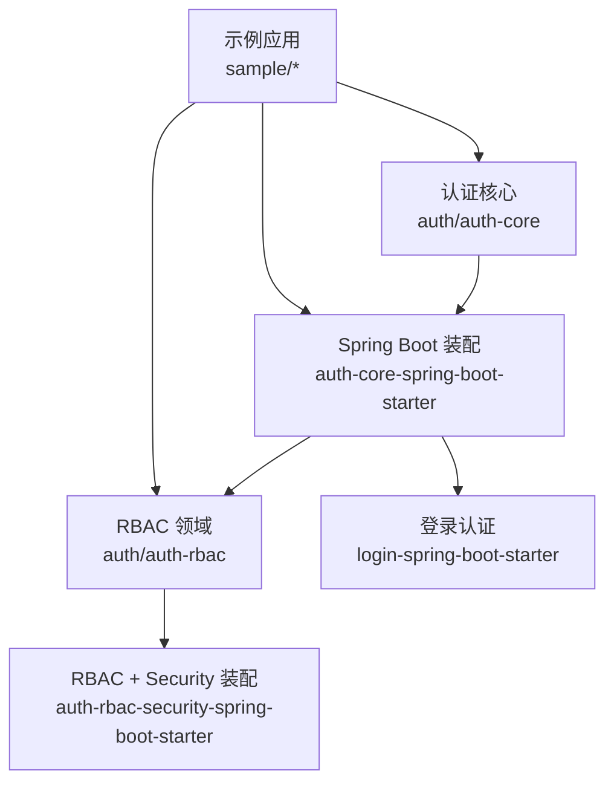
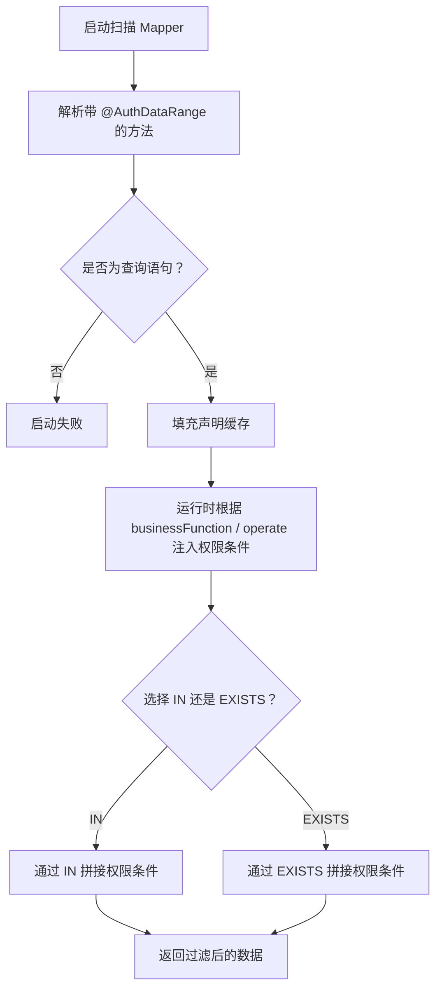
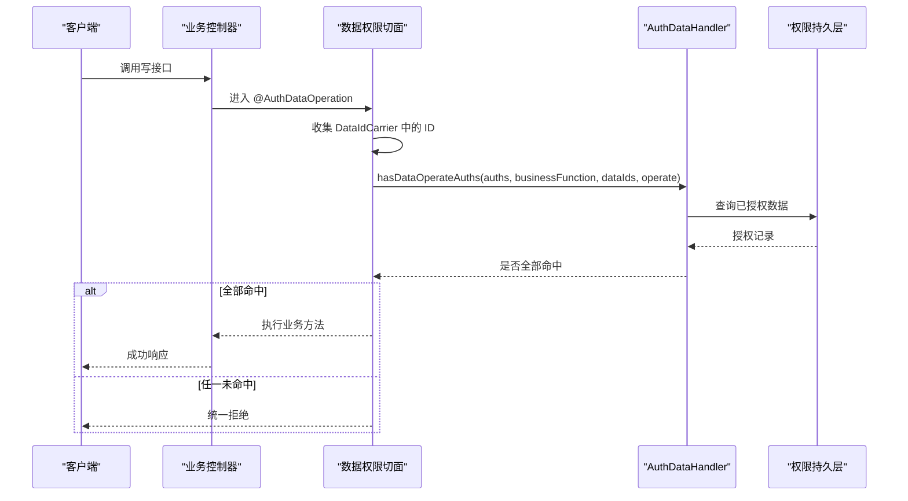
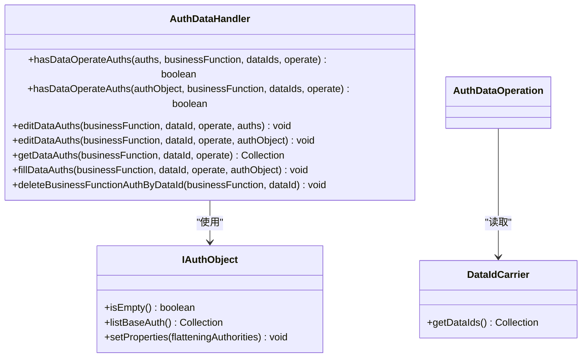
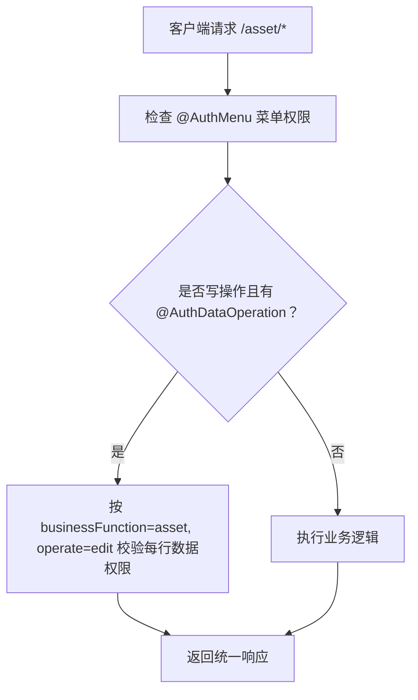
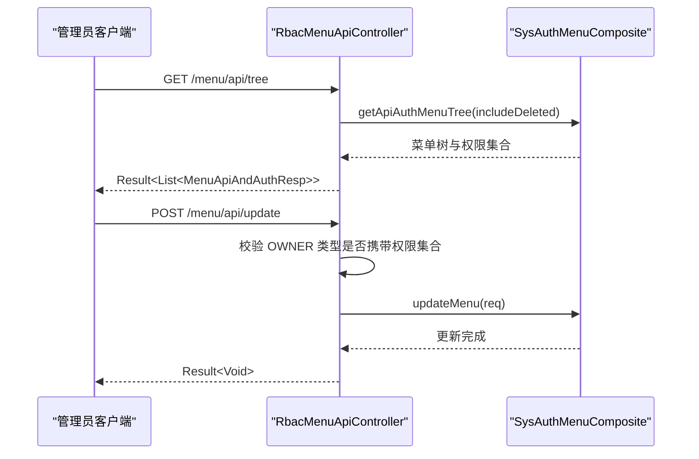
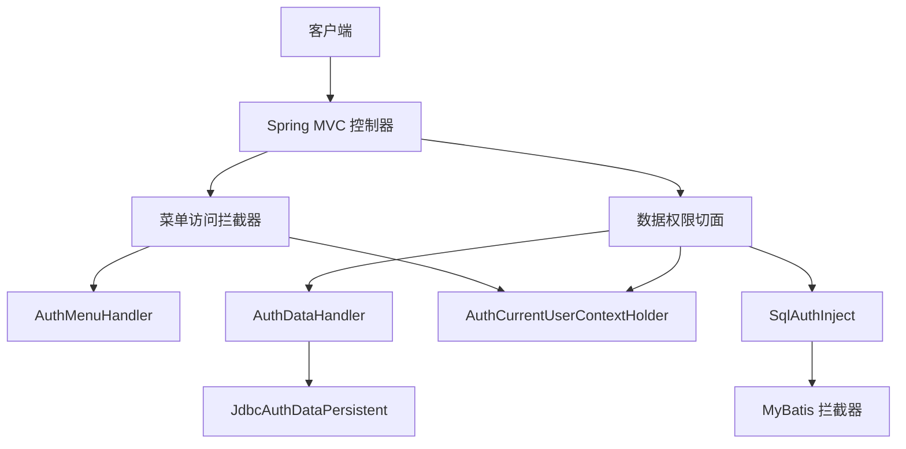
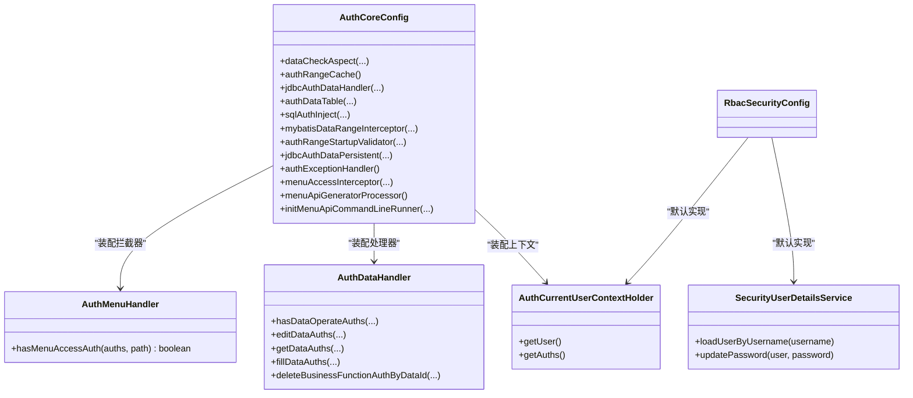

# API 参考文档

<cite>
**本文引用的文件**
- [AuthMenu.java](file://auth/auth-core/src/main/java/com/cu/framework/auth/core/AuthMenu.java)
- [AuthDataRange.java](file://auth/auth-core/src/main/java/com/cu/framework/auth/core/AuthDataRange.java)
- [AuthDataOperation.java](file://auth/auth-core/src/main/java/com/cu/framework/auth/core/AuthDataOperation.java)
- [AuthMenuDoc.java](file://auth/auth-core/src/main/java/com/cu/framework/auth/core/AuthMenuDoc.java)
- [AuthCurrentUserContextHolder.java](file://auth/auth-core/src/main/java/com/cu/framework/auth/core/AuthCurrentUserContextHolder.java)
- [AuthDataAdaptor.java](file://auth/auth-core/src/main/java/com/cu/framework/auth/core/AuthDataAdaptor.java)
- [AuthMenuHandler.java](file://auth/auth-core/src/main/java/com/cu/framework/auth/core/menu/AuthMenuHandler.java)
- [AuthDataHandler.java](file://auth/auth-core/src/main/java/com/cu/framework/auth/core/data/AuthDataHandler.java)
- [SecurityUserDetailsService.java](file://login-spring-boot-starter/src/main/java/com/cu/framework/authentication/service/SecurityUserDetailsService.java)
- [AuthCoreConfig.java](file://auth/auth-core-spring-boot-starter/src/main/java/com/cu/framework/boot/auth/core/config/AuthCoreConfig.java)
- [AuthDataTableProperties.java](file://auth/auth-core-spring-boot-starter/src/main/java/com/cu/framework/boot/auth/core/properties/AuthDataTableProperties.java)
- [RbacSecurityConfig.java](file://auth/auth-rbac-security-spring-boot-starter/src/main/java/com/cu/framework/auth/rbac/security/RbacSecurityConfig.java)
- [IAuthObject.java](file://auth/auth-core/src/main/java/com/cu/framework/auth/core/entity/IAuthObject.java)
- [DataIdCarrier.java](file://auth/auth-core/src/main/java/com/cu/framework/auth/core/data/edit/DataIdCarrier.java)
- [MatchMethod.java](file://auth/auth-core/src/main/java/com/cu/framework/auth/core/data/range/MatchMethod.java)
- [AssetController.java](file://sample/auth-core-boot-sample/src/main/java/com/cu/framework/sample/authcore/web/AssetController.java)
- [WorkOrderController.java](file://sample/auth-core-boot-sample/src/main/java/com/cu/framework/sample/authcore/web/WorkOrderController.java)
- [AuthDataAdminController.java](file://sample/auth-core-boot-sample/src/main/java/com/cu/framework/sample/authcore/web/AuthDataAdminController.java)
- [RbacMenuApiController.java](file://auth/auth-rbac/src/main/java/com/cu/framework/auth/rbac/controller/RbacMenuApiController.java)
</cite>

## 目录
1. [引言](#引言)
2. [项目结构](#项目结构)
3. [核心注解 API](#核心注解-api)
4. [配置类 API](#配置类-api)
5. [扩展接口 API](#扩展接口-api)
6. [RESTful API 端点规范](#restful-api-端点规范)
7. [架构总览](#架构总览)
8. [依赖关系分析](#依赖关系分析)
9. [性能与使用注意事项](#性能与使用注意事项)
10. [故障排查指南](#故障排查指南)
11. [结论](#结论)

## 引言
本文件是 Kewen Framework 认证鉴权模块的 API 参考文档，面向希望接入菜单权限、数据范围过滤和行级数据操作校验的开发者。文档聚焦以下目标：
- 说明 `@AuthMenu`、`@AuthMenuDoc`、`@AuthDataRange`、`@AuthDataOperation` 等核心注解的属性、语义和使用约束。
- 说明 `AuthCoreConfig`、`AuthDataTableProperties`、`RbacSecurityConfig` 等配置类的装配行为和可配置项。
- 说明 `AuthMenuHandler`、`AuthDataHandler`、`SecurityUserDetailsService`、`AuthCurrentUserContextHolder`、`IAuthObject`、`DataIdCarrier` 等扩展点的接口契约。
- 整理框架自带及示例中暴露的 RESTful 接口契约，包括 URL、HTTP 方法、请求响应格式、认证要求和行为约定。
- 提供集成步骤、最佳实践、异常处理和性能建议，帮助开发者正确、安全地扩展权限模型。

## 项目结构
Kewen Framework 的权限能力由多个子模块协作构成：
- `auth/auth-core`：定义注解、实体、扩展接口、切面和数据访问基础实现。
- `auth/auth-core-spring-boot-starter`：将 core 能力装配到 Spring Boot，注册拦截器、校验器、处理器和启动逻辑。
- `auth/auth-rbac`：RBAC 领域的实体、服务、组合对象和控制器。
- `auth/auth-rbac-security-spring-boot-starter`：将 RBAC 与 Spring Security 的用户详情、用户上下文结合。
- `login-spring-boot-starter`：登录与身份认证基础设施，提供 `SecurityUserDetailsService` 等扩展点。
- `sample/*`：示例应用，演示注解用法、控制器写法、权限维护和管理员界面。

**图示来源**
- [AuthCoreConfig.java:1-203](file://auth/auth-core-spring-boot-starter/src/main/java/com/cu/framework/boot/auth/core/config/AuthCoreConfig.java#L1-L203)
- [RbacSecurityConfig.java:1-35](file://auth/auth-rbac-security-spring-boot-starter/src/main/java/com/cu/framework/auth/rbac/security/RbacSecurityConfig.java#L1-L35)
- [AuthMenuHandler.java:1-27](file://auth/auth-core/src/main/java/com/cu/framework/auth/core/menu/AuthMenuHandler.java#L1-L27)
- [AuthDataHandler.java:1-102](file://auth/auth-core/src/main/java/com/cu/framework/auth/core/data/AuthDataHandler.java#L1-L102)

**章节来源**
- [AuthCoreConfig.java:1-203](file://auth/auth-core-spring-boot-starter/src/main/java/com/cu/framework/boot/auth/core/config/AuthCoreConfig.java#L1-L203)
- [RbacSecurityConfig.java:1-35](file://auth/auth-rbac-security-spring-boot-starter/src/main/java/com/cu/framework/auth/rbac/security/RbacSecurityConfig.java#L1-L35)

## 核心注解 API

### @AuthMenu
- **作用**：声明某个 Controller 或方法受菜单权限管辖；是否显示文案由 `@AuthMenuDoc` 承担，该注解本身不参与业务鉴权判定。
- **目标位置**：方法、类、注解类型。
- **属性**：无。
- **典型行为**：配合 `MenuAccessInterceptor` 和 `AuthMenuHandler` 做菜单访问控制；与 `@AuthMenuDoc` 一起生成菜单树标签。
- **注意事项**：
  - 仅声明“管不管辖”，不携带业务功能、操作类型等鉴权参数。
  - 标注在类上时，作用于该类全部端点；标注在方法上时，只作用于该方法。

**章节来源**
- [AuthMenu.java:1-16](file://auth/auth-core/src/main/java/com/cu/framework/auth/core/AuthMenu.java#L1-L16)
- [AuthMenuDoc.java:1-22](file://auth/auth-core/src/main/java/com/cu/framework/auth/core/AuthMenuDoc.java#L1-L22)

### @AuthMenuDoc
- **作用**：为菜单生成提供显示名称；不参与鉴权判定。
- **目标位置**：方法、类、注解类型。
- **属性**：
  - `name`：显示名称；标注在类上表示分组名称，标注在方法上表示端点名称；缺失时可回退到类名或方法名。
- **典型行为**：与 `MenuApiGeneratorProcessor` 配合生成菜单树标签。
- **注意事项**：
  - 必须与 `@AuthMenu` 共同使用才有实际意义。
  - 名称用于展示，不应作为权限判断依据。

**章节来源**
- [AuthMenuDoc.java:1-22](file://auth/auth-core/src/main/java/com/cu/framework/auth/core/AuthMenuDoc.java#L1-L22)

### @AuthDataRange
- **作用**：声明 MyBatis Mapper 查询方法的“数据范围权限”。框架会在解析到的 SQL 中注入权限条件，使查询结果按当前用户的数据权限过滤。
- **目标位置**：Mapper 接口查询方法。
- **属性**：
  - `businessFunction`：必填，业务功能标识。
  - `table`：可选，多表联查时指定主表；为空时默认以 from 后主表为准。
  - `tableAlias`：可选，多表同表场景下指定别名。
  - `dataIdColumn`：可选，业务主键列名，默认 `id`。
  - `operate`：可选，操作槽位，默认 `unified`。
  - `matchMethod`：可选，匹配方式，默认 `IN`；另一个值为 `EXISTS`。
- **关键约束**：
  - 注解绑定到具体语句，同一调用链上的其他语句不受影响。
  - 启动时会校验：解析不到映射语句、语句不是查询、启用二级缓存、静态 SQL 找不到目标表会直接启动失败。
  - MyBatis-Plus 内建方法（如 `selectList`、`page`）没有挂载点，不受本注解管辖。
- **推荐用法**：
  - 小表驱动大表时使用 `IN`。
  - 权限数据量很大时使用 `EXISTS`。

**图示来源**
- [AuthDataRange.java:1-81](file://auth/auth-core/src/main/java/com/cu/framework/auth/core/AuthDataRange.java#L1-L81)
- [MatchMethod.java:1-22](file://auth/auth-core/src/main/java/com/cu/framework/auth/core/data/range/MatchMethod.java#L1-L22)

**章节来源**
- [AuthDataRange.java:1-81](file://auth/auth-core/src/main/java/com/cu/framework/auth/core/AuthDataRange.java#L1-L81)
- [MatchMethod.java:1-22](file://auth/auth-core/src/main/java/com/cu/framework/auth/core/data/range/MatchMethod.java#L1-L22)

### @AuthDataOperation
- **作用**：校验写操作的行级数据权限。执行前从实参中收集所有 `DataIdCarrier` 交出的业务数据 ID，逐个判定；全部命中才放行，任一条无权限则整体拒绝。
- **目标位置**：业务方法，通常是 Controller 或 Service 的写方法。
- **属性**：
  - `businessFunction`：必填，业务功能标识。
  - `operate`：可选，操作类型，默认 `unified`。
- **关键约束**：
  - 判定单位是数据 ID，不是整次调用。
  - 一次调用涉及的去重 ID 最多 100 条，超出属于用法错误，应由调用方分批提交。
  - ID 类型不限；比较时按字符串归一化，不同形态的主键视为同一条数据。
  - 失败分为两类：用法错误（缺少承载对象、ID 集合为空、含空值、超限）和权限拒绝；对外统一拒绝语义，未命中明细进入日志。
- **配套接口**：
  - `DataIdCarrier`：交出本次操作涉及的 ID 集合。
  - `AuthDataAdaptor`：Service 层可直接调用的数据权限读写适配器。

**图示来源**
- [AuthDataOperation.java:1-51](file://auth/auth-core/src/main/java/com/cu/framework/auth/core/AuthDataOperation.java#L1-L51)
- [AuthDataHandler.java:1-102](file://auth/auth-core/src/main/java/com/cu/framework/auth/core/data/AuthDataHandler.java#L1-L102)
- [DataIdCarrier.java:1-26](file://auth/auth-core/src/main/java/com/cu/framework/auth/core/data/edit/DataIdCarrier.java#L1-L26)

**章节来源**
- [AuthDataOperation.java:1-51](file://auth/auth-core/src/main/java/com/cu/framework/auth/core/AuthDataOperation.java#L1-L51)
- [DataIdCarrier.java:1-26](file://auth/auth-core/src/main/java/com/cu/framework/auth/core/data/edit/DataIdCarrier.java#L1-L26)
- [AuthDataAdaptor.java:1-45](file://auth/auth-core/src/main/java/com/cu/framework/auth/core/AuthDataAdaptor.java#L1-L45)

## 配置类 API

### AuthCoreConfig
`AuthCoreConfig` 是 auth-core 模块的 Spring Boot 装配入口，负责注册数据校验切面、MyBatis 拦截器、启动校验器、权限处理器、拒绝响应通道、菜单访问拦截器和菜单 API 生成器。

- **主要 Bean**：
  - `dataCheckAspect`：`@AuthDataOperation` 的切面处理。
  - `authRangeCache`：基于 Mapper 方法解析的声明缓存。
  - `jdbcAuthDataHandler`：默认 Jdbc 实现的 `AuthDataHandler`，若存在自定义实现则让位。
  - `authDataTable`：从 `AuthDataTableProperties` 构建权限数据表字段映射。
  - `sqlAuthInject`：SQL 权限注入工具。
  - `mybatisDataRangeInterceptor`：MyBatis 数据范围拦截器，使用 `Lazy` 避免创建期循环依赖。
  - `authRangeStartupValidator`：启动期校验 `@AuthDataRange` 声明。
  - `jdbcAuthDataPersistent`：权限数据的批量插入删除实现。
  - `authExceptionHandler`：Web 环境下统一的权限拒绝响应处理器，若已有自定义实现则让位。
  - `menuAccessInterceptor`：菜单访问控制拦截器。
  - `menuApiGeneratorProcessor`：菜单 API 生成处理器。
  - `initMenuApiCommandLineRunner`：启动时调用菜单 API 生成。
- **关键行为**：
  - 使用 `@ConditionalOnMissingBean` 允许覆盖默认实现。
  - 使用 `@ConditionalOnWebApplication` 确保 Web 相关 Bean 只在 Web 环境注册。
  - 启动校验器通过 `ObjectProvider<SqlSessionFactory>` 延迟获取，避免自动配置顺序导致静默失效。

**章节来源**
- [AuthCoreConfig.java:1-203](file://auth/auth-core-spring-boot-starter/src/main/java/com/cu/framework/boot/auth/core/config/AuthCoreConfig.java#L1-L203)

### AuthDataTableProperties
`AuthDataTableProperties` 是权限数据表的配置属性类，绑定前缀 `cu.auth.auth-data-table`。

- **属性与默认值**：
  - `tableName`：默认 `sys_auth_data`。
  - `idColumn`：默认 `id`。
  - `businessFunctionColumn`：默认 `business_function`。
  - `dataIdColumn`：默认 `data_id`。
  - `operateColumn`：默认 `operate`。
  - `authorityColumn`：默认 `authority`。
  - `descriptionColumn`：默认 `description`。
- **用途**：供 `AuthCoreConfig.authDataTable` 构建 `AuthDataTable`，决定框架读取和写入权限数据时的表名和列名。
- **扩展建议**：
  - 若业务数据库表名或列名不同，可通过配置文件覆盖这些属性。
  - 修改列名前需同步数据库结构和持久层实现。

**章节来源**
- [AuthDataTableProperties.java:1-109](file://auth/auth-core-spring-boot-starter/src/main/java/com/cu/framework/boot/auth/core/properties/AuthDataTableProperties.java#L1-L109)

### RbacSecurityConfig
`RbacSecurityConfig` 是 RBAC 与安全模块的装配配置，主要职责是在未自定义实现时注册 RBAC 用户详情服务和当前用户上下文。

- **主要 Bean**：
  - `securityUserDetailsService`：默认 `RbacSecurityUserDetailsService`，若外部已提供 `SecurityUserDetailsService` 则跳过。
  - `rbacSecurityCurrentUserAuthContextHolder`：默认 `RbacSecurityAuthCurrentUserContextHolder`，若外部已提供 `AuthCurrentUserContextHolder` 则跳过。
- **适用场景**：
  - 使用 RBAC 且需要 Spring Security 集成时引入。
  - 若应用已有自己的用户详情加载策略，应实现 `SecurityUserDetailsService` 并交给 Spring 管理，而不是重复注册默认实现。

**章节来源**
- [RbacSecurityConfig.java:1-35](file://auth/auth-rbac-security-spring-boot-starter/src/main/java/com/cu/framework/auth/rbac/security/RbacSecurityConfig.java#L1-L35)

## 扩展接口 API

### AuthMenuHandler
- **职责**：菜单访问权限扩展点。
- **方法**：
  - `hasMenuAccessAuth(Collection<FlatteningAuthority> auths, String path)`：根据当前用户的扁平化权限集合和请求路径判断是否拥有菜单访问权限。
- **使用指南**：
  - 在 RBAC 实现中，通常根据用户角色、菜单路由、API 菜单关系计算 path 是否可访问。
  - 返回 `true` 表示允许访问该菜单路径，返回 `false` 表示拒绝。
  - 该接口由 `MenuAccessInterceptor` 调用，配合 `@AuthMenu` 生效。

**章节来源**
- [AuthMenuHandler.java:1-27](file://auth/auth-core/src/main/java/com/cu/framework/auth/core/menu/AuthMenuHandler.java#L1-L27)

### AuthDataHandler
- **职责**：数据权限扩展点，承载行级数据权限的判断、编辑、查询和清理逻辑。
- **关键方法**：
  - `hasDataOperateAuths(auths, businessFunction, dataIds, operate)`：判断一组数据 ID 是否全部具有指定业务功能和操作的权限。
  - `hasDataOperateAuths(authObject, businessFunction, dataIds, operate)`：基于 `IAuthObject` 的便捷重载。
  - `editDataAuths(businessFunction, dataId, operate, auths)`：编辑某条数据的权限。
  - `editDataAuths(businessFunction, dataId, operate, authObject)`：基于 `IAuthObject` 的重载。
  - `getDataAuths(businessFunction, dataId, operate)`：查询某条数据在指定操作下的权限集合。
  - `fillDataAuths(businessFunction, dataId, operate, authObject)`：将已配置权限填充进权限对象。
  - `deleteBusinessFunctionAuthByDataId(businessFunction, dataId)`：删除某条数据的全部权限。
- **使用指南**：
  - 默认实现 `JdbcAuthDataHandler` 基于 JDBC 访问权限表。
  - 若需要缓存、分库分表、审计或其他策略，可实现该接口并注册为 Bean。
  - 注意：不要编辑“本接口自身的权限槽位”，否则可能把自己关闭或产生越权风险。

**图示来源**
- [AuthDataHandler.java:1-102](file://auth/auth-core/src/main/java/com/cu/framework/auth/core/data/AuthDataHandler.java#L1-L102)
- [IAuthObject.java:1-35](file://auth/auth-core/src/main/java/com/cu/framework/auth/core/entity/IAuthObject.java#L1-L35)
- [DataIdCarrier.java:1-26](file://auth/auth-core/src/main/java/com/cu/framework/auth/core/data/edit/DataIdCarrier.java#L1-L26)

**章节来源**
- [AuthDataHandler.java:1-102](file://auth/auth-core/src/main/java/com/cu/framework/auth/core/data/AuthDataHandler.java#L1-L102)
- [IAuthObject.java:1-35](file://auth/auth-core/src/main/java/com/cu/framework/auth/core/entity/IAuthObject.java#L1-L35)
- [DataIdCarrier.java:1-26](file://auth/auth-core/src/main/java/com/cu/framework/auth/core/data/edit/DataIdCarrier.java#L1-L26)

### SecurityUserDetailsService
- **职责**：框架用户详情服务接口，组合 Spring Security 的 `UserDetailsService` 与 `UserDetailsPasswordService`，统一提供按用户名加载用户和更新密码的能力。
- **继承关系**：
  - 继承 `UserDetailsService`：提供 `loadUserByUsername(username)`。
  - 继承 `UserDetailsPasswordService`：提供 `updatePassword(user, encryptedNewPassword)`。
- **使用指南**：
  - 应用实现该接口，把用户加载逻辑与密码刷新逻辑统一到一处。
  - 如果实现了该接口并注册为 Spring Bean，`RbacSecurityConfig` 不会注册默认实现。
  - 密码更新常用于用户登录成功后，用新算法重新加密旧密码。

**章节来源**
- [SecurityUserDetailsService.java:1-27](file://login-spring-boot-starter/src/main/java/com/cu/framework/authentication/service/SecurityUserDetailsService.java#L1-L27)
- [RbacSecurityConfig.java:1-35](file://auth/auth-rbac-security-spring-boot-starter/src/main/java/com/cu/framework/auth/rbac/security/RbacSecurityConfig.java#L1-L35)

### AuthCurrentUserContextHolder
- **职责**：提供当前登录用户及其扁平化权限集合。
- **方法**：
  - `getUser()`：返回 `CurrentUser`。
  - `getAuths()`：返回 `Collection<FlatteningAuthority>`；上下文中无用户或无权限对象时返回空集合。
- **使用指南**：
  - RBAC 实现中通过 `RbacSecurityAuthCurrentUserContextHolder` 获取当前登录用户。
  - 框架内部在菜单拦截器、数据范围拦截器等组件中使用该上下文。

**章节来源**
- [AuthCurrentUserContextHolder.java:1-25](file://auth/auth-core/src/main/java/com/cu/framework/auth/core/AuthCurrentUserContextHolder.java#L1-L25)

### IAuthObject
- **职责**：权限集合体接口，存放用户、角色、部门、岗位等权限结构。
- **方法**：
  - `isEmpty()`：判断基础权限集合是否为空。
  - `listBaseAuth()`：返回基础权限集合。
  - `setProperties(flatteningAuthorities)`：设置权限对象属性。
- **使用指南**：
  - 任何需要表达“谁对什么数据拥有什么权限”的结构都应实现该接口。
  - 框架在权限编辑、填充、判定时多次使用该接口。

**章节来源**
- [IAuthObject.java:1-35](file://auth/auth-core/src/main/java/com/cu/framework/auth/core/entity/IAuthObject.java#L1-L35)

## RESTful API 端点规范

本节整理仓库中可直接观察到的控制器端点。除特别说明外，这些端点均基于 Spring MVC，并使用框架通用响应包装。

### 资产示例接口
- **基础路径**：`/asset`
- **认证要求**：
  - 带 `@AuthMenu` 的端点受菜单权限控制。
  - 带 `@AuthDataOperation` 的写端点额外进行行级数据权限校验。
- **端点列表**：
  - `GET /asset/list`：返回受 `unified` 槽位数据范围过滤的资产列表。
  - `GET /asset/all`：返回所有资产，不受数据范围过滤。
  - `POST /asset/update`：编辑单条资产，受 `@AuthMenu`、`@AuthMenuDoc(name="编辑资产")`、`@AuthDataOperation(businessFunction="asset", operate="edit")` 控制。
  - `POST /asset/updateIntegerForm`：以短整型形态提交 ID，仍按字符串归一化判定。
  - `POST /asset/batchUpdate`：批量编辑，ID 由请求体中的载体对象交出。
  - `POST /asset/scattered`：ID 分散在多个参数中，由业务方法收集。
  - `POST /asset/renameUnchecked`：未加 `@AuthDataOperation` 的写端点，走业务方法内的未声明路径。

**图示来源**
- [AssetController.java:1-148](file://sample/auth-core-boot-sample/src/main/java/com/cu/framework/sample/authcore/web/AssetController.java#L1-L148)

**章节来源**
- [AssetController.java:1-148](file://sample/auth-core-boot-sample/src/main/java/com/cu/framework/sample/authcore/web/AssetController.java#L1-L148)

### 工单示例接口
- **基础路径**：`/workOrder`
- **认证要求**：
  - 列表端点通常不加 `@AuthMenu`，重点演示数据范围注入效果。
  - 写端点同时加 `@AuthMenu`、`@AuthMenuDoc` 和 `@AuthDataOperation`。
- **端点列表**：
  - `GET /workOrder/rangeList`：使用 `IN` 匹配的 unified 槽位。
  - `GET /workOrder/rangeListExists`：使用 `EXISTS` 匹配的 unified 槽位。
  - `GET /workOrder/countRange`：计数也注入权限条件。
  - `GET /workOrder/editable`：可编辑槽位的可见行。
  - `GET /workOrder/approvable`：可审批槽位的可见行。
  - `GET /workOrder/twoSlots`：一次请求中使用两个槽位。
  - `GET /workOrder/all`：对照全量数据。
  - `GET /workOrder/nested`：外层语句触发内层语句，各自按槽位注入。
  - `GET /workOrder/joinCu`、`GET /workOrder/joinCb`：多表语句中权限条件挂到不同别名。
  - `GET /workOrder/dynamic`：动态 SQL 中可解析出目标表时照常注入。
  - `GET /workOrder/dynamicMissingTable`：运行期拼不出目标表时抛异常。
  - `POST /workOrder/update`：编辑工单，受 `@AuthDataOperation(businessFunction="work_order", operate="edit")` 控制。
  - `POST /workOrder/approve`：审批工单，与编辑同表但槽位不同。

**章节来源**
- [WorkOrderController.java:1-257](file://sample/auth-core-boot-sample/src/main/java/com/cu/framework/sample/authcore/web/WorkOrderController.java#L1-L257)

### 数据权限管理接口
- **基础路径**：`/authData`
- **用途**：管理员端点，直接在 Service 层通过 `AuthDataAdaptor` 读写数据权限，而不依赖注解判定目标数据。
- **端点列表**：
  - `POST /authData/grant`：给某条目标数据在指定槽位设置权限集合。
  - `POST /authData/remove`：清空某条目标数据的全部权限。
  - `POST /authData/fill`：读回某条数据在指定槽位上的权限集合。
- **注意事项**：
  - 管理动作的权限槽位应与被维护的目标数据槽位分开，避免“编辑自己权限导致无法继续管理”的风险。

**章节来源**
- [AuthDataAdminController.java:1-76](file://sample/auth-core-boot-sample/src/main/java/com/cu/framework/sample/authcore/web/AuthDataAdminController.java#L1-L76)

### 菜单 API 管理接口
- **基础路径**：`/menu/api`
- **类级别注解**：`@AuthMenu`、`@AuthMenuDoc(name="菜单路径相关接口")`。
- **端点列表**：
  - `GET /menu/api/tree`：获取全部 API 菜单树，包含已删除菜单，节点附带权限集合体。
  - `POST /menu/api/update`：更新菜单 API 及其权限集合体；当权限类型为 OWNER 且权限集合体为空时抛出业务异常。
- **响应格式**：
  - 控制器统一使用框架通用响应包装。
  - `GET /menu/api/tree` 返回 `Result<List<MenuApiAndAuthResp>>`。
  - `POST /menu/api/update` 返回 `Result<Void>`。

**图示来源**
- [RbacMenuApiController.java:1-73](file://auth/auth-rbac/src/main/java/com/cu/framework/auth/rbac/controller/RbacMenuApiController.java#L1-L73)

**章节来源**
- [RbacMenuApiController.java:1-73](file://auth/auth-rbac/src/main/java/com/cu/framework/auth/rbac/controller/RbacMenuApiController.java#L1-L73)

### 通用响应格式
仓库中的控制器普遍使用 `basic` 模块提供的 `Result` 作为统一响应包装。典型模式为：
- 成功响应：`Result.success(data)`。
- 业务异常：通过 `BizException` 抛出，由全局异常处理器统一转换为错误响应。
- 权限拒绝：由 `AuthExceptionHandler` 或业务逻辑统一返回拒绝语义，避免泄露详细权限细节。

**章节来源**
- [AssetController.java:1-148](file://sample/auth-core-boot-sample/src/main/java/com/cu/framework/sample/authcore/web/AssetController.java#L1-L148)
- [WorkOrderController.java:1-257](file://sample/auth-core-boot-sample/src/main/java/com/cu/framework/sample/authcore/web/WorkOrderController.java#L1-L257)
- [AuthDataAdminController.java:1-76](file://sample/auth-core-boot-sample/src/main/java/com/cu/framework/sample/authcore/web/AuthDataAdminController.java#L1-L76)
- [RbacMenuApiController.java:1-73](file://auth/auth-rbac/src/main/java/com/cu/framework/auth/rbac/controller/RbacMenuApiController.java#L1-L73)

## 架构总览

**图示来源**
- [AuthCoreConfig.java:1-203](file://auth/auth-core-spring-boot-starter/src/main/java/com/cu/framework/boot/auth/core/config/AuthCoreConfig.java#L1-L203)
- [AuthMenuHandler.java:1-27](file://auth/auth-core/src/main/java/com/cu/framework/auth/core/menu/AuthMenuHandler.java#L1-L27)
- [AuthDataHandler.java:1-102](file://auth/auth-core/src/main/java/com/cu/framework/auth/core/data/AuthDataHandler.java#L1-L102)
- [AuthCurrentUserContextHolder.java:1-25](file://auth/auth-core/src/main/java/com/cu/framework/auth/core/AuthCurrentUserContextHolder.java#L1-L25)

## 依赖关系分析

**图示来源**
- [AuthCoreConfig.java:1-203](file://auth/auth-core-spring-boot-starter/src/main/java/com/cu/framework/boot/auth/core/config/AuthCoreConfig.java#L1-L203)
- [AuthMenuHandler.java:1-27](file://auth/auth-core/src/main/java/com/cu/framework/auth/core/menu/AuthMenuHandler.java#L1-L27)
- [AuthDataHandler.java:1-102](file://auth/auth-core/src/main/java/com/cu/framework/auth/core/data/AuthDataHandler.java#L1-L102)
- [SecurityUserDetailsService.java:1-27](file://login-spring-boot-starter/src/main/java/com/cu/framework/authentication/service/SecurityUserDetailsService.java#L1-L27)
- [RbacSecurityConfig.java:1-35](file://auth/auth-rbac-security-spring-boot-starter/src/main/java/com/cu/framework/auth/rbac/security/RbacSecurityConfig.java#L1-L35)

**章节来源**
- [AuthCoreConfig.java:1-203](file://auth/auth-core-spring-boot-starter/src/main/java/com/cu/framework/boot/auth/core/config/AuthCoreConfig.java#L1-L203)
- [RbacSecurityConfig.java:1-35](file://auth/auth-rbac-security-spring-boot-starter/src/main/java/com/cu/framework/auth/rbac/security/RbacSecurityConfig.java#L1-L35)

## 性能与使用注意事项

- 数据范围过滤性能：
  - 权限数据远小于业务数据时使用 `IN`。
  - 权限数据量很大时使用 `EXISTS`，遵循“小表驱动大表”原则。
- 行级操作校验限制：
  - 一次调用去重后的数据 ID 最多 100 条，超过时应分批提交。
  - ID 类型不限，但比较时按字符串归一化；不同数值形态的主键视为同一条数据。
- 启动期校验：
  - 启动时会扫描 `@AuthDataRange` 声明，遇到无法解析的语句、非查询语句、二级缓存冲突、静态 SQL 找不到目标表等情况会直接启动失败，便于尽早发现问题。
- 权限表配置：
  - 使用 `AuthDataTableProperties` 修改表名和列名前，应先确认数据库结构与持久层实现一致。
- 菜单与数据权限分离：
  - `@AuthMenu` 控制“能不能进入端点”，`@AuthDataOperation` 控制“能不能操作这些数据”。两者可叠加，也可单独使用。
- 管理员权限风险：
  - 不要把管理接口的权限槽位与被维护的目标数据槽位混用，避免“管理权限被误删后无法继续管理”。

[本节为通用指导，不直接分析具体代码文件]

## 故障排查指南

- 注解未生效：
  - 确认引入了对应的 Spring Boot starter，并且包扫描能发现控制器、Mapper 和配置类。
  - 菜单权限需同时添加 `@AuthMenu` 和 `@AuthMenuDoc`；仅有 `@AuthMenuDoc` 不会产生权限控制。
- 数据范围未过滤：
  - 确认注解打在 Mapper 查询方法上，而非 MyBatis-Plus 内建方法。
  - 确认 SQL 是可解析的查询语句，且未被二级缓存绕过权限注入。
  - 动态 SQL 必须在运行期能解析出声明的目标表。
- 行级权限误拒绝：
  - 检查 `businessFunction` 与 `operate` 是否与权限表中一致。
  - 检查 `DataIdCarrier.getDataIds()` 是否正确交出所有业务 ID。
  - 检查 ID 集合是否为空、是否包含空值、是否超过 100 条上限。
- 权限表字段不一致：
  - 核对 `cu.auth.auth-data-table.*` 配置与实际数据库表结构。
- 菜单 API 更新报错：
  - 当菜单权限类型为 OWNER 时，必须携带非空的权限集合体，否则会抛出业务异常。

**章节来源**
- [AuthDataRange.java:1-81](file://auth/auth-core/src/main/java/com/cu/framework/auth/core/AuthDataRange.java#L1-L81)
- [AuthDataOperation.java:1-51](file://auth/auth-core/src/main/java/com/cu/framework/auth/core/AuthDataOperation.java#L1-L51)
- [AuthDataHandler.java:1-102](file://auth/auth-core/src/main/java/com/cu/framework/auth/core/data/AuthDataHandler.java#L1-L102)
- [AuthDataTableProperties.java:1-109](file://auth/auth-core-spring-boot-starter/src/main/java/com/cu/framework/boot/auth/core/properties/AuthDataTableProperties.java#L1-L109)
- [RbacMenuApiController.java:1-73](file://auth/auth-rbac/src/main/java/com/cu/framework/auth/rbac/controller/RbacMenuApiController.java#L1-L73)

## 结论
Kewen Framework 的认证鉴权 API 围绕三类能力展开：菜单访问控制、数据范围过滤、行级数据操作校验。开发者主要通过注解声明权限边界，通过扩展接口实现业务化的权限模型，并通过配置类装配默认实现或替换为自定义实现。示例控制器展示了如何在真实业务场景中组合这些能力，而 RBAC 控制器提供了菜单 API 管理的参考实现。建议在接入时优先明确业务功能标识、操作槽位、权限数据结构和安全策略，再逐步完善菜单树、数据范围规则和行级权限维护流程。