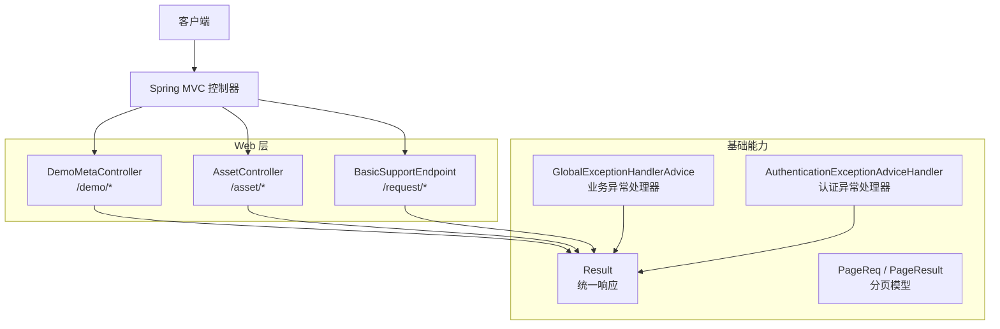
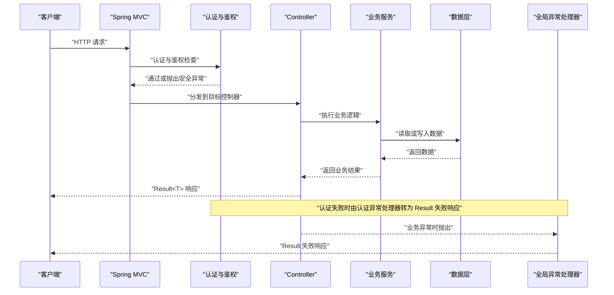
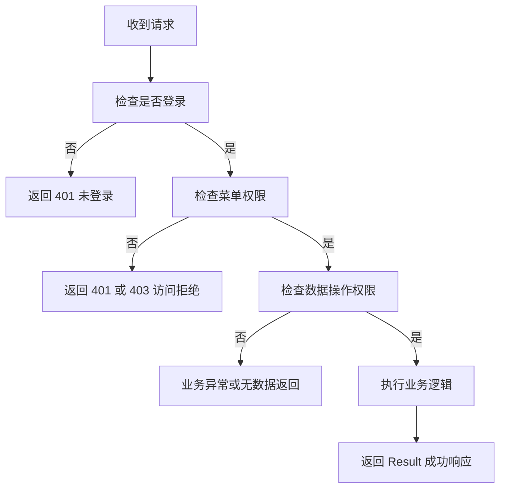
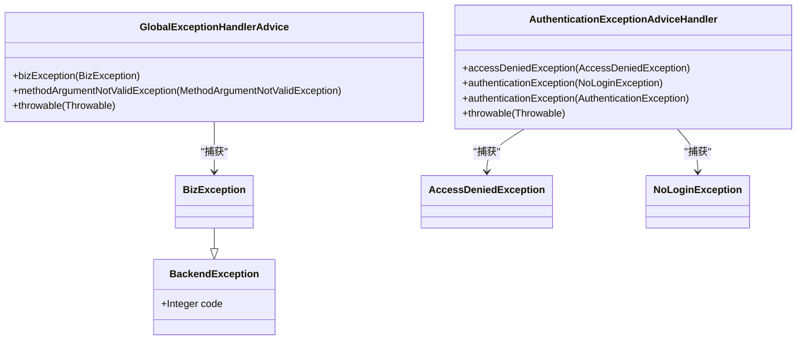
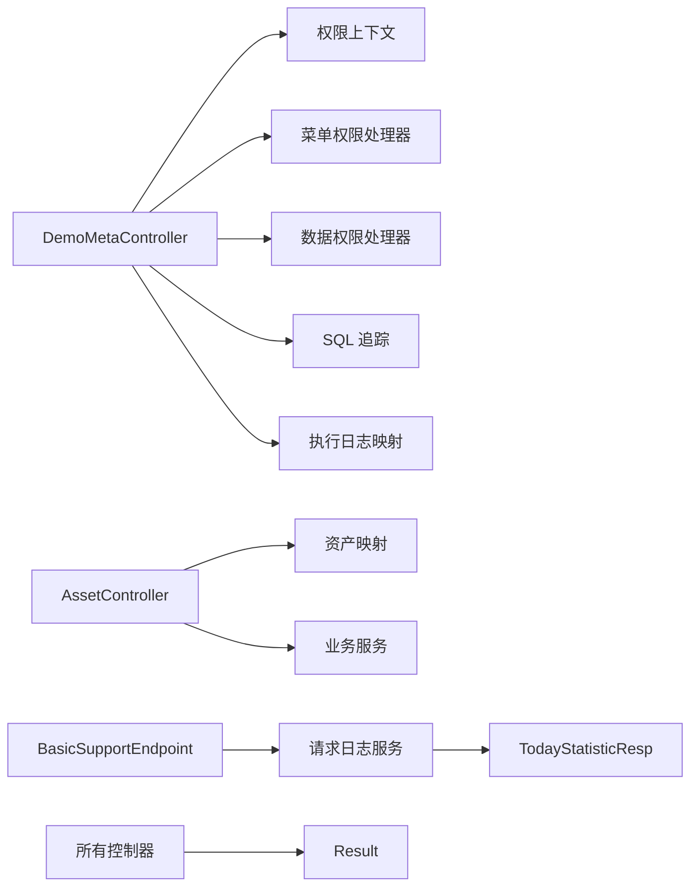

# RESTful API

<cite>
**本文引用的文件**   
- [DemoMetaController.java](file://sample/auth-core-boot-sample/src/main/java/com/cu/framework/sample/authcore/web/DemoMetaController.java)
- [AssetController.java](file://sample/auth-core-boot-sample/src/main/java/com/cu/framework/sample/authcore/web/AssetController.java)
- [BasicSupportEndpoint.java](file://basic-support/src/main/java/com/cu/framework/basic/support/BasicSupportEndpoint.java)
- [Result.java](file://basic/src/main/java/com/cu/framework/basic/model/Result.java)
- [PageReq.java](file://basic/src/main/java/com/cu/framework/basic/model/PageReq.java)
- [PageResult.java](file://basic/src/main/java/com/cu/framework/basic/model/PageResult.java)
- [GlobalExceptionHandlerAdvice.java](file://basic/src/main/java/com/cu/framework/basic/exception/GlobalExceptionHandlerAdvice.java)
- [BizException.java](file://basic/src/main/java/com/cu/framework/basic/exception/BizException.java)
- [BackendException.java](file://basic/src/main/java/com/cu/framework/basic/exception/BackendException.java)
- [ExceptionConstant.java](file://basic/src/main/java/com/cu/framework/basic/exception/ExceptionConstant.java)
- [AuthenticationExceptionAdviceHandler.java](file://login-spring-boot-starter/src/main/java/com/cu/framework/authentication/handler/AuthenticationExceptionAdviceHandler.java)
- [RequestResponseFormatConfig.java](file://boot/basic-spring-boot-starter/src/main/java/com/cu/framework/boot/basic/config/RequestResponseFormatConfig.java)
- [RequestLogService.java](file://basic-support/src/main/java/com/cu/framework/basic/support/log/persistent/RequestLogService.java)
- [TodayStatisticResp.java](file://basic-support/src/main/java/com/cu/framework/basic/support/log/persistent/TodayStatisticResp.java)
</cite>

## 目录
1. [简介](#简介)
2. [项目结构](#项目结构)
3. [核心组件](#核心组件)
4. [架构总览](#架构总览)
5. [接口规范](#接口规范)
6. [认证与鉴权](#认证与鉴权)
7. [统一响应格式](#统一响应格式)
8. [分页查询规范](#分页查询规范)
9. [错误处理机制](#错误处理机制)
10. [依赖关系分析](#依赖关系分析)
11. [性能与限制](#性能与限制)
12. [客户端集成示例](#客户端集成示例)
13. [常见问题排查](#常见问题排查)
14. [结论](#结论)

## 简介
本文档面向 Kewen Framework 的 RESTful API 使用者，聚焦以下公开控制器：
- DemoMetaController：权限与元数据观察台接口。
- AssetController：资产资源管理接口。
- BasicSupportEndpoint：基础支撑接口，提供访问统计查询。

文档覆盖每个端点的 HTTP 方法、URL 模式、请求头要求、请求体格式、响应结构、认证要求、分页参数规范、排序规则、过滤条件、统一响应格式 Result<T>、错误处理机制和调试方法。

## 项目结构
本仓库采用多模块 Maven 工程，REST 端点主要分布在 sample 启动模块和 basic-support 基础支撑模块中；统一模型、异常处理和 Web 配置集中在 basic 与 boot 模块中。



图表来源
- [DemoMetaController.java:1-455](file://sample/auth-core-boot-sample/src/main/java/com/cu/framework/sample/authcore/web/DemoMetaController.java#L1-L455)
- [AssetController.java:1-148](file://sample/auth-core-boot-sample/src/main/java/com/cu/framework/sample/authcore/web/AssetController.java#L1-L148)
- [BasicSupportEndpoint.java:1-46](file://basic-support/src/main/java/com/cu/framework/basic/support/BasicSupportEndpoint.java#L1-L46)
- [Result.java:1-73](file://basic/src/main/java/com/cu/framework/basic/model/Result.java#L1-L73)
- [GlobalExceptionHandlerAdvice.java:1-83](file://basic/src/main/java/com/cu/framework/basic/exception/GlobalExceptionHandlerAdvice.java#L1-L83)
- [AuthenticationExceptionAdviceHandler.java:1-86](file://login-spring-boot-starter/src/main/java/com/cu/framework/authentication/handler/AuthenticationExceptionAdviceHandler.java#L1-L86)

章节来源
- [DemoMetaController.java:1-455](file://sample/auth-core-boot-sample/src/main/java/com/cu/framework/sample/authcore/web/DemoMetaController.java#L1-L455)
- [AssetController.java:1-148](file://sample/auth-core-boot-sample/src/main/java/com/cu/framework/sample/authcore/web/AssetController.java#L1-L148)
- [BasicSupportEndpoint.java:1-46](file://basic-support/src/main/java/com/cu/framework/basic/support/BasicSupportEndpoint.java#L1-L46)

## 核心组件
- DemoMetaController：暴露当前用户权限视图、菜单判定预检、行级数据权限判定、SQL 执行追踪、菜单 API 注册信息和观察台清理等接口。该控制器未声明访问控制注解，因此这些端点可直接调用，适合测试脚本和诊断。
- AssetController：暴露资产列表、全量列表、编辑、批量编辑、分散承载编辑以及未声明校验的写操作。部分接口使用菜单和数据操作注解进行权限约束。
- BasicSupportEndpoint：提供按日期区间访问统计查询，返回当日独立 IP 数和独立用户数。

章节来源
- [DemoMetaController.java:1-455](file://sample/auth-core-boot-sample/src/main/java/com/cu/framework/sample/authcore/web/DemoMetaController.java#L1-L455)
- [AssetController.java:1-148](file://sample/auth-core-boot-sample/src/main/java/com/cu/framework/sample/authcore/web/AssetController.java#L1-L148)
- [BasicSupportEndpoint.java:1-46](file://basic-support/src/main/java/com/cu/framework/basic/support/BasicSupportEndpoint.java#L1-L46)

## 架构总览
Kewen Framework 的 REST 请求流程如下：
1. 客户端发送 HTTP 请求。
2. Spring MVC 路由到具体 Controller。
3. 若启用认证框架，Security 或登录 Starter 先完成身份认证与鉴权。
4. Controller 执行业务逻辑，构造业务数据。
5. Result<T> 作为统一响应包装返回。
6. 全局异常处理器将业务异常、参数校验异常、认证异常转换为统一的失败结果。



图表来源
- [AuthenticationExceptionAdviceHandler.java:1-86](file://login-spring-boot-starter/src/main/java/com/cu/framework/authentication/handler/AuthenticationExceptionAdviceHandler.java#L1-L86)
- [GlobalExceptionHandlerAdvice.java:1-83](file://basic/src/main/java/com/cu/framework/basic/exception/GlobalExceptionHandlerAdvice.java#L1-L83)
- [Result.java:1-73](file://basic/src/main/java/com/cu/framework/basic/model/Result.java#L1-L73)

## 接口规范

### 通用说明
- 所有接口返回统一结构 `Result<T>`。
- 成功响应的 HTTP 状态码通常为 200，失败响应可能为 400、401、403、500 等，取决于异常类型。
- 时间类型默认序列化格式：
  - `LocalDate`：`yyyy-MM-dd`
  - `LocalDateTime`：`yyyy-MM-dd HH:mm:ss`
- 请求体 JSON 字段名以 Controller 实际参数为准；分页模型字段见分页章节。

### DemoMetaController 元数据接口

| 方法 | URL | 认证要求 | 请求体或参数 | 响应说明 |
| --- | --- | --- | --- | --- |
| GET | `/demo/current-user` | 公开接口，不强制登录 | 无 | 返回当前用户名、权限对象、原始权限串、重序列化权限串及往返一致性标志。 |
| GET | `/demo/inherit-asymmetry` | 公开接口，不强制登录 | 无 | 返回继承权限标记、权限对象、配置侧解析结果和用户侧反序列化失败原因。 |
| POST | `/demo/permission-view` | 公开接口，不强制登录 | `PermissionViewReq` | 返回当前用户名、持有权限串、菜单判定结果和行级数据判定结果。 |
| GET | `/demo/trace` | 公开接口，不强制登录 | `traceId` | 返回某条链路追踪标识下的 SQL 执行记录。 |
| POST | `/demo/trace/clear` | 公开接口，不强制登录 | 无 | 清空观察台中的追踪记录。 |
| GET | `/demo/auth-data` | 公开接口，不强制登录 | `bizModule`、`action`、`bizDataId` | 返回指定槽位的权限行视图。 |
| GET | `/demo/auth-data/module` | 公开接口，不强制登录 | `bizModule` | 返回某业务功能下全部权限行。 |
| GET | `/demo/log` | 公开接口，不强制登录 | `apiKey` | 返回某接口已执行次数和执行明细。 |
| GET | `/demo/counts` | 公开接口，不强制登录 | 无 | 返回各表示例行数。 |
| GET | `/demo/menu-api` | 公开接口，不强制登录 | 无 | 返回已登记的菜单 API 行。 |
| POST | `/demo/menu-api/touch` | 公开接口，不强制登录 | `path`、`name`、`remark` | 更新某菜单行并返回影响行数。 |
| POST | `/demo/reset-slot` | 公开接口，不强制登录 | `RemoveReq` | 重置某权限槽位并返回剩余行数。 |

#### permission-view 请求体结构
`PermissionViewReq` 用于权限透视预检，典型字段包括：
- `menuPaths`：应用内菜单路径列表。
- `dataChecks`：行级数据判定项列表，每项包含：
  - `businessFunction`：业务功能。
  - `operate`：操作类型。
  - `ids`：业务数据 ID 集合。

注意：
- 菜单路径数量上限为 50。
- 行级判定项数量上限为 50。
- 单个行级槽位业务数据 ID 数量上限为 100。
- 超过上限会抛出服务内部异常，并返回统一失败响应。

#### trace 查询
- 请求参数 `traceId` 对应服务端链路追踪标识。
- 返回值为 `List<DemoSqlTrace.Entry>`，用于查看实际下发的 SQL 和真实发生的权限判定过程。

#### auth-data 与 auth-data/module
- `auth-data` 按业务模块、操作类型和业务数据 ID 查询槽位权限。
- `auth-data/module` 按业务模块列出全部权限行，便于核对载荷是否多写或多删。

章节来源
- [DemoMetaController.java:1-455](file://sample/auth-core-boot-sample/src/main/java/com/cu/framework/sample/authcore/web/DemoMetaController.java#L1-L455)

### AssetController 资源管理接口

| 方法 | URL | 认证要求 | 请求体或参数 | 响应说明 |
| --- | --- | --- | --- | --- |
| GET | `/asset/list` | 公开接口，可受数据范围影响 | 无 | 返回当前可见资产列表。 |
| GET | `/asset/all` | 公开接口，可受数据范围影响 | 无 | 返回所有资产，不受数据权限过滤。 |
| POST | `/asset/update` | 需要菜单和数据操作权限 | `AssetEditReq` | 编辑资产名称，返回执行标志和更新行数。 |
| POST | `/asset/updateIntegerForm` | 需要菜单和数据操作权限 | `AssetEditShortFormReq` | 以短整型形态提交主键，返回提交形态和更新行数。 |
| POST | `/asset/batchUpdate` | 需要菜单和数据操作权限 | `OrderBatchReq` | 批量编辑，返回执行标志和 ID 集合。 |
| POST | `/asset/scattered` | 需要菜单和数据操作权限 | `ScatteredReq` | 分散承载多个位置的主键，返回业务方法收集到的 ID。 |
| POST | `/asset/renameUnchecked` | 公开接口，走未声明校验路径 | `AssetEditReq` | 直接调用业务方法执行重命名。 |

#### 资产编辑请求体
- `AssetEditReq`：包含资产主键和名称。
- `AssetEditShortFormReq`：主键以短整型形态提交。
- `OrderBatchReq`：包含待编辑的 ID 集合。
- `ScatteredReq`：主键分散在多个字段或数组中。

章节来源
- [AssetController.java:1-148](file://sample/auth-core-boot-sample/src/main/java/com/cu/framework/sample/authcore/web/AssetController.java#L1-L148)

### BasicSupportEndpoint 基础支撑接口

| 方法 | URL | 认证要求 | 请求参数 | 响应说明 |
| --- | --- | --- | --- | --- |
| GET | `/request/visitStatistic` | 公开接口 | `startDate`、`endDate` | 返回按天统计的独立 IP 数与独立用户数。 |

#### visitStatistic 参数规范
- `startDate`：起始日期，可选；默认当天。
- `endDate`：结束日期，可选；默认当天。
- 日期格式：`yyyy-MM-dd`。
- 统计区间为闭区间；日志表中没有记录的日期不会出现在结果中。

#### visitStatistic 响应结构
返回 `List<TodayStatisticResp>`，每项包含：
- `day`：统计日期。
- `ipCount`：当日去重后的访问 IP 数。
- `userCount`：当日去重后的访问用户数。

章节来源
- [BasicSupportEndpoint.java:1-46](file://basic-support/src/main/java/com/cu/framework/basic/support/BasicSupportEndpoint.java#L1-L46)
- [RequestLogService.java:1-60](file://basic-support/src/main/java/com/cu/framework/basic/support/log/persistent/RequestLogService.java#L1-L60)
- [TodayStatisticResp.java:1-23](file://basic-support/src/main/java/com/cu/framework/basic/support/log/persistent/TodayStatisticResp.java#L1-L23)

## 认证与鉴权
- 公开接口：DemoMetaController 的所有接口均标注为公开，便于测试脚本和诊断工具获取权限证据。
- 受控接口：AssetController 中标注菜单和数据操作注解的接口需要进行菜单访问控制和数据操作权限校验。
- 认证失败：
  - 未登录或会话失效时，认证异常处理器返回 code 401。
  - 访问被拒绝时，返回 code 401。
  - 其他认证异常通常返回 code 403。
  - 认证服务内部异常返回 code 500。
- 鉴权失败：由业务权限判断或数据范围拦截器决定接口是否允许执行；若未满足权限，常见表现为空结果、业务异常或认证相关异常，最终由全局异常处理器封装为 Result 失败响应。



图表来源
- [AuthenticationExceptionAdviceHandler.java:1-86](file://login-spring-boot-starter/src/main/java/com/cu/framework/authentication/handler/AuthenticationExceptionAdviceHandler.java#L1-L86)
- [GlobalExceptionHandlerAdvice.java:1-83](file://basic/src/main/java/com/cu/framework/basic/exception/GlobalExceptionHandlerAdvice.java#L1-L83)

章节来源
- [AuthenticationExceptionAdviceHandler.java:1-86](file://login-spring-boot-starter/src/main/java/com/cu/framework/authentication/handler/AuthenticationExceptionAdviceHandler.java#L1-L86)

## 统一响应格式
所有 REST 接口统一返回 `Result<T>`：
- `code`：响应码。成功固定为 200；失败由业务或异常决定，常见为 401、403、500。
- `success`：是否成功。成功工厂方法为 true，失败工厂方法为 false。
- `message`：提示信息。成功时为“成功”，失败时为具体错误信息。
- `data`：业务数据，可为任意类型。

成功响应示例（结构描述）：
- `code=200`
- `success=true`
- `message="成功"`
- `data` 为业务对象、列表或分页对象。

失败响应示例（结构描述）：
- `code` 为 401、403 或 500。
- `success=false`
- `message` 为认证提示、参数校验错误或后端异常信息。
- `data` 通常为 null。

章节来源
- [Result.java:1-73](file://basic/src/main/java/com/cu/framework/basic/model/Result.java#L1-L73)

## 分页查询规范
虽然示例控制器未直接展示完整分页接口，但框架提供了标准分页模型，供业务接口复用：

- 分页请求模型 `PageReq`：
  - `page`：页码，从 1 开始，必填。
  - `size`：页面大小，必填。
  - `search`：模糊搜索关键字。
  - `offset()`：返回从 0 开始的偏移量，计算方式为 `(page-1)*size`。

- 分页响应模型 `PageResult<T>`：
  - `page`：当前页码。
  - `size`：每页大小。
  - `total`：总记录数。
  - `data`：当前页数据列表。

建议分页接口遵循以下约定：
- 查询参数优先使用 `page`、`size`、`search`。
- 返回 `Result<PageResult<T>>`。
- 默认排序可由后端实现定义；如需自定义排序，应在业务层明确排序字段与方向。

章节来源
- [PageReq.java:1-39](file://basic/src/main/java/com/cu/framework/basic/model/PageReq.java#L1-L39)
- [PageResult.java:1-44](file://basic/src/main/java/com/cu/framework/basic/model/PageResult.java#L1-L44)

## 错误处理机制
框架提供两层异常处理器：

1. 基础业务异常处理器：
   - 捕获 `BizException`，返回 code 500，message 为异常消息。
   - 捕获 `NullPointerException`，同样视为业务异常处理。
   - 捕获参数校验异常 `MethodArgumentNotValidException`，拼接字段校验失败信息，返回 code 500。
   - 兜底捕获 `Throwable`，返回 code 500。

2. 认证异常处理器：
   - 访问拒绝异常返回 code 401。
   - 未登录异常返回 code 401，HTTP 状态也为未授权。
   - 其他认证异常返回 code 403。
   - 认证服务内部异常返回 code 500。
   - 认证信息不足异常返回 code 401，并提示重新登录。

异常类层次：
- `BackendException`：基础运行时异常，默认错误码 500。
- `BizException`：业务异常，继承自 `BackendException`。
- `ExceptionConstant`：定义业务失败和参数校验失败的常量。



图表来源
- [BackendException.java:1-31](file://basic/src/main/java/com/cu/framework/basic/exception/BackendException.java#L1-L31)
- [BizException.java:1-27](file://basic/src/main/java/com/cu/framework/basic/exception/BizException.java#L1-L27)
- [GlobalExceptionHandlerAdvice.java:1-83](file://basic/src/main/java/com/cu/framework/basic/exception/GlobalExceptionHandlerAdvice.java#L1-L83)
- [AuthenticationExceptionAdviceHandler.java:1-86](file://login-spring-boot-starter/src/main/java/com/cu/framework/authentication/handler/AuthenticationExceptionAdviceHandler.java#L1-L86)

章节来源
- [GlobalExceptionHandlerAdvice.java:1-83](file://basic/src/main/java/com/cu/framework/basic/exception/GlobalExceptionHandlerAdvice.java#L1-L83)
- [AuthenticationExceptionAdviceHandler.java:1-86](file://login-spring-boot-starter/src/main/java/com/cu/framework/authentication/handler/AuthenticationExceptionAdviceHandler.java#L1-L86)
- [ExceptionConstant.java:1-13](file://basic/src/main/java/com/cu/framework/basic/exception/ExceptionConstant.java#L1-L13)

## 依赖关系分析
- DemoMetaController 依赖权限上下文、菜单权限处理器、菜单映射、数据权限处理器、SQL 追踪和执行日志映射。
- AssetController 依赖资产映射、执行日志映射和业务服务。
- BasicSupportEndpoint 依赖请求日志服务和日期统计响应模型。
- 所有控制器依赖统一响应模型 Result。
- 异常处理由 GlobalExceptionHandlerAdvice 和 AuthenticationExceptionAdviceHandler 共同承担。



图表来源
- [DemoMetaController.java:1-455](file://sample/auth-core-boot-sample/src/main/java/com/cu/framework/sample/authcore/web/DemoMetaController.java#L1-L455)
- [AssetController.java:1-148](file://sample/auth-core-boot-sample/src/main/java/com/cu/framework/sample/authcore/web/AssetController.java#L1-L148)
- [BasicSupportEndpoint.java:1-46](file://basic-support/src/main/java/com/cu/framework/basic/support/BasicSupportEndpoint.java#L1-L46)
- [RequestLogService.java:1-60](file://basic-support/src/main/java/com/cu/framework/basic/support/log/persistent/RequestLogService.java#L1-L60)
- [TodayStatisticResp.java:1-23](file://basic-support/src/main/java/com/cu/framework/basic/support/log/persistent/TodayStatisticResp.java#L1-L23)

章节来源
- [DemoMetaController.java:1-455](file://sample/auth-core-boot-sample/src/main/java/com/cu/framework/sample/authcore/web/DemoMetaController.java#L1-L455)
- [AssetController.java:1-148](file://sample/auth-core-boot-sample/src/main/java/com/cu/framework/sample/authcore/web/AssetController.java#L1-L148)
- [BasicSupportEndpoint.java:1-46](file://basic-support/src/main/java/com/cu/framework/basic/support/BasicSupportEndpoint.java#L1-L46)

## 性能与限制
- DemoMetaController 对权限预检输入做了容量保护：
  - 菜单路径最多 50 个。
  - 行级判定项最多 50 个。
  - 单个槽位业务数据 ID 最多 100 个。
- 访问统计接口按天分组聚合，仅返回有日志的日期；空区间返回空列表。
- 时间序列处理使用 Java 8 日期类型，避免精度问题。

章节来源
- [DemoMetaController.java:1-455](file://sample/auth-core-boot-sample/src/main/java/com/cu/framework/sample/authcore/web/DemoMetaController.java#L1-L455)
- [RequestLogService.java:1-60](file://basic-support/src/main/java/com/cu/framework/basic/support/log/persistent/RequestLogService.java#L1-L60)

## 客户端集成示例

### 获取当前用户权限视图
- 方法：GET
- URL：`/demo/current-user`
- 请求头：无需特殊认证头；如系统启用了登录，请携带有效会话或令牌。
- 成功响应示例：
```json
{
  "code": 200,
  "success": true,
  "message": "成功",
  "data": {
    "username": "示例用户",
    "authObject": {},
    "rawFromStore": [],
    "reSerialised": [],
    "roundTripConsistent": true
  }
}
```

### 权限透视预检
- 方法：POST
- URL：`/demo/permission-view`
- 请求体示例：
```json
{
  "menuPaths": ["system.menu.dashboard"],
  "dataChecks": [
    {
      "businessFunction": "asset",
      "operate": "edit",
      "ids": [1, 2]
    }
  ]
}
```
- 成功响应示例：
```json
{
  "code": 200,
  "success": true,
  "message": "成功",
  "data": {
    "username": "示例用户",
    "auths": ["DEPTINHERIT__100"],
    "menu": [
      {
        "path": "system.menu.dashboard",
        "ok": true,
        "required": [],
        "matched": [],
        "missing": []
      }
    ],
    "data": [
      {
        "businessFunction": "asset",
        "operate": "edit",
        "ids": [
          {
            "id": 1,
            "ok": true,
            "required": [],
            "matched": [],
            "missing": []
          }
        ]
      }
    ]
  }
}
```

### 编辑资产
- 方法：POST
- URL：`/asset/update`
- 请求体示例：
```json
{
  "assetId": 1,
  "name": "新资产名称"
}
```
- 成功响应示例：
```json
{
  "code": 200,
  "success": true,
  "message": "成功",
  "data": {
    "executed": true,
    "updated": 1
  }
}
```

### 访问统计
- 方法：GET
- URL：`/request/visitStatistic?startDate=2026-10-01&endDate=2026-10-27`
- 成功响应示例：
```json
{
  "code": 200,
  "success": true,
  "message": "成功",
  "data": [
    {
      "day": "2026-10-20",
      "ipCount": 5,
      "userCount": 3
    },
    {
      "day": "2026-10-21",
      "ipCount": 4,
      "userCount": 2
    }
  ]
}
```

### 失败响应示例
当发生认证失败、参数校验失败或后端异常时，响应结构如下：
```json
{
  "code": 500,
  "success": false,
  "message": "具体错误信息",
  "data": null
}
```

章节来源
- [DemoMetaController.java:1-455](file://sample/auth-core-boot-sample/src/main/java/com/cu/framework/sample/authcore/web/DemoMetaController.java#L1-L455)
- [AssetController.java:1-148](file://sample/auth-core-boot-sample/src/main/java/com/cu/framework/sample/authcore/web/AssetController.java#L1-L148)
- [BasicSupportEndpoint.java:1-46](file://basic-support/src/main/java/com/cu/framework/basic/support/BasicSupportEndpoint.java#L1-L46)
- [Result.java:1-73](file://basic/src/main/java/com/cu/framework/basic/model/Result.java#L1-L73)

## 常见问题排查

### 返回 401 未登录
- 现象：请求被拒绝，返回 code 401。
- 原因：未携带有效登录态或会话过期。
- 处理：先调用登录接口获取会话，再携带 Cookie 或 Token 访问受控接口。

### 返回 403 访问拒绝
- 现象：请求被拒绝，返回 code 403。
- 原因：已登录但缺少菜单或数据权限。
- 处理：检查当前用户的角色、部门权限和数据范围配置。

### 返回 500 业务异常
- 现象：请求失败，返回 code 500。
- 原因：业务逻辑抛出 `BizException`、参数校验失败或空指针异常。
- 处理：查看 message 中的字段校验信息或业务错误提示。

### 权限透视结果不一致
- 现象：`roundTripConsistent` 为 false。
- 原因：权限串的反序列化与重序列化不一致。
- 处理：使用 `/demo/inherit-asymmetry` 和 `/demo/current-user` 对比权限串，检查标记规则和实体定义。

### 访问统计数据为空
- 现象：`/request/visitStatistic` 返回空列表。
- 原因：指定日期区间内没有请求日志。
- 处理：扩大日期范围或确认请求日志采集是否正常。

章节来源
- [AuthenticationExceptionAdviceHandler.java:1-86](file://login-spring-boot-starter/src/main/java/com/cu/framework/authentication/handler/AuthenticationExceptionAdviceHandler.java#L1-L86)
- [GlobalExceptionHandlerAdvice.java:1-83](file://basic/src/main/java/com/cu/framework/basic/exception/GlobalExceptionHandlerAdvice.java#L1-L83)
- [RequestLogService.java:1-60](file://basic-support/src/main/java/com/cu/framework/basic/support/log/persistent/RequestLogService.java#L1-L60)

## 结论
Kewen Framework 的 RESTful API 以统一响应结构 Result<T> 为核心，结合全局异常处理器和认证异常处理器，形成一致的错误处理体验。DemoMetaController 提供公开的权限与元数据观察能力，AssetController 提供资源管理与权限校验示例，BasicSupportEndpoint 提供访问统计查询。开发者可基于现有分页模型和异常模型扩展更多业务接口，并通过 DemoMetaController 的观测接口辅助定位权限和数据范围问题。