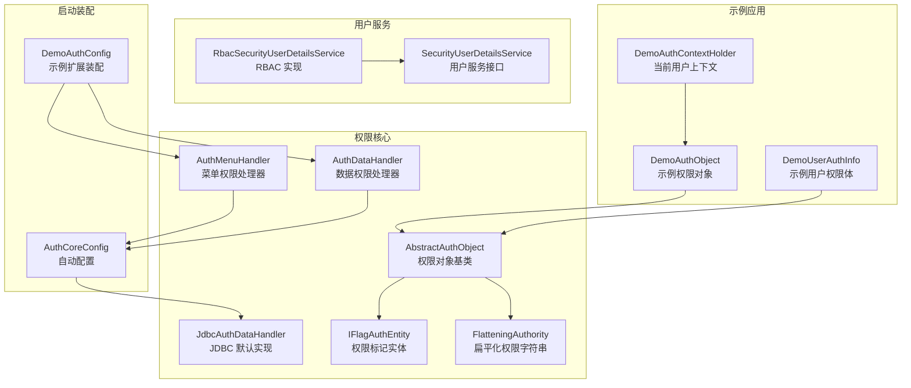
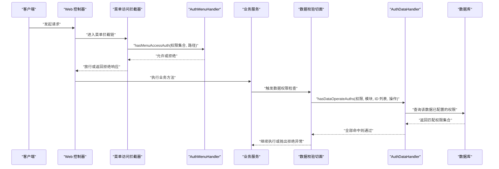
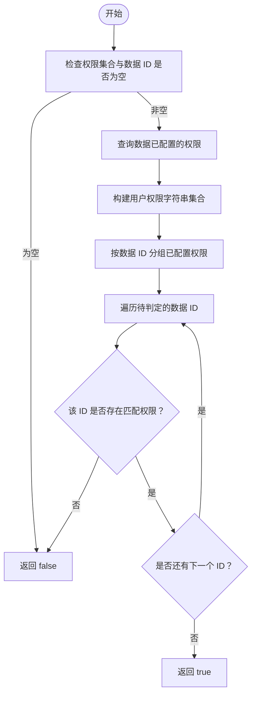
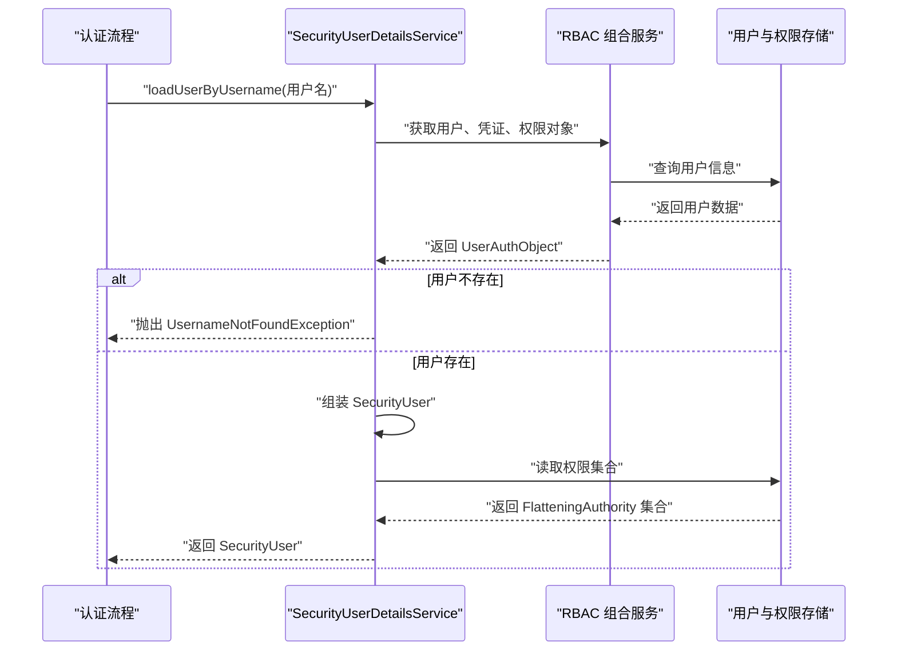
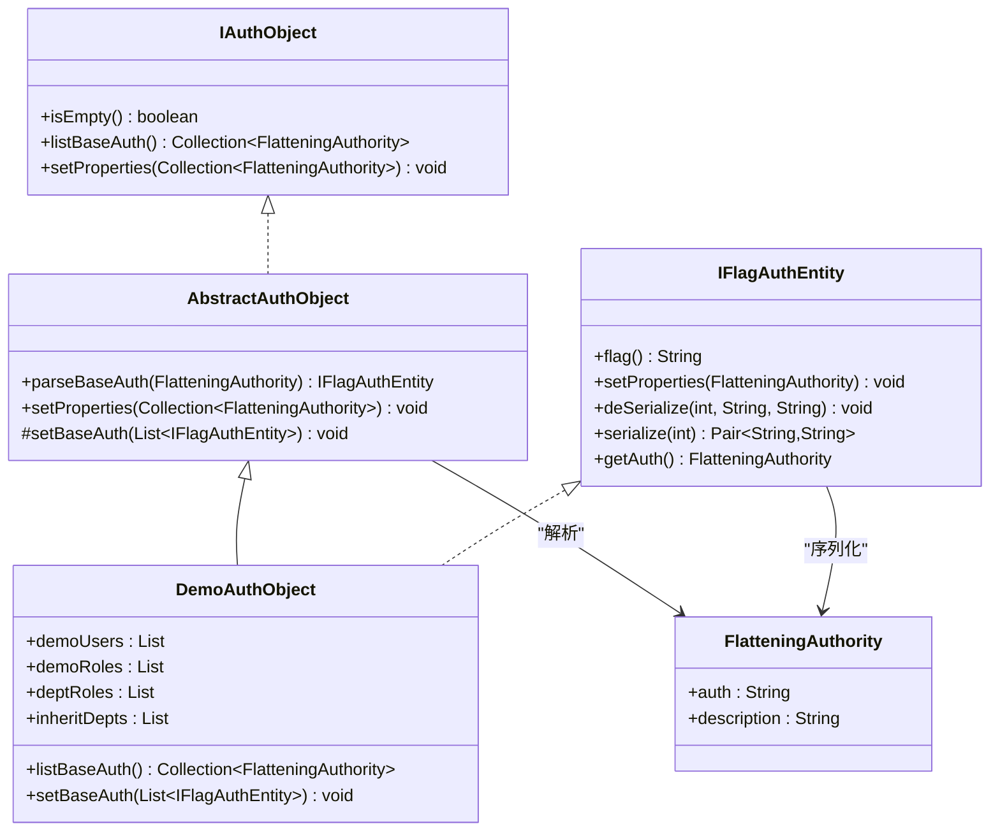
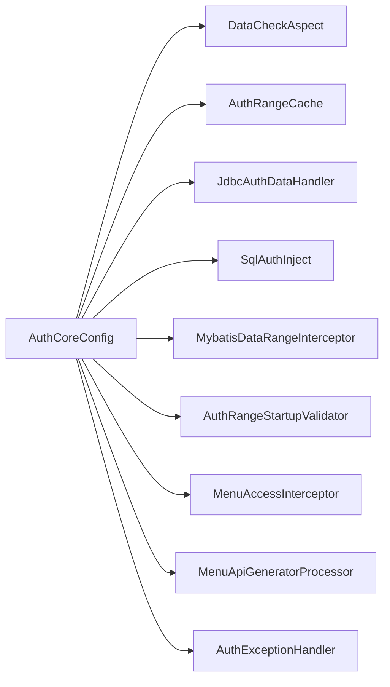
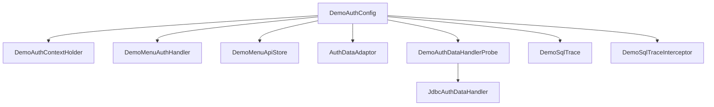

# 扩展接口 API

<cite>
**本文引用的文件**   
- [AuthMenuHandler.java](file://auth/auth-core/src/main/java/com/cu/framework/auth/core/menu/AuthMenuHandler.java)
- [AuthDataHandler.java](file://auth/auth-core/src/main/java/com/cu/framework/auth/core/data/AuthDataHandler.java)
- [JdbcAuthDataHandler.java](file://auth/auth-core/src/main/java/com/cu/framework/auth/core/data/JdbcAuthDataHandler.java)
- [SecurityUserDetailsService.java](file://login-spring-boot-starter/src/main/java/com/cu/framework/authentication/service/SecurityUserDetailsService.java)
- [RbacSecurityUserDetailsService.java](file://auth/auth-rbac-security-spring-boot-starter/src/main/java/com/cu/framework/auth/rbac/security/RbacSecurityUserDetailsService.java)
- [AbstractAuthObject.java](file://auth/auth-core/src/main/java/com/cu/framework/auth/core/entity/AbstractAuthObject.java)
- [IFlagAuthEntity.java](file://auth/auth-core/src/main/java/com/cu/framework/auth/core/entity/IFlagAuthEntity.java)
- [IAuthObject.java](file://auth/auth-core/src/main/java/com/cu/framework/auth/core/entity/IAuthObject.java)
- [FlatteningAuthority.java](file://auth/auth-core/src/main/java/com/cu/framework/auth/core/entity/FlatteningAuthority.java)
- [AuthCoreConfig.java](file://auth/auth-core-spring-boot-starter/src/main/java/com/cu/framework/boot/auth/core/config/AuthCoreConfig.java)
- [DemoAuthConfig.java](file://sample/auth-core-boot-sample/src/main/java/com/cu/framework/sample/authcore/config/DemoAuthConfig.java)
- [DemoAuthObject.java](file://sample/auth-core-boot-sample/src/main/java/com/cu/framework/sample/authcore/authobject/DemoAuthObject.java)
- [DemoUserAuthInfo.java](file://sample/auth-core-boot-sample/src/main/java/com/cu/framework/sample/authcore/authobject/DemoUserAuthInfo.java)
- [DemoAuthContextHolder.java](file://sample/auth-core-boot-sample/src/main/java/com/cu/framework/sample/authcore/context/DemoAuthContextHolder.java)
</cite>

## 目录
1. [引言](#引言)
2. [项目结构](#项目结构)
3. [核心扩展接口](#核心扩展接口)
4. [架构总览](#架构总览)
5. [组件详解](#组件详解)
6. [依赖与装配关系](#依赖与装配关系)
7. [性能与扩展开发建议](#性能与扩展开发建议)
8. [故障排查](#故障排查)
9. [结论](#结论)

## 引言
本文面向需要在 Kewen Framework 中实现自定义权限逻辑的开发者，围绕以下扩展点展开：
- 菜单访问权限：`AuthMenuHandler`
- 行级数据权限：`AuthDataHandler`
- 用户信息服务：`SecurityUserDetailsService`
- 权限对象与标记实体：`AbstractAuthObject`、`IFlagAuthEntity`、`IAuthObject`、`FlatteningAuthority`

文档同时说明扩展点的注册机制、加载顺序、错误处理、以及如何在示例应用中编写业务特定的权限实现。

## 项目结构
本仓库中与扩展接口直接相关的代码分布在三个模块中：
- `auth/auth-core`：权限核心接口与默认实现
- `login-spring-boot-starter`：安全用户信息服务接口
- `auth/auth-rbac-security-spring-boot-starter`：RBAC 下的用户服务实现
- `sample/auth-core-boot-sample`：完整的扩展示例与观察工具

**图示来源**
- [AuthMenuHandler.java:10-26](file://auth/auth-core/src/main/java/com/cu/framework/auth/core/menu/AuthMenuHandler.java#L10-L26)
- [AuthDataHandler.java:12-101](file://auth/auth-core/src/main/java/com/cu/framework/auth/core/data/AuthDataHandler.java#L12-L101)
- [JdbcAuthDataHandler.java:17-118](file://auth/auth-core/src/main/java/com/cu/framework/auth/core/data/JdbcAuthDataHandler.java#L17-L118)
- [SecurityUserDetailsService.java:12-26](file://login-spring-boot-starter/src/main/java/com/cu/framework/authentication/service/SecurityUserDetailsService.java#L12-L26)
- [RbacSecurityUserDetailsService.java:28-103](file://auth/auth-rbac-security-spring-boot-starter/src/main/java/com/cu/framework/auth/rbac/security/RbacSecurityUserDetailsService.java#L28-L103)
- [AbstractAuthObject.java:16-91](file://auth/auth-core/src/main/java/com/cu/framework/auth/core/entity/AbstractAuthObject.java#L16-L91)
- [IFlagAuthEntity.java:16-94](file://auth/auth-core/src/main/java/com/cu/framework/auth/core/entity/IFlagAuthEntity.java#L16-L94)
- [FlatteningAuthority.java:12-62](file://auth/auth-core/src/main/java/com/cu/framework/auth/core/entity/FlatteningAuthority.java#L12-L62)
- [AuthCoreConfig.java:52-200](file://auth/auth-core-spring-boot-starter/src/main/java/com/cu/framework/boot/auth/core/config/AuthCoreConfig.java#L52-L200)
- [DemoAuthConfig.java:24-103](file://sample/auth-core-boot-sample/src/main/java/com/cu/framework/sample/authcore/config/DemoAuthConfig.java#L24-L103)
- [DemoAuthObject.java:18-103](file://sample/auth-core-boot-sample/src/main/java/com/cu/framework/sample/authcore/authobject/DemoAuthObject.java#L18-L103)
- [DemoUserAuthInfo.java:16-74](file://sample/auth-core-boot-sample/src/main/java/com/cu/framework/sample/authcore/authobject/DemoUserAuthInfo.java#L16-L74)
- [DemoAuthContextHolder.java:18-77](file://sample/auth-core-boot-sample/src/main/java/com/cu/framework/sample/authcore/context/DemoAuthContextHolder.java#L18-L77)

**章节来源**
- [AuthMenuHandler.java:10-26](file://auth/auth-core/src/main/java/com/cu/framework/auth/core/menu/AuthMenuHandler.java#L10-L26)
- [AuthDataHandler.java:12-101](file://auth/auth-core/src/main/java/com/cu/framework/auth/core/data/AuthDataHandler.java#L12-L101)
- [SecurityUserDetailsService.java:12-26](file://login-spring-boot-starter/src/main/java/com/cu/framework/authentication/service/SecurityUserDetailsService.java#L12-L26)
- [AuthCoreConfig.java:52-200](file://auth/auth-core-spring-boot-starter/src/main/java/com/cu/framework/boot/auth/core/config/AuthCoreConfig.java#L52-L200)
- [DemoAuthConfig.java:24-103](file://sample/auth-core-boot-sample/src/main/java/com/cu/framework/sample/authcore/config/DemoAuthConfig.java#L24-L103)

## 核心扩展接口
Kewen Framework 的扩展体系以“接口 + 默认实现 + 启动装配”的方式组织：框架暴露最小可用接口，业务侧通过 Spring Bean 注入自己的实现。

| 扩展点 | 包路径 | 职责 | 典型调用方 |
|---|---|---|---|
| `AuthMenuHandler` | `com.cu.framework.auth.core.menu` | 判断请求路径是否需要特定菜单权限 | 菜单访问拦截器 |
| `AuthDataHandler` | `com.cu.framework.auth.core.data` | 行级数据权限判定、编辑、查询、删除 | 数据校验切面、业务适配器 |
| `SecurityUserDetailsService` | `com.cu.framework.authentication.service` | 按用户名加载用户、凭证与权限；更新密码 | 认证流程、RBAC 集成层 |
| `AbstractAuthObject` | `com.cu.framework.auth.core.entity` | 权限对象基类，负责扁平权限串解析为类型化实体 | 业务权限集合体 |
| `IFlagAuthEntity` | `com.cu.framework.auth.core.entity` | 定义权限标记实体的序列化、反序列化规则 | 权限对象基类 |

**章节来源**
- [AuthMenuHandler.java:10-26](file://auth/auth-core/src/main/java/com/cu/framework/auth/core/menu/AuthMenuHandler.java#L10-L26)
- [AuthDataHandler.java:12-101](file://auth/auth-core/src/main/java/com/cu/framework/auth/core/data/AuthDataHandler.java#L12-L101)
- [SecurityUserDetailsService.java:12-26](file://login-spring-boot-starter/src/main/java/com/cu/framework/authentication/service/SecurityUserDetailsService.java#L12-L26)
- [AbstractAuthObject.java:16-91](file://auth/auth-core/src/main/java/com/cu/framework/auth/core/entity/AbstractAuthObject.java#L16-L91)
- [IFlagAuthEntity.java:16-94](file://auth/auth-core/src/main/java/com/cu/framework/auth/core/entity/IFlagAuthEntity.java#L16-L94)

## 架构总览
权限系统在运行时分为三条主线：
1. **身份加载线**：通过 `SecurityUserDetailsService` 加载用户、凭证和基础权限，形成可被后续权限系统消费的用户信息。
2. **菜单权限线**：请求进入控制器前，由菜单访问拦截器使用 `AuthMenuHandler` 判断路径是否允许访问。
3. **数据权限线**：Service 或 Mapper 执行前后，由数据校验切面与 MyBatis 拦截器根据 `AuthDataHandler` 和数据范围声明注入 SQL 条件并做行级权限判定。

**图示来源**
- [AuthCoreConfig.java:150-200](file://auth/auth-core-spring-boot-starter/src/main/java/com/cu/framework/boot/auth/core/config/AuthCoreConfig.java#L150-L200)
- [AuthMenuHandler.java:18-26](file://auth/auth-core/src/main/java/com/cu/framework/auth/core/menu/AuthMenuHandler.java#L18-L26)
- [AuthDataHandler.java:24-76](file://auth/auth-core/src/main/java/com/cu/framework/auth/core/data/AuthDataHandler.java#L24-L76)
- [JdbcAuthDataHandler.java:63-99](file://auth/auth-core/src/main/java/com/cu/framework/auth/core/data/JdbcAuthDataHandler.java#L63-L99)

## 组件详解

### 菜单权限处理器 `AuthMenuHandler`
`AuthMenuHandler` 是菜单访问控制的扩展点。它接收当前用户的扁平权限集合和请求路径，返回是否允许访问。

| 方法 | 参数 | 返回值 | 语义 |
|---|---|---|---|
| `hasMenuAccessAuth` | `auths`：扁平权限集合；`path`：菜单路径 | `boolean` | 若用户具备该路径所需权限，返回 `true`；否则返回 `false` |

实现要求：
- 输入权限必须基于 `FlatteningAuthority`，比较时以 `auth` 字段为准。
- 返回 `false` 时应被视为拒绝访问，而不是降级放行。
- 当 `auths` 为空时，应返回 `false`；不能因空集合而放行。
- 日志可通过接口自带的 `logger` 记录关键判定结果，便于审计与排查。

参考实现位置：
- 接口定义：[AuthMenuHandler.java:10-26](file://auth/auth-core/src/main/java/com/cu/framework/auth/core/menu/AuthMenuHandler.java#L10-L26)
- 示例装配：[DemoAuthConfig.java:56-61](file://sample/auth-core-boot-sample/src/main/java/com/cu/framework/sample/authcore/config/DemoAuthConfig.java#L56-L61)

**章节来源**
- [AuthMenuHandler.java:10-26](file://auth/auth-core/src/main/java/com/cu/framework/auth/core/menu/AuthMenuHandler.java#L10-L26)
- [DemoAuthConfig.java:56-61](file://sample/auth-core-boot-sample/src/main/java/com/cu/framework/sample/authcore/config/DemoAuthConfig.java#L56-L61)

### 数据权限处理器 `AuthDataHandler`
`AuthDataHandler` 是行级数据权限的核心扩展点，承担三类职责：
1. **权限判定**：判断某条或多条数据在指定业务模块和操作槽位下是否拥有权限。
2. **权限编辑**：新增、移除、查询或删除某条数据的权限配置。
3. **权限填充**：将已配置权限写入权限对象，供前端展示或二次计算。

#### 判定方法规范
- `hasDataOperateAuths(auths, businessFunction, dataIds, operate)`
  - 判定单位是每条数据 ID。
  - 每个 ID 都必须在 `businessFunction + operate` 槽位命中用户权限。
  - 只要有一个未命中，就返回 `false`。
  - 不跨操作类型回退；权限集合为空时不放行。
  - ID 比较按字符串归一化，避免整型与长整型主键被当成不同数据。

- `hasDataOperateAuths(authObject, businessFunction, dataIds, operate)`
  - 默认实现从 `authObject.listBaseAuth()` 取扁平权限。
  - 若 `authObject` 为 `null`，记录日志并返回 `false`。

#### 编辑与查询方法
- `editDataAuths(businessFunction, dataId, operate, auths)`
  - 用于后台管理场景，设置某条数据在某个操作下的权限集合。
  - 注意：不应把接口自身的权限配置也交给普通用户编辑，否则会造成越权。
- `getDataAuths(businessFunction, dataId, operate)`
  - 返回该数据在该操作下已配置的权限集合。
- `fillDataAuths(businessFunction, dataId, operate, authObject)`
  - 默认实现调用 `getDataAuths` 后调用 `authObject.setProperties(...)`。
- `deleteBusinessFunctionAuthByDataId(businessFunction, dataId)`
  - 删除某条数据对应的所有权限配置，通常与业务数据删除联动。

默认 JDBC 实现的行为：
- 判定前先查库得到该批数据已配置的权限。
- 将用户权限转为字符串集合，再逐条比对。
- 任一数据无匹配权限即整体拒绝。

参考实现位置：
- 接口定义：[AuthDataHandler.java:12-101](file://auth/auth-core/src/main/java/com/cu/framework/auth/core/data/AuthDataHandler.java#L12-L101)
- JDBC 实现：[JdbcAuthDataHandler.java:17-118](file://auth/auth-core/src/main/java/com/cu/framework/auth/core/data/JdbcAuthDataHandler.java#L17-L118)

**图示来源**
- [AuthDataHandler.java:24-76](file://auth/auth-core/src/main/java/com/cu/framework/auth/core/data/AuthDataHandler.java#L24-L76)
- [JdbcAuthDataHandler.java:63-99](file://auth/auth-core/src/main/java/com/cu/framework/auth/core/data/JdbcAuthDataHandler.java#L63-L99)

**章节来源**
- [AuthDataHandler.java:24-101](file://auth/auth-core/src/main/java/com/cu/framework/auth/core/data/AuthDataHandler.java#L24-L101)
- [JdbcAuthDataHandler.java:17-118](file://auth/auth-core/src/main/java/com/cu/framework/auth/core/data/JdbcAuthDataHandler.java#L17-L118)

### 用户信息服务 `SecurityUserDetailsService`
`SecurityUserDetailsService` 统一继承 Spring Security 的 `UserDetailsService` 和 `UserDetailsPasswordService`，提供两个能力：
- 按用户名加载用户详情，包括基本信息、凭证信息和权限信息。
- 更新用户密码，常用于密码算法升级后的“登录一次即重置”。

| 方法 | 参数 | 返回值 | 异常行为 |
|---|---|---|---|
| `loadUserByUsername` | 用户名 | 安全用户详情对象 | 用户不存在时抛出 `UsernameNotFoundException` |
| `updatePassword` | 用户对象、加密后的新密码 | 原用户对象 | 更新失败时抛出运行时异常 |

RBAC 实现说明：
- 先从组合服务获取 `UserAuthObject`，包含用户、凭证和权限对象。
- 如果用户不存在，抛出 `UsernameNotFoundException`。
- 将 `FlatteningAuthority` 转换为框架的安全用户权限列表。
- 如果没有凭证信息，视为合法状态，不会因此阻止用户装载；但会给出空权限。
- 密码更新失败时抛出 `RuntimeException`。

参考实现位置：
- 接口定义：[SecurityUserDetailsService.java:12-26](file://login-spring-boot-starter/src/main/java/com/cu/framework/authentication/service/SecurityUserDetailsService.java#L12-L26)
- RBAC 实现：[RbacSecurityUserDetailsService.java:28-103](file://auth/auth-rbac-security-spring-boot-starter/src/main/java/com/cu/framework/auth/rbac/security/RbacSecurityUserDetailsService.java#L28-L103)

**图示来源**
- [SecurityUserDetailsService.java:12-26](file://login-spring-boot-starter/src/main/java/com/cu/framework/authentication/service/SecurityUserDetailsService.java#L12-L26)
- [RbacSecurityUserDetailsService.java:44-90](file://auth/auth-rbac-security-spring-boot-starter/src/main/java/com/cu/framework/auth/rbac/security/RbacSecurityUserDetailsService.java#L44-L90)

**章节来源**
- [SecurityUserDetailsService.java:12-26](file://login-spring-boot-starter/src/main/java/com/cu/framework/authentication/service/SecurityUserDetailsService.java#L12-L26)
- [RbacSecurityUserDetailsService.java:28-103](file://auth/auth-rbac-security-spring-boot-starter/src/main/java/com/cu/framework/auth/rbac/security/RbacSecurityUserDetailsService.java#L28-L103)

### 权限对象基类 `AbstractAuthObject`
`AbstractAuthObject` 是权限集合体的抽象基类，主要解决一个问题：**如何把扁平的权限字符串还原为业务可用的类型化对象**。

核心行为：
- 启动时扫描所有实现 `IFlagAuthEntity` 的具体类。
- 跳过抽象类和接口。
- 通过 `flag()` 获取权限标记，建立标记到实体类型的映射。
- 解析 `FlatteningAuthority` 时，按分割符取出标记，查找对应实体类并实例化。
- 调用 `setProperties` 将扁平权限填入实体字段。
- 子类只需实现 `setBaseAuth(List<IFlagAuthEntity>)`，把解析出的实体归位到业务字段。

常见异常：
- 权限标记未注册：抛出 `AuthEntityException`。
- 实体类没有无参构造：抛出 `AuthEntityException`。
- 权限串格式不符合约定：解析失败。

参考实现位置：
- 基类：[AbstractAuthObject.java:16-91](file://auth/auth-core/src/main/java/com/cu/framework/auth/core/entity/AbstractAuthObject.java#L16-L91)
- 示例权限对象：[DemoAuthObject.java:18-103](file://sample/auth-core-boot-sample/src/main/java/com/cu/framework/sample/authcore/authobject/DemoAuthObject.java#L18-L103)

**图示来源**
- [IAuthObject.java:12-34](file://auth/auth-core/src/main/java/com/cu/framework/auth/core/entity/IAuthObject.java#L12-L34)
- [AbstractAuthObject.java:16-91](file://auth/auth-core/src/main/java/com/cu/framework/auth/core/entity/AbstractAuthObject.java#L16-L91)
- [IFlagAuthEntity.java:16-94](file://auth/auth-core/src/main/java/com/cu/framework/auth/core/entity/IFlagAuthEntity.java#L16-L94)
- [DemoAuthObject.java:18-103](file://sample/auth-core-boot-sample/src/main/java/com/cu/framework/sample/authcore/authobject/DemoAuthObject.java#L18-L103)
- [FlatteningAuthority.java:12-62](file://auth/auth-core/src/main/java/com/cu/framework/auth/core/entity/FlatteningAuthority.java#L12-L62)

**章节来源**
- [AbstractAuthObject.java:16-91](file://auth/auth-core/src/main/java/com/cu/framework/auth/core/entity/AbstractAuthObject.java#L16-L91)
- [IFlagAuthEntity.java:16-94](file://auth/auth-core/src/main/java/com/cu/framework/auth/core/entity/IFlagAuthEntity.java#L16-L94)
- [DemoAuthObject.java:18-103](file://sample/auth-core-boot-sample/src/main/java/com/cu/framework/sample/authcore/authobject/DemoAuthObject.java#L18-L103)

### 权限标记实体 `IFlagAuthEntity`
`IFlagAuthEntity` 定义了一个权限标记实体的编解码契约：
- `flag()`：返回权限标记，如 `USER`、`ROLE`、`DEPT_ROLE`、`DEPTINHERIT`。
- `deSerialize(pos, posAuth, posDescription)`：按位置拆分扁平权限串，填充实体字段。
- `serialize(pos)`：按位置生成子权限 ID 和描述，参与拼出完整权限串。
- 默认 `getAuth()` 会按约定拼接标记、ID 段和描述段，生成 `FlatteningAuthority`。

重要约定：
- 权限串采用固定分隔符连接标记、ID 和描述。
- 同一权限对象可由多个标记组成，例如部门+角色。
- 如果传入的 `FlatteningAuthority` 中的标记与实体 `flag()` 不一致，会抛出 `AuthEntityException`。

参考实现位置：
- 接口定义：[IFlagAuthEntity.java:16-94](file://auth/auth-core/src/main/java/com/cu/framework/auth/core/entity/IFlagAuthEntity.java#L16-L94)
- 示例权限对象使用方式：[DemoAuthObject.java:18-103](file://sample/auth-core-boot-sample/src/main/java/com/cu/framework/sample/authcore/authobject/DemoAuthObject.java#L18-L103)

**章节来源**
- [IFlagAuthEntity.java:16-94](file://auth/auth-core/src/main/java/com/cu/framework/auth/core/entity/IFlagAuthEntity.java#L16-L94)
- [DemoAuthObject.java:18-103](file://sample/auth-core-boot-sample/src/main/java/com/cu/framework/sample/authcore/authobject/DemoAuthObject.java#L18-L103)

### 扁平化权限 `FlatteningAuthority`
`FlatteningAuthority` 表示一条扁平权限，包含：
- `auth`：唯一标识权限的字符串。
- `description`：可读描述。
- `equals` 和 `hashCode` 仅基于 `auth`，因此相同权限字符串会被视为同一条权限。

这个类是权限在框架内部传递的最小载体，也是 `AuthMenuHandler`、`AuthDataHandler`、`SecurityUserDetailsService` 共同使用的数据结构。

参考实现位置：
- [FlatteningAuthority.java:12-62](file://auth/auth-core/src/main/java/com/cu/framework/auth/core/entity/FlatteningAuthority.java#L12-L62)

**章节来源**
- [FlatteningAuthority.java:12-62](file://auth/auth-core/src/main/java/com/cu/framework/auth/core/entity/FlatteningAuthority.java#L12-L62)

### 用户权限体的不对称设计
示例展示了两种权限体：
- `DemoAuthObject`：继承 `AbstractAuthObject`，支持“权限串 → 对象 → 权限串”的往返一致性。
- `DemoUserAuthInfo`：只实现 `IAuthObject`，不支持反解析，因为某些权限串（如继承型权限）缺少足够信息还原原始结构。

这种不对称是有意设计的：
- 配置侧可以无损往返，方便管理界面展示和校验。
- 用户侧只输出权限串，不接受不可靠的反解，避免静默错误。

参考实现位置：
- [DemoAuthObject.java:18-103](file://sample/auth-core-boot-sample/src/main/java/com/cu/framework/sample/authcore/authobject/DemoAuthObject.java#L18-L103)
- [DemoUserAuthInfo.java:16-74](file://sample/auth-core-boot-sample/src/main/java/com/cu/framework/sample/authcore/authobject/DemoUserAuthInfo.java#L16-L74)

**章节来源**
- [DemoAuthObject.java:18-103](file://sample/auth-core-boot-sample/src/main/java/com/cu/framework/sample/authcore/authobject/DemoAuthObject.java#L18-L103)
- [DemoUserAuthInfo.java:16-74](file://sample/auth-core-boot-sample/src/main/java/com/cu/framework/sample/authcore/authobject/DemoUserAuthInfo.java#L16-L74)

## 依赖与装配关系

### 自动装配与扩展让位
`AuthCoreConfig` 是权限核心的自动装配入口，关键行为如下：
- 注册数据校验切面 `DataCheckAspect`。
- 注册数据范围缓存 `AuthRangeCache`。
- 注册默认数据权限处理器 `JdbcAuthDataHandler`，条件是容器中不存在其他 `AuthDataHandler`。
- 注册 SQL 注入组件 `SqlAuthInject`。
- 注册 MyBatis 数据范围拦截器 `MybatisDataRangeInterceptor`。
- 注册启动校验器 `AuthRangeStartupValidator`，用于校验数据范围声明。
- 注册菜单访问拦截器 `MenuAccessInterceptor`。
- 注册菜单 API 生成器和命令运行器。
- 注册权限拒绝处理器 `AuthExceptionHandler`。

**图示来源**
- [AuthCoreConfig.java:52-200](file://auth/auth-core-spring-boot-starter/src/main/java/com/cu/framework/boot/auth/core/config/AuthCoreConfig.java#L52-L200)

**章节来源**
- [AuthCoreConfig.java:52-200](file://auth/auth-core-spring-boot-starter/src/main/java/com/cu/framework/boot/auth/core/config/AuthCoreConfig.java#L52-L200)

### 示例扩展装配
示例应用通过 `DemoAuthConfig` 显式装配以下扩展点：
- 当前用户上下文：`DemoAuthContextHolder`
- 菜单权限处理器：`DemoMenuAuthHandler`
- 菜单 API 存储：`DemoMenuApiStore`
- 数据权限适配器：`AuthDataAdaptor`
- 观察组件：`DemoSqlTrace`、`DemoAuthDataHandlerProbe`、`DemoSqlTraceInterceptor`

其中 `DemoAuthDataHandlerProbe` 通过 `@Primary` 替换默认的 `JdbcAuthDataHandler`，从而在不修改判定逻辑的前提下增加观测能力。

**图示来源**
- [DemoAuthConfig.java:24-103](file://sample/auth-core-boot-sample/src/main/java/com/cu/framework/sample/authcore/config/DemoAuthConfig.java#L24-L103)
- [JdbcAuthDataHandler.java:17-118](file://auth/auth-core/src/main/java/com/cu/framework/auth/core/data/JdbcAuthDataHandler.java#L17-L118)

**章节来源**
- [DemoAuthConfig.java:24-103](file://sample/auth-core-boot-sample/src/main/java/com/cu/framework/sample/authcore/config/DemoAuthConfig.java#L24-L103)

## 性能与扩展开发建议

### 数据权限判定性能
- 默认 `JdbcAuthDataHandler` 会在内存中构建用户权限集合，并与数据库中查到的已配置权限进行比对。
- 用户权限规模不可控，因此不要把用户权限放入 SQL 查询条件。
- 对业务数据 ID 使用字符串归一化比较，避免不同类型主键造成误判。
- 如果业务需要高频判定，可在自定义 `AuthDataHandler` 中加入权限缓存层，但要注意缓存失效策略。

### 菜单权限判定性能
- `AuthMenuHandler.hasMenuAccessAuth` 应在单次请求中快速完成。
- 避免在菜单判定中执行重型 IO 或复杂事务。
- 如果需要缓存路径到权限规则的映射，应结合请求上下文和用户维度做合理缓存。

### 用户服务性能
- `SecurityUserDetailsService.loadUserByUsername` 通常在登录时调用，适合一次性加载用户、凭证和权限。
- 如果权限集合较大，建议在上层做适度缓存，但不要缓存过期凭证。
- 密码更新应走独立事务，避免部分成功导致状态不一致。

### 权限对象与标记实体
- `AbstractAuthObject` 启动时会扫描所有 `IFlagAuthEntity` 实现类，应避免注册过多无关实现。
- 权限串往返一致性应由 `IFlagAuthEntity.serialize` 和 `deSerialize` 保证，不要在业务层绕过。
- 对用户权限体，如果无法可靠反解，应像 `DemoUserAuthInfo` 一样明确拒绝，不要静默降级。

### 扩展开发注意事项
- 自定义 `AuthDataHandler` 必须保证空权限集合不放大权限。
- 自定义 `AuthMenuHandler` 必须保证空权限集合不放行路径访问。
- 自定义 `SecurityUserDetailsService` 必须正确处理用户不存在和凭证缺失的场景。
- 使用 `AbstractAuthObject` 时，确保 `flag()` 值稳定且唯一。
- 在示例中，观察者 Bean 通过 `@Primary` 替换默认实现，这是测试友好做法，生产环境应谨慎使用，避免引入额外开销。

[本节为通用指导，不直接分析具体文件]

## 故障排查

### 菜单访问总是拒绝
可能原因：
- `AuthMenuHandler` 返回 `false`。
- 当前用户上下文未正确设置。
- 用户权限集合为空。
- 路径与权限规则不匹配。

排查步骤：
1. 检查当前用户上下文是否正确加载用户名。
2. 检查用户权限集合是否非空。
3. 检查 `AuthMenuHandler` 的实现逻辑。
4. 在示例中可通过 `/demo/current-user` 查看当前权限对象。

参考位置：
- [DemoAuthContextHolder.java:18-77](file://sample/auth-core-boot-sample/src/main/java/com/cu/framework/sample/authcore/context/DemoAuthContextHolder.java#L18-L77)
- [AuthMenuHandler.java:18-26](file://auth/auth-core/src/main/java/com/cu/framework/auth/core/menu/AuthMenuHandler.java#L18-L26)

### 行级数据权限判定失败
可能原因：
- 业务数据 ID 未在权限表中配置。
- 业务模块或操作槽位不正确。
- 用户权限串与数据权限串不一致。
- `AuthDataHandler` 实现未按字符串归一化比较 ID。

排查步骤：
1. 确认 `businessFunction` 和 `operate` 与实际权限表一致。
2. 确认业务 ID 类型转换后一致。
3. 检查 `JdbcAuthDataHandler` 的判定逻辑是否被替换。
4. 使用示例观察组件确认实际下发的语句和判定结果。

参考位置：
- [AuthDataHandler.java:24-76](file://auth/auth-core/src/main/java/com/cu/framework/auth/core/data/AuthDataHandler.java#L24-L76)
- [JdbcAuthDataHandler.java:63-99](file://auth/auth-core/src/main/java/com/cu/framework/auth/core/data/JdbcAuthDataHandler.java#L63-L99)

### 权限对象解析失败
可能原因：
- 权限标记未注册。
- `IFlagAuthEntity` 没有无参构造。
- 权限串格式不符合约定。
- `flag()` 返回值与权限串标记不一致。

排查步骤：
1. 检查是否实现了 `IFlagAuthEntity` 并在类路径中被扫描。
2. 检查 `flag()` 返回值是否与权限串一致。
3. 检查权限串是否通过 `getAuth()` 生成。
4. 使用示例的往返一致性接口验证编解码是否正确。

参考位置：
- [AbstractAuthObject.java:36-88](file://auth/auth-core/src/main/java/com/cu/framework/auth/core/entity/AbstractAuthObject.java#L36-L88)
- [IFlagAuthEntity.java:36-84](file://auth/auth-core/src/main/java/com/cu/framework/auth/core/entity/IFlagAuthEntity.java#L36-L84)
- [DemoAuthObject.java:52-103](file://sample/auth-core-boot-sample/src/main/java/com/cu/framework/sample/authcore/authobject/DemoAuthObject.java#L52-L103)

### 用户服务加载失败
可能原因：
- 用户名不存在。
- 用户组合服务返回空权限对象。
- 密码更新失败。

排查步骤：
1. 检查用户名是否正确。
2. 检查 RBAC 组合服务是否能查到用户。
3. 检查权限对象是否能转换成 `FlatteningAuthority`。
4. 检查密码更新逻辑是否成功。

参考位置：
- [RbacSecurityUserDetailsService.java:44-103](file://auth/auth-rbac-security-spring-boot-starter/src/main/java/com/cu/framework/auth/rbac/security/RbacSecurityUserDetailsService.java#L44-L103)

**章节来源**
- [DemoAuthContextHolder.java:18-77](file://sample/auth-core-boot-sample/src/main/java/com/cu/framework/sample/authcore/context/DemoAuthContextHolder.java#L18-L77)
- [AuthMenuHandler.java:18-26](file://auth/auth-core/src/main/java/com/cu/framework/auth/core/menu/AuthMenuHandler.java#L18-L26)
- [AuthDataHandler.java:24-76](file://auth/auth-core/src/main/java/com/cu/framework/auth/core/data/AuthDataHandler.java#L24-L76)
- [JdbcAuthDataHandler.java:63-99](file://auth/auth-core/src/main/java/com/cu/framework/auth/core/data/JdbcAuthDataHandler.java#L63-L99)
- [AbstractAuthObject.java:36-88](file://auth/auth-core/src/main/java/com/cu/framework/auth/core/entity/AbstractAuthObject.java#L36-L88)
- [IFlagAuthEntity.java:36-84](file://auth/auth-core/src/main/java/com/cu/framework/auth/core/entity/IFlagAuthEntity.java#L36-L84)
- [DemoAuthObject.java:52-103](file://sample/auth-core-boot-sample/src/main/java/com/cu/framework/sample/authcore/authobject/DemoAuthObject.java#L52-L103)
- [RbacSecurityUserDetailsService.java:44-103](file://auth/auth-rbac-security-spring-boot-starter/src/main/java/com/cu/framework/auth/rbac/security/RbacSecurityUserDetailsService.java#L44-L103)

## 结论
Kewen Framework 的扩展接口以清晰的边界划分了菜单权限、数据权限、用户服务和权限对象四个维度。开发者只需要关注自身业务的数据模型和权限规则，并通过 Spring Bean 注册实现即可接入框架。

在实际项目中，建议遵循以下原则：
- 菜单权限快速判定，避免重型逻辑。
- 数据权限严格校验，空权限不放大。
- 用户服务准确装载，异常明确抛出。
- 权限对象保持编解码一致性，无法反解时显式拒绝。
- 通过示例扩展理解装配顺序，谨慎替换默认实现。