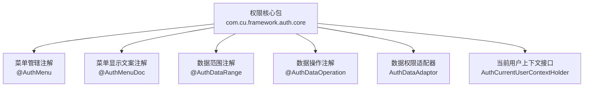
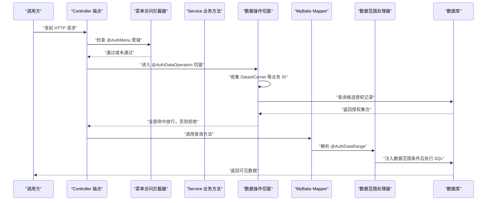
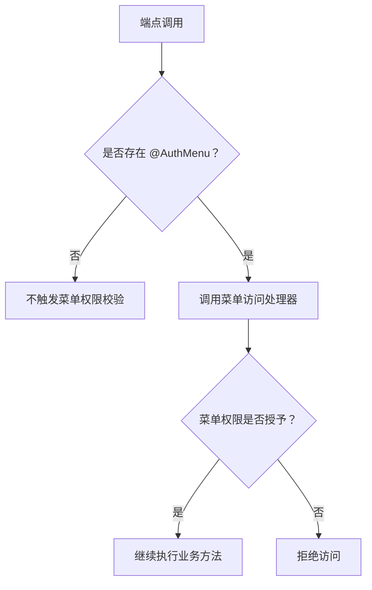
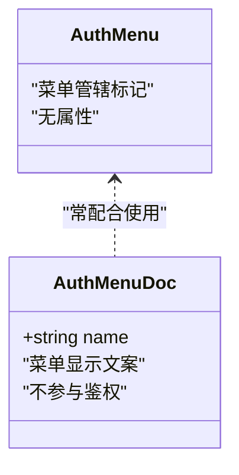
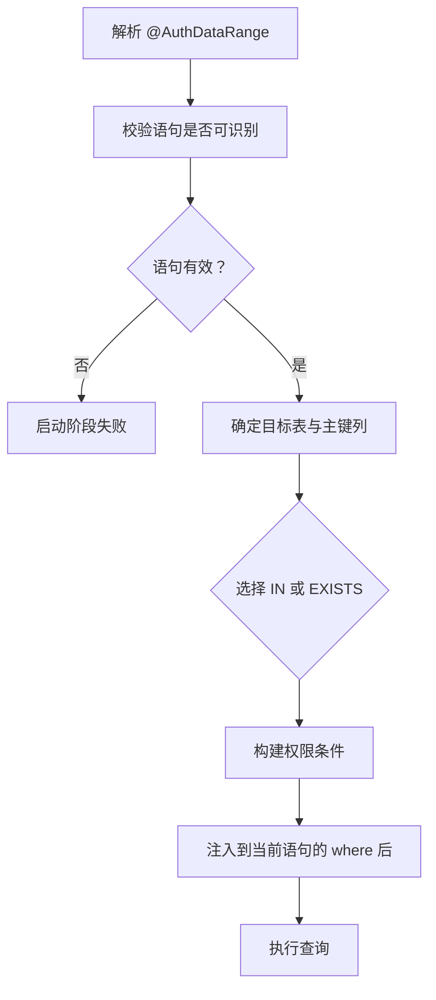
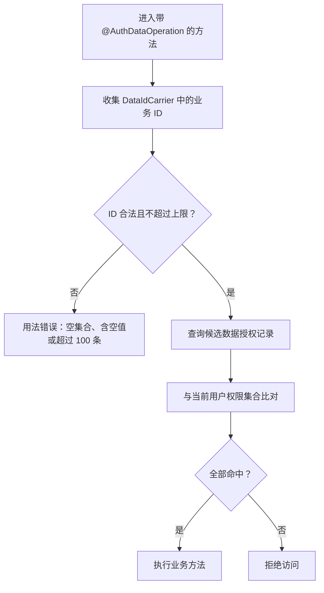
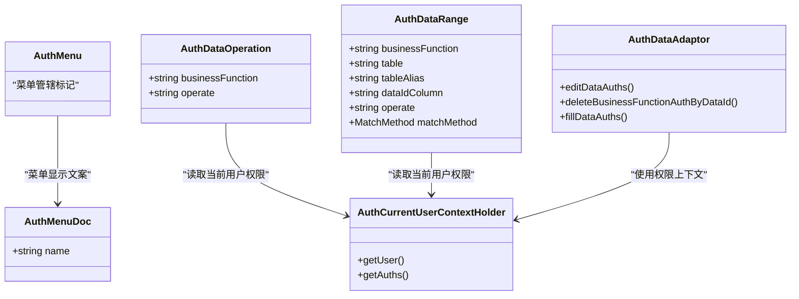

# 注解 API

<cite>
**本文引用的文件**   
- [AuthMenu.java](file://auth/auth-core/src/main/java/com/cu/framework/auth/core/AuthMenu.java)
- [AuthMenuDoc.java](file://auth/auth-core/src/main/java/com/cu/framework/auth/core/AuthMenuDoc.java)
- [AuthDataRange.java](file://auth/auth-core/src/main/java/com/cu/framework/auth/core/AuthDataRange.java)
- [AuthDataOperation.java](file://auth/auth-core/src/main/java/com/cu/framework/auth/core/AuthDataOperation.java)
- [AuthDataAdaptor.java](file://auth/auth-core/src/main/java/com/cu/framework/auth/core/AuthDataAdaptor.java)
- [AuthCurrentUserContextHolder.java](file://auth/auth-core/src/main/java/com/cu/framework/auth/core/AuthCurrentUserContextHolder.java)
- [package-info.java](file://auth/auth-core/src/main/java/com/cu/framework/auth/core/package-info.java)
- [AssetController.java](file://sample/auth-core-boot-sample/src/main/java/com/cu/framework/sample/authcore/web/AssetController.java)
- [WorkOrderController.java](file://sample/auth-core-boot-sample/src/main/java/com/cu/framework/sample/authcore/web/WorkOrderController.java)
- [AssetMapper.java](file://sample/auth-core-boot-sample/src/main/java/com/cu/framework/sample/authcore/mapper/AssetMapper.java)
- [DemoBusinessService.java](file://sample/auth-core-boot-sample/src/main/java/com/cu/framework/sample/authcore/service/DemoBusinessService.java)
- [TestAuthAnnotationController.java](file://sample/auth-rbac-boot-sample/src/main/java/com/cu/framework/auth/sample/controller/TestAuthAnnotationController.java)
</cite>

## 目录
1. [引言](#引言)
2. [项目结构定位](#项目结构定位)
3. [核心注解总览](#核心注解总览)
4. [架构与执行流程](#架构与执行流程)
5. [详细组件分析](#详细组件分析)
6. [依赖关系分析](#依赖关系分析)
7. [性能与边界特性](#性能与边界特性)
8. [常见问题排查](#常见问题排查)
9. [最佳实践与使用建议](#最佳实践与使用建议)
10. [结论](#结论)

## 引言
本文面向 Kewen Framework 权限注解 API，重点说明以下三类注解：
- 菜单访问控制注解：`@AuthMenu`、`@AuthMenuDoc`
- 数据范围查询控制注解：`@AuthDataRange`
- 数据操作权限校验注解：`@AuthDataOperation`

这些注解共同构成“端点入口控制 + 查询行级过滤 + 写操作逐条校验”的完整权限模型。文档会解释每个注解的属性含义、声明位置、执行语义、冲突处理机制，并给出 Controller、Service、Mapper 层的实际用法路径。

需要特别指出的是：当前仓库中的 `@AuthMenu` 是“无属性”的管辖标记；`value`、`code`、`description`、`required` 等常见权限注解属性并未出现在该注解定义中。菜单显示文案由 `@AuthMenuDoc.name` 提供，而不是 `@AuthMenu` 的属性。

## 项目结构定位
权限相关注解集中在 `auth/auth-core` 模块的 `com.cu.framework.auth.core` 包下。包级说明明确指出该包包含数据范围权限、数据操作权限验证、数据统一编辑和菜单权限控制，不包含登录相关逻辑。

**图表来源**
- [package-info.java:1-8](file://auth/auth-core/src/main/java/com/cu/framework/auth/core/package-info.java#L1-L8)
- [AuthMenu.java:1-16](file://auth/auth-core/src/main/java/com/cu/framework/auth/core/AuthMenu.java#L1-L16)
- [AuthMenuDoc.java:1-22](file://auth/auth-core/src/main/java/com/cu/framework/auth/core/AuthMenuDoc.java#L1-L22)
- [AuthDataRange.java:1-81](file://auth/auth-core/src/main/java/com/cu/framework/auth/core/AuthDataRange.java#L1-L81)
- [AuthDataOperation.java:1-51](file://auth/auth-core/src/main/java/com/cu/framework/auth/core/AuthDataOperation.java#L1-L51)
- [AuthDataAdaptor.java:1-45](file://auth/auth-core/src/main/java/com/cu/framework/auth/core/AuthDataAdaptor.java#L1-L45)
- [AuthCurrentUserContextHolder.java:1-25](file://auth/auth-core/src/main/java/com/cu/framework/auth/core/AuthCurrentUserContextHolder.java#L1-L25)

**章节来源**
- [package-info.java:1-8](file://auth/auth-core/src/main/java/com/cu/framework/auth/core/package-info.java#L1-L8)

## 核心注解总览

| 注解 | 声明目标 | 主要职责 | 关键属性 | 是否参与鉴权 |
|---|---|---|---|---|
| `@AuthMenu` | 方法、类、注解类型 | 声明某个端点或控制器受菜单权限管辖 | 无属性 | 是 |
| `@AuthMenuDoc` | 方法、类、注解类型 | 为菜单树生成显示名称 | `name` | 否 |
| `@AuthDataRange` | Mapper 查询方法 | 按业务功能与操作类型注入数据范围条件 | `businessFunction`、`table`、`tableAlias`、`dataIdColumn`、`operate`、`matchMethod` | 是 |
| `@AuthDataOperation` | 业务方法（通常位于 Controller 或 Service） | 对请求参数中的业务数据 ID 做逐条操作权限校验 | `businessFunction`、`operate` | 是 |

### 重要澄清：`@AuthMenu` 没有 `value`、`code`、`description`、`required` 属性
仓库中的 `@AuthMenu` 是一个纯标记注解，只表达“这个端点受菜单权限管辖”。它不携带业务编码、描述或是否必填等属性。菜单显示文案由 `@AuthMenuDoc.name` 提供；如果缺失，菜单标签会回落到类名或方法名。

**章节来源**
- [AuthMenu.java:1-16](file://auth/auth-core/src/main/java/com/cu/framework/auth/core/AuthMenu.java#L1-L16)
- [AuthMenuDoc.java:1-22](file://auth/auth-core/src/main/java/com/cu/framework/auth/core/AuthMenuDoc.java#L1-L22)

## 架构与执行流程

**图表来源**
- [AuthMenu.java:1-16](file://auth/auth-core/src/main/java/com/cu/framework/auth/core/AuthMenu.java#L1-L16)
- [AuthDataOperation.java:1-51](file://auth/auth-core/src/main/java/com/cu/framework/auth/core/AuthDataOperation.java#L1-L51)
- [AuthDataRange.java:1-81](file://auth/auth-core/src/main/java/com/cu/framework/auth/core/AuthDataRange.java#L1-L81)

### 执行顺序与优先级
1. **菜单访问控制优先**：`@AuthMenu` 决定一个端点是否可以被当前用户访问。未获得菜单权限时，请求在端点入口处被拒绝。
2. **数据操作权限校验紧随其后**：`@AuthDataOperation` 在业务方法执行前收集数据 ID，并判断当前用户对每条数据的操作权限。任一条未命中即整体拒绝，方法体不执行。
3. **数据范围条件最后注入**：`@AuthDataRange` 作用于 MyBatis 查询语句，将权限表结果拼接到 SQL 的 where 子句中，限制返回的数据行。

因此，典型顺序是：**菜单校验 → 数据操作校验 → 查询数据范围**。

**章节来源**
- [AuthMenu.java:1-16](file://auth/auth-core/src/main/java/com/cu/framework/auth/core/AuthMenu.java#L1-L16)
- [AuthDataOperation.java:1-51](file://auth/auth-core/src/main/java/com/cu/framework/auth/core/AuthDataOperation.java#L1-L51)
- [AuthDataRange.java:1-81](file://auth/auth-core/src/main/java/com/cu/framework/auth/core/AuthDataRange.java#L1-L81)

## 详细组件分析

### `@AuthMenu`：菜单访问管辖注解
- **作用**：声明某个方法或整个 Controller 受菜单权限控制。
- **目标**：方法、类、注解类型。
- **生命周期**：运行时保留。
- **行为**：本身不包含任何业务编码或显示文案；是否受管辖由该注解决定，具体菜单标签由 `@AuthMenuDoc` 负责。

#### 正确用法示例路径
- 类级管辖：[ClassNoDocController.java](file://sample/auth-core-boot-sample/src/main/java/com/cu/framework/sample/authcore/web/ClassNoDocController.java)
- 方法级管辖：[MethodLevelController.java](file://sample/auth-core-boot-sample/src/main/java/com/cu/framework/sample/authcore/web/MethodLevelController.java)
- 与菜单文案配合：[AssetController.java](file://sample/auth-core-boot-sample/src/main/java/com/cu/framework/sample/authcore/web/AssetController.java)
- RBAC 样例中的菜单测试：[TestAuthAnnotationController.java](file://sample/auth-rbac-boot-sample/src/main/java/com/cu/framework/auth/sample/controller/TestAuthAnnotationController.java)

**图表来源**
- [AuthMenu.java:1-16](file://auth/auth-core/src/main/java/com/cu/framework/auth/core/AuthMenu.java#L1-L16)

**章节来源**
- [AuthMenu.java:1-16](file://auth/auth-core/src/main/java/com/cu/framework/auth/core/AuthMenu.java#L1-L16)
- [ClassNoDocController.java:1-30](file://sample/auth-core-boot-sample/src/main/java/com/cu/framework/sample/authcore/web/ClassNoDocController.java#L1-L30)
- [MethodLevelController.java:1-78](file://sample/auth-core-boot-sample/src/main/java/com/cu/framework/sample/authcore/web/MethodLevelController.java#L1-L78)

### `@AuthMenuDoc`：菜单显示文案注解
- **作用**：为菜单树生成显示名称；不参与鉴权判定。
- **目标**：方法、类、注解类型。
- **关键属性**：
  - `name`：显示名称。标在类上为分组行命名，标在方法上为端点行命名；缺失时回落到类简单名或方法名。

#### 与 `@AuthMenu` 的配合方式
- 类上有 `@AuthMenu` 但没有 `@AuthMenuDoc` 时，分组行名称回落到类简单名。
- 方法上有 `@AuthMenu` 但缺少 `@AuthMenuDoc` 时，端点行名称回落到方法名。
- 两个不同端点可以有相同 `name`，但它们仍是独立的菜单行和独立授权。

**图表来源**
- [AuthMenu.java:1-16](file://auth/auth-core/src/main/java/com/cu/framework/auth/core/AuthMenu.java#L1-L16)
- [AuthMenuDoc.java:1-22](file://auth/auth-core/src/main/java/com/cu/framework/auth/core/AuthMenuDoc.java#L1-L22)

**章节来源**
- [AuthMenuDoc.java:1-22](file://auth/auth-core/src/main/java/com/cu/framework/auth/core/AuthMenuDoc.java#L1-L22)
- [ClassNoDocController.java:1-30](file://sample/auth-core-boot-sample/src/main/java/com/cu/framework/sample/authcore/web/ClassNoDocController.java#L1-L30)
- [MethodLevelController.java:1-78](file://sample/auth-core-boot-sample/src/main/java/com/cu/framework/sample/authcore/web/MethodLevelController.java#L1-L78)

### `@AuthDataRange`：数据范围控制注解
- **作用**：在查询数据时关联权限表与用户权限体系，仅注入到声明该注解的 MyBatis Mapper 查询方法对应的语句。
- **目标**：方法。
- **适用场景**：列表查询、计数查询、分页查询中实际执行的查询语句。
- **重要约束**：
  - 注解只绑定一个业务功能与一个操作类型。
  - 同一张表需要按多个操作过滤时，应为每个操作各自声明一个查询方法。
  - MyBatis-Plus 内建方法如 `selectList`、`page` 没有挂载点，不受本注解管辖。
  - 应用启动时会校验声明：解析不到映射语句、语句不是查询、启用了二级缓存、静态 SQL 中找不到声明的目标表时直接启动失败。

#### 属性说明
| 属性 | 类型 | 默认值 | 含义 |
|---|---|---|---|
| `businessFunction` | String | 无默认值 | 业务功能标识，用于匹配权限配置 |
| `table` | String | 空字符串 | 多表联查时指定主表；为空时使用 from 后的主表 |
| `tableAlias` | String | 空字符串 | 多表联查且存在同名表时指定别名 |
| `dataIdColumn` | String | `id` | 业务主键列名，用于拼接 `table.id` |
| `operate` | String | `unified` | 操作槽位，对应权限表中的 operate 字段 |
| `matchMethod` | MatchMethod | `IN` | 条件匹配方式：`IN` 或 `EXISTS`；权限表数据大时应选 `EXISTS` |

#### 数据范围注入语义
注解会在业务 SQL 的 where 部分追加权限条件，形式上类似：
- 业务 SQL 保留原有 where 条件；
- 框架追加 `and` 条件；
- 条件从权限表中根据 `businessFunction`、`operate`、当前用户权限集合筛选可访问的 `data_id`。

**图表来源**
- [AuthDataRange.java:1-81](file://auth/auth-core/src/main/java/com/cu/framework/auth/core/AuthDataRange.java#L1-L81)

#### 正确使用示例路径
- 自定义主键列名：[AssetMapper.java](file://sample/auth-core-boot-sample/src/main/java/com/cu/framework/sample/authcore/mapper/AssetMapper.java)
- 多种操作槽位的列表端点：[WorkOrderController.java](file://sample/auth-core-boot-sample/src/main/java/com/cu/framework/sample/authcore/web/WorkOrderController.java)

**章节来源**
- [AuthDataRange.java:1-81](file://auth/auth-core/src/main/java/com/cu/framework/auth/core/AuthDataRange.java#L1-L81)
- [AssetMapper.java:1-40](file://sample/auth-core-boot-sample/src/main/java/com/cu/framework/sample/authcore/mapper/AssetMapper.java#L1-L40)
- [WorkOrderController.java:1-200](file://sample/auth-core-boot-sample/src/main/java/com/cu/framework/sample/authcore/web/WorkOrderController.java#L1-L200)

### `@AuthDataOperation`：数据操作权限控制注解
- **作用**：在写方法执行前，从实参中收集所有实现 `DataIdCarrier` 的业务数据 ID，逐个判定权限；全部命中才放行，任一条无权限则整体拒绝。
- **目标**：方法。
- **数据来源**：实参中承载 `DataIdCarrier` 的对象，包括一层数组与集合元素。
- **校验逻辑**：
  - 查询候选数据授权记录；
  - 将当前登录人的权限集合在内存中比对；
  - 数据 ID 类型不限，但比对时按字符串归一化；
  - 一次调用涉及的数据 ID 去重后最多 100 条，超出直接失败。

#### 属性说明
| 属性 | 类型 | 默认值 | 含义 |
|---|---|---|---|
| `businessFunction` | String | 无默认值 | 业务功能标识 |
| `operate` | String | `unified` | 操作类型，可为 `unified`、`modify`、`update`、`delete` 或自定义值 |

#### 正确使用示例路径
- Controller 层单条与批量编辑：[AssetController.java](file://sample/auth-core-boot-sample/src/main/java/com/cu/framework/sample/authcore/web/AssetController.java)
- Service 层散参、集合、数组混合 ID 收集：[DemoBusinessService.java](file://sample/auth-core-boot-sample/src/main/java/com/cu/framework/sample/authcore/service/DemoBusinessService.java)
- RBAC 样例中 `DataIdCarrier` 的实现与批量校验：[TestAuthAnnotationController.java](file://sample/auth-rbac-boot-sample/src/main/java/com/cu/framework/auth/sample/controller/TestAuthAnnotationController.java)

**图表来源**
- [AuthDataOperation.java:1-51](file://auth/auth-core/src/main/java/com/cu/framework/auth/core/AuthDataOperation.java#L1-L51)

**章节来源**
- [AuthDataOperation.java:1-51](file://auth/auth-core/src/main/java/com/cu/framework/auth/core/AuthDataOperation.java#L1-L51)
- [AssetController.java:1-148](file://sample/auth-core-boot-sample/src/main/java/com/cu/framework/sample/authcore/web/AssetController.java#L1-L148)
- [DemoBusinessService.java:1-90](file://sample/auth-core-boot-sample/src/main/java/com/cu/framework/sample/authcore/service/DemoBusinessService.java#L1-L90)
- [TestAuthAnnotationController.java:1-122](file://sample/auth-rbac-boot-sample/src/main/java/com/cu/framework/auth/sample/controller/TestAuthAnnotationController.java#L1-L122)

## 依赖关系分析

**图表来源**
- [AuthMenu.java:1-16](file://auth/auth-core/src/main/java/com/cu/framework/auth/core/AuthMenu.java#L1-L16)
- [AuthMenuDoc.java:1-22](file://auth/auth-core/src/main/java/com/cu/framework/auth/core/AuthMenuDoc.java#L1-L22)
- [AuthDataRange.java:1-81](file://auth/auth-core/src/main/java/com/cu/framework/auth/core/AuthDataRange.java#L1-L81)
- [AuthDataOperation.java:1-51](file://auth/auth-core/src/main/java/com/cu/framework/auth/core/AuthDataOperation.java#L1-L51)
- [AuthDataAdaptor.java:1-45](file://auth/auth-core/src/main/java/com/cu/framework/auth/core/AuthDataAdaptor.java#L1-L45)
- [AuthCurrentUserContextHolder.java:1-25](file://auth/auth-core/src/main/java/com/cu/framework/auth/core/AuthCurrentUserContextHolder.java#L1-L25)

**章节来源**
- [AuthDataAdaptor.java:1-45](file://auth/auth-core/src/main/java/com/cu/framework/auth/core/AuthDataAdaptor.java#L1-L45)
- [AuthCurrentUserContextHolder.java:1-25](file://auth/auth-core/src/main/java/com/cu/framework/auth/core/AuthCurrentUserContextHolder.java#L1-L25)

## 性能与边界特性
- **数据范围匹配策略**：`@AuthDataRange.matchMethod` 支持 `IN` 与 `EXISTS`。当权限表数据较大时，应优先选择 `EXISTS`，以避免过大的 IN 列表影响 SQL 性能。
- **语句隔离**：`@AuthDataRange` 只注入到声明它的 Mapper 方法对应语句，同一调用链上的其他语句不受影响。
- **数据操作 ID 上限**：`@AuthDataOperation` 对一次调用涉及的数据 ID 做了去重上限保护，最多 100 条；超出应由调用方分批提交。
- **ID 类型归一化**：数据 ID 的类型不限，但比较时按字符串归一化，避免整型、长整型等不同形态导致误判。
- **启动期校验**：`@AuthDataRange` 在应用启动时进行严格校验，无法解析语句、语句非查询、启用二级缓存或找不到目标表的场景会直接启动失败，有助于尽早暴露配置问题。

**章节来源**
- [AuthDataRange.java:1-81](file://auth/auth-core/src/main/java/com/cu/framework/auth/core/AuthDataRange.java#L1-L81)
- [AuthDataOperation.java:1-51](file://auth/auth-core/src/main/java/com/cu/framework/auth/core/AuthDataOperation.java#L1-L51)

## 常见问题排查
- **使用了不存在的 `@AuthMenu` 属性**  
  当前 `@AuthMenu` 没有 `value`、`code`、`description`、`required` 等属性。如果需要菜单显示文案，请使用 `@AuthMenuDoc(name = "...")`。
- **菜单有权限但数据查不到**  
  这是正常现象：`@AuthMenu` 只控制端点入口，`@AuthDataRange` 控制返回数据行。即使能进入端点，也可能因为数据范围条件未命中而返回空列表。
- **写方法没报错但数据没更新**  
  检查是否真正命中了 `@AuthDataOperation` 的权限。若权限未命中，方法体不会执行；若已执行但未更新，需确认业务逻辑是否正确调用持久层。
- **分页查询数据范围不一致**  
  MyBatis-Plus 内建方法不受 `@AuthDataRange` 管辖。应确保分页查询的实际 SQL 是由声明了注解的 Mapper 方法执行的，并且总数与行集口径一致。
- **多表联查权限条件挂错表**  
  使用 `table` 指定主表，使用 `tableAlias` 指定别名，确保权限条件附加到正确的表或别名上。
- **启动时报数据范围相关错误**  
  检查是否把 `@AuthDataRange` 标注在写语句上、是否启用了二级缓存、SQL 是否能解析出目标表。

**章节来源**
- [AuthMenu.java:1-16](file://auth/auth-core/src/main/java/com/cu/framework/auth/core/AuthMenu.java#L1-L16)
- [AuthDataRange.java:1-81](file://auth/auth-core/src/main/java/com/cu/framework/auth/core/AuthDataRange.java#L1-L81)
- [AuthDataOperation.java:1-51](file://auth/auth-core/src/main/java/com/cu/framework/auth/core/AuthDataOperation.java#L1-L51)

## 最佳实践与使用建议
1. **菜单权限与数据权限分离**  
   - 用 `@AuthMenu` 控制端点是否可见、是否允许访问。
   - 用 `@AuthDataRange` 控制查询返回哪些行。
   - 用 `@AuthDataOperation` 控制写操作是否允许修改哪些数据。
2. **菜单文案使用 `@AuthMenuDoc.name`**  
   不要把显示文案塞进 `@AuthMenu`，因为它没有该属性。文案缺失时可依赖回落逻辑，但显式声明更清晰。
3. **按操作维度拆分 Mapper 方法**  
   同一张表的不同操作槽位应拆成不同的查询方法，例如“可编辑列表”和“可审批列表”，避免混用导致权限口径混乱。
4. **大数据量权限表优先使用 `EXISTS`**  
   当权限数据规模较大时，将 `@AuthDataRange.matchMethod` 设置为 `EXISTS`，减少 IN 列表带来的性能压力。
5. **写操作尽量在 Controller 或 Service 层集中声明**  
   使用 `@AuthDataOperation` 明确表达业务方法的写权限意图；同时确保请求参数中的业务 ID 能通过 `DataIdCarrier` 暴露出来。
6. **避免批量提交过多数据 ID**  
   单次调用涉及的业务 ID 去重后不超过 100 条；超过时应分批提交，避免触发用法错误。
7. **保持业务功能标识稳定**  
   `businessFunction` 应与权限配置保持一致；变更时需要同步调整权限数据，否则会导致权限校验失败。

**章节来源**
- [AuthMenu.java:1-16](file://auth/auth-core/src/main/java/com/cu/framework/auth/core/AuthMenu.java#L1-L16)
- [AuthMenuDoc.java:1-22](file://auth/auth-core/src/main/java/com/cu/framework/auth/core/AuthMenuDoc.java#L1-L22)
- [AuthDataRange.java:1-81](file://auth/auth-core/src/main/java/com/cu/framework/auth/core/AuthDataRange.java#L1-L81)
- [AuthDataOperation.java:1-51](file://auth/auth-core/src/main/java/com/cu/framework/auth/core/AuthDataOperation.java#L1-L51)
- [AssetController.java:1-148](file://sample/auth-core-boot-sample/src/main/java/com/cu/framework/sample/authcore/web/AssetController.java#L1-L148)
- [WorkOrderController.java:1-200](file://sample/auth-core-boot-sample/src/main/java/com/cu/framework/sample/authcore/web/WorkOrderController.java#L1-L200)
- [DemoBusinessService.java:1-90](file://sample/auth-core-boot-sample/src/main/java/com/cu/framework/sample/authcore/service/DemoBusinessService.java#L1-L90)
- [TestAuthAnnotationController.java:1-122](file://sample/auth-rbac-boot-sample/src/main/java/com/cu/framework/auth/sample/controller/TestAuthAnnotationController.java#L1-L122)

## 结论
Kewen Framework 的权限注解 API 以三个核心注解形成分层权限模型：
- `@AuthMenu` 控制端点入口；
- `@AuthDataOperation` 控制写操作的逐条数据权限；
- `@AuthDataRange` 控制查询语句的数据范围。

`@AuthMenuDoc` 只负责菜单显示文案，不参与鉴权。开发者应避免向 `@AuthMenu` 添加不存在的属性，而是使用 `@AuthMenuDoc.name` 提供菜单标签；同时根据业务规模选择合适的 `matchMethod`，并按操作维度拆分 Mapper 方法，以保证权限口径清晰、可维护且性能可控。