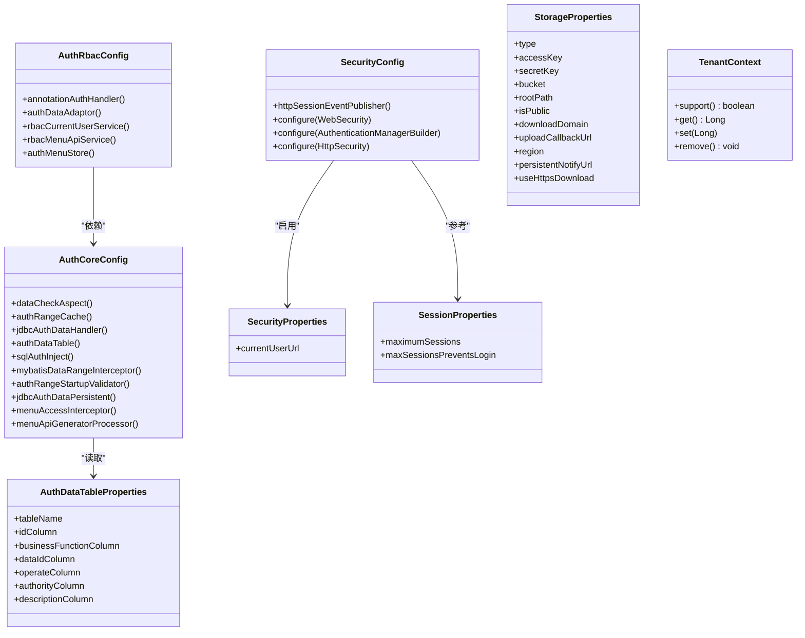
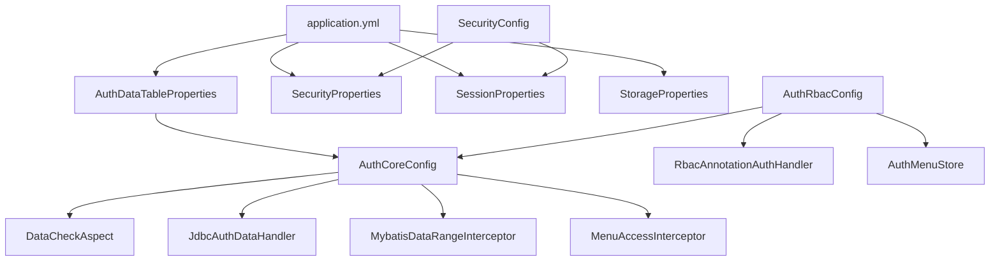

# 配置类 API

<cite>
**本文引用的文件**   
- [AuthCoreConfig.java](file://auth/auth-core-spring-boot-starter/src/main/java/com/cu/framework/boot/auth/core/config/AuthCoreConfig.java)
- [AuthDataTableProperties.java](file://auth/auth-core-spring-boot-starter/src/main/java/com/cu/framework/boot/auth/core/properties/AuthDataTableProperties.java)
- [AuthRbacConfig.java](file://auth/auth-rbac-spring-boot-starter/src/main/java/com/cu/framework/boot/auth/rbac/config/AuthRbacConfig.java)
- [SecurityConfig.java](file://login-spring-boot-starter/src/main/java/com/cu/framework/authentication/config/SecurityConfig.java)
- [SecurityProperties.java](file://login-spring-boot-starter/src/main/java/com/cu/framework/authentication/properties/SecurityProperties.java)
- [SessionProperties.java](file://login-spring-boot-starter/src/main/java/com/cu/framework/authentication/properties/SessionProperties.java)
- [StorageProperties.java](file://boot/storage-spring-boot-starter/src/main/java/com/cu/framework/storage/boot/StorageProperties.java)
- [TenantContext.java](file://boot/tenant-spring-boot-starter/src/main/java/com/cu/framework/tenant/TenantContext.java)
- [application.yml](file://docs/application.yml)
</cite>

## 目录

1. [引言](#引言)
2. [项目结构](#项目结构)
3. [核心配置类总览](#核心配置类总览)
4. [架构概览](#架构概览)
5. [详细配置说明](#详细配置说明)
6. [依赖关系分析](#依赖关系分析)
7. [性能与缓存特性](#性能与缓存特性)
8. [应用配置示例](#应用配置示例)
9. [加载顺序、默认值与覆盖规则](#加载顺序默认值与覆盖规则)
10. [常见问题排查](#常见问题排查)
11. [优化建议](#优化建议)
12. [结论](#结论)

## 引言

本文面向使用 Kewen Framework 的开发者，聚焦框架中与安全、权限、存储和多租户相关的配置类 API。重点包括：

- `AuthCoreConfig`：权限核心模块的配置装配点，负责数据权限处理器、SQL 注入、MyBatis 拦截器、菜单访问拦截器等 Bean 的创建。
- `AuthDataTableProperties`：权限数据表映射配置，对应 `cu.auth.auth-data-table`。
- `AuthRbacConfig`：RBAC 扩展配置，负责注解权限处理器、当前用户服务、菜单 API 服务和菜单存储等 Bean。
- `SecurityConfig`：基于 Spring Security 的安全配置入口，统一处理静态资源放行、认证管理器、请求授权、登出、异常处理和跨域相关逻辑。
- `SecurityProperties` 与 `SessionProperties`：安全与会话相关属性。
- `StorageProperties`：文件存储（七牛）配置。
- `TenantContext`：多租户线程上下文工具类。
- `docs/application.yml`：框架 starter 配置的参考手册。

本文不直接粘贴源代码，而是通过“源码路径”的方式标注关键实现位置。

## 项目结构

Kewen Framework 中与配置相关的关键代码分布在多个 starter 模块中：

| 模块 | 主要职责 | 关键配置类 |
|---|---|---|
| `auth/auth-core-spring-boot-starter` | 权限核心能力装配 | `AuthCoreConfig`、`AuthDataTableProperties` |
| `auth/auth-rbac-spring-boot-starter` | RBAC 扩展 Bean 装配 | `AuthRbacConfig` |
| `login-spring-boot-starter` | 登录与安全过滤器链 | `SecurityConfig`、`SecurityProperties`、`SessionProperties` |
| `boot/storage-spring-boot-starter` | 文件存储配置 | `StorageProperties` |
| `boot/tenant-spring-boot-starter` | 多租户上下文 | `TenantContext` |
| `docs` | 配置参考手册 | `application.yml` |

```mermaid
graph TB
    AuthCoreConfig["AuthCoreConfig<br/>权限核心配置"] --> AuthDataTableProperties["AuthDataTableProperties<br/>权限数据表配置"]
    AuthCoreConfig --> SqlAuthInject["SqlAuthInject<br/>SQL 权限注入"]
    AuthCoreConfig --> MybatisDataRangeInterceptor["MybatisDataRangeInterceptor<br/>MyBatis 数据范围拦截器"]
    AuthCoreConfig --> MenuAccessInterceptor["MenuAccessInterceptor<br/>菜单访问拦截器"]
    AuthRbacConfig["AuthRbacConfig<br/>RBAC 扩展配置"] --> RbacAnnotationAuthHandler["RbacAnnotationAuthHandler<br/>注解权限处理器"]
    AuthRbacConfig --> RbacCurrentUserService["RbacCurrentUserService<br/>当前用户服务"]
    SecurityConfig["SecurityConfig<br/>Spring Security 配置"] --> SecurityProperties["SecurityProperties<br/>安全属性"]
    SecurityConfig --> SessionProperties["SessionProperties<br/>会话属性"]
    StorageProperties["StorageProperties<br/>存储配置"] --> SevenNiu["七牛存储实现"]
    TenantContext["TenantContext<br/>租户上下文"] --> ThreadLocal["ThreadLocal 租户 ID"]
```



**图示来源**
- [AuthCoreConfig.java:1-203](file://auth/auth-core-spring-boot-starter/src/main/java/com/cu/framework/boot/auth/core/config/AuthCoreConfig.java#L1-L203)
- [AuthDataTableProperties.java:1-109](file://auth/auth-core-spring-boot-starter/src/main/java/com/cu/framework/boot/auth/core/properties/AuthDataTableProperties.java#L1-L109)
- [AuthRbacConfig.java:1-75](file://auth/auth-rbac-spring-boot-starter/src/main/java/com/cu/framework/boot/auth/rbac/config/AuthRbacConfig.java#L1-L75)
- [SecurityConfig.java:1-144](file://login-spring-boot-starter/src/main/java/com/cu/framework/authentication/config/SecurityConfig.java#L1-L144)
- [SecurityProperties.java:1-22](file://login-spring-boot-starter/src/main/java/com/cu/framework/authentication/properties/SecurityProperties.java#L1-L22)
- [SessionProperties.java:1-22](file://login-spring-boot-starter/src/main/java/com/cu/framework/authentication/properties/SessionProperties.java#L1-L22)
- [StorageProperties.java:1-63](file://boot/storage-spring-boot-starter/src/main/java/com/cu/framework/storage/boot/StorageProperties.java#L1-L63)
- [TenantContext.java:1-43](file://boot/tenant-spring-boot-starter/src/main/java/com/cu/framework/tenant/TenantContext.java#L1-L43)

**章节来源**
- [AuthCoreConfig.java:1-203](file://auth/auth-core-spring-boot-starter/src/main/java/com/cu/framework/boot/auth/core/config/AuthCoreConfig.java#L1-L203)
- [AuthRbacConfig.java:1-75](file://auth/auth-rbac-spring-boot-starter/src/main/java/com/cu/framework/boot/auth/rbac/config/AuthRbacConfig.java#L1-L75)
- [SecurityConfig.java:1-144](file://login-spring-boot-starter/src/main/java/com/cu/framework/authentication/config/SecurityConfig.java#L1-L144)
- [StorageProperties.java:1-63](file://boot/storage-spring-boot-starter/src/main/java/com/cu/framework/storage/boot/StorageProperties.java#L1-L63)
- [TenantContext.java:1-43](file://boot/tenant-spring-boot-starter/src/main/java/com/cu/framework/tenant/TenantContext.java#L1-L43)
- [application.yml:1-211](file://docs/application.yml#L1-L211)

## 核心配置类总览

### AuthCoreConfig：权限核心配置

`AuthCoreConfig` 是权限核心模块的装配入口。它不是单纯保存配置值的属性类，而是把配置属性转换为运行时 Bean，并注册权限相关切面、拦截器和校验器。

关键职责：

| 功能 | 行为 | 配置关联 |
|---|---|---|
| 数据校验切面 | 组装 `DataCheckAspect` | 依赖 `AuthDataHandler` 和 `AuthCurrentUserContextHolder` |
| 数据范围缓存 | 创建 `AuthRangeCache` | 无外部配置项 |
| 数据权限处理器 | 在缺少自定义实现时创建 `JdbcAuthDataHandler` | 可通过提供自定义 `AuthDataHandler` Bean 覆盖 |
| 权限数据表定义 | 将 `AuthDataTableProperties` 转为 `AuthDataTable` | 对应 `cu.auth.auth-data-table` |
| SQL 权限注入 | 创建 `SqlAuthInject` | 依赖 `AuthDataTable` |
| MyBatis 数据范围拦截器 | 创建 `MybatisDataRangeInterceptor` | 依赖 `AuthRangeCache` 和懒加载的 `AuthCurrentUserContextHolder` |
| 启动校验器 | 扫描 Mapper 中的权限范围声明并填充缓存 | 使用 `ObjectProvider<SqlSessionFactory>` 避免循环依赖 |
| 权限拒绝响应 | 创建 `AuthExceptionHandler` | 可被自定义 `AuthExceptionHandler` Bean 覆盖 |
| 菜单访问拦截器 | 创建 `MenuAccessInterceptor` | 依赖 `AuthMenuHandler` 和 `AuthCurrentUserContextHolder` |
| 菜单 API 生成 | 创建 `MenuApiGeneratorProcessor` 和命令行执行器 | 用于初始化菜单 API |

**章节来源**
- [AuthCoreConfig.java:1-203](file://auth/auth-core-spring-boot-starter/src/main/java/com/cu/framework/boot/auth/core/config/AuthCoreConfig.java#L1-L203)

### AuthDataTableProperties：权限数据表映射配置

该配置类绑定前缀为 `cu.auth.auth-data-table`，用于描述权限数据表的结构。框架根据这些字段名构造 SQL，因此表结构和列名必须与实际数据库一致。

| 配置键 | 类型 | 默认值 | 含义 |
|---|---|---:|---|
| `cu.auth.auth-data-table.table-name` | 字符串 | `sys_auth_data` | 权限数据表名称 |
| `cu.auth.auth-data-table.id-column` | 字符串 | `id` | 主键列名 |
| `cu.auth.auth-data-table.business-function-column` | 字符串 | `business_function` | 业务功能列名 |
| `cu.auth.auth-data-table.data-id-column` | 字符串 | `data_id` | 业务 ID 列名 |
| `cu.auth.auth-data-table.operate-column` | 字符串 | `operate` | 操作类型列名 |
| `cu.auth.auth-data-table.authority-column` | 字符串 | `authority` | 权限字符串列名 |
| `cu.auth.auth-data-table.description-column` | 字符串 | `description` | 权限描述列名 |

**章节来源**
- [AuthDataTableProperties.java:1-109](file://auth/auth-core-spring-boot-starter/src/main/java/com/cu/framework/boot/auth/core/properties/AuthDataTableProperties.java#L1-L109)

### SecurityConfig：安全配置入口

`SecurityConfig` 继承 Spring Security 的 Web 安全配置适配器，承担以下职责：

- 启用 `SecurityProperties`。
- 注册 `HttpSessionEventPublisher`，让会话销毁事件可被容器感知。
- 放行静态资源路径。
- 注册 `SecurityUserDetailsService` 作为用户名密码认证的用户来源。
- 构建统一的请求授权规则：汇总所有 `UrlSecurityCustomizer` 放行的 URL，其余请求需要认证。
- 设置登出成功处理器和访问拒绝处理器。
- 禁用 CSRF。
- 支持通过 `HttpSecurityCustomizer` 扩展或覆盖安全配置。
- 提供跨域配置方法（当前未作为主过滤链启用）。

注意：虽然存在 `SessionProperties`，但 `SecurityConfig` 当前并未直接读取会话并发控制配置；文档中的会话配置属于参考手册中的属性骨架。

**章节来源**
- [SecurityConfig.java:1-144](file://login-spring-boot-starter/src/main/java/com/cu/framework/authentication/config/SecurityConfig.java#L1-L144)

### SecurityProperties：安全属性

`SecurityProperties` 绑定 `cu.security`，当前仅暴露一个属性：

| 配置键 | 类型 | 默认值 | 含义 |
|---|---|---|---|
| `cu.security.current-user-url` | 字符串 | `/currentUser` | 当前用户接口地址；当前代码未读取，实际路径固定为 `/currentUser` |

**章节来源**
- [SecurityProperties.java:1-22](file://login-spring-boot-starter/src/main/java/com/cu/framework/authentication/properties/SecurityProperties.java#L1-L22)

### SessionProperties：会话属性

`SessionProperties` 绑定 `cu.security.session`，描述会话并发控制的配置项：

| 配置键 | 类型 | 默认值 | 含义 |
|---|---|---:|---|
| `cu.security.session.maximum-sessions` | 整数 | `10` | 同一用户最大并发会话数 |
| `cu.security.session.max-sessions-prevents-login` | 布尔值 | `false` | 达到上限时阻止新登录还是踢掉最早会话 |

**章节来源**
- [SessionProperties.java:1-22](file://login-spring-boot-starter/src/main/java/com/cu/framework/authentication/properties/SessionProperties.java#L1-L22)

### AuthRbacConfig：RBAC 配置

`AuthRbacConfig` 在引入 RBAC 扩展后装配 RBAC 相关 Bean，并在 `AuthCoreConfig` 之后自动装配。

| Bean | 条件 | 作用 |
|---|---|---|
| `annotationAuthHandler` | 容器中不存在 `AuthMenuHandler` | 创建 `RbacAnnotationAuthHandler`，基于 RBAC 菜单实现注解权限 |
| `authDataAdaptor` | 无条件 | 包装 `AuthDataHandler`，提供数据权限适配调用方式 |
| `rbacCurrentUserService` | 无条件 | 基于用户组合组件和密码编码器创建当前用户服务 |
| `rbacMenuApiService` | 无条件 | 基于菜单 API 持久化服务创建菜单 API 服务 |
| `authMenuStore` | 容器中不存在 `AuthMenuStore` | 创建内存过期版菜单存储；可被 Redis 等实现覆盖 |

**章节来源**
- [AuthRbacConfig.java:1-75](file://auth/auth-rbac-spring-boot-starter/src/main/java/com/cu/framework/boot/auth/rbac/config/AuthRbacConfig.java#L1-L75)

### StorageProperties：存储配置

`StorageProperties` 绑定 `cu.storage`，当前实现固定使用七牛对象存储。

| 配置键 | 类型 | 默认值 | 含义 |
|---|---|---|---|
| `cu.storage.type` | 字符串 | 空 | 预留字段；当前实现固定使用七牛 |
| `cu.storage.access-key` | 字符串 | 空 | 七牛 AccessKey |
| `cu.storage.secret-key` | 字符串 | 空 | 七牛 SecretKey |
| `cu.storage.bucket` | 字符串 | 空 | 七牛存储桶名称 |
| `cu.storage.root-path` | 字符串 | `""` | 存储根目录前缀 |
| `cu.storage.is-public` | 布尔值 | `true` | 是否公开空间；非公开时下载链接带签名 |
| `cu.storage.download-domain` | 字符串 | 空 | 下载域名 |
| `cu.storage.upload-callback-url` | 字符串 | 空 | 上传成功后回调地址 |
| `cu.storage.region` | 字符串 | `region2` | 七牛区域标识 |
| `cu.storage.persistent-notify-url` | 字符串 | 空 | 数据处理异步通知地址 |
| `cu.storage.use-https-download` | 布尔值 | `false` | 下载链接是否使用 HTTPS |

**章节来源**
- [StorageProperties.java:1-63](file://boot/storage-spring-boot-starter/src/main/java/com/cu/framework/storage/boot/StorageProperties.java#L1-L63)

### TenantContext：租户上下文

`TenantContext` 是多租户上下文的工具类，内部使用可继承的 `ThreadLocal` 保存当前线程的租户 ID。

| 方法 | 返回值 | 含义 |
|---|---|---|
| `support()` | 布尔值 | 判断当前线程是否已设置租户 ID |
| `get()` | 长整型租户 ID | 获取当前租户 ID |
| `set(tenantId)` | 无 | 设置当前租户 ID |
| `remove()` | 无 | 清除当前租户 ID |

该类本身不包含 `@ConfigurationProperties`，也不直接读取 application.yml；它由其他过滤器或拦截器在使用多租户功能时读写。

**章节来源**
- [TenantContext.java:1-43](file://boot/tenant-spring-boot-starter/src/main/java/com/cu/framework/tenant/TenantContext.java#L1-L43)

## 架构概览

下图展示配置类与运行时 Bean 的关系：



**图示来源**
- [AuthCoreConfig.java:1-203](file://auth/auth-core-spring-boot-starter/src/main/java/com/cu/framework/boot/auth/core/config/AuthCoreConfig.java#L1-L203)
- [AuthDataTableProperties.java:1-109](file://auth/auth-core-spring-boot-starter/src/main/java/com/cu/framework/boot/auth/core/properties/AuthDataTableProperties.java#L1-L109)
- [AuthRbacConfig.java:1-75](file://auth/auth-rbac-spring-boot-starter/src/main/java/com/cu/framework/boot/auth/rbac/config/AuthRbacConfig.java#L1-L75)
- [SecurityConfig.java:1-144](file://login-spring-boot-starter/src/main/java/com/cu/framework/authentication/config/SecurityConfig.java#L1-L144)
- [SecurityProperties.java:1-22](file://login-spring-boot-starter/src/main/java/com/cu/framework/authentication/properties/SecurityProperties.java#L1-L22)
- [SessionProperties.java:1-22](file://login-spring-boot-starter/src/main/java/com/cu/framework/authentication/properties/SessionProperties.java#L1-L22)
- [StorageProperties.java:1-63](file://boot/storage-spring-boot-starter/src/main/java/com/cu/framework/storage/boot/StorageProperties.java#L1-L63)
- [TenantContext.java:1-43](file://boot/tenant-spring-boot-starter/src/main/java/com/cu/framework/tenant/TenantContext.java#L1-L43)

## 详细配置说明

### 权限数据表配置

权限数据表配置用于告诉框架如何从数据库中读取“哪个业务实体、哪个业务 ID、允许哪些操作、对应什么权限字符串”。

典型使用场景：

- 修改权限数据表名称。
- 迁移到不同命名风格的数据库列名。
- 在旧系统上对接已有权限表结构。

注意事项：

- 如果列名配置错误，权限查询可能返回空结果，导致数据权限失效。
- 如果表名配置错误，可能出现 SQL 错误或启动校验失败。
- 建议在变更列名前先在测试环境验证 SQL 查询结果。

**章节来源**
- [AuthDataTableProperties.java:1-109](file://auth/auth-core-spring-boot-starter/src/main/java/com/cu/framework/boot/auth/core/properties/AuthDataTableProperties.java#L1-L109)
- [AuthCoreConfig.java:1-203](file://auth/auth-core-spring-boot-starter/src/main/java/com/cu/framework/boot/auth/core/config/AuthCoreConfig.java#L1-L203)

### 安全配置项

`SecurityConfig` 负责把安全策略落地到 Spring Security 过滤链中。

关键点：

| 配置项 | 行为 |
|---|---|
| `cu.security.current-user-url` | 当前代码未消费，实际路径固定为 `/currentUser` |
| 静态资源放行 | `/static/**`、`/js/**`、`/css/**`、`/image/**`、`/**/*.html` 不过滤 |
| 用户详情服务 | 通过 `SecurityUserDetailsService` 提供用户名密码认证用户来源 |
| 请求授权 | 先收集所有 `UrlSecurityCustomizer.permitAll()`，再要求其余请求认证 |
| 登出 | 使用 `SecurityAuthenticationSuccessHandler` |
| 访问拒绝 | 使用 `SecurityAuthenticationExceptionResolverHandler` |
| CSRF | 已禁用 |
| 自定义扩展 | 通过 `HttpSecurityCustomizer` 和 `UrlSecurityCustomizer` 扩展 |

**章节来源**
- [SecurityConfig.java:1-144](file://login-spring-boot-starter/src/main/java/com/cu/framework/authentication/config/SecurityConfig.java#L1-L144)
- [SecurityProperties.java:1-22](file://login-spring-boot-starter/src/main/java/com/cu/framework/authentication/properties/SecurityProperties.java#L1-L22)

### 会话管理配置

会话配置定义在 `SessionProperties` 中，绑定 `cu.security.session`。

| 配置项 | 默认值 | 行为 |
|---|---:|---|
| `maximum-sessions` | `10` | 同一用户的最大会话数 |
| `max-sessions-prevents-login` | `false` | `false` 表示挤掉最早会话，`true` 表示阻止新登录 |

需要注意：当前 `SecurityConfig` 没有直接读取该属性；如果你希望严格限制并发会话数，应检查业务模块是否自行实现了会话管理逻辑，或在自定义 `HttpSecurityCustomizer` 中显式配置。

**章节来源**
- [SessionProperties.java:1-22](file://login-spring-boot-starter/src/main/java/com/cu/framework/authentication/properties/SessionProperties.java#L1-L22)
- [SecurityConfig.java:1-144](file://login-spring-boot-starter/src/main/java/com/cu/framework/authentication/config/SecurityConfig.java#L1-L144)

### RBAC 配置选项

`AuthRbacConfig` 主要关注 RBAC 扩展 Bean 的装配，而不是纯 YAML 配置。

| 配置维度 | 说明 |
|---|---|
| 角色权限映射 | 通过 RBAC 菜单和用户角色数据模型实现；具体映射逻辑不在本配置类中，而在 RBAC 扩展的实现和服务层 |
| 注解权限 | 当容器中没有自定义 `AuthMenuHandler` 时，框架注册 `RbacAnnotationAuthHandler` |
| 菜单存储 | 默认使用内存过期存储，可通过提供自定义 `AuthMenuStore` Bean 替换为 Redis 等实现 |
| 当前用户服务 | 结合用户组合组件和密码编码器构建 |
| 菜单 API 服务 | 封装菜单 API 的持久化访问 |

关于“部门继承规则”，当前仓库中 `AuthRbacConfig` 没有直接暴露部门继承相关的 YAML 配置项；部门继承相关逻辑通常由 RBAC 的数据模型、服务实现或扩展点决定，而不是由 `AuthRbacConfig` 直接读取配置。

**章节来源**
- [AuthRbacConfig.java:1-75](file://auth/auth-rbac-spring-boot-starter/src/main/java/com/cu/framework/boot/auth/rbac/config/AuthRbacConfig.java#L1-L75)

### 存储配置

`StorageProperties` 是七牛存储的集中配置点。

重要建议：

- `access-key`、`secret-key`、`bucket`、`download-domain` 在生产环境应通过环境变量或配置中心注入，不要写死在仓库中。
- `is-public=false` 会生成带签名的下载链接，适合私有资源；`is-public=true` 适合公开资源。
- `region` 默认 `region2`，部署在不同机房时需要改为对应区域。
- `use-https-download=false` 保持现有行为；如需 HTTPS，需确保 `download-domain` 已配置证书。

**章节来源**
- [StorageProperties.java:1-63](file://boot/storage-spring-boot-starter/src/main/java/com/cu/framework/storage/boot/StorageProperties.java#L1-L63)

### 多租户上下文

`TenantContext` 是一个轻量级上下文工具类：

- 使用 `InheritableThreadLocal` 保存租户 ID。
- 提供 `support()`、`get()`、`set()`、`remove()` 四个方法。
- 常用于在请求链路中传递租户信息，例如在数据权限、分页、日志或多租户 SQL 改写中使用。

常见用法模式：

1. 过滤器或拦截器解析请求头或参数中的租户 ID。
2. 调用 `TenantContext.set(tenantId)` 设置上下文。
3. 业务逻辑通过 `TenantContext.get()` 获取租户 ID。
4. 请求结束时调用 `TenantContext.remove()` 清理上下文。

**章节来源**
- [TenantContext.java:1-43](file://boot/tenant-spring-boot-starter/src/main/java/com/cu/framework/tenant/TenantContext.java#L1-L43)

## 依赖关系分析

### 配置类之间的依赖



**图示来源**
- [AuthCoreConfig.java:1-203](file://auth/auth-core-spring-boot-starter/src/main/java/com/cu/framework/boot/auth/core/config/AuthCoreConfig.java#L1-L203)
- [AuthRbacConfig.java:1-75](file://auth/auth-rbac-spring-boot-starter/src/main/java/com/cu/framework/boot/auth/rbac/config/AuthRbacConfig.java#L1-L75)
- [SecurityConfig.java:1-144](file://login-spring-boot-starter/src/main/java/com/cu/framework/authentication/config/SecurityConfig.java#L1-L144)
- [AuthDataTableProperties.java:1-109](file://auth/auth-core-spring-boot-starter/src/main/java/com/cu/framework/boot/auth/core/properties/AuthDataTableProperties.java#L1-L109)
- [SecurityProperties.java:1-22](file://login-spring-boot-starter/src/main/java/com/cu/framework/authentication/properties/SecurityProperties.java#L1-L22)
- [SessionProperties.java:1-22](file://login-spring-boot-starter/src/main/java/com/cu/framework/authentication/properties/SessionProperties.java#L1-L22)
- [StorageProperties.java:1-63](file://boot/storage-spring-boot-starter/src/main/java/com/cu/framework/storage/boot/StorageProperties.java#L1-L63)
- [application.yml:1-211](file://docs/application.yml#L1-L211)

### 启动装配顺序

1. `AuthCoreConfig` 注册权限核心 Bean。
2. `AuthRbacConfig` 在 `AuthCoreConfig` 之后注册 RBAC 扩展 Bean。
3. `SecurityConfig` 注册 Spring Security 相关 Bean 并配置过滤链。
4. `StorageProperties` 由存储 starter 自动装配。
5. `TenantContext` 由多租户 starter 在请求链路中使用。

**章节来源**
- [AuthCoreConfig.java:1-203](file://auth/auth-core-spring-boot-starter/src/main/java/com/cu/framework/boot/auth/core/config/AuthCoreConfig.java#L1-L203)
- [AuthRbacConfig.java:1-75](file://auth/auth-rbac-spring-boot-starter/src/main/java/com/cu/framework/boot/auth/rbac/config/AuthRbacConfig.java#L1-L75)
- [SecurityConfig.java:1-144](file://login-spring-boot-starter/src/main/java/com/cu/framework/authentication/config/SecurityConfig.java#L1-L144)

## 性能与缓存特性

### 数据范围声明缓存

`AuthCoreConfig` 创建了 `AuthRangeCache`，并以 MyBatis 映射语句 ID 为键保存静态权限范围信息。这样可以在运行时减少重复解析开销。

### 菜单缓存开关

参考手册中存在 `cu.auth.cache-auth`，用于控制是否缓存菜单与权限数据。当关闭时，每次请求可能直接查库。开启后可降低数据库压力，但需要配合合适的缓存实现。

### 菜单存储

RBAC 模块默认使用内存过期版菜单存储。对于单机或小规模部署，这是简单实现；在多实例部署场景中，建议使用 Redis 等共享存储替代默认实现。

**章节来源**
- [AuthCoreConfig.java:1-203](file://auth/auth-core-spring-boot-starter/src/main/java/com/cu/framework/boot/auth/core/config/AuthCoreConfig.java#L1-L203)
- [AuthRbacConfig.java:1-75](file://auth/auth-rbac-spring-boot-starter/src/main/java/com/cu/framework/boot/auth/rbac/config/AuthRbacConfig.java#L1-L75)
- [application.yml:1-211](file://docs/application.yml#L1-L211)

## 应用配置示例

以下示例基于 `docs/application.yml` 整理，展示常用配置项的实际写法。

### 完整参考片段

```yaml
cu:
  # ---- basic-spring-boot-starter ----
  request:
    persistent:
      database: false
    message:
      fang-tang: false

  # ---- 方糖消息通知 ----
  notify:
    fang-tang:
      enabled: false
      key: ""
      domain: https://sctapi.ftqq.com

  # ---- storage-spring-boot-starter ----
  storage:
    type: ""
    access-key: ""
    secret-key: ""
    bucket: ""
    root-path: ""
    is-public: true
    download-domain: ""
    upload-callback-url: ""
    region: region2
    persistent-notify-url: ""
    use-https-download: false

  # ---- tenant-spring-boot-starter ----
  tenant:
    open: false

  # ---- cu.auth：三个 starter 共用 ----
  auth:
    auth-data-table:
      table-name: sys_auth_data
      id-column: id
      business-function-column: business_function
      data-id-column: data_id
      operate-column: operate
      authority-column: authority
      description-column: description
    cache-auth: false
    permit-url: ""

  # ---- login-spring-boot-starter ----
  security:
    current-user-url: /currentUser
    session:
      maximum-sessions: 10
      max-sessions-prevents-login: false
```

### 各 starter 最小可用配置

| 功能 | 最小必填配置 | 说明 |
|---|---|---|
| 文件存储 | `cu.storage.access-key`、`cu.storage.secret-key`、`cu.storage.bucket`、`cu.storage.download-domain` | 七牛凭据和下载域名 |
| 权限数据表 | `cu.auth.auth-data-table.*` | 与数据库权限表结构一致 |
| 多租户 | `cu.tenant.open: true` | 开启租户过滤器和 Feign 拦截器 |
| 安全基础 | 无需额外配置即可启动 | 默认放行静态资源，其余请求需认证 |

**章节来源**
- [application.yml:1-211](file://docs/application.yml#L1-L211)

## 加载顺序、默认值与覆盖规则

### 配置绑定前缀

| 配置类 | 前缀 | 主要用途 |
|---|---|---|
| `AuthDataTableProperties` | `cu.auth.auth-data-table` | 权限数据表映射 |
| `SecurityProperties` | `cu.security` | 安全属性 |
| `SessionProperties` | `cu.security.session` | 会话属性 |
| `StorageProperties` | `cu.storage` | 文件存储 |
| `TenantContext` | 无 | 运行时上下文工具 |

### 默认值规则

- 若配置项有默认值，且未在 application.yml 中覆盖，则使用默认值。
- 若配置项无默认值且未配置，可能在运行期出现空值或功能不可用。
- 参考手册中标记 `[必填]` 的键缺失时，可能导致启动失败或功能不可用。

### Bean 覆盖规则

| Bean | 覆盖方式 |
|---|---|
| `AuthDataHandler` | 提供自定义 Bean 覆盖默认 `JdbcAuthDataHandler` |
| `AuthExceptionHandler` | 提供自定义 Bean 覆盖默认权限拒绝处理器 |
| `AuthMenuHandler` | 提供自定义 Bean 覆盖默认 `RbacAnnotationAuthHandler` |
| `AuthMenuStore` | 提供自定义 Bean 覆盖默认内存菜单存储 |
| `HttpSecurityCustomizer` | 追加自定义安全规则，可覆盖默认行为 |
| `UrlSecurityCustomizer` | 追加免登录 URL |

**章节来源**
- [AuthCoreConfig.java:1-203](file://auth/auth-core-spring-boot-starter/src/main/java/com/cu/framework/boot/auth/core/config/AuthCoreConfig.java#L1-L203)
- [AuthRbacConfig.java:1-75](file://auth/auth-rbac-spring-boot-starter/src/main/java/com/cu/framework/boot/auth/rbac/config/AuthRbacConfig.java#L1-L75)
- [SecurityConfig.java:1-144](file://login-spring-boot-starter/src/main/java/com/cu/framework/authentication/config/SecurityConfig.java#L1-L144)

## 常见问题排查

### 权限数据表查询为空

**现象：** 权限生效但数据权限不生效，或某些数据列表返回空结果。

**排查步骤：**

1. 确认 `cu.auth.auth-data-table.table-name` 指向真实表名。
2. 确认所有列名与实际数据库列名一致。
3. 检查权限数据表中是否存在对应当前业务功能和操作的记录。
4. 查看启动阶段是否触发数据范围校验失败。

**章节来源**
- [AuthDataTableProperties.java:1-109](file://auth/auth-core-spring-boot-starter/src/main/java/com/cu/framework/boot/auth/core/properties/AuthDataTableProperties.java#L1-L109)
- [AuthCoreConfig.java:1-203](file://auth/auth-core-spring-boot-starter/src/main/java/com/cu/framework/boot/auth/core/config/AuthCoreConfig.java#L1-L203)

### 菜单权限不生效

**现象：** 注解权限或菜单访问控制无效。

**排查步骤：**

1. 确认是否引入了 RBAC 扩展依赖。
2. 确认容器中没有提前注册自定义 `AuthMenuHandler`。
3. 检查菜单数据是否正确加载。
4. 如使用多实例，检查菜单存储是否为共享实现。

**章节来源**
- [AuthRbacConfig.java:1-75](file://auth/auth-rbac-spring-boot-starter/src/main/java/com/cu/framework/boot/auth/rbac/config/AuthRbacConfig.java#L1-L75)

### 当前用户接口路径不一致

**现象：** 前端调用 `/currentUser` 报 401 或 404。

**排查步骤：**

1. 确认实际接口路径为 `/currentUser`。
2. 不要依赖 `cu.security.current-user-url` 改变该路径，因为当前代码未读取该属性。
3. 检查是否有自定义 `HttpSecurityCustomizer` 改变了认证流程。

**章节来源**
- [SecurityProperties.java:1-22](file://login-spring-boot-starter/src/main/java/com/cu/framework/authentication/properties/SecurityProperties.java#L1-L22)
- [SecurityConfig.java:1-144](file://login-spring-boot-starter/src/main/java/com/cu/framework/authentication/config/SecurityConfig.java#L1-L144)

### 存储上传失败

**现象：** 文件上传报错或下载链接无法访问。

**排查步骤：**

1. 检查 `access-key`、`secret-key`、`bucket` 是否正确。
2. 检查 `download-domain` 是否可访问。
3. 检查 `region` 是否与七牛存储桶所在区域一致。
4. 如 `is-public=false`，确认客户端能正确处理签名链接。

**章节来源**
- [StorageProperties.java:1-63](file://boot/storage-spring-boot-starter/src/main/java/com/cu/framework/storage/boot/StorageProperties.java#L1-L63)

### 租户上下文未生效

**现象：** 业务逻辑取不到租户 ID。

**排查步骤：**

1. 确认是否启用 `cu.tenant.open`。
2. 确认请求进入租户过滤器后被设置了租户 ID。
3. 检查是否在异步线程中使用了 `TenantContext`，因为 `ThreadLocal` 不会自动传播到子线程。
4. 确认请求结束后是否清理了上下文。

**章节来源**
- [TenantContext.java:1-43](file://boot/tenant-spring-boot-starter/src/main/java/com/cu/framework/tenant/TenantContext.java#L1-L43)

## 优化建议

1. **生产环境不要硬编码密钥。**  
   将 `storage.access-key`、`storage.secret-key`、OAuth/OIDC/SAML 相关凭据放入配置中心或环境变量。

2. **谨慎修改权限数据表列名。**  
   列名直接影响 SQL 生成和权限判定；建议先在测试环境验证。

3. **开启菜单缓存以降低数据库压力。**  
   如果频繁查询菜单和权限，可考虑开启 `cache-auth` 并提供共享菜单存储实现。

4. **多实例部署时使用共享菜单存储。**  
   默认内存菜单存储在集群环境下会导致各节点菜单不一致。

5. **合理使用静态资源放行。**  
   只放行必要的静态路径，避免误放行敏感接口。

6. **谨慎使用全局跨域配置。**  
   当前跨域配置方法未被主过滤链启用；如需开放跨域，应在自定义 `HttpSecurityCustomizer` 中精确配置来源和方法。

7. **租户上下文务必清理。**  
   在过滤器或拦截器的 finally 分支中调用 `TenantContext.remove()`，防止线程复用导致租户污染。

[本节为通用优化建议，不直接分析具体源码行]

## 结论

Kewen Framework 的配置体系围绕 starter 模块化设计展开：

- `AuthCoreConfig` 和 `AuthDataTableProperties` 负责权限核心能力和数据表映射。
- `AuthRbacConfig` 负责 RBAC 扩展 Bean 的装配。
- `SecurityConfig` 统一管理 Spring Security 过滤链，并通过扩展点允许覆盖。
- `StorageProperties` 集中管理七牛存储配置。
- `TenantContext` 提供轻量租户上下文。
- `docs/application.yml` 提供了完整的参考配置。

正确理解这些配置类的职责、默认值和覆盖规则，可以帮助你在开发、测试和生产环境中稳定地启用权限、安全、存储和多租户功能。