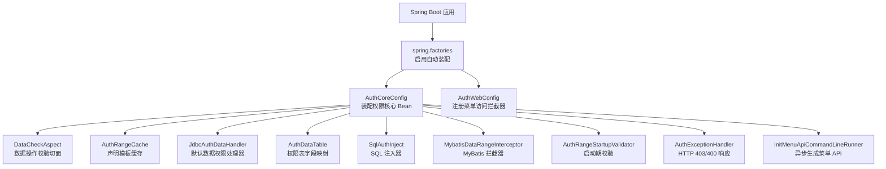
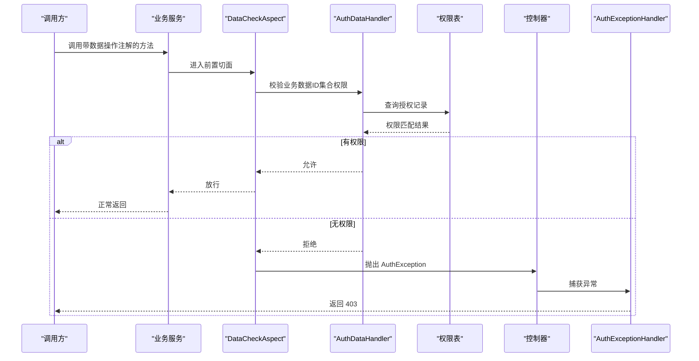
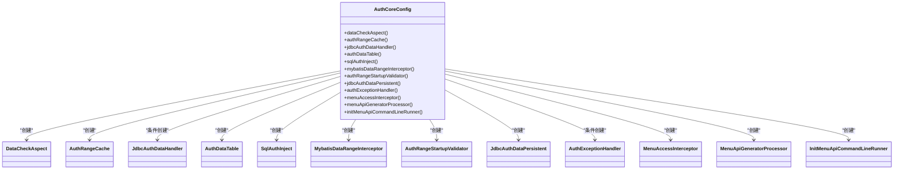
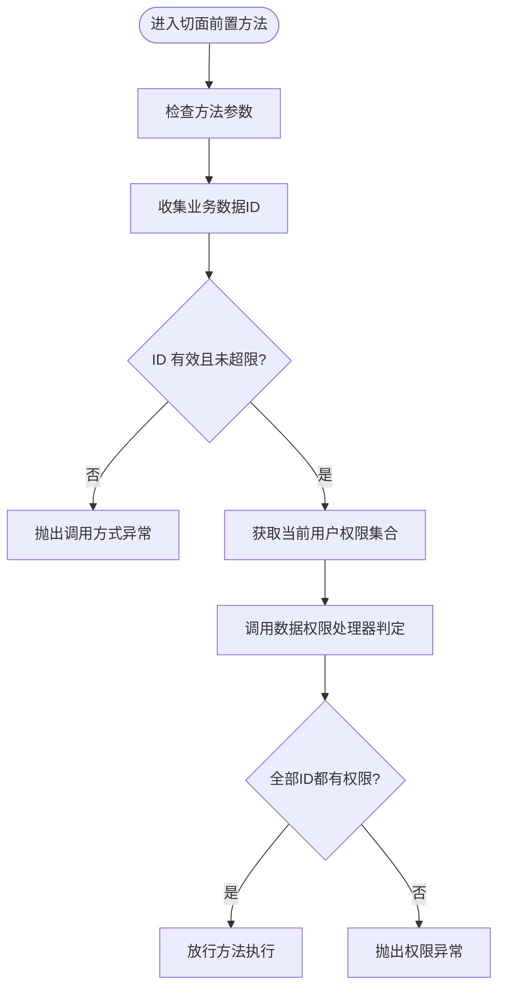
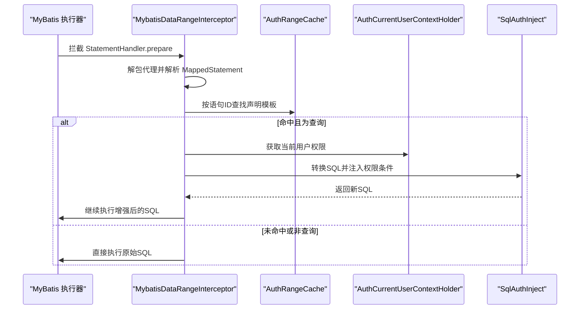
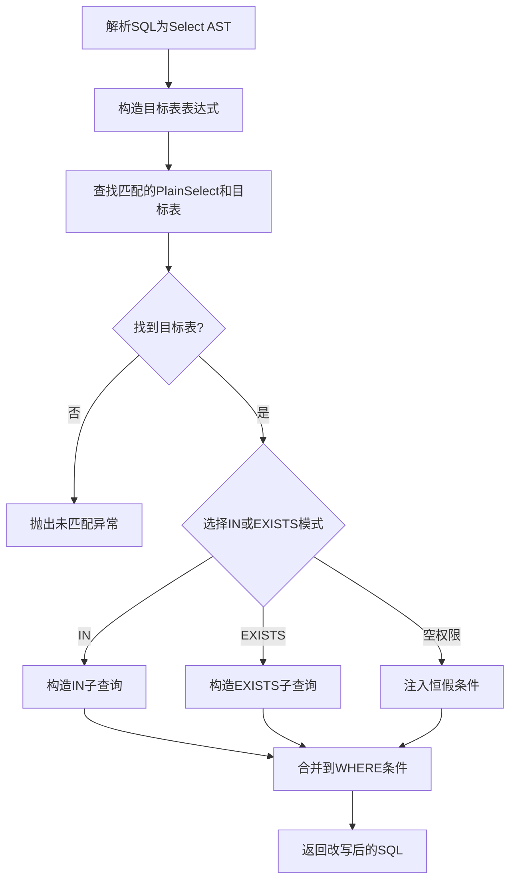
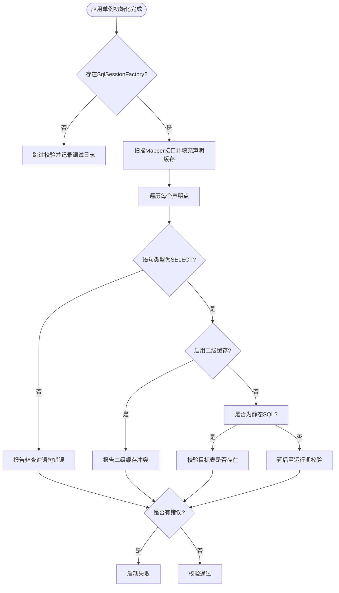
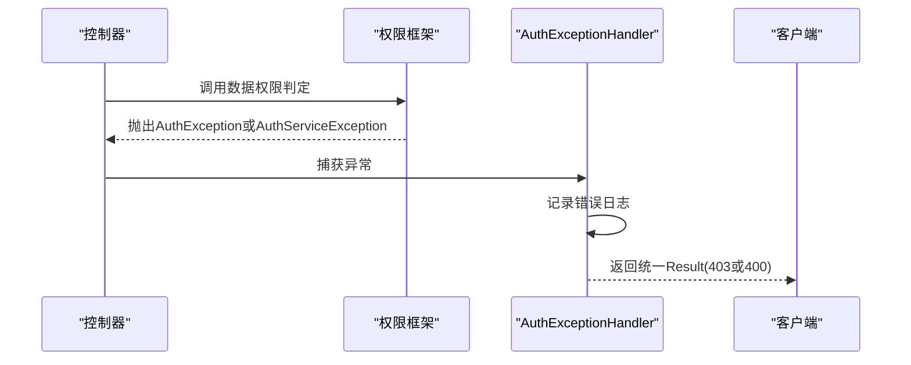
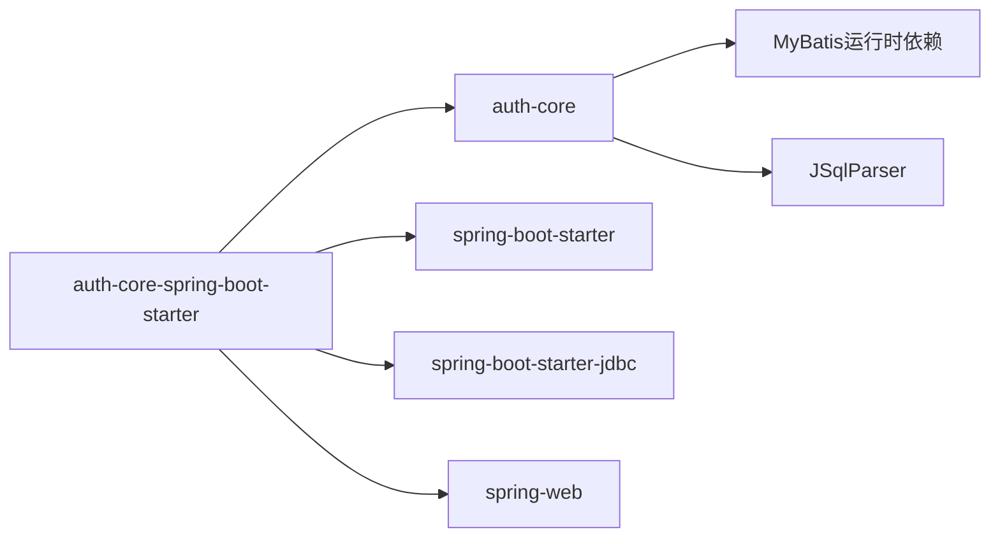

# Auth Core Starter 权限核心

<cite>
**本文引用的文件**   
- [AuthCoreConfig.java](file://auth/auth-core-spring-boot-starter/src/main/java/com/cu/framework/boot/auth/core/config/AuthCoreConfig.java)
- [AuthWebConfig.java](file://auth/auth-core-spring-boot-starter/src/main/java/com/cu/framework/boot/auth/core/config/AuthWebConfig.java)
- [AuthExceptionHandler.java](file://auth/auth-core-spring-boot-starter/src/main/java/com/cu/framework/boot/auth/core/AuthExceptionHandler.java)
- [InitMenuApiCommandLineRunner.java](file://auth/auth-core-spring-boot-starter/src/main/java/com/cu/framework/boot/auth/core/init/InitMenuApiCommandLineRunner.java)
- [AuthDataTableProperties.java](file://auth/auth-core-spring-boot-starter/src/main/java/com/cu/framework/boot/auth/core/properties/AuthDataTableProperties.java)
- [spring.factories](file://auth/auth-core-spring-boot-starter/src/main/resources/META-INF/spring.factories)
- [DataCheckAspect.java](file://auth/auth-core/src/main/java/com/cu/framework/auth/core/data/edit/DataCheckAspect.java)
- [JdbcAuthDataHandler.java](file://auth/auth-core/src/main/java/com/cu/framework/auth/core/data/JdbcAuthDataHandler.java)
- [AuthDataTable.java](file://auth/auth-core/src/main/java/com/cu/framework/auth/core/data/AuthDataTable.java)
- [MybatisDataRangeInterceptor.java](file://auth/auth-core/src/main/java/com/cu/framework/auth/core/data/Range/MybatisDataRangeInterceptor.java)
- [AuthRangeCache.java](file://auth/auth-core/src/main/java/com/cu/framework/auth/core/data/Range/AuthRangeCache.java)
- [AuthRangeStartupValidator.java](file://auth/auth-core/src/main/java/com/cu/framework/auth/core/data/Range/AuthRangeStartupValidator.java)
- [SqlAuthInject.java](file://auth/auth-core/src/main/java/com/cu/framework/auth/core/data/Range/SqlAuthInject.java)
- [schema.sql](file://sample/auth-core-boot-sample/sql/schema.sql)
</cite>

## 目录
1. [简介](#简介)
2. [项目结构](#项目结构)
3. [核心组件](#核心组件)
4. [架构总览](#架构总览)
5. [关键组件详细分析](#关键组件详细分析)
6. [依赖关系分析](#依赖关系分析)
7. [性能与扩展性](#性能与扩展性)
8. [配置属性参考](#配置属性参考)
9. [使用示例与集成指南](#使用示例与集成指南)
10. [故障排查](#故障排查)
11. [结论](#结论)

## 简介
Auth Core Starter 是权限框架的启动装配层，负责把 auth-core 模块中的数据校验切面、数据范围拦截器、SQL 注入器、权限表映射、菜单访问拦截器、启动期校验器等组件装配到 Spring 容器中。它同时提供默认的数据权限处理器和 HTTP 拒绝响应处理器，并暴露可替换扩展点，使业务可以自定义数据权限实现、权限表结构和 Web 层异常响应格式。

该文档聚焦以下能力：
- 核心配置类 `AuthCoreConfig` 的 Bean 装配流程。
- 数据校验切面 `DataCheckAspect`、数据范围缓存 `AuthRangeCache`、JDBC 数据权限处理器 `JdbcAuthDataHandler`。
- MyBatis 数据范围拦截器 `MybatisDataRangeInterceptor` 的工作原理与循环依赖规避。
- SQL 注入器 `SqlAuthInject` 与权限表配置 `AuthDataTable` 的工作机制。
- 启动校验器 `AuthRangeStartupValidator` 的检测策略。
- 权限异常处理器 `AuthExceptionHandler` 的自动装配条件与返回结果。
- 完整的配置属性说明、权限表结构示例和自定义数据权限处理器扩展指南。

## 项目结构
本 Starter 模块由两个主要部分组成：
- Spring Boot 自动装配入口：通过 `META-INF/spring.factories` 注册 `AuthCoreConfig` 与 `AuthWebConfig`。
- 核心 Bean 定义：集中在 `AuthCoreConfig`；Web 拦截器注册在 `AuthWebConfig`。
- 运行时组件来自 `auth-core` 模块：数据权限处理、SQL 注入、数据范围缓存、启动校验、菜单访问等。

**图表来源**
- [AuthCoreConfig.java:1-200](file://auth/auth-core-spring-boot-starter/src/main/java/com/cu/framework/boot/auth/core/config/AuthCoreConfig.java#L1-L200)
- [AuthWebConfig.java:1-30](file://auth/auth-core-spring-boot-starter/src/main/java/com/cu/framework/boot/auth/core/config/AuthWebConfig.java#L1-L30)
- [spring.factories:1-3](file://auth/auth-core-spring-boot-starter/src/main/resources/META-INF/spring.factories#L1-L3)

**章节来源**
- [spring.factories:1-3](file://auth/auth-core-spring-boot-starter/src/main/resources/META-INF/spring.factories#L1-L3)
- [AuthCoreConfig.java:1-200](file://auth/auth-core-spring-boot-starter/src/main/java/com/cu/framework/boot/auth/core/config/AuthCoreConfig.java#L1-L200)
- [AuthWebConfig.java:1-30](file://auth/auth-core-spring-boot-starter/src/main/java/com/cu/framework/boot/auth/core/config/AuthWebConfig.java#L1-L30)

## 核心组件
Auth Core Starter 的核心职责是把权限相关组件装配为 Spring Bean，并在合适阶段执行扫描、校验、拦截与响应处理。

| 组件 | 角色 | 是否默认装配 | 可替换方式 |
|---|---|---:|---|
| `AuthCoreConfig` | 权限核心装配入口 | 是 | 不可直接替换，但可通过覆盖其 Bean 改变行为 |
| `AuthWebConfig` | 注册菜单访问 MVC 拦截器 | 是 | 可通过自定义 `WebMvcConfigurer` 扩展拦截链 |
| `DataCheckAspect` | 注解驱动的数据操作权限校验 | 是 | 可删除或禁用对应切面 Bean |
| `AuthRangeCache` | Mapper 方法上的数据范围声明缓存 | 是 | 一般不替换 |
| `JdbcAuthDataHandler` | 基于 JDBC 的默认数据权限处理器 | 条件装配 | 提供自定义 `AuthDataHandler` Bean 即可让位 |
| `AuthDataTable` | 权限表字段映射对象 | 是 | 通过配置属性重写 |
| `SqlAuthInject` | 解析并改写 SQL，注入权限条件 | 是 | 可替换整个 Bean |
| `MybatisDataRangeInterceptor` | 拦截 MyBatis 语句执行，改写 SQL | 是 | 可替换 Bean 或移除 MyBatis |
| `AuthRangeStartupValidator` | 启动期检测数据范围声明错误 | 是 | 无法直接关闭，但无 `SqlSessionFactory` 时跳过 |
| `AuthExceptionHandler` | 统一返回 403/400 权限异常结果 | 条件装配 | 提供同类型 Bean 覆盖 |
| `InitMenuApiCommandLineRunner` | 启动后异步生成菜单 API | 是 | 可自定义运行逻辑 |

**章节来源**
- [AuthCoreConfig.java:1-200](file://auth/auth-core-spring-boot-starter/src/main/java/com/cu/framework/boot/auth/core/config/AuthCoreConfig.java#L1-L200)
- [AuthWebConfig.java:1-30](file://auth/auth-core-spring-boot-starter/src/main/java/com/cu/framework/boot/auth/core/config/AuthWebConfig.java#L1-L30)
- [AuthExceptionHandler.java:1-35](file://auth/auth-core-spring-boot-starter/src/main/java/com/cu/framework/boot/auth/core/AuthExceptionHandler.java#L1-L35)
- [InitMenuApiCommandLineRunner.java:1-33](file://auth/auth-core-spring-boot-starter/src/main/java/com/cu/framework/boot/auth/core/init/InitMenuApiCommandLineRunner.java#L1-L33)

## 架构总览
从调用视角看，权限核心形成两条主线：

1. **数据操作校验线**  
   业务方法标注数据操作注解 → `DataCheckAspect` 收集业务 ID → 调用 `AuthDataHandler.hasDataOperateAuths` → 默认由 `JdbcAuthDataHandler` 查权限表 → 任一 ID 无权限则抛 `AuthException` → `AuthExceptionHandler` 返回 403。

2. **数据范围注入线**  
   Mapper 查询执行 → `MybatisDataRangeInterceptor` 拦截 `StatementHandler.prepare` → 按语句 ID 查找 `AuthRangeCache` → 构造带用户权限的 `AuthRange` → `SqlAuthInject` 改写 SQL → 执行增强后的 SQL。

**图表来源**
- [DataCheckAspect.java:1-149](file://auth/auth-core/src/main/java/com/cu/framework/auth/core/data/edit/DataCheckAspect.java#L1-L149)
- [JdbcAuthDataHandler.java:1-119](file://auth/auth-core/src/main/java/com/cu/framework/auth/core/data/JdbcAuthDataHandler.java#L1-L119)
- [AuthExceptionHandler.java:1-35](file://auth/auth-core-spring-boot-starter/src/main/java/com/cu/framework/boot/auth/core/AuthExceptionHandler.java#L1-L35)

**章节来源**
- [DataCheckAspect.java:1-149](file://auth/auth-core/src/main/java/com/cu/framework/auth/core/data/edit/DataCheckAspect.java#L1-L149)
- [JdbcAuthDataHandler.java:1-119](file://auth/auth-core/src/main/java/com/cu/framework/auth/core/data/JdbcAuthDataHandler.java#L1-L119)
- [AuthExceptionHandler.java:1-35](file://auth/auth-core-spring-boot-starter/src/main/java/com/cu/framework/boot/auth/core/AuthExceptionHandler.java#L1-L35)

## 关键组件详细分析

### 核心配置类 AuthCoreConfig
`AuthCoreConfig` 是权限核心的装配中心，负责创建以下 Bean：

| Bean | 装配逻辑 | 关键设计点 |
|---|---|---|
| `DataCheckAspect` | 注入 `AuthDataHandler` 与 `AuthCurrentUserContextHolder` | 将注解式数据操作校验交给通用处理器，便于替换 |
| `AuthRangeCache` | 直接实例化 | 存储静态声明模板，不含用户权限 |
| `JdbcAuthDataHandler` | 当容器中没有其他 `AuthDataHandler` 时装配 | 默认实现，支持增删改权限数据 |
| `AuthDataTable` | 从 `AuthDataTableProperties` 构建 | 把配置文件映射成 JSqlParser 所需的表和列对象 |
| `SqlAuthInject` | 依赖 `AuthDataTable` | 负责解析 SQL、匹配目标表、注入权限条件 |
| `MybatisDataRangeInterceptor` | 懒加载当前用户上下文 | 避免 MyBatis 插件与 Spring 容器的循环依赖 |
| `AuthRangeStartupValidator` | 延迟获取 `SqlSessionFactory` | 避免自动配置顺序导致校验未生效 |
| `JdbcAuthDataPersistent` | 依赖 `AuthDataTable` 与 `JdbcTemplate` | 封装权限表的批量增删查 |
| `AuthExceptionHandler` | 仅 Web 环境且未被覆盖时装配 | 统一 403/400 响应 |
| `MenuAccessInterceptor` | 依赖菜单处理器与用户上下文 | 注册为 MVC 拦截器 |
| `MenuApiGeneratorProcessor` | 直接实例化 | 扫描菜单注解并生成 API |
| `InitMenuApiCommandLineRunner` | 依赖菜单 API 生成器 | 启动后异步执行，异常只记日志 |

**图表来源**
- [AuthCoreConfig.java:1-200](file://auth/auth-core-spring-boot-starter/src/main/java/com/cu/framework/boot/auth/core/config/AuthCoreConfig.java#L1-L200)

**章节来源**
- [AuthCoreConfig.java:1-200](file://auth/auth-core-spring-boot-starter/src/main/java/com/cu/framework/boot/auth/core/config/AuthCoreConfig.java#L1-L200)

### 数据校验切面 DataCheckAspect
`DataCheckAspect` 是一个 AOP 切面，用于拦截标注了数据操作注解的业务方法，并在方法执行前进行行级数据权限校验。

关键行为如下：
- 切入点：所有标注数据操作注解的方法。
- 参数收集：遍历方法参数及其数组、集合元素，提取实现承载接口的业务数据 ID。
- 去重上限：单批最多 100 个业务 ID，超出直接拒绝，防止一次校验触发过大查询。
- 空值保护：参数为空、承载对象为空、ID 为空都会抛出调用方式异常。
- 权限判定：调用 `AuthDataHandler.hasDataOperateAuths`，任一 ID 无权限即抛 `AuthException`。
- 日志记录：拒绝时会记录业务功能、操作类型和涉及 ID 数量。

**图表来源**
- [DataCheckAspect.java:1-149](file://auth/auth-core/src/main/java/com/cu/framework/auth/core/data/edit/DataCheckAspect.java#L1-L149)

**章节来源**
- [DataCheckAspect.java:1-149](file://auth/auth-core/src/main/java/com/cu/framework/auth/core/data/edit/DataCheckAspect.java#L1-L149)

### 数据范围缓存 AuthRangeCache
`AuthRangeCache` 保存的是 Mapper 接口方法上数据范围声明的静态模板。它不负责用户权限，也不随请求变化；每次请求的实际权限集合会在拦截器中复制模板后再写入。

核心行为：
- 扫描 `MapperRegistry`，找出所有带有数据范围注解的 Mapper 方法。
- 以“接口全限定名.方法名”作为语句 ID。
- 只有解析到的查询语句才会放入模板缓存；非查询语句保留在声明列表中供启动校验报告。
- 提供 `find` 按语句 ID 查找模板，以及 `declarations` 供启动期定位问题。

复杂度方面，扫描阶段的时间复杂度与 Mapper 方法总数线性相关；单次查找为哈希表常量时间。

**章节来源**
- [AuthRangeCache.java:1-155](file://auth/auth-core/src/main/java/com/cu/framework/auth/core/data/Range/AuthRangeCache.java#L1-L155)

### JDBC 数据权限处理器 JdbcAuthDataHandler
`JdbcAuthDataHandler` 是默认的 `AuthDataHandler` 实现，负责：
- 根据业务功能、操作类型和业务 ID 列表查询权限表。
- 判断当前用户权限是否与业务数据授权匹配。
- 提供批量编辑权限数据的增删逻辑。

关键设计点：
- 用户权限集合留在内存比对，不放入 SQL 条件，因为用户权限规模不可控。
- 业务 ID 会归一化为字符串再比对，避免不同主键类型被误判为不同数据。
- 若权限集合为空或业务 ID 为空，直接认为无权限。
- 批量编辑时先查数据库现有记录，再计算新增与删除项，分别调用持久层。

**章节来源**
- [JdbcAuthDataHandler.java:1-119](file://auth/auth-core/src/main/java/com/cu/framework/auth/core/data/JdbcAuthDataHandler.java#L1-L119)

### MyBatis 数据范围拦截器 MybatisDataRangeInterceptor
`MybatisDataRangeInterceptor` 是数据范围注入的关键拦截器，它拦截 MyBatis 的 `StatementHandler.prepare`，在每条物理 SQL 真正执行前决定是否改写 SQL。

工作流程：
1. 解包 MyBatis 动态代理，找到真实 `StatementHandler`。
2. 读取 `MappedStatement`，按语句 ID 从 `AuthRangeCache` 查找声明模板。
3. 如果未声明或不是 SELECT 语句，直接放行。
4. 从当前用户上下文取出权限集合，复制到模板中。
5. 调用 `SqlAuthInject.convert2NewSql` 生成新 SQL。
6. 通过反射修改 `BoundSql` 中的 SQL 文本。
7. 继续执行原调用。

循环依赖规避：
- 拦截器需要在 MyBatis 插件链中工作，而 Spring 容器可能尚未完全初始化。
- 因此当前用户上下文通过 `@Lazy` 注入，避免形成“拦截器 → 用户上下文 → 组合组件 → Mapper → SqlSessionFactory”的创建期环。
- 另外，`SqlAuthInject` 还通过双重检查懒加载从 `ApplicationContext` 取 Bean，进一步降低早期初始化风险。

**图表来源**
- [MybatisDataRangeInterceptor.java:1-216](file://auth/auth-core/src/main/java/com/cu/framework/auth/core/data/Range/MybatisDataRangeInterceptor.java#L1-L216)
- [AuthRangeCache.java:1-155](file://auth/auth-core/src/main/java/com/cu/framework/auth/core/data/Range/AuthRangeCache.java#L1-L155)

**章节来源**
- [MybatisDataRangeInterceptor.java:1-216](file://auth/auth-core/src/main/java/com/cu/framework/auth/core/data/Range/MybatisDataRangeInterceptor.java#L1-L216)

### SQL 注入器 SqlAuthInject
`SqlAuthInject` 基于 JSqlParser 解析 SQL，并根据声明的目标表、别名和数据 ID 列名，把权限子查询注入到 WHERE 条件中。

支持的注入模式：
- IN 模式：构造 `table.dataIdColumn IN (SELECT data_id FROM 权限表 ...)`。
- EXISTS 模式：构造 `EXISTS (SELECT 1 FROM 权限表 WHERE table.dataIdColumn = data_id AND ...)`。
- 权限集合为空：注入恒假条件 `1 = 0`，保证安全地返回零行，而不是放开过滤。

表匹配规则：
- 优先匹配主表，其次匹配 JOIN 表。
- 支持 WITH 子查询递归查找。
- 支持通过别名精确匹配同一表的多处引用。
- 若找不到声明的目标表，会抛出解析异常，供启动期或运行期报错。

**图表来源**
- [SqlAuthInject.java:1-441](file://auth/auth-core/src/main/java/com/cu/framework/auth/core/data/Range/SqlAuthInject.java#L1-L441)

**章节来源**
- [SqlAuthInject.java:1-441](file://auth/auth-core/src/main/java/com/cu/framework/auth/core/data/Range/SqlAuthInject.java#L1-L441)

### 权限表配置 AuthDataTable
`AuthDataTable` 是权限表的字段映射模型，既保存字符串字段名，也提供 JSqlParser 所需的 `Table` 和 `Column` 对象。它由 `AuthCoreConfig.authDataTable` 从 `AuthDataTableProperties` 构建。

用途包括：
- `JdbcAuthDataPersistent` 执行权限表增删查。
- `SqlAuthInject` 构造权限子查询的表名和列名。
- 启动期校验静态 SQL 时，验证声明的目标表是否存在于 SQL。

默认值来自配置属性，业务可按需覆盖表名和列名。

**章节来源**
- [AuthDataTable.java:1-113](file://auth/auth-core/src/main/java/com/cu/framework/auth/core/data/AuthDataTable.java#L1-L113)
- [AuthCoreConfig.java:1-200](file://auth/auth-core-spring-boot-starter/src/main/java/com/cu/framework/boot/auth/core/config/AuthCoreConfig.java#L1-L200)

### 启动校验器 AuthRangeStartupValidator
`AuthRangeStartupValidator` 实现 `SmartInitializingSingleton`，在所有单例（包括 Mapper 接口注册）就绪后执行校验。它的目标是把配置错误提前到启动阶段失败，而不是在运行期静默失效。

校验项：
1. 声明解析不到映射语句：通常是因为方法名与映射语句 ID 不一致。
2. 声明对应语句不是 SELECT：数据范围只对查询语句生效。
3. 声明对应语句启用了二级缓存：缓存键在权限条件注入之前计算，二者不能共存。
4. 静态 SQL 中目标表不存在：只对可直接获得的静态 SQL 做表匹配校验。
5. 迁移守卫：检测数据范围注解是否出现在非 Mapper 方法上。

如果没有 `SqlSessionFactory`，说明应用没有接入 MyBatis，此时跳过校验，保持与装配逻辑一致。

**图表来源**
- [AuthRangeStartupValidator.java:1-163](file://auth/auth-core/src/main/java/com/cu/framework/auth/core/data/Range/AuthRangeStartupValidator.java#L1-L163)

**章节来源**
- [AuthRangeStartupValidator.java:1-163](file://auth/auth-core/src/main/java/com/cu/framework/auth/core/data/Range/AuthRangeStartupValidator.java#L1-L163)

### 权限异常处理器 AuthExceptionHandler
`AuthExceptionHandler` 是一个 `@RestControllerAdvice`，用于统一处理权限框架抛出的异常：

| 异常类型 | 返回状态码 | 语义 |
|---|---:|---|
| `AuthException` | 403 | 当前登录人无权 |
| `AuthServiceException` | 400 | 调用方式错误或无法判定权限 |

自动装配条件：
- 仅在 Web 环境中装配。
- 如果使用者已经提供了同类型 Bean，则本默认处理器让位，避免重复出口。

响应体统一包装为框架基础响应模型，调用方可根据状态码区分“明确拒绝”和“调用异常”。

**图表来源**
- [AuthExceptionHandler.java:1-35](file://auth/auth-core-spring-boot-starter/src/main/java/com/cu/framework/boot/auth/core/AuthExceptionHandler.java#L1-L35)

**章节来源**
- [AuthExceptionHandler.java:1-35](file://auth/auth-core-spring-boot-starter/src/main/java/com/cu/framework/boot/auth/core/AuthExceptionHandler.java#L1-L35)

## 依赖关系分析
Starter 模块对 `auth-core` 和 Spring Boot 的依赖关系如下：

**图表来源**
- [pom.xml:1-53](file://auth/auth-core-spring-boot-starter/pom.xml#L1-L53)

**章节来源**
- [pom.xml:1-53](file://auth/auth-core-spring-boot-starter/pom.xml#L1-L53)

## 性能与扩展性
- 数据操作校验切面对单批业务 ID 设置上限，防止一次权限判定触发大规模查询。
- 数据范围缓存只存静态模板，不包含用户权限，减少并发写入风险。
- MyBatis 拦截器只在命中声明的语句上改写 SQL，未命中语句直接放行，开销很小。
- SQL 注入器使用 JSqlParser 解析 SQL，适合中等复杂度查询；非常复杂的动态 SQL 可能需要在业务侧优化或改用更明确的映射语句。
- 默认数据权限处理器在内存中对用户权限集合做比对，适用于用户权限规模可控的场景；若权限集合极大，建议实现自定义 `AuthDataHandler`，结合缓存或索引优化。

[本节为通用指导，不直接分析具体代码文件]

## 配置属性参考
权限表配置属性前缀为 `cu.auth.auth-data-table`，默认值如下：

| 属性 | 默认值 | 含义 |
|---|---|---|
| `cu.auth.auth-data-table.table-name` | `sys_auth_data` | 权限槽位表名 |
| `cu.auth.auth-data-table.id-column` | `id` | 主键列名，删除时使用 |
| `cu.auth.auth-data-table.business-function-column` | `business_function` | 业务功能列名 |
| `cu.auth.auth-data-table.data-id-column` | `data_id` | 业务数据 ID 列名 |
| `cu.auth.auth-data-table.operate-column` | `operate` | 操作类型列名 |
| `cu.auth.auth-data-table.authority-column` | `authority` | 权限字符串列名 |
| `cu.auth.auth-data-table.description-column` | `description` | 权限描述列名 |

这些属性会被 `AuthCoreConfig.authDataTable` 读取并转换为 `AuthDataTable`，进而影响 `JdbcAuthDataHandler`、`JdbcAuthDataPersistent` 和 `SqlAuthInject` 的行为。

**章节来源**
- [AuthDataTableProperties.java:1-109](file://auth/auth-core-spring-boot-starter/src/main/java/com/cu/framework/boot/auth/core/properties/AuthDataTableProperties.java#L1-L109)
- [AuthCoreConfig.java:1-200](file://auth/auth-core-spring-boot-starter/src/main/java/com/cu/framework/boot/auth/core/config/AuthCoreConfig.java#L1-L200)

## 使用示例与集成指南

### 权限表结构配置
示例模块提供了一张与框架默认约定不同的权限槽位表，并通过配置属性映射列名。典型结构包括：
- 主键列。
- 业务功能列。
- 业务数据 ID 列。
- 操作类型列。
- 权限字符串列。
- 权限描述列。

此外，示例还提供菜单授权表、菜单 API 表、用户权限表和业务表，用于演示菜单访问控制、API 生成、用户权限来源以及多表关联场景。

**章节来源**
- [schema.sql:1-120](file://sample/auth-core-boot-sample/sql/schema.sql#L1-L120)

### 自定义数据权限处理器扩展指南
如果业务需要基于缓存、外部服务或其他策略实现数据权限判定，可以：
1. 实现 `AuthDataHandler`。
2. 将其注册为 Spring Bean。
3. 确保 Bean 类型与 `AuthDataHandler` 一致。
4. 不再依赖默认 `JdbcAuthDataHandler`，因为它会通过 `@ConditionalOnMissingBean(AuthDataHandler.class)` 让位。

需要注意：
- 自定义实现应继承默认实现的语义：权限集合为空或业务 ID 为空时视为无权限。
- 若业务 ID 类型不固定，应在比较前做稳定归一化，避免相同主键因类型差异被判为不同数据。
- 若权限集合很大，应避免每次都全量比对，可在实现中加入本地缓存或分批判定。

**章节来源**
- [AuthCoreConfig.java:1-200](file://auth/auth-core-spring-boot-starter/src/main/java/com/cu/framework/boot/auth/core/config/AuthCoreConfig.java#L1-L200)
- [JdbcAuthDataHandler.java:1-119](file://auth/auth-core/src/main/java/com/cu/framework/auth/core/data/JdbcAuthDataHandler.java#L1-L119)

### 自定义权限异常响应
如果希望统一 403/400 响应格式，可以：
1. 提供一个 `AuthExceptionHandler` Bean。
2. 保持 `@RestControllerAdvice` 注解，以便被 Spring 识别。
3. 自定义 `@ExceptionHandler` 方法，返回业务需要的统一响应结构。

默认处理器会记录异常日志，并把 `AuthException` 转为 403，把 `AuthServiceException` 转为 400。

**章节来源**
- [AuthExceptionHandler.java:1-35](file://auth/auth-core-spring-boot-starter/src/main/java/com/cu/framework/boot/auth/core/AuthExceptionHandler.java#L1-L35)
- [AuthCoreConfig.java:1-200](file://auth/auth-core-spring-boot-starter/src/main/java/com/cu/framework/boot/auth/core/config/AuthCoreConfig.java#L1-L200)

## 故障排查

| 现象 | 可能原因 | 排查建议 |
|---|---|---|
| 启动时报数据范围声明解析不到映射语句 | Mapper 方法名与映射语句 ID 不一致 | 检查方法签名与 XML 或注解中的语句 ID |
| 启动时报声明对应非查询语句 | 数据范围注解标在了 UPDATE/INSERT/DELETE 上 | 只保留在 SELECT 查询方法上 |
| 启动时报二级缓存冲突 | 语句启用了二级缓存 | 去掉二级缓存或数据范围声明 |
| 启动时报静态 SQL 目标表不存在 | 注解声明的目标表或别名与 SQL 不一致 | 检查 `table` 和 `tableAlias` 配置 |
| 注解放在 Service 或 Controller 上未生效 | 迁移守卫检测到非法位置 | 把数据范围注解移到 Mapper 查询方法上 |
| 权限判定一直拒绝 | 用户权限集合为空、业务 ID 为空、权限串不匹配 | 检查 `AuthCurrentUserContextHolder` 返回的权限集合 |
| 数据操作切面报未提供业务数据 ID | 方法参数中没有承载对象或 ID 集合为空 | 检查入参是否实现承载接口并返回非空 ID 集合 |
| 权限拒绝返回 500 | 默认 `AuthExceptionHandler` 未生效或被覆盖 | 确认 Web 环境已装配，或未提供同类型 Bean |
| 数据范围注入无效 | 未声明数据范围、语句非 SELECT、未命中声明缓存 | 检查 Mapper 方法是否正确声明数据范围 |

**章节来源**
- [AuthRangeStartupValidator.java:1-163](file://auth/auth-core/src/main/java/com/cu/framework/auth/core/data/Range/AuthRangeStartupValidator.java#L1-L163)
- [DataCheckAspect.java:1-149](file://auth/auth-core/src/main/java/com/cu/framework/auth/core/data/edit/DataCheckAspect.java#L1-L149)
- [AuthExceptionHandler.java:1-35](file://auth/auth-core-spring-boot-starter/src/main/java/com/cu/framework/boot/auth/core/AuthExceptionHandler.java#L1-L35)

## 结论
Auth Core Starter 通过 `AuthCoreConfig` 集中装配权限核心组件，把注解式数据操作校验、MyBatis 数据范围注入、SQL 权限条件改写、权限表映射、启动期声明校验和 Web 层异常响应串联起来。它既提供了开箱即用的默认实现，又保留了清晰的扩展点：用户可以自定义数据权限处理器、权限表结构、菜单 API 生成流程和权限异常响应。

在实际使用中，最重要的原则是：
- 数据范围声明必须位于 Mapper 查询方法上。
- 目标表和别名必须与 SQL 严格匹配。
- 不要对声明为数据范围的查询启用二级缓存。
- 如需高性能或复杂权限策略，优先实现自定义 `AuthDataHandler`。
- 统一通过 `AuthExceptionHandler` 处理权限异常，避免业务层分散处理。

[本节为总结性内容，不直接分析具体代码文件]