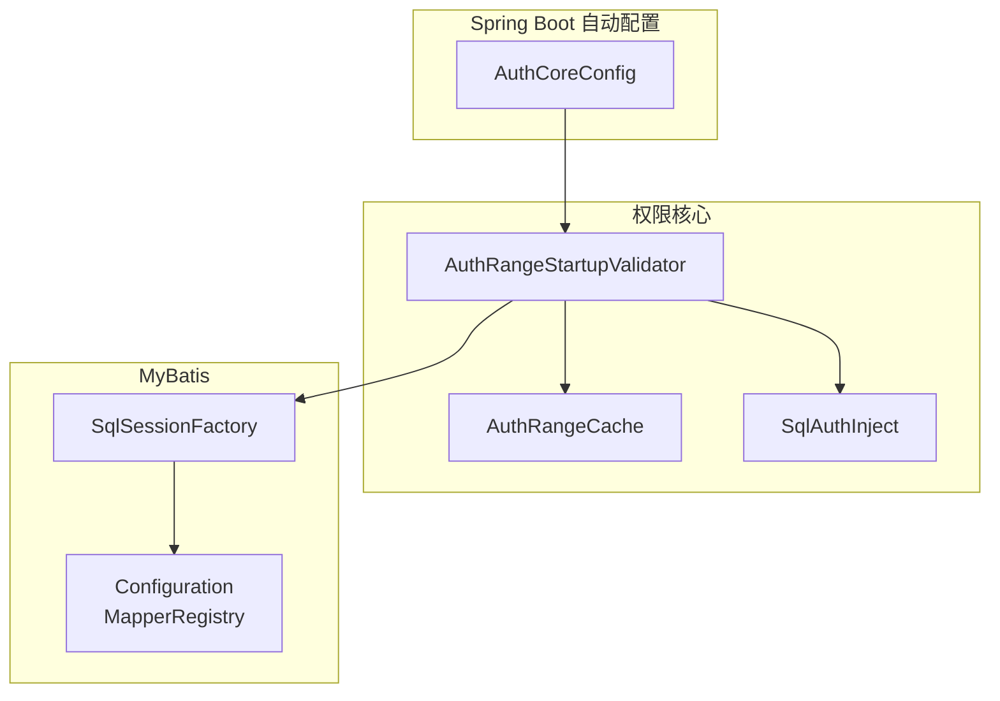
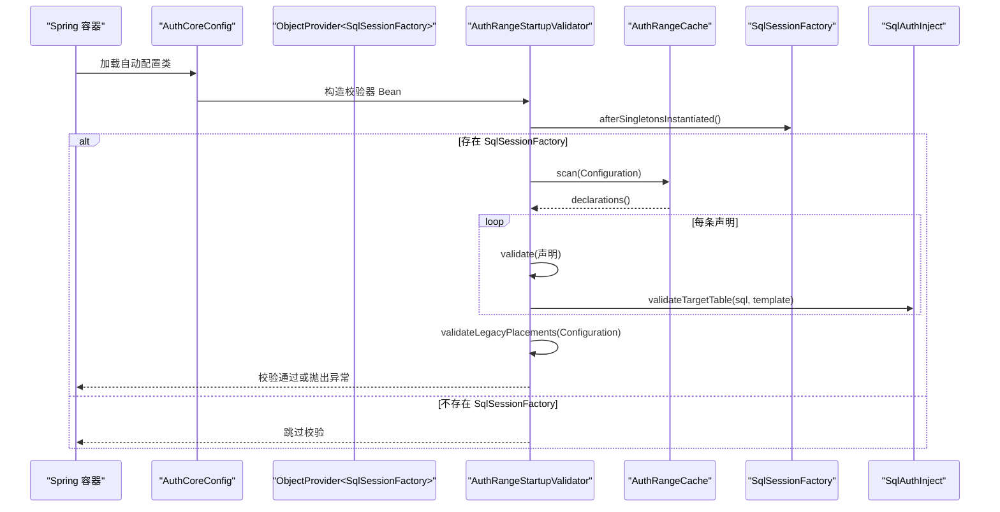
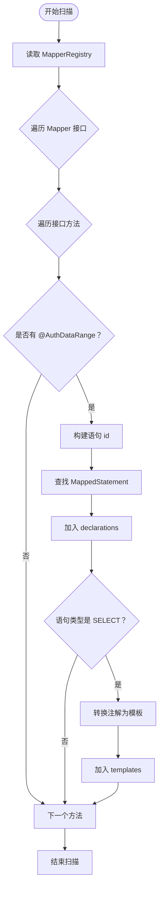
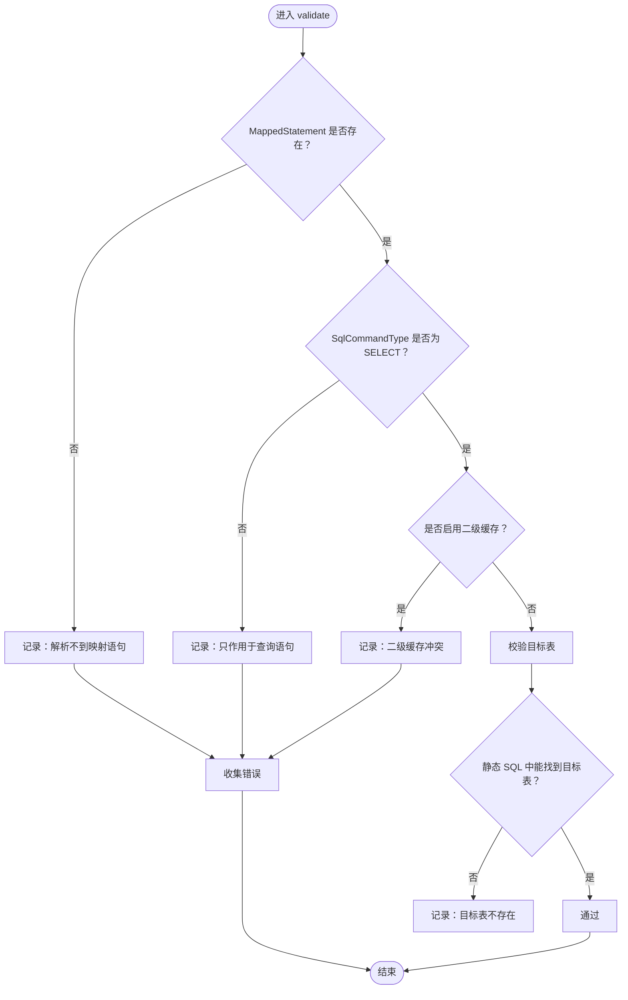
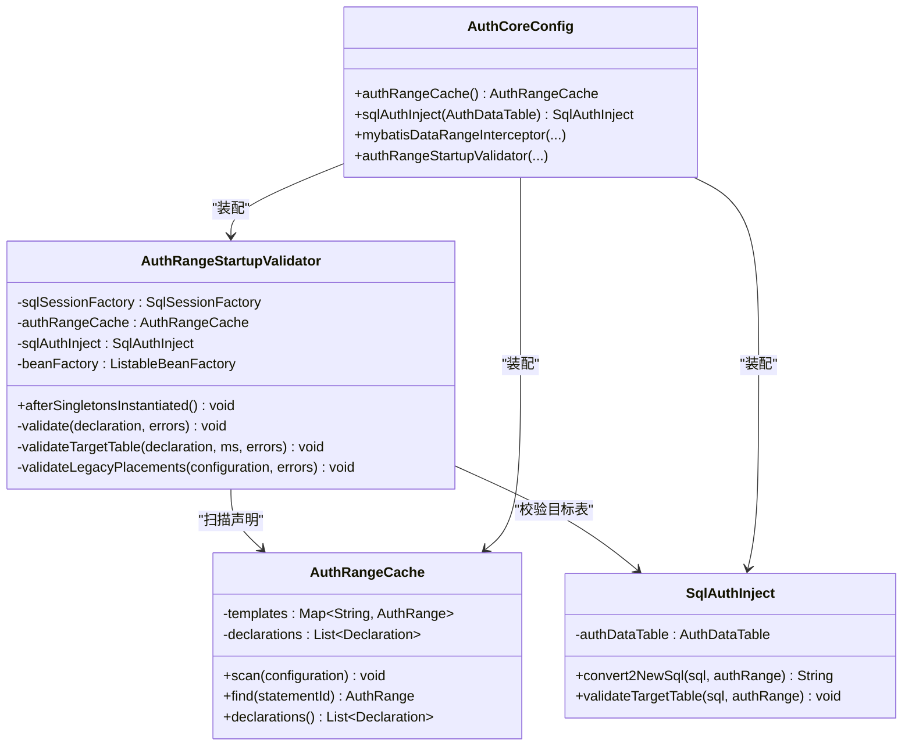

# 启动时权限声明校验

<cite>
**本文引用的文件**   
- [AuthRangeStartupValidator.java](file://auth/auth-core/src/main/java/com/cu/framework/auth/core/data/range/AuthRangeStartupValidator.java)
- [AuthRangeCache.java](file://auth/auth-core/src/main/java/com/cu/framework/auth/core/data/range/AuthRangeCache.java)
- [SqlAuthInject.java](file://auth/auth-core/src/main/java/com/cu/framework/auth/core/data/range/SqlAuthInject.java)
- [AuthCoreConfig.java](file://auth/auth-core-spring-boot-starter/src/main/java/com/cu/framework/boot/auth/core/config/AuthCoreConfig.java)
- [AuthRangeStartupValidatorTest.java](file://auth/auth-core/src/test/java/com/cu/framework/auth/core/data/range/AuthRangeStartupValidatorTest.java)
- [AuthRangeStartupFailureTest.java](file://sample/auth-core-boot-sample/src/test/java/com/cu/framework/sample/authcore/AuthRangeStartupFailureTest.java)
</cite>

## 目录
1. [引言](#引言)
2. [项目结构与职责边界](#项目结构与职责边界)
3. [核心组件总览](#核心组件总览)
4. [架构与执行时序](#架构与执行时序)
5. [详细实现分析](#详细实现分析)
6. [依赖关系分析](#依赖关系分析)
7. [性能与延迟加载特性](#性能与延迟加载特性)
8. [故障排查指南](#故障排查指南)
9. [结论](#结论)

## 引言
本文件围绕“启动时权限声明校验”功能展开，重点解释 `AuthRangeStartupValidator` 的实现原理、触发时机、校验规则及失败处理策略。该机制的目标是：在应用启动阶段尽早发现 Mapper 接口上 `@AuthDataRange` 注解的配置错误，让问题表现为启动失败，而不是运行期静默跳过数据范围过滤。

它主要完成四类检查：
- 解析不到映射语句；
- 语句不是查询；
- 语句启用了二级缓存；
- 静态可得的 SQL 中找不到声明的目标表；
并额外增加一条迁移守卫：`@AuthDataRange` 只能出现在 MyBatis Mapper 接口方法上。

## 项目结构与职责边界
与启动校验直接相关的代码分布在两个模块：
- `auth/auth-core`：包含校验器、声明缓存、SQL 注入与目标表校验逻辑；
- `auth/auth-core-spring-boot-starter`：负责把校验器装配进 Spring 容器，并通过延迟方式获取 `SqlSessionFactory`。

**图表来源**  
- [AuthCoreConfig.java:1-203](file://auth/auth-core-spring-boot-starter/src/main/java/com/cu/framework/boot/auth/core/config/AuthCoreConfig.java#L1-L203)  
- [AuthRangeStartupValidator.java:1-163](file://auth/auth-core/src/main/java/com/cu/framework/auth/core/data/range/AuthRangeStartupValidator.java#L1-L163)  
- [AuthRangeCache.java:1-155](file://auth/auth-core/src/main/java/com/cu/framework/auth/core/data/range/AuthRangeCache.java#L1-L155)  
- [SqlAuthInject.java:1-200](file://auth/auth-core/src/main/java/com/cu/framework/auth/core/data/range/SqlAuthInject.java#L1-L200)

**章节来源**  
- [AuthRangeStartupValidator.java:1-163](file://auth/auth-core/src/main/java/com/cu/framework/auth/core/data/range/AuthRangeStartupValidator.java#L1-L163)  
- [AuthCoreConfig.java:1-203](file://auth/auth-core-spring-boot-starter/src/main/java/com/cu/framework/boot/auth/core/config/AuthCoreConfig.java#L1-L203)

## 核心组件总览

### AuthRangeStartupValidator：启动期校验器
- 实现 Spring 的 `SmartInitializingSingleton`，在所有单例 Bean 初始化完成后执行 `afterSingletonsInstantiated()`。
- 若没有 `SqlSessionFactory`，则跳过校验，保持未接入 MyBatis 场景下的兼容性。
- 调用 `AuthRangeCache.scan` 扫描已注册的 Mapper 接口，收集所有 `@AuthDataRange` 声明。
- 遍历每条声明执行四步校验，最后再执行一次“非 Mapper 位置残留注解”的检查。
- 任意一条错误都会抛出 `IllegalStateException`，导致启动失败。

### AuthRangeCache：声明缓存
- 以 MyBatis 的 `MapperRegistry` 为基础，遍历所有 Mapper 接口方法上的 `@AuthDataRange`。
- 同时维护两类数据：
  - `declarations`：全部声明点，用于启动期定位错误；
  - `templates`：仅包含成功解析为查询语句的声明模板，供运行期权限注入使用。
- 声明模板只保存注解中的静态信息，不保存当前用户的权限集合。

### SqlAuthInject：SQL 注入与目标表校验
- 使用 JSqlParser 解析 `SELECT` 语句。
- 根据声明中的目标表名和别名匹配 SQL 中的主表或 `WITH` 子句表。
- 提供 `validateTargetTable` 方法，在不改写 SQL 的前提下验证目标表是否存在。
- 运行时还会根据匹配结果注入 `IN` 或 `EXISTS` 条件。

**章节来源**  
- [AuthRangeStartupValidator.java:1-163](file://auth/auth-core/src/main/java/com/cu/framework/auth/core/data/range/AuthRangeStartupValidator.java#L1-L163)  
- [AuthRangeCache.java:1-155](file://auth/auth-core/src/main/java/com/cu/framework/auth/core/data/range/AuthRangeCache.java#L1-L155)  
- [SqlAuthInject.java:1-200](file://auth/auth-core/src/main/java/com/cu/framework/auth/core/data/range/SqlAuthInject.java#L1-L200)

## 架构与执行时序

### 启动校验触发时机
校验器挂载在 `SmartInitializingSingleton` 生命周期回调上，这意味着：
- 所有单例 Bean 已经创建；
- MyBatis 的 Mapper 接口通常已经完成注册；
- 业务请求尚未被拦截；
- 配置错误会直接中断应用启动。

**图表来源**  
- [AuthCoreConfig.java:120-170](file://auth/auth-core-spring-boot-starter/src/main/java/com/cu/framework/boot/auth/core/config/AuthCoreConfig.java#L120-L170)  
- [AuthRangeStartupValidator.java:35-80](file://auth/auth-core/src/main/java/com/cu/framework/auth/core/data/range/AuthRangeStartupValidator.java#L35-L80)  
- [AuthRangeCache.java:35-80](file://auth/auth-core/src/main/java/com/cu/framework/auth/core/data/range/AuthRangeCache.java#L35-L80)  
- [SqlAuthInject.java:60-100](file://auth/auth-core/src/main/java/com/cu/framework/auth/core/data/range/SqlAuthInject.java#L60-L100)

### ObjectProvider 的使用原因
`AuthCoreConfig` 中并没有直接使用 `@ConditionalOnBean(SqlSessionFactory.class)` 来条件化创建校验器，而是通过 `ObjectProvider<SqlSessionFactory>` 在运行时调用 `getIfAvailable()`。原因在于：
- `@ConditionalOnBean` 的条件求值发生在配置类注册阶段；
- MyBatis 的自动配置可能按类名排序排在本次配置之后；
- 如果此时条件不成立，校验器根本不会被创建；
- 结果是 `@AuthDataRange` 声明缓存为空、校验器消失，但应用仍然启动成功；
- 这会把“配置错误”伪装成“功能未启用”，是最危险的状态。

因此，改用 `ObjectProvider` 后：
- Bean 定义已全部注册；
- 没有 `SqlSessionFactory` 时返回 `null`；
- 校验器自己判断并跳过，行为与“未接入 MyBatis”一致；
- 有 `SqlSessionFactory` 时才真正执行校验。

**章节来源**  
- [AuthCoreConfig.java:120-170](file://auth/auth-core-spring-boot-starter/src/main/java/com/cu/framework/boot/auth/core/config/AuthCoreConfig.java#L120-L170)  
- [AuthRangeStartupValidator.java:35-55](file://auth/auth-core/src/main/java/com/cu/framework/auth/core/data/range/AuthRangeStartupValidator.java#L35-L55)

## 详细实现分析

### 声明扫描流程
`AuthRangeCache.scan` 会读取 MyBatis 的 `MapperRegistry`，对每个 Mapper 接口的每个方法检查是否带有 `@AuthDataRange`。对于每个声明：
- 构造语句标识符：`接口全限定名.方法名`；
- 尝试从 `Configuration` 查找对应的 `MappedStatement`；
- 将声明加入 `declarations`；
- 如果语句存在且是 `SELECT`，则将注解转换为模板放入 `templates`。

**图表来源**  
- [AuthRangeCache.java:35-80](file://auth/auth-core/src/main/java/com/cu/framework/auth/core/data/range/AuthRangeCache.java#L35-L80)

**章节来源**  
- [AuthRangeCache.java:1-155](file://auth/auth-core/src/main/java/com/cu/framework/auth/core/data/range/AuthRangeCache.java#L1-L155)

### 单条声明校验流程
`validate` 方法依次执行以下检查：

1. **解析不到映射语句**：`MappedStatement` 为 `null`；
2. **不是查询语句**：`SqlCommandType` 不是 `SELECT`；
3. **启用二级缓存**：`MappedStatement.getCache()` 不为 `null`；
4. **目标表校验**：仅对静态 SQL 执行。

**图表来源**  
- [AuthRangeStartupValidator.java:82-120](file://auth/auth-core/src/main/java/com/cu/framework/auth/core/data/range/AuthRangeStartupValidator.java#L82-L120)

**章节来源**  
- [AuthRangeStartupValidator.java:82-120](file://auth/auth-core/src/main/java/com/cu/framework/auth/core/data/range/AuthRangeStartupValidator.java#L82-L120)

### 目标表校验逻辑
目标表校验由 `SqlAuthInject.validateTargetTable` 承担。它：
- 使用 JSqlParser 解析 SQL；
- 构造声明中指定的目标表对象；
- 复用运行期注入时的表匹配算法；
- 如果无法匹配到目标表，抛出 `JSQLParserException`；
- 校验器捕获该异常后将其转为启动期错误消息。

需要注意：只有 `RawSqlSource` 才会进行目标表校验。动态 SQL 或语句提供者生成的 SQL 会跳过启动期目标表检查，因为：
- 用空参数渲染动态 SQL 可能实际执行 OGNL；
- 渲染出的 SQL 可能与真实运行路径不同；
- 语句提供者会在运行期触发 provider 调用；
- 这些情况交由运行期注入失败兜住。

**章节来源**  
- [AuthRangeStartupValidator.java:122-150](file://auth/auth-core/src/main/java/com/cu/framework/auth/core/data/range/AuthRangeStartupValidator.java#L122-L150)  
- [SqlAuthInject.java:60-100](file://auth/auth-core/src/main/java/com/cu/framework/auth/core/data/range/SqlAuthInject.java#L60-L100)

### 非 Mapper 位置残留注解检查
`validateLegacyPlacements` 会遍历 Spring 容器中所有 Bean，检查：
- Bean 类型是否为 MyBatis Mapper 接口；
- 如果不是 Mapper，再检查其方法上是否残留 `@AuthDataRange`；
- 一旦在非 Mapper 方法上发现注解，就记录错误。

这条规则的目的是防止旧用法残留：当切面删除后，Controller 或 Service 上的注解不会被 Mapper 扫描看到，从而变成“静默不过滤”。启动期显式报错可以避免这种更危险的静默失效。

**章节来源**  
- [AuthRangeStartupValidator.java:152-163](file://auth/auth-core/src/main/java/com/cu/framework/auth/core/data/range/AuthRangeStartupValidator.java#L152-L163)

## 依赖关系分析

**图表来源**  
- [AuthRangeStartupValidator.java:1-163](file://auth/auth-core/src/main/java/com/cu/framework/auth/core/data/range/AuthRangeStartupValidator.java#L1-L163)  
- [AuthRangeCache.java:1-155](file://auth/auth-core/src/main/java/com/cu/framework/auth/core/data/range/AuthRangeCache.java#L1-L155)  
- [SqlAuthInject.java:1-200](file://auth/auth-core/src/main/java/com/cu/framework/auth/core/data/range/SqlAuthInject.java#L1-L200)  
- [AuthCoreConfig.java:1-203](file://auth/auth-core-spring-boot-starter/src/main/java/com/cu/framework/boot/auth/core/config/AuthCoreConfig.java#L1-L203)

**章节来源**  
- [AuthRangeStartupValidator.java:1-163](file://auth/auth-core/src/main/java/com/cu/framework/auth/core/data/range/AuthRangeStartupValidator.java#L1-L163)  
- [AuthRangeCache.java:1-155](file://auth/auth-core/src/main/java/com/cu/framework/auth/core/data/range/AuthRangeCache.java#L1-L155)  
- [SqlAuthInject.java:1-200](file://auth/auth-core/src/main/java/com/cu/framework/auth/core/data/range/SqlAuthInject.java#L1-L200)  
- [AuthCoreConfig.java:1-203](file://auth/auth-core-spring-boot-starter/src/main/java/com/cu/framework/boot/auth/core/config/AuthCoreConfig.java#L1-L203)

## 性能与延迟加载特性

### 启动期一次性开销
- 声明扫描发生在 `afterSingletonsInstantiated`，属于启动阶段的一次性操作；
- 扫描复杂度与 Mapper 接口数量和方法数量线性相关；
- 目标表校验只对静态 SQL 执行，避免对动态 SQL 做无意义的解析；
- 校验失败直接抛出异常，不会继续扫描后续声明，整体失败路径较快。

### 运行期注入延迟
- `AuthRangeCache.templates` 只保存成功解析为查询语句的模板；
- 用户权限集合不在缓存中，而是在运行期注入；
- `MybatisDataRangeInterceptor` 使用 `@Lazy` 注入 `AuthCurrentUserContextHolder`，以避免拦截器、上下文、Composite、Mapper、`SqlSessionFactory` 之间形成创建期循环依赖。

**章节来源**  
- [AuthRangeStartupValidator.java:35-80](file://auth/auth-core/src/main/java/com/cu/framework/auth/core/data/range/AuthRangeStartupValidator.java#L35-L80)  
- [AuthRangeCache.java:1-155](file://auth/auth-core/src/main/java/com/cu/framework/auth/core/data/range/AuthRangeCache.java#L1-L155)  
- [AuthCoreConfig.java:80-120](file://auth/auth-core-spring-boot-starter/src/main/java/com/cu/framework/boot/auth/core/config/AuthCoreConfig.java#L80-L120)

## 故障排查指南

### 常见启动失败原因

#### 1. 解析不到映射语句
- 现象：启动时报错，提示声明解析不到对应映射语句；
- 原因：方法上没有 SQL 注解，或者注解方法名与 XML 中的语句 ID 不一致；
- 修复方向：
  - 确保 Mapper 接口方法上有 `@Select`、`@Insert` 等 SQL 注解；
  - 如果使用 XML，确认 `id` 与 `接口名.方法名` 完全一致；
  - 确认 Mapper 接口确实被 MyBatis 扫描注册。

示例测试覆盖路径：[AuthRangeStartupValidatorTest.java:41-55](file://auth/auth-core/src/test/java/com/cu/framework/auth/core/data/range/AuthRangeStartupValidatorTest.java#L41-L55)、[AuthRangeStartupFailureTest.java:96-106](file://sample/auth-core-boot-sample/src/test/java/com/cu/framework/sample/authcore/AuthRangeStartupFailureTest.java#L96-L106)

#### 2. 声明标在非查询语句上
- 现象：启动时报错，提示数据范围只作用于查询语句；
- 原因：在 `@Update`、`@Insert`、`@Delete` 等方法上使用 `@AuthDataRange`；
- 修复方向：
  - 删除写方法上的 `@AuthDataRange`；
  - 如需写操作的数据权限控制，应使用其他机制，而不是数据范围过滤。

示例测试覆盖路径：[AuthRangeStartupValidatorTest.java:57-63](file://auth/auth-core/src/test/java/com/cu/framework/auth/core/data/range/AuthRangeStartupValidatorTest.java#L57-L63)、[AuthRangeStartupFailureTest.java:108-115](file://sample/auth-core-boot-sample/src/test/java/com/cu/framework/sample/authcore/AuthRangeStartupFailureTest.java#L108-L115)

#### 3. 语句启用二级缓存
- 现象：启动时报错，提示声明所在语句启用了二级缓存；
- 原因：语句使用了 `@CacheNamespace` 或其他二级缓存配置；
- 原因本质：缓存键在权限条件注入之前就已计算，两者不能共存；
- 修复方向：
  - 去掉该语句的二级缓存；
  - 或去掉该方法的 `@AuthDataRange`。

示例测试覆盖路径：[AuthRangeStartupValidatorTest.java:65-73](file://auth/auth-core/src/test/java/com/cu/framework/auth/core/data/range/AuthRangeStartupValidatorTest.java#L65-L73)、[AuthRangeStartupFailureTest.java:117-125](file://sample/auth-core-boot-sample/src/test/java/com/cu/framework/sample/authcore/AuthRangeStartupFailureTest.java#L117-L125)

#### 4. 静态 SQL 中目标表不存在
- 现象：启动时报错，提示目标表在该语句中不存在；
- 原因：声明中指定了 `table`，但 SQL 中找不到该表或别名；
- 修复方向：
  - 修正 `@AuthDataRange(table = "...")` 中的表名；
  - 如果使用了表别名，也要同步修正 `tableAlias`；
  - 如果是动态 SQL，注意启动期不会检查目标表，需要结合运行期行为进一步验证。

示例测试覆盖路径：[AuthRangeStartupValidatorTest.java:75-81](file://auth/auth-core/src/test/java/com/cu/framework/auth/core/data/range/AuthRangeStartupValidatorTest.java#L75-L81)、[AuthRangeStartupFailureTest.java:127-135](file://sample/auth-core-boot-sample/src/test/java/com/cu/framework/sample/authcore/AuthRangeStartupFailureTest.java#L127-L135)

#### 5. 动态 SQL 目标表校验被跳过
- 现象：启动期没有报目标表不存在；
- 原因：动态 SQL 不是 `RawSqlSource`，启动期跳过目标表校验；
- 风险：如果表名确实是错的，可能在运行期才暴露；
- 修复方向：
  - 尽量在单元测试中覆盖动态 SQL 分支；
  - 确保运行期能触发完整 SQL 渲染；
  - 如能改为静态 SQL，更容易在启动期发现问题。

示例测试覆盖路径：[AuthRangeStartupValidatorTest.java:83-89](file://auth/auth-core/src/test/java/com/cu/framework/auth/core/data/range/AuthRangeStartupValidatorTest.java#L83-L89)

#### 6. 注解残留到非 Mapper 类
- 现象：启动时报错，提示声明不在 MyBatis Mapper 接口上；
- 原因：旧版本把 `@AuthDataRange` 放在 Controller、Service 等业务 Bean 上；
- 风险：这是最危险的静默失效场景，必须启动失败；
- 修复方向：
  - 把 `@AuthDataRange` 移动到 Mapper 接口的查询方法上；
  - 清理业务类上的历史注解。

示例测试覆盖路径：[AuthRangeStartupValidatorTest.java:91-101](file://auth/auth-core/src/test/java/com/cu/framework/auth/core/data/range/AuthRangeStartupValidatorTest.java#L91-L101)、[AuthRangeStartupFailureTest.java:137-146](file://sample/auth-core-boot-sample/src/test/java/com/cu/framework/sample/authcore/AuthRangeStartupFailureTest.java#L137-L146)

#### 7. 未接入 MyBatis 的场景
- 现象：没有报错，也没有扫描任何声明；
- 原因：没有 `SqlSessionFactory`，校验器主动跳过；
- 预期行为：与“未启用数据范围”一致，不应因缺少框架能力而启动失败。

示例测试覆盖路径：[AuthRangeStartupValidatorTest.java:103-111](file://auth/auth-core/src/test/java/com/cu/framework/auth/core/data/range/AuthRangeStartupValidatorTest.java#L103-L111)

### 推荐排查步骤
1. 查看启动日志中的 `IllegalStateException` 消息；
2. 找到第一个失败的声明位置，通常是 `接口名#方法名`；
3. 对照上述六类常见错误逐一核对；
4. 如果涉及动态 SQL，补充运行期测试用例；
5. 如果项目迁移过旧版注解位置，全局搜索 `@AuthDataRange`，确认所有注解都在 Mapper 接口方法上；
6. 如果启用了二级缓存，优先评估是否真的需要该语句的二级缓存。

**章节来源**  
- [AuthRangeStartupValidatorTest.java:27-187](file://auth/auth-core/src/test/java/com/cu/framework/auth/core/data/range/AuthRangeStartupValidatorTest.java#L27-L187)  
- [AuthRangeStartupFailureTest.java:1-200](file://sample/auth-core-boot-sample/src/test/java/com/cu/framework/sample/authcore/AuthRangeStartupFailureTest.java#L1-L200)

## 结论
`AuthRangeStartupValidator` 是权限系统中的一个“启动期安全阀”。它通过扫描 MyBatis Mapper 接口上的 `@AuthDataRange`，在应用真正运行前发现常见的配置错误，从而避免“静默不过滤”这类高风险状态。其设计要点包括：
- 使用 `SmartInitializingSingleton` 保证扫描时机；
- 使用 `ObjectProvider` 避免自动配置顺序导致的假阴性；
- 将声明解析、语句类型、二级缓存、目标表、注解位置五类问题统一收敛为启动失败；
- 对动态 SQL 和目标表校验做合理降级，避免误报；
- 通过单元测试覆盖典型失败场景，确保行为稳定。

对于使用者而言，最稳妥的做法是：
- 只在 Mapper 接口的查询方法上声明 `@AuthDataRange`；
- 不要对写语句启用数据范围；
- 避免对带数据范围过滤的语句开启二级缓存；
- 确保静态 SQL 中声明的目标表与注解一致；
- 动态 SQL 要配合运行期测试验证。