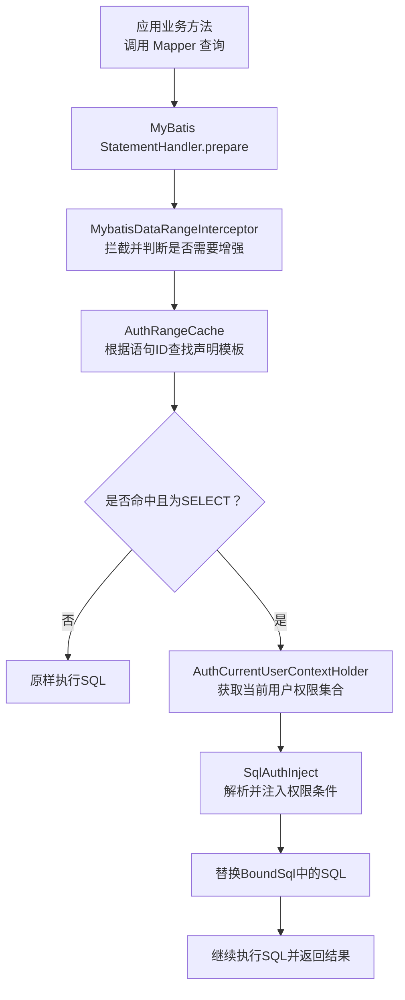
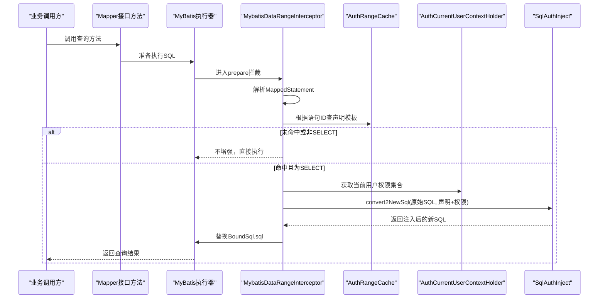
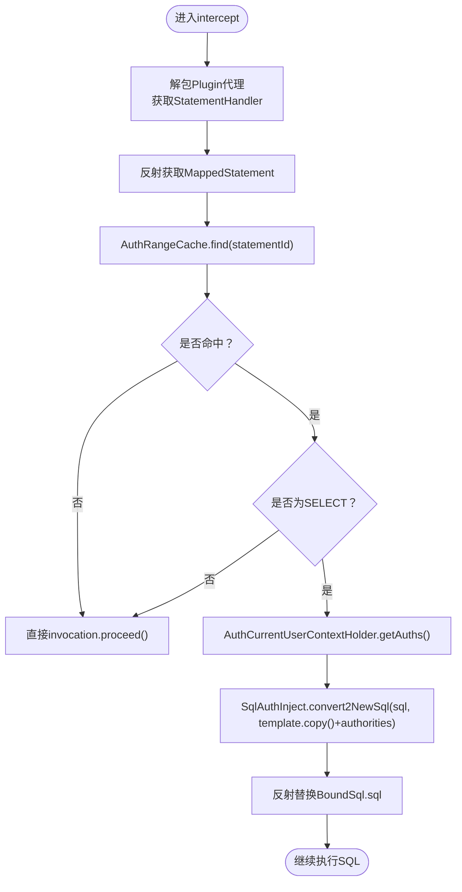
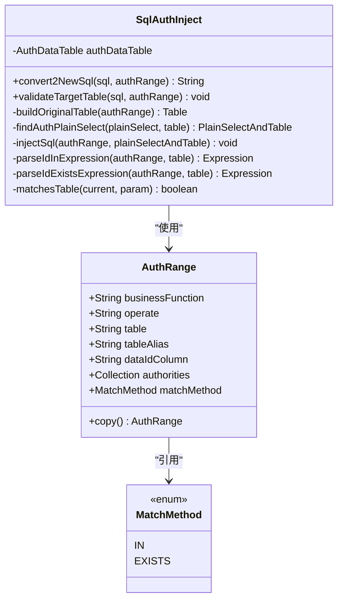
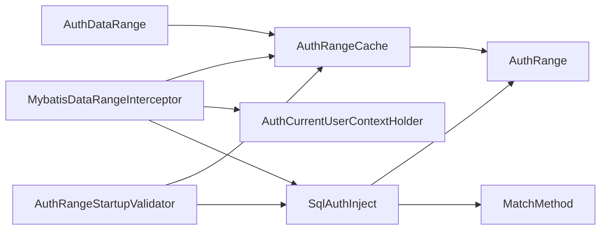

# 数据权限拦截器机制

<cite>
**本文引用的文件**   
- [MybatisDataRangeInterceptor.java](file://auth/auth-core/src/main/java/com/cu/framework/auth/core/data/range/MybatisDataRangeInterceptor.java)
- [AuthRangeCache.java](file://auth/auth-core/src/main/java/com/cu/framework/auth/core/data/range/AuthRangeCache.java)
- [SqlAuthInject.java](file://auth/auth-core/src/main/java/com/cu/framework/auth/core/data/range/SqlAuthInject.java)
- [AuthRangeStartupValidator.java](file://auth/auth-core/src/main/java/com/cu/framework/auth/core/data/range/AuthRangeStartupValidator.java)
- [AuthRange.java](file://auth/auth-core/src/main/java/com/cu/framework/auth/core/data/range/AuthRange.java)
- [MatchMethod.java](file://auth/auth-core/src/main/java/com/cu/framework/auth/core/data/range/MatchMethod.java)
- [AuthDataRange.java](file://auth/auth-core/src/main/java/com/cu/framework/auth/core/AuthDataRange.java)
- [AuthCurrentUserContextHolder.java](file://auth/auth-core/src/main/java/com/cu/framework/auth/core/AuthCurrentUserContextHolder.java)
</cite>

## 目录
1. [引言](#引言)
2. [项目结构](#项目结构)
3. [核心组件](#核心组件)
4. [架构总览](#架构总览)
5. [详细组件分析](#详细组件分析)
6. [依赖关系分析](#依赖关系分析)
7. [性能与优化建议](#性能与优化建议)
8. [故障排查指南](#故障排查指南)
9. [结论](#结论)

## 引言
本文件围绕数据权限拦截器机制，系统性解析 MyBatis 执行 SQL 前如何动态注入数据范围条件。重点覆盖：
- `MybatisDataRangeInterceptor` 的拦截时机、语句身份判定、SQL 改写流程。
- `AuthRangeCache` 的声明扫描、模板缓存、线程安全设计。
- `SqlAuthInject` 的静态 SQL 解析、目标表匹配、IN/EXISTS 两种权限注入策略。
- 启动期校验 `AuthRangeStartupValidator` 对配置错误的早期发现。
- 完整的数据权限拦截流程图、常见问题与最佳实践。

## 项目结构
数据权限相关代码集中在 `auth/auth-core` 模块中，按职责划分为注解定义、运行时拦截、声明缓存、SQL 注入和启动校验等层次。

**图表来源**
- [MybatisDataRangeInterceptor.java:50-140](file://auth/auth-core/src/main/java/com/cu/framework/auth/core/data/range/MybatisDataRangeInterceptor.java#L50-L140)
- [AuthRangeCache.java:30-90](file://auth/auth-core/src/main/java/com/cu/framework/auth/core/data/range/AuthRangeCache.java#L30-L90)
- [SqlAuthInject.java:50-120](file://auth/auth-core/src/main/java/com/cu/framework/auth/core/data/range/SqlAuthInject.java#L50-L120)

**章节来源**
- [MybatisDataRangeInterceptor.java:1-216](file://auth/auth-core/src/main/java/com/cu/framework/auth/core/data/range/MybatisDataRangeInterceptor.java#L1-L216)
- [AuthRangeCache.java:1-155](file://auth/auth-core/src/main/java/com/cu/framework/auth/core/data/range/AuthRangeCache.java#L1-L155)
- [SqlAuthInject.java:1-441](file://auth/auth-core/src/main/java/com/cu/framework/auth/core/data/range/SqlAuthInject.java#L1-L441)

## 核心组件
- `MybatisDataRangeInterceptor`：实现 MyBatis 插件接口，在 `StatementHandler.prepare` 阶段拦截，决定是否需要注入数据范围条件。
- `AuthRangeCache`：扫描 Mapper 接口上的 `@AuthDataRange`，构建语句 ID 到声明模板的映射，供运行期快速查找。
- `SqlAuthInject`：基于 JSqlParser 解析 SQL，定位目标表并注入 IN 或 EXISTS 形式的权限条件。
- `AuthRangeStartupValidator`：应用启动后校验所有 `@AuthDataRange` 声明，提前暴露配置错误。
- `AuthRange`：描述一条数据范围的声明模板，包括业务功能、操作类型、表名、别名、主键列、匹配方式及执行期的权限集合。
- `AuthDataRange`：标注在 Mapper 查询方法上的注解，用于声明数据范围。
- `AuthCurrentUserContextHolder`：提供当前登录用户的扁平化权限集合。

**章节来源**
- [MybatisDataRangeInterceptor.java:20-120](file://auth/auth-core/src/main/java/com/cu/framework/auth/core/data/range/MybatisDataRangeInterceptor.java#L20-L120)
- [AuthRangeCache.java:15-90](file://auth/auth-core/src/main/java/com/cu/framework/auth/core/data/range/AuthRangeCache.java#L15-L90)
- [SqlAuthInject.java:1-120](file://auth/auth-core/src/main/java/com/cu/framework/auth/core/data/range/SqlAuthInject.java#L1-L120)
- [AuthRangeStartupValidator.java:1-80](file://auth/auth-core/src/main/java/com/cu/framework/auth/core/data/range/AuthRangeStartupValidator.java#L1-L80)
- [AuthRange.java:1-64](file://auth/auth-core/src/main/java/com/cu/framework/auth/core/data/range/AuthRange.java#L1-L64)
- [AuthDataRange.java:1-81](file://auth/auth-core/src/main/java/com/cu/framework/auth/core/AuthDataRange.java#L1-L81)
- [AuthCurrentUserContextHolder.java:1-25](file://auth/auth-core/src/main/java/com/cu/framework/auth/core/AuthCurrentUserContextHolder.java#L1-L25)

## 架构总览
数据权限拦截的整体流程如下：

**图表来源**
- [MybatisDataRangeInterceptor.java:80-160](file://auth/auth-core/src/main/java/com/cu/framework/auth/core/data/range/MybatisDataRangeInterceptor.java#L80-L160)
- [AuthRangeCache.java:60-100](file://auth/auth-core/src/main/java/com/cu/framework/auth/core/data/range/AuthRangeCache.java#L60-L100)
- [SqlAuthInject.java:60-120](file://auth/auth-core/src/main/java/com/cu/framework/auth/core/data/range/SqlAuthInject.java#L60-L120)

## 详细组件分析

### MybatisDataRangeInterceptor：拦截入口与SQL改写
该拦截器通过 `@Intercepts` 指定拦截 `StatementHandler.prepare`，保证每条物理 SQL 执行前都经过一次判定。其核心职责包括：
- 解包 MyBatis 插件代理，拿到真实 `StatementHandler`。
- 从 `StatementHandler` 中反射取出 `MappedStatement`。
- 根据语句 ID 从 `AuthRangeCache` 查声明模板。
- 仅当模板存在且语句类型为 SELECT 时，才进行权限注入。
- 使用 `SqlAuthInject.convert2NewSql` 生成新 SQL，并通过反射替换 `BoundSql` 中的 SQL 文本。

关键点：
- 拦截粒度与 `@AuthDataRange` 声明粒度一致（Mapper 方法 -> 映射语句）。
- 非 SELECT 语句即使误标也不会被改写，避免写操作被意外过滤。
- 若无法解析 `MappedStatement`，会抛出明确异常，防止静默放行。

**图表来源**
- [MybatisDataRangeInterceptor.java:80-160](file://auth/auth-core/src/main/java/com/cu/framework/auth/core/data/range/MybatisDataRangeInterceptor.java#L80-L160)

**章节来源**
- [MybatisDataRangeInterceptor.java:50-200](file://auth/auth-core/src/main/java/com/cu/framework/auth/core/data/range/MybatisDataRangeInterceptor.java#L50-L200)

### AuthRangeCache：声明扫描与模板缓存
该组件负责在应用启动后扫描所有 Mapper 接口，收集 `@AuthDataRange` 注解，并构建语句 ID 到 `AuthRange` 模板的映射。关键特性：
- 扫描入口 `scan(Configuration)` 遍历 `MapperRegistry` 中已注册的 Mapper 接口。
- 仅将 `SqlCommandType.SELECT` 的语句纳入可注入模板。
- 模板不含权限集合，权限在执行期通过 `copy()` 后写入，避免跨请求污染。
- 对外暴露 `declarations()` 供启动校验器遍历所有声明点。

线程安全：
- `templates` 和 `declarations` 使用 `volatile` 引用指向不可变容器，保证并发读取安全。

**章节来源**
- [AuthRangeCache.java:20-120](file://auth/auth-core/src/main/java/com/cu/framework/auth/core/data/range/AuthRangeCache.java#L20-L120)
- [AuthRange.java:40-64](file://auth/auth-core/src/main/java/com/cu/framework/auth/core/data/range/AuthRange.java#L40-L64)

### SqlAuthInject：SQL解析与权限条件注入
该组件基于 JSqlParser 对 SQL 进行解析，目标是找到声明中指定的“目标表”，并在 WHERE 子句中注入权限条件。主要逻辑：
- `convert2NewSql`：解析 SQL，定位目标表，调用 `injectSql` 注入条件。
- `validateTargetTable`：启动期校验静态 SQL 是否能匹配目标表。
- `findAuthPlainSelect` + `parseExpression` + `parseCurrentSelectThenWhere`：递归遍历 FROM、JOIN、WITH、WHERE 子句，寻找匹配的表。
- `injectSql`：根据 `MatchMethod.IN` 或 `MatchMethod.EXISTS` 构造不同的权限条件表达式。
- 权限集合为空时，注入恒假条件 `1 = 0`，确保零结果而非语法错误。

注意：
- 权限字符串列表直接以字面量拼入 SQL，存在潜在 SQL 注入风险；当前框架假设权限 ID 为整型，暂不转义，但文档中标注了技术债务。

**图表来源**
- [SqlAuthInject.java:1-441](file://auth/auth-core/src/main/java/com/cu/framework/auth/core/data/range/SqlAuthInject.java#L1-L441)
- [AuthRange.java:1-64](file://auth/auth-core/src/main/java/com/cu/framework/auth/core/data/range/AuthRange.java#L1-L64)
- [MatchMethod.java:1-22](file://auth/auth-core/src/main/java/com/cu/framework/auth/core/data/range/MatchMethod.java#L1-L22)

**章节来源**
- [SqlAuthInject.java:50-441](file://auth/auth-core/src/main/java/com/cu/framework/auth/core/data/range/SqlAuthInject.java#L50-L441)

### AuthRangeStartupValidator：启动期配置校验
该验证器在 Spring 单例初始化完成后执行，确保 `@AuthDataRange` 的配置正确。校验项包括：
- 声明能否解析到对应的 `MappedStatement`。
- 语句类型是否为 SELECT。
- 是否启用了二级缓存（与权限注入冲突）。
- 静态 SQL 中是否能匹配到声明的目标表。
- 是否存在旧版用法：`@AuthDataRange` 出现在非 Mapper 接口上。

若任一校验失败，应用启动直接报错，避免运行期静默失效。

**章节来源**
- [AuthRangeStartupValidator.java:20-163](file://auth/auth-core/src/main/java/com/cu/framework/auth/core/data/range/AuthRangeStartupValidator.java#L20-L163)

### AuthDataRange：数据范围声明注解
该注解标注在 Mapper 查询方法上，声明该方法的查询需要受数据权限控制。关键属性：
- `businessFunction`：业务功能标识。
- `operate`：操作类型，默认 `unified`。
- `table` / `tableAlias`：多表联查时指定主表及别名。
- `dataIdColumn`：业务主键列名。
- `matchMethod`：权限匹配方式，支持 `IN` 或 `EXISTS`。

注意：
- MyBatis-Plus 内建方法（如 `selectList`、`page`）无挂载点，不受此注解管辖。

**章节来源**
- [AuthDataRange.java:1-81](file://auth/auth-core/src/main/java/com/cu/framework/auth/core/AuthDataRange.java#L1-L81)

## 依赖关系分析
各组件之间的依赖关系如下：

**图表来源**
- [MybatisDataRangeInterceptor.java:20-120](file://auth/auth-core/src/main/java/com/cu/framework/auth/core/data/range/MybatisDataRangeInterceptor.java#L20-L120)
- [AuthRangeCache.java:20-100](file://auth/auth-core/src/main/java/com/cu/framework/auth/core/data/range/AuthRangeCache.java#L20-L100)
- [SqlAuthInject.java:1-120](file://auth/auth-core/src/main/java/com/cu/framework/auth/core/data/range/SqlAuthInject.java#L1-L120)
- [AuthRangeStartupValidator.java:20-80](file://auth/auth-core/src/main/java/com/cu/framework/auth/core/data/range/AuthRangeStartupValidator.java#L20-L80)
- [AuthDataRange.java:1-81](file://auth/auth-core/src/main/java/com/cu/framework/auth/core/AuthDataRange.java#L1-L81)

**章节来源**
- [MybatisDataRangeInterceptor.java:1-216](file://auth/auth-core/src/main/java/com/cu/framework/auth/core/data/range/MybatisDataRangeInterceptor.java#L1-L216)
- [AuthRangeCache.java:1-155](file://auth/auth-core/src/main/java/com/cu/framework/auth/core/data/range/AuthRangeCache.java#L1-L155)
- [SqlAuthInject.java:1-441](file://auth/auth-core/src/main/java/com/cu/framework/auth/core/data/range/SqlAuthInject.java#L1-L441)
- [AuthRangeStartupValidator.java:1-163](file://auth/auth-core/src/main/java/com/cu/framework/auth/core/data/range/AuthRangeStartupValidator.java#L1-L163)
- [AuthDataRange.java:1-81](file://auth/auth-core/src/main/java/com/cu/framework/auth/core/AuthDataRange.java#L1-L81)

## 性能与优化建议
- **声明模板缓存**：`AuthRangeCache` 在启动期一次性扫描并缓存模板，运行期仅做 O(1) 查找，避免重复解析注解。
- **懒加载注入器**：`MybatisDataRangeInterceptor` 中的 `SqlAuthInject` 通过双重检查锁懒加载，避免 MyBatis 插件早于 Spring 容器初始化的问题。
- **匹配策略选择**：`MatchMethod.IN` 适合权限表远小于业务表的场景；`MatchMethod.EXISTS` 适合权限表较大的场景，遵循“小表驱动大表”原则。
- **避免二级缓存冲突**：启用 `@AuthDataRange` 的语句不能启用二级缓存，因为缓存键在权限注入前计算，会导致权限条件不生效。
- **权限集合为空处理**：空权限集合注入恒假条件，返回零行，避免语法错误或全表扫描。
- **SQL 解析开销**：JSqlParser 解析发生在每次查询前，建议在高频路径上复用复杂查询对象或使用分页/批量接口减少调用次数。

[本节为通用性能建议，不直接分析具体文件]

## 故障排查指南
常见配置错误及排查方法：

| 现象 | 可能原因 | 排查建议 |
|------|----------|----------|
| 应用启动时报错：解析不到映射语句 | `@AuthDataRange` 标注的方法名与 XML 中 `id` 不一致 | 检查 Mapper 接口方法名与对应 SQL 的 statementId |
| 启动时报错：语句不是查询 | 在非 SELECT 语句上标注了 `@AuthDataRange` | 仅对查询方法使用该注解 |
| 启动时报错：启用了二级缓存 | 语句开启了二级缓存，与权限注入冲突 | 移除语句级二级缓存或移除注解 |
| 启动时报错：静态 SQL 中找不到目标表 | `table` 或 `tableAlias` 配置错误 | 核对 SQL 中实际使用的表名与别名 |
| 运行时无权限数据 | 权限集合为空或未正确设置上下文 | 检查 `AuthCurrentUserContextHolder` 是否正确注入当前用户权限 |
| SQL 被静默放过 | 无法解析 `MappedStatement` 或语句未被声明 | 查看日志调试信息，确认 MyBatis 插件链正常 |

调试技巧：
- 开启 DEBUG 日志，观察原始 SQL 与修改后 SQL。
- 使用单元测试模拟不同权限集合，验证 IN/EXISTS 行为。
- 对于复杂 SQL，先单独调用 `SqlAuthInject.validateTargetTable` 验证表匹配。

**章节来源**
- [AuthRangeStartupValidator.java:80-163](file://auth/auth-core/src/main/java/com/cu/framework/auth/core/data/range/AuthRangeStartupValidator.java#L80-L163)
- [MybatisDataRangeInterceptor.java:120-200](file://auth/auth-core/src/main/java/com/cu/framework/auth/core/data/range/MybatisDataRangeInterceptor.java#L120-L200)
- [SqlAuthInject.java:100-200](file://auth/auth-core/src/main/java/com/cu/framework/auth/core/data/range/SqlAuthInject.java#L100-L200)

## 结论
数据权限拦截器机制通过 MyBatis 插件在 SQL 执行前动态注入权限条件，实现了业务层与权限控制的解耦。`AuthRangeCache` 提供高效的声明模板缓存，`SqlAuthInject` 基于 JSqlParser 精确解析并注入 IN/EXISTS 条件，`AuthRangeStartupValidator` 在启动期暴露配置错误，保障系统健壮性。正确使用该机制需注意注解位置、SQL 类型、二级缓存限制以及权限上下文设置。在高并发场景下，应合理选择匹配策略并监控 SQL 解析开销。

[本节为总结性内容，不直接分析具体文件]