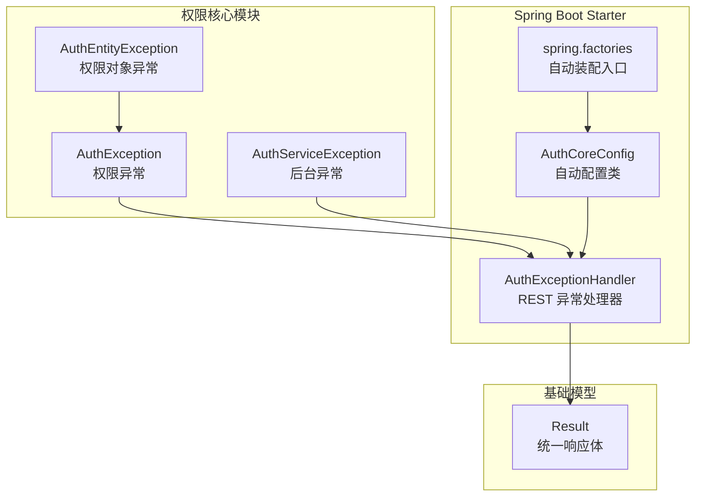
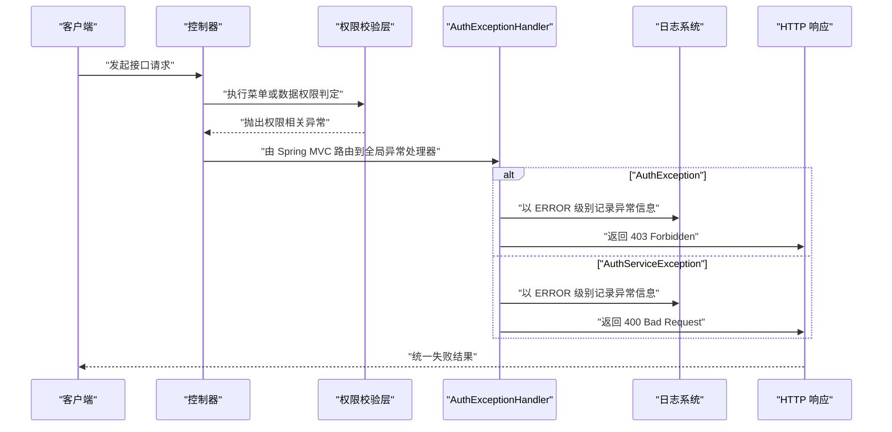
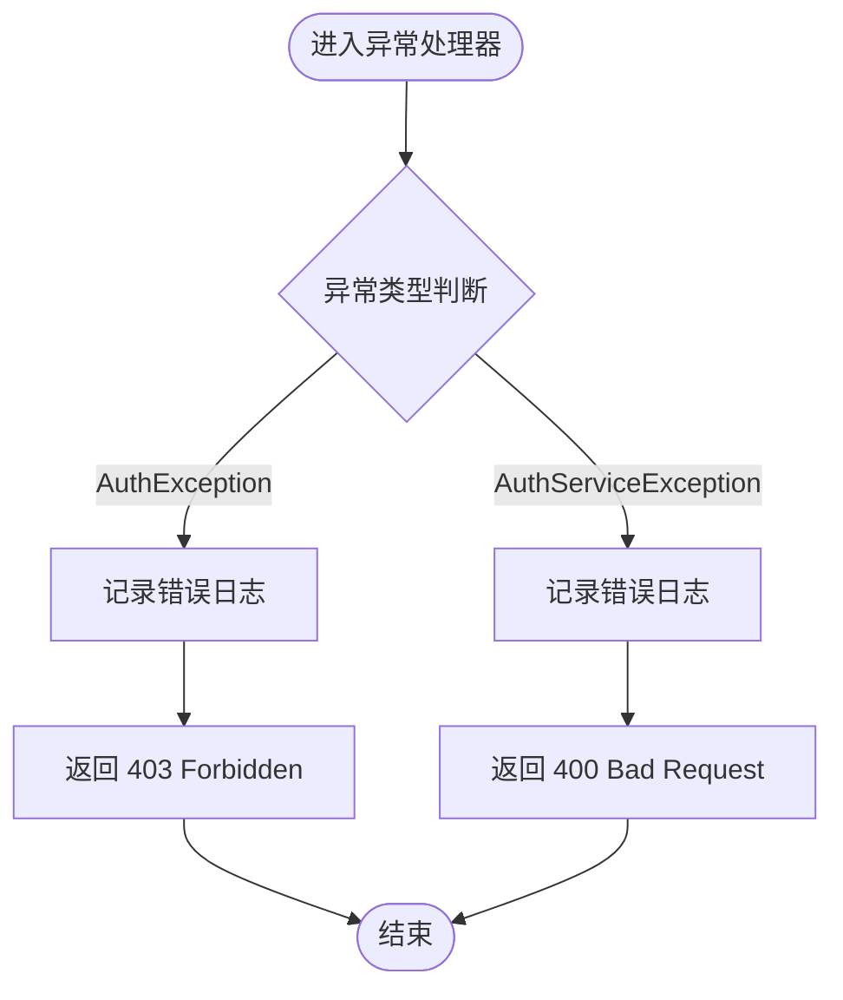
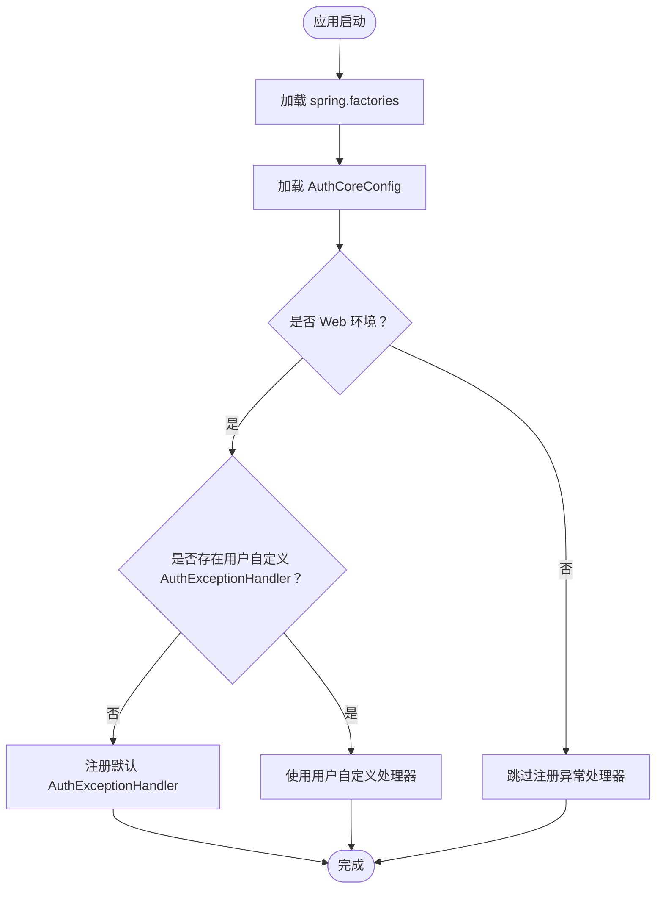
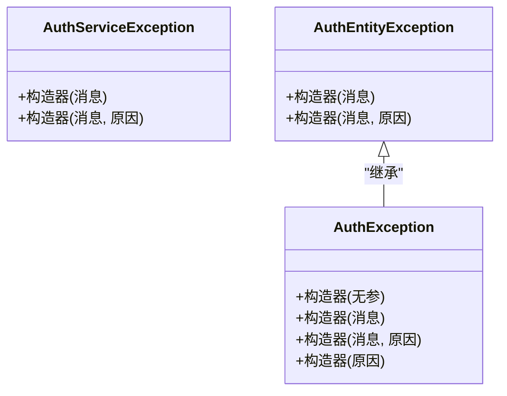
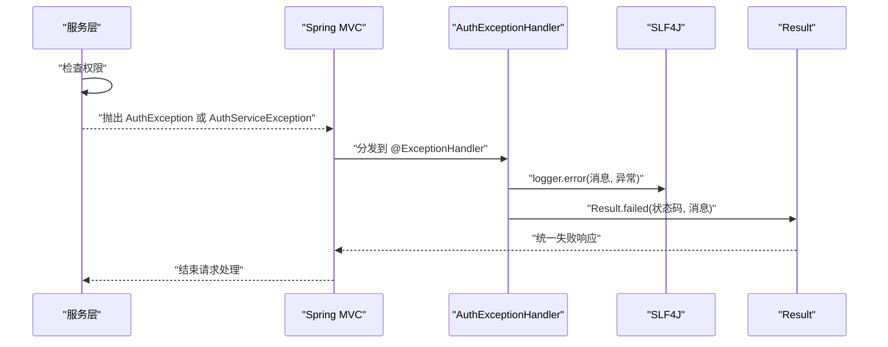
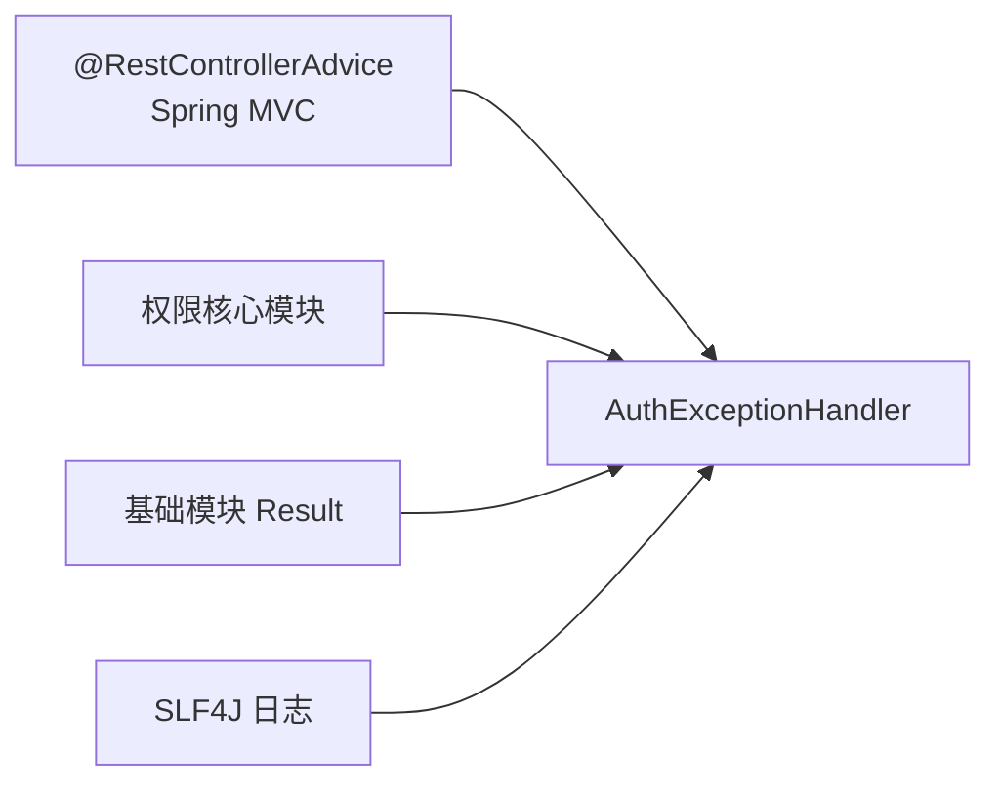

# 权限异常处理机制

<cite>
**本文引用的文件**   
- [AuthExceptionHandler.java](file://auth/auth-core-spring-boot-starter/src/main/java/com/cu/framework/boot/auth/core/AuthExceptionHandler.java)
- [AuthCoreConfig.java](file://auth/auth-core-spring-boot-starter/src/main/java/com/cu/framework/boot/auth/core/config/AuthCoreConfig.java)
- [spring.factories](file://auth/auth-core-spring-boot-starter/src/main/resources/META-INF/spring.factories)
- [AuthException.java](file://auth/auth-core/src/main/java/com/cu/framework/auth/core/exception/AuthException.java)
- [AuthServiceException.java](file://auth/auth-core/src/main/java/com/cu/framework/auth/core/exception/AuthServiceException.java)
- [AuthEntityException.java](file://auth/auth-core/src/main/java/com/cu/framework/auth/core/exception/AuthEntityException.java)
- [AuthExceptionHandlerAssemblyTest.java](file://auth/auth-core-spring-boot-starter/src/test/java/com/cu/framework/boot/auth/core/config/AuthExceptionHandlerAssemblyTest.java)
- [Result.java](file://basic/src/main/java/com/cu/framework/basic/model/Result.java)
</cite>

## 目录
1. [引言](#引言)
2. [项目结构定位](#项目结构定位)
3. [核心组件](#核心组件)
4. [架构总览](#架构总览)
5. [详细组件分析](#详细组件分析)
6. [依赖关系分析](#依赖关系分析)
7. [性能与行为特征](#性能与行为特征)
8. [故障排查指南](#故障排查指南)
9. [结论](#结论)
10. [附录：扩展与最佳实践](#附录扩展与最佳实践)

## 引言
本文件聚焦权限异常处理机制，围绕 `AuthExceptionHandler` 展开，说明其如何统一捕获并响应两类权限相关异常：
- `AuthException`：代表“当前登录用户无权限”的权限拒绝。
- `AuthServiceException`：代表“调用方式或运行时环境错误”，例如缺少必要上下文、无法完成鉴权判定等。

该机制通过 Spring Boot Starter 自动装配到 Web 环境中，将两类异常分别映射为明确的 HTTP 语义：
- `403 Forbidden`：用于权限不足。
- `400 Bad Request`：用于调用方式错误或无法判定的业务异常。

同时，文档解释 `@RestControllerAdvice` 的作用范围、`@ConditionalOnWebApplication` 的装配条件，以及从异常抛出到响应返回的完整流程，并提供自定义处理器扩展方案与常见场景处理建议。

## 项目结构定位
权限异常处理相关代码分布在两个模块中：
- 异常类型定义位于核心权限模块 `auth/auth-core`。
- 异常处理器及其自动装配逻辑位于 Spring Boot Starter 模块 `auth/auth-core-spring-boot-starter`。



**图表来源**
- [AuthExceptionHandler.java:1-35](file://auth/auth-core-spring-boot-starter/src/main/java/com/cu/framework/boot/auth/core/AuthExceptionHandler.java#L1-L35)
- [AuthCoreConfig.java:1-200](file://auth/auth-core-spring-boot-starter/src/main/java/com/cu/framework/boot/auth/core/config/AuthCoreConfig.java#L1-L200)
- [spring.factories:1-3](file://auth/auth-core-spring-boot-starter/src/main/resources/META-INF/spring.factories#L1-L3)
- [AuthException.java:1-23](file://auth/auth-core/src/main/java/com/cu/framework/auth/core/exception/AuthException.java#L1-L23)
- [AuthServiceException.java:1-16](file://auth/auth-core/src/main/java/com/cu/framework/auth/core/exception/AuthServiceException.java#L1-L16)
- [AuthEntityException.java:1-20](file://auth/auth-core/src/main/java/com/cu/framework/auth/core/exception/AuthEntityException.java#L1-L20)

**章节来源**
- [AuthExceptionHandler.java:1-35](file://auth/auth-core-spring-boot-starter/src/main/java/com/cu/framework/boot/auth/core/AuthExceptionHandler.java#L1-L35)
- [AuthCoreConfig.java:1-200](file://auth/auth-core-spring-boot-starter/src/main/java/com/cu/framework/boot/auth/core/config/AuthCoreConfig.java#L1-L200)
- [spring.factories:1-3](file://auth/auth-core-spring-boot-starter/src/main/resources/META-INF/spring.factories#L1-L3)

## 核心组件
- **AuthExceptionHandler**：基于 `@RestControllerAdvice` 的全局异常处理器，负责拦截 `AuthException` 与 `AuthServiceException`，记录日志并返回统一的失败响应。
- **AuthException**：权限异常基类，表示访问被拒绝；其子类 `AuthEntityException` 进一步封装“权限对象异常”。
- **AuthServiceException**：后台异常，表示调用方式错误或鉴权所需上下文缺失，不应被视为普通业务成功。
- **AuthCoreConfig**：Starter 的自动配置类，通过显式 Bean 方法注册 `AuthExceptionHandler`，并使用 `@ConditionalOnWebApplication` 限制仅在 Web 环境装配。
- **Result**：基础模块提供的统一响应体，用于封装状态码和消息。

**章节来源**
- [AuthExceptionHandler.java:1-35](file://auth/auth-core-spring-boot-starter/src/main/java/com/cu/framework/boot/auth/core/AuthExceptionHandler.java#L1-L35)
- [AuthException.java:1-23](file://auth/auth-core/src/main/java/com/cu/framework/auth/core/exception/AuthException.java#L1-L23)
- [AuthServiceException.java:1-16](file://auth/auth-core/src/main/java/com/cu/framework/auth/core/exception/AuthServiceException.java#L1-L16)
- [AuthEntityException.java:1-20](file://auth/auth-core/src/main/java/com/cu/framework/auth/core/exception/AuthEntityException.java#L1-L20)
- [AuthCoreConfig.java:1-200](file://auth/auth-core-spring-boot-starter/src/main/java/com/cu/framework/boot/auth/core/config/AuthCoreConfig.java#L1-L200)
- [Result.java](file://basic/src/main/java/com/cu/framework/basic/model/Result.java)

## 架构总览
权限异常处理的整体链路如下：



**图表来源**
- [AuthExceptionHandler.java:1-35](file://auth/auth-core-spring-boot-starter/src/main/java/com/cu/framework/boot/auth/core/AuthExceptionHandler.java#L1-L35)
- [AuthCoreConfig.java:1-200](file://auth/auth-core-spring-boot-starter/src/main/java/com/cu/framework/boot/auth/core/config/AuthCoreConfig.java#L1-L200)

**章节来源**
- [AuthExceptionHandler.java:1-35](file://auth/auth-core-spring-boot-starter/src/main/java/com/cu/framework/boot/auth/core/AuthExceptionHandler.java#L1-L35)

## 详细组件分析

### AuthExceptionHandler：权限异常的统一出口
`AuthExceptionHandler` 是权限框架对外暴露的拒绝通道。它有两个关键处理方法：
- 处理 `AuthException`：记录错误日志，返回 `403 Forbidden`。
- 处理 `AuthServiceException`：记录错误日志，返回 `400 Bad Request`。

这种区分非常重要：
- `403` 表示“身份已存在，但无权访问资源”。
- `400` 表示“本次调用本身存在问题”，例如缺少登录上下文、无法获取用户权限集合等。



**图表来源**
- [AuthExceptionHandler.java:1-35](file://auth/auth-core-spring-boot-starter/src/main/java/com/cu/framework/boot/auth/core/AuthExceptionHandler.java#L1-L35)

#### 自动装配与条件装配
`AuthExceptionHandler` 类上仅标注 `@RestControllerAdvice`，没有直接出现在 `spring.factories` 中。为了避免“注解存在但 Bean 未注册”的问题，`AuthCoreConfig` 显式提供一个 Bean 方法：

```java
@Bean
@ConditionalOnWebApplication
@ConditionalOnMissingBean(AuthExceptionHandler.class)
AuthExceptionHandler authExceptionHandler() {
    return new AuthExceptionHandler();
}
```

这里的关键点：
- `@Configuration` 使 `AuthCoreConfig` 成为 Spring 配置类。
- `@EnableAutoConfiguration` 通过 `spring.factories` 引入该配置类。
- `@ConditionalOnWebApplication` 确保只有在 Web 应用环境下才创建该 Bean。
- `@ConditionalOnMissingBean(AuthExceptionHandler.class)` 允许使用方覆盖默认实现，避免冲突。



**图表来源**
- [AuthCoreConfig.java:1-200](file://auth/auth-core-spring-boot-starter/src/main/java/com/cu/framework/boot/auth/core/config/AuthCoreConfig.java#L1-L200)
- [spring.factories:1-3](file://auth/auth-core-spring-boot-starter/src/main/resources/META-INF/spring.factories#L1-L3)

**章节来源**
- [AuthExceptionHandler.java:1-35](file://auth/auth-core-spring-boot-starter/src/main/java/com/cu/framework/boot/auth/core/AuthExceptionHandler.java#L1-L35)
- [AuthCoreConfig.java:1-200](file://auth/auth-core-spring-boot-starter/src/main/java/com/cu/framework/boot/auth/core/config/AuthCoreConfig.java#L1-L200)
- [spring.factories:1-3](file://auth/auth-core-spring-boot-starter/src/main/resources/META-INF/spring.factories#L1-L3)

### 异常类型体系
权限异常体系采用分层设计：
- `AuthException`：所有权限异常的根异常。
- `AuthEntityException`：权限对象相关的异常，继承自 `AuthException`。
- `AuthServiceException`：独立的后台异常，不属于权限拒绝语义，而是调用方式或上下文问题。



**图表来源**
- [AuthException.java:1-23](file://auth/auth-core/src/main/java/com/cu/framework/auth/core/exception/AuthException.java#L1-L23)
- [AuthServiceException.java:1-16](file://auth/auth-core/src/main/java/com/cu/framework/auth/core/exception/AuthServiceException.java#L1-L16)
- [AuthEntityException.java:1-20](file://auth/auth-core/src/main/java/com/cu/framework/auth/core/exception/AuthEntityException.java#L1-L20)

**章节来源**
- [AuthException.java:1-23](file://auth/auth-core/src/main/java/com/cu/framework/auth/core/exception/AuthException.java#L1-L23)
- [AuthServiceException.java:1-16](file://auth/auth-core/src/main/java/com/cu/framework/auth/core/exception/AuthServiceException.java#L1-L16)
- [AuthEntityException.java:1-20](file://auth/auth-core/src/main/java/com/cu/framework/auth/core/exception/AuthEntityException.java#L1-L20)

### HTTP 状态码映射与响应语义
| 异常类型 | HTTP 状态码 | 语义说明 | 典型触发场景 |
|---|---:|---|---|
| `AuthException` | `403 Forbidden` | 当前用户已认证，但无权限访问目标资源 | 菜单权限不足、数据权限不满足 |
| `AuthEntityException` | `403 Forbidden` | 权限对象异常，属于权限拒绝的一种 | 权限对象不存在、权限对象配置错误 |
| `AuthServiceException` | `400 Bad Request` | 调用方式错误或鉴权上下文缺失 | 未登录、无法获取用户、权限集合为空 |

注意：虽然 `AuthEntityException` 在代码中继承自 `AuthException`，但它最终仍会走 `AuthExceptionHandler` 中的 `AuthException` 分支，因此返回 `403`。

**章节来源**
- [AuthExceptionHandler.java:1-35](file://auth/auth-core-spring-boot-starter/src/main/java/com/cu/framework/boot/auth/core/AuthExceptionHandler.java#L1-L35)
- [AuthEntityException.java:1-20](file://auth/auth-core/src/main/java/com/cu/framework/auth/core/exception/AuthEntityException.java#L1-L20)

### 异常处理完整流程
权限异常处理的完整生命周期包括以下阶段：
1. 控制器或服务层执行权限判定。
2. 发现权限不足或上下文缺失时抛出相应异常。
3. Spring MVC 将异常路由到 `AuthExceptionHandler`。
4. 根据异常类型选择对应处理方法。
5. 使用 SLF4J 记录错误日志。
6. 构建统一失败响应 `Result.failed(...)`。
7. 返回给客户端。



**图表来源**
- [AuthExceptionHandler.java:1-35](file://auth/auth-core-spring-boot-starter/src/main/java/com/cu/framework/boot/auth/core/AuthExceptionHandler.java#L1-L35)
- [Result.java](file://basic/src/main/java/com/cu/framework/basic/model/Result.java)

**章节来源**
- [AuthExceptionHandler.java:1-35](file://auth/auth-core-spring-boot-starter/src/main/java/com/cu/framework/boot/auth/core/AuthExceptionHandler.java#L1-L35)

## 依赖关系分析
权限异常处理机制的依赖关系可以概括为三层：
- 表现层依赖 Spring MVC 的 `@RestControllerAdvice` 能力。
- 业务层依赖权限框架抛出的 `AuthException` 与 `AuthServiceException`。
- 基础设施层依赖 `Result` 统一响应体和 SLF4J 日志能力。



**图表来源**
- [AuthExceptionHandler.java:1-35](file://auth/auth-core-spring-boot-starter/src/main/java/com/cu/framework/boot/auth/core/AuthExceptionHandler.java#L1-L35)
- [AuthCoreConfig.java:1-200](file://auth/auth-core-spring-boot-starter/src/main/java/com/cu/framework/boot/auth/core/config/AuthCoreConfig.java#L1-L200)

**章节来源**
- [AuthExceptionHandler.java:1-35](file://auth/auth-core-spring-boot-starter/src/main/java/com/cu/framework/boot/auth/core/AuthExceptionHandler.java#L1-L35)

## 性能与行为特征
- 异常处理发生在请求正常业务流程之外，正常情况下对性能影响极小。
- 每次发生权限异常都会执行一次日志记录，属于 ERROR 级别，适合审计与排错。
- 由于使用 Spring MVC 的异常处理链，处理器数量通常很少，不会引入明显开销。
- 非 Web 环境不会注册该处理器，避免不必要的 Bean 创建。

[本节为通用行为说明，不直接分析具体源码行]

## 故障排查指南
如果权限异常未返回预期的 `403` 或 `400`，可按照以下顺序排查：

1. **确认是否引入了 Starter**  
   检查 `spring.factories` 是否正确引入 `AuthCoreConfig`。

2. **确认是否在 Web 环境运行**  
   `AuthExceptionHandler` 仅在 Web 应用中装配；非 Web 环境不会注册该 Bean。

3. **确认是否被用户自定义处理器覆盖**  
   若项目中已存在 `AuthExceptionHandler`，框架会自动让位，不再注册默认实现。

4. **确认异常类型是否正确**  
   - 权限拒绝应抛出 `AuthException` 或其子类。
   - 调用方式或上下文错误应抛出 `AuthServiceException`。

5. **查看日志输出**  
   权限异常会以 ERROR 级别记录，包含异常消息和堆栈。

**章节来源**
- [AuthExceptionHandlerAssemblyTest.java:1-101](file://auth/auth-core-spring-boot-starter/src/test/java/com/cu/framework/boot/auth/core/config/AuthExceptionHandlerAssemblyTest.java#L1-L101)
- [AuthCoreConfig.java:1-200](file://auth/auth-core-spring-boot-starter/src/main/java/com/cu/framework/boot/auth/core/config/AuthCoreConfig.java#L1-L200)
- [spring.factories:1-3](file://auth/auth-core-spring-boot-starter/src/main/resources/META-INF/spring.factories#L1-L3)

## 结论
权限异常处理机制通过清晰的异常类型划分和统一的 REST 异常处理器，将权限拒绝与调用错误明确区分：
- `403 Forbidden` 表达“有身份但无权限”。
- `400 Bad Request` 表达“调用方式或上下文不可用”。

该机制借助 Spring Boot Starter 的自动装配能力，在 Web 环境中默认生效，同时保留覆盖能力，既保证开箱即用，又支持企业级定制。测试用例进一步验证了装配契约：默认处理器存在、用户覆盖时让位、非 Web 环境不装配。

[本节为总结性内容，不直接分析具体源码行]

## 附录：扩展与最佳实践

### 自定义异常处理器扩展指南
如果需要修改权限异常的响应格式或状态码，可按以下步骤扩展：

1. 在业务项目中定义自己的 `AuthExceptionHandler`。
2. 保持包扫描路径可扫描到该类。
3. 由于 `@ConditionalOnMissingBean(AuthExceptionHandler.class)` 的存在，框架会自动使用你的实现。
4. 如需要保留框架默认行为，可选择只重写部分 `@ExceptionHandler` 方法，或通过组合方式委托默认处理器。

注意事项：
- 自定义处理器应保持与默认处理器一致的语义：`AuthException` 返回 `403`，`AuthServiceException` 返回 `400`。
- 不要吞掉异常堆栈，至少记录 ERROR 日志。
- 如需兼容多端（Web、内部调用），可结合更细粒度的条件装配控制处理器生效范围。

**章节来源**
- [AuthCoreConfig.java:1-200](file://auth/auth-core-spring-boot-starter/src/main/java/com/cu/framework/boot/auth/core/config/AuthCoreConfig.java#L1-L200)
- [AuthExceptionHandler.java:1-35](file://auth/auth-core-spring-boot-starter/src/main/java/com/cu/framework/boot/auth/core/AuthExceptionHandler.java#L1-L35)

### 常见异常场景与处理建议
| 场景 | 推荐异常类型 | 期望状态码 | 处理建议 |
|---|---|---:|---|
| 用户无菜单权限 | `AuthException` | `403` | 提示“无权访问该功能” |
| 用户无数据权限 | `AuthException` | `403` | 提示“无权查看该数据” |
| 权限对象配置错误 | `AuthEntityException` | `403` | 提示“权限对象无效” |
| 未登录访问受保护接口 | `AuthServiceException` | `400` | 提示“请先登录” |
| 无法获取当前用户 | `AuthServiceException` | `400` | 提示“会话失效或上下文缺失” |
| 权限集合为空导致无法判定 | `AuthServiceException` | `400` | 提示“权限信息不完整” |

**章节来源**
- [AuthExceptionHandler.java:1-35](file://auth/auth-core-spring-boot-starter/src/main/java/com/cu/framework/boot/auth/core/AuthExceptionHandler.java#L1-L35)
- [AuthException.java:1-23](file://auth/auth-core/src/main/java/com/cu/framework/auth/core/exception/AuthException.java#L1-L23)
- [AuthServiceException.java:1-16](file://auth/auth-core/src/main/java/com/cu/framework/auth/core/exception/AuthServiceException.java#L1-L16)
- [AuthEntityException.java:1-20](file://auth/auth-core/src/main/java/com/cu/framework/auth/core/exception/AuthEntityException.java#L1-L20)