# 核心配置装配 AuthCoreConfig

<cite>
**本文引用的文件**
- [AuthCoreConfig.java](file://auth/auth-core-spring-boot-starter/src/main/java/com/cu/framework/boot/auth/core/config/AuthCoreConfig.java)
- [AuthWebConfig.java](file://auth/auth-core-spring-boot-starter/src/main/java/com/cu/framework/boot/auth/core/config/AuthWebConfig.java)
- [DataCheckAspect.java](file://auth/auth-core/src/main/java/com/cu/framework/auth/core/data/edit/DataCheckAspect.java)
- [JdbcAuthDataHandler.java](file://auth/auth-core/src/main/java/com/cu/framework/auth/core/data/JdbcAuthDataHandler.java)
- [SqlAuthInject.java](file://auth/auth-core/src/main/java/com/cu/framework/auth/core/data/range/SqlAuthInject.java)
- [MybatisDataRangeInterceptor.java](file://auth/auth-core/src/main/java/com/cu/framework/auth/core/data/range/MybatisDataRangeInterceptor.java)
- [AuthRangeCache.java](file://auth/auth-core/src/main/java/com/cu/framework/auth/core/data/range/AuthRangeCache.java)
- [AuthRangeStartupValidator.java](file://auth/auth-core/src/main/java/com/cu/framework/auth/core/data/range/AuthRangeStartupValidator.java)
- [MenuAccessInterceptor.java](file://auth/auth-core/src/main/java/com/cu/framework/auth/core/menu/MenuAccessInterceptor.java)
- [AuthExceptionHandler.java](file://auth/auth-core-spring-boot-starter/src/main/java/com/cu/framework/boot/auth/core/AuthExceptionHandler.java)
- [GlobalExceptionHandlerAdvice.java](file://basic/src/main/java/com/cu/framework/basic/exception/GlobalExceptionHandlerAdvice.java)
- [AuthenticationExceptionAdviceHandler.java](file://boot/login-security-spring-boot-starter/src/main/java/com/cu/framework/authentication/handler/AuthenticationExceptionAdviceHandler.java)
- [SecurityBeanConfig.java](file://boot/login-security-spring-boot-starter/src/main/java/com/cu/framework/authentication/config/SecurityBeanConfig.java)
</cite>

## 目录
1. [引言](#引言)
2. [项目结构定位](#项目结构定位)
3. [核心组件总览](#核心组件总览)
4. [架构总览与装配入口](#架构总览与装配入口)
5. [关键 Bean 装配逻辑详解](#关键-bean-装配逻辑详解)
6. [依赖关系图与生命周期图](#依赖关系图与生命周期图)
7. [条件装配与用户替换机制](#条件装配与用户替换机制)
8. [循环依赖与 @Lazy 的作用机制](#循环依赖与-lazy-的作用机制)
9. [常见装配问题排查](#常见装配问题排查)
10. [性能特征与优化建议](#性能特征与优化建议)
11. [结论](#结论)

## 引言
AuthCoreConfig 是权限核心模块的 Spring 配置类，负责统一装配数据校验切面、数据范围缓存、JDBC 数据权限处理器、SQL 注入器、MyBatis 数据范围拦截器、启动期校验器以及菜单访问拦截器等关键组件。它既是默认实现的装配中心，也是用户自定义扩展点：通过 `@ConditionalOnMissingBean` 允许业务方提供自己的实现以替换默认行为；通过 `@Lazy` 和运行期提供者避免 MyBatis 初始化阶段可能出现的循环依赖。同时，框架通过多个全局异常处理器协同工作，并借助 `@Order` 注解建立明确的处理优先级，确保异常能够被正确捕获和处理。

## 项目结构定位
该配置位于 Spring Boot Starter 模块中，属于"自动装配层"，对外暴露权限核心所需的 Bean，并让 Web 层将菜单访问拦截器注册到 MVC 拦截链中。与之配合的核心实现则位于 auth-core 模块中，由配置类按需装配。

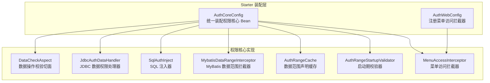

**图表来源**
- [AuthCoreConfig.java:1-203](file://auth/auth-core-spring-boot-starter/src/main/java/com/cu/framework/boot/auth/core/config/AuthCoreConfig.java#L1-L203)
- [AuthWebConfig.java:1-30](file://auth/auth-core-spring-boot-starter/src/main/java/com/cu/framework/boot/auth/core/config/AuthWebConfig.java#L1-L30)

**章节来源**
- [AuthCoreConfig.java:1-203](file://auth/auth-core-spring-boot-starter/src/main/java/com/cu/framework/boot/auth/core/config/AuthCoreConfig.java#L1-L203)
- [AuthWebConfig.java:1-30](file://auth/auth-core-spring-boot-starter/src/main/java/com/cu/framework/boot/auth/core/config/AuthWebConfig.java#L1-L30)

## 核心组件总览
| 组件 | Bean 名称 | 职责 | 关键依赖 | 是否可被用户替换 |
|---|---|---|---|---|
| 数据校验切面 | dataCheckAspect | 在标注了数据操作注解的方法执行前收集业务数据 ID 并判定权限 | AuthDataHandler、当前用户上下文 | 可通过扩展切面或调整注解使用方式替代，但默认 Bean 无条件创建 |
| 数据范围缓存 | authRangeCache | 保存 Mapper 方法上数据范围声明解析后的静态模板 | 无 Bean 依赖，扫描时依赖 MyBatis Configuration | 不可直接替换 Bean，但可读取其内容 |
| JDBC 数据权限处理器 | jdbcAuthDataHandler | 默认的数据权限增删查实现，基于权限表 | JdbcAuthDataPersistent | 是，存在 `@ConditionalOnMissingBean(AuthDataHandler.class)` |
| SQL 注入器 | sqlAuthInject | 根据声明和用户权限改写 SELECT 语句 | AuthDataTable | 可替换 Bean，但需注意兼容现有注入逻辑 |
| MyBatis 数据范围拦截器 | mybatisDataRangeInterceptor | 拦截 StatementHandler.prepare，动态改写物理 SQL | AuthRangeCache、当前用户上下文（懒加载） | 可替换 Bean，但需保持 MyBatis Interceptor 契约 |
| 启动校验器 | authRangeStartupValidator | 所有单例就绪后扫描声明、填充缓存、校验错误配置 | SqlSessionFactoryProvider、AuthRangeCache、SqlAuthInject、ListableBeanFactory | 通常保留默认实现，用于早期发现配置错误 |
| 菜单访问拦截器 | menuAccessInterceptor | 对带菜单权限注解的请求进行路径级鉴权 | 菜单权限处理器、当前用户上下文 | 可替换 Bean，并由 Web 配置注册 |
| 权限异常处理器 | authExceptionHandler | 处理权限框架业务异常，返回 403 或 400 状态码 | 无 | 是，存在 `@ConditionalOnMissingBean(AuthExceptionHandler.class)` |

**章节来源**
- [AuthCoreConfig.java:1-203](file://auth/auth-core-spring-boot-starter/src/main/java/com/cu/framework/boot/auth/core/config/AuthCoreConfig.java#L1-L203)
- [DataCheckAspect.java:1-149](file://auth/auth-core/src/main/java/com/cu/framework/auth/core/data/edit/DataCheckAspect.java#L1-L149)
- [JdbcAuthDataHandler.java:1-119](file://auth/auth-core/src/main/java/com/cu/framework/auth/core/data/JdbcAuthDataHandler.java#L1-L119)
- [SqlAuthInject.java:1-200](file://auth/auth-core/src/main/java/com/cu/framework/auth/core/data/range/SqlAuthInject.java#L1-L200)
- [MybatisDataRangeInterceptor.java:1-200](file://auth/auth-core/src/main/java/com/cu/framework/auth/core/data/range/MybatisDataRangeInterceptor.java#L1-L200)
- [AuthRangeCache.java:1-155](file://auth/auth-core/src/main/java/com/cu/framework/auth/core/data/range/AuthRangeCache.java#L1-L155)
- [AuthRangeStartupValidator.java:1-163](file://auth/auth-core/src/main/java/com/cu/framework/auth/core/data/range/AuthRangeStartupValidator.java#L1-L163)
- [MenuAccessInterceptor.java:1-93](file://auth/auth-core/src/main/java/com/cu/framework/auth/core/menu/MenuAccessInterceptor.java#L1-L93)
- [AuthExceptionHandler.java:1-38](file://auth/auth-core-spring-boot-starter/src/main/java/com/cu/framework/boot/auth/core/AuthExceptionHandler.java#L1-L38)

## 架构总览与装配入口
AuthCoreConfig 是一个普通 Spring 配置类，没有使用 Spring Boot 自动装配元数据来声明自身；实际启用由 starter 模块的装配机制触发。它的主要作用是把权限核心中的多个独立组件组合成一套可运行的装配结果：

1. 装配数据校验切面，使业务方法在执行前完成数据权限判定。
2. 装配数据范围缓存，供启动期扫描和运行期查询。
3. 有条件装配 JDBC 数据权限处理器，允许业务方替换为缓存或其他实现。
4. 装配 SQL 注入器，负责把权限条件注入 SELECT 语句。
5. 装配 MyBatis 数据范围拦截器，在物理 SQL 执行前改写 SQL。
6. 装配启动校验器，在所有单例就绪后做声明合法性检查。
7. 装配菜单访问拦截器，并在 Web 配置中注册到 MVC 拦截链。
8. 装配权限异常处理器，处理权限相关的业务异常。

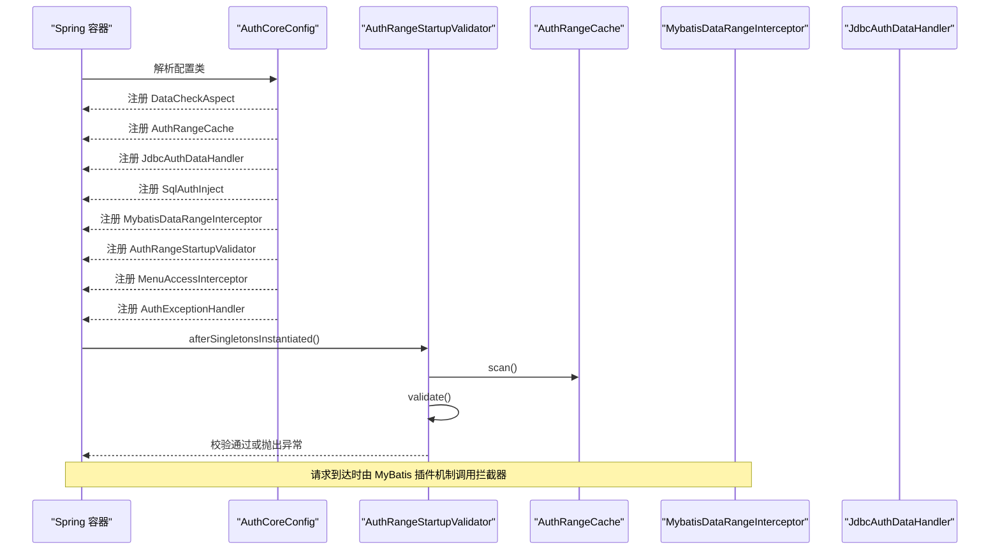

**图表来源**
- [AuthCoreConfig.java:1-203](file://auth/auth-core-spring-boot-starter/src/main/java/com/cu/framework/boot/auth/core/config/AuthCoreConfig.java#L1-L203)
- [AuthRangeStartupValidator.java:1-163](file://auth/auth-core/src/main/java/com/cu/framework/auth/core/data/range/AuthRangeStartupValidator.java#L1-L163)
- [AuthRangeCache.java:1-155](file://auth/auth-core/src/main/java/com/cu/framework/auth/core/data/range/AuthRangeCache.java#L1-L155)
- [MybatisDataRangeInterceptor.java:1-200](file://auth/auth-core/src/main/java/com/cu/framework/auth/core/data/range/MybatisDataRangeInterceptor.java#L1-L200)
- [JdbcAuthDataHandler.java:1-119](file://auth/auth-core/src/main/java/com/cu/framework/auth/core/data/JdbcAuthDataHandler.java#L1-L119)

**章节来源**
- [AuthCoreConfig.java:1-203](file://auth/auth-core-spring-boot-starter/src/main/java/com/cu/framework/boot/auth/core/config/AuthCoreConfig.java#L1-L203)
- [AuthWebConfig.java:1-30](file://auth/auth-core-spring-boot-starter/src/main/java/com/cu/framework/boot/auth/core/config/AuthWebConfig.java#L1-L30)

## 关键 Bean 装配逻辑详解

### 数据校验切面 DataCheckAspect
dataCheckAspect Bean 直接构造 DataCheckAspect，并注入一个 AuthDataHandler 实例和当前用户上下文。该切面拦截标注了数据操作注解的方法，从方法参数中提取业务数据 ID，去重后调用 AuthDataHandler 判定是否具备对应业务功能和操作类型的权限。若任一数据 ID 未命中权限，则拒绝访问。

关键点：
- 不依赖数据库连接，只依赖 AuthDataHandler 抽象接口。
- 默认由 jdbcAuthDataHandler 提供具体实现。
- 如果用户提供了其他 AuthDataHandler 实现，切面会透明使用该实现。

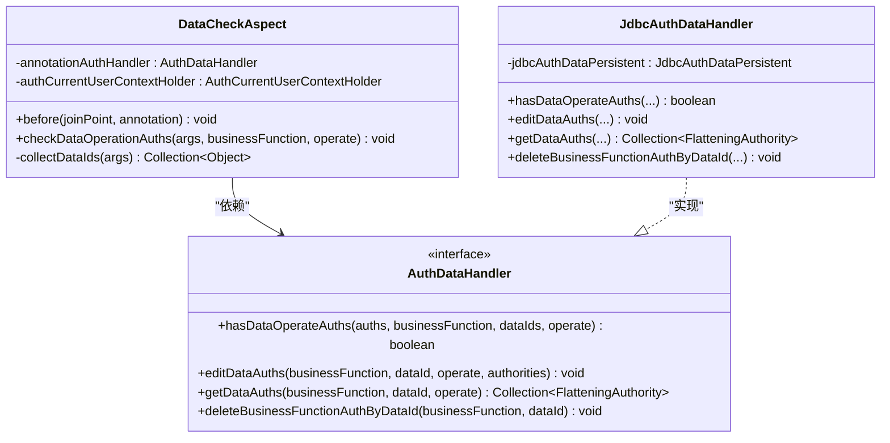

**图表来源**
- [DataCheckAspect.java:1-149](file://auth/auth-core/src/main/java/com/cu/framework/auth/core/data/edit/DataCheckAspect.java#L1-L149)
- [JdbcAuthDataHandler.java:1-119](file://auth/auth-core/src/main/java/com/cu/framework/auth/core/data/JdbcAuthDataHandler.java#L1-L119)

**章节来源**
- [AuthCoreConfig.java:1-203](file://auth/auth-core-spring-boot-starter/src/main/java/com/cu/framework/boot/auth/core/config/AuthCoreConfig.java#L1-L203)
- [DataCheckAspect.java:1-149](file://auth/auth-core/src/main/java/com/cu/framework/auth/core/data/edit/DataCheckAspect.java#L1-L149)
- [JdbcAuthDataHandler.java:1-119](file://auth/auth-core/src/main/java/com/cu/framework/auth/core/data/JdbcAuthDataHandler.java#L1-L119)

### 数据范围缓存 AuthRangeCache
AuthRangeCache 保存的是"按映射语句 ID 划分的静态声明模板"。它会在启动期由启动校验器扫描 MyBatis 已注册的 Mapper 接口，收集所有数据范围声明，并把能解析到的查询语句模板放入缓存。运行时，拦截器根据当前语句 ID 查找模板，再复制一份写入本次请求的用户权限集合，从而保证线程安全。

关键点：
- 键是"接口全限定名加方法名"拼出的语句 ID。
- 非查询语句不会生成可注入的模板。
- 声明失败也会保留 Declaration 信息，供启动校验报错定位。

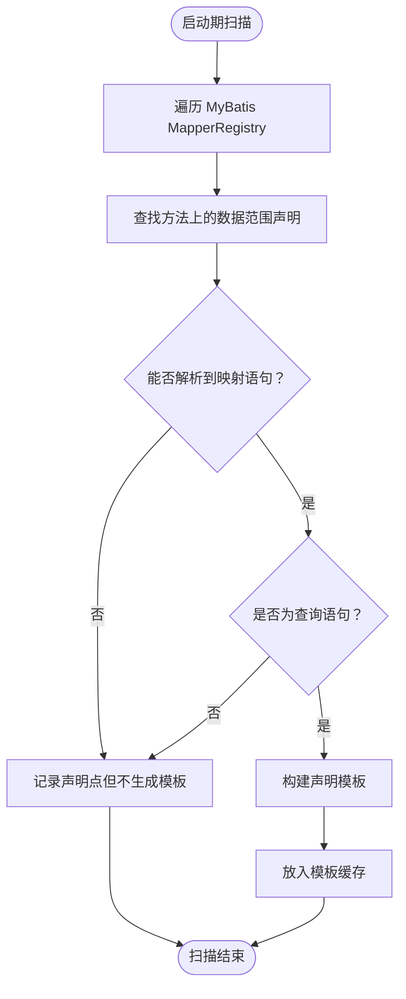

**图表来源**
- [AuthRangeCache.java:1-155](file://auth/auth-core/src/main/java/com/cu/framework/auth/core/data/range/AuthRangeCache.java#L1-L155)

**章节来源**
- [AuthRangeCache.java:1-155](file://auth/auth-core/src/main/java/com/cu/framework/auth/core/data/range/AuthRangeCache.java#L1-L155)
- [AuthRangeStartupValidator.java:1-163](file://auth/auth-core/src/main/java/com/cu/framework/auth/core/data/range/AuthRangeStartupValidator.java#L1-L163)

### JDBC 数据权限处理器 JdbcAuthDataHandler
JdbcAuthDataHandler 是默认的 AuthDataHandler 实现，负责：
- 批量新增、删除权限表记录。
- 根据业务功能、数据 ID、操作类型查询权限。
- 判断当前用户权限集合是否与目标数据的权限集合有交集。

注意：它的 hasDataOperateAuths 会把用户权限放在内存中比对，而不是放进 SQL 条件，因为用户权限规模不可控。

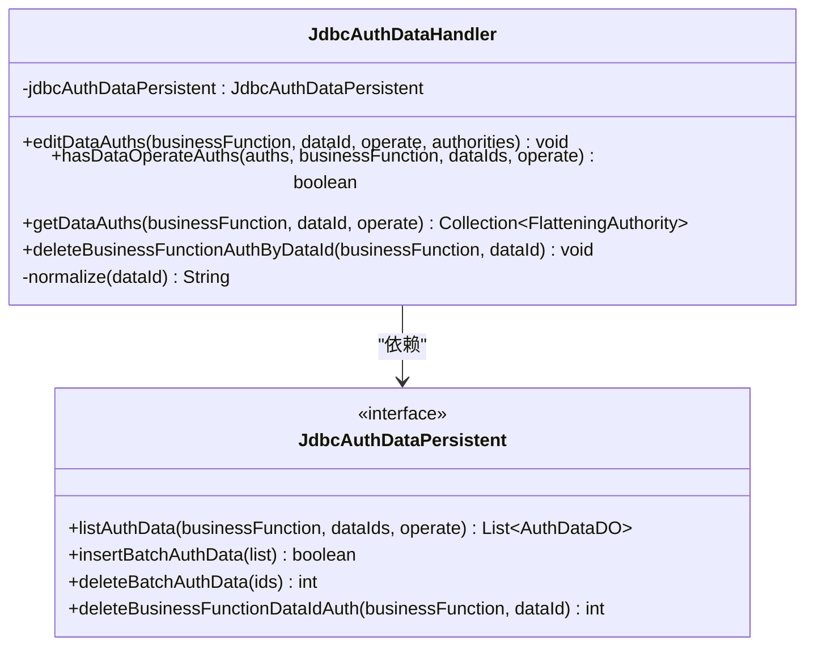

**图表来源**
- [JdbcAuthDataHandler.java:1-119](file://auth/auth-core/src/main/java/com/cu/framework/auth/core/data/JdbcAuthDataHandler.java#L1-L119)

**章节来源**
- [AuthCoreConfig.java:1-203](file://auth/auth-core-spring-boot-starter/src/main/java/com/cu/framework/boot/auth/core/config/AuthCoreConfig.java#L1-L203)
- [JdbcAuthDataHandler.java:1-119](file://auth/auth-core/src/main/java/com/cu/framework/auth/core/data/JdbcAuthDataHandler.java#L1-L119)

### SQL 注入器 SqlAuthInject
SqlAuthInject 接收 AuthDataTable 配置，负责把权限条件注入 SELECT 语句。它支持 IN 匹配和 EXISTS 匹配两种方式；当用户权限集合为空时，注入恒假条件，使查询返回空结果，而不是放开过滤。它还提供一个 validateTargetTable 方法，供启动期静态校验 SQL 是否能匹配声明的目标表。

关键点：
- 使用 SQL 解析库解析 SELECT。
- 需要找到最终 PlainSelect 和目标表。
- 空权限集合不是放行，而是"零行可见"。

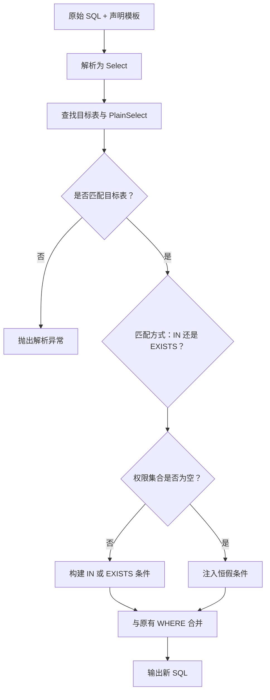

**图表来源**
- [SqlAuthInject.java:1-200](file://auth/auth-core/src/main/java/com/cu/framework/auth/core/data/range/SqlAuthInject.java#L1-L200)

**章节来源**
- [AuthCoreConfig.java:1-203](file://auth/auth-core-spring-boot-starter/src/main/java/com/cu/framework/boot/auth/core/config/AuthCoreConfig.java#L1-L203)
- [SqlAuthInject.java:1-200](file://auth/auth-core/src/main/java/com/cu/framework/auth/core/data/range/SqlAuthInject.java#L1-L200)

### MyBatis 数据范围拦截器 MybatisDataRangeInterceptor
该拦截器拦截 StatementHandler.prepare，也就是每条物理 SQL 执行前的位置。它会：
1. 从当前语句解析出 MappedStatement。
2. 用语句 ID 在 AuthRangeCache 中查找声明模板。
3. 如果不是查询语句，跳过增强。
4. 从当前用户上下文取出权限集合，复制模板后交给 SqlAuthInject 改写 SQL。
5. 把改写后的 SQL 写回 BoundSql。

为了避开 MyBatis 插件先于 Spring 容器完全初始化导致无法直接注入 SqlAuthInject 的问题，它采用 ApplicationContextAware 加双重检查懒加载。

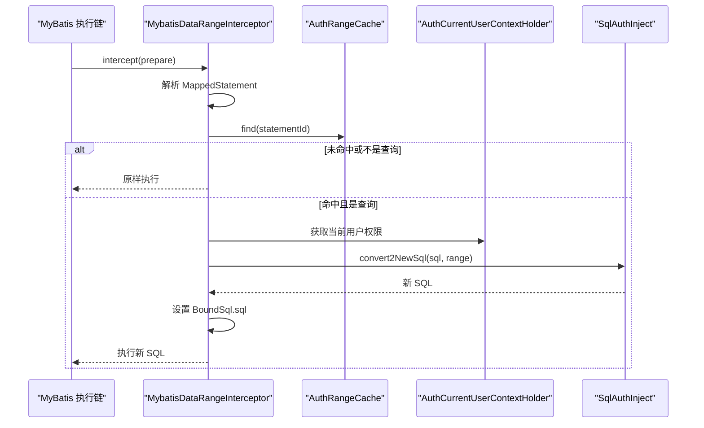

**图表来源**
- [MybatisDataRangeInterceptor.java:1-200](file://auth/auth-core/src/main/java/com/cu/framework/auth/core/data/range/MybatisDataRangeInterceptor.java#L1-L200)
- [AuthRangeCache.java:1-155](file://auth/auth-core/src/main/java/com/cu/framework/auth/core/data/range/AuthRangeCache.java#L1-L155)
- [SqlAuthInject.java:1-200](file://auth/auth-core/src/main/java/com/cu/framework/auth/core/data/range/SqlAuthInject.java#L1-L200)

**章节来源**
- [AuthCoreConfig.java:1-203](file://auth/auth-core-spring-boot-starter/src/main/java/com/cu/framework/boot/auth/core/config/AuthCoreConfig.java#L1-L203)
- [MybatisDataRangeInterceptor.java:1-200](file://auth/auth-core/src/main/java/com/cu/framework/auth/core/data/range/MybatisDataRangeInterceptor.java#L1-L200)

### 启动校验器 AuthRangeStartupValidator
AuthRangeStartupValidator 实现 SmartInitializingSingleton，在所有单例就绪后执行校验。它主要检查四类问题：
1. 声明解析不到映射语句。
2. 声明对应的语句不是查询。
3. 声明对应的语句启用了二级缓存。
4. 静态 SQL 中找不到声明的目标表。

此外，它还扫描非 Mapper 类上的旧用法残留声明，确保迁移期间不会静默失效。

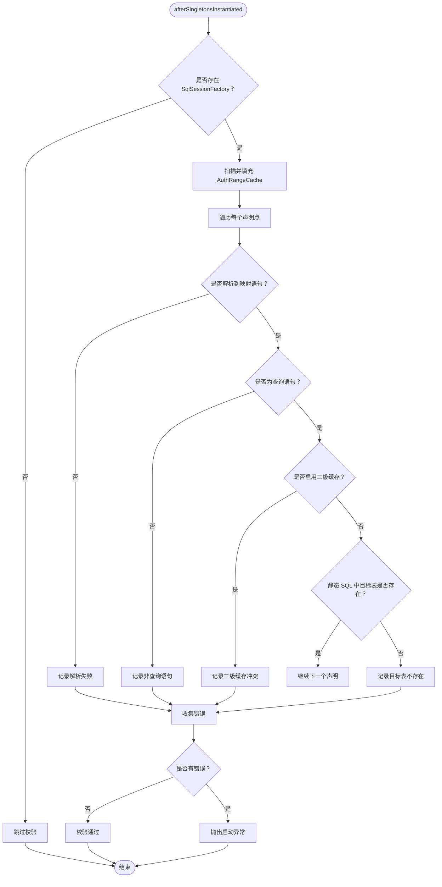

**图表来源**
- [AuthRangeStartupValidator.java:1-163](file://auth/auth-core/src/main/java/com/cu/framework/auth/core/data/range/AuthRangeStartupValidator.java#L1-L163)

**章节来源**
- [AuthCoreConfig.java:1-203](file://auth/auth-core-spring-boot-starter/src/main/java/com/cu/framework/boot/auth/core/config/AuthCoreConfig.java#L1-L203)
- [AuthRangeStartupValidator.java:1-163](file://auth/auth-core/src/main/java/com/cu/framework/auth/core/data/range/AuthRangeStartupValidator.java#L1-L163)

### 菜单访问拦截器 MenuAccessInterceptor
MenuAccessInterceptor 是 Spring MVC 拦截器，只对带菜单权限注解的请求生效。它从请求 URI 去掉 contextPath，再调用菜单权限处理器判断当前用户是否有权访问该路径。如果没有权限，抛出认证异常。

AuthWebConfig 将其注册到 MVC 拦截链中，因此菜单访问控制发生在 Controller 方法执行之前。

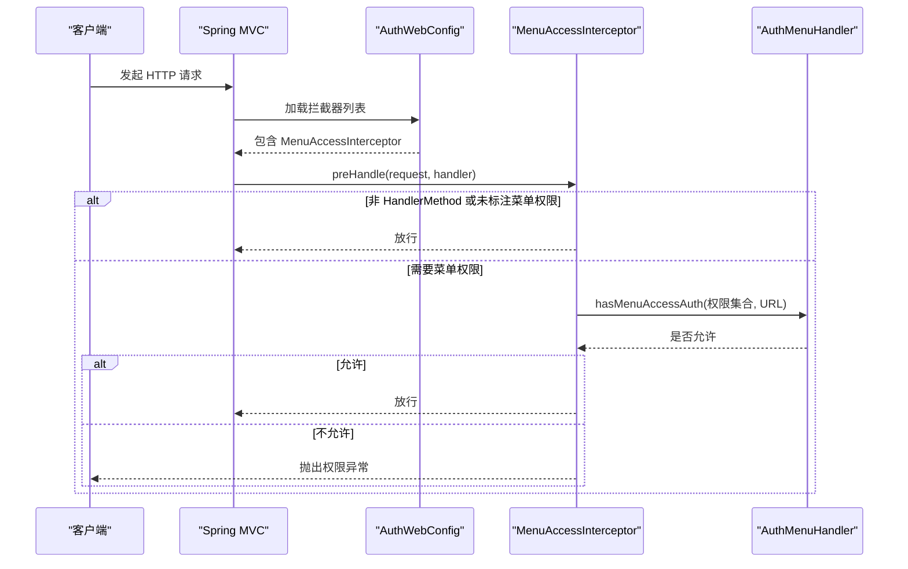

**图表来源**
- [MenuAccessInterceptor.java:1-93](file://auth/auth-core/src/main/java/com/cu/framework/auth/core/menu/MenuAccessInterceptor.java#L1-L93)
- [AuthWebConfig.java:1-30](file://auth/auth-core-spring-boot-starter/src/main/java/com/cu/framework/boot/auth/core/config/AuthWebConfig.java#L1-L30)

**章节来源**
- [AuthCoreConfig.java:1-203](file://auth/auth-core-spring-boot-starter/src/main/java/com/cu/framework/boot/auth/core/config/AuthCoreConfig.java#L1-L203)
- [MenuAccessInterceptor.java:1-93](file://auth/auth-core/src/main/java/com/cu/framework/auth/core/menu/MenuAccessInterceptor.java#L1-L93)
- [AuthWebConfig.java:1-30](file://auth/auth-core-spring-boot-starter/src/main/java/com/cu/framework/boot/auth/core/config/AuthWebConfig.java#L1-L30)

### 权限异常处理器 AuthExceptionHandler
AuthExceptionHandler 是权限框架专用的全局异常处理器，专门处理权限相关的业务异常。它通过 `@RestControllerAdvice` 和 `@Order(Ordered.HIGHEST_PRECEDENCE + 100)` 注解确保在异常处理链中具有较高的优先级。

该处理器主要处理两类异常：
- **AuthException**：权限框架业务异常，返回 HTTP 状态码 403，表示当前用户无权访问
- **AuthServiceException**：调用方式错误异常，返回 HTTP 状态码 400，表示这次调用无法判定权限

通过区分 403 和 400 状态码，调用方可以不必解析消息文本就能判断是"当前登录人无权"还是"这次调用无法判定"。

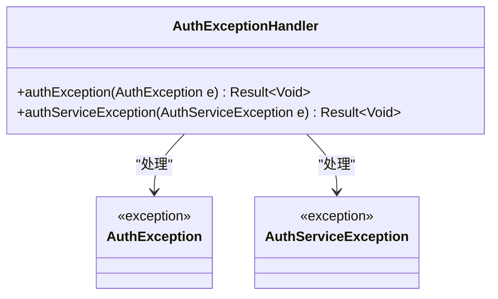

**图表来源**
- [AuthExceptionHandler.java:1-38](file://auth/auth-core-spring-boot-starter/src/main/java/com/cu/framework/boot/auth/core/AuthExceptionHandler.java#L1-L38)

**章节来源**
- [AuthExceptionHandler.java:1-38](file://auth/auth-core-spring-boot-starter/src/main/java/com/cu/framework/boot/auth/core/AuthExceptionHandler.java#L1-L38)

## 依赖关系图与生命周期图

### Bean 依赖关系图
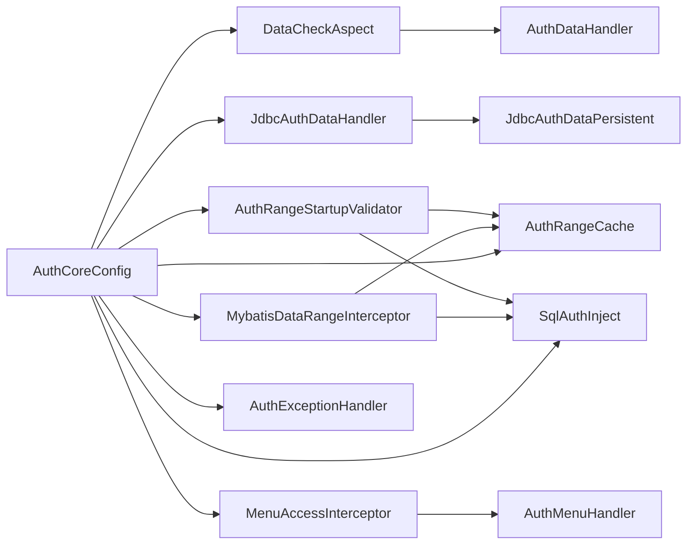

**图表来源**
- [AuthCoreConfig.java:1-203](file://auth/auth-core-spring-boot-starter/src/main/java/com/cu/framework/boot/auth/core/config/AuthCoreConfig.java#L1-L203)
- [DataCheckAspect.java:1-149](file://auth/auth-core/src/main/java/com/cu/framework/auth/core/data/edit/DataCheckAspect.java#L1-L149)
- [JdbcAuthDataHandler.java:1-119](file://auth/auth-core/src/main/java/com/cu/framework/auth/core/data/JdbcAuthDataHandler.java#L1-L119)
- [MybatisDataRangeInterceptor.java:1-200](file://auth/auth-core/src/main/java/com/cu/framework/auth/core/data/range/MybatisDataRangeInterceptor.java#L1-L200)
- [AuthRangeStartupValidator.java:1-163](file://auth/auth-core/src/main/java/com/cu/framework/auth/core/data/range/AuthRangeStartupValidator.java#L1-L163)
- [MenuAccessInterceptor.java:1-93](file://auth/auth-core/src/main/java/com/cu/framework/auth/core/menu/MenuAccessInterceptor.java#L1-L93)
- [AuthExceptionHandler.java:1-38](file://auth/auth-core-spring-boot-starter/src/main/java/com/cu/framework/boot/auth/core/AuthExceptionHandler.java#L1-L38)

### Bean 生命周期图
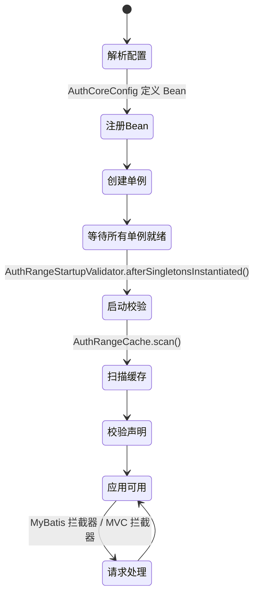

**图表来源**
- [AuthCoreConfig.java:1-203](file://auth/auth-core-spring-boot-starter/src/main/java/com/cu/framework/boot/auth/core/config/AuthCoreConfig.java#L1-L203)
- [AuthRangeStartupValidator.java:1-163](file://auth/auth-core/src/main/java/com/cu/framework/auth/core/data/range/AuthRangeStartupValidator.java#L1-L163)
- [AuthRangeCache.java:1-155](file://auth/auth-core/src/main/java/com/cu/framework/auth/core/data/range/AuthRangeCache.java#L1-L155)
- [MybatisDataRangeInterceptor.java:1-200](file://auth/auth-core/src/main/java/com/cu/framework/auth/core/data/range/MybatisDataRangeInterceptor.java#L1-L200)

## 条件装配与用户替换机制
AuthCoreConfig 明确支持用户替换默认实现，主要通过以下机制：

| 替换点 | 装配注解 | 说明 |
|---|---|---|
| 数据权限处理器 | `@ConditionalOnMissingBean(AuthDataHandler.class)` | 如果用户定义了任何 AuthDataHandler Bean，则不创建默认 JdbcAuthDataHandler |
| 权限异常处理器 | `@ConditionalOnMissingBean(AuthExceptionHandler.class)` | 避免重复响应出口 |
| Web 应用环境 | `@ConditionalOnWebApplication` | 只在 Web 环境下装配权限异常处理器 |
| 其他 Bean | 无条件创建 | 如 DataCheckAspect、AuthRangeCache、SqlAuthInject、MybatisDataRangeInterceptor、MenuAccessInterceptor 等 |

这意味着：
- 如果业务系统已经实现了自己的数据权限处理器，只需注册一个 AuthDataHandler Bean，即可覆盖默认 JDBC 实现。
- 如果业务系统已有统一的权限异常处理，可以注册 AuthExceptionHandler Bean，避免框架重复兜底。
- 如果业务系统希望完全接管 SQL 注入或 MyBatis 拦截逻辑，也可以注册同名 Bean 替换默认实现，但需要自行保证与现有流程兼容。

**章节来源**
- [AuthCoreConfig.java:1-203](file://auth/auth-core-spring-boot-starter/src/main/java/com/cu/framework/boot/auth/core/config/AuthCoreConfig.java#L1-L203)

## 循环依赖与 @Lazy 的作用机制
配置类注释明确指出：MybatisDataRangeInterceptor 在 SqlSessionFactory 构建期间可能被 MyBatis 取用。如果此时强依赖当前用户上下文，容易形成"拦截器 -> 用户上下文 -> 复合组件 -> Mapper -> SqlSessionFactory"的创建期循环依赖。

解决方案：
1. 在装配 MybatisDataRangeInterceptor 时，对 AuthCurrentUserContextHolder 使用 `@Lazy` 注入。
2. MybatisDataRangeInterceptor 本身还额外实现了 ApplicationContextAware，并对 SqlAuthInject 使用双重检查懒加载，以应对 MyBatis 插件早于 Spring 容器完全初始化的场景。

这表示：
- 启动阶段不需要立即拿到当前用户上下文。
- 只有真正执行 SQL 时，才通过代理对象获取真实依赖。
- 这样既避免了启动期循环依赖，又保留了运行期正确的权限上下文。

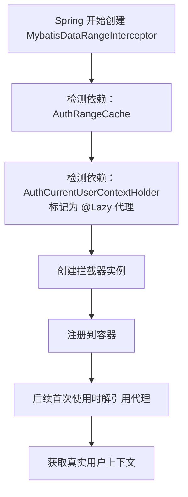

**图表来源**
- [AuthCoreConfig.java:1-203](file://auth/auth-core-spring-boot-starter/src/main/java/com/cu/framework/boot/auth/core/config/AuthCoreConfig.java#L1-L203)
- [MybatisDataRangeInterceptor.java:1-200](file://auth/auth-core/src/main/java/com/cu/framework/auth/core/data/range/MybatisDataRangeInterceptor.java#L1-L200)

**章节来源**
- [AuthCoreConfig.java:1-203](file://auth/auth-core-spring-boot-starter/src/main/java/com/cu/framework/boot/auth/core/config/AuthCoreConfig.java#L1-L203)
- [MybatisDataRangeInterceptor.java:1-200](file://auth/auth-core/src/main/java/com/cu/framework/auth/core/data/range/MybatisDataRangeInterceptor.java#L1-L200)

## 全局异常处理器优先级体系

框架中存在多个全局异常处理器，它们通过 `@Order` 注解建立了明确的处理优先级，确保异常能够按照预定的顺序被捕获和处理。这种设计避免了异常处理器之间的冲突，保证了异常处理的确定性和可预测性。

### 异常处理器优先级层次

| 处理器 | 优先级值 | 处理范围 | 典型异常 |
|---|---|---|---|
| AuthenticationExceptionAdviceHandler | Ordered.HIGHEST_PRECEDENCE + 200 | 认证与授权异常 | AccessDeniedException、NoLoginException、AuthenticationException |
| AuthExceptionHandler | Ordered.HIGHEST_PRECEDENCE + 100 | 权限框架业务异常 | AuthException、AuthServiceException |
| GlobalExceptionHandlerAdvice | Ordered.LOWEST_PRECEDENCE | 通用业务异常与参数校验 | BizException、NullPointerException、MethodArgumentNotValidException、Throwable |

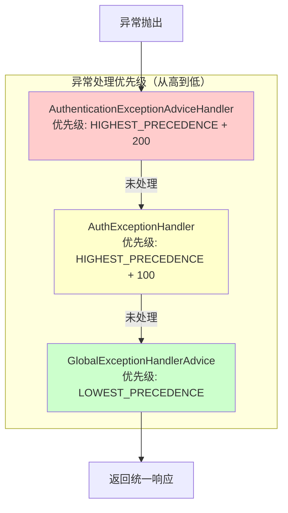

**图表来源**
- [AuthenticationExceptionAdviceHandler.java:1-80](file://boot/login-security-spring-boot-starter/src/main/java/com/cu/framework/authentication/handler/AuthenticationExceptionAdviceHandler.java#L1-L80)
- [AuthExceptionHandler.java:1-38](file://auth/auth-core-spring-boot-starter/src/main/java/com/cu/framework/boot/auth/core/AuthExceptionHandler.java#L1-L38)
- [GlobalExceptionHandlerAdvice.java:1-86](file://basic/src/main/java/com/cu/framework/basic/exception/GlobalExceptionHandlerAdvice.java#L1-L86)

### AuthenticationExceptionAdviceHandler
这是最高优先级的异常处理器，专门处理 Spring Security 相关的认证与授权异常。它通过 `@Order(Ordered.HIGHEST_PRECEDENCE + 200)` 确保在其他异常处理器之前执行。

主要处理的异常包括：
- **AccessDeniedException**：访问拒绝异常，返回 401 状态码
- **NoLoginException**：未登录异常，返回 401 状态码
- **AuthenticationException**：认证异常，返回 403 状态码
- **InternalAuthenticationServiceException**：认证服务内部异常，返回 500 状态码
- **InsufficientAuthenticationException**：认证信息不足异常，返回 401 状态码

**章节来源**
- [AuthenticationExceptionAdviceHandler.java:1-80](file://boot/login-security-spring-boot-starter/src/main/java/com/cu/framework/authentication/handler/AuthenticationExceptionAdviceHandler.java#L1-L80)

### AuthExceptionHandler
这是中等优先级的异常处理器，专门处理权限框架自身的业务异常。它通过 `@Order(Ordered.HIGHEST_PRECEDENCE + 100)` 确保在通用异常处理器之前执行，但在认证异常处理器之后执行。

主要处理的异常包括：
- **AuthException**：权限框架业务异常，返回 403 状态码
- **AuthServiceException**：调用方式错误异常，返回 400 状态码

**章节来源**
- [AuthExceptionHandler.java:1-38](file://auth/auth-core-spring-boot-starter/src/main/java/com/cu/framework/boot/auth/core/AuthExceptionHandler.java#L1-L38)

### GlobalExceptionHandlerAdvice
这是最低优先级的异常处理器，作为全局异常的兜底处理器。它通过 `@Order(Ordered.LOWEST_PRECEDENCE)` 确保在其他所有异常处理器之后执行，处理那些未被前面处理器捕获的异常。

主要处理的异常包括：
- **BizException**：业务异常，返回 BIZ_FAILED 错误码
- **NullPointerException**：空指针异常，按业务异常处理
- **MethodArgumentNotValidException**：参数校验异常，返回 PARAM_VALID_FAILED 错误码
- **Throwable**：全局异常兜底，返回异常消息

**章节来源**
- [GlobalExceptionHandlerAdvice.java:1-86](file://basic/src/main/java/com/cu/framework/basic/exception/GlobalExceptionHandlerAdvice.java#L1-L86)

### 异常处理流程示例

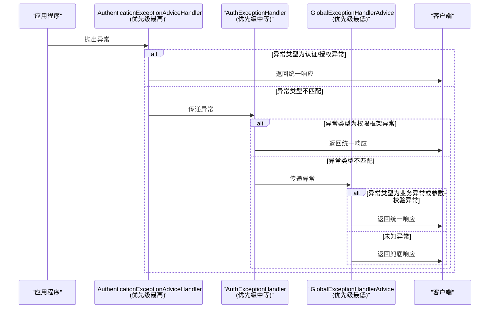

**图表来源**
- [AuthenticationExceptionAdviceHandler.java:1-80](file://boot/login-security-spring-boot-starter/src/main/java/com/cu/framework/authentication/handler/AuthenticationExceptionAdviceHandler.java#L1-L80)
- [AuthExceptionHandler.java:1-38](file://auth/auth-core-spring-boot-starter/src/main/java/com/cu/framework/boot/auth/core/AuthExceptionHandler.java#L1-L38)
- [GlobalExceptionHandlerAdvice.java:1-86](file://basic/src/main/java/com/cu/framework/basic/exception/GlobalExceptionHandlerAdvice.java#L1-L86)

### 设计优势

1. **明确的职责划分**：每个异常处理器专注于特定类型的异常，避免职责重叠
2. **确定的处理顺序**：通过 `@Order` 注解确保异常按照预定的顺序被处理
3. **灵活的扩展性**：业务系统可以通过定义更高优先级的异常处理器来覆盖默认行为
4. **完善的兜底机制**：GlobalExceptionHandlerAdvice 作为最后的防线，确保所有异常都能得到处理

### 注意事项

- 不要在同一优先级上定义多个相同类型的异常处理器，这可能导致不可预测的行为
- 如果需要自定义异常处理器，建议使用比现有处理器更高或更低的优先级，避免冲突
- 异常处理器应该只处理自己负责的异常类型，对于不匹配的异常应该让其传递给下一个处理器

## 常见装配问题排查

### 1. 数据范围声明静默失效
现象：应用启动成功，但某些查询没有按预期进行数据范围过滤。

可能原因：
- 声明的 Mapper 方法名与映射语句 ID 不一致。
- 声明被错误地放在非 Mapper 类的方法上。
- MyBatis 尚未完成 Mapper 注册时，缓存尚未扫描。
- 使用了动态 SQL，启动期无法静态验证目标表。

排查步骤：
1. 查看启动日志中是否出现 `@AuthDataRange 数据范围声明校验失败`。
2. 确认声明是否位于 MyBatis Mapper 接口方法上。
3. 确认方法名与 XML 或注解映射中的语句 ID 一致。
4. 对于动态 SQL，检查运行期是否因目标表匹配失败抛出异常。

相关依据：
- 启动校验器会在所有单例就绪后扫描声明。
- 非 Mapper 类上的旧用法会被显式报错。
- 动态 SQL 的目标表校验延后到运行期。

**章节来源**
- [AuthRangeStartupValidator.java:1-163](file://auth/auth-core/src/main/java/com/cu/framework/auth/core/data/range/AuthRangeStartupValidator.java#L1-L163)
- [AuthRangeCache.java:1-155](file://auth/auth-core/src/main/java/com/cu/framework/auth/core/data/range/AuthRangeCache.java#L1-L155)

### 2. 数据权限判定总是拒绝
现象：业务方法标注了数据操作注解，但任何数据 ID 都判为无权限。

可能原因：
- 当前用户权限集合为空。
- 权限表中缺少对应业务功能、数据 ID、操作类型的记录。
- 数据 ID 类型归一化不一致，导致主键形态不同。
- 用户自定义的 AuthDataHandler 实现逻辑不正确。

排查步骤：
1. 确认当前用户上下文是否包含 FlatteningAuthority。
2. 检查权限表中对应业务功能的记录是否存在。
3. 检查业务 ID 是否以字符串形式稳定归一化。
4. 如果替换了 AuthDataHandler，确认 hasDataOperateAuths 实现正确。

**章节来源**
- [DataCheckAspect.java:1-149](file://auth/auth-core/src/main/java/com/cu/framework/auth/core/data/edit/DataCheckAspect.java#L1-L149)
- [JdbcAuthDataHandler.java:1-119](file://auth/auth-core/src/main/java/com/cu/framework/auth/core/data/JdbcAuthDataHandler.java#L1-L119)

### 3. 菜单访问权限异常
现象：Controller 方法标注菜单权限注解后，请求直接抛权限异常。

可能原因：
- 当前用户没有该 URL 对应的菜单权限。
- 请求路径与菜单配置的 URL 不一致。
- contextPath 配置导致 URL 计算偏差。

排查步骤：
1. 确认 Controller 方法或其类上是否正确标注菜单权限注解。
2. 确认菜单权限处理器中记录的 URL 是否与请求路径一致。
3. 检查应用的 contextPath 配置。

**章节来源**
- [MenuAccessInterceptor.java:1-93](file://auth/auth-core/src/main/java/com/cu/framework/auth/core/menu/MenuAccessInterceptor.java#L1-L93)
- [AuthWebConfig.java:1-30](file://auth/auth-core-spring-boot-starter/src/main/java/com/cu/framework/boot/auth/core/config/AuthWebConfig.java#L1-L30)

### 4. SQL 注入失败
现象：查询执行时报 SQL 解析异常，提示匹配不到目标表。

可能原因：
- 声明中的 table 或 tableAlias 与实际 SQL 中的表名或别名不一致。
- 子查询嵌套较深，解析器未能定位到目标表。
- 动态 SQL 渲染后的实际表名与声明不一致。

排查步骤：
1. 检查声明中的 table 和 tableAlias。
2. 检查 SQL 中目标表的别名是否与声明一致。
3. 对动态 SQL，确认最终渲染出的 SQL 能被 SqlAuthInject 解析。

**章节来源**
- [SqlAuthInject.java:1-200](file://auth/auth-core/src/main/java/com/cu/framework/auth/core/data/range/SqlAuthInject.java#L1-L200)
- [MybatisDataRangeInterceptor.java:1-200](file://auth/auth-core/src/main/java/com/cu/framework/auth/core/data/range/MybatisDataRangeInterceptor.java#L1-L200)

### 5. 异常处理器冲突
现象：异常没有被预期的处理器捕获，或者返回的状态码不符合预期。

可能原因：
- 多个异常处理器定义了相同的优先级。
- 异常处理器的 `@Order` 值设置不当，导致处理顺序不符合预期。
- 异常类型被多个处理器同时匹配，但优先级高的处理器没有正确处理。

排查步骤：
1. 检查所有异常处理器的 `@Order` 注解值，确保优先级层次清晰。
2. 确认异常类型与处理器的 `@ExceptionHandler` 注解匹配。
3. 查看日志确认异常被哪个处理器捕获。
4. 如果需要自定义异常处理器，确保使用合适的优先级值，避免与现有处理器冲突。

**章节来源**
- [AuthenticationExceptionAdviceHandler.java:1-80](file://boot/login-security-spring-boot-starter/src/main/java/com/cu/framework/authentication/handler/AuthenticationExceptionAdviceHandler.java#L1-L80)
- [AuthExceptionHandler.java:1-38](file://auth/auth-core-spring-boot-starter/src/main/java/com/cu/framework/boot/auth/core/AuthExceptionHandler.java#L1-L38)
- [GlobalExceptionHandlerAdvice.java:1-86](file://basic/src/main/java/com/cu/framework/basic/exception/GlobalExceptionHandlerAdvice.java#L1-L86)

## 性能特征与优化建议

### 数据校验切面
- 单次校验会对参数中的业务数据 ID 去重，默认上限为 100。
- 超出上限会拒绝判定，要求调用方分批提交，避免一次校验退化成大规模查询。
- 建议在业务层对大批量数据进行分片处理。

**章节来源**
- [DataCheckAspect.java:1-149](file://auth/auth-core/src/main/java/com/cu/framework/auth/core/data/edit/DataCheckAspect.java#L1-L149)

### JDBC 数据权限处理器
- hasDataOperateAuths 会将用户权限集合放入内存比对，不在 SQL 中传参。
- 当用户权限集合很大时，内存比对成本上升。
- 建议：
  - 控制用户权限粒度，避免单个用户拥有过多权限串。
  - 如需高性能场景，可提供自定义 AuthDataHandler，例如结合本地缓存或预聚合。

**章节来源**
- [JdbcAuthDataHandler.java:1-119](file://auth/auth-core/src/main/java/com/cu/framework/auth/core/data/JdbcAuthDataHandler.java#L1-L119)

### SQL 注入器
- 每次查询都会经过 SQL 解析。
- 权限集合为空时注入恒假条件，避免产生非法 SQL。
- 建议：
  - 避免在高频路径上使用过于复杂的子查询。
  - 合理设置 table 和 tableAlias，减少解析失败风险。
  - 对热点查询可考虑在业务层增加缓存，减少底层 SQL 数量。

**章节来源**
- [SqlAuthInject.java:1-200](file://auth/auth-core/src/main/java/com/cu/framework/auth/core/data/range/SqlAuthInject.java#L1-L200)

### MyBatis 拦截器
- 拦截器在每条物理 SQL 执行前介入。
- 未命中声明的语句直接放行，开销较小。
- SqlAuthInject 采用双重检查懒加载，避免早期初始化问题。
- 建议：
  - 不要滥用数据范围声明，仅对需要行级数据控制的查询声明。
  - 保持声明与 SQL 结构一致，降低解析失败概率。

**章节来源**
- [MybatisDataRangeInterceptor.java:1-200](file://auth/auth-core/src/main/java/com/cu/framework/auth/core/data/range/MybatisDataRangeInterceptor.java#L1-L200)

### 启动校验器
- 仅在启动期执行一次。
- 扫描所有 Mapper 方法，收集声明并校验。
- 建议：
  - 在 CI 或测试环境中启用完整权限数据，以便尽早发现配置错误。
  - 不要在频繁重启的服务中忽略启动校验失败。

**章节来源**
- [AuthRangeStartupValidator.java:1-163](file://auth/auth-core/src/main/java/com/cu/framework/auth/core/data/range/AuthRangeStartupValidator.java#L1-L163)

### 异常处理器
- 异常处理器的优先级通过 `@Order` 注解明确指定，确保处理顺序的确定性。
- 每个异常处理器只处理自己负责的异常类型，避免不必要的处理开销。
- 建议：
  - 不要在同一优先级上定义多个相同类型的异常处理器。
  - 自定义异常处理器时，选择合适的优先级值，避免与现有处理器冲突。
  - 异常处理器应该快速返回，避免在异常处理中执行耗时操作。

**章节来源**
- [AuthenticationExceptionAdviceHandler.java:1-80](file://boot/login-security-spring-boot-starter/src/main/java/com/cu/framework/authentication/handler/AuthenticationExceptionAdviceHandler.java#L1-L80)
- [AuthExceptionHandler.java:1-38](file://auth/auth-core-spring-boot-starter/src/main/java/com/cu/framework/boot/auth/core/AuthExceptionHandler.java#L1-L38)
- [GlobalExceptionHandlerAdvice.java:1-86](file://basic/src/main/java/com/cu/framework/basic/exception/GlobalExceptionHandlerAdvice.java#L1-L86)

## 结论
AuthCoreConfig 是权限核心模块的装配中枢：它把数据校验切面、数据范围缓存、JDBC 数据权限处理器、SQL 注入器、MyBatis 数据范围拦截器、启动校验器和菜单访问拦截器组合成一个可运行的权限体系。其设计重点在于三点：

1. **可替换性**：通过 `@ConditionalOnMissingBean` 允许业务方替换默认数据权限处理器和异常处理器，同时保持核心流程不变。
2. **健壮性**：启动期扫描和校验能在应用启动阶段暴露配置错误，避免运行期静默失效。
3. **稳定性**：通过 `@Lazy` 和运行期提供者解决 MyBatis 初始化阶段的潜在循环依赖，并保证 SQL 注入与菜单访问拦截在请求期正确工作。
4. **明确的异常处理优先级**：通过 `@Order` 注解建立多层异常处理器的优先级体系，确保异常能够按照预定的顺序被捕获和处理，避免处理器之间的冲突。

在实际使用中，应优先通过声明和数据权限配置解决问题；只有在确实需要更高性能或特殊存储策略时，才替换默认实现。替换时需严格遵循接口契约，并确保不影响启动校验、SQL 注入和菜单访问拦截的整体链路。同时，在自定义异常处理器时，应合理设置优先级，避免与现有处理器发生冲突。