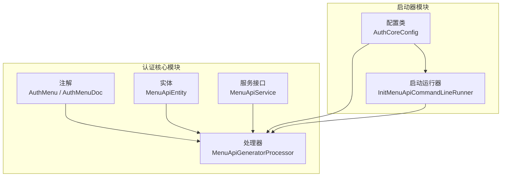
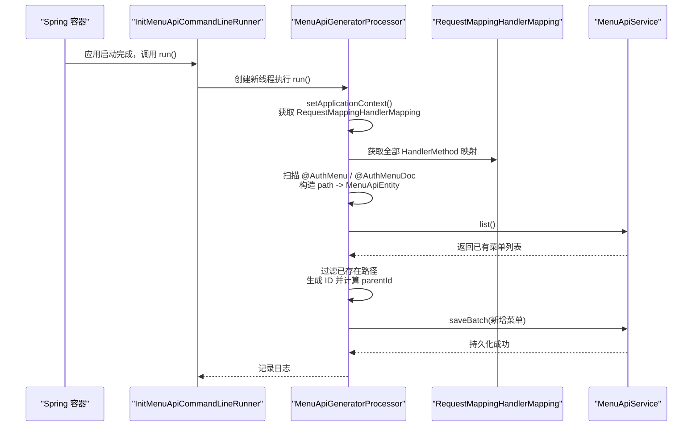
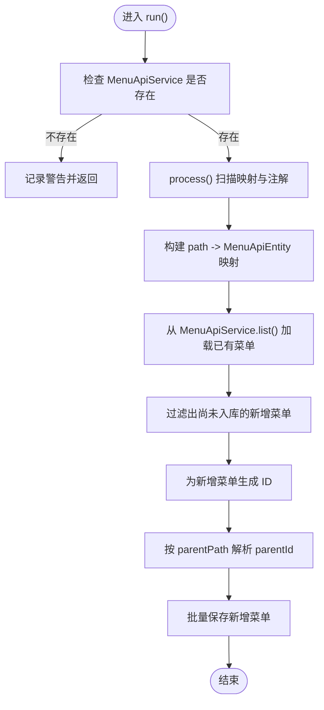
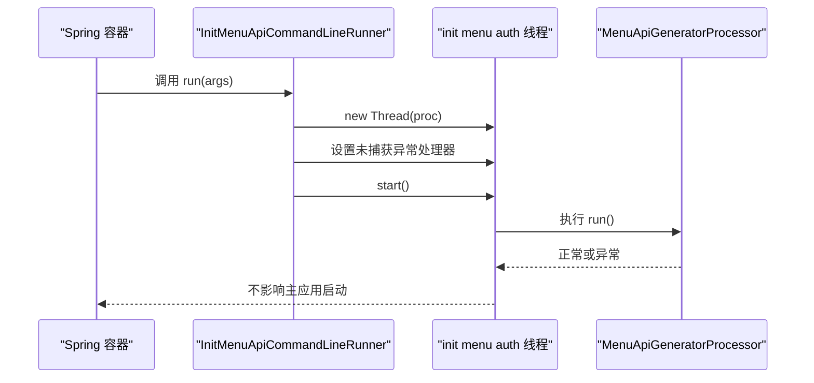
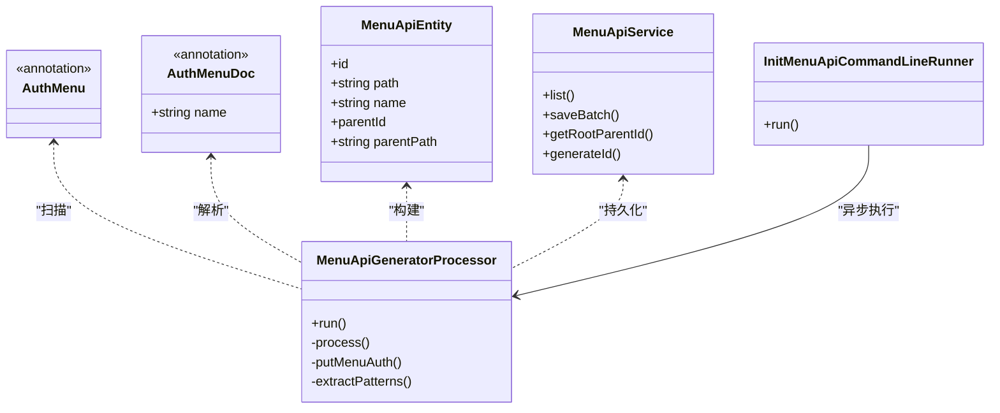
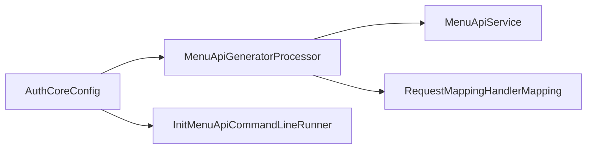

# 菜单 API 生成器

<cite>
**本文引用的文件**   
- [MenuApiGeneratorProcessor.java](file://auth/auth-core/src/main/java/com/cu/framework/auth/core/menu/MenuApiGeneratorProcessor.java)
- [InitMenuApiCommandLineRunner.java](file://auth/auth-core-spring-boot-starter/src/main/java/com/cu/framework/boot/auth/core/init/InitMenuApiCommandLineRunner.java)
- [AuthCoreConfig.java](file://auth/auth-core-spring-boot-starter/src/main/java/com/cu/framework/boot/auth/core/config/AuthCoreConfig.java)
- [MenuApiService.java](file://auth/auth-core/src/main/java/com/cu/framework/auth/core/menu/MenuApiService.java)
- [MenuApiEntity.java](file://auth/auth-core/src/main/java/com/cu/framework/auth/core/menu/MenuApiEntity.java)
- [AuthMenu.java](file://auth/auth-core/src/main/java/com/cu/framework/auth/core/AuthMenu.java)
- [AuthMenuDoc.java](file://auth/auth-core/src/main/java/com/cu/framework/auth/core/AuthMenuDoc.java)
</cite>

## 目录
1. [引言](#引言)
2. [项目结构定位](#项目结构定位)
3. [核心组件](#核心组件)
4. [架构总览](#架构总览)
5. [详细组件分析](#详细组件分析)
6. [依赖关系分析](#依赖关系分析)
7. [性能与健壮性](#性能与健壮性)
8. [配置与使用示例](#配置与使用示例)
9. [故障排查指南](#故障排查指南)
10. [结论](#结论)

## 引言
本文面向“菜单 API 生成器”这一能力，聚焦以下目标：
- 解释 MenuApiGeneratorProcessor 如何扫描 Controller 上的 @AuthMenu 注解并生成菜单权限脚本。
- 说明 InitMenuApiCommandLineRunner 的启动执行机制，包括异步线程策略和异常处理。
- 完整梳理“注解解析 → 元数据提取 → 脚本生成 → 文件输出（持久化）”流程。
- 给出可操作的配置选项、脚本格式规范以及扩展自定义逻辑的方法。

该功能属于权限系统的菜单访问控制子域：通过声明式注解描述哪些接口受菜单权限管控，并在应用启动后自动把控制器端点注册为菜单树节点，从而驱动运行时鉴权。

## 项目结构定位
菜单 API 生成器横跨两个模块：
- auth-core：定义注解、实体、处理器接口与核心处理器实现。
- auth-core-spring-boot-starter：装配 Spring Bean，并通过 CommandLineRunner 在应用启动时触发生成。

图表来源
- [AuthMenu.java:1-16](file://auth/auth-core/src/main/java/com/cu/framework/auth/core/AuthMenu.java#L1-L16)
- [AuthMenuDoc.java:1-22](file://auth/auth-core/src/main/java/com/cu/framework/auth/core/AuthMenuDoc.java#L1-L22)
- [MenuApiEntity.java:1-63](file://auth/auth-core/src/main/java/com/cu/framework/auth/core/menu/MenuApiEntity.java#L1-L63)
- [MenuApiService.java:1-38](file://auth/auth-core/src/main/java/com/cu/framework/auth/core/menu/MenuApiService.java#L1-L38)
- [MenuApiGeneratorProcessor.java:1-214](file://auth/auth-core/src/main/java/com/cu/framework/auth/core/menu/MenuApiGeneratorProcessor.java#L1-L214)
- [AuthCoreConfig.java:160-203](file://auth/auth-core-spring-boot-starter/src/main/java/com/cu/framework/boot/auth/core/config/AuthCoreConfig.java#L160-L203)
- [InitMenuApiCommandLineRunner.java:1-33](file://auth/auth-core-spring-boot-starter/src/main/java/com/cu/framework/boot/auth/core/init/InitMenuApiCommandLineRunner.java#L1-L33)

章节来源
- [AuthCoreConfig.java:160-203](file://auth/auth-core-spring-boot-starter/src/main/java/com/cu/framework/boot/auth/core/config/AuthCoreConfig.java#L160-L203)

## 核心组件
- AuthMenu：声明式注解，用于标记某个方法或整个 Controller 需要由菜单权限系统管辖。它不携带属性，只表达“是否管辖”。
- AuthMenuDoc：声明式注解，用于提供菜单显示文案；可标注在类上作为分组名称，也可标注在方法上作为端点名称。缺失时可回退到类名或方法名。
- MenuApiEntity：菜单 API 的数据载体，包含 id、path、name、parentId、parentPath。path 是菜单的唯一标识。
- MenuApiService：菜单 API 的持久化抽象，提供 list/saveBatch/getRootParentId/generateId 等方法。具体数据库实现由业务侧提供。
- MenuApiGeneratorProcessor：核心处理器，负责扫描 Spring MVC 映射、解析注解、构建菜单树并批量保存。
- InitMenuApiCommandLineRunner：启动运行器，应用启动后在新线程中异步执行 MenuApiGeneratorProcessor。
- AuthCoreConfig：Spring Boot 自动装配入口，注册 MenuApiGeneratorProcessor 与 InitMenuApiCommandLineRunner。

章节来源
- [AuthMenu.java:1-16](file://auth/auth-core/src/main/java/com/cu/framework/auth/core/AuthMenu.java#L1-L16)
- [AuthMenuDoc.java:1-22](file://auth/auth-core/src/main/java/com/cu/framework/auth/core/AuthMenuDoc.java#L1-L22)
- [MenuApiEntity.java:1-63](file://auth/auth-core/src/main/java/com/cu/framework/auth/core/menu/MenuApiEntity.java#L1-L63)
- [MenuApiService.java:1-38](file://auth/auth-core/src/main/java/com/cu/framework/auth/core/menu/MenuApiService.java#L1-L38)
- [MenuApiGeneratorProcessor.java:1-214](file://auth/auth-core/src/main/java/com/cu/framework/auth/core/menu/MenuApiGeneratorProcessor.java#L1-L214)
- [InitMenuApiCommandLineRunner.java:1-33](file://auth/auth-core-spring-boot-starter/src/main/java/com/cu/framework/boot/auth/core/init/InitMenuApiCommandLineRunner.java#L1-L33)
- [AuthCoreConfig.java:160-203](file://auth/auth-core-spring-boot-starter/src/main/java/com/cu/framework/boot/auth/core/config/AuthCoreConfig.java#L160-L203)

## 架构总览
菜单 API 生成的整体时序如下：

图表来源
- [InitMenuApiCommandLineRunner.java:1-33](file://auth/auth-core-spring-boot-starter/src/main/java/com/cu/framework/boot/auth/core/init/InitMenuApiCommandLineRunner.java#L1-L33)
- [MenuApiGeneratorProcessor.java:1-214](file://auth/auth-core/src/main/java/com/cu/framework/auth/core/menu/MenuApiGeneratorProcessor.java#L1-L214)
- [MenuApiService.java:1-38](file://auth/auth-core/src/main/java/com/cu/framework/auth/core/menu/MenuApiService.java#L1-L38)

## 详细组件分析

### MenuApiGeneratorProcessor：处理器工作原理
MenuApiGeneratorProcessor 实现了 ApplicationContextAware 与 Runnable：
- 通过 ApplicationContextAware 从容器中取 RequestMappingHandlerMapping 的全部请求映射，同时可选获取 MenuApiService；若容器中没有 MenuApiService，则跳过生成。
- 通过 run() 执行主流程：
  - 校验 MenuApiService 是否存在，不存在则直接返回。
  - process() 扫描所有 HandlerMethod，识别 @AuthMenu 与 @AuthMenuDoc，结合 @RequestMapping 生成 path 与 name，并维护 path→MenuApiEntity 的映射。
  - 读取数据库中已有菜单，过滤掉已存在的 path，仅对新增项生成 ID。
  - 根据 parentPath 查找父节点并设置 parentId；找不到父节点或父节点未入库时降级为根节点，避免空指针异常。
  - 批量保存新增菜单，并记录日志。

关键行为要点：
- 类级 @AuthMenu：使该类全部端点受管辖。
- 方法级 @AuthMenu：使单个端点受管辖。
- 类级 @AuthMenuDoc：为类维度提供分组名称；方法级 @AuthMenuDoc：为方法维度提供显示名称；缺失时分别回退到类简单名与方法名。
- 类级虚拟路径：当 Controller 有非空的 @RequestMapping 值且不是根路径 “/” 时，会插入一条虚拟路径节点，用于建立层级关系。
- URL 模式兼容：支持 Spring MVC 5.3+ 的 PathPatternParser，优先使用 getPathPatternsCondition()，再回退 getPatternsCondition()。
- 幂等性：以 path 作为唯一键去重，不会重复写入数据库中已有的菜单。

图表来源
- [MenuApiGeneratorProcessor.java:1-214](file://auth/auth-core/src/main/java/com/cu/framework/auth/core/menu/MenuApiGeneratorProcessor.java#L1-L214)

章节来源
- [MenuApiGeneratorProcessor.java:1-214](file://auth/auth-core/src/main/java/com/cu/framework/auth/core/menu/MenuApiGeneratorProcessor.java#L1-L214)

### InitMenuApiCommandLineRunner：启动执行机制
InitMenuApiCommandLineRunner 实现 CommandLineRunner：
- 在 Spring 应用启动完成后被调用。
- 创建一个名为 “init menu auth” 的新线程来执行 MenuApiGeneratorProcessor.run()。
- 为该线程设置未捕获异常处理器：一旦生成过程出现异常，仅记录错误日志，不会中断应用启动。

这意味着菜单生成失败不会导致应用不可用，但运维人员需关注日志中出现的初始化异常。

图表来源
- [InitMenuApiCommandLineRunner.java:1-33](file://auth/auth-core-spring-boot-starter/src/main/java/com/cu/framework/boot/auth/core/init/InitMenuApiCommandLineRunner.java#L1-L33)

章节来源
- [InitMenuApiCommandLineRunner.java:1-33](file://auth/auth-core-spring-boot-starter/src/main/java/com/cu/framework/boot/auth/core/init/InitMenuApiCommandLineRunner.java#L1-L33)

### 注解与元数据模型
- AuthMenu：仅声明管辖范围，不参与文案。
- AuthMenuDoc：提供显示文案，可与 AuthMenu 组合使用。
- MenuApiEntity：承载菜单节点信息，其中：
  - path：唯一标识，通常对应 HTTP 请求路径。
  - name：显示名称，方法级默认形如 “控制器名>方法名”，类级可用作分组名称。
  - parentPath：父节点路径，用于构建树。
  - parentId：父节点 ID，最终由 MenuApiService.getRootParentId() 与父路径解析得到。
  - id：由 MenuApiService.generateId() 生成。

图表来源
- [AuthMenu.java:1-16](file://auth/auth-core/src/main/java/com/cu/framework/auth/core/AuthMenu.java#L1-L16)
- [AuthMenuDoc.java:1-22](file://auth/auth-core/src/main/java/com/cu/framework/auth/core/AuthMenuDoc.java#L1-L22)
- [MenuApiEntity.java:1-63](file://auth/auth-core/src/main/java/com/cu/framework/auth/core/menu/MenuApiEntity.java#L1-L63)
- [MenuApiService.java:1-38](file://auth/auth-core/src/main/java/com/cu/framework/auth/core/menu/MenuApiService.java#L1-L38)
- [MenuApiGeneratorProcessor.java:1-214](file://auth/auth-core/src/main/java/com/cu/framework/auth/core/menu/MenuApiGeneratorProcessor.java#L1-L214)
- [InitMenuApiCommandLineRunner.java:1-33](file://auth/auth-core-spring-boot-starter/src/main/java/com/cu/framework/boot/auth/core/init/InitMenuApiCommandLineRunner.java#L1-L33)

### 注解解析与元数据提取规则
- 类级注解：
  - 存在 @AuthMenu：该类下所有方法端点均受菜单权限管控。
  - 存在 @AuthMenuDoc：使用该 name 作为类维度的分组名称；否则回退到类简单名。
  - 存在 @RequestMapping 且 value 非空且不是根路径 “/”：插入一个虚拟路径节点，用于建立父子层级关系。
- 方法级注解：
  - 存在 @AuthMenu：该方法端点受菜单权限管控。
  - 存在 @AuthMenuDoc：使用该 name 作为端点名称；否则回退到 “控制器名>方法名”。
- URL 模式提取：
  - 优先使用 getPathPatternsCondition() 获取 PathPatternParser 模式。
  - 回退到 getPatternsCondition() 获取传统 PatternsCondition。
  - 任一方式都取不到时返回空集合，该端点不会被加入菜单。

章节来源
- [MenuApiGeneratorProcessor.java:1-214](file://auth/auth-core/src/main/java/com/cu/framework/auth/core/menu/MenuApiGeneratorProcessor.java#L1-L214)

### 脚本生成与文件输出
这里的“脚本”并非模板语言生成的代码文件，而是指将 Controller 端点转换为菜单树节点并持久化的过程：
- 生成阶段：
  - 遍历 Spring MVC 映射，收集受 @AuthMenu 管辖的端点。
  - 为每个端点构建 MenuApiEntity，包含 path、name、parentPath。
  - 从数据库加载已有菜单，去重后为新增项生成 ID。
  - 根据 parentPath 解析 parentId，无法找到父节点时降级为根节点。
- 输出阶段：
  - 通过 MenuApiService.saveBatch() 批量持久化新增菜单。
  - 记录新增的 path 列表，便于审计与排错。

因此，“文件输出”在实现上体现为数据库持久化，而不是静态文件写入。

章节来源
- [MenuApiGeneratorProcessor.java:1-214](file://auth/auth-core/src/main/java/com/cu/framework/auth/core/menu/MenuApiGeneratorProcessor.java#L1-L214)
- [MenuApiService.java:1-38](file://auth/auth-core/src/main/java/com/cu/framework/auth/core/menu/MenuApiService.java#L1-L38)

## 依赖关系分析
- MenuApiGeneratorProcessor 依赖：
  - Spring MVC 的 RequestMappingHandlerMapping，用于获取 Controller 方法与 URL 映射。
  - MenuApiService，用于查询已有菜单、生成 ID、获取根 ID 并批量保存。
- AuthCoreConfig 依赖：
  - 注册 MenuApiGeneratorProcessor 与 InitMenuApiCommandLineRunner。
  - 同时注册菜单访问拦截器等配套组件，但与本处理器无直接耦合。

图表来源
- [AuthCoreConfig.java:160-203](file://auth/auth-core-spring-boot-starter/src/main/java/com/cu/framework/boot/auth/core/config/AuthCoreConfig.java#L160-L203)
- [MenuApiGeneratorProcessor.java:1-214](file://auth/auth-core/src/main/java/com/cu/framework/auth/core/menu/MenuApiGeneratorProcessor.java#L1-L214)
- [MenuApiService.java:1-38](file://auth/auth-core/src/main/java/com/cu/framework/auth/core/menu/MenuApiService.java#L1-L38)

章节来源
- [AuthCoreConfig.java:160-203](file://auth/auth-core-spring-boot-starter/src/main/java/com/cu/framework/boot/auth/core/config/AuthCoreConfig.java#L160-L203)
- [MenuApiGeneratorProcessor.java:1-214](file://auth/auth-core/src/main/java/com/cu/framework/auth/core/menu/MenuApiGeneratorProcessor.java#L1-L214)

## 性能与健壮性
- 启动期开销：
  - 生成器在独立线程中执行，避免阻塞主应用启动流程。
  - 仅扫描已注册的 Controller 映射，并对新增路径做批量保存，减少数据库交互次数。
- 幂等性与容错：
  - 以 path 作为唯一键去重，避免重复写入。
  - 父路径缺失时降级为根节点，避免因单条父链断裂导致 NPE 或整批失败。
  - 线程内异常被捕获并记录日志，不中断应用。
- 可扩展性：
  - MenuApiService 是接口，允许业务方提供自定义持久化实现。
  - 若容器中不存在 MenuApiService，处理器会跳过生成，便于在不启用菜单持久化场景下安全运行。

[本节为通用性能与健壮性讨论，不直接分析具体代码行]

## 配置与使用示例

### 基本用法
1. 在 Controller 或方法上添加 @AuthMenu 表示受菜单权限管控。
2. 根据需要添加 @AuthMenuDoc(name = "...") 指定菜单显示名称；若不添加，将回退到类名或方法名。
3. 确保项目中提供了 MenuApiService 的实现，以便生成器能持久化菜单。
4. 启动应用后，InitMenuApiCommandLineRunner 会在后台线程执行生成。

章节来源
- [AuthMenu.java:1-16](file://auth/auth-core/src/main/java/com/cu/framework/auth/core/AuthMenu.java#L1-L16)
- [AuthMenuDoc.java:1-22](file://auth/auth-core/src/main/java/com/cu/framework/auth/core/AuthMenuDoc.java#L1-L22)
- [InitMenuApiCommandLineRunner.java:1-33](file://auth/auth-core-spring-boot-starter/src/main/java/com/cu/framework/boot/auth/core/init/InitMenuApiCommandLineRunner.java#L1-L33)

### 生成脚本的格式规范
菜单节点字段规范如下：
- id：由 MenuApiService.generateId() 生成，类型由业务实现决定。
- path：HTTP 请求路径，作为菜单唯一标识。
- name：菜单显示名称，方法级默认为 “控制器名>方法名”，类级可用作分组名称。
- parentId：父节点 ID，根据 parentPath 解析；找不到父节点时使用根 ID。
- parentPath：父节点路径，用于构建树形结构。

章节来源
- [MenuApiEntity.java:1-63](file://auth/auth-core/src/main/java/com/cu/framework/auth/core/menu/MenuApiEntity.java#L1-L63)
- [MenuApiService.java:1-38](file://auth/auth-core/src/main/java/com/cu/framework/auth/core/menu/MenuApiService.java#L1-L38)

### 自定义生成逻辑的扩展方法
- 自定义持久化：实现 MenuApiService，并提供 list/saveBatch/getRootParentId/generateId。
- 自定义命名策略：通过 @AuthMenuDoc.name 覆盖默认命名。
- 自定义层级：通过类级 @RequestMapping 与 parentPath 控制虚拟路径与父子关系。
- 禁用生成：不提供 MenuApiService 实现时，处理器会自动跳过生成，适合不需要菜单持久化的场景。

章节来源
- [MenuApiService.java:1-38](file://auth/auth-core/src/main/java/com/cu/framework/auth/core/menu/MenuApiService.java#L1-L38)
- [MenuApiGeneratorProcessor.java:1-214](file://auth/auth-core/src/main/java/com/cu/framework/auth/core/menu/MenuApiGeneratorProcessor.java#L1-L214)

## 故障排查指南
常见问题与定位建议：
- 没有生成任何菜单：
  - 检查是否添加了 @AuthMenu。
  - 确认 Controller 上有有效的 @RequestMapping 路径。
  - 确认项目中存在 MenuApiService 实现；若不存在，处理器会跳过生成。
- 父节点缺失或层级不正确：
  - 检查类级 @RequestMapping 是否与预期一致。
  - 检查 parentPath 是否正确指向父路径；找不到父节点时会降级为根节点。
- 启动异常但不影响应用：
  - 查看名为 “init menu auth” 的线程日志；InitMenuApiCommandLineRunner 仅记录异常而不中断应用。
- URL 模式未被识别：
  - 确认 Spring MVC 版本与注解使用方式；处理器兼容 Spring MVC 5.3+ 的 PathPatternParser。

章节来源
- [MenuApiGeneratorProcessor.java:1-214](file://auth/auth-core/src/main/java/com/cu/framework/auth/core/menu/MenuApiGeneratorProcessor.java#L1-L214)
- [InitMenuApiCommandLineRunner.java:1-33](file://auth/auth-core-spring-boot-starter/src/main/java/com/cu/framework/boot/auth/core/init/InitMenuApiCommandLineRunner.java#L1-L33)

## 结论
菜单 API 生成器通过声明式注解与 Spring MVC 映射扫描，自动将控制器端点转化为菜单树节点，并在应用启动后异步持久化。其设计强调：
- 低侵入：只需添加 @AuthMenu 与可选的 @AuthMenuDoc。
- 高可用：异步执行与未捕获异常捕获保证应用稳定性。
- 可扩展：MenuApiService 允许业务方自定义持久化与 ID 生成策略。
- 强鲁棒：父路径缺失时降级为根节点，避免级联失败。

对于需要菜单权限的系统，推荐在 Controller 层显式声明 @AuthMenu，并通过 @AuthMenuDoc 明确菜单文案；同时提供稳定的 MenuApiService 实现，以确保菜单生成结果可靠、可追踪。