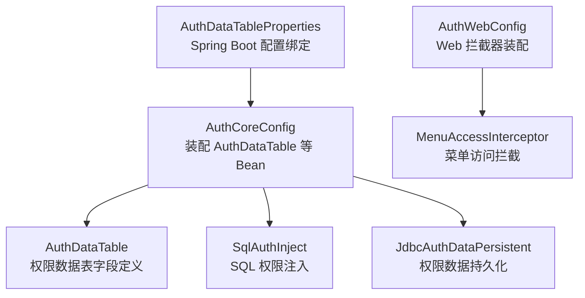
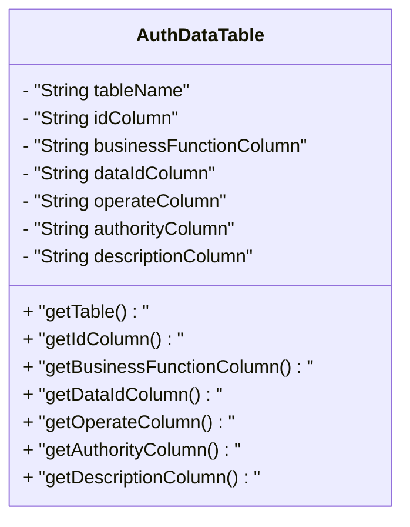
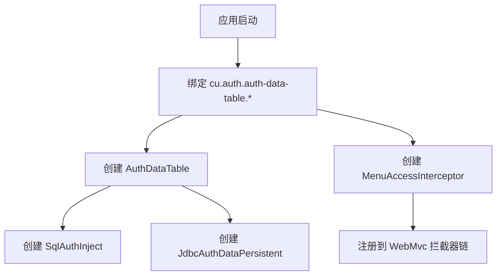
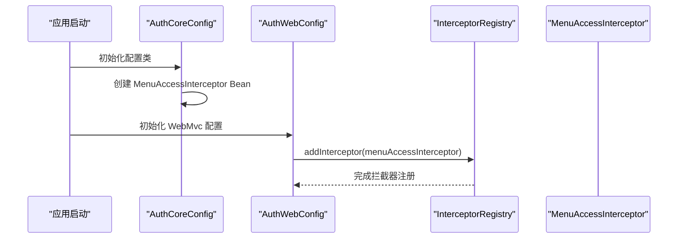
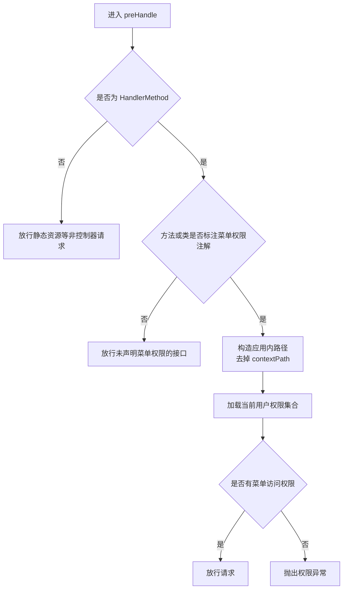
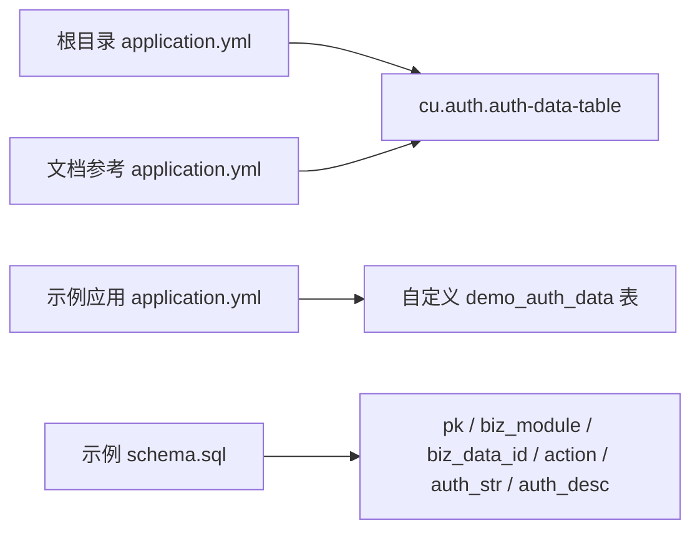
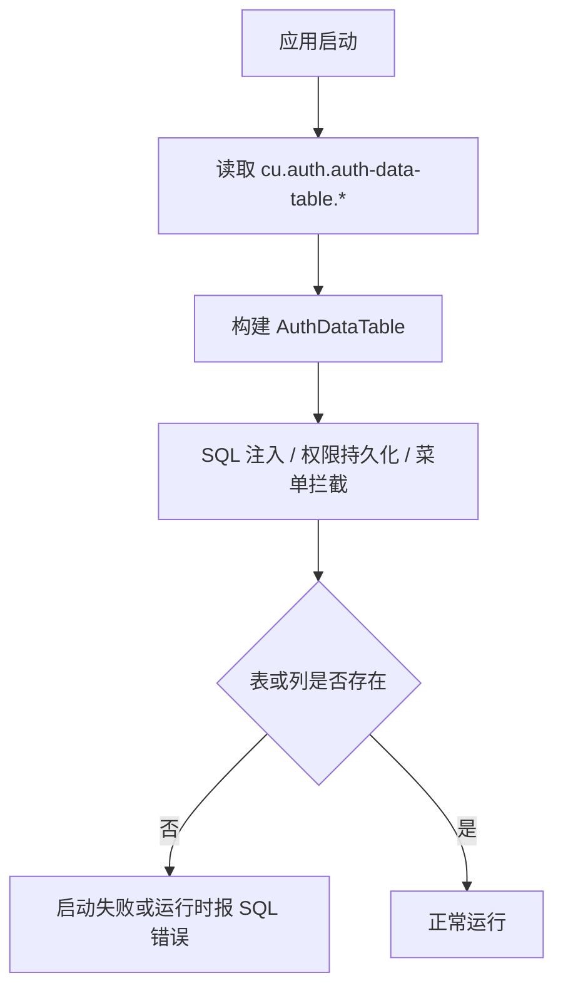

# 配置属性参考

<cite>
**本文引用的文件**   
- [AuthDataTableProperties.java](file://auth/auth-core-spring-boot-starter/src/main/java/com/cu/framework/boot/auth/core/properties/AuthDataTableProperties.java)
- [AuthCoreConfig.java](file://auth/auth-core-spring-boot-starter/src/main/java/com/cu/framework/boot/auth/core/config/AuthCoreConfig.java)
- [AuthWebConfig.java](file://auth/auth-core-spring-boot-starter/src/main/java/com/cu/framework/boot/auth/core/config/AuthWebConfig.java)
- [MenuAccessInterceptor.java](file://auth/auth-core/src/main/java/com/cu/framework/auth/core/menu/MenuAccessInterceptor.java)
- [AuthDataTable.java](file://auth/auth-core/src/main/java/com/cu/framework/auth/core/data/AuthDataTable.java)
- [application.yml（示例应用）](file://sample/auth-core-boot-sample/src/main/resources/application.yml)
- [schema.sql（示例应用）](file://sample/auth-core-boot-sample/sql/schema.sql)
- [application.yml（根目录参考）](file://application.yml)
- [application.yml（文档参考）](file://docs/application.yml)
</cite>

## 目录
1. [简介](#简介)
2. [项目结构与定位](#项目结构与定位)
3. [核心配置类总览](#核心配置类总览)
4. [AuthDataTableProperties 完整属性参考](#authdatatableproperties-完整属性参考)
5. [Web 层拦截器注册机制](#web-层拦截器注册机制)
6. [application.yml 配置示例与推荐写法](#applicationyml-配置示例与推荐写法)
7. [数据格式、校验规则与启动行为](#数据格式校验规则与启动行为)
8. [常见配置错误与排查方法](#常见配置错误与排查方法)
9. [最佳实践建议](#最佳实践建议)
10. [结论](#结论)

## 简介
本文面向使用 **Auth Core Starter** 的开发者，完整说明权限数据表映射配置 `cu.auth.auth-data-table` 下的所有属性，并解释 Web 层菜单访问拦截器的装配方式。重点包括：

- `AuthDataTableProperties` 的七项属性含义、默认值及在应用中的使用方式。
- Spring Boot 如何通过 `@ConfigurationProperties` 把配置绑定到内存对象，再由 `AuthCoreConfig` 装配为框架内部使用的 `AuthDataTable`。
- Web 层拦截器如何自动注册，以及它只对标注了菜单权限注解的请求生效。
- 提供可直接对照的 `application.yml` 配置片段，并给出生产环境推荐配置结构。
- 汇总配置数据的格式要求、潜在验证点、常见问题和排错思路。

## 项目结构与定位
本参考聚焦以下两个 starter 包：

| 模块 | 职责 | 与本参考的关系 |
|---|---|---|
| `auth-core-spring-boot-starter` | 暴露启动期 Bean、绑定配置、装配权限相关组件 | 包含 `AuthDataTableProperties`、`AuthCoreConfig`、`AuthWebConfig` |
| `auth-core` | 权限核心模型、数据范围、SQL 注入、菜单访问控制等实现 | 包含 `AuthDataTable`、`MenuAccessInterceptor` |

**图示来源**
- [AuthDataTableProperties.java:1-109](file://auth/auth-core-spring-boot-starter/src/main/java/com/cu/framework/boot/auth/core/properties/AuthDataTableProperties.java#L1-L109)
- [AuthCoreConfig.java:1-203](file://auth/auth-core-spring-boot-starter/src/main/java/com/cu/framework/boot/auth/core/config/AuthCoreConfig.java#L1-L203)
- [AuthWebConfig.java:1-30](file://auth/auth-core-spring-boot-starter/src/main/java/com/cu/framework/boot/auth/core/config/AuthWebConfig.java#L1-L30)
- [AuthDataTable.java:1-113](file://auth/auth-core/src/main/java/com/cu/framework/auth/core/data/AuthDataTable.java#L1-L113)
- [MenuAccessInterceptor.java:1-93](file://auth/auth-core/src/main/java/com/cu/framework/auth/core/menu/MenuAccessInterceptor.java#L1-L93)

**章节来源**
- [AuthDataTableProperties.java:1-109](file://auth/auth-core-spring-boot-starter/src/main/java/com/cu/framework/boot/auth/core/properties/AuthDataTableProperties.java#L1-L109)
- [AuthCoreConfig.java:1-203](file://auth/auth-core-spring-boot-starter/src/main/java/com/cu/framework/boot/auth/core/config/AuthCoreConfig.java#L1-L203)
- [AuthWebConfig.java:1-30](file://auth/auth-core-spring-boot-starter/src/main/java/com/cu/framework/boot/auth/core/config/AuthWebConfig.java#L1-L30)
- [AuthDataTable.java:1-113](file://auth/auth-core/src/main/java/com/cu/framework/auth/core/data/AuthDataTable.java#L1-L113)
- [MenuAccessInterceptor.java:1-93](file://auth/auth-core/src/main/java/com/cu/framework/auth/core/menu/MenuAccessInterceptor.java#L1-L93)

## 核心配置类总览

### AuthDataTableProperties：外部配置入口
`AuthDataTableProperties` 是用户直接配置的入口类。它通过 `@ConfigurationProperties("cu.auth.auth-data-table")` 将 YAML 或 properties 中的键绑定到 Java 字段。

| 属性名 | 对应 YAML 键 | 默认值 | 含义 |
|---|---|---:|---|
| `tableName` | `table-name` | `sys_auth_data` | 权限数据所在的业务关联表名 |
| `idColumn` | `id-column` | `id` | 主键列名；删除操作使用，插入和查询不使用 |
| `businessFunctionColumn` | `business-function-column` | `business_function` | 业务功能列名，用于区分不同业务模块 |
| `dataIdColumn` | `data-id-column` | `data_id` | 业务数据 ID 列名，存储具体业务记录的主键 |
| `operateColumn` | `operate-column` | `operate` | 操作类型列名，例如读、写、审批等 |
| `authorityColumn` | `authority-column` | `authority` | 权限字符串列名 |
| `descriptionColumn` | `description-column` | `description` | 权限描述列名 |

该类的 getter/setter 全部返回自身或字段值，方便链式赋值；但对外部使用者来说，通常只关心 YAML 键和默认值。

**章节来源**
- [AuthDataTableProperties.java:12-109](file://auth/auth-core-spring-boot-starter/src/main/java/com/cu/framework/boot/auth/core/properties/AuthDataTableProperties.java#L12-L109)

### AuthDataTable：框架内部数据表模型
`AuthDataTable` 是权限数据表字段的内部模型。它被 `AuthCoreConfig` 从 `AuthDataTableProperties` 读取后填充，再交给 SQL 注入、权限持久化等组件使用。

**图示来源**
- [AuthDataTable.java:1-113](file://auth/auth-core/src/main/java/com/cu/framework/auth/core/data/AuthDataTable.java#L1-L113)

**章节来源**
- [AuthDataTable.java:1-113](file://auth/auth-core/src/main/java/com/cu/framework/auth/core/data/AuthDataTable.java#L1-L113)

### AuthCoreConfig：配置装配中心
`AuthCoreConfig` 通过 `@EnableConfigurationProperties(AuthDataTableProperties.class)` 启用配置绑定，并创建多个关键 Bean：

- `AuthDataTable`：从 `AuthDataTableProperties` 拷贝七项字段。
- `SqlAuthInject`：基于 `AuthDataTable` 构造 SQL 权限注入逻辑。
- `JdbcAuthDataPersistent`：执行权限数据的批量插入与删除。
- `MenuAccessInterceptor`：菜单访问拦截器。
- 其他数据范围缓存、MyBatis 拦截器、异常处理器等。

**图示来源**
- [AuthCoreConfig.java:1-203](file://auth/auth-core-spring-boot-starter/src/main/java/com/cu/framework/boot/auth/core/config/AuthCoreConfig.java#L1-L203)
- [AuthWebConfig.java:12-30](file://auth/auth-core-spring-boot-starter/src/main/java/com/cu/framework/boot/auth/core/config/AuthWebConfig.java#L12-L30)

**章节来源**
- [AuthCoreConfig.java:1-203](file://auth/auth-core-spring-boot-starter/src/main/java/com/cu/framework/boot/auth/core/config/AuthCoreConfig.java#L1-L203)

## AuthDataTableProperties 完整属性参考

### 属性总表

| 配置键 | 类型 | 是否必填 | 默认值 | 说明 |
|---|---|---:|---|---|
| `cu.auth.auth-data-table.table-name` | 字符串 | 否 | `sys_auth_data` | 权限数据表表名 |
| `cu.auth.auth-data-table.id-column` | 字符串 | 否 | `id` | 主键列名；删除时使用，插入和查询不使用 |
| `cu.auth.auth-data-table.business-function-column` | 字符串 | 否 | `business_function` | 业务功能列名 |
| `cu.auth.auth-data-table.data-id-column` | 字符串 | 否 | `data_id` | 业务数据 ID 列名 |
| `cu.auth.auth-data-table.operate-column` | 字符串 | 否 | `operate` | 操作类型列名 |
| `cu.auth.auth-data-table.authority-column` | 字符串 | 否 | `authority` | 权限字符串列名 |
| `cu.auth.auth-data-table.description-column` | 字符串 | 否 | `description` | 权限描述列名 |

### 各属性详解

#### table-name
- **含义**：权限数据存储在数据库中的表名。
- **默认值**：`sys_auth_data`。
- **使用场景**：当示例应用不想使用框架默认表名时，可改为自己命名的表，如 `demo_auth_data`。
- **注意事项**：如果修改了表名，必须确保数据库中存在同名表，且列名也与其它属性一致。

#### id-column
- **含义**：权限表的物理主键列名。
- **默认值**：`id`。
- **重要语义**：该类注释明确说明，此字段“删除使用，插入、查询不使用此字段”。因此，它主要参与权限记录的删除流程，而不是业务数据过滤条件。
- **示例应用差异**：示例中使用 `pk`，以证明框架不会硬编码 `id`。

#### business-function-column
- **含义**：业务功能列，用于区分不同业务模块，例如订单、资产、客户等。
- **默认值**：`business_function`。
- **示例应用差异**：示例中使用 `biz_module`，表示“业务模块”语义更贴近实际业务。

#### data-id-column
- **含义**：业务数据 ID 列，保存具体业务记录的主键值。
- **默认值**：`data_id`。
- **使用注意**：该列的值来自业务实体主键。如果业务主键不是整型，需要确认下游权限处理逻辑是否支持相应类型。

#### operate-column
- **含义**：操作类型列，例如读、写、编辑、审批等。
- **默认值**：`operate`。
- **示例应用差异**：示例使用 `action`，体现“动作”语义。

#### authority-column
- **含义**：权限字符串列，用于存储权限标识，例如角色、资源、权限码等。
- **默认值**：`authority`。
- **示例应用差异**：示例使用 `auth_str`，便于区分通用权限串和业务字段。

#### description-column
- **含义**：权限描述列，常用于展示权限名称、备注或可读信息。
- **默认值**：`description`。
- **示例应用差异**：示例使用 `auth_desc`。

**章节来源**
- [AuthDataTableProperties.java:12-109](file://auth/auth-core-spring-boot-starter/src/main/java/com/cu/framework/boot/auth/core/properties/AuthDataTableProperties.java#L12-L109)
- [AuthDataTable.java:14-113](file://auth/auth-core/src/main/java/com/cu/framework/auth/core/data/AuthDataTable.java#L14-L113)
- [sample/auth-core-boot-sample/sql/schema.sql:1-40](file://sample/auth-core-boot-sample/sql/schema.sql#L1-L40)

## Web 层拦截器注册机制

### 拦截器装配链路
Web 层菜单访问拦截器的装配分为两步：

1. `AuthCoreConfig` 创建 `MenuAccessInterceptor` Bean。
2. `AuthWebConfig` 实现 `WebMvcConfigurer`，并在 `addInterceptors` 中将该拦截器注册到 Spring MVC 拦截器链。

**图示来源**
- [AuthCoreConfig.java:170-203](file://auth/auth-core-spring-boot-starter/src/main/java/com/cu/framework/boot/auth/core/config/AuthCoreConfig.java#L170-L203)
- [AuthWebConfig.java:12-30](file://auth/auth-core-spring-boot-starter/src/main/java/com/cu/framework/boot/auth/core/config/AuthWebConfig.java#L12-L30)

### 拦截时机与权限判断逻辑
`MenuAccessInterceptor` 的核心行为如下：

- 只对 `HandlerMethod` 类型的请求进行拦截。
- 如果当前 Controller 方法或其类上没有菜单权限注解，则直接放行。
- 如果存在管辖声明，则去掉 `contextPath` 后，用当前登录用户的权限集合检查是否有菜单访问权限。
- 如果没有权限，抛出权限异常。

**图示来源**
- [MenuAccessInterceptor.java:25-93](file://auth/auth-core/src/main/java/com/cu/framework/auth/core/menu/MenuAccessInterceptor.java#L25-L93)

**章节来源**
- [AuthWebConfig.java:12-30](file://auth/auth-core-spring-boot-starter/src/main/java/com/cu/framework/boot/auth/core/config/AuthWebConfig.java#L12-L30)
- [MenuAccessInterceptor.java:1-93](file://auth/auth-core/src/main/java/com/cu/framework/auth/core/menu/MenuAccessInterceptor.java#L1-L93)

## application.yml 配置示例与推荐写法

### 最小可用配置
如果你希望使用框架默认权限表 `sys_auth_data`，只需引入对应的 starter，不显式配置 `cu.auth.auth-data-table` 即可。此时框架会使用七项默认值。

### 自定义权限表配置示例
示例应用展示了完整的自定义配置，所有七项都映射到自有表和列：

| 配置键 | 示例值 | 对应数据库列 |
|---|---|---|
| `table-name` | `demo_auth_data` | 权限表名 |
| `id-column` | `pk` | 主键列 |
| `business-function-column` | `biz_module` | 业务功能列 |
| `data-id-column` | `biz_data_id` | 业务数据 ID 列 |
| `operate-column` | `action` | 操作类型列 |
| `authority-column` | `auth_str` | 权限字符串列 |
| `description-column` | `auth_desc` | 权限描述列 |

推荐把这个配置放在公共段，与数据库连接、MyBatis、日志等配置放在一起；数据库连接可以按 profile 拆分。

### 根目录参考配置
根目录的 `application.yml` 也提供了 `cu.auth.auth-data-table` 的配置骨架，并补充了菜单缓存开关 `cache-auth` 和登录安全相关配置。这些内容可以作为跨模块统一配置的参考。

### 文档参考配置
`docs/application.yml` 是官方风格的参考手册配置，其中明确列出 `auth-data-table` 下七项属性的默认值，适合作为配置字典对照。

**图示来源**
- [application.yml:1-32](file://application.yml#L1-L32)
- [docs/application.yml:1-60](file://docs/application.yml#L1-L60)
- [sample/auth-core-boot-sample/src/main/resources/application.yml:1-40](file://sample/auth-core-boot-sample/src/main/resources/application.yml#L1-L40)
- [sample/auth-core-boot-sample/sql/schema.sql:1-40](file://sample/auth-core-boot-sample/sql/schema.sql#L1-L40)

**章节来源**
- [sample/auth-core-boot-sample/src/main/resources/application.yml:25-40](file://sample/auth-core-boot-sample/src/main/resources/application.yml#L25-L40)
- [application.yml:1-10](file://application.yml#L1-L10)
- [docs/application.yml:40-60](file://docs/application.yml#L40-L60)

## 数据格式、校验规则与启动行为

### 数据类型与取值
所有 `AuthDataTableProperties` 字段都是字符串类型，没有内置数值范围校验。这意味着：

- 表名必须是合法数据库标识符。
- 列名必须与数据库真实列名一致。
- 值不能为空字符串；虽然当前类没有显式空校验，但空值会导致 SQL 生成失败。
- 大小写敏感性取决于数据库和驱动配置。示例中 H2 使用了 `DATABASE_TO_LOWER=TRUE;CASE_INSENSITIVE_IDENTIFIERS=TRUE`，而 MySQL 示例未设置同样选项，因此需要注意大小写一致性。

### 启动期校验与运行时影响
`AuthCoreConfig` 只是把 `AuthDataTableProperties` 的值复制到 `AuthDataTable`，并没有对每个字段做业务校验。真正的校验发生在：

1. 权限数据写入或查询时，底层 JDBC 或 SQL 解析组件发现表名或列名不存在。
2. MyBatis 数据范围校验器扫描 Mapper 声明时，可能把“目标表不存在”“语句不是查询”等配置问题转化为启动期失败。
3. 菜单访问拦截器在权限不足时抛出权限异常。

**图示来源**
- [AuthCoreConfig.java:55-95](file://auth/auth-core-spring-boot-starter/src/main/java/com/cu/framework/boot/auth/core/config/AuthCoreConfig.java#L55-L95)
- [AuthRangeStartupValidator.java 相关注释与 Bean 定义](file://auth/auth-core-spring-boot-starter/src/main/java/com/cu/framework/boot/auth/core/config/AuthCoreConfig.java#L110-L170)

**章节来源**
- [AuthCoreConfig.java:55-170](file://auth/auth-core-spring-boot-starter/src/main/java/com/cu/framework/boot/auth/core/config/AuthCoreConfig.java#L55-L170)
- [AuthDataTable.java:14-113](file://auth/auth-core/src/main/java/com/cu/framework/auth/core/data/AuthDataTable.java#L14-L113)

## 常见配置错误与排查方法

### 表名写错或未建表
**现象**：启动时报 SQL 异常，或权限读写失败。  
**原因**：`table-name` 指向的表不存在，或者示例应用启用了建表脚本但脚本未执行。  
**排查步骤**：
1. 检查 `cu.auth.auth-data-table.table-name` 是否与数据库表名完全一致。
2. 如果是示例应用，确认 H2 或 MySQL profile 已激活，并且 `sql.init.mode` 和 `schema-locations` 正确。
3. 查看 `sample/auth-core-boot-sample/sql/schema.sql` 中 `CREATE TABLE IF NOT EXISTS demo_auth_data` 是否成功执行。

**章节来源**
- [sample/auth-core-boot-sample/src/main/resources/application.yml:25-40](file://sample/auth-core-boot-sample/src/main/resources/application.yml#L25-L40)
- [sample/auth-core-boot-sample/sql/schema.sql:1-40](file://sample/auth-core-boot-sample/sql/schema.sql#L1-L40)

### 列名与配置不一致
**现象**：权限写入或查询失败，SQL 报错找不到列。  
**原因**：某个 `*-column` 配置与实际数据库列名不一致。  
**排查步骤**：
1. 逐项核对 `id-column`、`business-function-column`、`data-id-column`、`operate-column`、`authority-column`、`description-column`。
2. 确认数据库列名大小写与配置一致。
3. 对比示例应用的 `schema.sql` 与 `application.yml` 中的映射关系。

**章节来源**
- [sample/auth-core-boot-sample/sql/schema.sql:1-40](file://sample/auth-core-boot-sample/sql/schema.sql#L1-L40)
- [sample/auth-core-boot-sample/src/main/resources/application.yml:25-40](file://sample/auth-core-boot-sample/src/main/resources/application.yml#L25-L40)

### 误以为 id-column 参与业务数据过滤
**现象**：期望业务主键过滤走 `id-column`，但结果不符合预期。  
**原因**：`id-column` 是权限表自身的物理主键，注释明确说明“删除使用，插入、查询不使用此字段”。业务数据 ID 应使用 `data-id-column`。  
**排查步骤**：
1. 检查业务数据 ID 是否正确写入 `data-id-column`。
2. 不要混淆权限表主键和业务表主键。

**章节来源**
- [AuthDataTable.java:20-24](file://auth/auth-core/src/main/java/com/cu/framework/auth/core/data/AuthDataTable.java#L20-L24)

### 菜单权限始终拒绝
**现象**：接口调用被拦截并提示没有菜单访问权限。  
**原因**：
- 接口或类上没有菜单权限注解。
- 当前登录用户权限集合中没有对应路径所需的权限。
- `context-path` 导致请求路径与菜单登记路径不一致。

**排查步骤**：
1. 确认 Controller 方法或类上标注了菜单权限相关注解。
2. 检查用户权限数据中是否包含该路径所需权限串。
3. 示例应用中 `server.servlet.context-path` 为 `/coredemo`，菜单路径不包含该前缀，因此鉴权时应去掉 `contextPath`。

**章节来源**
- [MenuAccessInterceptor.java:38-88](file://auth/auth-core/src/main/java/com/cu/framework/auth/core/menu/MenuAccessInterceptor.java#L38-L88)
- [sample/auth-core-boot-sample/src/main/resources/application.yml:1-10](file://sample/auth-core-boot-sample/src/main/resources/application.yml#L1-L10)

### 权限响应退化为 HTTP 500
**现象**：权限拒绝时没有统一的 JSON 响应，而是 500。  
**原因**：框架会尝试注册 `AuthExceptionHandler`，但如果使用方扫描不到框架包，或者重复定义了同类 Bean，可能导致异常处理器未生效。  
**排查步骤**：
1. 确认应用扫描到了 `AuthCoreConfig`。
2. 检查是否重复定义了 `AuthExceptionHandler`。
3. 查看日志中是否出现权限异常堆栈。

**章节来源**
- [AuthCoreConfig.java:140-170](file://auth/auth-core-spring-boot-starter/src/main/java/com/cu/framework/boot/auth/core/config/AuthCoreConfig.java#L140-L170)

## 最佳实践建议

1. **优先使用默认配置起步**  
   如果业务允许使用 `sys_auth_data` 及其默认列名，先不配置 `cu.auth.auth-data-table`，减少出错面。

2. **自定义表名时保持命名清晰**  
   示例使用 `demo_auth_data`、`biz_module`、`biz_data_id`、`action`、`auth_str`、`auth_desc`，语义明确，便于后续维护。

3. **严格区分权限表主键和业务数据 ID**  
   `id-column` 是权限表主键；`data-id-column` 才是业务数据 ID。不要把两者混为一谈。

4. **数据库大小写策略保持一致**  
   H2 示例开启了大小写不敏感和自动转小写，MySQL 示例没有开启相同策略。跨库迁移时要特别注意列名大小写。

5. **在示例环境中验证建表脚本**  
   示例应用使用幂等的 `IF NOT EXISTS` 建表和种子数据，适合本地开发反复启动。生产环境应改为手动或受控的部署脚本。

6. **结合日志定位权限问题**  
   示例应用开启了 `com.cu.framework.sample.authcore.mapper`、`com.cu.framework.auth.core`、`org.springframework.jdbc.core` 的 debug 日志，有助于观察 SQL 改写、权限表读写和实际下发语句。

7. **菜单路径与 context-path 分离考虑**  
   如果应用有 `server.servlet.context-path`，菜单路径应使用应用内路径，不要带上 `contextPath`。拦截器会在鉴权前主动去掉 `contextPath`。

**章节来源**
- [sample/auth-core-boot-sample/src/main/resources/application.yml:11-23](file://sample/auth-core-boot-sample/src/main/resources/application.yml#L11-L23)
- [sample/auth-core-boot-sample/sql/schema.sql:1-40](file://sample/auth-core-boot-sample/sql/schema.sql#L1-L40)
- [MenuAccessInterceptor.java:76-88](file://auth/auth-core/src/main/java/com/cu/framework/auth/core/menu/MenuAccessInterceptor.java#L76-L88)

## 结论
`AuthDataTableProperties` 是 Auth Core Starter 中权限数据表映射的唯一外部配置入口。它的七个属性分别控制权限表名、主键列、业务功能列、业务数据 ID 列、操作类型列、权限字符串列和权限描述列。框架通过 `AuthCoreConfig` 把这些属性装配为内部 `AuthDataTable`，并进一步驱动 SQL 注入、权限持久化和数据范围校验。

Web 层菜单访问拦截器由 `AuthWebConfig` 自动注册到 Spring MVC，但只对标注了菜单权限注解的 Controller 方法或类生效。对于大多数业务，推荐先在示例应用中跑通 `demo_auth_data` 表，再根据实际业务调整表名和列名，并通过日志和数据库状态验证配置是否正确。