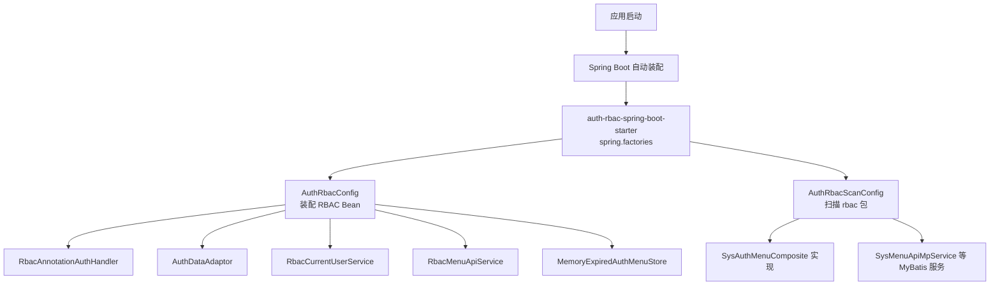
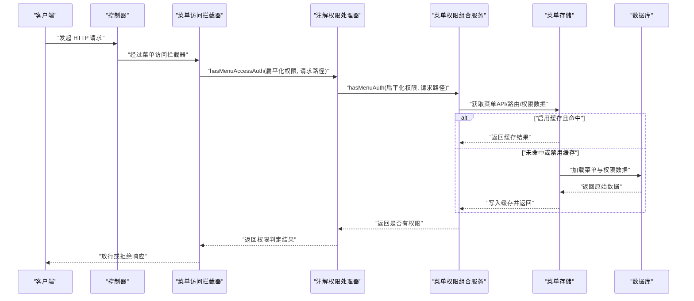
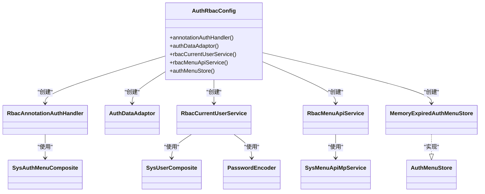
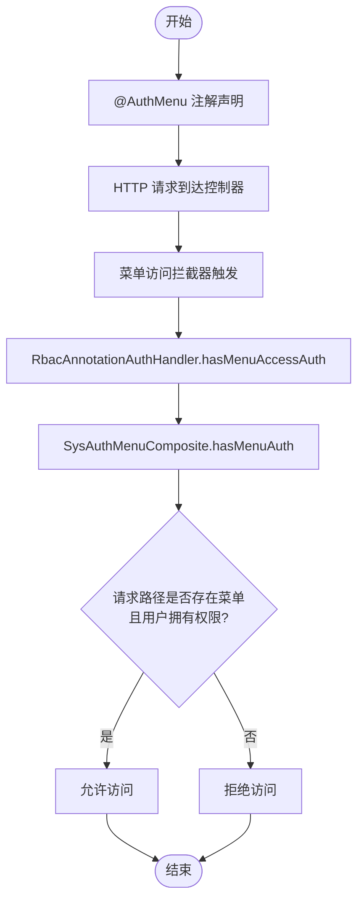
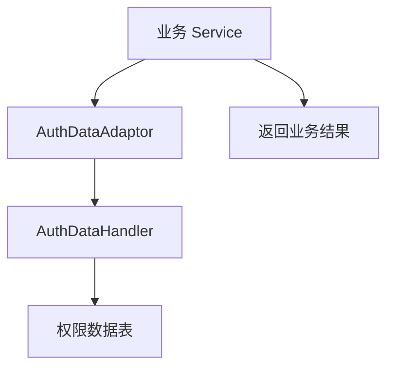
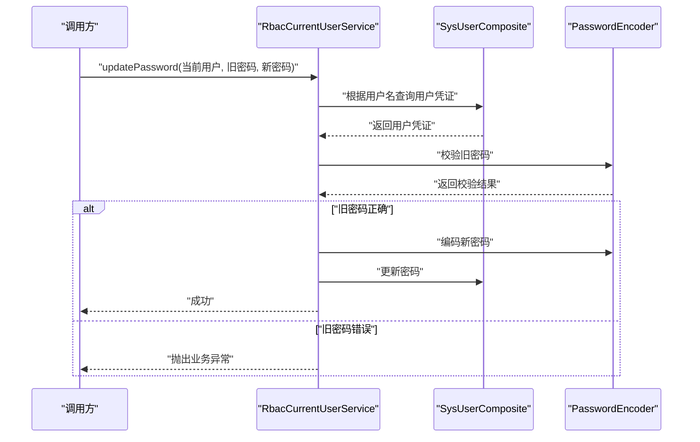
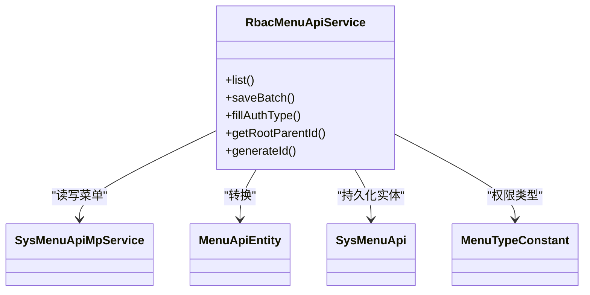
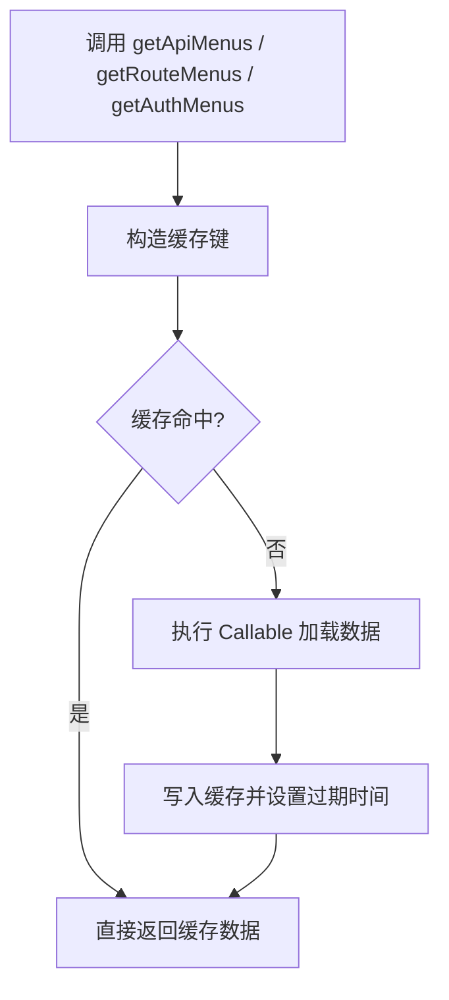
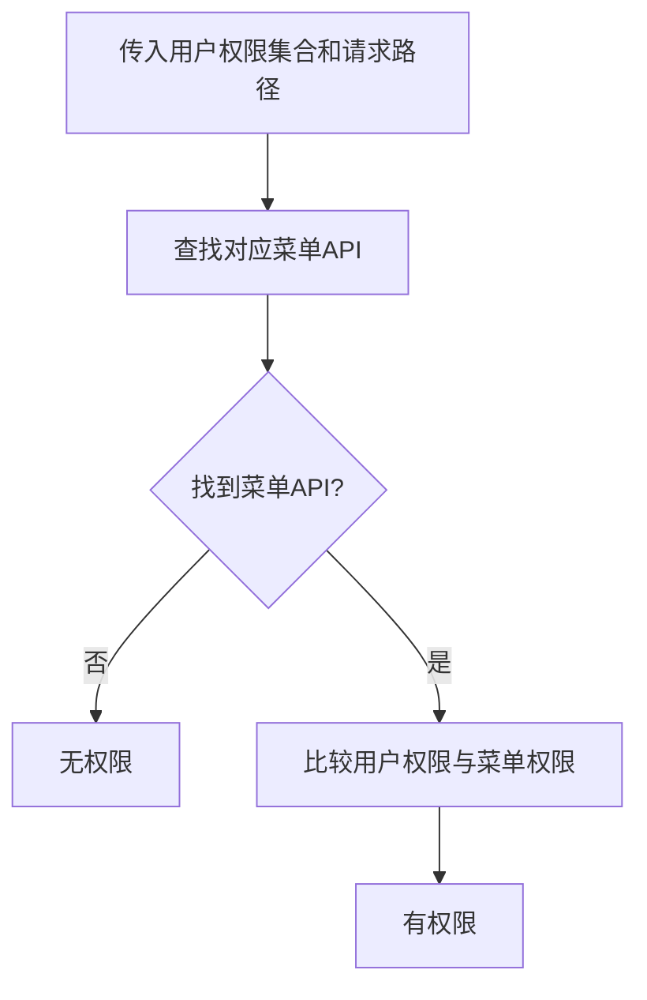
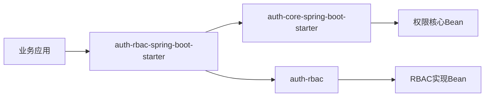

# Auth RBAC Starter 权限实现

<cite>
**本文引用的文件**   
- [AuthRbacConfig.java](file://auth/auth-rbac-spring-boot-starter/src/main/java/com/cu/framework/boot/auth/rbac/config/AuthRbacConfig.java)
- [AuthRbacScanConfig.java](file://auth/auth-rbac-spring-boot-starter/src/main/java/com/cu/framework/boot/auth/rbac/config/AuthRbacScanConfig.java)
- [AuthCoreConfig.java](file://auth/auth-core-spring-boot-starter/src/main/java/com/cu/framework/boot/auth/core/config/AuthCoreConfig.java)
- [AuthMenu.java](file://auth/auth-core/src/main/java/com/cu/framework/auth/core/AuthMenu.java)
- [AuthDataAdaptor.java](file://auth/auth-core/src/main/java/com/cu/framework/auth/core/AuthDataAdaptor.java)
- [RbacAnnotationAuthHandler.java](file://auth/auth-rbac/src/main/java/com/cu/framework/auth/rbac/RbacAnnotationAuthHandler.java)
- [SysAuthMenuComposite.java](file://auth/auth-rbac/src/main/java/com/cu/framework/auth/rbac/composite/SysAuthMenuComposite.java)
- [DefaultSysAuthMenuComposite.java](file://auth/auth-rbac/src/main/java/com/cu/framework/auth/rbac/composite/impl/DefaultSysAuthMenuComposite.java)
- [MemoryExpiredAuthMenuStore.java](file://auth/auth-rbac/src/main/java/com/cu/framework/auth/rbac/composite/impl/MemoryExpiredAuthMenuStore.java)
- [RbacCurrentUserService.java](file://auth/auth-rbac/src/main/java/com/cu/framework/auth/rbac/extension/RbacCurrentUserService.java)
- [RbacMenuApiService.java](file://auth/auth-rbac/src/main/java/com/cu/framework/auth/rbac/extension/RbacMenuApiService.java)
- [spring.factories](file://auth/auth-rbac-spring-boot-starter/src/main/resources/META-INF/spring.factories)
- [pom.xml](file://auth/auth-rbac-spring-boot-starter/pom.xml)
</cite>

## 目录
1. [简介](#简介)
2. [项目结构](#项目结构)
3. [核心组件](#核心组件)
4. [架构总览](#架构总览)
5. [详细组件分析](#详细组件分析)
6. [依赖与装配顺序](#依赖与装配顺序)
7. [性能特性与缓存策略](#性能特性与缓存策略)
8. [RBAC 配置与使用示例](#rbac-配置与使用示例)
9. [故障排查](#故障排查)
10. [结论](#结论)

## 简介
本文面向使用 `auth-rbac-spring-boot-starter` 的开发者，系统说明该模块如何实现基于角色的访问控制（RBAC）权限模型，并重点解析以下关键点：
- `AuthRbacConfig` 如何装配注解处理器、数据操作适配器、当前用户服务、菜单 API 服务与菜单存储。
- `RbacAnnotationAuthHandler` 如何配合 `@AuthMenu` 注解完成接口级菜单权限校验。
- `AuthDataAdaptor` 在 Service 层中触发数据权限检查的方式。
- `RbacCurrentUserService` 和 `RbacMenuApiService` 的职责边界。
- `MemoryExpiredAuthMenuStore` 的内存缓存机制与过期策略。
- 与 `AuthCoreConfig` 的依赖关系、自动装配顺序及 `@AutoConfigureAfter` 的使用场景。
- 提供完整的 RBAC 权限配置与授权操作指南。

## 项目结构
`auth-rbac-spring-boot-starter` 是一个 Spring Boot Starter，负责把 RBAC 相关能力装配到应用上下文中。它依赖两个核心子模块：
- `auth-core-spring-boot-starter`：提供权限核心基础设施，包括拦截器、数据权限处理器、异常处理等。
- `auth-rbac`：提供 RBAC 具体实现，包括菜单权限组合服务、MyBatis 持久化服务、扩展服务等。

Starter 通过 `META-INF/spring.factories` 注册两个自动配置类：
- `AuthRbacConfig`：装配 RBAC Bean。
- `AuthRbacScanConfig`：扫描 RBAC 的 Mapper、Composite、Controller 等包路径。

**图示来源**
- [spring.factories:1-3](file://auth/auth-rbac-spring-boot-starter/src/main/resources/META-INF/spring.factories#L1-L3)
- [AuthRbacConfig.java:1-75](file://auth/auth-rbac-spring-boot-starter/src/main/java/com/cu/framework/boot/auth/rbac/config/AuthRbacConfig.java#L1-L75)
- [AuthRbacScanConfig.java:1-24](file://auth/auth-rbac-spring-boot-starter/src/main/java/com/cu/framework/boot/auth/rbac/config/AuthRbacScanConfig.java#L1-L24)

**章节来源**
- [spring.factories:1-3](file://auth/auth-rbac-spring-boot-starter/src/main/resources/META-INF/spring.factories#L1-L3)
- [pom.xml:1-39](file://auth/auth-rbac-spring-boot-starter/pom.xml#L1-L39)

## 核心组件
本模块的核心职责是把 RBAC 权限模型落地为可被注解和代码调用的运行时能力。关键组件如下：

| 组件 | 类型 | 职责 | 主要依赖 |
|---|---|---|---|
| `AuthRbacConfig` | 配置类 | 装配注解权限处理器、数据操作适配器、当前用户服务、菜单 API 服务、菜单存储 | `AuthCoreConfig`、`SysAuthMenuComposite`、`AuthDataHandler`、`SysUserComposite`、`PasswordEncoder`、`SysMenuApiMpService` |
| `RbacAnnotationAuthHandler` | 注解权限处理器 | 根据用户扁平化权限集合判断请求路径是否可访问 | `SysAuthMenuComposite` |
| `AuthDataAdaptor` | 数据操作适配器 | 在业务 Service 中直接调用数据权限编辑、填充、删除 | `AuthDataHandler` |
| `RbacCurrentUserService` | 当前用户服务 | 提供密码更新等用户维度操作 | `SysUserComposite`、`PasswordEncoder` |
| `RbacMenuApiService` | 菜单 API 服务 | 暴露菜单 API 的列表、批量保存、ID 生成、根父 ID 等能力 | `SysMenuApiMpService` |
| `MemoryExpiredAuthMenuStore` | 菜单存储 | 基于 Guava Cache 的内存缓存，支持写入后过期 | Guava `CacheBuilder` |
| `SysAuthMenuComposite` | 菜单权限组合接口 | 统一封装菜单树、路由树、权限校验、权限编辑等能力 | 多个 MyBatis MP 服务、`AuthMenuStore` |
| `DefaultSysAuthMenuComposite` | 菜单权限组合实现 | 实际实现菜单与权限查询、过滤、同步、校验逻辑 | `SysMenuApiMpService`、`SysMenuRouteMpService`、`SysAuthMenuMpService`、`AuthMenuStore` |

**章节来源**
- [AuthRbacConfig.java:1-75](file://auth/auth-rbac-spring-boot-starter/src/main/java/com/cu/framework/boot/auth/rbac/config/AuthRbacConfig.java#L1-L75)
- [RbacAnnotationAuthHandler.java:1-27](file://auth/auth-rbac/src/main/java/com/cu/framework/auth/rbac/RbacAnnotationAuthHandler.java#L1-L27)
- [AuthDataAdaptor.java:1-45](file://auth/auth-core/src/main/java/com/cu/framework/auth/core/AuthDataAdaptor.java#L1-L45)
- [RbacCurrentUserService.java:1-42](file://auth/auth-rbac/src/main/java/com/cu/framework/auth/rbac/extension/RbacCurrentUserService.java#L1-L42)
- [RbacMenuApiService.java:1-73](file://auth/auth-rbac/src/main/java/com/cu/framework/auth/rbac/extension/RbacMenuApiService.java#L1-L73)
- [MemoryExpiredAuthMenuStore.java:1-69](file://auth/auth-rbac/src/main/java/com/cu/framework/auth/rbac/composite/impl/MemoryExpiredAuthMenuStore.java#L1-L69)
- [SysAuthMenuComposite.java:1-63](file://auth/auth-rbac/src/main/java/com/cu/framework/auth/rbac/composite/SysAuthMenuComposite.java#L1-L63)
- [DefaultSysAuthMenuComposite.java:1-200](file://auth/auth-rbac/src/main/java/com/cu/framework/auth/rbac/composite/impl/DefaultSysAuthMenuComposite.java#L1-L200)

## 架构总览
从请求进入控制器到权限判定，整体流程由三层组成：
1. Web 层：控制器方法标注 `@AuthMenu`，表示该接口受菜单权限管辖。
2. 拦截层：`AuthCoreConfig` 装配的 `MenuAccessInterceptor` 在请求进入时触发菜单权限校验。
3. RBAC 实现层：`RbacAnnotationAuthHandler` 委托 `SysAuthMenuComposite` 进行真实权限判断。

**图示来源**
- [AuthCoreConfig.java:1-203](file://auth/auth-core-spring-boot-starter/src/main/java/com/cu/framework/boot/auth/core/config/AuthCoreConfig.java#L1-L203)
- [RbacAnnotationAuthHandler.java:1-27](file://auth/auth-rbac/src/main/java/com/cu/framework/auth/rbac/RbacAnnotationAuthHandler.java#L1-L27)
- [DefaultSysAuthMenuComposite.java:1-200](file://auth/auth-rbac/src/main/java/com/cu/framework/auth/rbac/composite/impl/DefaultSysAuthMenuComposite.java#L1-L200)
- [MemoryExpiredAuthMenuStore.java:1-69](file://auth/auth-rbac/src/main/java/com/cu/framework/auth/rbac/composite/impl/MemoryExpiredAuthMenuStore.java#L1-L69)

## 详细组件分析

### `AuthRbacConfig`：RBAC Starter 的核心装配点
`AuthRbacConfig` 是 RBAC Starter 的自动配置入口，负责把 RBAC 能力的 Bean 注入 Spring 容器。其关键装配行为如下：
- 当容器中不存在自定义 `AuthMenuHandler` 时，装配默认实现 `RbacAnnotationAuthHandler`。
- 装配 `AuthDataAdaptor`，让业务 Service 可以直接调用数据权限操作。
- 装配 `RbacCurrentUserService`，封装用户密码更新等操作。
- 装配 `RbacMenuApiService`，对外暴露菜单 API 管理能力。
- 当容器中不存在自定义 `AuthMenuStore` 时，装配 `MemoryExpiredAuthMenuStore`，提供基于内存的可过期菜单缓存。

此外，该类通过 `@AutoConfigureAfter({AuthCoreConfig.class, AuthRbacScanConfig.class})` 明确依赖顺序：先加载权限核心配置和扫描配置，再装配 RBAC Bean。

**图示来源**
- [AuthRbacConfig.java:1-75](file://auth/auth-rbac-spring-boot-starter/src/main/java/com/cu/framework/boot/auth/rbac/config/AuthRbacConfig.java#L1-L75)

**章节来源**
- [AuthRbacConfig.java:1-75](file://auth/auth-rbac-spring-boot-starter/src/main/java/com/cu/framework/boot/auth/rbac/config/AuthRbacConfig.java#L1-L75)

### `RbacAnnotationAuthHandler`：注解权限处理器的实现
`RbacAnnotationAuthHandler` 实现了 `AuthMenuHandler`，是注解权限判定的默认实现。它不直接判断角色或权限字符串，而是委托 `SysAuthMenuComposite.hasMenuAuth` 完成真实校验。

它与 `@AuthMenu` 的配合方式如下：
- 开发者在 Controller 类或方法上标注 `@AuthMenu`。
- `AuthCoreConfig` 装配的 `MenuAccessInterceptor` 会在请求进入时读取该注解。
- 拦截器调用 `AuthMenuHandler.hasMenuAccessAuth`，最终落到 `RbacAnnotationAuthHandler`。
- 处理器通过 `SysAuthMenuComposite` 查找对应菜单 API，并根据用户权限决定放行或拒绝。

**图示来源**
- [AuthMenu.java:1-16](file://auth/auth-core/src/main/java/com/cu/framework/auth/core/AuthMenu.java#L1-L16)
- [RbacAnnotationAuthHandler.java:1-27](file://auth/auth-rbac/src/main/java/com/cu/framework/auth/rbac/RbacAnnotationAuthHandler.java#L1-L27)
- [DefaultSysAuthMenuComposite.java:1-200](file://auth/auth-rbac/src/main/java/com/cu/framework/auth/rbac/composite/impl/DefaultSysAuthMenuComposite.java#L1-L200)

**章节来源**
- [AuthMenu.java:1-16](file://auth/auth-core/src/main/java/com/cu/framework/auth/core/AuthMenu.java#L1-L16)
- [RbacAnnotationAuthHandler.java:1-27](file://auth/auth-rbac/src/main/java/com/cu/framework/auth/rbac/RbacAnnotationAuthHandler.java#L1-L27)

### `AuthDataAdaptor`：数据操作适配器
`AuthDataAdaptor` 是业务层直接调用数据权限的能力入口。它的核心作用不是实现权限逻辑，而是封装对 `AuthDataHandler` 的调用，使业务代码无需感知底层注解式数据权限的具体实现。

典型用途包括：
- 编辑某条数据的权限集合。
- 删除某条数据对应的权限记录。
- 填充某条数据对应的权限对象，用于前端展示或二次校验。

**图示来源**
- [AuthDataAdaptor.java:1-45](file://auth/auth-core/src/main/java/com/cu/framework/auth/core/AuthDataAdaptor.java#L1-L45)

**章节来源**
- [AuthDataAdaptor.java:1-45](file://auth/auth-core/src/main/java/com/cu/framework/auth/core/AuthDataAdaptor.java#L1-L45)

### `RbacCurrentUserService`：当前用户服务
`RbacCurrentUserService` 提供当前登录用户的扩展操作，当前示例展示了密码更新能力：
- 根据用户名查询用户凭证。
- 校验旧密码是否正确。
- 使用 `PasswordEncoder` 编码新密码。
- 调用 `SysUserComposite` 更新密码。

如果旧密码不正确，会抛出业务异常，提示“旧密码不正确”。

**图示来源**
- [RbacCurrentUserService.java:1-42](file://auth/auth-rbac/src/main/java/com/cu/framework/auth/rbac/extension/RbacCurrentUserService.java#L1-L42)

**章节来源**
- [RbacCurrentUserService.java:1-42](file://auth/auth-rbac/src/main/java/com/cu/framework/auth/rbac/extension/RbacCurrentUserService.java#L1-L42)

### `RbacMenuApiService`：菜单 API 服务
`RbacMenuApiService` 实现了 `MenuApiService<Long>`，是对菜单 API 管理能力的门面：
- 列出所有菜单 API。
- 批量保存菜单 API。
- 根据父 ID 填充菜单权限类型：顶级菜单使用自身权限，子菜单继承父菜单权限。
- 返回根父 ID。
- 使用雪花算法生成菜单 ID。

该服务将持久化实体 `SysMenuApi` 转换为框架通用的 `MenuApiEntity<Long>`，从而屏蔽具体数据库模型细节。

**图示来源**
- [RbacMenuApiService.java:1-73](file://auth/auth-rbac/src/main/java/com/cu/framework/auth/rbac/extension/RbacMenuApiService.java#L1-L73)

**章节来源**
- [RbacMenuApiService.java:1-73](file://auth/auth-rbac/src/main/java/com/cu/framework/auth/rbac/extension/RbacMenuApiService.java#L1-L73)

### `MemoryExpiredAuthMenuStore`：内存菜单存储与过期策略
`MemoryExpiredAuthMenuStore` 实现了 `AuthMenuStore`，基于 Guava `CacheBuilder` 提供三类菜单数据的内存缓存：
- 菜单 API 列表。
- 菜单路由列表。
- 菜单权限列表。

关键特性：
- 所有缓存项写入后 10 分钟过期。
- 缓存未命中时，通过传入的 `Callable` 加载数据并写入缓存。
- 缓存读取失败时会抛出运行时异常，便于上层发现数据加载问题。
- 适用于单机或轻量部署；如果需要多实例共享，可替换为 Redis 等分布式缓存实现。

**图示来源**
- [MemoryExpiredAuthMenuStore.java:1-69](file://auth/auth-rbac/src/main/java/com/cu/framework/auth/rbac/composite/impl/MemoryExpiredAuthMenuStore.java#L1-L69)

**章节来源**
- [MemoryExpiredAuthMenuStore.java:1-69](file://auth/auth-rbac/src/main/java/com/cu/framework/auth/rbac/composite/impl/MemoryExpiredAuthMenuStore.java#L1-L69)

### `SysAuthMenuComposite` 与 `DefaultSysAuthMenuComposite`：菜单权限组合服务
`SysAuthMenuComposite` 是菜单权限能力的统一接口，涵盖：
- 用户菜单权限校验。
- 获取树形菜单。
- 获取权限集对应的菜单树。
- 获取路由树。
- 编辑菜单权限。
- 更新菜单。

`DefaultSysAuthMenuComposite` 是其默认实现，核心逻辑包括：
- 优先从 `AuthMenuStore` 获取菜单与权限数据。
- 根据请求路径匹配菜单 API。
- 根据用户扁平化权限集合过滤菜单树和路由树。
- 对比现有权限与新权限集合，批量删除不再需要的权限，新增缺失的权限。
- 支持通过配置开关 `cu.auth.cache-auth` 控制是否启用菜单缓存。

**图示来源**
- [SysAuthMenuComposite.java:1-63](file://auth/auth-rbac/src/main/java/com/cu/framework/auth/rbac/composite/SysAuthMenuComposite.java#L1-L63)
- [DefaultSysAuthMenuComposite.java:1-200](file://auth/auth-rbac/src/main/java/com/cu/framework/auth/rbac/composite/impl/DefaultSysAuthMenuComposite.java#L1-L200)

**章节来源**
- [SysAuthMenuComposite.java:1-63](file://auth/auth-rbac/src/main/java/com/cu/framework/auth/rbac/composite/SysAuthMenuComposite.java#L1-L63)
- [DefaultSysAuthMenuComposite.java:1-200](file://auth/auth-rbac/src/main/java/com/cu/framework/auth/rbac/composite/impl/DefaultSysAuthMenuComposite.java#L1-L200)

## 依赖与装配顺序
### Starter 与核心模块依赖
`auth-rbac-spring-boot-starter` 依赖：
- `auth-core-spring-boot-starter`：提供权限核心 Bean，如 `AuthMenuHandler`、`MenuAccessInterceptor`、`AuthExceptionHandler`、`AuthDataHandler` 等。
- `auth-rbac`：提供 RBAC 具体实现，如 `RbacAnnotationAuthHandler`、`SysAuthMenuComposite`、`RbacMenuApiService`、`MemoryExpiredAuthMenuStore` 等。
- Spring Boot Starter 和 MyBatis Plus Starter。

**图示来源**
- [pom.xml:1-39](file://auth/auth-rbac-spring-boot-starter/pom.xml#L1-L39)

### 自动装配顺序
`AuthRbacConfig` 通过 `@AutoConfigureAfter({AuthCoreConfig.class, AuthRbacScanConfig.class})` 保证：
1. `AuthCoreConfig` 先装配权限核心 Bean，例如 `AuthMenuHandler`、`MenuAccessInterceptor`、`AuthDataHandler`。
2. `AuthRbacScanConfig` 先完成 Mapper、Composite、Controller 的扫描。
3. `AuthRbacConfig` 最后装配 RBAC Bean，确保它能依赖已经存在的核心 Bean。

如果没有自定义 `AuthMenuHandler`，`AuthRbacConfig` 才会装配默认的 `RbacAnnotationAuthHandler`；如果有自定义实现，则覆盖默认值。

**章节来源**
- [AuthRbacConfig.java:1-75](file://auth/auth-rbac-spring-boot-starter/src/main/java/com/cu/framework/boot/auth/rbac/config/AuthRbacConfig.java#L1-L75)
- [AuthCoreConfig.java:1-203](file://auth/auth-core-spring-boot-starter/src/main/java/com/cu/framework/boot/auth/core/config/AuthCoreConfig.java#L1-L203)
- [AuthRbacScanConfig.java:1-24](file://auth/auth-rbac-spring-boot-starter/src/main/java/com/cu/framework/boot/auth/rbac/config/AuthRbacScanConfig.java#L1-L24)

## 性能特性与缓存策略
### 菜单权限校验性能
- `DefaultSysAuthMenuComposite` 在判断菜单权限时，先从 `AuthMenuStore` 获取菜单 API 列表，然后按请求路径匹配。
- 如果启用了菜单缓存，则避免每次请求都查库。
- 如果未启用缓存，则每次请求都会访问数据库，适合菜单较少或不需要缓存的场景。

### 内存缓存策略
`MemoryExpiredAuthMenuStore` 使用 Guava 本地缓存：
- 过期策略：写入后 10 分钟过期。
- 适用场景：单机部署、菜单变更频率较低的应用。
- 风险点：多实例环境下各实例缓存不一致，菜单变更后需要等待过期或通过外部机制刷新。

### 优化建议
- 对于高并发、多实例环境，建议替换 `AuthMenuStore` 为分布式缓存实现。
- 菜单变更频繁时，应结合配置开关 `cu.auth.cache-auth` 和缓存刷新策略，避免频繁读库。
- 若菜单数量很大，可在 `SysAuthMenuComposite` 层面增加路径索引或按租户分片缓存。

[本节为通用性能讨论，不直接分析具体代码行]

## RBAC 配置与使用示例

### 启用 RBAC Starter
在应用依赖中加入 `auth-rbac-spring-boot-starter`，Starter 会自动装配 RBAC Bean。

**步骤：**
1. 在 Maven 或 Gradle 中引入 `auth-rbac-spring-boot-starter`。
2. 确保应用已引入 `auth-core-spring-boot-starter`。
3. 启动应用后，Spring 会自动加载 `AuthRbacConfig` 和 `AuthRbacScanConfig`。

**章节来源**
- [pom.xml:1-39](file://auth/auth-rbac-spring-boot-starter/pom.xml#L1-L39)
- [spring.factories:1-3](file://auth/auth-rbac-spring-boot-starter/src/main/resources/META-INF/spring.factories#L1-L3)

### 给控制器接口添加菜单权限
在需要权限控制的 Controller 类或方法上标注 `@AuthMenu`。

**示例说明：**
- 标注在方法上：表示该方法受菜单权限管辖。
- 标注在类上：表示该类下所有端点受菜单权限管辖。
- 显示文案由 `AuthMenuDoc` 承担，注解本身只表达“管不管辖”。

**章节来源**
- [AuthMenu.java:1-16](file://auth/auth-core/src/main/java/com/cu/framework/auth/core/AuthMenu.java#L1-L16)

### 分配菜单权限
菜单权限存储在 `sys_auth_menu` 表中，并通过 `SysAuthMenuComposite.editMenuAuthorities` 进行增删。

**操作步骤：**
1. 在系统中维护菜单 API，确保每个接口的路径与 `@AuthMenu` 管辖的请求路径一致。
2. 使用菜单权限管理功能，为某个菜单 API 绑定扁平化权限集合。
3. 用户登录后，系统根据用户拥有的扁平化权限与菜单权限进行匹配。

**章节来源**
- [DefaultSysAuthMenuComposite.java:1-200](file://auth/auth-rbac/src/main/java/com/cu/framework/auth/rbac/composite/impl/DefaultSysAuthMenuComposite.java#L1-L200)

### 给用户授权
用户授权通常由认证系统和用户角色权限体系共同完成，最终体现为用户的扁平化权限集合。RBAC 侧通过以下方式参与：
- 用户登录后，上下文持有当前用户信息。
- 菜单权限校验时，系统使用当前用户的扁平化权限集合与菜单 API 的权限集合比对。
- 数据权限可通过 `AuthDataAdaptor` 在业务层动态调整。

**章节来源**
- [RbacAnnotationAuthHandler.java:1-27](file://auth/auth-rbac/src/main/java/com/cu/framework/auth/rbac/RbacAnnotationAuthHandler.java#L1-L27)
- [AuthDataAdaptor.java:1-45](file://auth/auth-core/src/main/java/com/cu/framework/auth/core/AuthDataAdaptor.java#L1-L45)

### 在业务 Service 中调用数据权限
如果需要在 Service 层直接操作数据权限，可以注入 `AuthDataAdaptor`：
- 编辑数据权限：在新增或修改业务数据时，为该数据 ID 写入权限。
- 删除数据权限：删除业务数据时，清理对应数据 ID 的权限。
- 填充数据权限：查询业务数据时，填充权限集合供前端展示。

**章节来源**
- [AuthDataAdaptor.java:1-45](file://auth/auth-core/src/main/java/com/cu/framework/auth/core/AuthDataAdaptor.java#L1-L45)

### 开启菜单缓存
如需启用菜单缓存，可通过配置项 `cu.auth.cache-auth` 控制 `DefaultSysAuthMenuComposite` 的行为。启用后，菜单与权限数据会通过 `AuthMenuStore` 缓存，默认实现为 `MemoryExpiredAuthMenuStore`。

**章节来源**
- [DefaultSysAuthMenuComposite.java:1-200](file://auth/auth-rbac/src/main/java/com/cu/framework/auth/rbac/composite/impl/DefaultSysAuthMenuComposite.java#L1-L200)
- [MemoryExpiredAuthMenuStore.java:1-69](file://auth/auth-rbac/src/main/java/com/cu/framework/auth/rbac/composite/impl/MemoryExpiredAuthMenuStore.java#L1-L69)

## 故障排查

### 接口标注了 `@AuthMenu` 但仍被拒绝
可能原因：
- 菜单 API 路径与控制器实际请求路径不一致。
- 用户没有该菜单 API 对应的权限。
- 菜单权限尚未保存或未生效。

排查建议：
1. 确认菜单 API 的 path 字段与实际请求路径一致。
2. 检查 `sys_auth_menu` 中该菜单是否绑定了用户权限。
3. 查看当前用户扁平化权限集合是否包含所需权限。

**章节来源**
- [RbacAnnotationAuthHandler.java:1-27](file://auth/auth-rbac/src/main/java/com/cu/framework/auth/rbac/RbacAnnotationAuthHandler.java#L1-L27)
- [DefaultSysAuthMenuComposite.java:1-200](file://auth/auth-rbac/src/main/java/com/cu/framework/auth/rbac/composite/impl/DefaultSysAuthMenuComposite.java#L1-L200)

### 菜单权限不生效或响应异常
可能原因：
- 未引入 `auth-core-spring-boot-starter`，导致 `AuthExceptionHandler` 未装配。
- 自定义了 `AuthExceptionHandler` 但没有正确处理权限拒绝。

排查建议：
1. 确认引入了 `auth-core-spring-boot-starter`。
2. 如果自定义异常处理器，确保能返回统一的权限拒绝响应。

**章节来源**
- [AuthCoreConfig.java:1-203](file://auth/auth-core-spring-boot-starter/src/main/java/com/cu/framework/boot/auth/core/config/AuthCoreConfig.java#L1-L203)

### 菜单缓存未命中或数据陈旧
可能原因：
- 启用了 `cu.auth.cache-auth`，但菜单变更后未刷新缓存。
- 多实例部署时，各实例缓存不一致。

排查建议：
1. 检查是否启用了菜单缓存。
2. 如果是多实例，考虑替换 `AuthMenuStore` 为分布式缓存。
3. 菜单变更后主动触发缓存刷新，或等待过期后自动重建。

**章节来源**
- [MemoryExpiredAuthMenuStore.java:1-69](file://auth/auth-rbac/src/main/java/com/cu/framework/auth/rbac/composite/impl/MemoryExpiredAuthMenuStore.java#L1-L69)
- [DefaultSysAuthMenuComposite.java:1-200](file://auth/auth-rbac/src/main/java/com/cu/framework/auth/rbac/composite/impl/DefaultSysAuthMenuComposite.java#L1-L200)

### 用户密码更新失败
可能原因：
- 旧密码不正确。
- 未正确注入 `PasswordEncoder`。

排查建议：
1. 确认旧密码与数据库中存储的加密密码匹配。
2. 检查 Spring Security 或应用是否提供了 `PasswordEncoder` Bean。

**章节来源**
- [RbacCurrentUserService.java:1-42](file://auth/auth-rbac/src/main/java/com/cu/framework/auth/rbac/extension/RbacCurrentUserService.java#L1-L42)

## 结论
`auth-rbac-spring-boot-starter` 通过 `AuthRbacConfig` 将 RBAC 的核心能力装配到 Spring 容器中，并与 `AuthCoreConfig` 形成清晰的依赖层次：核心模块提供拦截器和基础 Bean，RBAC 模块提供具体实现。  
在实际使用中，开发者只需：
- 在控制器上使用 `@AuthMenu` 声明接口受菜单权限管辖。
- 通过菜单权限管理为菜单 API 绑定权限。
- 通过用户授权体系赋予用户相应权限。
- 在业务层通过 `AuthDataAdaptor` 管理数据权限。
- 根据部署规模选择是否启用 `MemoryExpiredAuthMenuStore` 或替换为分布式菜单存储。

这套设计既保证了权限校验的统一入口，又保留了足够的扩展点，适合在企业级应用中作为 RBAC 权限模型的基础设施。