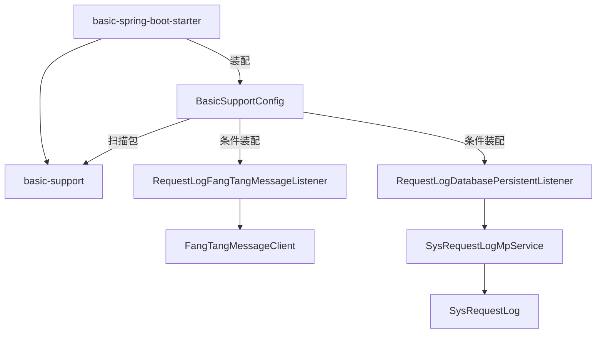
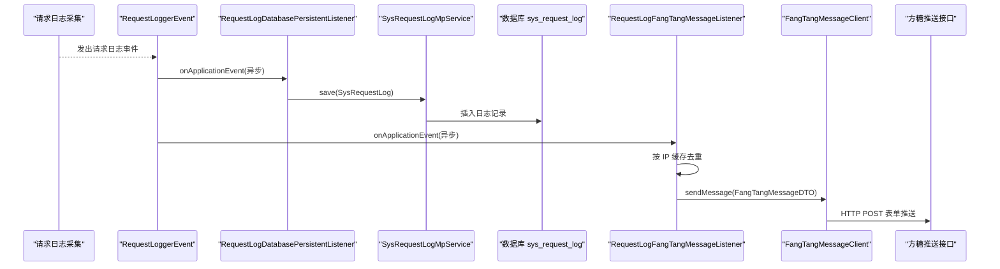
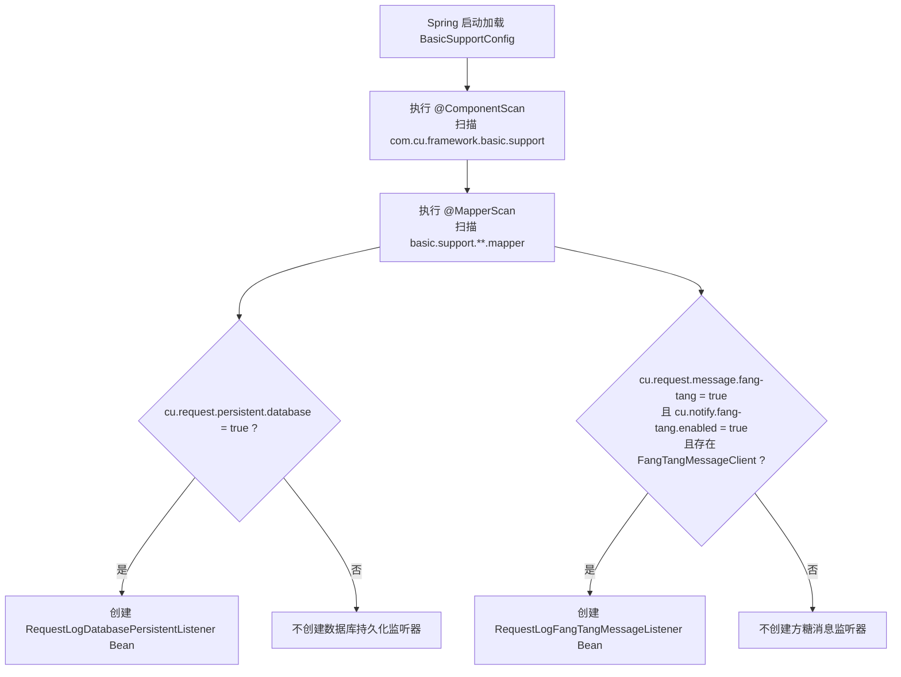
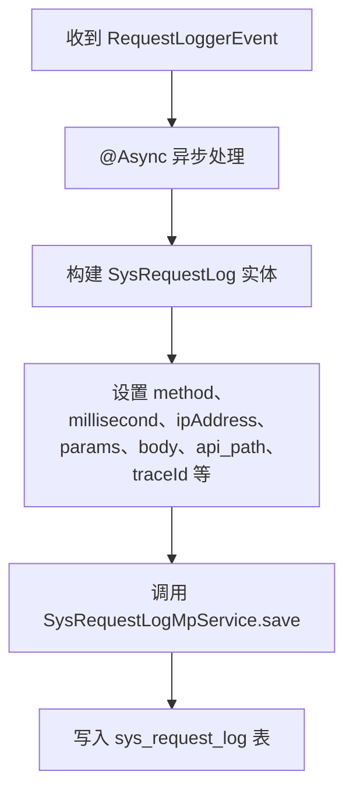
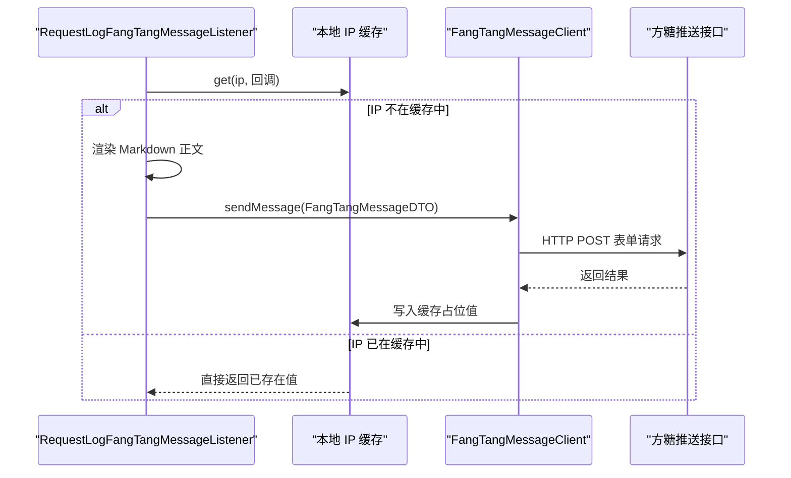
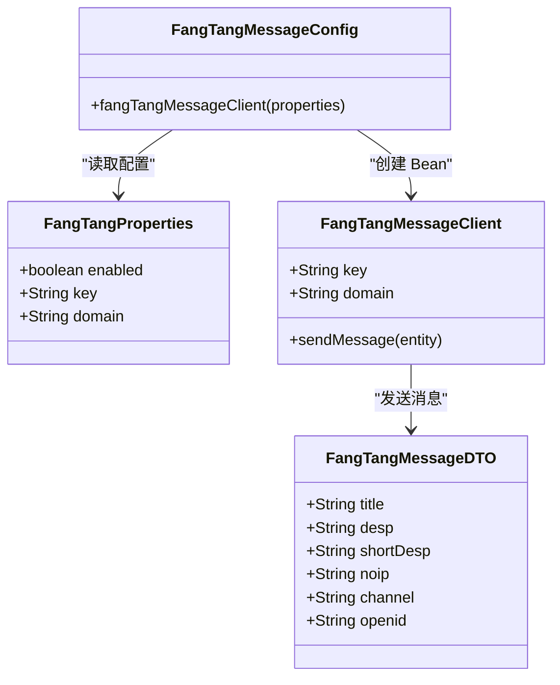
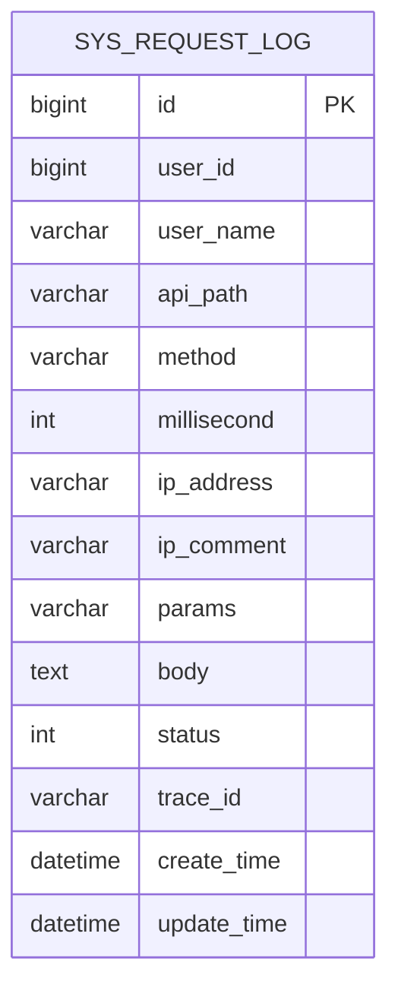
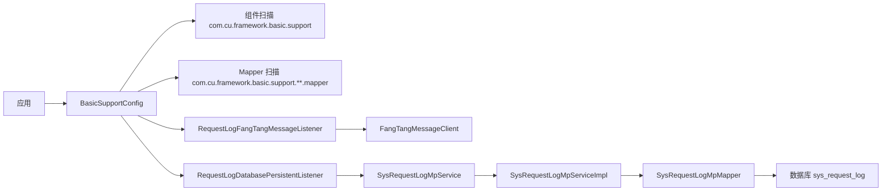

# Basic Starter 基础能力

<cite>
**本文引用的文件**
- [BasicSupportConfig.java](file://boot/basic-spring-boot-starter/src/main/java/com/cu/framework/boot/basic/config/BasicSupportConfig.java)
- [FangTangMessageConfig.java](file://boot/basic-spring-boot-starter/src/main/java/com/cu/framework/boot/basic/config/FangTangMessageConfig.java)
- [FangTangProperties.java](file://boot/basic-spring-boot-starter/src/main/java/com/cu/framework/boot/basic/properties/FangTangProperties.java)
- [RequestLogDatabasePersistentListener.java](file://basic-support/src/main/java/com/cu/framework/basic/support/log/RequestLogDatabasePersistentListener.java)
- [RequestLogFangTangMessageListener.java](file://basic-support/src/main/java/com/cu/framework/basic/support/log/RequestLogFangTangMessageListener.java)
- [RequestLogService.java](file://basic-support/src/main/java/com/cu/framework/basic/support/log/persistent/RequestLogService.java)
- [SysRequestLog.java](file://basic-support/src/main/java/com/cu/framework/basic/support/mp/entity/SysRequestLog.java)
- [SysRequestLogMpMapper.java](file://basic-support/src/main/java/com/cu/framework/basic/support/mp/mapper/SysRequestLogMpMapper.java)
- [SysRequestLogMpService.java](file://basic-support/src/main/java/com/cu/framework/basic/support/mp/service/SysRequestLogMpService.java)
- [SysRequestLogMpServiceImpl.java](file://basic-support/src/main/java/com/cu/framework/basic/support/mp/service/impl/SysRequestLogMpServiceImpl.java)
- [FangTangMessageClient.java](file://basic-support/src/main/java/com/cu/framework/basic/support/notify/fangtang/FangTangMessageClient.java)
- [FangTangMessageDTO.java](file://basic-support/src/main/java/com/cu/framework/basic/support/notify/fangtang/FangTangMessageDTO.java)
- [basic-support.sql](file://docs/sql/basic-support.sql)
</cite>

## 目录
1. [简介](#简介)
2. [项目结构定位](#项目结构定位)
3. [核心组件总览](#核心组件总览)
4. [架构概览](#架构概览)
5. [详细组件分析](#详细组件分析)
6. [依赖关系分析](#依赖关系分析)
7. [配置与集成指南](#配置与集成指南)
8. [性能与行为特性](#性能与行为特性)
9. [故障排查指南](#故障排查指南)
10. [结论](#结论)

## 简介
Basic Starter 基础能力由 `basic-spring-boot-starter` 装配，并通过 `basic-support` 模块提供通用支撑。其核心目标是：在请求生命周期结束后，自动把请求日志输出到数据库或消息渠道；同时暴露请求日志统计能力、方糖消息通知能力以及 MyBatis-Plus 基础设施。

关键要点：
- 通过 `BasicSupportConfig` 扫描 `com.cu.framework.basic.support` 包，并扫描该包下所有 `mapper` 子包中的 Mapper 接口。
- 请求日志持久化由 `cu.request.persistent.database=true` 启用。
- 方糖消息通知由 `cu.request.message.fang-tang=true` 和 `cu.notify.fang-tang.enabled=true` 共同控制，且需要存在 `FangTangMessageClient` Bean。
- 数据库表 `sys_request_log` 用于保存请求日志，建表脚本位于 `docs/sql/basic-support.sql`。

## 项目结构定位
本功能横跨两个模块：
- `boot/basic-spring-boot-starter`：负责 Spring Boot 自动装配、配置类、属性绑定和条件装配。
- `basic-support`：实现具体支撑逻辑，包括请求日志监听器、MyBatis-Plus 实体/Mapper/Service、方糖消息客户端等。

**图表来源**
- [BasicSupportConfig.java:1-45](file://boot/basic-spring-boot-starter/src/main/java/com/cu/framework/boot/basic/config/BasicSupportConfig.java#L1-L45)
- [RequestLogDatabasePersistentListener.java:1-66](file://basic-support/src/main/java/com/cu/framework/basic/support/log/RequestLogDatabasePersistentListener.java#L1-L66)
- [RequestLogFangTangMessageListener.java:1-108](file://basic-support/src/main/java/com/cu/framework/basic/support/log/RequestLogFangTangMessageListener.java#L1-L108)
- [FangTangMessageClient.java:1-86](file://basic-support/src/main/java/com/cu/framework/basic/support/notify/fangtang/FangTangMessageClient.java#L1-L86)
- [SysRequestLog.java:1-123](file://basic-support/src/main/java/com/cu/framework/basic/support/mp/entity/SysRequestLog.java#L1-L123)

**章节来源**
- [BasicSupportConfig.java:1-45](file://boot/basic-spring-boot-starter/src/main/java/com/cu/framework/boot/basic/config/BasicSupportConfig.java#L1-L45)
- [basic-support.sql:60-79](file://docs/sql/basic-support.sql#L60-L79)

## 核心组件总览
| 组件 | 作用 | 关键行为 |
|---|---|---|
| `BasicSupportConfig` | 基础支撑装配入口 | 扫描支持包、扫描 Mapper、条件创建持久化和消息监听器 Bean |
| `RequestLogDatabasePersistentListener` | 请求日志数据库持久化监听器 | 异步接收请求日志事件，写入 `sys_request_log` 表 |
| `RequestLogFangTangMessageListener` | 请求日志方糖消息通知监听器 | 异步发送方糖消息，按 IP 去重推送 |
| `FangTangMessageClient` | 方糖消息 HTTP 客户端 | 以表单方式调用方糖推送接口，异常仅记录日志 |
| `SysRequestLog` / `SysRequestLogMpMapper` / `SysRequestLogMpService` | 请求日志数据模型与访问层 | 基于 MyBatis-Plus 的实体、Mapper 与服务接口及默认实现 |
| `RequestLogService` | 请求日志统计服务 | 按天统计独立 IP 数与独立用户数 |
| `FangTangMessageConfig` / `FangTangProperties` | 方糖消息配置 | 校验并构建 `FangTangMessageClient` Bean |

**章节来源**
- [BasicSupportConfig.java:1-45](file://boot/basic-spring-boot-starter/src/main/java/com/cu/framework/boot/basic/config/BasicSupportConfig.java#L1-L45)
- [RequestLogDatabasePersistentListener.java:1-66](file://basic-support/src/main/java/com/cu/framework/basic/support/log/RequestLogDatabasePersistentListener.java#L1-L66)
- [RequestLogFangTangMessageListener.java:1-108](file://basic-support/src/main/java/com/cu/framework/basic/support/log/RequestLogFangTangMessageListener.java#L1-L108)
- [FangTangMessageClient.java:1-86](file://basic-support/src/main/java/com/cu/framework/basic/support/notify/fangtang/FangTangMessageClient.java#L1-L86)
- [SysRequestLog.java:1-123](file://basic-support/src/main/java/com/cu/framework/basic/support/mp/entity/SysRequestLog.java#L1-L123)
- [SysRequestLogMpMapper.java:1-18](file://basic-support/src/main/java/com/cu/framework/basic/support/mp/mapper/SysRequestLogMpMapper.java#L1-L18)
- [SysRequestLogMpService.java:1-17](file://basic-support/src/main/java/com/cu/framework/basic/support/mp/service/SysRequestLogMpService.java#L1-L17)
- [SysRequestLogMpServiceImpl.java:1-22](file://basic-support/src/main/java/com/cu/framework/basic/support/mp/service/impl/SysRequestLogMpServiceImpl.java#L1-L22)
- [RequestLogService.java:1-60](file://basic-support/src/main/java/com/cu/framework/basic/support/log/persistent/RequestLogService.java#L1-L60)
- [FangTangMessageConfig.java:1-44](file://boot/basic-spring-boot-starter/src/main/java/com/cu/framework/boot/basic/config/FangTangMessageConfig.java#L1-L44)
- [FangTangProperties.java:1-49](file://boot/basic-spring-boot-starter/src/main/java/com/cu/framework/boot/basic/properties/FangTangProperties.java#L1-L49)

## 架构概览
请求日志从基础日志采集组件发出 `RequestLoggerEvent`，由 Basic Starter 提供的两种监听器消费：
- 数据库路径：监听器异步落库到 `sys_request_log`。
- 方糖消息路径：监听器构造 Markdown 内容，经 `FangTangMessageClient` 调用外部推送接口。

**图表来源**
- [RequestLogDatabasePersistentListener.java:27-66](file://basic-support/src/main/java/com/cu/framework/basic/support/log/RequestLogDatabasePersistentListener.java#L27-L66)
- [RequestLogFangTangMessageListener.java:33-108](file://basic-support/src/main/java/com/cu/framework/basic/support/log/RequestLogFangTangMessageListener.java#L33-L108)
- [FangTangMessageClient.java:33-86](file://basic-support/src/main/java/com/cu/framework/basic/support/notify/fangtang/FangTangMessageClient.java#L33-L86)
- [SysRequestLogMpServiceImpl.java:14-22](file://basic-support/src/main/java/com/cu/framework/basic/support/mp/service/impl/SysRequestLogMpServiceImpl.java#L14-L22)

## 详细组件分析

### BasicSupportConfig 配置机制
`BasicSupportConfig` 是基础支撑能力的装配中心，承担三类职责：
1. 组件扫描：使用 `@ComponentScan("com.cu.framework.basic.support")` 扫描基础支撑包，使监听器、实体、Mapper、Service、工具类等自动注册。
2. Mapper 扫描：使用 `@MapperScan("com.cu.framework.basic.support.**.mapper")` 扫描 `basic-support` 下任意层级 `mapper` 包中的接口。
3. 条件装配：
   - 当 `cu.request.persistent.database=true` 时，创建 `RequestLogDatabasePersistentListener` Bean。
   - 当 `cu.request.message.fang-tang=true` 且 `cu.notify.fang-tang.enabled=true`，并且容器中已有 `FangTangMessageClient` Bean 时，创建 `RequestLogFangTangMessageListener` Bean。

**图表来源**
- [BasicSupportConfig.java:16-45](file://boot/basic-spring-boot-starter/src/main/java/com/cu/framework/boot/basic/config/BasicSupportConfig.java#L16-L45)

**章节来源**
- [BasicSupportConfig.java:16-45](file://boot/basic-spring-boot-starter/src/main/java/com/cu/framework/boot/basic/config/BasicSupportConfig.java#L16-L45)

### 请求日志数据库持久化流程
`RequestLogDatabasePersistentListener` 监听 `RequestLoggerEvent`，并将请求日志异步写入数据库。

关键行为：
- 构造函数中打印“开启请求日志数据库持久化”日志。
- `onApplicationEvent` 使用 `@Async` 异步处理，避免阻塞请求线程。
- `save` 方法将 `RequestLogger` 转换为 `SysRequestLog`，其中：
  - 请求体转为 JSON 字符串入库。
  - `traceId` 来自 `requestLogger.getTraceId()`，而非当前线程 `TraceContext`，以避免异步线程上下文丢失。
  - 字段包括方法、耗时、IP、参数、URL、状态码、跟踪号、创建时间等。
- 最终通过 `SysRequestLogMpService.save` 完成写入。

**图表来源**
- [RequestLogDatabasePersistentListener.java:27-66](file://basic-support/src/main/java/com/cu/framework/basic/support/log/RequestLogDatabasePersistentListener.java#L27-L66)
- [SysRequestLog.java:21-123](file://basic-support/src/main/java/com/cu/framework/basic/support/mp/entity/SysRequestLog.java#L21-L123)
- [SysRequestLogMpServiceImpl.java:14-22](file://basic-support/src/main/java/com/cu/framework/basic/support/mp/service/impl/SysRequestLogMpServiceImpl.java#L14-L22)

**章节来源**
- [RequestLogDatabasePersistentListener.java:17-66](file://basic-support/src/main/java/com/cu/framework/basic/support/log/RequestLogDatabasePersistentListener.java#L17-L66)
- [SysRequestLog.java:1-123](file://basic-support/src/main/java/com/cu/framework/basic/support/mp/entity/SysRequestLog.java#L1-L123)
- [SysRequestLogMpServiceImpl.java:1-22](file://basic-support/src/main/java/com/cu/framework/basic/support/mp/service/impl/SysRequestLogMpServiceImpl.java#L1-L22)

### 方糖消息通知流程
`RequestLogFangTangMessageListener` 是请求日志的消息渠道监听器，负责将请求详情渲染为 Markdown 并发送到方糖。

关键行为：
- 构造函数打印“开启请求消息通知 - 方糖渠道”。
- 使用本地缓存按请求来源 IP 做去重，缓存过期时间为 30 分钟。
- 首次命中某个 IP 时才真正调用 `FangTangMessageClient.sendMessage`。
- Markdown 正文包含 ip 地址、url、headers、params、body 五个分区。
- 标题格式包含应用名和来源 IP。
- 如果缓存操作抛出异常，会包装为运行时异常向上抛出。

**图表来源**
- [RequestLogFangTangMessageListener.java:33-108](file://basic-support/src/main/java/com/cu/framework/basic/support/log/RequestLogFangTangMessageListener.java#L33-L108)
- [FangTangMessageClient.java:33-86](file://basic-support/src/main/java/com/cu/framework/basic/support/notify/fangtang/FangTangMessageClient.java#L33-L86)

**章节来源**
- [RequestLogFangTangMessageListener.java:17-108](file://basic-support/src/main/java/com/cu/framework/basic/support/log/RequestLogFangTangMessageListener.java#L17-L108)
- [FangTangMessageClient.java:1-86](file://basic-support/src/main/java/com/cu/framework/basic/support/notify/fangtang/FangTangMessageClient.java#L1-L86)
- [FangTangMessageDTO.java:1-46](file://basic-support/src/main/java/com/cu/framework/basic/support/notify/fangtang/FangTangMessageDTO.java#L1-L46)

### 方糖消息客户端与配置
`FangTangMessageClient` 是一个轻量级 HTTP 客户端：
- 目标接口拼接规则为 `domain/key.send`。
- 使用表单方式提交 title、desp、short、noip、channel、openid 等字段。
- 发送异常只记录 warn 日志，不向调用方抛出，因此消息推送失败不会中断主流程。
- domain 默认值为 `https://sctapi.ftqq.com`。

`FangTangMessageConfig` 负责：
- 启用 `FangTangProperties`。
- 当 `cu.notify.fang-tang.enabled=true` 时创建 `FangTangMessageClient`。
- 校验 key 和 domain 不能为空，否则抛出运行时异常。

`FangTangProperties` 绑定前缀为 `cu.notify.fang-tang`，包含 enabled、key、domain。

**图表来源**
- [FangTangProperties.java:12-49](file://boot/basic-spring-boot-starter/src/main/java/com/cu/framework/boot/basic/properties/FangTangProperties.java#L12-L49)
- [FangTangMessageConfig.java:16-44](file://boot/basic-spring-boot-starter/src/main/java/com/cu/framework/boot/basic/config/FangTangMessageConfig.java#L16-L44)
- [FangTangMessageClient.java:1-86](file://basic-support/src/main/java/com/cu/framework/basic/support/notify/fangtang/FangTangMessageClient.java#L1-L86)
- [FangTangMessageDTO.java:1-46](file://basic-support/src/main/java/com/cu/framework/basic/support/notify/fangtang/FangTangMessageDTO.java#L1-L46)

**章节来源**
- [FangTangMessageClient.java:1-86](file://basic-support/src/main/java/com/cu/framework/basic/support/notify/fangtang/FangTangMessageClient.java#L1-L86)
- [FangTangMessageConfig.java:1-44](file://boot/basic-spring-boot-starter/src/main/java/com/cu/framework/boot/basic/config/FangTangMessageConfig.java#L1-L44)
- [FangTangProperties.java:1-49](file://boot/basic-spring-boot-starter/src/main/java/com/cu/framework/boot/basic/properties/FangTangProperties.java#L1-L49)

### 请求日志数据模型与统计
`SysRequestLog` 对应数据库表 `sys_request_log`，包含用户标识、API 路径、请求方法、耗时、IP、参数、请求体、状态、跟踪号、创建时间和更新时间。

`SysRequestLogMpMapper` 继承 MyBatis-Plus 的 `BaseMapper`，提供基础 CRUD。

`SysRequestLogMpService` 是扩展服务接口，`SysRequestLogMpServiceImpl` 提供默认实现，并使用 `@Primary` 标记为主 Service。

`RequestLogService` 提供按天统计独立 IP 数和独立用户数的能力，查询条件是 `createTime` 落在指定日期区间的闭区间。

**图表来源**
- [SysRequestLog.java:21-123](file://basic-support/src/main/java/com/cu/framework/basic/support/mp/entity/SysRequestLog.java#L21-L123)
- [basic-support.sql:60-79](file://docs/sql/basic-support.sql#L60-L79)

**章节来源**
- [SysRequestLog.java:1-123](file://basic-support/src/main/java/com/cu/framework/basic/support/mp/entity/SysRequestLog.java#L1-L123)
- [SysRequestLogMpMapper.java:1-18](file://basic-support/src/main/java/com/cu/framework/basic/support/mp/mapper/SysRequestLogMpMapper.java#L1-L18)
- [SysRequestLogMpService.java:1-17](file://basic-support/src/main/java/com/cu/framework/basic/support/mp/service/SysRequestLogMpService.java#L1-L17)
- [SysRequestLogMpServiceImpl.java:1-22](file://basic-support/src/main/java/com/cu/framework/basic/support/mp/service/impl/SysRequestLogMpServiceImpl.java#L1-L22)
- [RequestLogService.java:1-60](file://basic-support/src/main/java/com/cu/framework/basic/support/log/persistent/RequestLogService.java#L1-L60)
- [basic-support.sql:60-79](file://docs/sql/basic-support.sql#L60-L79)

## 依赖关系分析
Basic Starter 对基础支撑能力的依赖集中在配置层，业务代码不应直接耦合底层监听器。

**图表来源**
- [BasicSupportConfig.java:16-45](file://boot/basic-spring-boot-starter/src/main/java/com/cu/framework/boot/basic/config/BasicSupportConfig.java#L16-L45)
- [SysRequestLogMpServiceImpl.java:14-22](file://basic-support/src/main/java/com/cu/framework/basic/support/mp/service/impl/SysRequestLogMpServiceImpl.java#L14-L22)
- [SysRequestLogMpMapper.java:1-18](file://basic-support/src/main/java/com/cu/framework/basic/support/mp/mapper/SysRequestLogMpMapper.java#L1-L18)

**章节来源**
- [BasicSupportConfig.java:16-45](file://boot/basic-spring-boot-starter/src/main/java/com/cu/framework/boot/basic/config/BasicSupportConfig.java#L16-L45)
- [SysRequestLogMpServiceImpl.java:1-22](file://basic-support/src/main/java/com/cu/framework/basic/support/mp/service/impl/SysRequestLogMpServiceImpl.java#L1-L22)

## 配置与集成指南

### 启用数据库持久化
若希望请求日志写入数据库，需要：
1. 引入 `basic-spring-boot-starter`。
2. 确保数据库中已存在 `sys_request_log` 表。
3. 在配置文件中设置 `cu.request.persistent.database=true`。

相关表结构定义见 `docs/sql/basic-support.sql`。

**章节来源**
- [BasicSupportConfig.java:24-30](file://boot/basic-spring-boot-starter/src/main/java/com/cu/framework/boot/basic/config/BasicSupportConfig.java#L24-L30)
- [basic-support.sql:60-79](file://docs/sql/basic-support.sql#L60-L79)

### 启用方糖消息通知
若希望请求日志通过方糖推送，需要满足以下全部条件：
1. 引入 `basic-spring-boot-starter`。
2. 配置 `cu.request.message.fang-tang=true`。
3. 配置 `cu.notify.fang-tang.enabled=true`。
4. 配置 `cu.notify.fang-tang.key`。
5. 配置 `cu.notify.fang-tang.domain`（可保留默认值）。
6. 保证 `FangTangMessageClient` Bean 被创建。

`FangTangMessageConfig` 会在启用方糖消息时校验 key 和 domain 非空，否则启动阶段抛出异常。

**章节来源**
- [BasicSupportConfig.java:32-45](file://boot/basic-spring-boot-starter/src/main/java/com/cu/framework/boot/basic/config/BasicSupportConfig.java#L32-L45)
- [FangTangMessageConfig.java:16-44](file://boot/basic-spring-boot-starter/src/main/java/com/cu/framework/boot/basic/config/FangTangMessageConfig.java#L16-L44)
- [FangTangProperties.java:12-49](file://boot/basic-spring-boot-starter/src/main/java/com/cu/framework/boot/basic/properties/FangTangProperties.java#L12-L49)

### 常用配置项说明
| 配置项 | 作用 | 是否必填 | 默认值或约束 |
|---|---|---|---|
| `cu.request.persistent.database` | 是否启用请求日志数据库持久化 | 按需 | `true` 时创建数据库持久化监听器 |
| `cu.request.message.fang-tang` | 是否启用请求日志方糖消息通知 | 按需 | 必须为 `true` |
| `cu.notify.fang-tang.enabled` | 是否启用方糖消息客户端 Bean | 按需 | 必须为 `true` |
| `cu.notify.fang-tang.key` | 方糖推送密钥 | 启用时必须配置 | 不能为空 |
| `cu.notify.fang-tang.domain` | 方糖推送域名 | 启用时可配置 | 默认 `https://sctapi.ftqq.com` |

**章节来源**
- [BasicSupportConfig.java:24-45](file://boot/basic-spring-boot-starter/src/main/java/com/cu/framework/boot/basic/config/BasicSupportConfig.java#L24-L45)
- [FangTangProperties.java:12-49](file://boot/basic-spring-boot-starter/src/main/java/com/cu/framework/boot/basic/properties/FangTangProperties.java#L12-L49)
- [FangTangMessageConfig.java:16-44](file://boot/basic-spring-boot-starter/src/main/java/com/cu/framework/boot/basic/config/FangTangMessageConfig.java#L16-L44)

## 性能与行为特性
- 异步处理：两个监听器均使用 `@Async` 处理请求日志事件，降低对主请求链路的影响。
- 数据库落库：请求体以 JSON 字符串存储，适合后续审计和分析，但大体积请求体会增加数据库写入压力。
- 消息去重：方糖消息监听器使用本地缓存按 IP 去重，默认 30 分钟内同一 IP 不会重复推送。
- 外部依赖容错：`FangTangMessageClient` 捕获所有异常并以 warn 级别记录，不向调用方抛出，消息失败不影响主流程。
- 统计查询复杂度：`RequestLogService.visitStatistic` 先查询日志列表，再在内存中按天和字段去重计数，适用于中小规模日志量；日志量极大时应考虑数据库侧聚合。

**章节来源**
- [RequestLogDatabasePersistentListener.java:27-66](file://basic-support/src/main/java/com/cu/framework/basic/support/log/RequestLogDatabasePersistentListener.java#L27-L66)
- [RequestLogFangTangMessageListener.java:27-108](file://basic-support/src/main/java/com/cu/framework/basic/support/log/RequestLogFangTangMessageListener.java#L27-L108)
- [FangTangMessageClient.java:33-86](file://basic-support/src/main/java/com/cu/framework/basic/support/notify/fangtang/FangTangMessageClient.java#L33-L86)
- [RequestLogService.java:24-60](file://basic-support/src/main/java/com/cu/framework/basic/support/log/persistent/RequestLogService.java#L24-L60)

## 故障排查指南

### 问题一：数据库中没有请求日志
可能原因：
- 未设置 `cu.request.persistent.database=true`。
- 未导入 `sys_request_log` 表。
- 基础日志采集没有触发 `RequestLoggerEvent`。
- 异步线程未正确配置或线程池耗尽。

排查步骤：
1. 检查是否启用数据库持久化开关。
2. 确认数据库中存在 `sys_request_log` 表。
3. 查看应用日志中是否出现“开启请求日志数据库持久化”。
4. 检查异步任务执行情况。

**章节来源**
- [BasicSupportConfig.java:24-30](file://boot/basic-spring-boot-starter/src/main/java/com/cu/framework/boot/basic/config/BasicSupportConfig.java#L24-L30)
- [RequestLogDatabasePersistentListener.java:27-66](file://basic-support/src/main/java/com/cu/framework/basic/support/log/RequestLogDatabasePersistentListener.java#L27-L66)
- [basic-support.sql:60-79](file://docs/sql/basic-support.sql#L60-L79)

### 问题二：方糖消息未收到
可能原因：
- 未同时配置 `cu.request.message.fang-tang=true` 和 `cu.notify.fang-tang.enabled=true`。
- 未提供 `cu.notify.fang-tang.key` 或 `cu.notify.fang-tang.domain`。
- 方糖推送接口不可用或返回错误。
- 同一 IP 在缓存有效期内被去重。

排查步骤：
1. 检查两个开关是否都为 `true`。
2. 检查 key 和 domain 是否配置。
3. 查看日志中是否有“方糖服务异常”警告。
4. 等待缓存过期后再次测试，或更换不同 IP 验证。

**章节来源**
- [BasicSupportConfig.java:32-45](file://boot/basic-spring-boot-starter/src/main/java/com/cu/framework/boot/basic/config/BasicSupportConfig.java#L32-L45)
- [FangTangMessageConfig.java:28-44](file://boot/basic-spring-boot-starter/src/main/java/com/cu/framework/boot/basic/config/FangTangMessageConfig.java#L28-L44)
- [FangTangMessageClient.java:33-86](file://basic-support/src/main/java/com/cu/framework/basic/support/notify/fangtang/FangTangMessageClient.java#L33-L86)
- [RequestLogFangTangMessageListener.java:33-108](file://basic-support/src/main/java/com/cu/framework/basic/support/log/RequestLogFangTangMessageListener.java#L33-L108)

### 问题三：启动时报方糖配置错误
现象：
- 启动阶段抛出运行时异常，提示 key 或 domain 为空。

原因：
- 启用了方糖消息但未配置必要属性。

处理：
- 设置 `cu.notify.fang-tang.key`。
- 设置 `cu.notify.fang-tang.domain`，或使用默认值。

**章节来源**
- [FangTangMessageConfig.java:28-44](file://boot/basic-spring-boot-starter/src/main/java/com/cu/framework/boot/basic/config/FangTangMessageConfig.java#L28-L44)
- [FangTangProperties.java:12-49](file://boot/basic-spring-boot-starter/src/main/java/com/cu/framework/boot/basic/properties/FangTangProperties.java#L12-L49)

### 问题四：请求日志统计结果为空
可能原因：
- 指定日期区间内无日志。
- 日志尚未异步写入数据库。
- 查询字段缺失导致去重结果为空。

建议：
- 确认日志确实产生并成功落库。
- 调整日期区间。
- 如需更精确统计，可在数据库层补充索引或视图。

**章节来源**
- [RequestLogService.java:24-60](file://basic-support/src/main/java/com/cu/framework/basic/support/log/persistent/RequestLogService.java#L24-L60)

## 结论
Basic Starter 基础能力通过 `BasicSupportConfig` 将基础日志事件与持久化、消息通知能力解耦装配。数据库持久化适合审计与回溯，方糖消息通知适合实时告警与运维感知。两者均可按需启用，且均以异步方式减少对主请求的影响。集成时重点关注三个层面：
- 配置开关是否正确。
- 数据库表是否存在。
- 外部消息通道是否可达且配置完整。