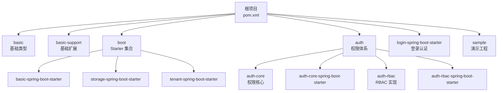
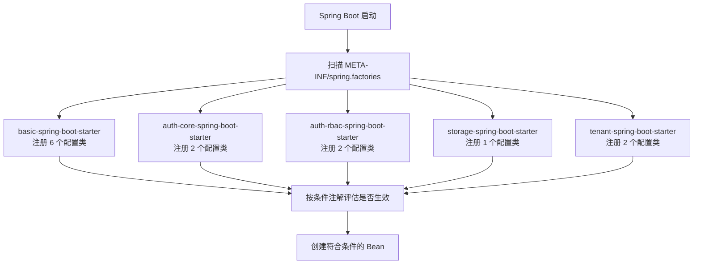
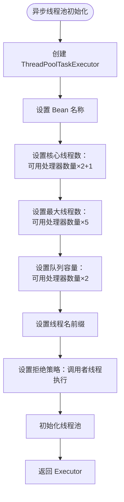
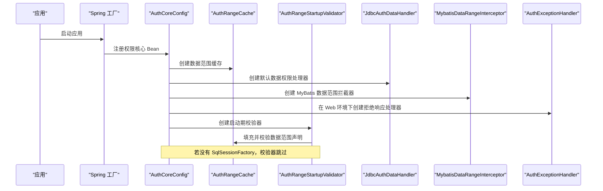
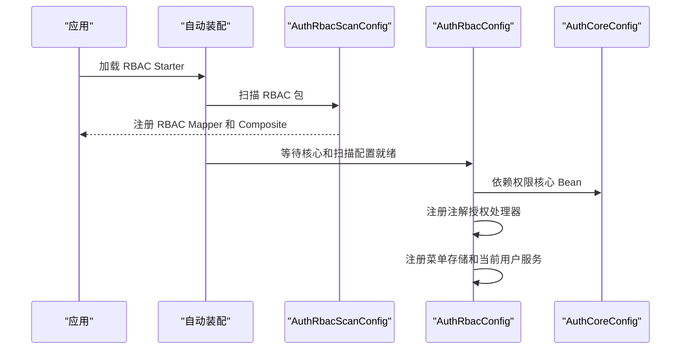
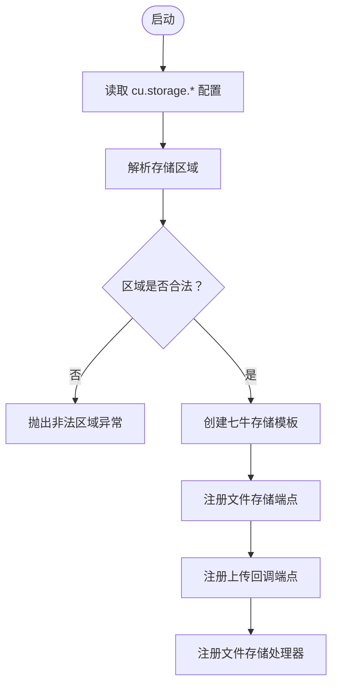
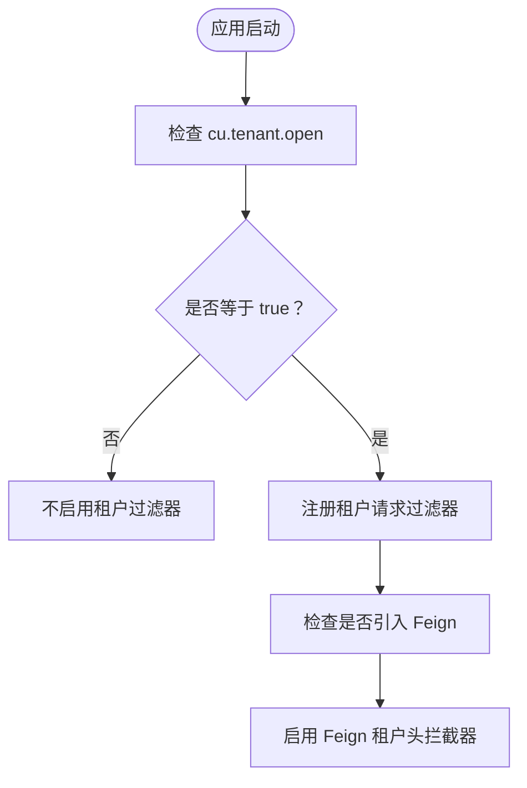
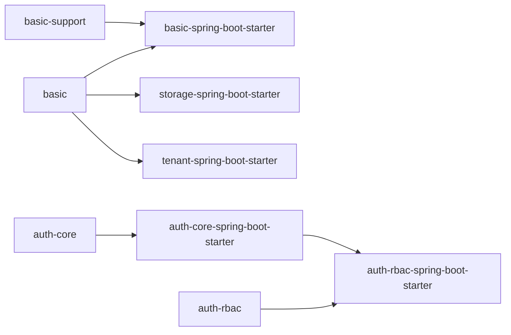

# Spring Boot Starter 集成

<cite>
**本文引用的文件**   
- [根项目依赖管理 pom.xml](file://pom.xml)
- [basic-spring-boot-starter 模块清单](file://boot/basic-spring-boot-starter/pom.xml)
- [storage-spring-boot-starter 模块清单](file://boot/storage-spring-boot-starter/pom.xml)
- [tenant-spring-boot-starter 模块清单](file://boot/tenant-spring-boot-starter/pom.xml)
- [auth-core-spring-boot-starter 模块清单](file://auth/auth-core-spring-boot-starter/pom.xml)
- [auth-rbac-spring-boot-starter 模块清单](file://auth/auth-rbac-spring-boot-starter/pom.xml)
- [basic-spring-boot-starter 自动装配配置](file://boot/basic-spring-boot-starter/src/main/resources/META-INF/spring.factories)
- [storage-spring-boot-starter 自动装配配置](file://boot/storage-spring-boot-starter/src/main/resources/META-INF/spring.factories)
- [tenant-spring-boot-starter 自动装配配置](file://boot/tenant-spring-boot-starter/src/main/resources/META-INF/spring.factories)
- [auth-core-spring-boot-starter 自动装配配置](file://auth/auth-core-spring-boot-starter/src/main/resources/META-INF/spring.factories)
- [auth-rbac-spring-boot-starter 自动装配配置](file://auth/auth-rbac-spring-boot-starter/src/main/resources/META-INF/spring.factories)
- [异步线程池配置类](file://boot/basic-spring-boot-starter/src/main/java/com/cu/framework/boot/basic/config/AsyncConfig.java)
- [基础能力支持配置类](file://boot/basic-spring-boot-starter/src/main/java/com/cu/framework/boot/basic/config/BasicSupportConfig.java)
- [早期过滤器配置类](file://boot/basic-spring-boot-starter/src/main/java/com/cu/framework/boot/basic/config/EarlyFilterConfig.java)
- [方糖消息通知配置类](file://boot/basic-spring-boot-starter/src/main/java/com/cu/framework/boot/basic/config/FangTangMessageConfig.java)
- [MyBatis-Plus 分页配置类](file://boot/basic-spring-boot-starter/src/main/java/com/cu/framework/boot/basic/config/MybatisPlusConfig.java)
- [请求响应格式配置类](file://boot/basic-spring-boot-starter/src/main/java/com/cu/framework/boot/basic/config/RequestResponseFormatConfig.java)
- [权限核心自动装配配置类](file://auth/auth-core-spring-boot-starter/src/main/java/com/cu/framework/boot/auth/core/config/AuthCoreConfig.java)
- [权限 Web 拦截器配置类](file://auth/auth-core-spring-boot-starter/src/main/java/com/cu/framework/boot/auth/core/config/AuthWebConfig.java)
- [RBAC 实现配置类](file://auth/auth-rbac-spring-boot-starter/src/main/java/com/cu/framework/boot/auth/rbac/config/AuthRbacConfig.java)
- [RBAC 扫描配置类](file://auth/auth-rbac-spring-boot-starter/src/main/java/com/cu/framework/boot/auth/rbac/config/AuthRbacScanConfig.java)
- [存储自动装配配置类](file://boot/storage-spring-boot-starter/src/main/java/com/cu/framework/storage/boot/StorageAutoConfiguration.java)
- [租户自动装配配置类](file://boot/tenant-spring-boot-starter/src/main/java/com/cu/framework/tenant/config/TenantConfig.java)
</cite>

## 目录

1. [引言](#引言)
2. [项目结构](#项目结构)
3. [Starter 模块总览](#starter-模块总览)
4. [自动装配机制](#自动装配机制)
5. [各 Starter 详细分析](#各-starter-详细分析)
6. [依赖关系与加载顺序](#依赖关系与加载顺序)
7. [依赖引入与配置示例](#依赖引入与配置示例)
8. [常见集成问题排查](#常见集成问题排查)
9. [性能考虑与优化建议](#性能考虑与优化建议)
10. [结论](#结论)

## 引言

Kewen Framework 是一个以 Spring Boot 为基础的模块化技术栈，提供基础能力、权限体系、多租户、文件存储和登录认证等可组合的组件。本文聚焦于 Spring Boot Starter 集成：说明 basic-spring-boot-starter、auth-core-spring-boot-starter、auth-rbac-spring-boot-starter、storage-spring-boot-starter、tenant-spring-boot-starter 的功能定位、装配行为、属性绑定方式、依赖关系和典型使用方式。

该仓库采用 Maven 多模块组织，顶层 `pom.xml` 管理框架版本、Spring Boot 依赖以及部分公共第三方库版本；各个 Starter 通过 `spring.factories` 暴露自动装配类，结合条件注解控制是否生效。这样设计的好处是：业务项目可以按需引入 Starter，而不是被强制绑定全部功能。

## 项目结构

从 Spring Boot Starter 视角看，仓库中与集成最相关的模块集中在三个区域：

| 区域 | 主要职责 | 关键产物 |
|---|---|---|
| `basic` | 通用异常、日志、工具、模型等基础类型 | `com.cu.framework.basic` |
| `basic-support` | 请求日志持久化、消息通知、分页工具、雪花 Id 等扩展能力 | `com.cu.framework.basic.support` |
| `boot` | Spring Boot Starter 封装层 | `basic-spring-boot-starter`、`storage-spring-boot-starter`、`tenant-spring-boot-starter`、`magic-spring-boot-starter` |
| `auth` | 权限核心与 RBAC 实现 | `auth-core`、`auth-rbac`、对应 Starter |
| `login-spring-boot-starter` | 登录认证、OAuth2、SSO 等身份能力 | 独立 Starter（不在本次文档重点） |
| `sample` | 各模块演示工程 | 参考集成方式 |

**图表来源**
- [根项目依赖管理 pom.xml:1-200](file://pom.xml#L1-L200)

**章节来源**
- [根项目依赖管理 pom.xml:1-200](file://pom.xml#L1-L200)

## Starter 模块总览

| Starter | Maven 坐标 | 主要功能 | 是否依赖 Web | 典型接入场景 |
|---|---|---|---:|---|
| `basic-spring-boot-starter` | `com.cu.framework.boot:basic-spring-boot-starter` | 统一异常处理、Jackson 序列化规则、异步线程池、MyBatis-Plus 分页、早期请求过滤、请求日志、可选方糖消息通知 | 是，依赖 `spring-boot-starter-web` | 大多数后端服务的基础底座 |
| `auth-core-spring-boot-starter` | `com.cu.framework.auth:auth-core-spring-boot-starter` | 当前用户上下文、菜单访问控制、数据范围声明、SQL 注入、启动期校验、拒绝响应通道 | 否，但 Web 条件下注册 MVC 拦截器和异常处理器 | 需要权限体系的服务 |
| `auth-rbac-spring-boot-starter` | `com.cu.framework.auth:auth-rbac-spring-boot-starter` | RBAC 注解授权、菜单存储、当前用户服务、菜单 API 服务、MyBatis-Plus 映射扫描 | 否 | 基于数据库的 RBAC 权限实现 |
| `storage-spring-boot-starter` | `com.cu.framework.boot:storage-spring-boot-starter` | 七牛云文件存储模板、文件上传回调、文件下载接口、文件响应增强 | 否，但提供 Web 端点 | 需要对象存储的文件服务 |
| `tenant-spring-boot-starter` | `com.cu.framework.boot:tenant-spring-boot-starter` | 租户上下文、请求头传递、Feign 租户头拦截器 | 是，依赖 `spring-boot-starter-web` | 多租户应用 |

这些 Starter 不是孤立存在的：它们共同围绕 `basic` 基础包构建，并通过条件装配避免不必要的依赖膨胀。例如，`tenant-spring-boot-starter` 中的 Feign 支持通过 `optional` 依赖控制，只有引入 Feign 时才会真正参与运行。

**章节来源**
- [basic-spring-boot-starter 模块清单:1-62](file://boot/basic-spring-boot-starter/pom.xml#L1-L62)
- [storage-spring-boot-starter 模块清单:1-51](file://boot/storage-spring-boot-starter/pom.xml#L1-L51)
- [tenant-spring-boot-starter 模块清单:1-42](file://boot/tenant-spring-boot-starter/pom.xml#L1-L42)
- [auth-core-spring-boot-starter 模块清单:1-53](file://auth/auth-core-spring-boot-starter/pom.xml#L1-L53)
- [auth-rbac-spring-boot-starter 模块清单:1-39](file://auth/auth-rbac-spring-boot-starter/pom.xml#L1-L39)

## 自动装配机制

### spring.factories 暴露的自动装配类

每个 Starter 都在 `META-INF/spring.factories` 中注册 `EnableAutoConfiguration` 对应的配置类。Spring Boot 启动时会扫描这些配置并创建 Bean。

| Starter | 自动装配配置类 |
|---|---|
| `basic-spring-boot-starter` | `AsyncConfig`、`BasicSupportConfig`、`EarlyFilterConfig`、`FangTangMessageConfig`、`MybatisPlusConfig`、`RequestResponseFormatConfig` |
| `auth-core-spring-boot-starter` | `AuthCoreConfig`、`AuthWebConfig` |
| `auth-rbac-spring-boot-starter` | `AuthRbacConfig`、`AuthRbacScanConfig` |
| `storage-spring-boot-starter` | `StorageAutoConfiguration` |
| `tenant-spring-boot-starter` | `TenantConfig`、`TenantHeaderInterceptor` |

**图表来源**
- [basic-spring-boot-starter 自动装配配置:1-7](file://boot/basic-spring-boot-starter/src/main/resources/META-INF/spring.factories#L1-L7)
- [auth-core-spring-boot-starter 自动装配配置:1-3](file://auth/auth-core-spring-boot-starter/src/main/resources/META-INF/spring.factories#L1-L3)
- [auth-rbac-spring-boot-starter 自动装配配置:1-3](file://auth/auth-rbac-spring-boot-starter/src/main/resources/META-INF/spring.factories#L1-L3)
- [storage-spring-boot-starter 自动装配配置:1-2](file://boot/storage-spring-boot-starter/src/main/resources/META-INF/spring.factories#L1-L2)
- [tenant-spring-boot-starter 自动装配配置:1-3](file://boot/tenant-spring-boot-starter/src/main/resources/META-INF/spring.factories#L1-L3)

### 条件装配关键点

| 条件 | 作用 | 涉及类或配置 |
|---|---|---|
| `@ConditionalOnWebApplication` | 仅在 Web 环境中装配权限拒绝响应处理器 | `AuthCoreConfig` |
| `@ConditionalOnMissingBean(AuthDataHandler.class)` | 允许业务自定义数据权限处理器覆盖默认 JDBC 实现 | `AuthCoreConfig` |
| `@ConditionalOnMissingBean(AuthExceptionHandler.class)` | 允许业务自定义权限拒绝响应处理器 | `AuthCoreConfig` |
| `@ConditionalOnProperty(name = "cu.request.persistent.database", havingValue = "true")` | 开启请求日志写入数据库 | `BasicSupportConfig` |
| `@ConditionalOnProperty(name = {"cu.request.message.fang-tang","cu.notify.fang-tang.enabled"}, havingValue = "true")` | 开启方糖渠道的请求日志消息通知 | `BasicSupportConfig` |
| `@ConditionalOnBean(FangTangMessageClient.class)` | 要求已存在方糖消息客户端 | `BasicSupportConfig` |
| `@ConditionalOnProperty(prefix = "cu.notify.fang-tang", name = "enabled", havingValue = "true")` | 启用方糖消息客户端 | `FangTangMessageConfig` |
| `@ConditionalOnProperty(name = "cu.tenant.open", havingValue = "true")` | 开启租户过滤器 | `TenantConfig` |
| `feign-core` 为 optional 依赖 | 未引入 Feign 时不报错，也不装配 Feign 租户头拦截器 | `tenant-spring-boot-starter` |

**章节来源**
- [权限核心自动装配配置类:1-203](file://auth/auth-core-spring-boot-starter/src/main/java/com/cu/framework/boot/auth/core/config/AuthCoreConfig.java#L1-L203)
- [基础能力支持配置类:1-45](file://boot/basic-spring-boot-starter/src/main/java/com/cu/framework/boot/basic/config/BasicSupportConfig.java#L1-L45)
- [方糖消息通知配置类:1-44](file://boot/basic-spring-boot-starter/src/main/java/com/cu/framework/boot/basic/config/FangTangMessageConfig.java#L1-L44)
- [租户自动装配配置类:1-22](file://boot/tenant-spring-boot-starter/src/main/java/com/cu/framework/tenant/config/TenantConfig.java#L1-L22)
- [tenant-spring-boot-starter 模块清单:24-42](file://boot/tenant-spring-boot-starter/pom.xml#L24-L42)

### 属性绑定

| 属性 | 所属 Starter | 含义 | 默认值或约束 |
|---|---|---|---|
| `cu.request.persistent.database` | `basic-spring-boot-starter` | 是否将请求日志持久化到数据库 | 关闭时不创建数据库持久化监听器 |
| `cu.request.message.fang-tang` | `basic-spring-boot-starter` | 是否启用方糖渠道请求日志通知 | 与 `cu.notify.fang-tang.enabled` 二选一 |
| `cu.notify.fang-tang.enabled` | `basic-spring-boot-starter` | 是否启用方糖消息通知 | 需同时满足客户端 Bean 存在 |
| `cu.notify.fang-tang.key` | `basic-spring-boot-starter` | 方糖消息 Key | 必填，为空时报运行时异常 |
| `cu.notify.fang-tang.domain` | `basic-spring-boot-starter` | 方糖消息域名 | 必填，为空时报运行时异常 |
| `cu.tenant.open` | `tenant-spring-boot-starter` | 是否开启租户过滤器 | 必须显式设为 `true` 才生效 |
| `cu.storage.*` | `storage-spring-boot-starter` | 七牛存储访问密钥、密钥、区域、桶、根路径、公开访问、下载域名、回调地址等 | 区域值有严格校验 |

其中，`FangTangProperties` 由 `FangTangMessageConfig` 通过 `@EnableConfigurationProperties` 启用；`StorageProperties` 由 `StorageAutoConfiguration` 启用。`additional-spring-configuration-metadata.json` 用于在 IDE 中提供属性提示。

**章节来源**
- [基础能力支持配置类:1-45](file://boot/basic-spring-boot-starter/src/main/java/com/cu/framework/boot/basic/config/BasicSupportConfig.java#L1-L45)
- [方糖消息通知配置类:1-44](file://boot/basic-spring-boot-starter/src/main/java/com/cu/framework/boot/basic/config/FangTangMessageConfig.java#L1-L44)
- [存储自动装配配置类:1-100](file://boot/storage-spring-boot-starter/src/main/java/com/cu/framework/storage/boot/StorageAutoConfiguration.java#L1-L100)
- [tenant-spring-boot-starter 自动装配配置:1-3](file://boot/tenant-spring-boot-starter/src/main/resources/META-INF/spring.factories#L1-L3)

## 各 Starter 详细分析

### basic-spring-boot-starter：基础能力

`basic-spring-boot-starter` 是框架中最常用的底座 Starter，它聚合了 `basic` 和 `basic-support` 两个内部模块，并进一步整合 Web、MyBatis-Plus、参数校验、P6Spy、MySQL 驱动等依赖。

它的主要贡献包括：

| 配置类 | 职责 |
|---|---|
| `AsyncConfig` | 启用异步任务，并提供固定大小的线程池、调用者拒绝策略和异步异常打印 |
| `BasicSupportConfig` | 扫描基础扩展包、扫描 MyBatis Mapper，并按属性决定是否注册请求日志持久化和方糖消息监听器 |
| `EarlyFilterConfig` | 注册链路追踪过滤器、请求信息过滤器和早期请求过滤器代理 |
| `FangTangMessageConfig` | 根据配置创建方糖消息客户端，并对 key 和 domain 做非空校验 |
| `MybatisPlusConfig` | 注册 MyBatis-Plus 分页拦截器，默认数据库类型为 MySQL |
| `RequestResponseFormatConfig` | 注册全局异常处理器、响应体链路追踪增强、Jackson 序列化规则和日期转换器 |

#### 异步线程池

异步线程池的核心逻辑如下：

**图表来源**
- [异步线程池配置类:1-59](file://boot/basic-spring-boot-starter/src/main/java/com/cu/framework/boot/basic/config/AsyncConfig.java#L1-L59)

需要注意：核心线程数、最大线程数和队列容量都与 CPU 核数相关，适合 IO 密集型场景，但在高并发应用中应结合实际压测调整，不能直接照搬公式。

#### 请求与日志能力

`EarlyFilterConfig` 负责注册三类过滤器：链路追踪过滤器、请求日志过滤器和早期请求过滤器代理。`BasicSupportConfig` 则根据配置决定是否需要把请求日志持久化到数据库，或者通过方糖消息渠道推送。

`FangTangMessageConfig` 在启用方糖消息时会对配置进行强校验：如果 `key` 或 `domain` 为空，会抛出运行时异常。这属于“失败快速”的设计，有助于尽早暴露配置错误。

#### 请求响应格式

`RequestResponseFormatConfig` 统一了以下行为：

- 全局异常处理器
- 响应体链路追踪增强
- Jackson 包含空字段策略
- `LocalDate` 和 `LocalDateTime` 的序列化与反序列化格式
- 字符串到 `Date`、`LocalDate`、`LocalDateTime` 的类型转换器

这些规则对前端交互体验比较重要，尤其是 Long 精度丢失、日期格式不一致、异常响应结构不统一等问题，通常可以通过这个配置解决。

**章节来源**
- [basic-spring-boot-starter 模块清单:1-62](file://boot/basic-spring-boot-starter/pom.xml#L1-L62)
- [异步线程池配置类:1-59](file://boot/basic-spring-boot-starter/src/main/java/com/cu/framework/boot/basic/config/AsyncConfig.java#L1-L59)
- [基础能力支持配置类:1-45](file://boot/basic-spring-boot-starter/src/main/java/com/cu/framework/boot/basic/config/BasicSupportConfig.java#L1-L45)
- [早期过滤器配置类:1-47](file://boot/basic-spring-boot-starter/src/main/java/com/cu/framework/boot/basic/config/EarlyFilterConfig.java#L1-L47)
- [方糖消息通知配置类:1-44](file://boot/basic-spring-boot-starter/src/main/java/com/cu/framework/boot/basic/config/FangTangMessageConfig.java#L1-L44)
- [MyBatis-Plus 分页配置类:1-28](file://boot/basic-spring-boot-starter/src/main/java/com/cu/framework/boot/basic/config/MybatisPlusConfig.java#L1-L28)
- [请求响应格式配置类:1-126](file://boot/basic-spring-boot-starter/src/main/java/com/cu/framework/boot/basic/config/RequestResponseFormatConfig.java#L1-L126)

### auth-core-spring-boot-starter：权限核心

`auth-core-spring-boot-starter` 封装的是权限核心能力，包括当前用户上下文、数据范围、菜单访问控制、SQL 注入、启动期校验和拒绝响应通道。它依赖 `auth-core` 业务核心和 Spring Web、JDBC，但不强制依赖完整的 Spring Security。

核心装配类 `AuthCoreConfig` 的职责非常集中：

| Bean | 说明 |
|---|---|
| `dataCheckAspect` | 数据校验切面，结合当前用户上下文判断数据操作权限 |
| `authRangeCache` | 缓存注解解析出的静态数据范围信息 |
| `jdbcAuthDataHandler` | 默认 JDBC 数据权限处理器，可被业务自定义实现替换 |
| `authDataTable` | 权限数据表字段映射 |
| `sqlAuthInject` | SQL 层面注入权限条件 |
| `mybatisDataRangeInterceptor` | MyBatis 数据范围拦截器 |
| `authRangeStartupValidator` | 启动期校验数据范围声明 |
| `jdbcAuthDataPersistent` | 批量插入删除权限数据的持久化实现 |
| `authExceptionHandler` | 权限拒绝响应通道 |
| `menuAccessInterceptor` | 菜单访问拦截器 |
| `menuApiGeneratorProcessor` | 菜单 API 生成处理器 |
| `initMenuApiCommandLineRunner` | 启动后生成菜单 API |

#### 权限核心装配流程

**图表来源**
- [权限核心自动装配配置类:1-203](file://auth/auth-core-spring-boot-starter/src/main/java/com/cu/framework/boot/auth/core/config/AuthCoreConfig.java#L1-L203)

#### Web 条件装配

`AuthWebConfig` 实现了 `WebMvcConfigurer`，并把 `MenuAccessInterceptor` 注册到 MVC 拦截器链中。`AuthExceptionHandler` 只在 Web 环境下创建，并且如果业务已经定义了同类型 Bean，会通过 `@ConditionalOnMissingBean` 让位。

这一点很重要：权限拒绝响应通道是可替换的，业务可以在自己的控制器增强类中覆盖默认行为。

#### 启动期校验设计

`AuthRangeStartupValidator` 没有直接使用 `@ConditionalOnBean(SqlSessionFactory.class)`，而是通过 `ObjectProvider<SqlSessionFactory>` 在运行期获取。原因是 MyBatis 自动配置可能排在权限核心之后，若在配置注册阶段就判断不到 `SqlSessionFactory`，会导致校验器根本不创建，数据范围注解静默失效。

**章节来源**
- [权限核心自动装配配置类:1-203](file://auth/auth-core-spring-boot-starter/src/main/java/com/cu/framework/boot/auth/core/config/AuthCoreConfig.java#L1-L203)
- [权限 Web 拦截器配置类:1-30](file://auth/auth-core-spring-boot-starter/src/main/java/com/cu/framework/boot/auth/core/config/AuthWebConfig.java#L1-L30)
- [auth-core-spring-boot-starter 自动装配配置:1-3](file://auth/auth-core-spring-boot-starter/src/main/resources/META-INF/spring.factories#L1-L3)

### auth-rbac-spring-boot-starter：RBAC 实现

`auth-rbac-spring-boot-starter` 是在权限核心基础上提供的角色权限实现。它依赖 `auth-core-spring-boot-starter` 和 `auth-rbac`，并引入 MyBatis-Plus，用于扫描 RBAC 相关的 Mapper 和服务实现。

核心配置类有两个：

| 配置类 | 职责 |
|---|---|
| `AuthRbacScanConfig` | 扫描 RBAC Mapper、Composite 实现、Controller 等包 |
| `AuthRbacConfig` | 注册 RBAC 注解授权处理器、数据适配层、当前用户服务、菜单 API 服务和内存过期菜单存储 |

#### RBAC 装配时序

**图表来源**
- [RBAC 实现配置类:1-75](file://auth/auth-rbac-spring-boot-starter/src/main/java/com/cu/framework/boot/auth/rbac/config/AuthRbacConfig.java#L1-L75)
- [RBAC 扫描配置类:1-24](file://auth/auth-rbac-spring-boot-starter/src/main/java/com/cu/framework/boot/auth/rbac/config/AuthRbacScanConfig.java#L1-L24)

#### 可替换性

`AuthRbacConfig` 使用了多个 `@ConditionalOnMissingBean`：

- 如果业务提供了自定义 `AuthMenuHandler`，不会注册默认的 RBAC 注解授权处理器。
- 如果业务提供了自定义 `AuthMenuStore`，不会注册内存过期菜单存储。

这使得 RBAC 的实现细节可以被扩展，比如用 Redis 替代内存存储，或用外部权限服务替代本地菜单查询。

**章节来源**
- [auth-rbac-spring-boot-starter 模块清单:1-39](file://auth/auth-rbac-spring-boot-starter/pom.xml#L1-L39)
- [RBAC 实现配置类:1-75](file://auth/auth-rbac-spring-boot-starter/src/main/java/com/cu/framework/boot/auth/rbac/config/AuthRbacConfig.java#L1-L75)
- [RBAC 扫描配置类:1-24](file://auth/auth-rbac-spring-boot-starter/src/main/java/com/cu/framework/boot/auth/rbac/config/AuthRbacScanConfig.java#L1-L24)

### storage-spring-boot-starter：文件存储

`storage-spring-boot-starter` 提供文件存储抽象，当前实现基于七牛云 SDK。它暴露 `StorageTemplate`，并注册文件存储端点、上传回调端点和文件响应增强。

#### 存储装配流程

**图表来源**
- [存储自动装配配置类:1-100](file://boot/storage-spring-boot-starter/src/main/java/com/cu/framework/storage/boot/StorageAutoConfiguration.java#L1-L100)

#### 区域解析规则

区域配置值支持以下标识：

| 配置值 | 含义 |
|---|---|
| `region0`、`huadong` | 华东 |
| `region1`、`huabei` | 华北 |
| `region2`、`huanan` | 华南 |
| `region3`、`beimei` | 北美 |
| `region4`、`xinjiapo` | 新加坡 |
| `auto`、`autoregion` | 自动选择区域 |

如果传入无法识别的区域值，装配过程会直接抛出非法参数异常，避免误连到其他机房。

**章节来源**
- [storage-spring-boot-starter 模块清单:1-51](file://boot/storage-spring-boot-starter/pom.xml#L1-L51)
- [存储自动装配配置类:1-100](file://boot/storage-spring-boot-starter/src/main/java/com/cu/framework/storage/boot/StorageAutoConfiguration.java#L1-L100)

### tenant-spring-boot-starter：多租户支持

`tenant-spring-boot-starter` 提供租户上下文和请求头透传能力。它依赖 `basic` 和 `spring-boot-starter-web`，并可选引入 `feign-core`。

`TenantConfig` 只会在 `cu.tenant.open=true` 时启用，并注册 `TenantRequestFilter`。`TenantHeaderInterceptor` 则在自动装配配置中被列出，用于 Feign 请求携带租户头。

**图表来源**
- [tenant-spring-boot-starter 自动装配配置:1-3](file://boot/tenant-spring-boot-starter/src/main/resources/META-INF/spring.factories#L1-L3)
- [租户自动装配配置类:1-22](file://boot/tenant-spring-boot-starter/src/main/java/com/cu/framework/tenant/config/TenantConfig.java#L1-L22)
- [tenant-spring-boot-starter 模块清单:24-42](file://boot/tenant-spring-boot-starter/pom.xml#L24-L42)

**章节来源**
- [tenant-spring-boot-starter 模块清单:1-42](file://boot/tenant-spring-boot-starter/pom.xml#L1-L42)
- [tenant-spring-boot-starter 自动装配配置:1-3](file://boot/tenant-spring-boot-starter/src/main/resources/META-INF/spring.factories#L1-L3)
- [租户自动装配配置类:1-22](file://boot/tenant-spring-boot-starter/src/main/java/com/cu/framework/tenant/config/TenantConfig.java#L1-L22)

## 依赖关系与加载顺序

### 模块依赖图

**图表来源**
- [basic-spring-boot-starter 模块清单:1-62](file://boot/basic-spring-boot-starter/pom.xml#L1-L62)
- [storage-spring-boot-starter 模块清单:1-51](file://boot/storage-spring-boot-starter/pom.xml#L1-L51)
- [tenant-spring-boot-starter 模块清单:1-42](file://boot/tenant-spring-boot-starter/pom.xml#L1-L42)
- [auth-core-spring-boot-starter 模块清单:1-53](file://auth/auth-core-spring-boot-starter/pom.xml#L1-L53)
- [auth-rbac-spring-boot-starter 模块清单:1-39](file://auth/auth-rbac-spring-boot-starter/pom.xml#L1-L39)

### 推荐引入顺序

对于需要完整能力的业务项目，推荐按以下顺序引入 Starter：

1. 先引入 `basic-spring-boot-starter`，获得统一异常、日志、Jackson、MyBatis-Plus 分页、异步线程池等基础能力。
2. 如果需要权限，再引入 `auth-core-spring-boot-starter`。
3. 如果使用 RBAC 实现，继续引入 `auth-rbac-spring-boot-starter`。
4. 如果需要文件上传下载，引入 `storage-spring-boot-starter`。
5. 如果需要多租户，引入 `tenant-spring-boot-starter`。

不建议业务项目直接依赖底层 `basic`、`auth-core`、`auth-rbac` 等非 Starter 模块，除非确实需要复用核心类型而不触发自动装配。

### 加载顺序注意事项

| 风险点 | 说明 | 处理方式 |
|---|---|---|
| 权限拒绝响应通道冲突 | 业务也定义了 `AuthExceptionHandler` | 使用 `@ConditionalOnMissingBean` 让业务 Bean 优先 |
| 数据权限处理器冲突 | 业务自定义 `AuthDataHandler` | 默认 JDBC 实现会被跳过 |
| 菜单存储实现冲突 | 业务自定义 `AuthMenuStore` | 默认内存过期存储会被跳过 |
| 租户过滤器未生效 | 忘记设置 `cu.tenant.open=true` | 显式开启租户开关 |
| 方糖消息未生效 | 缺少 key/domain 或未启用 | 检查属性和客户端 Bean |
| 存储区域配置错误 | 传入不支持的区域标识 | 使用支持的 region 值 |
| Feign 租户头未生效 | 未引入 Feign 或未开启租户 | 引入 `feign-core` 并开启租户 |

**章节来源**
- [basic-spring-boot-starter 模块清单:1-62](file://boot/basic-spring-boot-starter/pom.xml#L1-L62)
- [auth-core-spring-boot-starter 模块清单:1-53](file://auth/auth-core-spring-boot-starter/pom.xml#L1-L53)
- [auth-rbac-spring-boot-starter 模块清单:1-39](file://auth/auth-rbac-spring-boot-starter/pom.xml#L1-L39)
- [storage-spring-boot-starter 模块清单:1-51](file://boot/storage-spring-boot-starter/pom.xml#L1-L51)
- [tenant-spring-boot-starter 模块清单:1-42](file://boot/tenant-spring-boot-starter/pom.xml#L1-L42)

## 依赖引入与配置示例

### 引入 basic-spring-boot-starter

适用于大多数后端服务。业务项目需要在依赖管理中声明该 Starter，并在 application 配置文件中按需开启请求日志持久化、方糖消息通知等功能。

关键依赖方向：

- 业务项目依赖 `basic-spring-boot-starter`
- `basic-spring-boot-starter` 依赖 `basic`、`basic-support`、`spring-boot-starter-web`、`mybatis-plus-boot-starter`、`spring-boot-starter-validation`、`p6spy`、`mysql-connector-java`

适用场景：

- 统一异常响应
- 统一 JSON 序列化
- 异步任务
- MyBatis-Plus 分页
- 请求日志
- 可选的消息通知

### 引入权限相关 Starter

如果只需要权限核心，引入 `auth-core-spring-boot-starter`；如果需要基于数据库的角色权限，再引入 `auth-rbac-spring-boot-starter`。

注意：

- `auth-rbac-spring-boot-starter` 已经依赖 `auth-core-spring-boot-starter`，不需要重复引入。
- `auth-rbac-spring-boot-starter` 依赖 MyBatis-Plus，因此项目中通常需要数据库连接和 Mapper。
- 权限核心依赖 JDBC，用于读写权限数据和执行数据范围校验。

### 引入 storage-spring-boot-starter

适用于需要对象存储的场景。业务项目只需引入该 Starter，并配置七牛访问密钥、密钥、区域、桶、根路径、公开访问、下载域名和回调地址。

关键点：

- 区域配置必须合法。
- 文件下载和上传回调会暴露 Web 端点。
- 业务一般通过 `StorageTemplate` 调用存储能力，而不是直接操作七牛 SDK。

### 引入 tenant-spring-boot-starter

适用于多租户场景。需要显式开启 `cu.tenant.open=true`，否则过滤器不会注册。

如果还需要跨服务调用时携带租户头，需要额外引入 Feign。由于 `feign-core` 是 optional 依赖，不引入时不会报错。

### 配置文件示例说明

下面给出常用属性的分组说明，不直接粘贴具体代码内容：

| 配置组 | 典型属性 | 用途 |
|---|---|---|
| `cu.request.persistent.database` | `true/false` | 是否启用请求日志数据库持久化 |
| `cu.request.message.fang-tang` | `true/false` | 是否启用方糖渠道请求日志通知 |
| `cu.notify.fang-tang.enabled` | `true/false` | 是否启用方糖消息通知 |
| `cu.notify.fang-tang.key` | 字符串 | 方糖消息 Key |
| `cu.notify.fang-tang.domain` | 字符串 | 方糖消息域名 |
| `cu.tenant.open` | `true/false` | 是否启用租户过滤器 |
| `cu.storage.access-key` | 字符串 | 七牛访问密钥 |
| `cu.storage.secret-key` | 字符串 | 七牛密钥 |
| `cu.storage.region` | 区域标识 | 七牛存储区域 |
| `cu.storage.bucket` | 字符串 | 七牛桶名 |
| `cu.storage.root-path` | 字符串 | 文件根路径 |
| `cu.storage.is-public` | 布尔值 | 是否公开访问 |
| `cu.storage.download-domain` | 字符串 | 下载域名 |
| `cu.storage.upload-callback-url` | 字符串 | 上传回调地址 |
| `cu.storage.persistent-notify-url` | 字符串 | 持久化通知地址 |
| `cu.storage.use-https-download` | 布尔值 | 是否使用 HTTPS 下载 |

**章节来源**
- [basic-spring-boot-starter 模块清单:1-62](file://boot/basic-spring-boot-starter/pom.xml#L1-L62)
- [auth-core-spring-boot-starter 模块清单:1-53](file://auth/auth-core-spring-boot-starter/pom.xml#L1-L53)
- [auth-rbac-spring-boot-starter 模块清单:1-39](file://auth/auth-rbac-spring-boot-starter/pom.xml#L1-L39)
- [storage-spring-boot-starter 模块清单:1-51](file://boot/storage-spring-boot-starter/pom.xml#L1-L51)
- [tenant-spring-boot-starter 模块清单:1-42](file://boot/tenant-spring-boot-starter/pom.xml#L1-L42)
- [基础能力支持配置类:1-45](file://boot/basic-spring-boot-starter/src/main/java/com/cu/framework/boot/basic/config/BasicSupportConfig.java#L1-L45)
- [方糖消息通知配置类:1-44](file://boot/basic-spring-boot-starter/src/main/java/com/cu/framework/boot/basic/config/FangTangMessageConfig.java#L1-L44)
- [存储自动装配配置类:1-100](file://boot/storage-spring-boot-starter/src/main/java/com/cu/framework/storage/boot/StorageAutoConfiguration.java#L1-L100)
- [租户自动装配配置类:1-22](file://boot/tenant-spring-boot-starter/src/main/java/com/cu/framework/tenant/config/TenantConfig.java#L1-L22)

## 常见集成问题排查

### 权限拒绝响应没有生效

**现象：** 权限判定失败时返回 HTTP 500，而不是统一的权限拒绝响应。

**可能原因：**

- 没有引入 `auth-core-spring-boot-starter`。
- 没有引入 `spring-boot-starter-web`，导致 Web 环境不成立。
- 业务自定义了 `AuthExceptionHandler`，但命名或包扫描未生效。

**排查步骤：**

1. 确认引入了 `auth-core-spring-boot-starter`。
2. 确认应用在 Web 环境下启动。
3. 确认业务没有意外覆盖 `AuthExceptionHandler`。
4. 查看权限核心装配日志，确认 `AuthCoreConfig` 已加载。

**章节来源**
- [权限核心自动装配配置类:120-170](file://auth/auth-core-spring-boot-starter/src/main/java/com/cu/framework/boot/auth/core/config/AuthCoreConfig.java#L120-L170)
- [权限 Web 拦截器配置类:1-30](file://auth/auth-core-spring-boot-starter/src/main/java/com/cu/framework/boot/auth/core/config/AuthWebConfig.java#L1-L30)

### 数据范围注解无效

**现象：** 开启了权限核心，但数据范围没有按预期过滤。

**可能原因：**

- 没有引入 MyBatis-Plus 或数据库连接。
- 数据范围声明无法解析。
- 启动期校验被跳过。
- 目标语句不是查询语句。

**排查步骤：**

1. 确认引入了 `auth-core-spring-boot-starter` 和数据库连接。
2. 检查 Mapper 上是否正确声明数据范围。
3. 查看启动期校验输出，确认是否报出语句解析失败。
4. 确认实际执行的 SQL 是查询语句。

**章节来源**
- [权限核心自动装配配置类:1-203](file://auth/auth-core-spring-boot-starter/src/main/java/com/cu/framework/boot/auth/core/config/AuthCoreConfig.java#L1-L203)

### 方糖消息通知未生效

**现象：** 启用了方糖消息通知，但没有收到消息。

**可能原因：**

- 未设置 `cu.notify.fang-tang.enabled=true`。
- 未设置 `key` 或 `domain`。
- 未设置 `cu.request.message.fang-tang=true` 或 `cu.request.persistent.database=true`。
- 没有引入 `basic-support` 中对应的消息客户端实现。

**排查步骤：**

1. 检查 `FangTangMessageConfig` 是否创建 Bean。
2. 检查 `BasicSupportConfig` 是否创建对应监听器。
3. 检查属性是否正确。
4. 检查网络是否能访问方糖服务。

**章节来源**
- [方糖消息通知配置类:1-44](file://boot/basic-spring-boot-starter/src/main/java/com/cu/framework/boot/basic/config/FangTangMessageConfig.java#L1-L44)
- [基础能力支持配置类:1-45](file://boot/basic-spring-boot-starter/src/main/java/com/cu/framework/boot/basic/config/BasicSupportConfig.java#L1-L45)

### 租户过滤器未生效

**现象：** 请求中没有租户信息，或跨服务调用没有租户头。

**可能原因：**

- 没有设置 `cu.tenant.open=true`。
- 没有引入 `spring-boot-starter-web`。
- 跨服务调用没有引入 Feign。
- 没有正确设置租户上下文。

**排查步骤：**

1. 检查 `cu.tenant.open`。
2. 确认 `TenantConfig` 被加载。
3. 检查请求过滤器是否注册。
4. 如果是 Feign 调用，确认引入 `feign-core`。

**章节来源**
- [租户自动装配配置类:1-22](file://boot/tenant-spring-boot-starter/src/main/java/com/cu/framework/tenant/config/TenantConfig.java#L1-L22)
- [tenant-spring-boot-starter 自动装配配置:1-3](file://boot/tenant-spring-boot-starter/src/main/resources/META-INF/spring.factories#L1-L3)

### 存储区域配置错误

**现象：** 启动时报非法参数异常，提示无法识别存储区域。

**可能原因：**

- `cu.storage.region` 填写了不支持的值。
- 大小写或拼写错误。
- 混淆了官方区域标识和本地别名。

**修复建议：**

使用支持的区域标识，如 `region0`、`region1`、`region2`、`region3`、`region4`、`auto`，或使用对应别名 `huadong`、`huabei`、`huanan`、`beimei`、`xinjiapo`。

**章节来源**
- [存储自动装配配置类:40-85](file://boot/storage-spring-boot-starter/src/main/java/com/cu/framework/storage/boot/StorageAutoConfiguration.java#L40-L85)

### 异步任务异常未捕获

**现象：** `@Async` 方法抛出异常后，日志不明显或无法定位。

**可能原因：**

- 没有引入 `basic-spring-boot-starter`。
- 自定义了异步线程池，但没有配置异步异常处理器。
- 异常发生在未被 Spring 管理的线程中。

**修复建议：**

- 使用框架提供的 `AsyncConfig`。
- 如需自定义线程池，实现 `AsyncConfigurer` 并注册异步异常处理器。
- 避免在异步任务中执行阻塞 IO。

**章节来源**
- [异步线程池配置类:1-59](file://boot/basic-spring-boot-starter/src/main/java/com/cu/framework/boot/basic/config/AsyncConfig.java#L1-L59)

## 性能考虑与优化建议

### 异步线程池

`AsyncConfig` 使用与 CPU 核数相关的线程池公式。对于 CPU 密集型任务，这个设置可能偏大；对于 IO 密集型任务，可能需要调大队列容量或最大线程数。生产环境建议结合压测结果调整：

- 核心线程数：观察线程活跃比例。
- 最大线程数：观察拒绝策略是否触发。
- 队列容量：观察任务堆积情况。
- 线程名前缀：便于日志和监控区分。

### MyBatis-Plus 分页

`MybatisPlusConfig` 默认使用 MySQL 分页插件。如果切换其他数据库，需要修改数据库类型。分页性能还取决于索引、SQL 结构和数据量，不应只依赖分页插件本身。

### 权限校验缓存

`AuthRangeCache` 缓存注解解析后的静态数据范围信息，减少重复解析开销。但如果权限数据频繁变化，应评估缓存命中率和刷新策略。

### 菜单存储

RBAC 默认使用内存过期菜单存储。对于单机小系统足够，但在分布式系统中建议使用 Redis 等共享存储，并关注缓存一致性和过期策略。

### 请求日志

请求日志会占用网络和磁盘资源。在生产环境中：

- 关闭不必要的日志持久化。
- 控制日志字段大小。
- 合理选择日志通道，避免同步阻塞主流程。
- 对高频接口采样记录。

### 文件存储

文件上传下载走对象存储，性能主要受网络带宽、文件大小、并发量和 CDN 影响。建议：

- 合理使用分片上传。
- 配置合适的下载域名和 CDN。
- 控制回调频率。
- 监控上传失败率和超时率。

[本节为通用性能建议，不直接分析具体源码]

## 结论

Kewen Framework 的 Spring Boot Starter 集成为业务提供了分层清晰、可组合的能力单元：

- `basic-spring-boot-starter` 是基础底座，提供异常、日志、序列化、异步、分页等通用能力。
- `auth-core-spring-boot-starter` 提供权限核心，包括用户上下文、数据范围和菜单访问控制。
- `auth-rbac-spring-boot-starter` 提供 RBAC 实现，并支持通过条件装配替换默认实现。
- `storage-spring-boot-starter` 封装对象存储，当前以七牛为主，对外暴露模板和 Web 端点。
- `tenant-spring-boot-starter` 提供多租户上下文和过滤器，并可扩展到 Feign 调用。

这些 Starter 通过 `spring.factories` 暴露自动装配类，并结合 `@ConditionalOn*` 注解控制加载时机。业务项目应根据实际需求引入，避免无谓依赖。遇到集成问题时，优先检查自动装配是否生效、属性是否配置、条件是否满足，以及是否存在 Bean 覆盖。