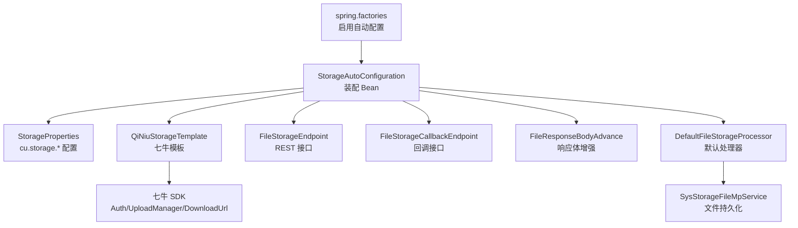
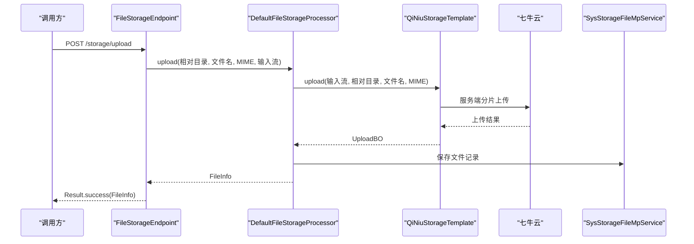
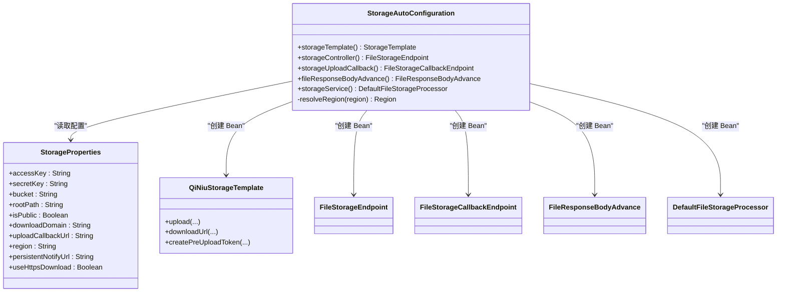
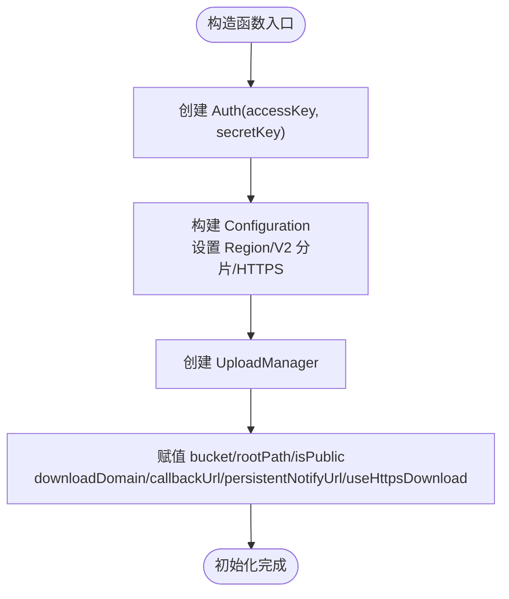
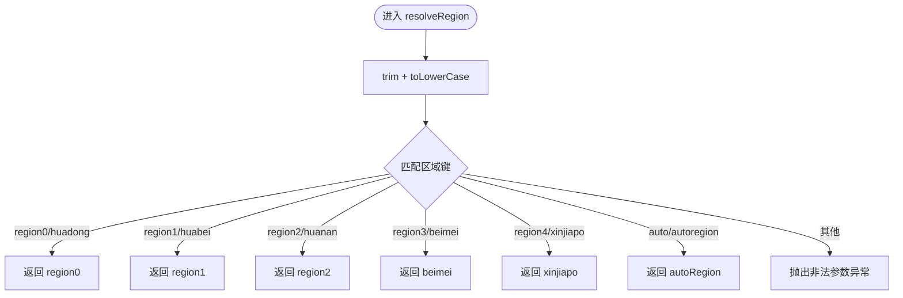
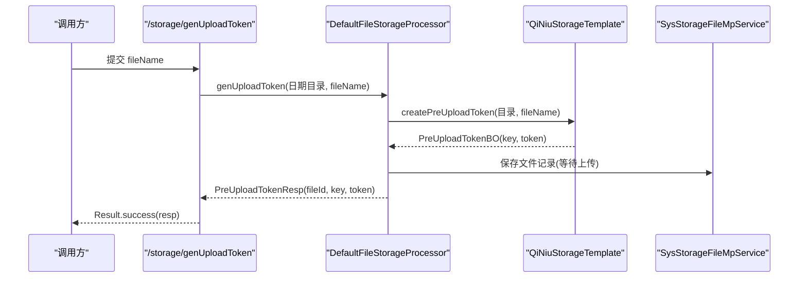
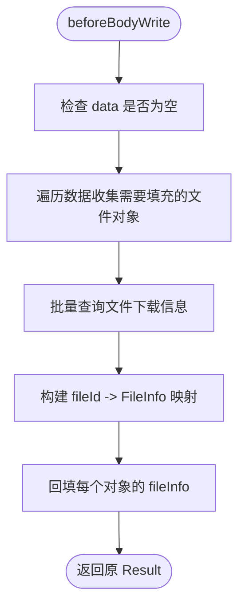
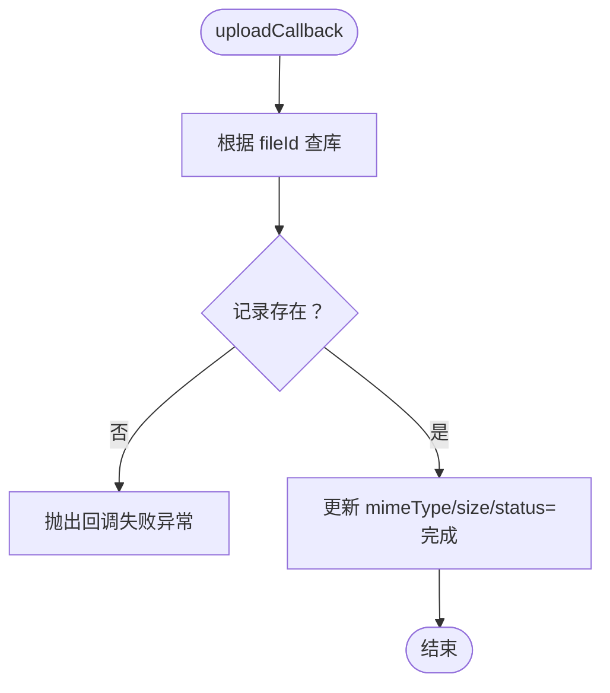
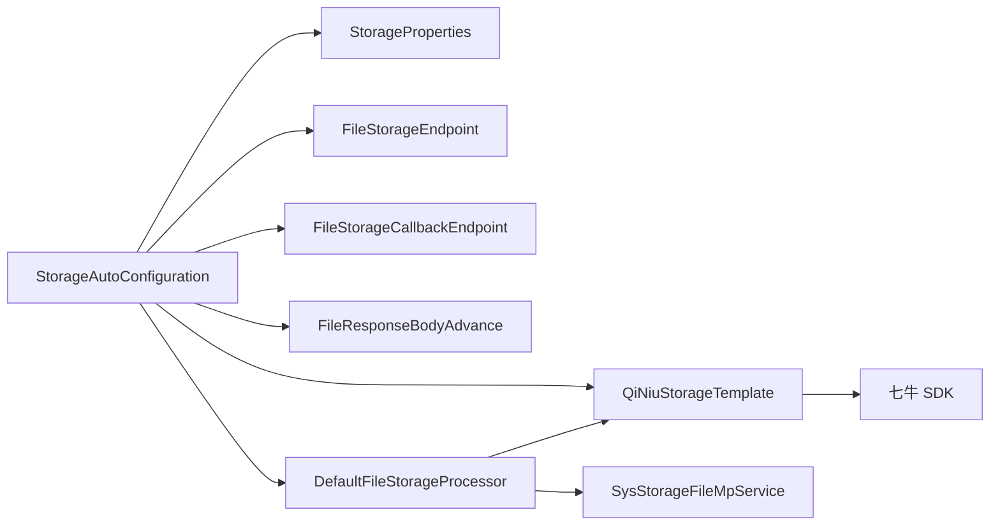

# Storage Starter 文件存储

<cite>
**本文引用的文件**   
- [StorageAutoConfiguration.java](file://boot/storage-spring-boot-starter/src/main/java/com/cu/framework/storage/boot/StorageAutoConfiguration.java)
- [StorageProperties.java](file://boot/storage-spring-boot-starter/src/main/java/com/cu/framework/storage/boot/StorageProperties.java)
- [QiNiuStorageTemplate.java](file://boot/storage-spring-boot-starter/src/main/java/com/cu/framework/storage/core/qiniu/QiNiuStorageTemplate.java)
- [FileStorageEndpoint.java](file://boot/storage-spring-boot-starter/src/main/java/com/cu/framework/storage/web/FileStorageEndpoint.java)
- [FileStorageCallbackEndpoint.java](file://boot/storage-spring-boot-starter/src/main/java/com/cu/framework/storage/web/FileStorageCallbackEndpoint.java)
- [FileResponseBodyAdvance.java](file://boot/storage-spring-boot-starter/src/main/java/com/cu/framework/storage/web/FileResponseBodyAdvance.java)
- [DefaultFileStorageProcessor.java](file://boot/storage-spring-boot-starter/src/main/java/com/cu/framework/storage/web/impl/DefaultFileStorageProcessor.java)
- [spring.factories](file://boot/storage-spring-boot-starter/src/main/resources/META-INF/spring.factories)
</cite>

## 目录
1. [简介](#简介)
2. [项目结构](#项目结构)
3. [核心组件](#核心组件)
4. [架构总览](#架构总览)
5. [详细组件分析](#详细组件分析)
6. [依赖关系分析](#依赖关系分析)
7. [性能与可用性考虑](#性能与可用性考虑)
8. [配置示例](#配置示例)
9. [调用示例](#调用示例)
10. [错误处理与排错](#错误处理与排错)
11. [结论](#结论)

## 简介
本文件围绕 `storage-spring-boot-starter` 模块，系统化说明其基于七牛云的对象存储能力。文档重点覆盖以下方面：
- 自动装配机制与启动器装配入口
- `StorageTemplate` 七牛模板的初始化流程及参数含义
- 区域解析逻辑 `resolveRegion` 的区域标识映射
- RESTful 接口：文件上传、下载、预签名直传凭证与回调
- 响应体增强器对文件信息的自动填充
- 默认文件处理器的工作流程
- 完整的存储配置项说明、HTTPS 下载、回调地址等部署选项
- 典型调用路径与常见错误处理方法

## 项目结构
该 starter 主要包含三层：
- 启动装配层：自动配置类、属性绑定、Spring 工厂注册
- 核心模板层：封装七牛对象存储操作
- Web 层：控制器、回调处理器、响应体增强器与默认业务处理器



**图表来源**
- [spring.factories:1-2](file://boot/storage-spring-boot-starter/src/main/resources/META-INF/spring.factories#L1-L2)
- [StorageAutoConfiguration.java:1-100](file://boot/storage-spring-boot-starter/src/main/java/com/cu/framework/storage/boot/StorageAutoConfiguration.java#L1-L100)
- [StorageProperties.java:1-63](file://boot/storage-spring-boot-starter/src/main/java/com/cu/framework/storage/boot/StorageProperties.java#L1-L63)
- [QiNiuStorageTemplate.java:1-218](file://boot/storage-spring-boot-starter/src/main/java/com/cu/framework/storage/core/qiniu/QiNiuStorageTemplate.java#L1-L218)
- [FileStorageEndpoint.java:1-98](file://boot/storage-spring-boot-starter/src/main/java/com/cu/framework/storage/web/FileStorageEndpoint.java#L1-L98)
- [FileStorageCallbackEndpoint.java:1-70](file://boot/storage-spring-boot-starter/src/main/java/com/cu/framework/storage/web/FileStorageCallbackEndpoint.java#L1-L70)
- [FileResponseBodyAdvance.java:1-182](file://boot/storage-spring-boot-starter/src/main/java/com/cu/framework/storage/web/FileResponseBodyAdvance.java#L1-L182)
- [DefaultFileStorageProcessor.java:1-122](file://boot/storage-spring-boot-starter/src/main/java/com/cu/framework/storage/web/impl/DefaultFileStorageProcessor.java#L1-L122)

**章节来源**
- [spring.factories:1-2](file://boot/storage-spring-boot-starter/src/main/resources/META-INF/spring.factories#L1-L2)
- [StorageAutoConfiguration.java:1-100](file://boot/storage-spring-boot-starter/src/main/java/com/cu/framework/storage/boot/StorageAutoConfiguration.java#L1-L100)

## 核心组件
- `StorageAutoConfiguration`：负责加载 `StorageProperties`，创建并装配 `StorageTemplate`、Web 控制器、响应体增强器和默认文件处理器。
- `StorageProperties`：绑定 `cu.storage.*` 前缀的配置项，包括访问密钥、存储桶、区域、域名、回调地址、HTTPS 开关等。
- `QiNiuStorageTemplate`：基于七牛 SDK 实现对象上传、下载链接生成和客户端直传凭证签发。
- `FileStorageEndpoint`：对外暴露上传、获取下载 URL、批量获取下载 URL 等接口。
- `FileStorageCallbackEndpoint`：接收七牛上传成功回调，更新本地文件记录状态。
- `FileResponseBodyAdvance`：在返回 `Result` 时，自动识别含文件 ID 的对象，并填充下载信息。
- `DefaultFileStorageProcessor`：默认实现，协调模板与持久化服务，完成上传、回调处理与下载信息查询。

**章节来源**
- [StorageAutoConfiguration.java:1-100](file://boot/storage-spring-boot-starter/src/main/java/com/cu/framework/storage/boot/StorageAutoConfiguration.java#L1-L100)
- [StorageProperties.java:1-63](file://boot/storage-spring-boot-starter/src/main/java/com/cu/framework/storage/boot/StorageProperties.java#L1-L63)
- [QiNiuStorageTemplate.java:1-218](file://boot/storage-spring-boot-starter/src/main/java/com/cu/framework/storage/core/qiniu/QiNiuStorageTemplate.java#L1-L218)
- [FileStorageEndpoint.java:1-98](file://boot/storage-spring-boot-starter/src/main/java/com/cu/framework/storage/web/FileStorageEndpoint.java#L1-L98)
- [FileStorageCallbackEndpoint.java:1-70](file://boot/storage-spring-boot-starter/src/main/java/com/cu/framework/storage/web/FileStorageCallbackEndpoint.java#L1-L70)
- [FileResponseBodyAdvance.java:1-182](file://boot/storage-spring-boot-starter/src/main/java/com/cu/framework/storage/web/FileResponseBodyAdvance.java#L1-L182)
- [DefaultFileStorageProcessor.java:1-122](file://boot/storage-spring-boot-starter/src/main/java/com/cu/framework/storage/web/impl/DefaultFileStorageProcessor.java#L1-L122)

## 架构总览
整个模块遵循“自动装配 → 属性绑定 → 模板封装 → Web 接口 → 默认处理器 → 持久化”的分层设计。



**图表来源**
- [FileStorageEndpoint.java:37-74](file://boot/storage-spring-boot-starter/src/main/java/com/cu/framework/storage/web/FileStorageEndpoint.java#L37-L74)
- [DefaultFileStorageProcessor.java:78-101](file://boot/storage-spring-boot-starter/src/main/java/com/cu/framework/storage/web/impl/DefaultFileStorageProcessor.java#L78-L101)
- [QiNiuStorageTemplate.java:87-136](file://boot/storage-spring-boot-starter/src/main/java/com/cu/framework/storage/core/qiniu/QiNiuStorageTemplate.java#L87-L136)

## 详细组件分析

### 自动装配与启动入口
`StorageAutoConfiguration` 通过 `@EnableConfigurationProperties` 加载 `StorageProperties`，并通过多个 `@Bean` 方法注册：
- `StorageTemplate`：使用 `QiNiuStorageTemplate`，传入访问密钥、密钥、区域、存储桶、根路径、公开性、下载域名、回调地址、异步通知地址、是否 HTTPS 下载。
- Web 控制器：`FileStorageEndpoint`、`FileStorageCallbackEndpoint`
- 响应体增强器：`FileResponseBodyAdvance`
- 默认处理器：`DefaultFileStorageProcessor`

此外，该类还扫描 MyBatis Mapper 包，便于后续持久化操作。



**图表来源**
- [StorageAutoConfiguration.java:1-100](file://boot/storage-spring-boot-starter/src/main/java/com/cu/framework/storage/boot/StorageAutoConfiguration.java#L1-L100)
- [StorageProperties.java:1-63](file://boot/storage-spring-boot-starter/src/main/java/com/cu/framework/storage/boot/StorageProperties.java#L1-L63)
- [QiNiuStorageTemplate.java:1-218](file://boot/storage-spring-boot-starter/src/main/java/com/cu/framework/storage/core/qiniu/QiNiuStorageTemplate.java#L1-L218)

**章节来源**
- [StorageAutoConfiguration.java:1-100](file://boot/storage-spring-boot-starter/src/main/java/com/cu/framework/storage/boot/StorageAutoConfiguration.java#L1-L100)
- [spring.factories:1-2](file://boot/storage-spring-boot-starter/src/main/resources/META-INF/spring.factories#L1-L2)

### 七牛模板初始化与参数说明
`QiNiuStorageTemplate` 构造函数接收以下关键参数：
- 访问密钥：`accessKey`
- 访问秘钥：`secretKey`
- 存储区域：`region`（由 `resolveRegion` 解析为七牛 `Region`）
- 存储桶名：`bucket`
- 根路径：`rootPath`，用于生成对象 key 的前缀
- 是否公开空间：`isPublic`，决定下载链接是否带签名
- 下载域名：`downloadDomain`
- 上传成功回调地址：`callbackUrl`
- 数据处理异步通知地址：`persistentNotifyUrl`
- 是否 HTTPS 下载：`useHttpsDownload`

构造过程中会创建鉴权对象 `Auth`，并构建带 V2 分片上传、HTTPS 域名的 `Configuration` 与 `UploadManager`。



**图表来源**
- [QiNiuStorageTemplate.java:52-94](file://boot/storage-spring-boot-starter/src/main/java/com/cu/framework/storage/core/qiniu/QiNiuStorageTemplate.java#L52-L94)

**章节来源**
- [QiNiuStorageTemplate.java:52-94](file://boot/storage-spring-boot-starter/src/main/java/com/cu/framework/storage/core/qiniu/QiNiuStorageTemplate.java#L52-L94)

### 区域解析逻辑 resolveRegion
`resolveRegion` 将配置值映射到七牛 `Region` 实例，支持以下标识：
- `region0` 或 `huadong` → 华东
- `region1` 或 `huabei` → 华北
- `region2` 或 `huanan` → 华南
- `region3` 或 `beimei` → 北美
- `region4` 或 `xinjiapo` → 新加坡
- `auto` 或 `autoregion` → 自动选择区域

当配置值无法识别时抛出非法参数异常，避免静默落入错误机房。



**图表来源**
- [StorageAutoConfiguration.java:44-79](file://boot/storage-spring-boot-starter/src/main/java/com/cu/framework/storage/boot/StorageAutoConfiguration.java#L44-L79)

**章节来源**
- [StorageAutoConfiguration.java:44-79](file://boot/storage-spring-boot-starter/src/main/java/com/cu/framework/storage/boot/StorageAutoConfiguration.java#L44-L79)

### RESTful API 接口
- `/storage/genUploadToken`（POST）：生成客户端直传凭证，返回文件 ID、key 与上传 token。
- `/storage/upload`（POST）：服务端上传，返回文件信息（ID、文件名、下载 URL、大小）。
- `/storage/getDownloadUrl`（GET）：根据文件 ID 获取单个文件下载信息。
- `/storage/listDownloadUrl`（GET）：批量获取文件下载信息。
- `/storage/upload/callback`（POST）：接收七牛上传成功回调，更新文件状态。
- `/storage/getFileById`（GET）：根据 ID 查询文件下载信息。
- `/storage/upload/callbackAsync`（POST）：预留异步回调接口。



**图表来源**
- [FileStorageEndpoint.java:29-35](file://boot/storage-spring-boot-starter/src/main/java/com/cu/framework/storage/web/FileStorageEndpoint.java#L29-L35)
- [DefaultFileStorageProcessor.java:29-57](file://boot/storage-spring-boot-starter/src/main/java/com/cu/framework/storage/web/impl/DefaultFileStorageProcessor.java#L29-L57)
- [QiNiuStorageTemplate.java:166-218](file://boot/storage-spring-boot-starter/src/main/java/com/cu/framework/storage/core/qiniu/QiNiuStorageTemplate.java#L166-L218)

**章节来源**
- [FileStorageEndpoint.java:1-98](file://boot/storage-spring-boot-starter/src/main/java/com/cu/framework/storage/web/FileStorageEndpoint.java#L1-L98)
- [FileStorageCallbackEndpoint.java:1-70](file://boot/storage-spring-boot-starter/src/main/java/com/cu/framework/storage/web/FileStorageCallbackEndpoint.java#L1-L70)

### 响应体增强器 FileResponseBodyAdvance
该增强器拦截返回类型为 `Result` 的控制器方法，在写出响应体前扫描 `data` 字段中的 `FileFillSupport` 或其集合泛型元素，收集其中的文件 ID，统一批量查询下载信息后回填到对应对象中。

关键点：
- 仅作用于 `Result` 类型返回值
- 支持普通对象、集合、分页对象 `PageResult`
- 支持对象内嵌 `FileFillSupport` 字段
- 批量查询下载信息并缓存为 Map，提升性能



**图表来源**
- [FileResponseBodyAdvance.java:60-182](file://boot/storage-spring-boot-starter/src/main/java/com/cu/framework/storage/web/FileResponseBodyAdvance.java#L60-L182)

**章节来源**
- [FileResponseBodyAdvance.java:1-182](file://boot/storage-spring-boot-starter/src/main/java/com/cu/framework/storage/web/FileResponseBodyAdvance.java#L1-L182)

### 默认文件处理器 DefaultFileStorageProcessor
默认处理器协调模板与持久化服务，实现：
- 生成客户端直传凭证并写入数据库记录（等待上传）
- 服务端上传成功后写入文件记录并完成状态更新
- 处理七牛回调，更新 MIME、大小与状态为已完成
- 根据文件 ID 查询并返回下载信息



**图表来源**
- [DefaultFileStorageProcessor.java:59-76](file://boot/storage-spring-boot-starter/src/main/java/com/cu/framework/storage/web/impl/DefaultFileStorageProcessor.java#L59-L76)

**章节来源**
- [DefaultFileStorageProcessor.java:1-122](file://boot/storage-spring-boot-starter/src/main/java/com/cu/framework/storage/web/impl/DefaultFileStorageProcessor.java#L1-L122)

## 依赖关系分析
- `StorageAutoConfiguration` 依赖 `StorageProperties` 提供运行时配置
- `DefaultFileStorageProcessor` 依赖 `StorageTemplate` 与 `SysStorageFileMpService`
- `QiNiuStorageTemplate` 依赖七牛 SDK 的 `Auth`、`UploadManager`、`DownloadUrl`、`Region`
- Web 层通过 Spring MVC 注解暴露 REST 接口，并由 `FileResponseBodyAdvance` 统一增强响应体



**图表来源**
- [StorageAutoConfiguration.java:1-100](file://boot/storage-spring-boot-starter/src/main/java/com/cu/framework/storage/boot/StorageAutoConfiguration.java#L1-L100)
- [DefaultFileStorageProcessor.java:1-122](file://boot/storage-spring-boot-starter/src/main/java/com/cu/framework/storage/web/impl/DefaultFileStorageProcessor.java#L1-L122)
- [QiNiuStorageTemplate.java:1-218](file://boot/storage-spring-boot-starter/src/main/java/com/cu/framework/storage/core/qiniu/QiNiuStorageTemplate.java#L1-L218)

**章节来源**
- [StorageAutoConfiguration.java:1-100](file://boot/storage-spring-boot-starter/src/main/java/com/cu/framework/storage/boot/StorageAutoConfiguration.java#L1-L100)
- [DefaultFileStorageProcessor.java:1-122](file://boot/storage-spring-boot-starter/src/main/java/com/cu/framework/storage/web/impl/DefaultFileStorageProcessor.java#L1-L122)

## 性能与可用性考虑
- 七牛上传采用 V2 分片上传，适合大文件场景，降低网络中断影响。
- 下载链接生成针对公开与私有空间分别处理：公开空间直接拼接 URL；私有空间附加签名有效期，默认一小时。
- 响应体增强器批量查询下载信息，减少多次数据库往返。
- 区域解析提前校验，避免运行期因区域配置错误导致静默故障。
- HTTPS 下载需确保下载域名已配置证书，默认关闭以保持向后兼容。

[本节为通用性能建议，不直接分析具体代码文件]

## 配置示例
以下为 `application.yml` 中 `cu.storage.*` 配置的完整说明与示例：

- `type`：预留字段，当前固定使用七牛
- `accessKey`：七牛访问密钥
- `secretKey`：七牛访问秘钥
- `bucket`：存储桶名称
- `rootPath`：存储根目录，为空则无前缀
- `isPublic`：是否公开空间，默认 `true`；为 `false` 时下载链接带签名
- `downloadDomain`：下载域名，必须与七牛控制台域名一致
- `uploadCallbackUrl`：上传成功回调地址，用于客户端直传后的服务端确认
- `region`：区域标识，默认 `region2`，可选 `region0/huadong`、`region1/huabei`、`region2/huanan`、`region3/beimei`、`region4/xinjiapo`、`auto`
- `persistentNotifyUrl`：数据处理异步通知地址，为空时不写入策略
- `useHttpsDownload`：下载链接是否使用 HTTPS，默认 `false`

示例配置片段：
```yaml
cu:
  storage:
    type: qiniu
    access-key: "你的七牛访问密钥"
    secret-key: "你的七牛访问秘钥"
    bucket: "你的存储桶名"
    root-path: "files/"
    is-public: false
    download-domain: "cdn.example.com"
    upload-callback-url: "https://api.example.com/storage/upload/callback"
    region: region2
    persistent-notify-url: "https://api.example.com/storage/notify"
    use-https-download: true
```

**章节来源**
- [StorageProperties.java:1-63](file://boot/storage-spring-boot-starter/src/main/java/com/cu/framework/storage/boot/StorageProperties.java#L1-L63)

## 调用示例

### 生成客户端直传凭证
- 请求方式：`POST /storage/genUploadToken`
- 请求体：`PreUploadTokenReq`，包含 `fileName`
- 返回体：`Result<PreUploadTokenResp>`，包含 `fileId`、`key`、`uploadToken`

适用场景：前端直传到七牛，后端仅负责签发凭证并登记待上传记录。

**章节来源**
- [FileStorageEndpoint.java:29-35](file://boot/storage-spring-boot-starter/src/main/java/com/cu/framework/storage/web/FileStorageEndpoint.java#L29-L35)
- [DefaultFileStorageProcessor.java:29-57](file://boot/storage-spring-boot-starter/src/main/java/com/cu/framework/storage/web/impl/DefaultFileStorageProcessor.java#L29-L57)

### 服务端上传文件
- 请求方式：`POST /storage/upload`
- 表单字段：`relativeDirectory`、`file`（MultipartFile）
- 返回体：`Result<FileInfo>`，包含文件 ID、文件名、下载 URL、大小

适用场景：后端接收文件后直接上传至七牛，并返回可下载的链接。

**章节来源**
- [FileStorageEndpoint.java:37-74](file://boot/storage-spring-boot-starter/src/main/java/com/cu/framework/storage/web/FileStorageEndpoint.java#L37-L74)
- [DefaultFileStorageProcessor.java:78-101](file://boot/storage-spring-boot-starter/src/main/java/com/cu/framework/storage/web/impl/DefaultFileStorageProcessor.java#L78-L101)

### 获取下载信息
- 单个：`GET /storage/getDownloadUrl?fileId=xxx`
- 批量：`GET /storage/listDownloadUrl?fileIds=1&fileIds=2`

返回体为 `Result<FileInfo>` 或 `Result<List<FileInfo>>`，其中包含最终下载 URL。

**章节来源**
- [FileStorageEndpoint.java:76-97](file://boot/storage-spring-boot-starter/src/main/java/com/cu/framework/storage/web/FileStorageEndpoint.java#L76-L97)
- [DefaultFileStorageProcessor.java:103-122](file://boot/storage-spring-boot-starter/src/main/java/com/cu/framework/storage/web/impl/DefaultFileStorageProcessor.java#L103-L122)

### 七牛上传回调
- 回调地址：`/storage/upload/callback`
- 请求体：`UploadCallbackReq`，包含 `fileId`、`mimeType`、`size` 等
- 返回体：`Result`，回显请求内容

适用场景：前端直传完成后，七牛回调后端更新本地文件状态。

**章节来源**
- [FileStorageCallbackEndpoint.java:24-43](file://boot/storage-spring-boot-starter/src/main/java/com/cu/framework/storage/web/FileStorageCallbackEndpoint.java#L24-L43)
- [DefaultFileStorageProcessor.java:59-76](file://boot/storage-spring-boot-starter/src/main/java/com/cu/framework/storage/web/impl/DefaultFileStorageProcessor.java#L59-L76)

## 错误处理与排错
- 区域配置错误：当 `cu.storage.region` 无法识别时，自动装配阶段抛出非法参数异常，提示合法取值。
- 上传异常：七牛上传失败会包装为运行时异常，调用方应捕获并给出用户友好提示。
- 下载链接异常：签名或域名配置错误可能导致下载链接生成失败，需检查 `downloadDomain`、`isPublic`、`useHttpsDownload`。
- 回调失败：若回调中 `fileId` 不存在，处理器抛出异常，需检查直传凭证是否正确关联文件记录。
- 响应体增强异常：反射扫描或批量查询失败会记录日志，不影响主流程，但可能导致文件信息未填充。

排查建议：
- 核对 `cu.storage.access-key`、`secret-key`、`bucket`、`download-domain` 是否与七牛控制台一致
- 确认 `region` 与目标机房一致，或使用 `auto`
- 若开启 HTTPS 下载，请确保下载域名已正确配置证书
- 回调地址需在公网可达，且路径与控制器一致

**章节来源**
- [StorageAutoConfiguration.java:44-79](file://boot/storage-spring-boot-starter/src/main/java/com/cu/framework/storage/boot/StorageAutoConfiguration.java#L44-L79)
- [QiNiuStorageTemplate.java:138-164](file://boot/storage-spring-boot-starter/src/main/java/com/cu/framework/storage/core/qiniu/QiNiuStorageTemplate.java#L138-L164)
- [DefaultFileStorageProcessor.java:59-76](file://boot/storage-spring-boot-starter/src/main/java/com/cu/framework/storage/web/impl/DefaultFileStorageProcessor.java#L59-L76)
- [FileResponseBodyAdvance.java:150-182](file://boot/storage-spring-boot-starter/src/main/java/com/cu/framework/storage/web/FileResponseBodyAdvance.java#L150-L182)

## 结论
`storage-spring-boot-starter` 以 Spring Boot 自动装配为核心，将七牛对象存储能力封装为统一的 `StorageTemplate`，并通过 RESTful 接口与响应体增强器提供开箱即用的文件存储解决方案。开发者只需配置 `cu.storage.*`，即可快速实现客户端直传、服务端上传、下载链接生成与回调处理。通过区域解析校验、V2 分片上传、批量下载信息查询等机制，系统在易用性与可靠性之间取得平衡。生产环境建议明确配置下载域名、回调地址与 HTTPS 选项，并妥善管理访问密钥与存储桶权限。

[本节为总结性内容，不直接分析具体代码文件]