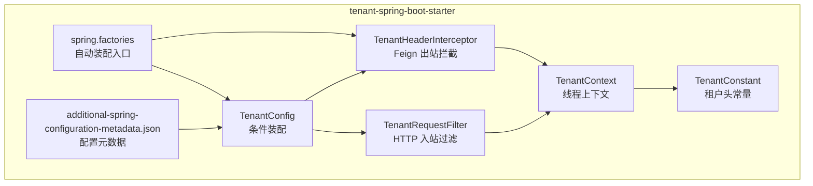
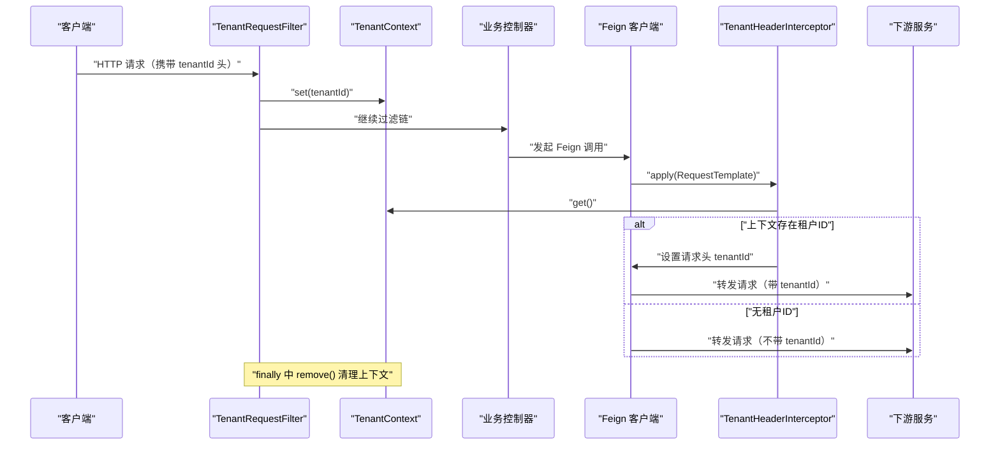
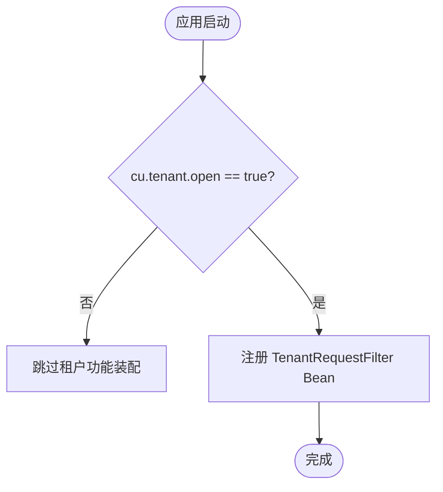
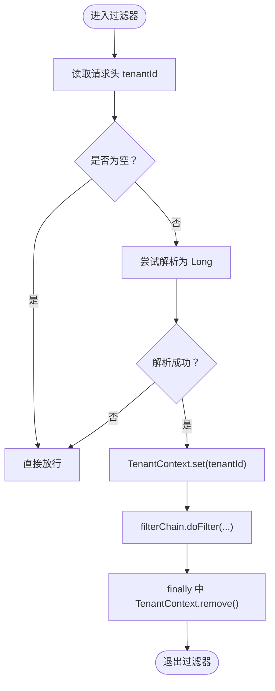
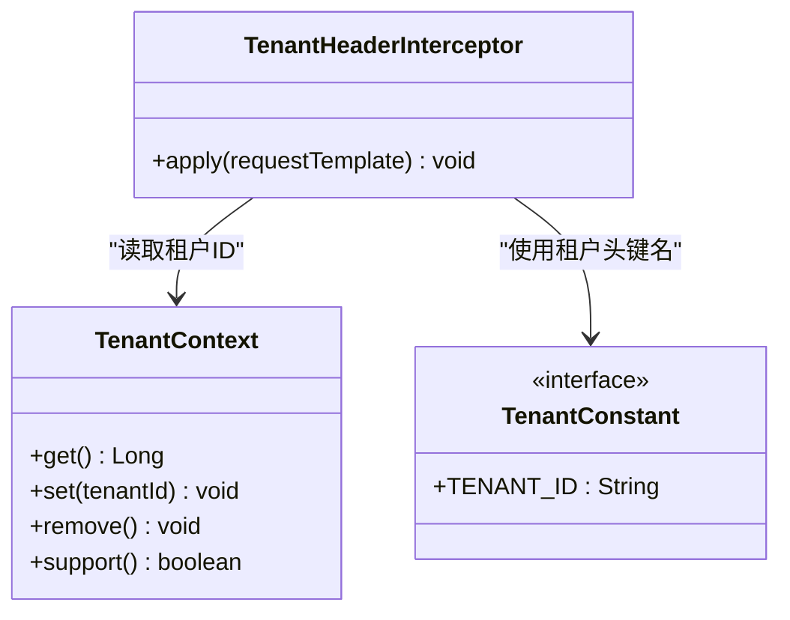
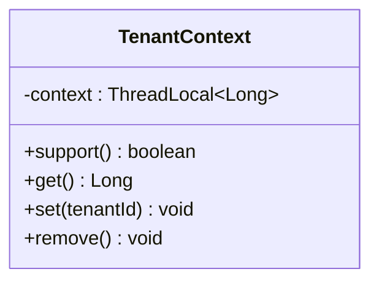
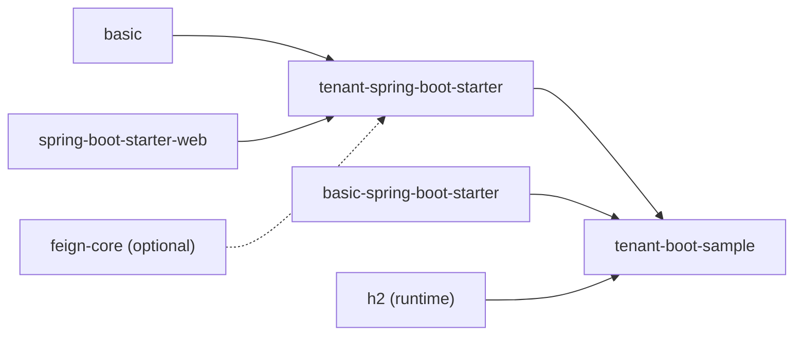
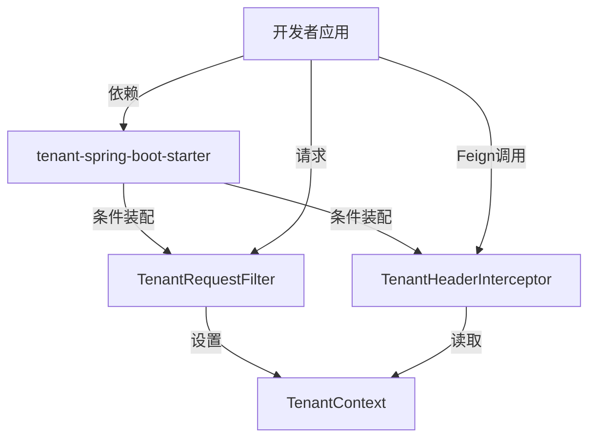

# Tenant Starter 多租户

<cite>
**本文引用的文件**
- [TenantConfig.java](file://boot/tenant-spring-boot-starter/src/main/java/com/cu/framework/tenant/config/TenantConfig.java)
- [TenantRequestFilter.java](file://boot/tenant-spring-boot-starter/src/main/java/com/cu/framework/tenant/TenantRequestFilter.java)
- [TenantHeaderInterceptor.java](file://boot/tenant-spring-boot-starter/src/main/java/com/cu/framework/tenant/feign/TenantHeaderInterceptor.java)
- [TenantContext.java](file://boot/tenant-spring-boot-starter/src/main/java/com/cu/framework/tenant/TenantContext.java)
- [TenantConstant.java](file://boot/tenant-spring-boot-starter/src/main/java/com/cu/framework/tenant/TenantConstant.java)
- [spring.factories](file://boot/tenant-spring-boot-starter/src/main/resources/META-INF/spring.factories)
- [additional-spring-configuration-metadata.json](file://boot/tenant-spring-boot-starter/src/main/resources/META-INF/additional-spring-configuration-metadata.json)
- [pom.xml（tenant-spring-boot-starter）](file://boot/tenant-spring-boot-starter/pom.xml)
- [TenantSampleApp.java](file://sample/tenant-boot-sample/src/main/java/com/cu/framework/sample/tenant/TenantSampleApp.java)
- [TenantController.java](file://sample/tenant-boot-sample/src/main/java/com/cu/framework/sample/tenant/controller/TenantController.java)
- [application.yml（示例应用）](file://sample/tenant-boot-sample/src/main/resources/application.yml)
- [pom.xml（示例应用）](file://sample/tenant-boot-sample/pom.xml)
</cite>

## 目录
1. [简介](#简介)
2. [项目结构](#项目结构)
3. [核心组件](#核心组件)
4. [架构总览](#架构总览)
5. [详细组件分析](#详细组件分析)
6. [依赖关系分析](#依赖关系分析)
7. [性能与线程安全](#性能与线程安全)
8. [配置指南与完整示例](#配置指南与完整示例)
9. [常见问题排查](#常见问题排查)
10. [结论](#结论)

## 简介
本模块 tenant-spring-boot-starter 提供 Spring Boot 应用的多租户基础能力：在 Web 请求中解析租户标识，将其写入线程上下文；在 Feign 客户端调用下游服务时自动透传租户头。租户开关由配置属性 cu.tenant.open 控制，默认关闭，启用后才会装配过滤器和 Feign 拦截器。该实现不直接操作数据库，数据隔离策略由业务层结合 TenantContext 自行决定。

## 项目结构
tenant-spring-boot-starter 是 Maven 子模块，对外暴露以下关键类与资源：
- 配置类 TenantConfig：根据 cu.tenant.open 条件装配过滤器 Bean。
- 过滤器 TenantRequestFilter：从 HTTP 请求头中提取租户 ID 并写入上下文。
- Feign 拦截器 TenantHeaderInterceptor：将上下文中的租户 ID 注入到 Feign 请求头。
- 上下文 TenantContext：基于 InheritableThreadLocal 的线程级租户存储。
- 常量 TenantConstant：定义统一的租户头键名。
- spring.factories：声明自动装配入口。
- additional-spring-configuration-metadata.json：向 IDE 和 Spring Boot 提示 cu.tenant.open 配置项。

图表来源
- [TenantConfig.java:1-22](file://boot/tenant-spring-boot-starter/src/main/java/com/cu/framework/tenant/config/TenantConfig.java#L1-L22)
- [TenantRequestFilter.java:1-46](file://boot/tenant-spring-boot-starter/src/main/java/com/cu/framework/tenant/TenantRequestFilter.java#L1-L46)
- [TenantHeaderInterceptor.java:1-36](file://boot/tenant-spring-boot-starter/src/main/java/com/cu/framework/tenant/feign/TenantHeaderInterceptor.java#L1-L36)
- [TenantContext.java:1-43](file://boot/tenant-spring-boot-starter/src/main/java/com/cu/framework/tenant/TenantContext.java#L1-L43)
- [TenantConstant.java:1-11](file://boot/tenant-spring-boot-starter/src/main/java/com/cu/framework/tenant/TenantConstant.java#L1-L11)
- [spring.factories:1-3](file://boot/tenant-spring-boot-starter/src/main/resources/META-INF/spring.factories#L1-L3)
- [additional-spring-configuration-metadata.json:1-10](file://boot/tenant-spring-boot-starter/src/main/resources/META-INF/additional-spring-configuration-metadata.json#L1-L10)

章节来源
- [pom.xml（tenant-spring-boot-starter）:1-42](file://boot/tenant-spring-boot-starter/pom.xml#L1-L42)

## 核心组件
- TenantConfig：使用 @Configuration 与 @ConditionalOnProperty(name = "cu.tenant.open", havingValue = "true") 控制租户功能是否开启；当开启时注册 TenantRequestFilter Bean。
- TenantRequestFilter：实现 EarlyRequestFilter，@Order(2) 保证较早执行；从请求头 tenantId 解析租户 ID 并设置到 TenantContext，随后放行请求链，并在 finally 中清理上下文。
- TenantHeaderInterceptor：实现 RequestInterceptor，同样受 @ConditionalOnProperty("cu.tenant.open"=true) 与 @ConditionalOnClass(Feign.class) 控制；在 Feign 发起请求前，若上下文存在租户 ID，则把 tenantId 写入请求头。
- TenantContext：封装 ThreadLocal<Long> 的 set/get/remove/support 方法，用于线程内存取租户 ID。
- TenantConstant：统一租户头键名 TENANT_ID = "tenantId"。
- spring.factories：将 TenantConfig 与 TenantHeaderInterceptor 注册为 EnableAutoConfiguration 入口。
- additional-spring-configuration-metadata.json：声明 cu.tenant.open 布尔属性及其默认值 false、描述信息。

章节来源
- [TenantConfig.java:1-22](file://boot/tenant-spring-boot-starter/src/main/java/com/cu/framework/tenant/config/TenantConfig.java#L1-L22)
- [TenantRequestFilter.java:1-46](file://boot/tenant-spring-boot-starter/src/main/java/com/cu/framework/tenant/TenantRequestFilter.java#L1-L46)
- [TenantHeaderInterceptor.java:1-36](file://boot/tenant-spring-boot-starter/src/main/java/com/cu/framework/tenant/feign/TenantHeaderInterceptor.java#L1-L36)
- [TenantContext.java:1-43](file://boot/tenant-spring-boot-starter/src/main/java/com/cu/framework/tenant/TenantContext.java#L1-L43)
- [TenantConstant.java:1-11](file://boot/tenant-spring-boot-starter/src/main/java/com/cu/framework/tenant/TenantConstant.java#L1-L11)
- [spring.factories:1-3](file://boot/tenant-spring-boot-starter/src/main/resources/META-INF/spring.factories#L1-L3)
- [additional-spring-configuration-metadata.json:1-10](file://boot/tenant-spring-boot-starter/src/main/resources/META-INF/additional-spring-configuration-metadata.json#L1-L10)

## 架构总览
下面的时序图展示了典型 Web 请求与 Feign 调用的多租户流转过程：

图表来源
- [TenantRequestFilter.java:1-46](file://boot/tenant-spring-boot-starter/src/main/java/com/cu/framework/tenant/TenantRequestFilter.java#L1-L46)
- [TenantHeaderInterceptor.java:1-36](file://boot/tenant-spring-boot-starter/src/main/java/com/cu/framework/tenant/feign/TenantHeaderInterceptor.java#L1-L36)
- [TenantContext.java:1-43](file://boot/tenant-spring-boot-starter/src/main/java/com/cu/framework/tenant/TenantContext.java#L1-L43)

## 详细组件分析

### 条件装配机制：TenantConfig
- 通过 @Configuration 声明为配置类。
- 使用 @ConditionalOnProperty(name = "cu.tenant.open", havingValue = "true") 控制整体租户功能开关。
- 仅当 cu.tenant.open=true 时，才创建 TenantRequestFilter Bean。
- 注意：当前 TenantConfig 只装配了过滤器；Feign 拦截器由 spring.factories 直接声明为自动装配入口，并通过自身的 @ConditionalOnProperty 与 @ConditionalOnClass 控制生效。

图表来源
- [TenantConfig.java:1-22](file://boot/tenant-spring-boot-starter/src/main/java/com/cu/framework/tenant/config/TenantConfig.java#L1-L22)
- [spring.factories:1-3](file://boot/tenant-spring-boot-starter/src/main/resources/META-INF/spring.factories#L1-L3)
- [additional-spring-configuration-metadata.json:1-10](file://boot/tenant-spring-boot-starter/src/main/resources/META-INF/additional-spring-configuration-metadata.json#L1-L10)

章节来源
- [TenantConfig.java:1-22](file://boot/tenant-spring-boot-starter/src/main/java/com/cu/framework/tenant/config/TenantConfig.java#L1-L22)
- [additional-spring-configuration-metadata.json:1-10](file://boot/tenant-spring-boot-starter/src/main/resources/META-INF/additional-spring-configuration-metadata.json#L1-L10)

### 请求过滤与上下文设置：TenantRequestFilter
- 实现 EarlyRequestFilter，@Order(2) 确保在早期阶段处理。
- 从请求头读取 tenantId，若存在且可解析为 Long，则调用 TenantContext.set 写入上下文。
- 使用 try/finally 包裹 filterChain.doFilter，确保无论业务逻辑是否抛出异常，最终都会调用 TenantContext.remove 清理上下文。
- 若请求头为空或不可解析，则直接放行，不设置上下文。

图表来源
- [TenantRequestFilter.java:1-46](file://boot/tenant-spring-boot-starter/src/main/java/com/cu/framework/tenant/TenantRequestFilter.java#L1-L46)
- [TenantContext.java:1-43](file://boot/tenant-spring-boot-starter/src/main/java/com/cu/framework/tenant/TenantContext.java#L1-L43)

章节来源
- [TenantRequestFilter.java:1-46](file://boot/tenant-spring-boot-starter/src/main/java/com/cu/framework/tenant/TenantRequestFilter.java#L1-L46)

### Feign 客户端租户头透传：TenantHeaderInterceptor
- 实现 RequestInterceptor，被 @Configuration 标记并由 spring.factories 自动装配。
- 同时受两个条件约束：
  - @ConditionalOnProperty(name = "cu.tenant.open", havingValue = "true")：与过滤器保持一致的开关。
  - @ConditionalOnClass(Feign.class)：仅在 classpath 中存在 Feign 时才生效。
- 在 apply 方法中，从 TenantContext.get() 获取租户 ID，若不为空则将 tenantId 写入 RequestTemplate 的请求头。

图表来源
- [TenantHeaderInterceptor.java:1-36](file://boot/tenant-spring-boot-starter/src/main/java/com/cu/framework/tenant/feign/TenantHeaderInterceptor.java#L1-L36)
- [TenantContext.java:1-43](file://boot/tenant-spring-boot-starter/src/main/java/com/cu/framework/tenant/TenantContext.java#L1-L43)
- [TenantConstant.java:1-11](file://boot/tenant-spring-boot-starter/src/main/java/com/cu/framework/tenant/TenantConstant.java#L1-L11)

章节来源
- [TenantHeaderInterceptor.java:1-36](file://boot/tenant-spring-boot-starter/src/main/java/com/cu/framework/tenant/feign/TenantHeaderInterceptor.java#L1-L36)
- [spring.factories:1-3](file://boot/tenant-spring-boot-starter/src/main/resources/META-INF/spring.factories#L1-L3)

### 租户上下文管理：TenantContext
- 内部使用 InheritableThreadLocal<Long> 存储租户 ID，支持父子线程继承。
- support() 判断是否已设置租户 ID。
- get()/set()/remove() 提供标准读写与清理接口。
- 建议始终配合过滤器或拦截器的 finally 块调用 remove()，避免线程池复用导致上下文污染。

图表来源
- [TenantContext.java:1-43](file://boot/tenant-spring-boot-starter/src/main/java/com/cu/framework/tenant/TenantContext.java#L1-L43)

章节来源
- [TenantContext.java:1-43](file://boot/tenant-spring-boot-starter/src/main/java/com/cu/framework/tenant/TenantContext.java#L1-L43)

## 依赖关系分析
- tenant-spring-boot-starter 依赖 basic 与 spring-boot-starter-web。
- Feign 支持依赖 io.github.openfeign:feign-core，声明为 optional，仅在引入 Feign 时生效。
- 示例应用 tenant-boot-sample 依赖 tenant-spring-boot-starter 与 basic-spring-boot-starter，并使用 H2 内存库以满足 MyBatis-Plus 的数据源要求（尽管示例不访问任何表）。

图表来源
- [pom.xml（tenant-spring-boot-starter）:1-42](file://boot/tenant-spring-boot-starter/pom.xml#L1-L42)
- [pom.xml（示例应用）:1-42](file://sample/tenant-boot-sample/pom.xml#L1-L42)

章节来源
- [pom.xml（tenant-spring-boot-starter）:1-42](file://boot/tenant-spring-boot-starter/pom.xml#L1-L42)
- [pom.xml（示例应用）:1-42](file://sample/tenant-boot-sample/pom.xml#L1-L42)

## 性能与线程安全
- 线程安全：TenantContext 使用 InheritableThreadLocal，每个线程独立存储租户 ID，避免并发污染。
- 清理保障：过滤器在 finally 中清理上下文，防止异步任务或线程池复用导致的上下文泄漏。
- 条件装配：未开启 cu.tenant.open 时，不会注册过滤器与拦截器，减少不必要的对象创建。
- Feign 条件：仅当 classpath 存在 Feign 时才加载拦截器，避免无关依赖带来的额外开销。
- 解析成本：过滤器对 tenantId 做字符串非空校验与长整型解析，属于轻量操作；建议在网关或前置层保证 tenantId 格式正确，降低解析失败概率。

[本节为通用指导，不直接分析具体文件]

## 配置指南与完整示例

### 最小化启用步骤
1. 在应用中引入 tenant-spring-boot-starter。
2. 在 application.yml 中设置 cu.tenant.open=true。
3. 在 HTTP 请求头中携带 tenantId，例如：tenantId=123。
4. 在业务代码中通过 TenantContext.get() 获取当前租户 ID。

### 示例应用说明
- 示例启动类：TenantSampleApp。
- 示例控制器：TenantController，/hello 接口返回 hello - <tenantId>，用于验证租户上下文是否正确注入。
- 示例配置：application.yml 中设置 cu.tenant.open=true，并提供 H2 与 MySQL 两种 profile 的数据源配置（示例不建表）。

图表来源
- [TenantSampleApp.java:1-21](file://sample/tenant-boot-sample/src/main/java/com/cu/framework/sample/tenant/TenantSampleApp.java#L1-L21)
- [TenantController.java:1-26](file://sample/tenant-boot-sample/src/main/java/com/cu/framework/sample/tenant/controller/TenantController.java#L1-L26)
- [application.yml（示例应用）:1-37](file://sample/tenant-boot-sample/src/main/resources/application.yml#L1-L37)

章节来源
- [TenantSampleApp.java:1-21](file://sample/tenant-boot-sample/src/main/java/com/cu/framework/sample/tenant/TenantSampleApp.java#L1-L21)
- [TenantController.java:1-26](file://sample/tenant-boot-sample/src/main/java/com/cu/framework/sample/tenant/controller/TenantController.java#L1-L26)
- [application.yml（示例应用）:1-37](file://sample/tenant-boot-sample/src/main/resources/application.yml#L1-L37)

### 租户标识获取策略
- 当前实现从 HTTP 请求头 tenantId 获取租户 ID。
- 可在网关层统一注入 tenantId，或在认证成功后从用户会话/令牌中解析并注入到下游请求头。
- 对于后端定时任务、消息消费者等非 Web 场景，可直接在任务入口处调用 TenantContext.set 设置租户 ID，并在完成后调用 remove 清理。

### 数据隔离方案
- 本模块不直接参与 SQL 改写或数据源路由，数据隔离由业务层结合 TenantContext 实现，常见方式包括：
  - 逻辑隔离：在所有查询中附加 tenant_id 条件。
  - 物理隔离：按租户分库分表，或使用不同 Schema。
  - 中间件增强：结合 MyBatis 拦截器、JPA 审计等机制自动注入租户条件。
- 推荐在 Service 层封装统一的数据访问方法，确保所有写读路径都携带租户标识。

## 常见问题排查

- 问题：未生效或未注册过滤器
  - 检查是否设置了 cu.tenant.open=true。
  - 确认 spring.factories 未被覆盖或删除。
  - 确认 starter 依赖已引入。

- 问题：Feign 调用未透传租户头
  - 检查是否引入了 Feign 依赖。
  - 检查是否启用了 cu.tenant.open=true。
  - 检查上游是否在 TenantContext 中设置了租户 ID。
  - 确认下游服务能接收 tenantId 请求头。

- 问题：线程上下文中租户 ID 异常
  - 检查是否遗漏了 finally 中的 remove 调用。
  - 检查是否存在自定义异步任务或线程池未传递上下文。
  - 若使用 InheritableThreadLocal，需确保子线程正确继承；否则应在子任务中显式 set。

- 问题：tenantId 解析失败
  - 确保请求头 tenantId 为有效数字字符串。
  - 在网关或前置层进行格式校验，避免非法值进入业务层。

章节来源
- [TenantRequestFilter.java:1-46](file://boot/tenant-spring-boot-starter/src/main/java/com/cu/framework/tenant/TenantRequestFilter.java#L1-L46)
- [TenantHeaderInterceptor.java:1-36](file://boot/tenant-spring-boot-starter/src/main/java/com/cu/framework/tenant/feign/TenantHeaderInterceptor.java#L1-L36)
- [TenantContext.java:1-43](file://boot/tenant-spring-boot-starter/src/main/java/com/cu/framework/tenant/TenantContext.java#L1-L43)
- [spring.factories:1-3](file://boot/tenant-spring-boot-starter/src/main/resources/META-INF/spring.factories#L1-L3)

## 结论
tenant-spring-boot-starter 以轻量、可插拔的方式提供多租户上下文管理能力：通过 cu.tenant.open 开关控制功能装配，在 Web 层解析租户头并维护线程上下文，在 Feign 层自动透传租户标识。该实现专注于上下文传递与生命周期管理，数据隔离策略留给业务层灵活实现。建议在生产环境中配合网关统一注入 tenantId，并在所有异步与后台任务中显式管理与清理上下文，以确保多租户行为一致且可靠。