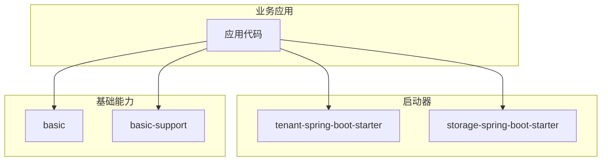
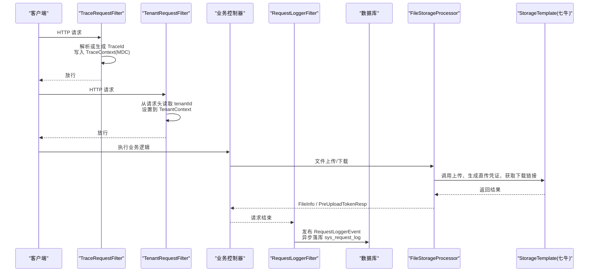
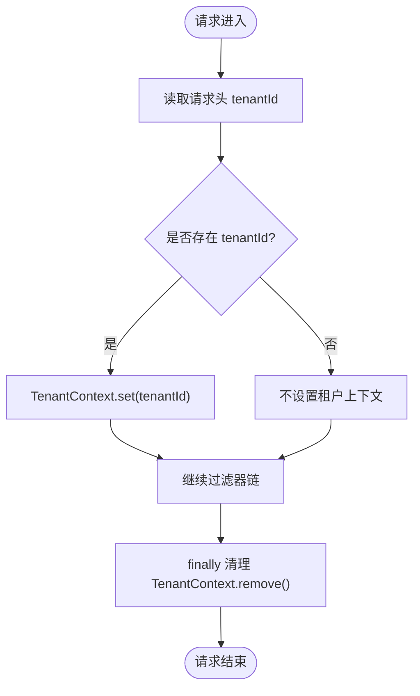
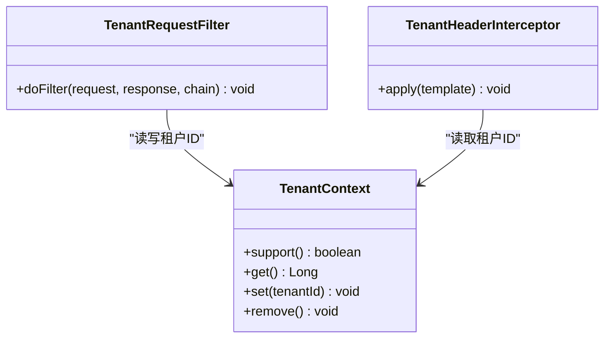
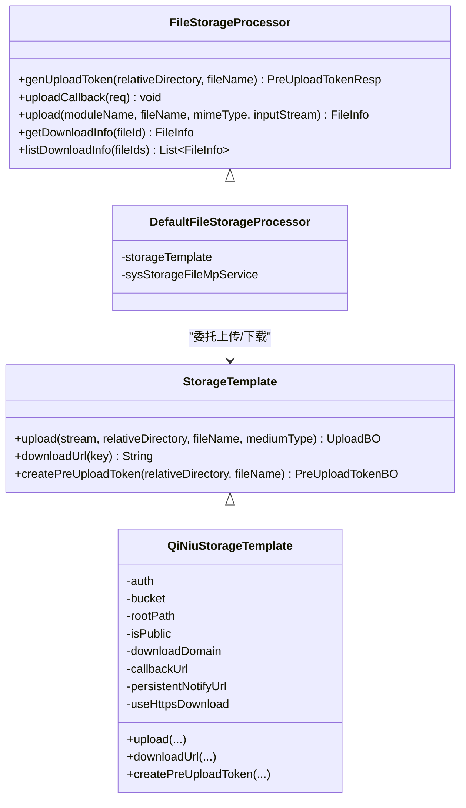
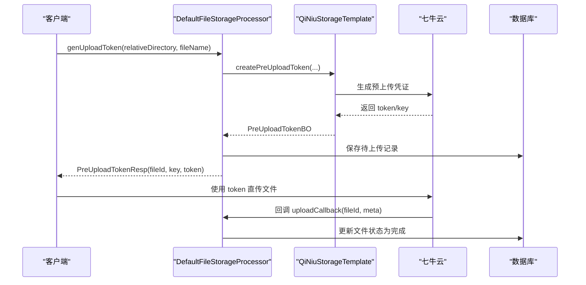
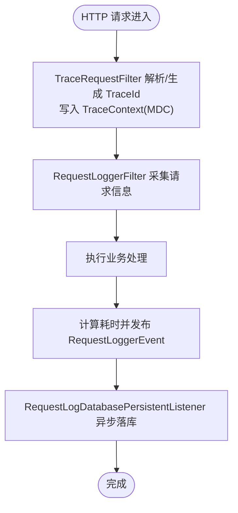
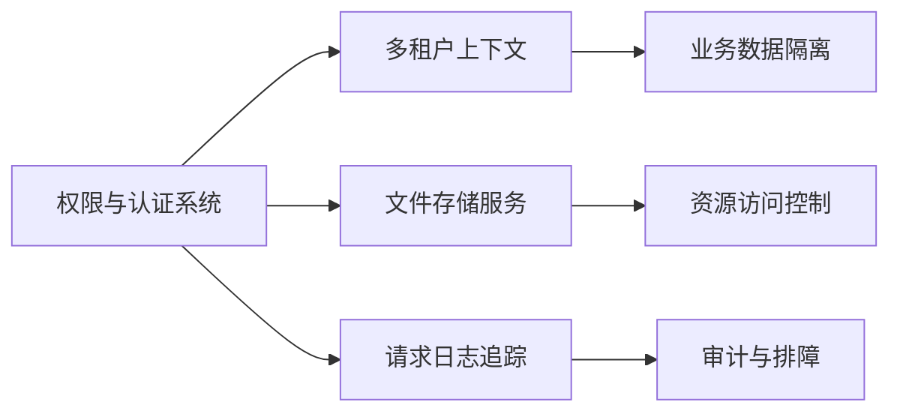
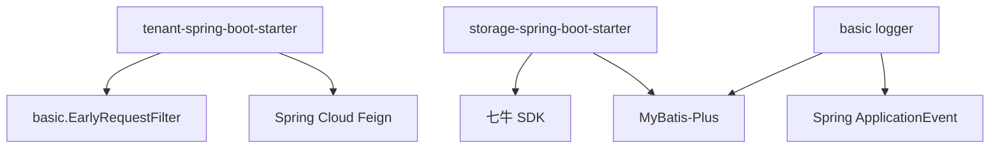

# 企业级功能

<cite>
**本文引用的文件**   
- [README_Auth.md](file://README_Auth.md)
- [pom.xml](file://pom.xml)
- [TenantContext.java](file://boot/tenant-spring-boot-starter/src/main/java/com/cu/framework/tenant/TenantContext.java)
- [TenantRequestFilter.java](file://boot/tenant-spring-boot-starter/src/main/java/com/cu/framework/tenant/TenantRequestFilter.java)
- [TenantConstant.java](file://boot/tenant-spring-boot-starter/src/main/java/com/cu/framework/tenant/TenantConstant.java)
- [TenantConfig.java](file://boot/tenant-spring-boot-starter/src/main/java/com/cu/framework/tenant/config/TenantConfig.java)
- [TenantHeaderInterceptor.java](file://boot/tenant-spring-boot-starter/src/main/java/com/cu/framework/tenant/feign/TenantHeaderInterceptor.java)
- [StorageAutoConfiguration.java](file://boot/storage-spring-boot-starter/src/main/java/com/cu/framework/storage/boot/StorageAutoConfiguration.java)
- [StorageProperties.java](file://boot/storage-spring-boot-starter/src/main/java/com/cu/framework/storage/boot/StorageProperties.java)
- [StorageTemplate.java](file://boot/storage-spring-boot-starter/src/main/java/com/cu/framework/storage/core/StorageTemplate.java)
- [QiNiuStorageTemplate.java](file://boot/storage-spring-boot-starter/src/main/java/com/cu/framework/storage/core/qiniu/QiNiuStorageTemplate.java)
- [FileStorageProcessor.java](file://boot/storage-spring-boot-starter/src/main/java/com/cu/framework/storage/web/FileStorageProcessor.java)
- [DefaultFileStorageProcessor.java](file://boot/storage-spring-boot-starter/src/main/java/com/cu/framework/storage/web/impl/DefaultFileStorageProcessor.java)
- [RequestLoggerFilter.java](file://basic/src/main/java/com/cu/framework/basic/logger/RequestLoggerFilter.java)
- [TraceRequestFilter.java](file://basic/src/main/java/com/cu/framework/basic/logger/TraceRequestFilter.java)
- [TraceContext.java](file://basic/src/main/java/com/cu/framework/basic/logger/trace/TraceContext.java)
- [RequestLoggerEvent.java](file://basic/src/main/java/com/cu/framework/basic/logger/request/RequestLoggerEvent.java)
- [RequestLogDatabasePersistentListener.java](file://basic-support/src/main/java/com/cu/framework/basic/support/log/RequestLogDatabasePersistentListener.java)
</cite>

## 目录
1. [引言](#引言)
2. [项目结构](#项目结构)
3. [核心组件](#核心组件)
4. [架构总览](#架构总览)
5. [详细组件分析](#详细组件分析)
6. [依赖关系分析](#依赖关系分析)
7. [性能与监控](#性能与监控)
8. [配置与使用指南](#配置与使用指南)
9. [故障排查](#故障排查)
10. [结论](#结论)

## 引言
本仓库以多模块 Maven 工程组织，围绕权限认证、基础能力、启动器装配以及示例应用构建企业级后端框架。本次文档聚焦三个企业级能力：
- 多租户支持：通过请求头解析租户标识，并在线程上下文与远程调用中透传，实现跨服务的数据隔离入口。
- 文件存储服务：抽象存储模板与 Web 处理接口，默认集成七牛云对象存储，提供直传凭证、服务端上传、下载链接生成与回调持久化。
- 请求日志追踪：基于过滤器采集请求参数、耗时、IP、TraceId，并通过事件机制异步落库，支撑可观测性。

这些能力与权限认证模块共同构成统一的企业管理能力，既满足单应用内的权限控制，也具备多租户与可观测性的生产就绪特性。

**章节来源**
- [README_Auth.md:1-40](file://README_Auth.md#L1-L40)

## 项目结构
与企业级功能直接相关的模块如下：
- boot/tenant-spring-boot-starter：多租户启动器，负责租户上下文注入、Feign 透传与条件装配。
- boot/storage-spring-boot-starter：文件存储启动器，抽象存储接口并默认装配七牛云实现，暴露统一文件操作端点。
- basic：基础能力，包含请求日志采集、全局流水号（TraceId）管理。
- basic-support：扩展能力，提供请求日志落库监听等可选实现。

[本图为概念结构图，不直接映射具体源码文件]

## 核心组件
- 多租户上下文与过滤器：TenantContext、TenantRequestFilter、TenantConstant、TenantConfig、TenantHeaderInterceptor。
- 文件存储抽象与适配器：StorageTemplate、QiNiuStorageTemplate、FileStorageProcessor、DefaultFileStorageProcessor、StorageAutoConfiguration、StorageProperties。
- 请求日志与追踪：TraceRequestFilter、RequestLoggerFilter、TraceContext、RequestLoggerEvent、RequestLogDatabasePersistentListener。

这些组件分别位于不同模块，通过 Spring Boot 自动装配和注解驱动组合成完整的企业级能力。

**章节来源**
- [TenantContext.java:1-43](file://boot/tenant-spring-boot-starter/src/main/java/com/cu/framework/tenant/TenantContext.java#L1-L43)
- [TenantRequestFilter.java:1-46](file://boot/tenant-spring-boot-starter/src/main/java/com/cu/framework/tenant/TenantRequestFilter.java#L1-L46)
- [TenantConstant.java:1-11](file://boot/tenant-spring-boot-starter/src/main/java/com/cu/framework/tenant/TenantConstant.java#L1-L11)
- [TenantConfig.java:1-22](file://boot/tenant-spring-boot-starter/src/main/java/com/cu/framework/tenant/config/TenantConfig.java#L1-L22)
- [TenantHeaderInterceptor.java:1-36](file://boot/tenant-spring-boot-starter/src/main/java/com/cu/framework/tenant/feign/TenantHeaderInterceptor.java#L1-L36)
- [StorageTemplate.java:1-23](file://boot/storage-spring-boot-starter/src/main/java/com/cu/framework/storage/core/StorageTemplate.java#L1-L23)
- [QiNiuStorageTemplate.java:1-218](file://boot/storage-spring-boot-starter/src/main/java/com/cu/framework/storage/core/qiniu/QiNiuStorageTemplate.java#L1-L218)
- [FileStorageProcessor.java:1-54](file://boot/storage-spring-boot-starter/src/main/java/com/cu/framework/storage/web/FileStorageProcessor.java#L1-L54)
- [DefaultFileStorageProcessor.java:1-122](file://boot/storage-spring-boot-starter/src/main/java/com/cu/framework/storage/web/impl/DefaultFileStorageProcessor.java#L1-L122)
- [StorageAutoConfiguration.java:1-100](file://boot/storage-spring-boot-starter/src/main/java/com/cu/framework/storage/boot/StorageAutoConfiguration.java#L1-L100)
- [StorageProperties.java:1-63](file://boot/storage-spring-boot-starter/src/main/java/com/cu/framework/storage/boot/StorageProperties.java#L1-L63)
- [TraceRequestFilter.java:1-60](file://basic/src/main/java/com/cu/framework/basic/logger/TraceRequestFilter.java#L1-L60)
- [RequestLoggerFilter.java:1-133](file://basic/src/main/java/com/cu/framework/basic/logger/RequestLoggerFilter.java#L1-L133)
- [TraceContext.java:1-22](file://basic/src/main/java/com/cu/framework/basic/logger/trace/TraceContext.java#L1-L22)
- [RequestLoggerEvent.java:1-23](file://basic/src/main/java/com/cu/framework/basic/logger/request/RequestLoggerEvent.java#L1-L23)
- [RequestLogDatabasePersistentListener.java:1-66](file://basic-support/src/main/java/com/cu/framework/basic/support/log/RequestLogDatabasePersistentListener.java#L1-L66)

## 架构总览
下图展示企业级功能的端到端流程：请求进入后先建立 TraceId 与租户上下文，再经业务处理后由日志过滤器收集指标并发布事件；文件上传则通过统一处理器协调存储模板与回调持久化。

**图表来源**
- [TraceRequestFilter.java:1-60](file://basic/src/main/java/com/cu/framework/basic/logger/TraceRequestFilter.java#L1-L60)
- [TenantRequestFilter.java:1-46](file://boot/tenant-spring-boot-starter/src/main/java/com/cu/framework/tenant/TenantRequestFilter.java#L1-L46)
- [RequestLoggerFilter.java:1-133](file://basic/src/main/java/com/cu/framework/basic/logger/RequestLoggerFilter.java#L1-L133)
- [StorageAutoConfiguration.java:1-100](file://boot/storage-spring-boot-starter/src/main/java/com/cu/framework/storage/boot/StorageAutoConfiguration.java#L1-L100)
- [DefaultFileStorageProcessor.java:1-122](file://boot/storage-spring-boot-starter/src/main/java/com/cu/framework/storage/web/impl/DefaultFileStorageProcessor.java#L1-L122)
- [QiNiuStorageTemplate.java:1-218](file://boot/storage-spring-boot-starter/src/main/java/com/cu/framework/storage/core/qiniu/QiNiuStorageTemplate.java#L1-L218)

## 详细组件分析

### 多租户支持机制
多租户能力的核心在于“请求头解析 + 线程上下文 + 远程调用透传”。

- 租户常量：TENANT_ID 固定为 tenantId。
- 租户上下文：使用 InheritableThreadLocal 保存 Long 类型 tenantId，并提供 support/get/set/remove 方法。
- 请求过滤：TenantRequestFilter 在早期过滤器链中读取请求头 tenantId，若存在则设置到 TenantContext，并在 finally 中清理。
- Feign 透传：TenantHeaderInterceptor 在 Feign 发起请求前将当前 TenantContext 中的 tenantId 写入下游请求头。
- 条件装配：TenantConfig 仅在 cu.tenant.open=true 时启用过滤器与拦截器。

**图表来源**
- [TenantRequestFilter.java:1-46](file://boot/tenant-spring-boot-starter/src/main/java/com/cu/framework/tenant/TenantRequestFilter.java#L1-L46)
- [TenantContext.java:1-43](file://boot/tenant-spring-boot-starter/src/main/java/com/cu/framework/tenant/TenantContext.java#L1-L43)

**图表来源**
- [TenantContext.java:1-43](file://boot/tenant-spring-boot-starter/src/main/java/com/cu/framework/tenant/TenantContext.java#L1-L43)
- [TenantRequestFilter.java:1-46](file://boot/tenant-spring-boot-starter/src/main/java/com/cu/framework/tenant/TenantRequestFilter.java#L1-L46)
- [TenantHeaderInterceptor.java:1-36](file://boot/tenant-spring-boot-starter/src/main/java/com/cu/framework/tenant/feign/TenantHeaderInterceptor.java#L1-L36)

数据隔离策略说明：
- 当前实现提供租户上下文与透传机制，但未在 SQL 层自动追加 tenant_id 条件。实际数据隔离需结合 MyBatis Plus 的租户插件或业务查询中根据 TenantContext.get() 追加过滤条件。
- 该设计符合“上下文透传 + 业务侧隔离”的模式，避免侵入式修改所有查询语句。

**章节来源**
- [TenantConstant.java:1-11](file://boot/tenant-spring-boot-starter/src/main/java/com/cu/framework/tenant/TenantConstant.java#L1-L11)
- [TenantContext.java:1-43](file://boot/tenant-spring-boot-starter/src/main/java/com/cu/framework/tenant/TenantContext.java#L1-L43)
- [TenantRequestFilter.java:1-46](file://boot/tenant-spring-boot-starter/src/main/java/com/cu/framework/tenant/TenantRequestFilter.java#L1-L46)
- [TenantHeaderInterceptor.java:1-36](file://boot/tenant-spring-boot-starter/src/main/java/com/cu/framework/tenant/feign/TenantHeaderInterceptor.java#L1-L36)
- [TenantConfig.java:1-22](file://boot/tenant-spring-boot-starter/src/main/java/com/cu/framework/tenant/config/TenantConfig.java#L1-L22)

### 文件存储服务的抽象设计与适配器模式
文件存储采用三层抽象：
- 传输接口：StorageTemplate，定义 upload、downloadUrl、createPreUploadToken。
- 适配器实现：QiNiuStorageTemplate，封装七牛 SDK 的鉴权、分片上传、签名下载、直传凭证。
- Web 处理层：FileStorageProcessor 与 DefaultFileStorageProcessor，协调存储模板与数据库记录，提供统一 API。

**图表来源**
- [StorageTemplate.java:1-23](file://boot/storage-spring-boot-starter/src/main/java/com/cu/framework/storage/core/StorageTemplate.java#L1-L23)
- [QiNiuStorageTemplate.java:1-218](file://boot/storage-spring-boot-starter/src/main/java/com/cu/framework/storage/core/qiniu/QiNiuStorageTemplate.java#L1-L218)
- [FileStorageProcessor.java:1-54](file://boot/storage-spring-boot-starter/src/main/java/com/cu/framework/storage/web/FileStorageProcessor.java#L1-L54)
- [DefaultFileStorageProcessor.java:1-122](file://boot/storage-spring-boot-starter/src/main/java/com/cu/framework/storage/web/impl/DefaultFileStorageProcessor.java#L1-L122)

关键流程说明：
- 客户端直传：DefaultFileStorageProcessor.genUploadToken 调用 StorageTemplate.createPreUploadToken，先在本地记录待上传元数据，返回 token 与 key；七牛回调后更新状态。
- 服务端上传：DefaultFileStorageProcessor.upload 调用 StorageTemplate.upload，成功后记录文件信息并返回下载链接。
- 下载链接：QiNiuStorageTemplate.downloadUrl 根据 isPublic 决定直接拼接域名或使用签名 URL，并支持 https。

**图表来源**
- [DefaultFileStorageProcessor.java:1-122](file://boot/storage-spring-boot-starter/src/main/java/com/cu/framework/storage/web/impl/DefaultFileStorageProcessor.java#L1-L122)
- [QiNiuStorageTemplate.java:1-218](file://boot/storage-spring-boot-starter/src/main/java/com/cu/framework/storage/core/qiniu/QiNiuStorageTemplate.java#L1-L218)

**章节来源**
- [StorageAutoConfiguration.java:1-100](file://boot/storage-spring-boot-starter/src/main/java/com/cu/framework/storage/boot/StorageAutoConfiguration.java#L1-L100)
- [StorageProperties.java:1-63](file://boot/storage-spring-boot-starter/src/main/java/com/cu/framework/storage/boot/StorageProperties.java#L1-L63)
- [StorageTemplate.java:1-23](file://boot/storage-spring-boot-starter/src/main/java/com/cu/framework/storage/core/StorageTemplate.java#L1-L23)
- [QiNiuStorageTemplate.java:1-218](file://boot/storage-spring-boot-starter/src/main/java/com/cu/framework/storage/core/qiniu/QiNiuStorageTemplate.java#L1-L218)
- [FileStorageProcessor.java:1-54](file://boot/storage-spring-boot-starter/src/main/java/com/cu/framework/storage/web/FileStorageProcessor.java#L1-L54)
- [DefaultFileStorageProcessor.java:1-122](file://boot/storage-spring-boot-starter/src/main/java/com/cu/framework/storage/web/impl/DefaultFileStorageProcessor.java#L1-L122)

### 请求日志追踪与性能监控
请求链路中包含两个重要过滤器：
- TraceRequestFilter：优先使用容器中的 TraceIdProcessor，未注册则回退 HeaderTraceIdProcessor，将 traceId 写入 MDC（TraceContext）。
- RequestLoggerFilter：采集请求头、参数、Body、IP、URL、方法、执行耗时，并发布 RequestLoggerEvent；监听器 RequestLogDatabasePersistentListener 异步落库。

**图表来源**
- [TraceRequestFilter.java:1-60](file://basic/src/main/java/com/cu/framework/basic/logger/TraceRequestFilter.java#L1-L60)
- [TraceContext.java:1-22](file://basic/src/main/java/com/cu/framework/basic/logger/trace/TraceContext.java#L1-L22)
- [RequestLoggerFilter.java:1-133](file://basic/src/main/java/com/cu/framework/basic/logger/RequestLoggerFilter.java#L1-L133)
- [RequestLoggerEvent.java:1-23](file://basic/src/main/java/com/cu/framework/basic/logger/request/RequestLoggerEvent.java#L1-L23)
- [RequestLogDatabasePersistentListener.java:1-66](file://basic-support/src/main/java/com/cu/framework/basic/support/log/RequestLogDatabasePersistentListener.java#L1-L66)

性能与可观测性要点：
- TraceId 通过 MDC 贯穿日志，便于聚合分析。
- 日志采集在过滤器中完成，避免侵入业务代码。
- 落库监听使用 @Async 异步处理，降低对请求主链路的影响。
- RequestLoggerFilter 包装 BodyHttpServletRequest 以支持重复读取请求体。

**章节来源**
- [TraceRequestFilter.java:1-60](file://basic/src/main/java/com/cu/framework/basic/logger/TraceRequestFilter.java#L1-L60)
- [RequestLoggerFilter.java:1-133](file://basic/src/main/java/com/cu/framework/basic/logger/RequestLoggerFilter.java#L1-L133)
- [TraceContext.java:1-22](file://basic/src/main/java/com/cu/framework/basic/logger/trace/TraceContext.java#L1-L22)
- [RequestLoggerEvent.java:1-23](file://basic/src/main/java/com/cu/framework/basic/logger/request/RequestLoggerEvent.java#L1-L23)
- [RequestLogDatabasePersistentListener.java:1-66](file://basic-support/src/main/java/com/cu/framework/basic/support/log/RequestLogDatabasePersistentListener.java#L1-L66)

### 与权限管理和认证系统的集成
权限认证模块提供 RBAC 用户-角色-部门模型、菜单与数据权限注解、SpringSecurity 整合与登录态管理。多租户与文件存储、请求日志作为横切能力，与权限系统共同构成企业管理平台的基础设施：
- 权限系统在认证通过后确定用户身份与权限范围。
- 多租户在认证后按租户隔离业务数据。
- 文件存储用于资源上传与访问，配合权限控制访问范围。
- 请求日志记录鉴权相关接口的调用轨迹，便于审计与排障。

[本图为概念集成图，不直接映射具体源码文件]

**章节来源**
- [README_Auth.md:1-40](file://README_Auth.md#L1-L40)

## 依赖关系分析
企业级功能的关键依赖如下：
- 多租户启动器依赖 basic 的 EarlyRequestFilter 接口，并与 Spring Cloud Feign 集成。
- 文件存储启动器依赖七牛 SDK，装配 StorageTemplate 与 Web 处理器。
- 请求日志依赖 Spring ApplicationEvent 与 MyBatis-Plus 服务进行异步持久化。

**图表来源**
- [TenantRequestFilter.java:1-46](file://boot/tenant-spring-boot-starter/src/main/java/com/cu/framework/tenant/TenantRequestFilter.java#L1-L46)
- [TenantHeaderInterceptor.java:1-36](file://boot/tenant-spring-boot-starter/src/main/java/com/cu/framework/tenant/feign/TenantHeaderInterceptor.java#L1-L36)
- [StorageAutoConfiguration.java:1-100](file://boot/storage-spring-boot-starter/src/main/java/com/cu/framework/storage/boot/StorageAutoConfiguration.java#L1-L100)
- [RequestLoggerFilter.java:1-133](file://basic/src/main/java/com/cu/framework/basic/logger/RequestLoggerFilter.java#L1-L133)

**章节来源**
- [pom.xml:1-120](file://pom.xml#L1-L120)

## 性能与监控
- 多租户：过滤器开销极低，仅一次请求头解析与 ThreadLocal 读写；注意避免在业务中频繁创建复杂对象。
- 文件存储：七牛直传减少服务器带宽压力；服务端上传建议使用流式接口避免大文件内存峰值。
- 请求日志：建议开启异步落库并合理调整日志级别，避免高并发场景下磁盘 I/O 成为瓶颈。
- TraceId：确保日志输出包含 MDC，便于集中日志平台聚合。

[本节为通用性能建议，不直接分析具体源码文件]

## 配置与使用指南

### 多租户配置
- 启用开关：cu.tenant.open=true
- 请求头：在 HTTP 请求头中携带 tenantId（Long），例如：tenantId=123
- Feign 透传：当目标服务同样启用多租户时，TenantHeaderInterceptor 会自动将 tenantId 注入下游请求头。

**章节来源**
- [TenantConfig.java:1-22](file://boot/tenant-spring-boot-starter/src/main/java/com/cu/framework/tenant/config/TenantConfig.java#L1-L22)
- [TenantConstant.java:1-11](file://boot/tenant-spring-boot-starter/src/main/java/com/cu/framework/tenant/TenantConstant.java#L1-L11)
- [TenantRequestFilter.java:1-46](file://boot/tenant-spring-boot-starter/src/main/java/com/cu/framework/tenant/TenantRequestFilter.java#L1-L46)
- [TenantHeaderInterceptor.java:1-36](file://boot/tenant-spring-boot-starter/src/main/java/com/cu/framework/tenant/feign/TenantHeaderInterceptor.java#L1-L36)

### 文件存储配置
- 配置前缀：cu.storage
- 主要属性：
  - accessKey、secretKey：七牛账号凭据
  - bucket：存储空间名
  - rootPath：根目录前缀
  - isPublic：是否公开空间（影响下载链接是否签名）
  - downloadDomain：下载域名
  - region：区域标识，支持 region0/huadong、region1/huabei、region2/huanan、region3/beimei、region4/xinjiapo、auto
  - persistentNotifyUrl：数据处理异步通知地址
  - useHttpsDownload：是否使用 HTTPS 下载链接
  - type：预留字段，当前实现固定使用七牛

- 常用接口：
  - 客户端直传：FileStorageProcessor.genUploadToken
  - 服务端上传：FileStorageProcessor.upload
  - 获取下载信息：FileStorageProcessor.getDownloadInfo / listDownloadInfo

**章节来源**
- [StorageProperties.java:1-63](file://boot/storage-spring-boot-starter/src/main/java/com/cu/framework/storage/boot/StorageProperties.java#L1-L63)
- [StorageAutoConfiguration.java:1-100](file://boot/storage-spring-boot-starter/src/main/java/com/cu/framework/storage/boot/StorageAutoConfiguration.java#L1-L100)
- [FileStorageProcessor.java:1-54](file://boot/storage-spring-boot-starter/src/main/java/com/cu/framework/storage/web/FileStorageProcessor.java#L1-L54)
- [DefaultFileStorageProcessor.java:1-122](file://boot/storage-spring-boot-starter/src/main/java/com/cu/framework/storage/web/impl/DefaultFileStorageProcessor.java#L1-L122)

### 请求日志与追踪配置
- TraceId：由 TraceRequestFilter 自动注入，可通过 TraceContext 获取；建议在日志框架中输出 MDC 字段。
- 请求日志：RequestLoggerFilter 自动采集请求头、参数、Body、IP、URL、方法与耗时，并发布事件；监听器 RequestLogDatabasePersistentListener 异步落库到 sys_request_log。
- 扩展：可自定义 TraceId 生成策略（实现 TraceIdProcessor）或替换日志监听器。

**章节来源**
- [TraceRequestFilter.java:1-60](file://basic/src/main/java/com/cu/framework/basic/logger/TraceRequestFilter.java#L1-L60)
- [TraceContext.java:1-22](file://basic/src/main/java/com/cu/framework/basic/logger/trace/TraceContext.java#L1-L22)
- [RequestLoggerFilter.java:1-133](file://basic/src/main/java/com/cu/framework/basic/logger/RequestLoggerFilter.java#L1-L133)
- [RequestLogDatabasePersistentListener.java:1-66](file://basic-support/src/main/java/com/cu/framework/basic/support/log/RequestLogDatabasePersistentListener.java#L1-L66)

## 故障排查
- 多租户问题：
  - 未生效：检查是否设置 cu.tenant.open=true，且请求头包含 tenantId。
  - 下游服务无租户：确认 Feign 已启用并正确注入 TenantHeaderInterceptor。
  - 数据未隔离：在业务查询中根据 TenantContext.get() 追加 tenant_id 过滤条件。

- 文件存储问题：
  - 直传失败：检查七牛 accessKey/secretKey、bucket 与 region 配置是否正确。
  - 回调未触发：核对 uploadCallbackUrl 与 persistentNotifyUrl 配置，并确保回调可达。
  - 下载链接无效：检查 downloadDomain 与 isPublic/useHttpsDownload 配置。

- 日志与追踪问题：
  - TraceId 缺失：检查 TraceRequestFilter 是否被加载，MDC 是否正确输出。
  - 日志未落库：确认 RequestLogDatabasePersistentListener 已装配，并开启异步执行。
  - 性能下降：评估日志级别与异步队列容量，避免磁盘 I/O 阻塞。

**章节来源**
- [TenantConfig.java:1-22](file://boot/tenant-spring-boot-starter/src/main/java/com/cu/framework/tenant/config/TenantConfig.java#L1-L22)
- [TenantHeaderInterceptor.java:1-36](file://boot/tenant-spring-boot-starter/src/main/java/com/cu/framework/tenant/feign/TenantHeaderInterceptor.java#L1-L36)
- [StorageAutoConfiguration.java:1-100](file://boot/storage-spring-boot-starter/src/main/java/com/cu/framework/storage/boot/StorageAutoConfiguration.java#L1-L100)
- [StorageProperties.java:1-63](file://boot/storage-spring-boot-starter/src/main/java/com/cu/framework/storage/boot/StorageProperties.java#L1-L63)
- [RequestLoggerFilter.java:1-133](file://basic/src/main/java/com/cu/framework/basic/logger/RequestLoggerFilter.java#L1-L133)
- [RequestLogDatabasePersistentListener.java:1-66](file://basic-support/src/main/java/com/cu/framework/basic/support/log/RequestLogDatabasePersistentListener.java#L1-L66)

## 结论
Kewen Framework 在企业级能力方面提供了多租户上下文透传、文件存储抽象与七牛集成、以及完整的请求日志追踪方案。这些能力与权限认证模块协同工作，形成统一的企业管理平台基础。实际落地时，应关注：
- 多租户的数据隔离需在业务查询中显式应用租户过滤。
- 文件存储应根据公开/私有空间选择签名下载策略，并完善回调与通知机制。
- 请求日志与 TraceId 应在日志平台中聚合分析，形成闭环的可观测性体系。