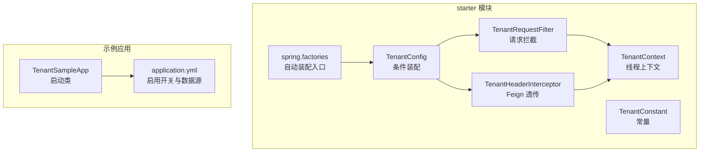
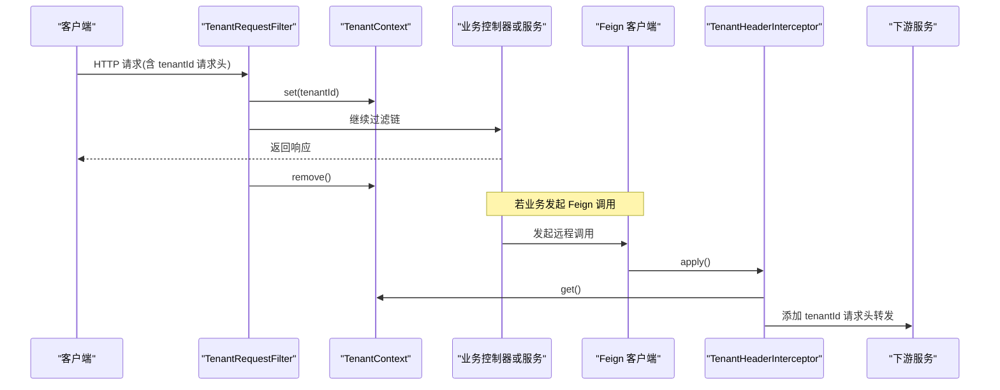
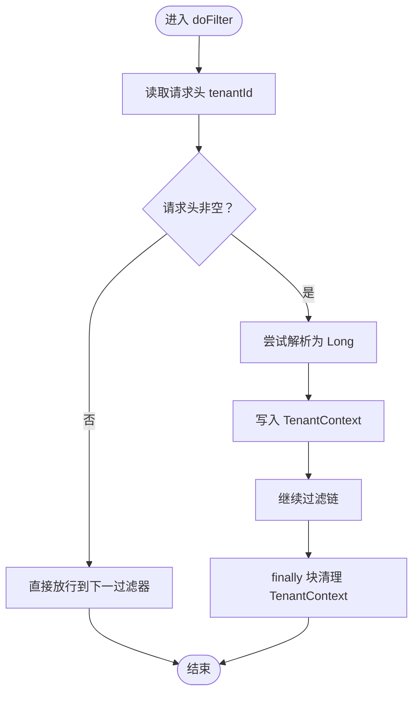
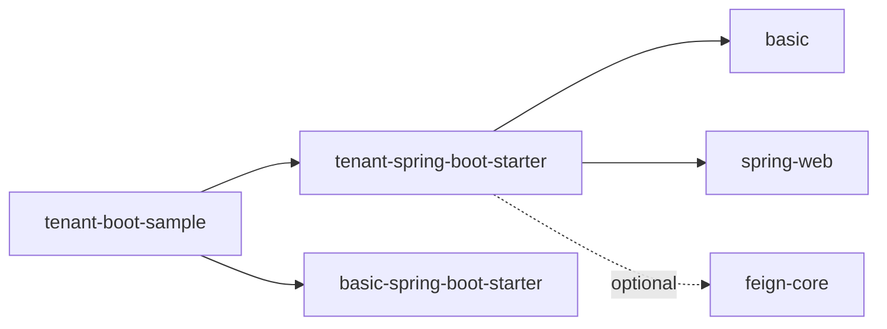

# 多租户支持

<cite>
**本文引用的文件**   
- [TenantContext.java](file://boot/tenant-spring-boot-starter/src/main/java/com/cu/framework/tenant/TenantContext.java)
- [TenantRequestFilter.java](file://boot/tenant-spring-boot-starter/src/main/java/com/cu/framework/tenant/TenantRequestFilter.java)
- [TenantConfig.java](file://boot/tenant-spring-boot-starter/src/main/java/com/cu/framework/tenant/config/TenantConfig.java)
- [TenantConstant.java](file://boot/tenant-spring-boot-starter/src/main/java/com/cu/framework/tenant/TenantConstant.java)
- [TenantHeaderInterceptor.java](file://boot/tenant-spring-boot-starter/src/main/java/com/cu/framework/tenant/feign/TenantHeaderInterceptor.java)
- [spring.factories](file://boot/tenant-spring-boot-starter/src/main/resources/META-INF/spring.factories)
- [pom.xml（tenant-spring-boot-starter）](file://boot/tenant-spring-boot-starter/pom.xml)
- [TenantSampleApp.java](file://sample/tenant-boot-sample/src/main/java/com/cu/framework/sample/tenant/TenantSampleApp.java)
- [application.yml（tenant-boot-sample）](file://sample/tenant-boot-sample/src/main/resources/application.yml)
- [pom.xml（tenant-boot-sample）](file://sample/tenant-boot-sample/pom.xml)
</cite>

## 目录
1. [引言](#引言)
2. [项目结构](#项目结构)
3. [核心组件](#核心组件)
4. [架构总览](#架构总览)
5. [详细组件分析](#详细组件分析)
6. [依赖关系分析](#依赖关系分析)
7. [性能与隔离策略说明](#性能与隔离策略说明)
8. [故障排查指南](#故障排查指南)
9. [结论](#结论)
10. [附录：配置与使用示例](#附录配置与使用示例)

## 引言
本仓库的“多租户支持”以 Spring Boot Starter 的形式提供，核心目标是：在 Web 请求进入业务逻辑之前，自动解析并注入租户标识；在 Feign 调用下游服务时，自动透传租户标识。它通过线程上下文保存租户信息，由过滤器拦截请求、由 Feign 拦截器透传租户头，并通过条件装配控制开关。该实现聚焦于“请求级租户传递”，不直接承担数据库路由、SQL 改写或数据权限注入等 MyBatis-Plus 集成能力；这些扩展点可在应用层基于 TenantContext 自行扩展。

## 项目结构
多租户功能主要位于 `boot/tenant-spring-boot-starter` 模块中，示例应用位于 `sample/tenant-boot-sample`。

图表来源
- [TenantConfig.java:1-22](file://boot/tenant-spring-boot-starter/src/main/java/com/cu/framework/tenant/config/TenantConfig.java#L1-L22)
- [TenantRequestFilter.java:1-46](file://boot/tenant-spring-boot-starter/src/main/java/com/cu/framework/tenant/TenantRequestFilter.java#L1-L46)
- [TenantContext.java:1-43](file://boot/tenant-spring-boot-starter/src/main/java/com/cu/framework/tenant/TenantContext.java#L1-L43)
- [TenantConstant.java:1-11](file://boot/tenant-spring-boot-starter/src/main/java/com/cu/framework/tenant/TenantConstant.java#L1-L11)
- [TenantHeaderInterceptor.java:1-36](file://boot/tenant-spring-boot-starter/src/main/java/com/cu/framework/tenant/feign/TenantHeaderInterceptor.java#L1-L36)
- [spring.factories:1-3](file://boot/tenant-spring-boot-starter/src/main/resources/META-INF/spring.factories#L1-L3)
- [TenantSampleApp.java:1-21](file://sample/tenant-boot-sample/src/main/java/com/cu/framework/sample/tenant/TenantSampleApp.java#L1-L21)
- [application.yml:1-37](file://sample/tenant-boot-sample/src/main/resources/application.yml#L1-L37)

章节来源
- [TenantConfig.java:1-22](file://boot/tenant-spring-boot-starter/src/main/java/com/cu/framework/tenant/config/TenantConfig.java#L1-L22)
- [TenantRequestFilter.java:1-46](file://boot/tenant-spring-boot-starter/src/main/java/com/cu/framework/tenant/TenantRequestFilter.java#L1-L46)
- [TenantContext.java:1-43](file://boot/tenant-spring-boot-starter/src/main/java/com/cu/framework/tenant/TenantContext.java#L1-L43)
- [TenantConstant.java:1-11](file://boot/tenant-spring-boot-starter/src/main/java/com/cu/framework/tenant/TenantConstant.java#L1-L11)
- [TenantHeaderInterceptor.java:1-36](file://boot/tenant-spring-boot-starter/src/main/java/com/cu/framework/tenant/feign/TenantHeaderInterceptor.java#L1-L36)
- [spring.factories:1-3](file://boot/tenant-spring-boot-starter/src/main/resources/META-INF/spring.factories#L1-L3)
- [TenantSampleApp.java:1-21](file://sample/tenant-boot-sample/src/main/java/com/cu/framework/sample/tenant/TenantSampleApp.java#L1-L21)
- [application.yml:1-37](file://sample/tenant-boot-sample/src/main/resources/application.yml#L1-L37)

## 核心组件
- TenantContext：基于可继承线程本地变量保存当前线程的租户 ID，提供设置、获取、判断与清理操作。
- TenantRequestFilter：实现 EarlyRequestFilter，按 Order=2 优先执行，从请求头 tenantId 解析租户 ID 并写入 TenantContext，处理完成后清理。
- TenantConfig：在 cu.tenant.open=true 时才注册过滤器和 Feign 拦截器。
- TenantConstant：定义租户头键 tenantId。
- TenantHeaderInterceptor：当存在 TenantContext 租户 ID 时，将 tenantId 添加到 Feign 请求头，传递给下游服务。
- spring.factories：声明 EnableAutoConfiguration，自动加载 TenantConfig 与 TenantHeaderInterceptor。

章节来源
- [TenantContext.java:1-43](file://boot/tenant-spring-boot-starter/src/main/java/com/cu/framework/tenant/TenantContext.java#L1-L43)
- [TenantRequestFilter.java:1-46](file://boot/tenant-spring-boot-starter/src/main/java/com/cu/framework/tenant/TenantRequestFilter.java#L1-L46)
- [TenantConfig.java:1-22](file://boot/tenant-spring-boot-starter/src/main/java/com/cu/framework/tenant/config/TenantConfig.java#L1-L22)
- [TenantConstant.java:1-11](file://boot/tenant-spring-boot-starter/src/main/java/com/cu/framework/tenant/TenantConstant.java#L1-L11)
- [TenantHeaderInterceptor.java:1-36](file://boot/tenant-spring-boot-starter/src/main/java/com/cu/framework/tenant/feign/TenantHeaderInterceptor.java#L1-L36)
- [spring.factories:1-3](file://boot/tenant-spring-boot-starter/src/main/resources/META-INF/spring.factories#L1-L3)

## 架构总览
多租户支持在 Web 层与远程调用层分别进行租户标识的处理：

图表来源
- [TenantRequestFilter.java:1-46](file://boot/tenant-spring-boot-starter/src/main/java/com/cu/framework/tenant/TenantRequestFilter.java#L1-L46)
- [TenantContext.java:1-43](file://boot/tenant-spring-boot-starter/src/main/java/com/cu/framework/tenant/TenantContext.java#L1-L43)
- [TenantHeaderInterceptor.java:1-36](file://boot/tenant-spring-boot-starter/src/main/java/com/cu/framework/tenant/feign/TenantHeaderInterceptor.java#L1-L36)

## 详细组件分析

### 租户上下文 TenantContext
TenantContext 使用 InheritableThreadLocal 维护线程级别的租户 ID，提供如下能力：
- support()：判断当前线程是否已设置租户 ID。
- get()/set()/remove()：获取、设置、清除租户 ID。
- 设计要点：
  - 使用 InheritableThreadLocal 便于子线程继承父线程的租户上下文。
  - 需要在请求结束后清理，避免线程复用导致的数据串扰。

复杂度与内存影响：
- 每个线程一个 Long 引用，空间开销极低。
- 关键风险在于忘记 remove 会导致线程池场景下租户污染。

章节来源
- [TenantContext.java:1-43](file://boot/tenant-spring-boot-starter/src/main/java/com/cu/framework/tenant/TenantContext.java#L1-L43)

### 请求过滤器 TenantRequestFilter
TenantRequestFilter 实现 EarlyRequestFilter，Order=2，确保尽可能早地解析租户 ID。其工作流如下：

行为约定：
- 未携带 tenantId 的请求不会设置租户上下文，仍正常放行。
- 成功设置后，在 finally 中清理，保证线程安全。

章节来源
- [TenantRequestFilter.java:1-46](file://boot/tenant-spring-boot-starter/src/main/java/com/cu/framework/tenant/TenantRequestFilter.java#L1-L46)

### Feign 透传拦截器 TenantHeaderInterceptor
当应用使用 Feign 调用下游服务时，TenantHeaderInterceptor 会在请求发出前检查当前 TenantContext 是否存在租户 ID，若存在则将其写入请求头 tenantId，从而实现跨服务透传。

关键约束：
- 需要同时满足 cu.tenant.open=true 且 classpath 中存在 Feign 类才会生效。
- 该类必须为 @Configuration，否则无法作为 RequestInterceptor 生效。

章节来源
- [TenantHeaderInterceptor.java:1-36](file://boot/tenant-spring-boot-starter/src/main/java/com/cu/framework/tenant/feign/TenantHeaderInterceptor.java#L1-L36)

### 自动装配与开关 TenantConfig 与 spring.factories
- TenantConfig 通过 @ConditionalOnProperty("cu.tenant.open"="true") 控制是否注册过滤器与 Feign 拦截器。
- spring.factories 声明两个自动装配类：TenantConfig 与 TenantHeaderInterceptor，使 starter 具备开箱即用的装配能力。
- 注意：虽然 TenantHeaderInterceptor 自身也有条件注解，但 spring.factories 仍会尝试加载；若 Feign 不存在，条件判断会阻止其装配。

章节来源
- [TenantConfig.java:1-22](file://boot/tenant-spring-boot-starter/src/main/java/com/cu/framework/tenant/config/TenantConfig.java#L1-L22)
- [spring.factories:1-3](file://boot/tenant-spring-boot-starter/src/main/resources/META-INF/spring.factories#L1-L3)
- [TenantHeaderInterceptor.java:1-36](file://boot/tenant-spring-boot-starter/src/main/java/com/cu/framework/tenant/feign/TenantHeaderInterceptor.java#L1-L36)

### 常量 TenantConstant
TenantConstant 仅暴露租户头名称常量 tenantId，避免硬编码字符串散落在代码各处。

章节来源
- [TenantConstant.java:1-11](file://boot/tenant-spring-boot-starter/src/main/java/com/cu/framework/tenant/TenantConstant.java#L1-L11)

## 依赖关系分析
starter 模块对外暴露的依赖包括 basic 与 spring-web，并在可选条件下引入 feign-core。示例工程依赖 tenant-spring-boot-starter 与 basic-spring-boot-starter，并通过 application.yml 开启多租户开关。

图表来源
- [pom.xml（tenant-spring-boot-starter）:1-42](file://boot/tenant-spring-boot-starter/pom.xml#L1-L42)
- [pom.xml（tenant-boot-sample）:1-42](file://sample/tenant-boot-sample/pom.xml#L1-L42)

章节来源
- [pom.xml（tenant-spring-boot-starter）:1-42](file://boot/tenant-spring-boot-starter/pom.xml#L1-L42)
- [pom.xml（tenant-boot-sample）:1-42](file://sample/tenant-boot-sample/pom.xml#L1-L42)

## 性能与隔离策略说明

### 请求级租户传递的性能特征
- 过滤器仅在请求头非空时执行 Long 解析与 ThreadLocal 写入/清理，额外开销极小。
- TenantContext 使用 InheritableThreadLocal，线程内访问为 O(1)。
- Feign 拦截器仅在存在租户上下文时追加请求头，无租户上下文时不产生额外负载。

### 租户隔离策略说明
当前 starter 提供的能力是“租户上下文传递”，并未直接实现以下三种隔离的具体策略：
- 数据库级隔离：未根据租户切换数据源或数据库连接。
- Schema 级隔离：未根据租户切换 schema 或命名空间。
- 字段级隔离：未自动为 SQL 追加 tenant_id 等条件。

若需实现上述隔离，建议在应用层基于 TenantContext.get() 自行扩展：
- 数据源路由：结合动态数据源方案，根据租户选择数据源。
- Schema 路由：在连接或会话级别设置 schema。
- 数据权限：自定义 MyBatis 拦截器或 MyBatis-Plus 拦截器，依据 TenantContext 自动拼接数据权限条件。

注意：仓库中未发现现成的 MyBatis-Plus 数据权限拦截器或 SQL 改写逻辑与 tenant-spring-boot-starter 绑定。因此，文档中关于“MyBatis-Plus 自动注入数据权限”的部分属于扩展建议，而非现有实现。

[本节为通用设计与实践建议，不直接分析具体源码文件]

## 故障排查指南
- 未生效：确认 cu.tenant.open=true 已配置；检查 starter 是否被引入；确认请求确实包含 tenantId 请求头。
- 线程上下文泄漏：确认过滤器或业务代码在 finally 中清理了 TenantContext；避免在线程池中长时间持有上下文。
- Feign 透传失败：确认下游服务能接收 tenantId 请求头；确认当前线程存在 TenantContext；确认 Feign 可用且条件装配生效。
- 启动异常：如果 classpath 缺少 Feign，TenantHeaderInterceptor 会通过条件注解跳过装配；如出现其他装配错误，请检查自动装配顺序与依赖版本。

章节来源
- [TenantRequestFilter.java:1-46](file://boot/tenant-spring-boot-starter/src/main/java/com/cu/framework/tenant/TenantRequestFilter.java#L1-L46)
- [TenantHeaderInterceptor.java:1-36](file://boot/tenant-spring-boot-starter/src/main/java/com/cu/framework/tenant/feign/TenantHeaderInterceptor.java#L1-L36)
- [TenantConfig.java:1-22](file://boot/tenant-spring-boot-starter/src/main/java/com/cu/framework/tenant/config/TenantConfig.java#L1-L22)

## 结论
本项目的多租户支持以最小侵入的方式实现了“Web 请求解析租户 + Feign 透传租户”的核心链路，并通过条件装配提供开关能力。对于数据库级、Schema 级或字段级的数据隔离，需要在应用层基于 TenantContext 自行扩展。starter 的设计保持低耦合与高内聚，便于在不同业务场景中按需组合。

[本节为总结性内容，不直接分析具体源码文件]

## 附录：配置与使用示例

### 启用多租户
在示例工程中，通过 application.yml 启用多租户：

- 开关配置：cu.tenant.open=true
- 数据源配置：示例提供 H2 与 MySQL profile，用于满足 basic-spring-boot-starter 对 DataSource 的依赖；示例业务不访问任何表，因此无需建表脚本。

章节来源
- [application.yml:1-37](file://sample/tenant-boot-sample/src/main/resources/application.yml#L1-L37)

### 启动类
示例启动类演示如何引入 tenant-spring-boot-starter 并通过 cu.tenant.open 开启多租户支持。

章节来源
- [TenantSampleApp.java:1-21](file://sample/tenant-boot-sample/src/main/java/com/cu/framework/sample/tenant/TenantSampleApp.java#L1-L21)

### 依赖引入
示例工程通过 Maven 引入 tenant-spring-boot-starter 与 basic-spring-boot-starter，并使用 H2 作为运行时依赖以满足数据源要求。

章节来源
- [pom.xml（tenant-boot-sample）:1-42](file://sample/tenant-boot-sample/pom.xml#L1-L42)

### 最佳实践与建议
- 租户标识来源：建议统一从网关或认证服务注入 tenantId 请求头，确保所有入口一致。
- 线程安全：严禁在异步任务中直接共享 TenantContext；如需跨线程传递，应在任务创建时显式捕获并传递。
- 数据隔离扩展：
  - 数据库级：基于租户 ID 动态选择数据源。
  - Schema 级：根据租户切换 schema。
  - 字段级：自定义拦截器自动附加数据权限条件。
- 性能优化：
  - 避免在高频路径中重复解析租户头；尽量在过滤器阶段完成解析。
  - 减少不必要的 TenantContext 读写；仅在必要范围设置与清理。
- 常见问题：
  - 租户头缺失：上游未透传或网关未注入。
  - 租户类型错误：tenantId 无法解析为 Long。
  - 下游未识别租户：下游服务未处理 tenantId 请求头。

[本节为通用实践建议，不直接分析具体源码文件]