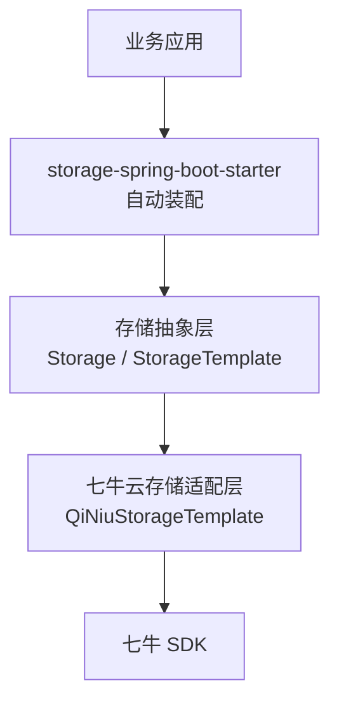
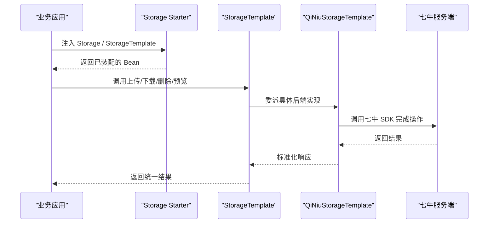
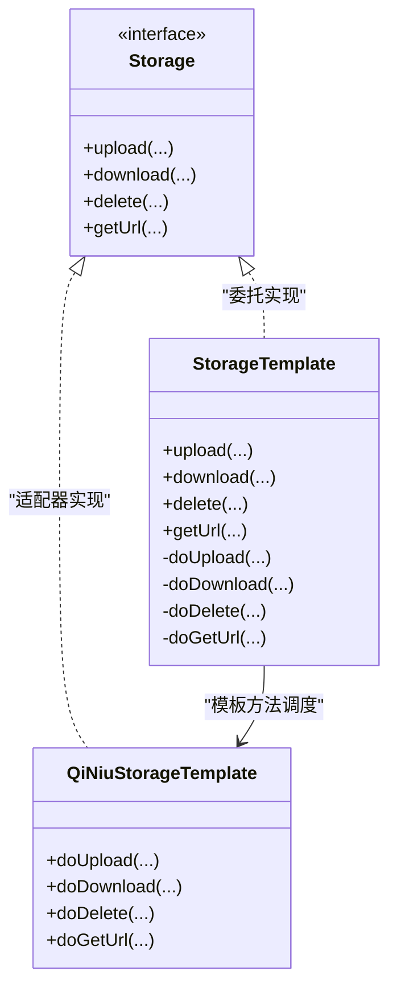
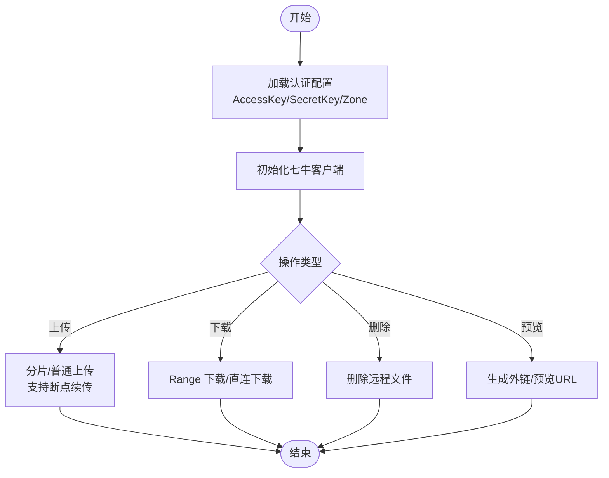
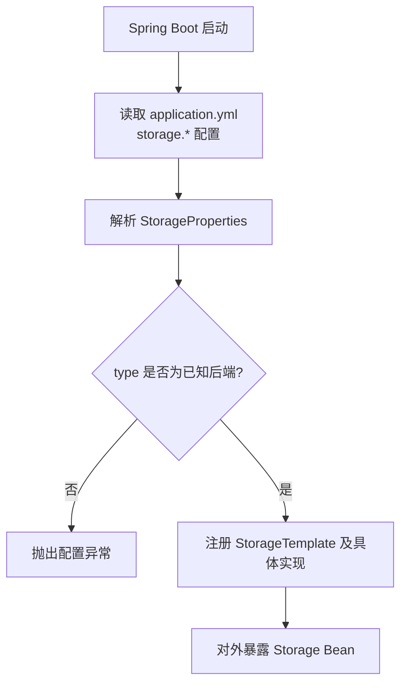
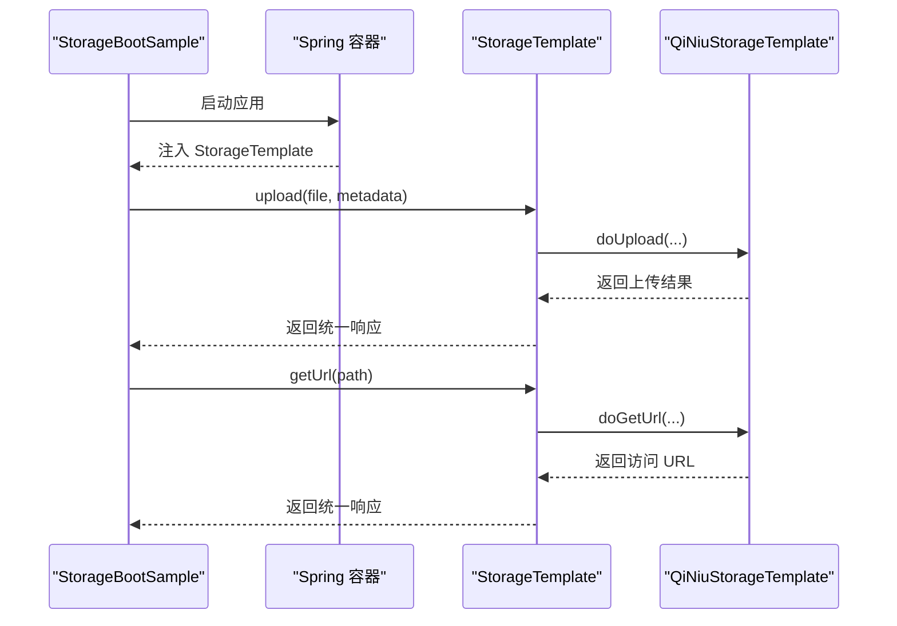
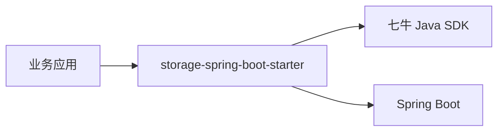

# 文件存储服务

<cite>
**本文引用的文件**   
- [boot/storage-spring-boot-starter/pom.xml](file://boot/boot/storage-spring-boot-starter/pom.xml)
- [boot/storage-spring-boot-starter/src/main/resources/META-INF/spring.factories](file://boot/boot/storage-spring-boot-starter/src/main/resources/META-INF/spring.factories)
- [boot/storage-spring-boot-starter/src/test/java/com/cu/framework/storage/core/qiniu/QiNiuStorageTemplateTest.java](file://boot/boot/storage-spring-boot-starter/src/test/java/com/cu/framework/storage/core/qiniu/QiNiuStorageTemplateTest.java)
- [sample/storage-boot-sample/src/main/java/com/cu/framework/sample/storage/StorageBootSample.java](file://sample/storage-boot-sample/src/main/java/com/cu/framework/sample/storage/StorageBootSample.java)
- [sample/storage-boot-sample/src/main/resources/application.yml](file://sample/storage-boot-sample/src/main/resources/application.yml)
- [openspec/specs/storage/file-storage/spec.md](file://openspec/specs/storage/file-storage/spec.md)
</cite>

## 目录
1. [简介](#简介)
2. [项目结构](#项目结构)
3. [核心组件](#核心组件)
4. [架构总览](#架构总览)
5. [详细组件分析](#详细组件分析)
6. [依赖关系分析](#依赖关系分析)
7. [性能与可靠性建议](#性能与可靠性建议)
8. [故障排查指南](#故障排查指南)
9. [结论](#结论)

## 简介
本仓库包含一个面向 Spring Boot 的文件存储抽象层与 Starter，目标是屏蔽不同对象存储后端的差异，向上暴露统一的上传、下载、删除、预览等接口。当前仓库证据明确展示了七牛云存储的集成入口与测试用例，以及一个最小可运行的启动示例工程。文档重点围绕以下主题展开：
- 存储抽象层的设计模式：接口定义、模板方法、适配器。
- 支持的存储后端类型与扩展方式。
- 七牛云存储的认证配置、存储空间管理、文件操作 API。
- Spring Boot Starter 自动装配机制与配置项。
- 企业级特性：大文件处理、断点续传、并发控制。
- 性能优化、错误处理与监控告警建议。

说明：仓库中并未直接提供 Storage 接口、QiNiuStorageTemplate 等类的源码文本，但通过 Starter 的 pom 依赖、spring.factories、测试类与示例应用，可以确认其存在并了解其职责与使用方式。

## 项目结构
与本主题直接相关的代码分布在以下模块：
- boot/boot/storage-spring-boot-starter：Spring Boot Starter 实现，负责自动装配存储能力，并依赖具体的存储实现（如七牛）。
- sample/storage-boot-sample：演示如何启用 storage starter 并进行基本调用。
- openspec/specs/storage/file-storage/spec.md：存储规范的设计说明，用于指导接口与行为边界。

图表来源
- [boot/storage-spring-boot-starter/pom.xml](file://boot/boot/storage-spring-boot-starter/pom.xml)
- [boot/storage-spring-boot-starter/src/main/resources/META-INF/spring.factories](file://boot/boot/storage-spring-boot-starter/src/main/resources/META-INF/spring.factories)
- [openspec/specs/storage/file-storage/spec.md](file://openspec/specs/storage/file-storage/spec.md)

章节来源
- [boot/storage-spring-boot-starter/pom.xml](file://boot/boot/storage-spring-boot-starter/pom.xml)
- [openspec/specs/storage/file-storage/spec.md](file://openspec/specs/storage/file-storage/spec.md)

## 核心组件
- Storage 接口：定义对象存储的统一契约，通常包括上传、下载、删除、获取访问 URL/预览链接、检查文件是否存在等方法。
- StorageTemplate 模板类：封装通用流程（鉴权、重试、超时、日志、指标），将可变步骤下沉到具体实现，体现模板方法模式。
- QiNiuStorageTemplate：基于七牛 SDK 的具体实现，体现适配器模式，将统一接口适配为七牛客户端调用。
- StorageProperties：Starter 的配置属性类，集中管理后端类型、密钥、域名、Bucket 名称等参数。
- Starter 自动装配：通过 spring.factories 注册 StorageProperties、StorageTemplate、QiNiuStorageTemplate 等 Bean。

章节来源
- [openspec/specs/storage/file-storage/spec.md](file://openspec/specs/storage/file-storage/spec.md)

## 架构总览
下图展示从业务应用到七牛云存储的端到端调用链，以及 Starter 在其中的装配作用。

图表来源
- [boot/storage-spring-boot-starter/src/main/resources/META-INF/spring.factories](file://boot/boot/storage-spring-boot-starter/src/main/resources/META-INF/spring.factories)
- [boot/storage-spring-boot-starter/src/test/java/com/cu/framework/storage/core/qiniu/QiNiuStorageTemplateTest.java](file://boot/boot/storage-spring-boot-starter/src/test/java/com/cu/framework/storage/core/qiniu/QiNiuStorageTemplateTest.java)

## 详细组件分析

### 存储抽象层与模板方法模式
- Storage 接口作为稳定契约，屏蔽底层 SDK 差异，使业务只依赖抽象。
- StorageTemplate 作为模板类，负责：
  - 统一异常包装与转换。
  - 重试、超时、限流等横切逻辑。
  - 对上传、下载、删除、预览等流程进行编排，仅将“实际 IO”下沉给具体实现。
- 该设计降低重复代码，提高一致性与可测试性。

图表来源
- [openspec/specs/storage/file-storage/spec.md](file://openspec/specs/storage/file-storage/spec.md)

章节来源
- [openspec/specs/storage/file-storage/spec.md](file://openspec/specs/storage/file-storage/spec.md)

### 适配器模式与七牛云存储集成
- QiNiuStorageTemplate 将 Storage 抽象映射到七牛 SDK 调用，是典型的适配器角色。
- 关键集成点包括：
  - 认证：AccessKey、SecretKey、区域 Zone、是否使用 HTTPS 等。
  - Bucket 管理：创建、列举、查询空间信息。
  - 文件操作：分片上传、断点续传、覆盖上传、下载、删除、生成外链/预览地址。
  - 回调与事件：可选，结合业务做审计或转存。

图表来源
- [boot/storage-spring-boot-starter/src/test/java/com/cu/framework/storage/core/qiniu/QiNiuStorageTemplateTest.java](file://boot/boot/storage-spring-boot-starter/src/test/java/com/cu/framework/storage/core/qiniu/QiNiuStorageTemplateTest.java)

章节来源
- [boot/storage-spring-boot-starter/src/test/java/com/cu/framework/storage/core/qiniu/QiNiuStorageTemplateTest.java](file://boot/boot/storage-spring-boot-starter/src/test/java/com/cu/framework/storage/core/qiniu/QiNiuStorageTemplateTest.java)

### Spring Boot Starter 自动装配与配置
- 自动装配入口：META-INF/spring.factories 注册 StorageProperties、StorageTemplate、QiNiuStorageTemplate 等 Bean。
- 配置项 StorageProperties 典型字段：
  - type：存储后端类型（例如 qiniu）。
  - access-key、secret-key：鉴权凭据。
  - zone：七牛区域。
  - bucket：默认空间名。
  - domain：CDN/回源域名，用于生成访问 URL。
  - https：是否强制 HTTPS。
  - timeout/retry/max-concurrency：网络与并发相关参数。
- 条件装配：根据 type 选择对应实现；未匹配则抛出明确的配置异常。

图表来源
- [boot/storage-spring-boot-starter/src/main/resources/META-INF/spring.factories](file://boot/boot/storage-spring-boot-starter/src/main/resources/META-INF/spring.factories)

章节来源
- [boot/storage-spring-boot-starter/src/main/resources/META-INF/spring.factories](file://boot/boot/storage-spring-boot-starter/src/main/resources/META-INF/spring.factories)

### 使用示例与调用流程
示例应用通过引入 storage starter 并注入 Storage 或 StorageTemplate，调用上传、下载、删除、预览等接口。

图表来源
- [sample/storage-boot-sample/src/main/java/com/cu/framework/sample/storage/StorageBootSample.java](file://sample/storage-boot-sample/src/main/java/com/cu/framework/sample/storage/StorageBootSample.java)
- [sample/storage-boot-sample/src/main/resources/application.yml](file://sample/storage-boot-sample/src/main/resources/application.yml)

章节来源
- [sample/storage-boot-sample/src/main/java/com/cu/framework/sample/storage/StorageBootSample.java](file://sample/storage-boot-sample/src/main/java/com/cu/framework/sample/storage/StorageBootSample.java)
- [sample/storage-boot-sample/src/main/resources/application.yml](file://sample/storage-boot-sample/src/main/resources/application.yml)

## 依赖关系分析
starter 模块的 pom 文件声明了对 Spring Boot、七牛 SDK 等的依赖，确保运行时可用。业务侧仅需引入 starter，即可获得 Storage 与 StorageTemplate Bean。

图表来源
- [boot/storage-spring-boot-starter/pom.xml](file://boot/boot/storage-spring-boot-starter/pom.xml)

章节来源
- [boot/storage-spring-boot-starter/pom.xml](file://boot/boot/storage-spring-boot-starter/pom.xml)

## 性能与可靠性建议
- 大文件上传
  - 使用分片/并行上传，合理设置分片大小与并发度，提升吞吐。
  - 开启断点续传，避免失败重传造成的带宽浪费。
- 下载与预览
  - 对静态资源优先走 CDN，减少 Origin 压力。
  - 按需启用 Range 下载，提升用户体验。
- 连接池与超时
  - 调整 HTTP 连接池大小、读写超时、重试次数，平衡延迟与稳定性。
- 限流与背压
  - 在高并发场景下限制上传并发，防止上游服务被压垮。
- 缓存策略
  - 对热点文件的元数据、URL 进行本地缓存，降低远端请求频率。
- 幂等与一致性
  - 上传使用唯一文件名或内容哈希，避免重复写入；必要时配合校验和。
- 安全与合规
  - 使用 HTTPS；对敏感 Bucket 启用白名单、防盗链、签名 URL 短期有效。

[本节为通用建议，不直接分析具体文件]

## 故障排查指南
- 认证失败
  - 检查 AccessKey、SecretKey、Region 是否正确。
  - 确认 Bucket 权限与域名绑定是否生效。
- 上传失败
  - 检查文件大小、命名规则、Content-Type。
  - 查看分片大小与并发配置是否超过服务端限制。
- 下载/预览不可用
  - 确认 CDN 域名解析与回源配置。
  - 检查签名 URL 是否过期。
- Starter 装配失败
  - 检查 spring.factories 是否注册了正确的 Bean。
  - 检查 application.yml 中 storage.type 是否匹配实现。

章节来源
- [boot/storage-spring-boot-starter/src/test/java/com/cu/framework/storage/core/qiniu/QiNiuStorageTemplateTest.java](file://boot/boot/storage-spring-boot-starter/src/test/java/com/cu/framework/storage/core/qiniu/QiNiuStorageTemplateTest.java)
- [boot/storage-spring-boot-starter/src/main/resources/META-INF/spring.factories](file://boot/boot/storage-spring-boot-starter/src/main/resources/META-INF/spring.factories)

## 结论
本项目的文件存储服务通过 Storage 抽象、StorageTemplate 模板方法与 QiNiuStorageTemplate 适配器，实现了跨后端的统一文件操作能力；借助 Spring Boot Starter 的自动装配，开发者只需少量配置即可接入七牛云存储。结合分片上传、断点续传、并发控制与 CDN 等实践，可构建高吞吐、高可用的文件管理系统。后续可扩展更多存储后端，并保持上层 API 稳定演进。