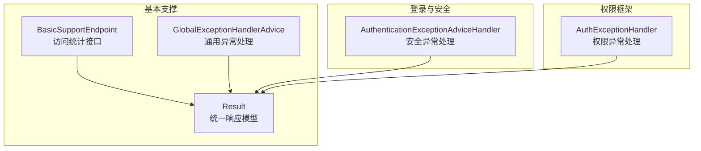
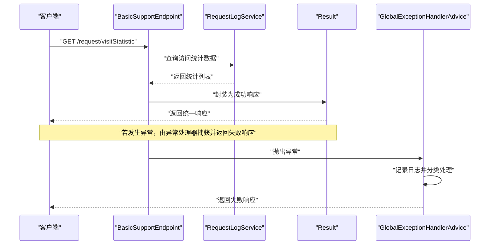
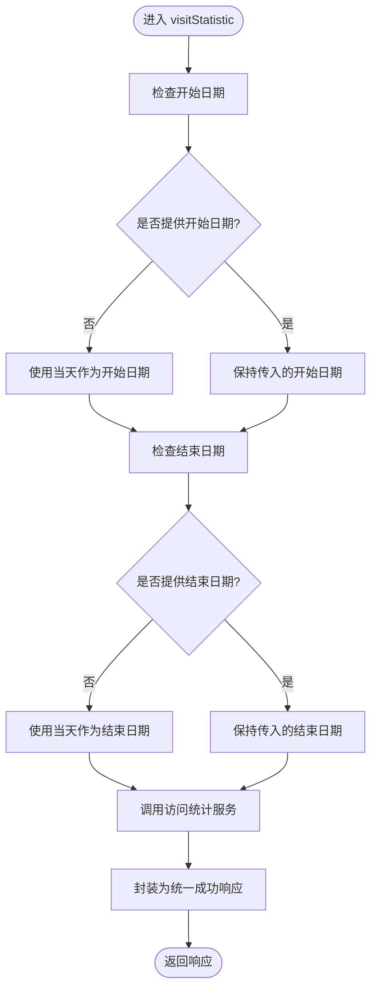
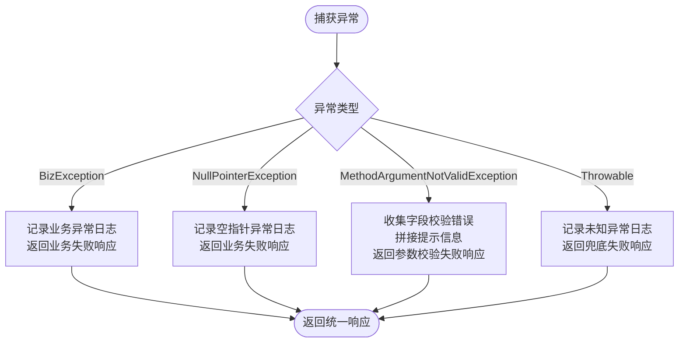
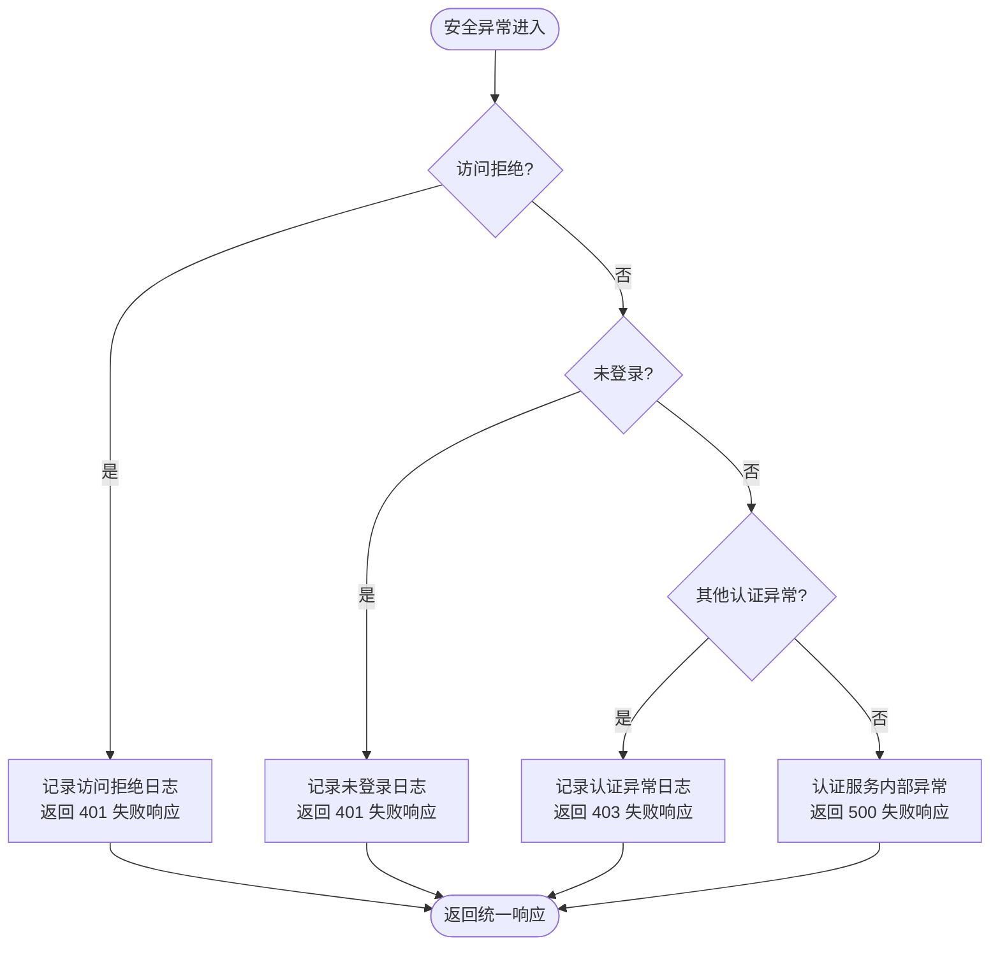
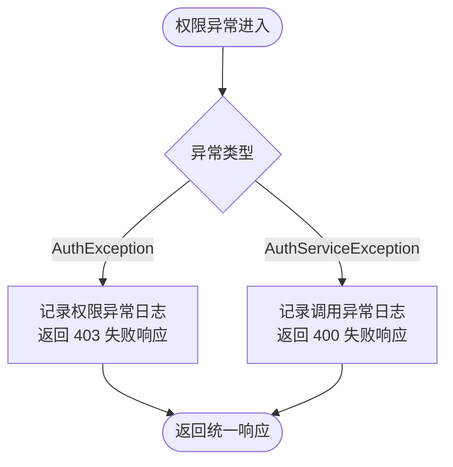
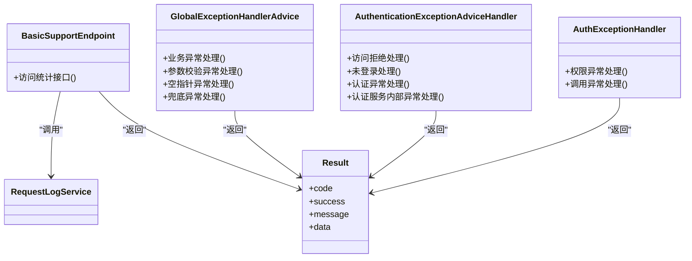
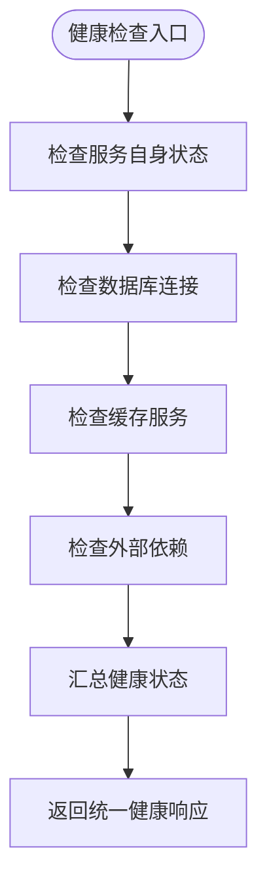

# 监控与健康检查

<cite>
**本文引用的文件**   
- [BasicSupportEndpoint.java](file://basic-support/src/main/java/com/cu/framework/basic/support/BasicSupportEndpoint.java)
- [GlobalExceptionHandlerAdvice.java](file://basic/src/main/java/com/cu/framework/basic/exception/GlobalExceptionHandlerAdvice.java)
- [AuthExceptionHandler.java](file://auth/auth-core-spring-boot-starter/src/main/java/com/cu/framework/boot/auth/core/AuthExceptionHandler.java)
- [AuthenticationExceptionAdviceHandler.java](file://login-spring-boot-starter/src/main/java/com/cu/framework/authentication/handler/AuthenticationExceptionAdviceHandler.java)
- [Result.java](file://basic/src/main/java/com/cu/framework/basic/model/Result.java)
- [AuthExceptionHandlerAssemblyTest.java](file://auth/auth-core-spring-boot-starter/src/test/java/com/cu/framework/boot/auth/core/config/AuthExceptionHandlerAssemblyTest.java)
</cite>

## 目录
1. [引言](#引言)
2. [项目结构定位](#项目结构定位)
3. [核心组件](#核心组件)
4. [架构总览](#架构总览)
5. [详细组件分析](#详细组件分析)
6. [依赖关系分析](#依赖关系分析)
7. [性能与可靠性考虑](#性能与可靠性考虑)
8. [监控指标与暴露方式](#监控指标与暴露方式)
9. [健康检查设计建议](#健康检查设计建议)
10. [故障排查指南](#故障排查指南)
11. [结论](#结论)

## 引言
本文面向运维、后端开发与平台工程人员，系统梳理本仓库中与“监控”和“健康检查”相关的现有实现与扩展点。当前代码库并未直接提供传统意义上的 `/actuator/health` 健康端点或 Prometheus/JMX 指标暴露器；但已具备以下关键能力：
- 基于 Spring MVC 的访问统计接口，可用于基础运行状态观测。
- 多层次的统一异常处理机制，确保错误可观测、可归因。
- 统一的返回模型，便于监控面板、日志聚合与告警规则解析。

在后续章节中，我将先说明现有实现，再给出健康检查项设计与监控告警配置建议，帮助你在不侵入业务的前提下建立完整的可观测性体系。

## 项目结构定位
与监控和健康检查最直接相关的代码分布在以下模块：
- basic-support：提供请求日志访问统计的控制器端点。
- basic：定义全局异常处理器与统一响应模型。
- login-spring-boot-starter：提供安全认证相关的全局异常处理器。
- auth/auth-core-spring-boot-starter：提供权限框架的异常处理器，并通过测试验证其自动装配契约。

**图表来源**
- [BasicSupportEndpoint.java:1-46](file://basic-support/src/main/java/com/cu/framework/basic/support/BasicSupportEndpoint.java#L1-L46)
- [GlobalExceptionHandlerAdvice.java:1-83](file://basic/src/main/java/com/cu/framework/basic/exception/GlobalExceptionHandlerAdvice.java#L1-L83)
- [AuthenticationExceptionAdviceHandler.java:1-86](file://login-spring-boot-starter/src/main/java/com/cu/framework/authentication/handler/AuthenticationExceptionAdviceHandler.java#L1-L86)
- [AuthExceptionHandler.java:1-35](file://auth/auth-core-spring-boot-starter/src/main/java/com/cu/framework/boot/auth/core/AuthExceptionHandler.java#L1-L35)
- [Result.java:1-73](file://basic/src/main/java/com/cu/framework/basic/model/Result.java#L1-L73)

**章节来源**
- [BasicSupportEndpoint.java:1-46](file://basic-support/src/main/java/com/cu/framework/basic/support/BasicSupportEndpoint.java#L1-L46)
- [GlobalExceptionHandlerAdvice.java:1-83](file://basic/src/main/java/com/cu/framework/basic/exception/GlobalExceptionHandlerAdvice.java#L1-L83)
- [AuthenticationExceptionAdviceHandler.java:1-86](file://login-spring-boot-starter/src/main/java/com/cu/framework/authentication/handler/AuthenticationExceptionAdviceHandler.java#L1-L86)
- [AuthExceptionHandler.java:1-35](file://auth/auth-core-spring-boot-starter/src/main/java/com/cu/framework/boot/auth/core/AuthExceptionHandler.java#L1-L35)
- [Result.java:1-73](file://basic/src/main/java/com/cu/framework/basic/model/Result.java#L1-L73)

## 核心组件
- BasicSupportEndpoint：对外暴露访问统计接口，用于统计指定日期范围内的访问数据。该接口可作为基础监控数据源。
- GlobalExceptionHandlerAdvice：捕获业务异常、参数校验异常、空指针异常及兜底未知异常，统一记录日志并返回失败结果。
- AuthenticationExceptionAdviceHandler：将访问拒绝、未登录、认证失败等安全异常转换为统一 Result，保证前端与监控系统能稳定解析。
- AuthExceptionHandler：将权限框架抛出的权限异常与调用异常转换为明确的 HTTP 状态码与错误码，便于告警区分“无权访问”与“调用错误”。
- Result：统一响应模型，包含响应码、成功标志、消息体与数据体，是监控告警解析的统一契约。

**章节来源**
- [BasicSupportEndpoint.java:1-46](file://basic-support/src/main/java/com/cu/framework/basic/support/BasicSupportEndpoint.java#L1-L46)
- [GlobalExceptionHandlerAdvice.java:1-83](file://basic/src/main/java/com/cu/framework/basic/exception/GlobalExceptionHandlerAdvice.java#L1-L83)
- [AuthenticationExceptionAdviceHandler.java:1-86](file://login-spring-boot-starter/src/main/java/com/cu/framework/authentication/handler/AuthenticationExceptionAdviceHandler.java#L1-L86)
- [AuthExceptionHandler.java:1-35](file://auth/auth-core-spring-boot-starter/src/main/java/com/cu/framework/boot/auth/core/AuthExceptionHandler.java#L1-L35)
- [Result.java:1-73](file://basic/src/main/java/com/cu/framework/basic/model/Result.java#L1-L73)

## 架构总览
下面的时序图展示一次访问统计请求的处理流程，以及异常如何被统一处理并返回统一响应。

**图表来源**
- [BasicSupportEndpoint.java:1-46](file://basic-support/src/main/java/com/cu/framework/basic/support/BasicSupportEndpoint.java#L1-L46)
- [GlobalExceptionHandlerAdvice.java:1-83](file://basic/src/main/java/com/cu/framework/basic/exception/GlobalExceptionHandlerAdvice.java#L1-L83)
- [Result.java:1-73](file://basic/src/main/java/com/cu/framework/basic/model/Result.java#L1-L73)

## 详细组件分析

### BasicSupportEndpoint：访问统计与健康观测入口
BasicSupportEndpoint 通过 `/request/visitStatistic` 暴露访问统计能力，支持可选的起止日期参数。默认情况下，起止日期均取当天，适合快速查看当日访问量趋势；传入日期范围后，可生成历史访问统计序列，作为基础监控指标的数据源。

**图表来源**
- [BasicSupportEndpoint.java:1-46](file://basic-support/src/main/java/com/cu/framework/basic/support/BasicSupportEndpoint.java#L1-L46)

要点：
- 该接口是“只读”的基础观测入口，适合作为监控系统的拉取目标。
- 如果底层 `RequestLogService` 不可用，会触发全局异常处理，最终返回失败响应，便于监控系统判定服务可用性。

**章节来源**
- [BasicSupportEndpoint.java:1-46](file://basic-support/src/main/java/com/cu/framework/basic/support/BasicSupportEndpoint.java#L1-L46)

### GlobalExceptionHandlerAdvice：通用异常处理
该处理器覆盖业务异常、空指针异常、参数校验异常以及兜底异常，所有异常都会记录日志并返回统一的失败响应。它的作用是让错误可观测、可归因，避免原始堆栈直接暴露给调用方。

**图表来源**
- [GlobalExceptionHandlerAdvice.java:1-83](file://basic/src/main/java/com/cu/framework/basic/exception/GlobalExceptionHandlerAdvice.java#L1-L83)
- [Result.java:1-73](file://basic/src/main/java/com/cu/framework/basic/model/Result.java#L1-L73)

要点：
- 业务异常与空指针异常统一按“业务失败”语义处理，便于告警规则聚焦真实业务问题。
- 参数校验异常会将多个字段错误合并为可读提示，便于前端与监控系统定位输入问题。
- 兜底异常以通用失败响应返回，配合日志可实现错误率与异常量监控。

**章节来源**
- [GlobalExceptionHandlerAdvice.java:1-83](file://basic/src/main/java/com/cu/framework/basic/exception/GlobalExceptionHandlerAdvice.java#L1-L83)
- [Result.java:1-73](file://basic/src/main/java/com/cu/framework/basic/model/Result.java#L1-L73)

### AuthenticationExceptionAdviceHandler：安全认证异常处理
该处理器将访问拒绝、未登录、认证失败等安全异常转换为稳定的 HTTP 状态码与错误码，使监控系统能够区分“未认证”“拒绝访问”“认证服务内部错误”等不同类别。

**图表来源**
- [AuthenticationExceptionAdviceHandler.java:1-86](file://login-spring-boot-starter/src/main/java/com/cu/framework/authentication/handler/AuthenticationExceptionAdviceHandler.java#L1-L86)
- [Result.java:1-73](file://basic/src/main/java/com/cu/framework/basic/model/Result.java#L1-L73)

要点：
- 未登录与访问拒绝统一使用 401，便于监控系统识别认证态缺失。
- 普通认证异常使用 403，表示“已认证但无权限”。
- 认证服务内部异常与兜底异常使用 500，表示服务端错误。

**章节来源**
- [AuthenticationExceptionAdviceHandler.java:1-86](file://login-spring-boot-starter/src/main/java/com/cu/framework/authentication/handler/AuthenticationExceptionAdviceHandler.java#L1-L86)
- [Result.java:1-73](file://basic/src/main/java/com/cu/framework/basic/model/Result.java#L1-L73)

### AuthExceptionHandler：权限框架异常处理
该处理器专门处理权限框架中的权限异常与调用异常，把“无权访问”与“调用无法判定”两类问题区分开，便于告警策略精细化。

**图表来源**
- [AuthExceptionHandler.java:1-35](file://auth/auth-core-spring-boot-starter/src/main/java/com/cu/framework/boot/auth/core/AuthExceptionHandler.java#L1-L35)
- [Result.java:1-73](file://basic/src/main/java/com/cu/framework/basic/model/Result.java#L1-L73)

要点：
- 权限异常返回 403，适合接入“权限拒绝对比透视台”等监控看板。
- 调用异常返回 400，便于区分“用户无权”与“框架调用错误”。
- 测试用例验证了该处理器在 Web 环境下自动装配且不会重复注册，在非 Web 环境不装配，保证稳定性。

**章节来源**
- [AuthExceptionHandler.java:1-35](file://auth/auth-core-spring-boot-starter/src/main/java/com/cu/framework/boot/auth/core/AuthExceptionHandler.java#L1-L35)
- [AuthExceptionHandlerAssemblyTest.java:1-101](file://auth/auth-core-spring-boot-starter/src/test/java/com/cu/framework/boot/auth/core/config/AuthExceptionHandlerAssemblyTest.java#L1-L101)
- [Result.java:1-73](file://basic/src/main/java/com/cu/framework/basic/model/Result.java#L1-L73)

## 依赖关系分析
从监控视角看，各组件的耦合关系如下：
- BasicSupportEndpoint 依赖请求日志服务，输出基础访问指标。
- 所有控制器与远程调用最终可能触发各类异常，由不同层的 @RestControllerAdvice 捕获。
- 所有响应都通过 Result 统一封装，便于监控系统解析。

**图表来源**
- [BasicSupportEndpoint.java:1-46](file://basic-support/src/main/java/com/cu/framework/basic/support/BasicSupportEndpoint.java#L1-L46)
- [GlobalExceptionHandlerAdvice.java:1-83](file://basic/src/main/java/com/cu/framework/basic/exception/GlobalExceptionHandlerAdvice.java#L1-L83)
- [AuthenticationExceptionAdviceHandler.java:1-86](file://login-spring-boot-starter/src/main/java/com/cu/framework/authentication/handler/AuthenticationExceptionAdviceHandler.java#L1-L86)
- [AuthExceptionHandler.java:1-35](file://auth/auth-core-spring-boot-starter/src/main/java/com/cu/framework/boot/auth/core/AuthExceptionHandler.java#L1-L35)
- [Result.java:1-73](file://basic/src/main/java/com/cu/framework/basic/model/Result.java#L1-L73)

**章节来源**
- [BasicSupportEndpoint.java:1-46](file://basic-support/src/main/java/com/cu/framework/basic/support/BasicSupportEndpoint.java#L1-L46)
- [GlobalExceptionHandlerAdvice.java:1-83](file://basic/src/main/java/com/cu/framework/basic/exception/GlobalExceptionHandlerAdvice.java#L1-L83)
- [AuthenticationExceptionAdviceHandler.java:1-86](file://login-spring-boot-starter/src/main/java/com/cu/framework/authentication/handler/AuthenticationExceptionAdviceHandler.java#L1-L86)
- [AuthExceptionHandler.java:1-35](file://auth/auth-core-spring-boot-starter/src/main/java/com/cu/framework/boot/auth/core/AuthExceptionHandler.java#L1-L35)
- [Result.java:1-73](file://basic/src/main/java/com/cu/framework/basic/model/Result.java#L1-L73)

## 性能与可靠性考虑
虽然当前仓库没有直接实现熔断、重试、超时控制等容错组件，但从异常处理和统一响应的设计可以看出，系统在错误路径上保持了良好的可观测性。建议在业务层引入以下策略：
- 熔断降级：对数据库、缓存、外部 API 调用增加熔断器，避免级联故障。
- 重试机制：对幂等的外部调用增加有限次重试，并结合退避策略。
- 超时控制：为所有远程调用设置合理超时，防止线程池被慢调用占满。
- 指标采集：在熔断、重试、超时等关键点埋点，结合监控系统绘制 SLO/SLI 曲线。

这些内容属于通用实践建议，不直接对应具体源码文件。

## 监控指标与暴露方式
当前仓库未直接集成 Micrometer、Prometheus 或 JMX 指标暴露器。不过，可以利用现有能力构建最小化监控方案：

- 基础指标
  - 访问统计指标：通过 `/request/visitStatistic` 拉取访问数据，计算 QPS、峰值、日环比等指标。
  - 错误率指标：通过监控日志中异常关键字或统一失败响应的 code 字段，统计业务失败、参数校验失败、认证失败、权限拒绝等错误比例。
  - 健康状态指标：可将访问统计接口的成功率与耗时作为“服务可用”信号。

- 指标暴露建议
  - JMX：可在应用内增加 JMX Bean，暴露 JVM、线程池、连接池等运行时指标。
  - Prometheus：引入 Micrometer 与 Spring Boot Actuator，暴露 HTTP 请求计数、延迟、错误率，以及自定义业务指标。
  - 日志聚合：将统一异常处理的日志接入 ELK、Splunk 或云厂商日志平台，建立错误关键词告警。

- 告警规则示例
  - 访问统计接口连续 N 次失败，判定服务不可用。
  - 统一失败响应中 code 为 500 的比例超过阈值，触发严重告警。
  - 权限拒绝 403 与认证失败 403 突增，触发权限异常告警。
  - 未登录 401 占比异常升高，提示会话失效或认证服务异常。

上述建议为通用方案，不直接绑定仓库特定实现。

## 健康检查设计建议
由于仓库未提供标准健康检查端点，建议实现一个轻量级健康检查控制器，复用现有 Result 模型与日志规范。健康检查应包含以下维度：

- 服务自身状态
  - 进程存活、端口监听、启动时间。
  - 最近一次访问统计接口的成功率与延迟。

- 数据库连接
  - 执行简单查询验证连接可用。
  - 统计连接池活跃数、等待队列长度。

- 缓存服务
  - 探测缓存连通性与延迟。
  - 统计命中率、淘汰率。

- 外部依赖
  - 第三方 API 连通性、延迟、错误率。
  - 外部依赖熔断状态。

该流程图用于指导健康检查实现，不直接映射到现有源码文件。

## 故障排查指南
当监控系统发现异常时，可按照以下路径定位问题：

- 访问统计接口失败
  - 检查 BasicSupportEndpoint 调用的日志与服务可用性。
  - 确认 RequestLogService 是否可正常返回数据。
  - 若出现异常，查看 GlobalExceptionHandlerAdvice 记录的日志与统一失败响应。

- 认证与权限异常增多
  - 检查 AuthenticationExceptionAdviceHandler 与 AuthExceptionHandler 的日志。
  - 区分未登录、访问拒绝、认证失败、权限拒绝等类别。
  - 结合权限透视台与审计日志分析权限配置变更。

- 业务异常与参数校验异常
  - 根据 GlobalExceptionHandlerAdvice 的错误码与消息定位业务逻辑或入参问题。
  - 对高频参数校验失败接口补充前端校验与接口文档。

- 兜底异常
  - 兜底异常通常意味着未预期错误，需要重点排查依赖服务、配置错误或代码缺陷。

**章节来源**
- [BasicSupportEndpoint.java:1-46](file://basic-support/src/main/java/com/cu/framework/basic/support/BasicSupportEndpoint.java#L1-L46)
- [GlobalExceptionHandlerAdvice.java:1-83](file://basic/src/main/java/com/cu/framework/basic/exception/GlobalExceptionHandlerAdvice.java#L1-L83)
- [AuthenticationExceptionAdviceHandler.java:1-86](file://login-spring-boot-starter/src/main/java/com/cu/framework/authentication/handler/AuthenticationExceptionAdviceHandler.java#L1-L86)
- [AuthExceptionHandler.java:1-35](file://auth/auth-core-spring-boot-starter/src/main/java/com/cu/framework/boot/auth/core/AuthExceptionHandler.java#L1-L35)

## 结论
当前仓库已经具备了监控与健康检查所需的关键基础设施：统一的访问统计入口、多层次的异常处理机制，以及统一的响应模型。这为构建完整的可观测性体系提供了良好基础。下一步建议：
- 实现标准化的健康检查端点，覆盖服务、数据库、缓存与外部依赖。
- 引入 Micrometer 与 Actuator，暴露 Prometheus 与 JMX 指标。
- 基于统一错误码与日志建立告警规则，形成“指标-日志-告警-自愈”闭环。
- 在业务层引入熔断、重试、超时等容错策略，提升系统可用性。

通过这些措施，运维人员可以快速发现潜在问题，开发团队可以更高效地定位根因，平台工程团队可以持续优化系统可靠性。