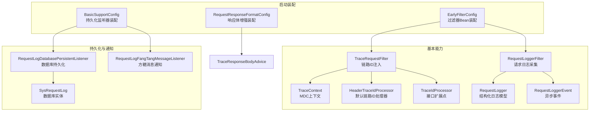
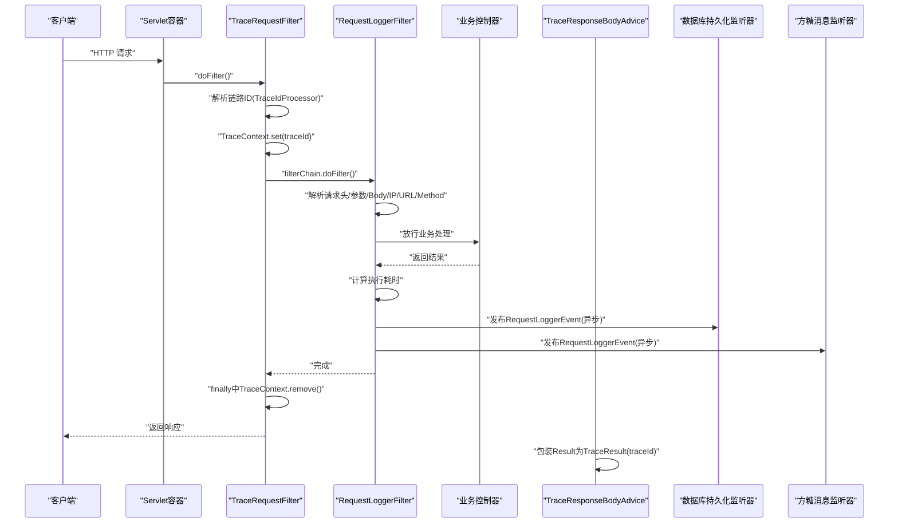
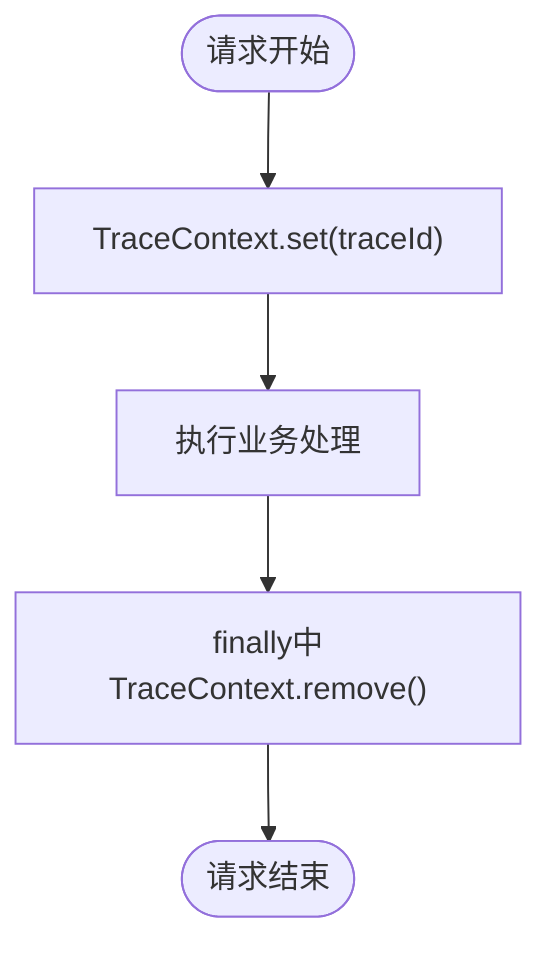
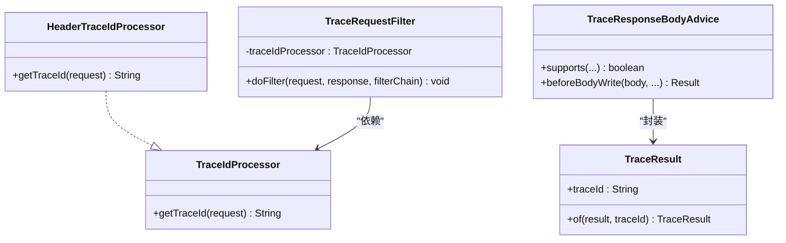
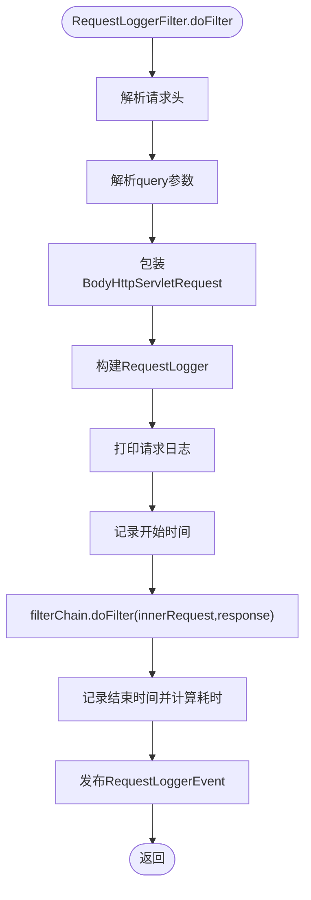
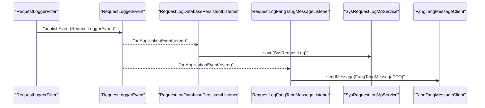
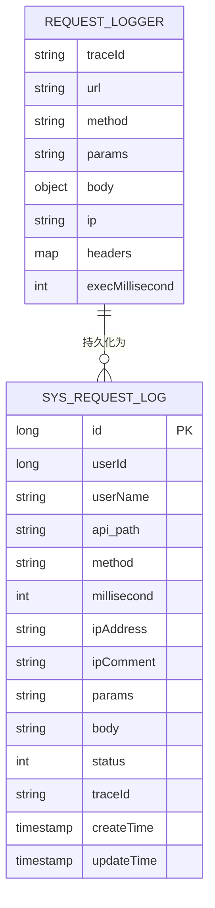
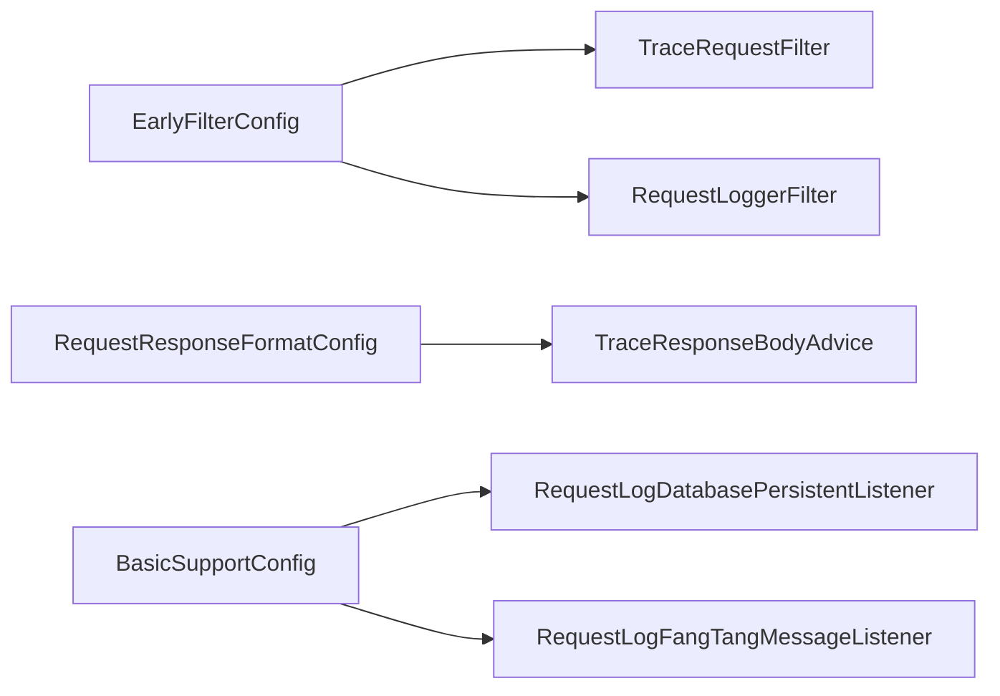

# 请求日志追踪

<cite>
**本文引用的文件**   
- [TraceRequestFilter.java](file://basic/src/main/java/com/cu/framework/basic/logger/TraceRequestFilter.java)
- [EarlyRequestFilter.java](file://basic/src/main/java/com/cu/framework/basic/filter/EarlyRequestFilter.java)
- [RequestLoggerFilter.java](file://basic/src/main/java/com/cu/framework/basic/logger/RequestLoggerFilter.java)
- [RequestLogger.java](file://basic/src/main/java/com/cu/framework/basic/logger/request/RequestLogger.java)
- [RequestLoggerEvent.java](file://basic/src/main/java/com/cu/framework/basic/logger/request/RequestLoggerEvent.java)
- [TraceContext.java](file://basic/src/main/java/com/cu/framework/basic/logger/trace/TraceContext.java)
- [HeaderTraceIdProcessor.java](file://basic/src/main/java/com/cu/framework/basic/logger/trace/HeaderTraceIdProcessor.java)
- [TraceIdProcessor.java](file://basic/src/main/java/com/cu/framework/basic/logger/trace/TraceIdProcessor.java)
- [TraceResponseBodyAdvice.java](file://basic/src/main/java/com/cu/framework/basic/logger/trace/TraceResponseBodyAdvice.java)
- [TraceResult.java](file://basic/src/main/java/com/cu/framework/basic/logger/trace/TraceResult.java)
- [LoggerConstant.java](file://basic/src/main/java/com/cu/framework/basic/logger/LoggerConstant.java)
- [BasicSupportConfig.java](file://boot/basic-spring-boot-starter/src/main/java/com/cu/framework/boot/basic/config/BasicSupportConfig.java)
- [EarlyFilterConfig.java](file://boot/basic-spring-boot-starter/src/main/java/com/cu/framework/boot/basic/config/EarlyFilterConfig.java)
- [RequestResponseFormatConfig.java](file://boot/basic-spring-boot-starter/src/main/java/com/cu/framework/boot/basic/config/RequestResponseFormatConfig.java)
- [RequestLogDatabasePersistentListener.java](file://basic-support/src/main/java/com/cu/framework/basic/support/log/RequestLogDatabasePersistentListener.java)
- [RequestLogFangTangMessageListener.java](file://basic-support/src/main/java/com/cu/framework/basic/support/log/RequestLogFangTangMessageListener.java)
- [SysRequestLog.java](file://basic-support/src/main/java/com/cu/framework/basic/support/mp/entity/SysRequestLog.java)
- [spec.md](file://openspec/specs/observability/request-tracing/spec.md)
</cite>

## 目录
1. [简介](#简介)
2. [项目结构](#项目结构)
3. [核心组件](#核心组件)
4. [架构总览](#架构总览)
5. [详细组件分析](#详细组件分析)
6. [依赖关系分析](#依赖关系分析)
7. [性能考虑](#性能考虑)
8. [故障排查指南](#故障排查指南)
9. [结论](#结论)
10. [附录：配置与最佳实践](#附录配置与最佳实践)

## 简介
本文件聚焦于框架中的请求日志追踪能力，覆盖以下内容：
- 请求进入阶段的链路 ID 注入、请求信息收集与格式化。
- 分布式追踪上下文管理、链路 ID 的生成与传播。
- 日志持久化方案：数据库持久化监听器与方糖消息队列集成监听器。
- 日志数据结构设计：请求参数、响应结果、执行时间、异常信息与链路 ID。
- 与监控系统集成的方式：日志分析、性能监控、故障排查。
- 配置与最佳实践：日志级别、敏感信息脱敏、存储策略优化等。

该功能以过滤器为入口，通过事件机制解耦持久化与通知逻辑，保证对业务线程的低侵入和高可扩展性。

## 项目结构
请求日志追踪相关代码主要分布在以下模块：
- basic：核心过滤链、追踪上下文、请求日志模型与基础处理器。
- boot.basic-spring-boot-starter：启动装配、过滤器注册、响应体增强装配。
- basic-support：可选的持久化监听器（数据库）和消息通知监听器（方糖）。
- openspec.specs：观测性规范的约束说明。

**图表来源**
- [TraceRequestFilter.java:1-60](file://basic/src/main/java/com/cu/framework/basic/logger/TraceRequestFilter.java#L1-L60)
- [RequestLoggerFilter.java:1-133](file://basic/src/main/java/com/cu/framework/basic/logger/RequestLoggerFilter.java#L1-L133)
- [TraceContext.java:1-22](file://basic/src/main/java/com/cu/framework/basic/logger/trace/TraceContext.java#L1-L22)
- [HeaderTraceIdProcessor.java:1-27](file://basic/src/main/java/com/cu/framework/basic/logger/trace/HeaderTraceIdProcessor.java#L1-L27)
- [TraceIdProcessor.java:1-18](file://basic/src/main/java/com/cu/framework/basic/logger/trace/TraceIdProcessor.java#L1-L18)
- [RequestLogger.java:1-40](file://basic/src/main/java/com/cu/framework/basic/logger/request/RequestLogger.java#L1-L40)
- [RequestLoggerEvent.java:1-23](file://basic/src/main/java/com/cu/framework/basic/logger/request/RequestLoggerEvent.java#L1-L23)
- [EarlyFilterConfig.java:1-47](file://boot/basic-spring-boot-starter/src/main/java/com/cu/framework/boot/basic/config/EarlyFilterConfig.java#L1-L47)
- [RequestResponseFormatConfig.java:1-126](file://boot/basic-spring-boot-starter/src/main/java/com/cu/framework/boot/basic/config/RequestResponseFormatConfig.java#L1-L126)
- [BasicSupportConfig.java:1-45](file://boot/basic-spring-boot-starter/src/main/java/com/cu/framework/boot/basic/config/BasicSupportConfig.java#L1-L45)
- [RequestLogDatabasePersistentListener.java:1-66](file://basic-support/src/main/java/com/cu/framework/basic/support/log/RequestLogDatabasePersistentListener.java#L1-L66)
- [RequestLogFangTangMessageListener.java:1-108](file://basic-support/src/main/java/com/cu/framework/basic/support/log/RequestLogFangTangMessageListener.java#L1-L108)
- [SysRequestLog.java:1-123](file://basic-support/src/main/java/com/cu/framework/basic/support/mp/entity/SysRequestLog.java#L1-L123)

**章节来源**
- [TraceRequestFilter.java:1-60](file://basic/src/main/java/com/cu/framework/basic/logger/TraceRequestFilter.java#L1-L60)
- [RequestLoggerFilter.java:1-133](file://basic/src/main/java/com/cu/framework/basic/logger/RequestLoggerFilter.java#L1-L133)
- [EarlyFilterConfig.java:1-47](file://boot/basic-spring-boot-starter/src/main/java/com/cu/framework/boot/basic/config/EarlyFilterConfig.java#L1-L47)
- [BasicSupportConfig.java:1-45](file://boot/basic-spring-boot-starter/src/main/java/com/cu/framework/boot/basic/config/BasicSupportConfig.java#L1-L45)

## 核心组件
- TraceRequestFilter：在请求进入时解析链路 ID 并写入 MDC，确保后续日志包含 traceId。
- RequestLoggerFilter：捕获请求头、参数、Body、IP、URL、方法，统计执行耗时，发布请求日志事件。
- TraceContext：基于 SLF4J MDC 的线程局部链路上下文，提供 get/set/remove。
- HeaderTraceIdProcessor：默认链路 ID 处理器，从请求头获取或生成 UUID。
- RequestLogger：结构化日志数据模型，承载 traceId、url、method、params、body、ip、headers、execMillisecond。
- RequestLoggerEvent：Spring 事件载体，将 RequestLogger 异步传递给持久化与通知监听器。
- RequestLogDatabasePersistentListener：将请求日志持久化到 sys_request_log 表。
- RequestLogFangTangMessageListener：将请求日志渲染为 Markdown 并通过方糖消息客户端发送通知。
- TraceResponseBodyAdvice：在返回 Result 前包装为 TraceResult，附带 traceId。

**章节来源**
- [TraceRequestFilter.java:1-60](file://basic/src/main/java/com/cu/framework/basic/logger/TraceRequestFilter.java#L1-L60)
- [RequestLoggerFilter.java:1-133](file://basic/src/main/java/com/cu/framework/basic/logger/RequestLoggerFilter.java#L1-L133)
- [TraceContext.java:1-22](file://basic/src/main/java/com/cu/framework/basic/logger/trace/TraceContext.java#L1-L22)
- [HeaderTraceIdProcessor.java:1-27](file://basic/src/main/java/com/cu/framework/basic/logger/trace/HeaderTraceIdProcessor.java#L1-L27)
- [RequestLogger.java:1-40](file://basic/src/main/java/com/cu/framework/basic/logger/request/RequestLogger.java#L1-L40)
- [RequestLoggerEvent.java:1-23](file://basic/src/main/java/com/cu/framework/basic/logger/request/RequestLoggerEvent.java#L1-L23)
- [RequestLogDatabasePersistentListener.java:1-66](file://basic-support/src/main/java/com/cu/framework/basic/support/log/RequestLogDatabasePersistentListener.java#L1-L66)
- [RequestLogFangTangMessageListener.java:1-108](file://basic-support/src/main/java/com/cu/framework/basic/support/log/RequestLogFangTangMessageListener.java#L1-L108)
- [TraceResponseBodyAdvice.java:1-42](file://basic/src/main/java/com/cu/framework/basic/logger/trace/TraceResponseBodyAdvice.java#L1-L42)
- [TraceResult.java:1-39](file://basic/src/main/java/com/cu/framework/basic/logger/trace/TraceResult.java#L1-L39)

## 架构总览
整体流程分为三个阶段：
1. 链路 ID 注入阶段：TraceRequestFilter 根据 TraceIdProcessor 获取或生成 traceId，写入 TraceContext(MDC)。
2. 请求日志采集阶段：RequestLoggerFilter 捕获请求头、参数、Body、IP、URL、方法，计算执行耗时并发布 RequestLoggerEvent。
3. 异步持久化与通知阶段：监听器消费事件，分别落库或发送消息通知；响应阶段 TraceResponseBodyAdvice 将 traceId 附加到返回结构中。

**图表来源**
- [TraceRequestFilter.java:1-60](file://basic/src/main/java/com/cu/framework/basic/logger/TraceRequestFilter.java#L1-L60)
- [RequestLoggerFilter.java:1-133](file://basic/src/main/java/com/cu/framework/basic/logger/RequestLoggerFilter.java#L1-L133)
- [TraceResponseBodyAdvice.java:1-42](file://basic/src/main/java/com/cu/framework/basic/logger/trace/TraceResponseBodyAdvice.java#L1-L42)
- [RequestLogDatabasePersistentListener.java:1-66](file://basic-support/src/main/java/com/cu/framework/basic/support/log/RequestLogDatabasePersistentListener.java#L1-L66)
- [RequestLogFangTangMessageListener.java:1-108](file://basic-support/src/main/java/com/cu/framework/basic/support/log/RequestLogFangTangMessageListener.java#L1-L108)

## 详细组件分析

### 链路追踪与上下文管理
- TraceContext 使用 SLF4J MDC 维护固定键 traceId，提供 get/set/remove。
- LoggerConstant.TRACE_ID_KEY 定义固定键名，确保清除操作作用于固定键，不受值影响。
- OpenSpec 规范明确要求：
  - 清理按固定键生效。
  - 请求结束时必须清理，包括异常路径。
  - 线程复用后不应继承上一个请求的 traceId。

**图表来源**
- [TraceContext.java:1-22](file://basic/src/main/java/com/cu/framework/basic/logger/trace/TraceContext.java#L1-L22)
- [LoggerConstant.java:1-10](file://basic/src/main/java/com/cu/framework/basic/logger/LoggerConstant.java#L1-L10)
- [spec.md:1-40](file://openspec/specs/observability/request-tracing/spec.md#L1-L40)

**章节来源**
- [TraceContext.java:1-22](file://basic/src/main/java/com/cu/framework/basic/logger/trace/TraceContext.java#L1-L22)
- [LoggerConstant.java:1-10](file://basic/src/main/java/com/cu/framework/basic/logger/LoggerConstant.java#L1-L10)
- [spec.md:1-40](file://openspec/specs/observability/request-tracing/spec.md#L1-L40)

### 链路 ID 生成与传播
- TraceIdProcessor 是扩展点，允许自定义链路 ID 获取策略。
- HeaderTraceIdProcessor 默认实现：优先读取请求头 traceId，不存在则生成去除连字符的 UUID。
- TraceRequestFilter 通过 ObjectProvider 获取 TraceIdProcessor；未注册时使用 HeaderTraceIdProcessor。
- 链路 ID 传播范围：
  - 服务端日志：通过 MDC 透传到所有日志输出。
  - 客户端返回：TraceResponseBodyAdvice 将 traceId 附加到 Result 返回结构中（TraceResult）。

**图表来源**
- [TraceIdProcessor.java:1-18](file://basic/src/main/java/com/cu/framework/basic/logger/trace/TraceIdProcessor.java#L1-L18)
- [HeaderTraceIdProcessor.java:1-27](file://basic/src/main/java/com/cu/framework/basic/logger/trace/HeaderTraceIdProcessor.java#L1-L27)
- [TraceRequestFilter.java:1-60](file://basic/src/main/java/com/cu/framework/basic/logger/TraceRequestFilter.java#L1-L60)
- [TraceResponseBodyAdvice.java:1-42](file://basic/src/main/java/com/cu/framework/basic/logger/trace/TraceResponseBodyAdvice.java#L1-L42)
- [TraceResult.java:1-39](file://basic/src/main/java/com/cu/framework/basic/logger/trace/TraceResult.java#L1-L39)

**章节来源**
- [TraceIdProcessor.java:1-18](file://basic/src/main/java/com/cu/framework/basic/logger/trace/TraceIdProcessor.java#L1-L18)
- [HeaderTraceIdProcessor.java:1-27](file://basic/src/main/java/com/cu/framework/basic/logger/trace/HeaderTraceIdProcessor.java#L1-L27)
- [TraceRequestFilter.java:1-60](file://basic/src/main/java/com/cu/framework/basic/logger/TraceRequestFilter.java#L1-L60)
- [TraceResponseBodyAdvice.java:1-42](file://basic/src/main/java/com/cu/framework/basic/logger/trace/TraceResponseBodyAdvice.java#L1-L42)
- [TraceResult.java:1-39](file://basic/src/main/java/com/cu/framework/basic/logger/trace/TraceResult.java#L1-L39)

### 请求信息捕获与格式化
- RequestLoggerFilter 负责：
  - 解析请求头为 Map<String,String>。
  - 解析 query 参数为 JSON 字符串，支持单值与多值数组。
  - 解析 Body 为对象（JSON 反序列化），无 Body 时为 null。
  - 记录 IP、URI、HTTP Method、traceId。
  - 统计执行耗时毫秒数。
  - 打印结构化请求日志。
  - 发布 RequestLoggerEvent，携带 RequestLogger 对象。

**图表来源**
- [RequestLoggerFilter.java:1-133](file://basic/src/main/java/com/cu/framework/basic/logger/RequestLoggerFilter.java#L1-L133)

**章节来源**
- [RequestLoggerFilter.java:1-133](file://basic/src/main/java/com/cu/framework/basic/logger/RequestLoggerFilter.java#L1-L133)

### 日志持久化方案
- 数据库持久化监听器：
  - 接收 RequestLoggerEvent，异步保存 SysRequestLog。
  - 将 RequestLogger.body 序列化为 JSON 字符串入库。
  - traceId 从 RequestLogger 对象携带的数据取，避免异步线程丢失 ThreadLocal。
- 方糖消息通知监听器：
  - 接收 RequestLoggerEvent，异步发送方糖消息。
  - 基于来源 IP 去重，缓存有效期 30 分钟。
  - 将 RequestLogger 渲染为 Markdown，包含 ip、url、headers、params、body。

**图表来源**
- [RequestLoggerFilter.java:1-133](file://basic/src/main/java/com/cu/framework/basic/logger/RequestLoggerFilter.java#L1-L133)
- [RequestLogDatabasePersistentListener.java:1-66](file://basic-support/src/main/java/com/cu/framework/basic/support/log/RequestLogDatabasePersistentListener.java#L1-L66)
- [RequestLogFangTangMessageListener.java:1-108](file://basic-support/src/main/java/com/cu/framework/basic/support/log/RequestLogFangTangMessageListener.java#L1-L108)

**章节来源**
- [RequestLogDatabasePersistentListener.java:1-66](file://basic-support/src/main/java/com/cu/framework/basic/support/log/RequestLogDatabasePersistentListener.java#L1-L66)
- [RequestLogFangTangMessageListener.java:1-108](file://basic-support/src/main/java/com/cu/framework/basic/support/log/RequestLogFangTangMessageListener.java#L1-L108)

### 数据结构设计
- RequestLogger：
  - traceId：链路 ID。
  - url：请求 URI。
  - method：HTTP 方法。
  - params：query 参数 JSON 字符串。
  - body：请求体 JSON 解析后的对象。
  - ip：客户端 IP。
  - headers：全部请求头 Map。
  - execMillisecond：执行耗时毫秒数。
- SysRequestLog：
  - id、userId、userName、api_path、method、millisecond、ip_address、ip_comment、params、body、status、trace_id、create_time、update_time。

**图表来源**
- [RequestLogger.java:1-40](file://basic/src/main/java/com/cu/framework/basic/logger/request/RequestLogger.java#L1-L40)
- [SysRequestLog.java:1-123](file://basic-support/src/main/java/com/cu/framework/basic/support/mp/entity/SysRequestLog.java#L1-L123)

**章节来源**
- [RequestLogger.java:1-40](file://basic/src/main/java/com/cu/framework/basic/logger/request/RequestLogger.java#L1-L40)
- [SysRequestLog.java:1-123](file://basic-support/src/main/java/com/cu/framework/basic/support/mp/entity/SysRequestLog.java#L1-L123)

### 与监控系统集成
- 日志分析：
  - 通过 MDC 统一输出 traceId，便于在日志系统中按链路聚合。
  - RequestLoggerFilter 打印结构化请求日志，包含 ip、url、method、params、body。
- 性能监控：
  - execMillisecond 可用于统计接口耗时分布。
  - 结合 SysRequestLog.millisecond 字段进行历史趋势分析。
- 故障排查：
  - 通过 traceId 跨服务/组件关联日志。
  - 方糖消息通知快速感知异常请求来源 IP 与详情。

[本节为概念性说明，不直接分析具体文件]

## 依赖关系分析
- EarlyFilterConfig 装配 TraceRequestFilter 与 RequestLoggerFilter，并提供 EarlyRequestFilterProxy。
- RequestResponseFormatConfig 装配 TraceResponseBodyAdvice，并配置 Jackson 序列化规则。
- BasicSupportConfig 条件装配：
  - cu.request.persistent.database=true 时启用数据库持久化监听器。
  - cu.request.message.fang-tang=true 且 cu.notify.fang-tang.enabled=true 且存在 FangTangMessageClient 时启用方糖消息监听器。

**图表来源**
- [EarlyFilterConfig.java:1-47](file://boot/basic-spring-boot-starter/src/main/java/com/cu/framework/boot/basic/config/EarlyFilterConfig.java#L1-L47)
- [RequestResponseFormatConfig.java:1-126](file://boot/basic-spring-boot-starter/src/main/java/com/cu/framework/boot/basic/config/RequestResponseFormatConfig.java#L1-L126)
- [BasicSupportConfig.java:1-45](file://boot/basic-spring-boot-starter/src/main/java/com/cu/framework/boot/basic/config/BasicSupportConfig.java#L1-L45)

**章节来源**
- [EarlyFilterConfig.java:1-47](file://boot/basic-spring-boot-starter/src/main/java/com/cu/framework/boot/basic/config/EarlyFilterConfig.java#L1-L47)
- [RequestResponseFormatConfig.java:1-126](file://boot/basic-spring-boot-starter/src/main/java/com/cu/framework/boot/basic/config/RequestResponseFormatConfig.java#L1-L126)
- [BasicSupportConfig.java:1-45](file://boot/basic-spring-boot-starter/src/main/java/com/cu/framework/boot/basic/config/BasicSupportConfig.java#L1-L45)

## 性能考虑
- 过滤器顺序：
  - TraceRequestFilter @Order(1) 最先注入链路 ID。
  - RequestLoggerFilter @Order(3) 随后采集请求日志。
  - TraceResponseBodyAdvice @Order(9000) 最后包装返回值。
- 异步持久化：
  - 监听器 onApplicationEvent 使用 @Async，避免阻塞主请求线程。
- Body 重复读取：
  - RequestLoggerFilter 使用 BodyHttpServletRequest 包装，确保可重复读取请求体。
- 日志大小控制：
  - params/body 可能较大，建议在生产环境限制最大长度或开启采样策略。
- MDC 开销：
  - 合理设置日志级别，避免高频全量打印导致 IO 压力。

[本节为通用性能指导，不直接分析具体文件]

## 故障排查指南
- 链路 ID 缺失：
  - 检查 TraceRequestFilter 是否被正确装配。
  - 确认 TraceIdProcessor 是否被自定义覆盖或未注册。
  - 检查 MDC 配置与日志格式是否包含 traceId。
- 链路 ID 未清理：
  - 确认 finally 分支调用 TraceContext.remove()。
  - 验证 OpenSpec 规范是否满足“请求结束时清理”。
- 请求日志为空或不完整：
  - 检查 RequestLoggerFilter 是否注册。
  - 确认 BodyHttpServletRequest 是否能正常读取 Body。
  - 查看 params/body 解析是否抛出异常导致事件未发布。
- 数据库未落库：
  - 检查 cu.request.persistent.database 是否为 true。
  - 确认 SysRequestLogMpService 可用且数据库连接正常。
- 方糖消息未推送：
  - 检查 cu.request.message.fang-tang 与 cu.notify.fang-tang.enabled 是否为 true。
  - 确认 FangTangMessageClient Bean 存在。
  - 查看 IP 去重缓存是否命中。

**章节来源**
- [TraceRequestFilter.java:1-60](file://basic/src/main/java/com/cu/framework/basic/logger/TraceRequestFilter.java#L1-L60)
- [RequestLoggerFilter.java:1-133](file://basic/src/main/java/com/cu/framework/basic/logger/RequestLoggerFilter.java#L1-L133)
- [BasicSupportConfig.java:1-45](file://boot/basic-spring-boot-starter/src/main/java/com/cu/framework/boot/basic/config/BasicSupportConfig.java#L1-L45)

## 结论
该请求日志追踪体系通过早期过滤器注入链路 ID、集中式日志采集、异步事件驱动持久化与通知，形成完整的可观测闭环。其扩展点丰富（TraceIdProcessor）、数据模型清晰（RequestLogger/SysRequestLog）、与监控系统天然契合（MDC 与结构化日志）。在实际生产环境中，应重点关注链路 ID 清理、日志体积控制、异步任务资源隔离与告警通道稳定性。

[本节为总结性内容，不直接分析具体文件]

## 附录：配置与最佳实践

### 关键配置项
- 启用数据库持久化：
  - cu.request.persistent.database=true
- 启用方糖消息通知：
  - cu.request.message.fang-tang=true
  - cu.notify.fang-tang.enabled=true
- 应用名称用于消息标题：
  - spring.application.name=your-app-name

**章节来源**
- [BasicSupportConfig.java:1-45](file://boot/basic-spring-boot-starter/src/main/java/com/cu/framework/boot/basic/config/BasicSupportConfig.java#L1-L45)

### 日志级别控制
- 生产环境建议：
  - 仅对错误路径或慢请求开启详细日志。
  - 使用采样策略降低高频接口的日志量。
- 调试环境建议：
  - 开启 DEBUG 级别日志，观察 RequestLoggerEvent 的处理过程。

[本节为通用指导，不直接分析具体文件]

### 敏感信息脱敏
- 建议在 RequestLoggerFilter 或自定义 TraceIdProcessor 中进行脱敏：
  - 对 headers/body/params 中的敏感字段（如密码、令牌）进行掩码替换。
- 持久化前校验：
  - 在 RequestLogDatabasePersistentListener.save 前进行二次脱敏，防止意外落库。

[本节为通用指导，不直接分析具体文件]

### 存储策略优化
- 数据库：
  - 对 sys_request_log 建立索引：trace_id、api_path、create_time。
  - 定期归档或压缩历史数据，控制表大小。
- 消息通知：
  - 调整方糖消息去重缓存过期时间，平衡通知频率与性能。
  - 增加重试与失败告警机制。

[本节为通用指导，不直接分析具体文件]

### 调试技巧
- 查看链路 ID：
  - 在日志中搜索 traceId，确认是否正确注入与清理。
- 定位慢接口：
  - 查询 SysRequestLog.millisecond 较高的记录，结合 params/body 分析原因。
- 复现问题：
  - 使用 traceId 在多个系统间关联日志，缩小排查范围。

[本节为通用指导，不直接分析具体文件]