# 扩展开发指南

<cite>
**本文引用的文件 **
- [AuthMenu.java](file://auth/auth-core/src/main/java/com/cu/framework/auth/core/AuthMenu.java)
- [AuthDataOperation.java](file://auth/auth-core/src/main/java/com/cu/framework/auth/core/AuthDataOperation.java)
- [AuthDataRange.java](file://auth/auth-core/src/main/java/com/cu/framework/auth/core/AuthDataRange.java)
- [AuthCurrentUserContextHolder.java](file://auth/auth-core/src/main/java/com/cu/framework/auth/core/AuthCurrentUserContextHolder.java)
- [AuthDataAdaptor.java](file://auth/auth-core/src/main/java/com/cu/framework/auth/core/AuthDataAdaptor.java)
- [AuthMenuHandler.java](file://auth/auth-core/src/main/java/com/cu/framework/auth/core/menu/AuthMenuHandler.java)
- [MenuAccessInterceptor.java](file://auth/auth-core/src/main/java/com/cu/framework/auth/core/menu/MenuAccessInterceptor.java)
- [AuthDataHandler.java](file://auth/auth-core/src/main/java/com/cu/framework/auth/core/data/AuthDataHandler.java)
- [JdbcAuthDataHandler.java](file://auth/auth-core/src/main/java/com/cu/framework/auth/core/data/JdbcAuthDataHandler.java)
- [SqlAuthInject.java](file://auth/auth-core/src/main/java/com/cu/framework/auth/core/data/range/SqlAuthInject.java)
- [RbacAnnotationAuthHandler.java](file://auth/auth-rbac/src/main/java/com/cu/framework/auth/rbac/RbacAnnotationAuthHandler.java)
- [SecurityUserDetailsService.java](file://login-spring-boot-starter/src/main/java/com/cu/framework/authentication/service/SecurityUserDetailsService.java)
- [AuthenticationExceptionAdviceHandler.java](file://login-spring-boot-starter/src/main/java/com/cu/framework/authentication/handler/AuthenticationExceptionAdviceHandler.java)
- [TokenSessionRequestFilter.java](file://login-spring-boot-starter/src/main/java/com/cu/framework/authentication/filter/TokenSessionRequestFilter.java)
- [AuthCoreConfig.java](file://auth/auth-core-spring-boot-starter/src/main/java/com/cu/framework/boot/auth/core/config/AuthCoreConfig.java)
- [AuthWebConfig.java](file://auth/auth-core-spring-boot-starter/src/main/java/com/cu/framework/boot/auth/core/config/AuthWebConfig.java)
- [DemoAuthContextHolder.java](file://sample/auth-core-boot-sample/src/main/java/com/cu/framework/sample/authcore/context/DemoAuthContextHolder.java)
- [DemoMenuAuthHandler.java](file://sample/auth-core-boot-sample/src/main/java/com/cu/framework/sample/authcore/context/DemoMenuAuthHandler.java)
- [DemoAuthDataHandlerProbe.java](file://sample/auth-core-boot-sample/src/main/java/com/cu/framework/sample/authcore/trace/DemoAuthDataHandlerProbe.java)
- [AuthBootSampleCurrentUserContextHolder.java](file://sample/auth-rbac-boot-sample/src/main/java/com/cu/framework/auth/sample/AuthBootSampleCurrentUserContextHolder.java)
</cite>

## 目录
1. [引言](#引言)
2. [项目结构](#项目结构)
3. [核心扩展点总览](#核心扩展点总览)
4. [架构概览](#架构概览)
5. [菜单权限扩展：AuthMenuHandler](#菜单权限扩展authmenuhandler)
6. [数据操作权限扩展：AuthDataHandler](#数据操作权限扩展authdatahandler)
7. [数据范围权限扩展：AuthDataRange 与 SQL 注入](#数据范围权限扩展authdatarange-与-sql-注入)
8. [认证系统扩展：用户详情服务、过滤器与响应处理器](#认证系统扩展用户详情服务过滤器与响应处理器)
9. [数据存储层扩展：权限持久化与缓存定制](#数据存储层扩展权限持久化与缓存定制)
10. [完整扩展开发流程示例](#完整扩展开发流程示例)
11. [依赖关系分析](#依赖关系分析)
12. [性能考虑](#性能考虑)
13. [故障排查](#故障排查)
14. [结论](#结论)

## 引言
本指南面向需要基于 Kewen Framework 进行权限扩展的开发者，重点说明框架在菜单权限、数据权限、SQL 范围过滤、用户上下文和认证体系上提供的扩展点。文档以实际源码为依据，给出接口职责、默认实现、装配方式、调用流程以及样例工程中的参考实现路径，帮助你在不修改框架代码的前提下完成自定义权限处理器、认证源、数据存储和响应策略。

## 项目结构
Kewen Framework 的扩展能力分布在多个模块中：
- `auth/auth-core`：权限核心模型、注解、拦截器、切面、数据权限处理接口及 JDBC 默认实现。
- `auth/auth-rbac`：RBAC 风格的菜单权限默认实现。
- `auth/auth-core-spring-boot-starter`：将核心扩展点注册为 Spring Bean，装配 Web 拦截器和 MyBatis 拦截器。
- `login-spring-boot-starter`：认证基础，包括用户详情服务接口、全局异常处理和可替换的过滤器。
- `sample/auth-core-boot-sample`、`sample/auth-rbac-boot-sample`：演示如何接入 `AuthCurrentUserContextHolder`、`AuthMenuHandler`、`AuthDataHandler` 等扩展点。

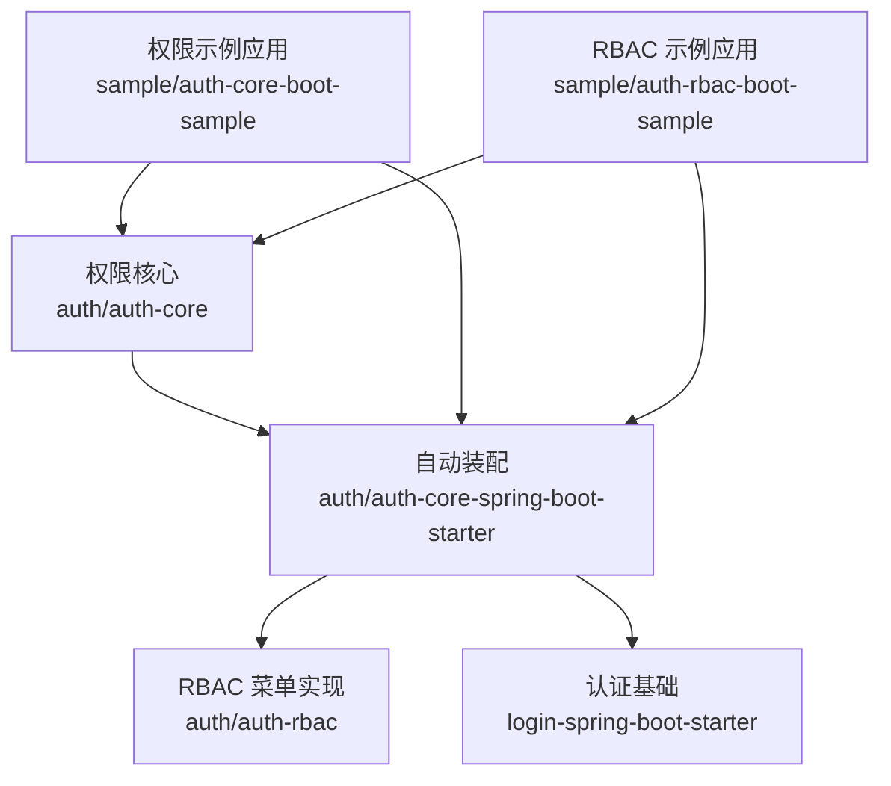

**图示来源**
- [AuthCoreConfig.java:1-200](file://auth/auth-core-spring-boot-starter/src/main/java/com/cu/framework/boot/auth/core/config/AuthCoreConfig.java#L1-L200)
- [AuthWebConfig.java:1-30](file://auth/auth-core-spring-boot-starter/src/main/java/com/cu/framework/boot/auth/core/config/AuthWebConfig.java#L1-L30)
- [RbacAnnotationAuthHandler.java:1-27](file://auth/auth-rbac/src/main/java/com/cu/framework/auth/rbac/RbacAnnotationAuthHandler.java#L1-L27)

**章节来源**
- [AuthCoreConfig.java:1-200](file://auth/auth-core-spring-boot-starter/src/main/java/com/cu/framework/boot/auth/core/config/AuthCoreConfig.java#L1-L200)
- [AuthWebConfig.java:1-30](file://auth/auth-core-spring-boot-starter/src/main/java/com/cu/framework/boot/auth/core/config/AuthWebConfig.java#L1-L30)

## 核心扩展点总览
框架暴露的扩展点可以按职责分为三类：

| 扩展维度 | 关键接口或注解 | 作用 | 默认行为 | 典型扩展方式 |
|---|---|---|---|---|
| 菜单访问控制 | `AuthMenuHandler` | 判断当前用户是否有权访问某个应用内路径 | RBAC 模块提供基于菜单组合的默认实现 | 实现 `hasMenuAccessAuth`，并替换 Bean |
| 数据操作校验 | `AuthDataHandler` | 校验业务方法对一批数据 ID 是否有编辑类权限 | JDBC 实现查权限表后在内存比对 | 替换 `AuthDataHandler` Bean |
| 数据范围查询 | `AuthDataRange`、`SqlAuthInject` | 在 Mapper SQL 上注入行级权限条件 | 通过 JSqlParser 拼接 `IN` 或 `EXISTS` 子查询 | 配置表名、列名、匹配方式；必要时扩展解析逻辑 |
| 用户上下文 | `AuthCurrentUserContextHolder` | 提供当前登录用户和扁平化权限集合 | 由具体应用或示例填充 | 实现 `getUser` 和 `getAuths` |
| 认证用户详情 | `SecurityUserDetailsService` | 统一用户名加载和用户详情密码更新 | 由应用或第三方认证适配实现 | 实现 `loadUserByUsername` 和 `updatePassword` |
| 安全异常响应 | `AuthenticationExceptionAdviceHandler` | 将未登录、拒绝、认证失败转为统一 JSON | 返回不同 code 的错误结果 | 覆盖对应 `@ExceptionHandler` 或提供同类型 Bean |

**章节来源**
- [AuthMenuHandler.java:1-27](file://auth/auth-core/src/main/java/com/cu/framework/auth/core/menu/AuthMenuHandler.java#L1-L27)
- [AuthDataHandler.java:1-102](file://auth/auth-core/src/main/java/com/cu/framework/auth/core/data/AuthDataHandler.java#L1-L102)
- [AuthDataRange.java:1-81](file://auth/auth-core/src/main/java/com/cu/framework/auth/core/AuthDataRange.java#L1-L81)
- [AuthCurrentUserContextHolder.java:1-25](file://auth/auth-core/src/main/java/com/cu/framework/auth/core/AuthCurrentUserContextHolder.java#L1-L25)
- [SecurityUserDetailsService.java:1-27](file://login-spring-boot-starter/src/main/java/com/cu/framework/authentication/service/SecurityUserDetailsService.java#L1-L27)
- [AuthenticationExceptionAdviceHandler.java:1-86](file://login-spring-boot-starter/src/main/java/com/cu/framework/authentication/handler/AuthenticationExceptionAdviceHandler.java#L1-L86)

## 架构概览
权限相关请求通常经历两条主线：

1. **菜单权限主线**：请求进入控制器前，由 `MenuAccessInterceptor` 检查是否声明了 `@AuthMenu`，若声明则委托 `AuthMenuHandler` 判断路径权限。
2. **数据权限主线**：写方法标注 `@AuthDataOperation` 时，由 `DataCheckAspect` 收集数据 ID，再委托 `AuthDataHandler` 判定每个 ID 的操作权限；Mapper 查询标注 `@AuthDataRange` 时，MyBatis 拦截器通过 `SqlAuthInject` 注入行级条件。

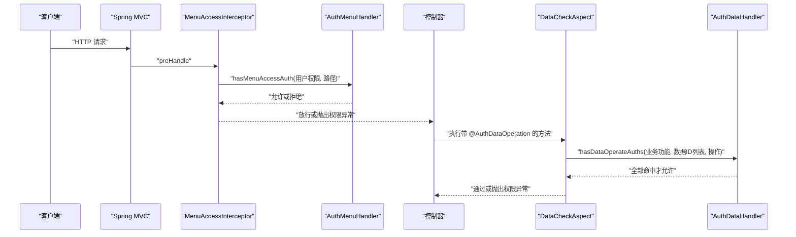

**图示来源**
- [MenuAccessInterceptor.java:1-93](file://auth/auth-core/src/main/java/com/cu/framework/auth/core/menu/MenuAccessInterceptor.java#L1-L93)
- [DataCheckAspect.java:1-149](file://auth/auth-core/src/main/java/com/cu/framework/auth/core/data/edit/DataCheckAspect.java#L1-L149)
- [AuthMenuHandler.java:1-27](file://auth/auth-core/src/main/java/com/cu/framework/auth/core/menu/AuthMenuHandler.java#L1-L27)
- [AuthDataHandler.java:1-102](file://auth/auth-core/src/main/java/com/cu/framework/auth/core/data/AuthDataHandler.java#L1-L102)

**章节来源**
- [MenuAccessInterceptor.java:1-93](file://auth/auth-core/src/main/java/com/cu/framework/auth/core/menu/MenuAccessInterceptor.java#L1-L93)
- [DataCheckAspect.java:1-149](file://auth/auth-core/src/main/java/com/cu/framework/auth/core/data/edit/DataCheckAspect.java#L1-L149)

## 菜单权限扩展：AuthMenuHandler
### 接口定义与职责
`AuthMenuHandler` 是菜单权限的核心 SPI，只关注“给定用户权限集合和应用内路径，是否允许访问”。它不包含任何 HTTP 细节，也不关心权限来自数据库、缓存还是外部系统。

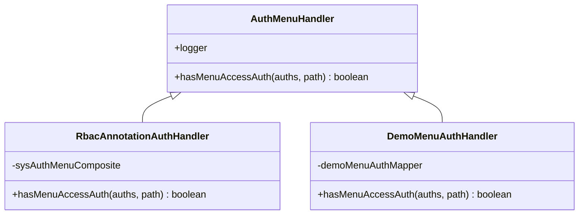

**图示来源**
- [AuthMenuHandler.java:1-27](file://auth/auth-core/src/main/java/com/cu/framework/auth/core/menu/AuthMenuHandler.java#L1-L27)
- [RbacAnnotationAuthHandler.java:1-27](file://auth/auth-rbac/src/main/java/com/cu/framework/auth/rbac/RbacAnnotationAuthHandler.java#L1-L27)
- [DemoMenuAuthHandler.java:1-63](file://sample/auth-core-boot-sample/src/main/java/com/cu/framework/sample/authcore/context/DemoMenuAuthHandler.java#L1-L63)

### 使用方式
1. 在控制器方法或类上添加 `@AuthMenu`。
2. 提供一个 `AuthMenuHandler` Bean：
   - 使用 RBAC 默认实现：引入 RBAC 模块即可。
   - 自定义规则：实现 `hasMenuAccessAuth`，根据路径和权限集合返回布尔值。
3. 启动后，所有被 `@AuthMenu` 管辖的端点都会经过 `MenuAccessInterceptor`。

### 推荐实践
- 路径语义要稳定：拦截器会去掉 `contextPath`，登记时应使用应用内路径。
- 权限为空应拒绝：没有登记的路径不应隐式放行。
- 日志记录拒绝原因：便于审计和排查。

**章节来源**
- [AuthMenu.java:1-16](file://auth/auth-core/src/main/java/com/cu/framework/auth/core/AuthMenu.java#L1-L16)
- [MenuAccessInterceptor.java:1-93](file://auth/auth-core/src/main/java/com/cu/framework/auth/core/menu/MenuAccessInterceptor.java#L1-L93)
- [DemoMenuAuthHandler.java:1-63](file://sample/auth-core-boot-sample/src/main/java/com/cu/framework/sample/authcore/context/DemoMenuAuthHandler.java#L1-L63)

## 数据操作权限扩展：AuthDataHandler
### 接口定义与职责
`AuthDataHandler` 负责数据操作维度的权限判定和权限数据维护，主要能力包括：
- 判定一组数据 ID 在指定业务功能和操作下是否都有权限。
- 编辑某条数据的权限集合。
- 查询某条数据在指定操作下的已授权权限。
- 删除某条数据对应的权限记录。

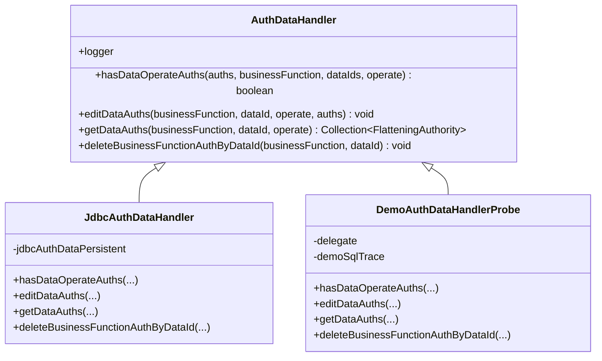

**图示来源**
- [AuthDataHandler.java:1-102](file://auth/auth-core/src/main/java/com/cu/framework/auth/core/data/AuthDataHandler.java#L1-L102)
- [JdbcAuthDataHandler.java:1-119](file://auth/auth-core/src/main/java/com/cu/framework/auth/core/data/JdbcAuthDataHandler.java#L1-L119)
- [DemoAuthDataHandlerProbe.java:1-54](file://sample/auth-core-boot-sample/src/main/java/com/cu/framework/sample/authcore/trace/DemoAuthDataHandlerProbe.java#L1-L54)

### 判定流程
当方法标注 `@AuthDataOperation` 时，框架会执行如下流程：

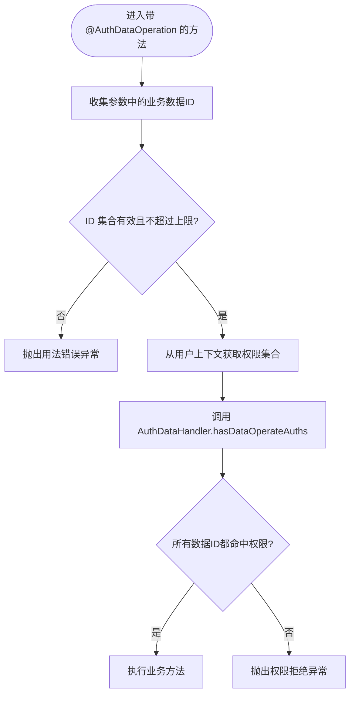

**图示来源**
- [DataCheckAspect.java:1-149](file://auth/auth-core/src/main/java/com/cu/framework/auth/core/data/edit/DataCheckAspect.java#L1-L149)
- [AuthDataHandler.java:1-102](file://auth/auth-core/src/main/java/com/cu/framework/auth/core/data/AuthDataHandler.java#L1-L102)
- [JdbcAuthDataHandler.java:1-119](file://auth/auth-core/src/main/java/com/cu/framework/auth/core/data/JdbcAuthDataHandler.java#L1-L119)

### 使用方式
1. 在写方法上标注 `@AuthDataOperation`，填写 `businessFunction` 和 `operate`。
2. 方法参数中包含实现了 `DataIdCarrier` 的对象，或由你自行收集数据 ID。
3. 如果需要直接调用权限逻辑而不依赖注解，可使用 `AuthDataAdaptor`。

**章节来源**
- [AuthDataOperation.java:1-51](file://auth/auth-core/src/main/java/com/cu/framework/auth/core/AuthDataOperation.java#L1-L51)
- [DataCheckAspect.java:1-149](file://auth/auth-core/src/main/java/com/cu/framework/auth/core/data/edit/DataCheckAspect.java#L1-L149)
- [AuthDataAdaptor.java:1-45](file://auth/auth-core/src/main/java/com/cu/framework/auth/core/AuthDataAdaptor.java#L1-L45)

## 数据范围权限扩展：AuthDataRange 与 SQL 注入
### 注解设计
`@AuthDataRange` 用于 MyBatis Mapper 查询方法，声明该语句应受数据范围权限约束。注解支持：
- 指定业务功能与操作类型。
- 指定主表、表别名和数据 ID 列。
- 选择 `IN` 或 `EXISTS` 匹配方式。

### SQL 注入机制
框架使用 `SqlAuthInject` 解析目标 SQL，找到匹配的表和 `PlainSelect`，然后注入权限子查询。权限集合为空时注入恒假条件，保证“无权限即零行”的语义。

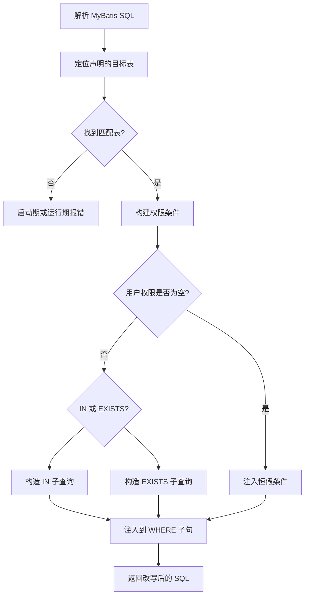

**图示来源**
- [AuthDataRange.java:1-81](file://auth/auth-core/src/main/java/com/cu/framework/auth/core/AuthDataRange.java#L1-L81)
- [SqlAuthInject.java:1-200](file://auth/auth-core/src/main/java/com/cu/framework/auth/core/data/range/SqlAuthInject.java#L1-L200)

### 使用方式
1. 在 Mapper 查询方法上添加 `@AuthDataRange`。
2. 正确声明 `businessFunction`、`table`、`dataIdColumn` 和 `operate`。
3. 如果权限表规模较大，可将 `matchMethod` 改为 `EXISTS`。
4. 启动时会校验映射语句存在、是查询语句、未启用二级缓存，并且静态 SQL 能定位到目标表。

**章节来源**
- [AuthDataRange.java:1-81](file://auth/auth-core/src/main/java/com/cu/framework/auth/core/AuthDataRange.java#L1-L81)
- [SqlAuthInject.java:1-200](file://auth/auth-core/src/main/java/com/cu/framework/auth/core/data/range/SqlAuthInject.java#L1-L200)

## 认证系统扩展：用户详情服务、过滤器与响应处理器
### SecurityUserDetailsService：自定义用户详情服务
`SecurityUserDetailsService` 同时继承 Spring Security 的 `UserDetailsService` 和 `UserDetailsPasswordService`，承担两个职责：
- 按用户名加载用户详情。
- 更新用户密码，常用于刷新旧算法加密后的密码。

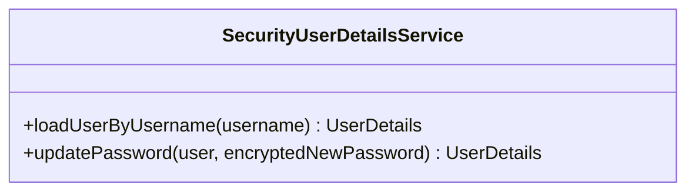

**图示来源**
- [SecurityUserDetailsService.java:1-27](file://login-spring-boot-starter/src/main/java/com/cu/framework/authentication/service/SecurityUserDetailsService.java#L1-L27)

### 过滤器：认证入口扩展点
框架提供了基于 `OncePerRequestFilter` 的过滤器示例。`TokenSessionRequestFilter` 已被标记为废弃，但展示了如何通过包装 `HttpServletRequest` 把请求头中的 token 作为会话标识传入。对于新的认证入口，建议：
- 新增一个 `OncePerRequestFilter` 子类。
- 解析自定义凭证（如 SSO token、OAuth2 token、短信验证码等）。
- 将解析结果写入 Spring Security 的 `SecurityContext`，而不是直接操作 Session。

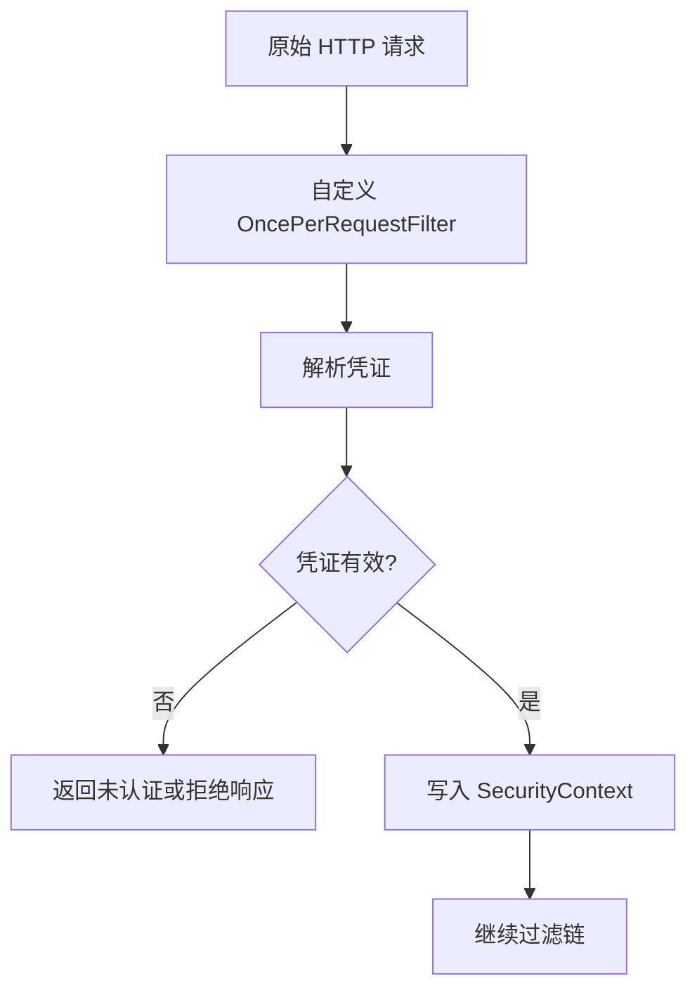

**图示来源**
- [TokenSessionRequestFilter.java:1-200](file://login-spring-boot-starter/src/main/java/com/cu/framework/authentication/filter/TokenSessionRequestFilter.java#L1-L200)

### 认证成功响应处理器：统一异常与结果格式
`AuthenticationExceptionAdviceHandler` 是一个 `@RestControllerAdvice`，将常见的安全异常转换为统一的 `Result` JSON。你可以：
- 覆盖其中某个 `@ExceptionHandler`。
- 提供自己的 `AuthenticationExceptionAdviceHandler` Bean。
- 在更高层的业务异常处理器中继续细化。

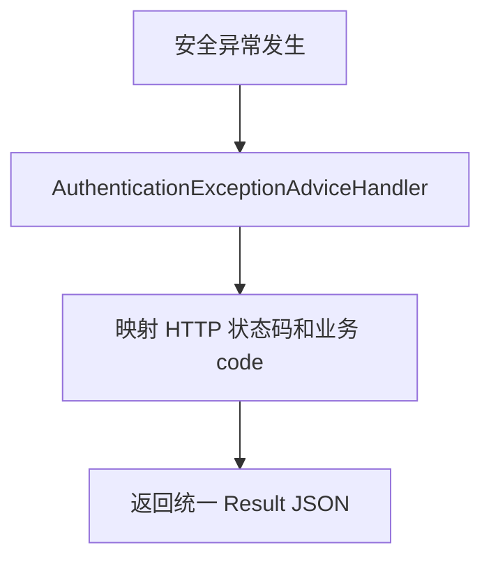

**图示来源**
- [AuthenticationExceptionAdviceHandler.java:1-86](file://login-spring-boot-starter/src/main/java/com/cu/framework/authentication/handler/AuthenticationExceptionAdviceHandler.java#L1-L86)

**章节来源**
- [SecurityUserDetailsService.java:1-27](file://login-spring-boot-starter/src/main/java/com/cu/framework/authentication/service/SecurityUserDetailsService.java#L1-L27)
- [TokenSessionRequestFilter.java:1-200](file://login-spring-boot-starter/src/main/java/com/cu/framework/authentication/filter/TokenSessionRequestFilter.java#L1-L200)
- [AuthenticationExceptionAdviceHandler.java:1-86](file://login-spring-boot-starter/src/main/java/com/cu/framework/authentication/handler/AuthenticationExceptionAdviceHandler.java#L1-L86)

## 数据存储层扩展：权限持久化与缓存定制
### 数据权限持久化
框架默认通过 `JdbcAuthDataHandler` 和 `JdbcAuthDataPersistent` 操作权限表。如果你希望使用 Redis、本地缓存或其他存储：
1. 实现 `AuthDataHandler`。
2. 在 Spring 容器中提供你的实现 Bean。
3. 由于 `AuthCoreConfig` 使用 `@ConditionalOnMissingBean(AuthDataHandler.class)`，只要你的 Bean 同名类型存在，默认 JDBC 实现就不会生效。

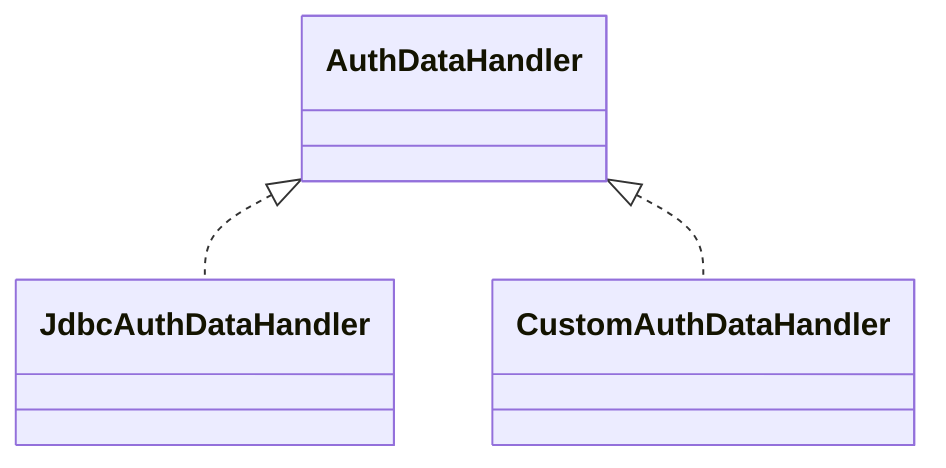

**图示来源**
- [AuthDataHandler.java:1-102](file://auth/auth-core/src/main/java/com/cu/framework/auth/core/data/AuthDataHandler.java#L1-L102)
- [JdbcAuthDataHandler.java:1-119](file://auth/auth-core/src/main/java/com/cu/framework/auth/core/data/JdbcAuthDataHandler.java#L1-L119)
- [AuthCoreConfig.java:1-200](file://auth/auth-core-spring-boot-starter/src/main/java/com/cu/framework/boot/auth/core/config/AuthCoreConfig.java#L1-L200)

### 数据范围声明缓存
`AuthRangeCache` 用于缓存 Mapper 上 `@AuthDataRange` 的解析结果，避免每次查询重复解析 SQL。启动阶段由 `AuthRangeStartupValidator` 扫描并填充缓存。

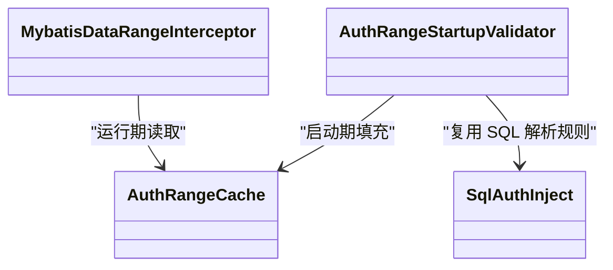

**图示来源**
- [AuthCoreConfig.java:1-200](file://auth/auth-core-spring-boot-starter/src/main/java/com/cu/framework/boot/auth/core/config/AuthCoreConfig.java#L1-L200)
- [SqlAuthInject.java:1-200](file://auth/auth-core/src/main/java/com/cu/framework/auth/core/data/range/SqlAuthInject.java#L1-L200)

**章节来源**
- [JdbcAuthDataHandler.java:1-119](file://auth/auth-core/src/main/java/com/cu/framework/auth/core/data/JdbcAuthDataHandler.java#L1-L119)
- [AuthCoreConfig.java:1-200](file://auth/auth-core-spring-boot-starter/src/main/java/com/cu/framework/boot/auth/core/config/AuthCoreConfig.java#L1-L200)

## 完整扩展开发流程示例
以下以“自定义菜单权限处理器 + 自定义用户上下文 + 观察数据权限调用”为例，给出端到端流程。

### 第一步：实现用户上下文
你需要实现 `AuthCurrentUserContextHolder`，让框架知道当前请求的用户是谁、拥有哪些扁平化权限。

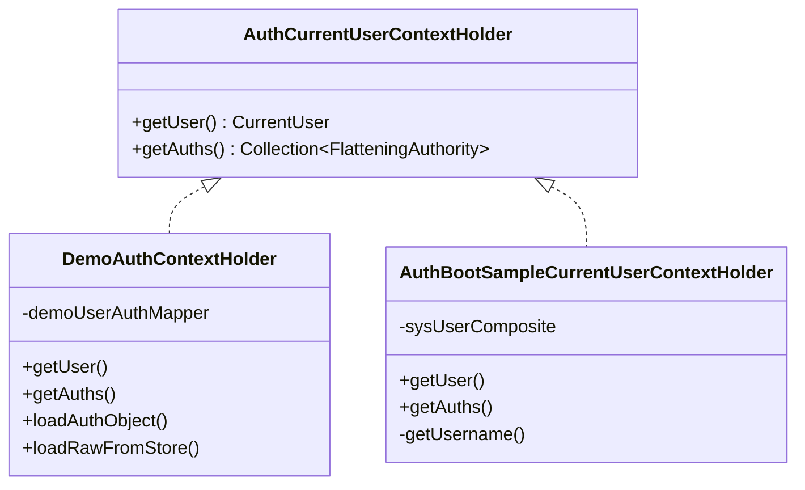

**图示来源**
- [AuthCurrentUserContextHolder.java:1-25](file://auth/auth-core/src/main/java/com/cu/framework/auth/core/AuthCurrentUserContextHolder.java#L1-L25)
- [DemoAuthContextHolder.java:1-78](file://sample/auth-core-boot-sample/src/main/java/com/cu/framework/sample/authcore/context/DemoAuthContextHolder.java#L1-L78)
- [AuthBootSampleCurrentUserContextHolder.java:1-77](file://sample/auth-rbac-boot-sample/src/main/java/com/cu/framework/auth/sample/AuthBootSampleCurrentUserContextHolder.java#L1-L77)

**章节来源**
- [DemoAuthContextHolder.java:1-78](file://sample/auth-core-boot-sample/src/main/java/com/cu/framework/sample/authcore/context/DemoAuthContextHolder.java#L1-L78)
- [AuthBootSampleCurrentUserContextHolder.java:1-77](file://sample/auth-rbac-boot-sample/src/main/java/com/cu/framework/auth/sample/AuthBootSampleCurrentUserContextHolder.java#L1-L77)

### 第二步：实现菜单权限处理器
实现 `AuthMenuHandler`，定义“哪些权限串可以访问哪些路径”。

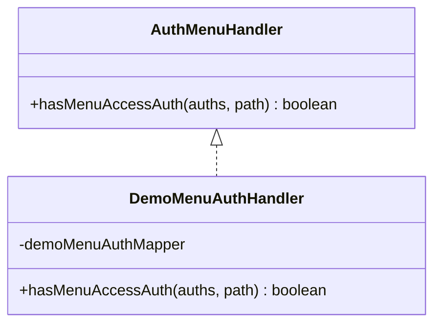

**图示来源**
- [AuthMenuHandler.java:1-27](file://auth/auth-core/src/main/java/com/cu/framework/auth/core/menu/AuthMenuHandler.java#L1-L27)
- [DemoMenuAuthHandler.java:1-63](file://sample/auth-core-boot-sample/src/main/java/com/cu/framework/sample/authcore/context/DemoMenuAuthHandler.java#L1-L63)

**章节来源**
- [DemoMenuAuthHandler.java:1-63](file://sample/auth-core-boot-sample/src/main/java/com/cu/framework/sample/authcore/context/DemoMenuAuthHandler.java#L1-L63)

### 第三步：观察或替换数据权限处理器
如果你只想观察框架默认的权限判定行为，可以实现 `AuthDataHandler` 并代理默认实现；如果要完全替换持久化策略，则提供你自己的 `AuthDataHandler` Bean。

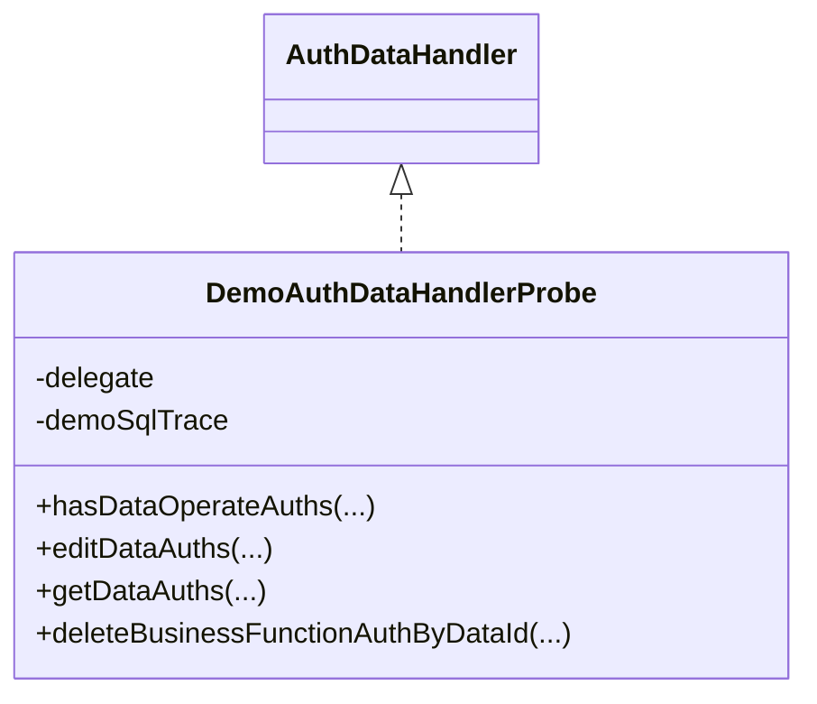

**图示来源**
- [AuthDataHandler.java:1-102](file://auth/auth-core/src/main/java/com/cu/framework/auth/core/data/AuthDataHandler.java#L1-L102)
- [DemoAuthDataHandlerProbe.java:1-54](file://sample/auth-core-boot-sample/src/main/java/com/cu/framework/sample/authcore/trace/DemoAuthDataHandlerProbe.java#L1-L54)

**章节来源**
- [DemoAuthDataHandlerProbe.java:1-54](file://sample/auth-core-boot-sample/src/main/java/com/cu/framework/sample/authcore/trace/DemoAuthDataHandlerProbe.java#L1-L54)

### 第四步：注册与验证
- 确保 Spring 容器中存在你实现的 `AuthCurrentUserContextHolder`、`AuthMenuHandler`，以及可选的 `AuthDataHandler`。
- 在控制器上使用 `@AuthMenu` 测试菜单权限。
- 在写方法上使用 `@AuthDataOperation` 测试数据操作权限。
- 在 Mapper 查询方法上使用 `@AuthDataRange` 测试数据范围权限。
- 通过统一异常处理器确认权限拒绝返回预期 JSON。

**章节来源**
- [AuthCoreConfig.java:1-200](file://auth/auth-core-spring-boot-starter/src/main/java/com/cu/framework/boot/auth/core/config/AuthCoreConfig.java#L1-L200)
- [AuthWebConfig.java:1-30](file://auth/auth-core-spring-boot-starter/src/main/java/com/cu/framework/boot/auth/core/config/AuthWebConfig.java#L1-L30)

## 依赖关系分析
下图展示核心扩展点的依赖方向：Web 层拦截器依赖菜单处理器和用户上下文；数据切面依赖数据权限处理器和用户上下文；默认数据权限处理器依赖持久层。

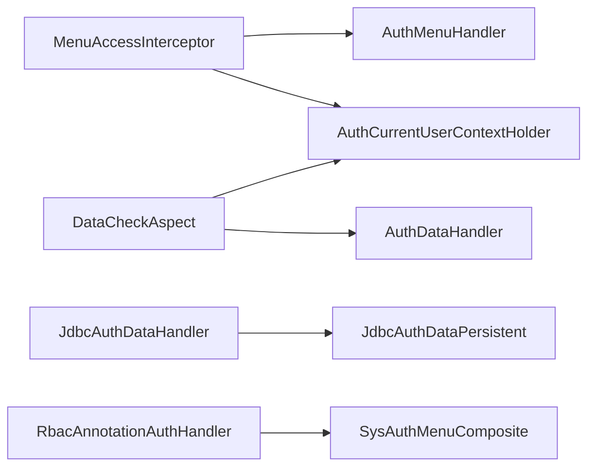

**图示来源**
- [MenuAccessInterceptor.java:1-93](file://auth/auth-core/src/main/java/com/cu/framework/auth/core/menu/MenuAccessInterceptor.java#L1-L93)
- [DataCheckAspect.java:1-149](file://auth/auth-core/src/main/java/com/cu/framework/auth/core/data/edit/DataCheckAspect.java#L1-L149)
- [JdbcAuthDataHandler.java:1-119](file://auth/auth-core/src/main/java/com/cu/framework/auth/core/data/JdbcAuthDataHandler.java#L1-L119)
- [RbacAnnotationAuthHandler.java:1-27](file://auth/auth-rbac/src/main/java/com/cu/framework/auth/rbac/RbacAnnotationAuthHandler.java#L1-L27)

**章节来源**
- [MenuAccessInterceptor.java:1-93](file://auth/auth-core/src/main/java/com/cu/framework/auth/core/menu/MenuAccessInterceptor.java#L1-L93)
- [DataCheckAspect.java:1-149](file://auth/auth-core/src/main/java/com/cu/framework/auth/core/data/edit/DataCheckAspect.java#L1-L149)
- [JdbcAuthDataHandler.java:1-119](file://auth/auth-core/src/main/java/com/cu/framework/auth/core/data/JdbcAuthDataHandler.java#L1-L119)
- [RbacAnnotationAuthHandler.java:1-27](file://auth/auth-rbac/src/main/java/com/cu/framework/auth/rbac/RbacAnnotationAuthHandler.java#L1-L27)

## 性能考虑
- **数据 ID 上限**：`DataCheckAspect` 对去重后的数据 ID 设置上限，超出时直接拒绝，避免一次调用退化为大规模权限查询。
- **权限集合不入查询条件**：`JdbcAuthDataHandler` 将用户权限放在内存中与权限表结果比对，防止用户权限规模影响 SQL 执行计划。
- **ID 归一化**：数据 ID 比较使用字符串归一化，整型、长整型等不同形态的主键被视为同一数据。
- **SQL 解析开销**：`@AuthDataRange` 的静态信息通过 `AuthRangeCache` 缓存，减少重复解析。
- **匹配策略选择**：权限表数据量较大时优先使用 `EXISTS`，避免 `IN` 列表过大。
- **上下文查询频率**：`AuthCurrentUserContextHolder.getAuths()` 的实现应避免在同一请求中重复高开销查询；如需缓存，应在业务上下文中控制生命周期。

[本节为通用性能建议，不直接分析具体代码片段]

## 故障排查
| 现象 | 可能原因 | 排查建议 |
|---|---|---|
| 菜单权限未生效 | 未添加 `@AuthMenu`，或未注册 `AuthMenuHandler` | 检查控制器是否声明注解，确认 `AuthMenuHandler` Bean 存在 |
| 菜单权限总是拒绝 | 路径未登记、权限集合为空、上下文未注入权限 | 查看 `AuthMenuHandler` 实现和 `AuthCurrentUserContextHolder.getAuths()` |
| 数据操作权限误拒 | 参数中没有 `DataIdCarrier`、ID 为空、ID 数量超限 | 检查方法参数结构和日志中的业务功能与操作类型 |
| 数据范围权限无效 | Mapper 方法未加 `@AuthDataRange`、表名或列名配置错误 | 检查注解属性，确认 SQL 能被解析并定位目标表 |
| 启动时报 SQL 解析失败 | 语句不是查询、启用了二级缓存、找不到目标表 | 根据启动校验错误修正 Mapper 声明 |
| 认证异常返回 500 | 缺少权限异常处理器或未注册全局异常处理器 | 确认 `AuthenticationExceptionAdviceHandler` 或自定义同类 Bean 存在 |

**章节来源**
- [DataCheckAspect.java:1-149](file://auth/auth-core/src/main/java/com/cu/framework/auth/core/data/edit/DataCheckAspect.java#L1-L149)
- [SqlAuthInject.java:1-200](file://auth/auth-core/src/main/java/com/cu/framework/auth/core/data/range/SqlAuthInject.java#L1-L200)
- [AuthenticationExceptionAdviceHandler.java:1-86](file://login-spring-boot-starter/src/main/java/com/cu/framework/authentication/handler/AuthenticationExceptionAdviceHandler.java#L1-L86)

## 结论
Kewen Framework 的扩展设计遵循“核心定义接口、starter 装配默认实现、应用替换 Bean”的模式。开发者只需实现少量接口：
- 用 `AuthCurrentUserContextHolder` 决定“谁在请求中”。
- 用 `AuthMenuHandler` 决定“哪个路径需要什么权限”。
- 用 `AuthDataHandler` 决定“哪些数据可以被编辑、查询和授权”。
- 用 `@AuthDataRange` 决定“哪些 SQL 需要行级数据权限”。
- 用 `SecurityUserDetailsService`、过滤器和异常处理器完善认证流程和统一响应。

通过这种方式，框架保持低耦合，而业务可以灵活扩展权限模型、认证来源和存储策略。

[本节为总结性内容，不直接分析具体文件]