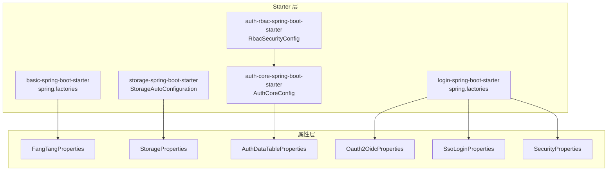
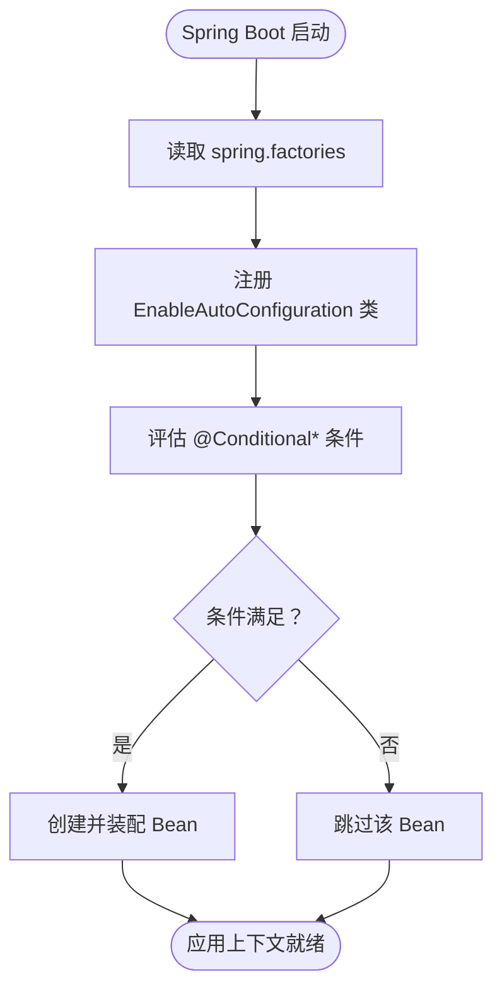
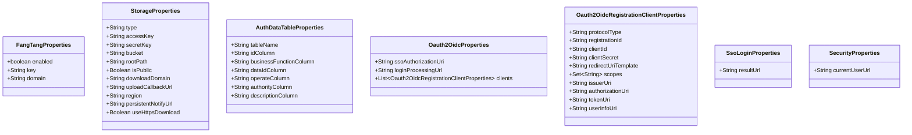
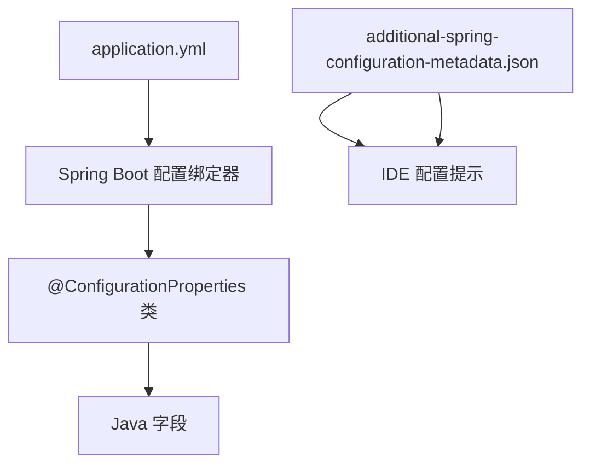
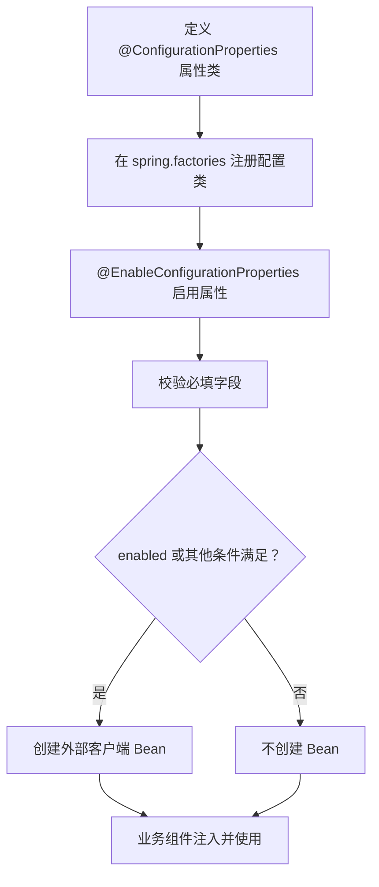
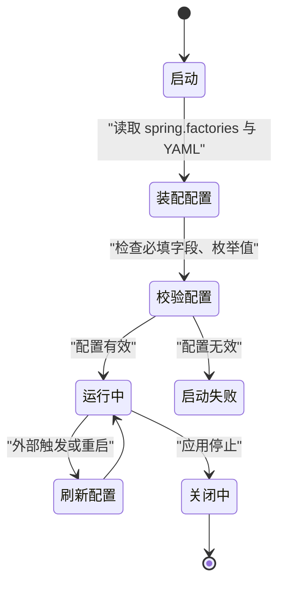
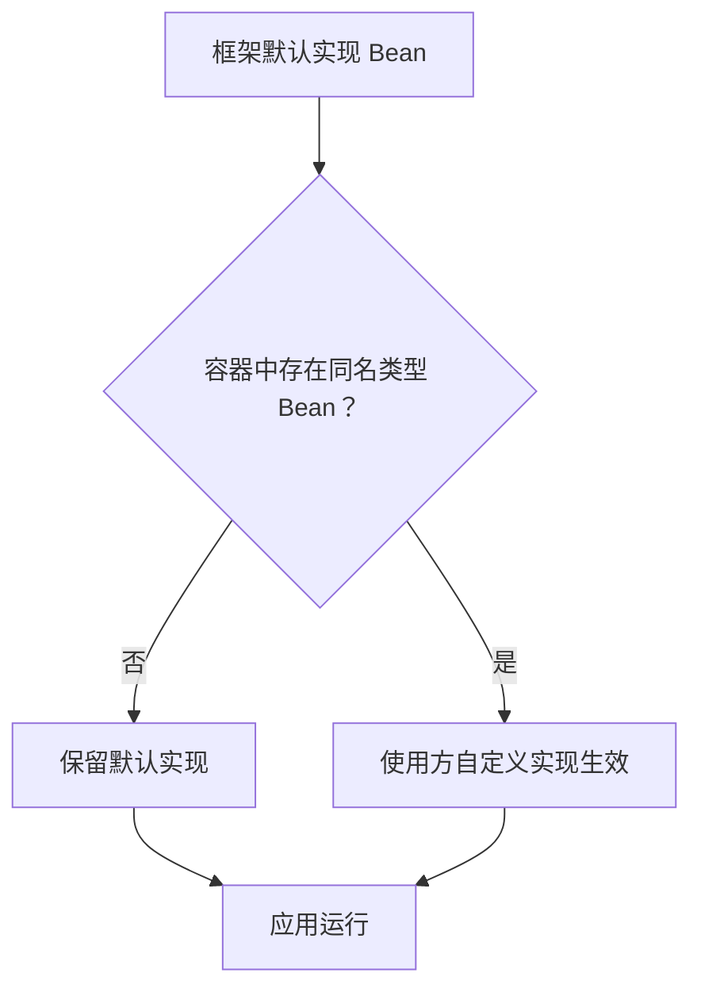

# 扩展配置管理

<cite>
**本文引用的文件**   
- [basic-spring-boot-starter 自动装配清单](file://boot/basic-spring-boot-starter/src/main/resources/META-INF/spring.factories)
- [auth-core 自动装配清单](file://auth/auth-core-spring-boot-starter/src/main/resources/META-INF/spring.factories)
- [login-spring-boot-starter 自动装配清单](file://login-spring-boot-starter/src/main/resources/META-INF/spring.factories)
- [基础能力配置类 BasicSupportConfig.java](file://boot/basic-spring-boot-starter/src/main/java/com/cu/framework/boot/basic/config/BasicSupportConfig.java)
- [方糖消息配置 FangTangMessageConfig.java](file://boot/basic-spring-boot-starter/src/main/java/com/cu/framework/boot/basic/config/FangTangMessageConfig.java)
- [方糖属性 FangTangProperties.java](file://boot/basic-spring-boot-starter/src/main/java/com/cu/framework/boot/basic/properties/FangTangProperties.java)
- [存储自动装配 StorageAutoConfiguration.java](file://boot/storage-spring-boot-starter/src/main/java/com/cu/framework/storage/boot/StorageAutoConfiguration.java)
- [存储属性 StorageProperties.java](file://boot/storage-spring-boot-starter/src/main/java/com/cu/framework/storage/boot/StorageProperties.java)
- [认证核心配置 AuthCoreConfig.java](file://auth/auth-core-spring-boot-starter/src/main/java/com/cu/framework/boot/auth/core/config/AuthCoreConfig.java)
- [权限表属性 AuthDataTableProperties.java](file://auth/auth-core-spring-boot-starter/src/main/java/com/cu/framework/boot/auth/core/properties/AuthDataTableProperties.java)
- [RBAC 安全配置 RbacSecurityConfig.java](file://auth/auth-rbac-security-spring-boot-starter/src/main/java/com/cu/framework/auth/rbac/security/RbacSecurityConfig.java)
- [会话配置 SessionConfig.java](file://login-spring-boot-starter/src/main/java/com/cu/framework/authentication/config/SessionConfig.java)
- [OAuth2/OIDC 配置 Oauth2Config.java](file://login-spring-boot-starter/src/main/java/com/cu/framework/authentication/oauth2/Oauth2Config.java)
- [OAuth2/OIDC 属性 Oauth2OidcProperties.java](file://login-spring-boot-starter/src/main/java/com/cu/framework/authentication/oauth2/Oauth2OidcProperties.java)
- [单点登录通用属性 SsoLoginProperties.java](file://login-spring-boot-starter/src/main/java/com/cu/framework/authentication/properties/SsoLoginProperties.java)
- [安全属性 SecurityProperties.java](file://login-spring-boot-starter/src/main/java/com/cu/framework/authentication/properties/SecurityProperties.java)
- [附加配置元数据 basic-spring-boot-starter](file://boot/basic-spring-boot-starter/src/main/resources/META-INF/additional-spring-configuration-metadata.json)
- [附加配置元数据 tenant-spring-boot-starter](file://boot/tenant-spring-boot-starter/src/main/resources/META-INF/additional-spring-configuration-metadata.json)
- [附加配置元数据 login-spring-boot-starter](file://login-spring-boot-starter/src/main/resources/META-INF/additional-spring-configuration-metadata.json)
- [附加配置元数据 auth-rbac-spring-boot-starter](file://auth/auth-rbac-spring-boot-starter/src/main/resources/META-INF/additional-spring-configuration-metadata.json)
- [框架参考配置 docs/application.yml](file://docs/application.yml)
</cite>

## 目录
1. [引言](#引言)
2. [项目结构中的扩展配置位置](#项目结构中的扩展配置位置)
3. [核心概念与自动装配机制](#核心概念与自动装配机制)
4. [配置属性类设计模式](#配置属性类设计模式)
5. [YAML 配置组织与元数据](#yaml-配置组织与元数据)
6. [完整扩展配置示例](#完整扩展配置示例)
7. [生命周期管理：启动、运行期与关闭](#生命周期管理启动运行期与关闭)
8. [安全性与敏感信息保护](#安全性与敏感信息保护)
9. [冲突解决与版本兼容性](#冲突解决与版本兼容性)
10. [依赖关系图](#依赖关系图)
11. [故障排查指南](#故障排查指南)
12. [结论](#结论)

## 引言
本指南面向希望在当前 Spring Boot 框架基础上扩展功能并接入统一配置管理的开发者。仓库已经通过多个 Spring Boot Starter 实现了完整的扩展点，包括基础能力、存储、认证、RBAC、租户和登录等模块。本文围绕以下目标展开：
- 解释 `@Configuration`、`@ConditionalOnMissingBean`、`@ConditionalOnProperty`、`@EnableConfigurationProperties` 在框架扩展中的实际用法。
- 说明如何为自定义扩展组件编写 `@ConfigurationProperties` 属性类，并提供 YAML 配置组织方式。
- 给出包含默认值、必填校验、运行时行为切换的完整配置示例。
- 说明扩展组件的生命周期：启动时初始化、运行期条件装配、关闭时资源释放。
- 覆盖环境变量注入、配置文件加密、敏感字段处理和配置冲突治理。
- 结合仓库中已有实现，给出可落地的最佳实践。

## 项目结构中的扩展配置位置
仓库采用“按 Starter 分模块”的组织方式。每个 Starter 通常包含三类关键内容：
- Java 配置类：使用 `@Configuration` 定义 Bean 装配逻辑。
- 属性类：使用 `@ConfigurationProperties` 绑定 YAML 或环境变量。
- 自动装配清单：通过 `META-INF/spring.factories` 暴露 `EnableAutoConfiguration`。

**图示来源**
- [basic-spring-boot-starter 自动装配清单:1-7](file://boot/basic-spring-boot-starter/src/main/resources/META-INF/spring.factories#L1-L7)
- [storage-spring-boot-starter StorageAutoConfiguration.java:1-100](file://boot/storage-spring-boot-starter/src/main/java/com/cu/framework/storage/boot/StorageAutoConfiguration.java#L1-L100)
- [auth-core 自动装配清单:1-3](file://auth/auth-core-spring-boot-starter/src/main/resources/META-INF/spring.factories#L1-L3)
- [auth-core 配置 AuthCoreConfig.java:1-203](file://auth/auth-core-spring-boot-starter/src/main/java/com/cu/framework/boot/auth/core/config/AuthCoreConfig.java#L1-L203)
- [login-spring-boot-starter 自动装配清单:1-8](file://login-spring-boot-starter/src/main/resources/META-INF/spring.factories#L1-L8)
- [RBAC 安全配置 RbacSecurityConfig.java:1-35](file://auth/auth-rbac-security-spring-boot-starter/src/main/java/com/cu/framework/auth/rbac/security/RbacSecurityConfig.java#L1-L35)

**章节来源**
- [basic-spring-boot-starter 自动装配清单:1-7](file://boot/basic-spring-boot-starter/src/main/resources/META-INF/spring.factories#L1-L7)
- [auth-core 自动装配清单:1-3](file://auth/auth-core-spring-boot-starter/src/main/resources/META-INF/spring.factories#L1-L3)
- [login-spring-boot-starter 自动装配清单:1-8](file://login-spring-boot-starter/src/main/resources/META-INF/spring.factories#L1-L8)

## 核心概念与自动装配机制
框架广泛使用 Spring Boot 自动装配来降低使用者配置成本。关键注解及其作用如下：

| 注解 | 作用 | 仓库中的典型场景 |
|---|---|---|
| `@Configuration` | 声明配置类，用于注册 Bean、扫描包、启用其他配置 | `BasicSupportConfig`、`AuthCoreConfig`、`Oauth2Config`、`SessionConfig` |
| `@EnableConfigurationProperties` | 显式启用某个属性类，使其可被注入 | `StorageAutoConfiguration`、`FangTangMessageConfig`、`SessionConfig`、`Oauth2Config` |
| `@ConfigurationProperties` | 将 YAML 前缀映射到 Java 对象字段 | `FangTangProperties`、`StorageProperties`、`AuthDataTableProperties`、`Oauth2OidcProperties` |
| `@ConditionalOnMissingBean` | 仅当容器中没有同类型 Bean 时才装配默认实现 | `AuthCoreConfig`、`AuthRbacConfig`、`RbacSecurityConfig` |
| `@ConditionalOnProperty` | 根据配置项是否存在或取值是否匹配才装配 Bean | `BasicSupportConfig`、`FangTangMessageConfig`、`SessionConfig` |
| `@ConditionalOnBean` | 依赖某个 Bean 存在时才装配当前 Bean | `BasicSupportConfig`、`SessionConfig` |
| `@ConditionalOnWebApplication` | 仅在 Web 应用环境下生效 | `AuthCoreConfig` 中的异常处理器 |

### 自动装配入口
各 Starter 通过 `META-INF/spring.factories` 注册自动配置类，Spring Boot 启动时会自动加载这些类。例如：
- `basic-spring-boot-starter` 注册异步、基础支持、早期过滤器、方糖消息、MyBatis Plus、请求响应格式等配置。
- `auth-core-spring-boot-starter` 注册权限核心配置和 Web 相关配置。
- `login-spring-boot-starter` 注册安全 Bean、安全规则、认证结果处理、会话、密码登录、SAML2、OAuth2/OIDC 等配置。

**图示来源**
- [basic-spring-boot-starter 自动装配清单:1-7](file://boot/basic-spring-boot-starter/src/main/resources/META-INF/spring.factories#L1-L7)
- [auth-core 自动装配清单:1-3](file://auth/auth-core-spring-boot-starter/src/main/resources/META-INF/spring.factories#L1-L3)
- [login-spring-boot-starter 自动装配清单:1-8](file://login-spring-boot-starter/src/main/resources/META-INF/spring.factories#L1-L8)

**章节来源**
- [basic-spring-boot-starter 自动装配清单:1-7](file://boot/basic-spring-boot-starter/src/main/resources/META-INF/spring.factories#L1-L7)
- [auth-core 自动装配清单:1-3](file://auth/auth-core-spring-boot-starter/src/main/resources/META-INF/spring.factories#L1-L3)
- [login-spring-boot-starter 自动装配清单:1-8](file://login-spring-boot-starter/src/main/resources/META-INF/spring.factories#L1-L8)

## 配置属性类设计模式
框架的属性类遵循统一模式：
1. 使用 `@ConfigurationProperties(prefix = "...")` 指定 YAML 前缀。
2. 使用 Lombok 或手写 getter/setter 暴露字段。
3. 对可选字段提供合理默认值。
4. 对必填字段由配置类或业务逻辑进行校验。
5. 复杂嵌套结构拆分为内部静态类，如 OAuth2/OIDC 客户端列表。

### 典型属性类
| 属性类 | 前缀 | 主要职责 | 默认值或约束 |
|---|---|---|---|
| `FangTangProperties` | `cu.notify.fang-tang` | 方糖消息通知开关、密钥、域名 | `domain` 默认第三方接口地址；`key` 为空时报错 |
| `StorageProperties` | `cu.storage` | 七牛存储访问密钥、桶、区域、下载域名、回调等 | `rootPath` 默认空串，`isPublic` 默认公开，`region` 默认华南 |
| `AuthDataTableProperties` | `cu.auth.auth-data-table` | 权限数据表名及列名映射 | 所有列名均有默认值，便于直接对接现有库 |
| `Oauth2OidcProperties` | `cu.security.login.oauth2` | OAuth2/OIDC 授权端点、回调、客户端注册列表 | 提供协议默认路径、授权码模式、OIDC scope 自动补充等语义 |
| `SsoLoginProperties` | `cu.security.login.sso` | 单点登录成功或失败后的结果页 | 无默认值，留空表示保持 JSON 响应 |
| `SecurityProperties` | `cu.security` | 当前用户接口地址等安全相关全局配置 | 当前代码未消费该字段，但保留配置空间 |

**图示来源**
- [方糖属性 FangTangProperties.java:1-52](file://boot/basic-spring-boot-starter/src/main/java/com/cu/framework/boot/basic/properties/FangTangProperties.java#L1-L52)
- [存储属性 StorageProperties.java:1-63](file://boot/storage-spring-boot-starter/src/main/java/com/cu/framework/storage/boot/StorageProperties.java#L1-L63)
- [权限表属性 AuthDataTableProperties.java:1-109](file://auth/auth-core-spring-boot-starter/src/main/java/com/cu/framework/boot/auth/core/properties/AuthDataTableProperties.java#L1-L109)
- [OAuth2/OIDC 属性 Oauth2OidcProperties.java:1-237](file://login-spring-boot-starter/src/main/java/com/cu/framework/authentication/oauth2/Oauth2OidcProperties.java#L1-L237)
- [单点登录通用属性 SsoLoginProperties.java:1-24](file://login-spring-boot-starter/src/main/java/com/cu/framework/authentication/properties/SsoLoginProperties.java#L1-L24)
- [安全属性 SecurityProperties.java:1-22](file://login-spring-boot-starter/src/main/java/com/cu/framework/authentication/properties/SecurityProperties.java#L1-L22)

**章节来源**
- [方糖属性 FangTangProperties.java:1-52](file://boot/basic-spring-boot-starter/src/main/java/com/cu/framework/boot/basic/properties/FangTangProperties.java#L1-L52)
- [存储属性 StorageProperties.java:1-63](file://boot/storage-spring-boot-starter/src/main/java/com/cu/framework/storage/boot/StorageProperties.java#L1-L63)
- [权限表属性 AuthDataTableProperties.java:1-109](file://auth/auth-core-spring-boot-starter/src/main/java/com/cu/framework/boot/auth/core/properties/AuthDataTableProperties.java#L1-L109)
- [OAuth2/OIDC 属性 Oauth2OidcProperties.java:1-237](file://login-spring-boot-starter/src/main/java/com/cu/framework/authentication/oauth2/Oauth2OidcProperties.java#L1-L237)
- [单点登录通用属性 SsoLoginProperties.java:1-24](file://login-spring-boot-starter/src/main/java/com/cu/framework/authentication/properties/SsoLoginProperties.java#L1-L24)
- [安全属性 SecurityProperties.java:1-22](file://login-spring-boot-starter/src/main/java/com/cu/framework/authentication/properties/SecurityProperties.java#L1-L22)

## YAML 配置组织与元数据
### 配置分组策略
框架参考配置将不同 Starter 的配置集中在一个文档化 YAML 文件中，并按功能域分组：
- `cu.request`：请求日志持久化、请求消息推送。
- `cu.notify`：第三方消息通道。
- `cu.storage`：文件存储。
- `cu.tenant`：租户开关。
- `cu.auth`：权限数据表、菜单缓存、免登录放行 URL。
- `cu.security`：安全、会话、记住我、单点登录、OAuth2/OIDC、SAML2。

这种组织方式适合大型系统，但需要配合 IDE 元数据才能获得良好提示。

### 元数据增强
仓库在每个 Starter 的 `META-INF/additional-spring-configuration-metadata.json` 中声明属性名称、类型、默认值和描述，以便 IDE 和 Spring Boot Actuator 配置元数据工具识别。例如：
- `cu.request.persistent.database`
- `cu.request.message.fang-tang`
- `cu.tenant.open`
- `cu.auth.permit-url`
- `cu.auth.cache-auth`

**图示来源**
- [框架参考配置 docs/application.yml:1-206](file://docs/application.yml#L1-L206)
- [附加配置元数据 basic-spring-boot-starter:1-16](file://boot/basic-spring-boot-starter/src/main/resources/META-INF/additional-spring-configuration-metadata.json#L1-L16)
- [附加配置元数据 tenant-spring-boot-starter:1-10](file://boot/tenant-spring-boot-starter/src/main/resources/META-INF/additional-spring-configuration-metadata.json#L1-L10)
- [附加配置元数据 login-spring-boot-starter:1-10](file://login-spring-boot-starter/src/main/resources/META-INF/additional-spring-configuration-metadata.json#L1-L10)
- [附加配置元数据 auth-rbac-spring-boot-starter:1-10](file://auth/auth-rbac-spring-boot-starter/src/main/resources/META-INF/additional-spring-configuration-metadata.json#L1-L10)

**章节来源**
- [框架参考配置 docs/application.yml:1-206](file://docs/application.yml#L1-L206)
- [附加配置元数据 basic-spring-boot-starter:1-16](file://boot/basic-spring-boot-starter/src/main/resources/META-INF/additional-spring-configuration-metadata.json#L1-L16)
- [附加配置元数据 tenant-spring-boot-starter:1-10](file://boot/tenant-spring-boot-starter/src/main/resources/META-INF/additional-spring-configuration-metadata.json#L1-L10)
- [附加配置元数据 login-spring-boot-starter:1-10](file://login-spring-boot-starter/src/main/resources/META-INF/additional-spring-configuration-metadata.json#L1-L10)
- [附加配置元数据 auth-rbac-spring-boot-starter:1-10](file://auth/auth-rbac-spring-boot-starter/src/main/resources/META-INF/additional-spring-configuration-metadata.json#L1-L10)

## 完整扩展配置示例
下面以“新增一个可插拔的通知渠道”为例，说明如何完成从属性类、自动装配、条件装配到 YAML 配置的完整流程。

### 步骤一：定义属性类
新建属性类，使用 `@ConfigurationProperties` 指定前缀，并为可选字段设置默认值。对于敏感字段（如密钥），不要写入源码注释中的明文，只保留字段名和类型。

### 步骤二：注册自动装配
在 Starter 的 `META-INF/spring.factories` 中注册配置类，或使用 `@Import` 引入。若希望该 Starter 只对特定业务启用，应使用 `@ConditionalOnProperty` 控制。

### 步骤三：实现条件装配
类似 `FangTangMessageConfig`，先 `@EnableConfigurationProperties` 启用属性类，再根据 `enabled` 判断是否创建客户端 Bean；如果密钥或域名缺失，应在启动阶段抛出明确错误。

### 步骤四：编写 YAML
参考 `docs/application.yml` 的结构，把新渠道放在对应业务分组下，并在元数据文件中登记属性名、类型、默认值和说明。

### 步骤五：添加验证
- 必填字段：在配置类构造或 Bean 创建时校验，失败则抛异常。
- 枚举字段：建议使用 Java 枚举封装合法值，避免字符串拼写错误。
- 组合条件：多个配置项共同决定行为时，使用 `@ConditionalOnProperty` 多条件组合。

[此图为通用扩展流程示意，不对应单一源码文件，因此不列出图示来源]

## 生命周期管理：启动、运行期与关闭
### 启动时初始化
框架在启动阶段完成大量装配：
- 读取 `spring.factories` 注册自动配置。
- 解析 `@ConfigurationProperties` 并绑定 YAML、环境变量、命令行参数。
- 根据 `@Conditional*` 决定是否创建 Bean。
- 构建数据库连接、存储模板、安全过滤器链等基础设施。

典型实现包括：
- `StorageAutoConfiguration` 在启动时根据 `cu.storage.region` 解析七牛区域，无效值直接抛出非法参数异常。
- `AuthCoreConfig` 在启动后扫描数据范围声明，发现配置错误时让启动失败，而不是静默失效。
- `FangTangMessageConfig` 在创建客户端前校验密钥和域名。

### 运行期动态刷新
当前仓库中并未看到基于 `@RefreshScope` 或配置中心监听器的热更新实现。因此：
- 修改 YAML 后通常需要重启服务。
- 若需要运行期刷新，可在自定义属性类上配合配置中心监听，或在 Bean 上暴露 `refresh()` 方法，由外部调度触发。
- 对于缓存型组件（如菜单缓存、权限缓存），刷新时应同时清理旧缓存，避免新旧配置共存。

### 关闭时资源清理
仓库中未显式实现 `@PreDestroy` 或 `DisposableBean` 作为统一关闭钩子。实践中建议：
- 对外部 HTTP 客户端、线程池、连接池增加关闭逻辑。
- 对文件上传回调、消息队列消费者、定时任务在应用关闭时优雅停止。
- 避免在销毁阶段再次访问已销毁的数据库连接或第三方服务。

[此图为通用生命周期示意，不对应单一源码文件，因此不列出图示来源]

**章节来源**
- [存储自动装配 StorageAutoConfiguration.java:1-100](file://boot/storage-spring-boot-starter/src/main/java/com/cu/framework/storage/boot/StorageAutoConfiguration.java#L1-L100)
- [认证核心配置 AuthCoreConfig.java:1-203](file://auth/auth-core-spring-boot-starter/src/main/java/com/cu/framework/boot/auth/core/config/AuthCoreConfig.java#L1-L203)
- [方糖消息配置 FangTangMessageConfig.java:1-44](file://boot/basic-spring-boot-starter/src/main/java/com/cu/framework/boot/basic/config/FangTangMessageConfig.java#L1-L44)

## 安全性与敏感信息保护
### 环境变量注入
Spring Boot 支持从环境变量、操作系统属性、JVM 参数中读取配置。对于密钥类字段，推荐做法：
- 使用环境变量或密钥管理服务注入，例如 `cu.storage.access-key`、`cu.storage.secret-key`、`cu.auth.auth-data-table.*` 等敏感字段。
- 不在 Git 仓库中提交真实密钥。
- 在部署脚本或容器中注入敏感变量。

### 配置文件加密
仓库根目录中存在 `clean-sensitive-files.sh`，表明项目关注敏感文件清理。结合常见实践：
- 使用 Jasypt 等工具对 YAML 中的敏感字段加密。
- 在启动参数或环境变量中提供解密密钥。
- 确保 CI/CD 流水线不会泄露解密后的配置文件。

### 日志脱敏
仓库中的基础模块包含请求日志、跟踪日志、方糖消息通知等能力。应避免在日志中打印：
- 用户名密码
- OAuth2/OIDC 的 `client-secret`
- 存储 `secretKey`
- 第三方消息通道的 `key`

### 配置校验与安全边界
- 对必填字段进行启动期校验，例如方糖消息 `key` 为空时报错。
- 对区域、协议类型、认证方式等枚举字段进行白名单校验。
- 对 SSL 证书校验、HTTPS 下载等安全选项提供显式开关，避免误开启测试环境不安全配置。

**章节来源**
- [方糖消息配置 FangTangMessageConfig.java:1-44](file://boot/basic-spring-boot-starter/src/main/java/com/cu/framework/boot/basic/config/FangTangMessageConfig.java#L1-L44)
- [存储属性 StorageProperties.java:1-63](file://boot/storage-spring-boot-starter/src/main/java/com/cu/framework/storage/boot/StorageProperties.java#L1-L63)
- [OAuth2/OIDC 属性 Oauth2OidcProperties.java:1-237](file://login-spring-boot-starter/src/main/java/com/cu/framework/authentication/oauth2/Oauth2OidcProperties.java#L1-L237)

## 冲突解决与版本兼容性
### 使用 `@ConditionalOnMissingBean` 提供可替换默认实现
仓库中多处使用“默认实现 + 允许覆盖”的模式：
- `AuthCoreConfig` 提供 `JdbcAuthDataHandler` 默认实现，若使用者自定义 `AuthDataHandler`，则默认实现不生效。
- `AuthRbacConfig` 提供 `RbacAnnotationAuthHandler` 和内存版菜单存储，若使用者提供 `AuthMenuHandler` 或 `AuthMenuStore`，则默认实现让位。
- `RbacSecurityConfig` 提供 `SecurityUserDetailsService` 默认实现，若使用者自定义该 Bean，则 RBAC 默认实现不注册。

**图示来源**
- [认证核心配置 AuthCoreConfig.java:1-203](file://auth/auth-core-spring-boot-starter/src/main/java/com/cu/framework/boot/auth/core/config/AuthCoreConfig.java#L1-L203)
- [RBAC 安全配置 RbacSecurityConfig.java:1-35](file://auth/auth-rbac-security-spring-boot-starter/src/main/java/com/cu/framework/auth/rbac/security/RbacSecurityConfig.java#L1-L35)

### 使用 `@ConditionalOnProperty` 控制功能开关
- 请求日志持久化：只有 `cu.request.persistent.database=true` 时才注册数据库持久化监听器。
- 方糖消息：只有 `cu.request.message.fang-tang=true` 且 `cu.notify.fang-tang.enabled=true` 且存在 `FangTangMessageClient` 时才注册消息监听器。
- Remember Me：只有 `cu.security.remember-me.enabled=true` 时才注册基于 Spring Session 的记住我服务。

### 向后兼容原则
- 默认值应尽可能保持原有行为，例如存储 `region` 默认华南区域，避免升级后跨区域。
- 废弃字段应先标记 `@Deprecated`，并在文档中说明替代方案。
- 新增必填字段时应谨慎，优先提供默认值；若必须必填，应在启动时给出清晰错误信息。
- 对协议相关配置（如 OAuth2/OIDC）应区分“自动发现”和“手动配置”，避免因 IDP 变更导致配置失效。

**章节来源**
- [基础能力配置类 BasicSupportConfig.java:1-45](file://boot/basic-spring-boot-starter/src/main/java/com/cu/framework/boot/basic/config/BasicSupportConfig.java#L1-L45)
- [认证核心配置 AuthCoreConfig.java:1-203](file://auth/auth-core-spring-boot-starter/src/main/java/com/cu/framework/boot/auth/core/config/AuthCoreConfig.java#L1-L203)
- [RBAC 安全配置 RbacSecurityConfig.java:1-35](file://auth/auth-rbac-security-spring-boot-starter/src/main/java/com/cu/framework/auth/rbac/security/RbacSecurityConfig.java#L1-L35)
- [会话配置 SessionConfig.java:1-124](file://login-spring-boot-starter/src/main/java/com/cu/framework/authentication/config/SessionConfig.java#L1-L124)

## 依赖关系图
下面的依赖图展示几个关键 Starter 与其属性类、配置类的关系：

```mermaid
graph TB
    subgraph "基础能力"
        BSF["basic-spring-boot-starter spring.factories"]
        BSC["BasicSupportConfig"]
        FMC["FangTangMessageConfig"]
        FP["FangTangProperties"]
    end

    subgraph "存储"
        SSF["storage-spring-boot-starter"]
        SAC["StorageAutoConfiguration"]
        SP["StorageProperties"]
    end

    subgraph "认证"
        ASF["auth-core-spring-boot-starter spring.factories"]
        ACC["AuthCoreConfig"]
        ADP["AuthDataTableProperties"]
    end

    subgraph "登录"
        LSF["login-spring-boot-starter spring.factories"]
        OC["Oauth2Config"]
        OP["Oauth2OidcProperties"]
        SC["SessionConfig"]
    end

    BSF --> BSC
    BSF --> FMC
    FMC --> FP
    SSF --> SAC
    SAC --> SP
    ASF --> ACC
    ACC --> ADP
    LSF --> OC
    OC --> OP
    LSF --> SC
```

**图示来源**
- [basic-spring-boot-starter 自动装配清单:1-7](file://boot/basic-spring-boot-starter/src/main/resources/META-INF/spring.factories#L1-L7)
- [auth-core 自动装配清单:1-3](file://auth/auth-core-spring-boot-starter/src/main/resources/META-INF/spring.factories#L1-L3)
- [login-spring-boot-starter 自动装配清单:1-8](file://login-spring-boot-starter/src/main/resources/META-INF/spring.factories#L1-L8)
- [基础能力配置类 BasicSupportConfig.java:1-45](file://boot/basic-spring-boot-starter/src/main/java/com/cu/framework/boot/basic/config/BasicSupportConfig.java#L1-L45)
- [方糖消息配置 FangTangMessageConfig.java:1-44](file://boot/basic-spring-boot-starter/src/main/java/com/cu/framework/boot/basic/config/FangTangMessageConfig.java#L1-L44)
- [存储自动装配 StorageAutoConfiguration.java:1-100](file://boot/storage-spring-boot-starter/src/main/java/com/cu/framework/storage/boot/StorageAutoConfiguration.java#L1-L100)
- [认证核心配置 AuthCoreConfig.java:1-203](file://auth/auth-core-spring-boot-starter/src/main/java/com/cu/framework/boot/auth/core/config/AuthCoreConfig.java#L1-L203)
- [OAuth2/OIDC 配置 Oauth2Config.java:1-271](file://login-spring-boot-starter/src/main/java/com/cu/framework/authentication/oauth2/Oauth2Config.java#L1-L271)
- [会话配置 SessionConfig.java:1-124](file://login-spring-boot-starter/src/main/java/com/cu/framework/authentication/config/SessionConfig.java#L1-L124)

## 故障排查指南
### 启动时报缺少必填配置
- 现象：方糖消息启动失败，提示密钥或域名为空。
- 原因：`FangTangMessageConfig` 在创建客户端前校验 `key` 和 `domain`。
- 处理：
  - 确认 `cu.notify.fang-tang.enabled=true`。
  - 配置 `cu.notify.fang-tang.key` 和 `cu.notify.fang-tang.domain`。
  - 若不需要该功能，关闭 `cu.request.message.fang-tang` 或 `cu.notify.fang-tang.enabled`。

**章节来源**
- [方糖消息配置 FangTangMessageConfig.java:1-44](file://boot/basic-spring-boot-starter/src/main/java/com/cu/framework/boot/basic/config/FangTangMessageConfig.java#L1-L44)

### 存储区域配置错误
- 现象：启动时报无法识别的存储区域。
- 原因：`StorageAutoConfiguration.resolveRegion` 对 `cu.storage.region` 做严格映射。
- 处理：
  - 使用 `region0/huadong`、`region1/huabei`、`region2/huanan`、`region3/beimei`、`region4/xinjiapo`、`auto`。
  - 不要填写未知值，避免静默落到错误机房。

**章节来源**
- [存储自动装配 StorageAutoConfiguration.java:1-100](file://boot/storage-spring-boot-starter/src/main/java/com/cu/framework/storage/boot/StorageAutoConfiguration.java#L1-L100)

### 权限数据范围声明静默失效
- 现象：启用了权限模块，但行级数据权限不生效。
- 原因：若未正确装配 MyBatis 或未注册校验器，可能表现为静默失效。
- 处理：
  - 确保引入 `auth-core-spring-boot-starter`。
  - 确保有 `SqlSessionFactory`。
  - 查看 `AuthCoreConfig` 中的启动校验逻辑，确认异常能被转换为启动失败而非静默忽略。

**章节来源**
- [认证核心配置 AuthCoreConfig.java:1-203](file://auth/auth-core-spring-boot-starter/src/main/java/com/cu/framework/boot/auth/core/config/AuthCoreConfig.java#L1-L203)

### OAuth2/OIDC 客户端未生效
- 现象：单点登录没有对应提供商按钮或回调失败。
- 原因：`Oauth2Config` 根据 `cu.security.login.oauth2.clients` 构建客户端注册仓库，列表为空会导致后续逻辑异常。
- 处理：
  - 至少配置一条客户端记录。
  - OIDC 模式配置 `issuer-uri`，OAuth2 手动模式配置授权、令牌、用户信息端点。
  - 检查 `registration-id`、`client-id`、`client-secret` 是否与身份提供方一致。

**章节来源**
- [OAuth2/OIDC 配置 Oauth2Config.java:1-271](file://login-spring-boot-starter/src/main/java/com/cu/framework/authentication/oauth2/Oauth2Config.java#L1-L271)
- [OAuth2/OIDC 属性 Oauth2OidcProperties.java:1-237](file://login-spring-boot-starter/src/main/java/com/cu/framework/authentication/oauth2/Oauth2OidcProperties.java#L1-L237)

### 会话并发控制不生效
- 现象：同一用户多设备登录行为不符合预期。
- 原因：`SessionConfig` 通过 `SessionProperties` 控制最大会话数和超限行为。
- 处理：
  - 确认 `cu.security.session.maximum-sessions` 和 `max-sessions-prevents-login` 配置。
  - 注意当前实现中会话并发定制逻辑可能处于受限状态，需结合实际安全配置确认。

**章节来源**
- [会话配置 SessionConfig.java:1-124](file://login-spring-boot-starter/src/main/java/com/cu/framework/authentication/config/SessionConfig.java#L1-L124)

## 结论
本仓库通过多个 Spring Boot Starter 构建了清晰的扩展配置体系：
- 使用 `@Configuration` 集中管理 Bean 装配。
- 使用 `@ConfigurationProperties` 统一管理 YAML 配置。
- 使用 `@ConditionalOnMissingBean` 提供可替换默认实现。
- 使用 `@ConditionalOnProperty` 实现功能开关。
- 使用 `spring.factories` 实现零侵入自动装配。
- 使用 `additional-spring-configuration-metadata.json` 提升配置体验。

在实际开发中，建议遵循以下原则：
1. 为新扩展建立独立 Starter，并通过 `spring.factories` 暴露自动配置。
2. 为每个可配置能力提供属性类，并为可选字段设置合理默认值。
3. 对必填字段、枚举字段、敏感字段进行启动期校验。
4. 默认实现使用 `@ConditionalOnMissingBean`，允许使用者覆盖。
5. 敏感信息通过环境变量或密钥管理系统注入，避免硬编码。
6. 对缓存、连接、外部客户端等资源做好生命周期管理。
7. 对破坏性变更保留向后兼容默认值，并在文档中明确废弃策略。