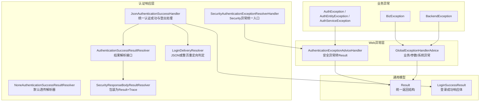
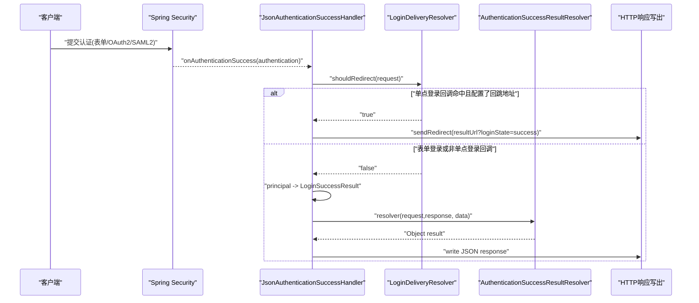
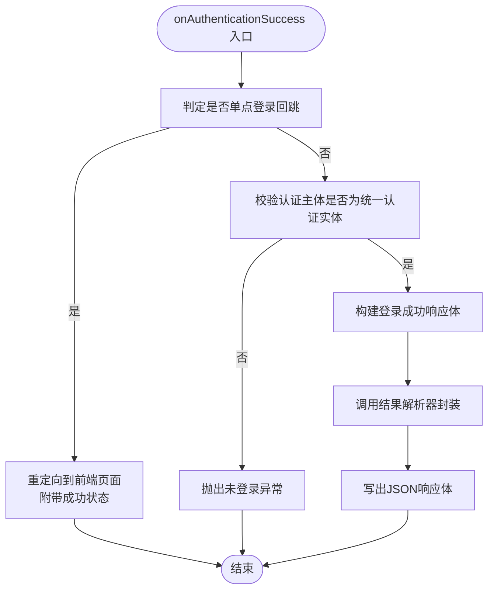
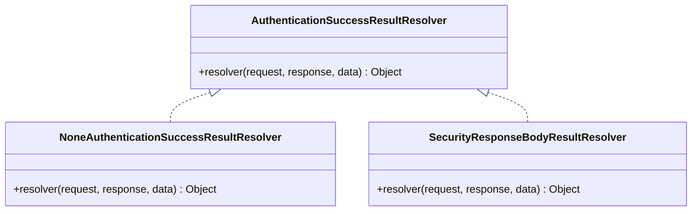
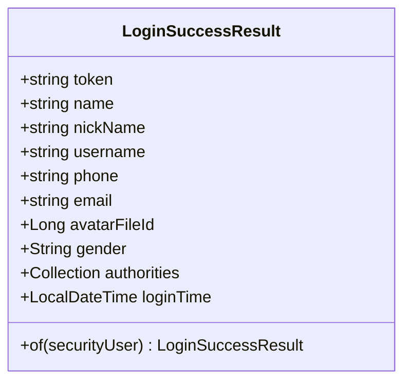
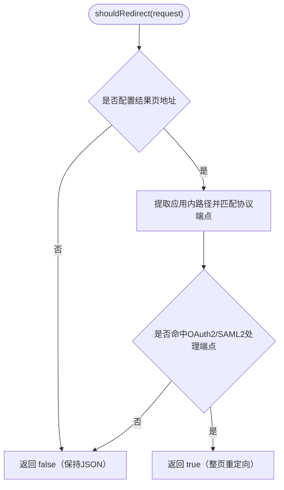
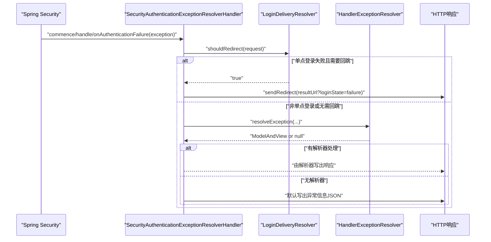
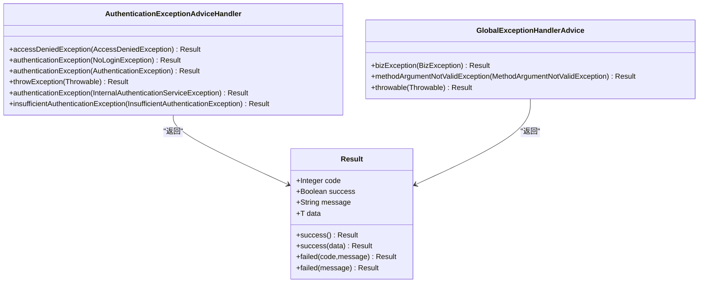
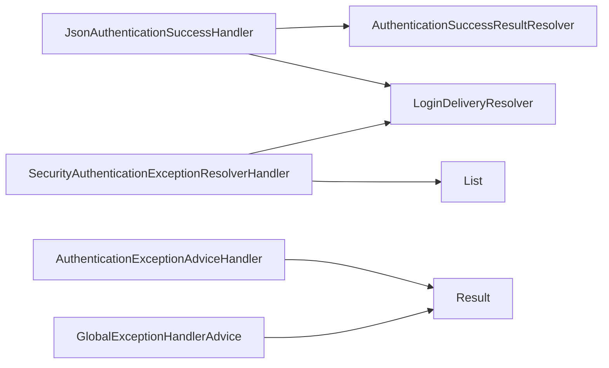

# 自定义响应处理器

<cite>
**本文引用的文件**   
- [AuthenticationSuccessResultResolver.java](file://login-spring-boot-starter/src/main/java/com/cu/framework/authentication/response/AuthenticationSuccessResultResolver.java)
- [SecurityAuthenticationSuccessHandler.java](file://login-spring-boot-starter/src/main/java/com/cu/framework/authentication/response/SecurityAuthenticationSuccessHandler.java)
- [JsonAuthenticationSuccessHandler.java](file://login-spring-boot-starter/src/main/java/com/cu/framework/authentication/response/JsonAuthenticationSuccessHandler.java)
- [LoginSuccessResult.java](file://login-spring-boot-starter/src/main/java/com/cu/framework/authentication/response/LoginSuccessResult.java)
- [LoginDeliveryResolver.java](file://login-spring-boot-starter/src/main/java/com/cu/framework/authentication/response/LoginDeliveryResolver.java)
- [NoneAuthenticationSuccessResultResolver.java](file://login-spring-boot-starter/src/main/java/com/cu/framework/authentication/response/NoneAuthenticationSuccessResultResolver.java)
- [SecurityAuthenticationExceptionResolverHandler.java](file://login-spring-boot-starter/src/main/java/com/cu/framework/authentication/response/SecurityAuthenticationExceptionResolverHandler.java)
- [SecurityResponseBodyResultResolver.java](file://login-spring-boot-starter/src/main/java/com/cu/framework/authentication/handler/SecurityResponseBodyResultResolver.java)
- [AuthenticationExceptionAdviceHandler.java](file://login-spring-boot-starter/src/main/java/com/cu/framework/authentication/handler/AuthenticationExceptionAdviceHandler.java)
- [GlobalExceptionHandlerAdvice.java](file://basic/src/main/java/com/cu/framework/basic/exception/GlobalExceptionHandlerAdvice.java)
- [Result.java](file://basic/src/main/java/com/cu/framework/basic/model/Result.java)
- [BizException.java](file://basic/src/main/java/com/cu/framework/basic/exception/BizException.java)
- [BackendException.java](file://basic/src/main/java/com/cu/framework/basic/exception/BackendException.java)
- [ExceptionConstant.java](file://basic/src/main/java/com/cu/framework/basic/exception/ExceptionConstant.java)
- [AuthException.java](file://auth/auth-core/src/main/java/com/cu/framework/auth/core/exception/AuthException.java)
- [AuthEntityException.java](file://auth/auth-core/src/main/java/com/cu/framework/auth/core/exception/AuthEntityException.java)
- [AuthServiceException.java](file://auth/auth-core/src/main/java/com/cu/framework/auth/core/exception/AuthServiceException.java)
</cite>

## 目录
1. [引言](#引言)
2. [项目结构](#项目结构)
3. [核心组件](#核心组件)
4. [架构总览](#架构总览)
5. [详细组件分析](#详细组件分析)
6. [依赖关系分析](#依赖关系分析)
7. [性能与可扩展性](#性能与可扩展性)
8. [故障排查指南](#故障排查指南)
9. [结论](#结论)
10. [附录：自定义实现模板](#附录自定义实现模板)

## 引言
本指南面向需要在 Spring Security 认证流程中定制成功、失败和登出响应的开发者。仓库通过“认证成功处理器 + 结果解析器 + 交付姿态判定器 + 全局异常处理”的解耦设计，统一了表单登录、OAuth2、SAML2 等协议的认证结果输出，并支持 JSON 响应与单点登录整页回跳两种交付形态。本文将逐层说明这些组件的职责、协作方式以及扩展方法，帮助你在不侵入框架的前提下实现统一响应结构、国际化、审计日志、数据脱敏与安全控制。

## 项目结构
围绕认证响应的主要代码集中在以下模块：
- login-spring-boot-starter：封装 Spring Security 认证成功、失败、登出处理器，以及认证结果解析器和单点登录交付策略。
- basic：提供统一的业务返回模型 Result、基础异常类型及 Web 层全局异常处理器。
- auth/auth-core：定义权限相关异常体系，供上层安全逻辑抛出结构化错误。

**图示来源**
- [JsonAuthenticationSuccessHandler.java:1-95](file://login-spring-boot-starter/src/main/java/com/cu/framework/authentication/response/JsonAuthenticationSuccessHandler.java#L1-L95)
- [AuthenticationSuccessResultResolver.java:1-23](file://login-spring-boot-starter/src/main/java/com/cu/framework/authentication/response/AuthenticationSuccessResultResolver.java#L1-L23)
- [NoneAuthenticationSuccessResultResolver.java:1-26](file://login-spring-boot-starter/src/main/java/com/cu/framework/authentication/response/NoneAuthenticationSuccessResultResolver.java#L1-L26)
- [SecurityResponseBodyResultResolver.java:1-28](file://login-spring-boot-starter/src/main/java/com/cu/framework/authentication/handler/SecurityResponseBodyResultResolver.java#L1-L28)
- [LoginDeliveryResolver.java:1-114](file://login-spring-boot-starter/src/main/java/com/cu/framework/authentication/response/LoginDeliveryResolver.java#L1-L114)
- [SecurityAuthenticationExceptionResolverHandler.java:1-110](file://login-spring-boot-starter/src/main/java/com/cu/framework/authentication/response/SecurityAuthenticationExceptionResolverHandler.java#L1-L110)
- [AuthenticationExceptionAdviceHandler.java:1-86](file://login-spring-boot-starter/src/main/java/com/cu/framework/authentication/handler/AuthenticationExceptionAdviceHandler.java#L1-L86)
- [GlobalExceptionHandlerAdvice.java:1-83](file://basic/src/main/java/com/cu/framework/basic/exception/GlobalExceptionHandlerAdvice.java#L1-L83)
- [Result.java:1-73](file://basic/src/main/java/com/cu/framework/basic/model/Result.java#L1-L73)
- [LoginSuccessResult.java:1-96](file://login-spring-boot-starter/src/main/java/com/cu/framework/authentication/response/LoginSuccessResult.java#L1-L96)
- [BizException.java:1-27](file://basic/src/main/java/com/cu/framework/basic/exception/BizException.java#L1-L27)
- [BackendException.java:1-31](file://basic/src/main/java/com/cu/framework/basic/exception/BackendException.java#L1-L31)
- [AuthException.java:1-23](file://auth/auth-core/src/main/java/com/cu/framework/auth/core/exception/AuthException.java#L1-L23)
- [AuthEntityException.java:1-20](file://auth/auth-core/src/main/java/com/cu/framework/auth/core/exception/AuthEntityException.java#L1-L20)
- [AuthServiceException.java:1-16](file://auth/auth-core/src/main/java/com/cu/framework/auth/core/exception/AuthServiceException.java#L1-L16)

**章节来源**
- [JsonAuthenticationSuccessHandler.java:1-95](file://login-spring-boot-starter/src/main/java/com/cu/framework/authentication/response/JsonAuthenticationSuccessHandler.java#L1-L95)
- [LoginDeliveryResolver.java:1-114](file://login-spring-boot-starter/src/main/java/com/cu/framework/authentication/response/LoginDeliveryResolver.java#L1-L114)
- [SecurityAuthenticationExceptionResolverHandler.java:1-110](file://login-spring-boot-starter/src/main/java/com/cu/framework/authentication/response/SecurityAuthenticationExceptionResolverHandler.java#L1-L110)

## 核心组件
- AuthenticationSuccessResultResolver：认证相关成功用户转化解析器接口，用于在认证成功、登出成功、获取当前用户等场景下，将原始数据转换为最终返回对象。它不直接操作响应流，只负责数据转换。
- SecurityAuthenticationSuccessHandler：继承 Spring Security 的成功处理器与登出处理器接口，定义认证成功与登出的统一回调契约。
- JsonAuthenticationSuccessHandler：具体实现类，负责把认证主体转换为 LoginSuccessResult，调用结果解析器生成最终响应，并根据协议类型决定是返回 JSON 还是整页重定向。
- LoginSuccessResult：登录成功后返回的统一响应体，包含会话 token、用户基本信息、权限集合、登录时间等字段，并提供从统一认证主体构造的方法。
- LoginDeliveryResolver：根据配置与请求路径判断认证结果应返回 JSON 还是整页回跳；对 OAuth2/SAML2 的单点登录回调地址进行匹配，并注入成功/失败状态标记。
- NoneAuthenticationSuccessResultResolver：默认解析器，不对数据进行任何包装，原样返回。
- SecurityResponseBodyResultResolver：示例解析器，将数据包装为 Result.success，并附加链路追踪信息。
- SecurityAuthenticationExceptionResolverHandler：Spring Security 异常统一入口，同时实现未认证、访问拒绝、认证失败的处理器，并与 Spring MVC 的 HandlerExceptionResolver 协作。
- AuthenticationExceptionAdviceHandler：@RestControllerAdvice，将安全异常转为 Result JSON 响应。
- GlobalExceptionHandlerAdvice：@RestControllerAdvice，统一处理业务异常、参数校验异常与兜底系统异常。
- Result：统一返回模型，包含 code、success、message、data 四个字段，并提供 success/failed 工厂方法。
- BizException/BackendException：业务与后端基础异常，配合 GlobalExceptionHandlerAdvice 输出统一错误码与信息。
- AuthException/AuthEntityException/AuthServiceException：权限与认证服务异常族谱，供认证相关逻辑抛出。

**章节来源**
- [AuthenticationSuccessResultResolver.java:1-23](file://login-spring-boot-starter/src/main/java/com/cu/framework/authentication/response/AuthenticationSuccessResultResolver.java#L1-L23)
- [SecurityAuthenticationSuccessHandler.java:1-32](file://login-spring-boot-starter/src/main/java/com/cu/framework/authentication/response/SecurityAuthenticationSuccessHandler.java#L1-L32)
- [JsonAuthenticationSuccessHandler.java:1-95](file://login-spring-boot-starter/src/main/java/com/cu/framework/authentication/response/JsonAuthenticationSuccessHandler.java#L1-L95)
- [LoginSuccessResult.java:1-96](file://login-spring-boot-starter/src/main/java/com/cu/framework/authentication/response/LoginSuccessResult.java#L1-L96)
- [LoginDeliveryResolver.java:1-114](file://login-spring-boot-starter/src/main/java/com/cu/framework/authentication/response/LoginDeliveryResolver.java#L1-L114)
- [NoneAuthenticationSuccessResultResolver.java:1-26](file://login-spring-boot-starter/src/main/java/com/cu/framework/authentication/response/NoneAuthenticationSuccessResultResolver.java#L1-L26)
- [SecurityResponseBodyResultResolver.java:1-28](file://login-spring-boot-starter/src/main/java/com/cu/framework/authentication/handler/SecurityResponseBodyResultResolver.java#L1-L28)
- [SecurityAuthenticationExceptionResolverHandler.java:1-110](file://login-spring-boot-starter/src/main/java/com/cu/framework/authentication/response/SecurityAuthenticationExceptionResolverHandler.java#L1-L110)
- [AuthenticationExceptionAdviceHandler.java:1-86](file://login-spring-boot-starter/src/main/java/com/cu/framework/authentication/handler/AuthenticationExceptionAdviceHandler.java#L1-L86)
- [GlobalExceptionHandlerAdvice.java:1-83](file://basic/src/main/java/com/cu/framework/basic/exception/GlobalExceptionHandlerAdvice.java#L1-L83)
- [Result.java:1-73](file://basic/src/main/java/com/cu/framework/basic/model/Result.java#L1-L73)
- [BizException.java:1-27](file://basic/src/main/java/com/cu/framework/basic/exception/BizException.java#L1-L27)
- [BackendException.java:1-31](file://basic/src/main/java/com/cu/framework/basic/exception/BackendException.java#L1-L31)
- [AuthException.java:1-23](file://auth/auth-core/src/main/java/com/cu/framework/auth/core/exception/AuthException.java#L1-L23)
- [AuthEntityException.java:1-20](file://auth/auth-core/src/main/java/com/cu/framework/auth/core/exception/AuthEntityException.java#L1-L20)
- [AuthServiceException.java:1-16](file://auth/auth-core/src/main/java/com/cu/framework/auth/core/exception/AuthServiceException.java#L1-L16)

## 架构总览
认证响应架构分为四层：
- 协议接入层：表单登录、OAuth2、SAML2 均产生 Spring Security 的 Authentication 对象。
- 成功/失败处理器层：由 SecurityAuthenticationSuccessHandler 及其实现 JsonAuthenticationSuccessHandler 处理成功与登出；SecurityAuthenticationExceptionResolverHandler 处理未认证、访问拒绝与认证失败。
- 结果解析层：AuthenticationSuccessResultResolver 将业务数据包装成最终返回对象；默认实现 NoneAuthenticationSuccessResultResolver 不做转换，示例实现 SecurityResponseBodyResultResolver 包装为 Result 并追加链路追踪。
- 交付姿态层：LoginDeliveryResolver 根据协议端点判断是否整页回跳，避免浏览器在无脚本环境中收到裸 JSON。

**图示来源**
- [JsonAuthenticationSuccessHandler.java:1-95](file://login-spring-boot-starter/src/main/java/com/cu/framework/authentication/response/JsonAuthenticationSuccessHandler.java#L1-L95)
- [LoginDeliveryResolver.java:1-114](file://login-spring-boot-starter/src/main/java/com/cu/framework/authentication/response/LoginDeliveryResolver.java#L1-L114)
- [AuthenticationSuccessResultResolver.java:1-23](file://login-spring-boot-starter/src/main/java/com/cu/framework/authentication/response/AuthenticationSuccessResultResolver.java#L1-L23)

**章节来源**
- [JsonAuthenticationSuccessHandler.java:1-95](file://login-spring-boot-starter/src/main/java/com/cu/framework/authentication/response/JsonAuthenticationSuccessHandler.java#L1-L95)
- [LoginDeliveryResolver.java:1-114](file://login-spring-boot-starter/src/main/java/com/cu/framework/authentication/response/LoginDeliveryResolver.java#L1-L114)

## 详细组件分析

### 认证成功与登出处理器
- SecurityAuthenticationSuccessHandler 定义了认证成功与登出的统一回调方法。
- JsonAuthenticationSuccessHandler 的具体职责包括：
  - 若请求命中单点登录处理端点且已配置回跳地址，则整页重定向到前端页面，并在查询参数中附带成功状态。
  - 否则，要求认证主体的 principal 是统一认证实体，否则抛出未登录异常。
  - 基于统一认证主体构建 LoginSuccessResult，填充会话 token 与登录时间。
  - 调用 AuthenticationSuccessResultResolver 进行结果封装。
  - 使用 ObjectMapper 以 UTF-8 写出 JSON 响应体。
  - 登出成功时，直接调用解析器并写出空数据的响应体。

**图示来源**
- [JsonAuthenticationSuccessHandler.java:1-95](file://login-spring-boot-starter/src/main/java/com/cu/framework/authentication/response/JsonAuthenticationSuccessHandler.java#L1-L95)
- [LoginDeliveryResolver.java:1-114](file://login-spring-boot-starter/src/main/java/com/cu/framework/authentication/response/LoginDeliveryResolver.java#L1-L114)

**章节来源**
- [SecurityAuthenticationSuccessHandler.java:1-32](file://login-spring-boot-starter/src/main/java/com/cu/framework/authentication/response/SecurityAuthenticationSuccessHandler.java#L1-L32)
- [JsonAuthenticationSuccessHandler.java:1-95](file://login-spring-boot-starter/src/main/java/com/cu/framework/authentication/response/JsonAuthenticationSuccessHandler.java#L1-L95)

### 认证结果解析器
- AuthenticationSuccessResultResolver 是一个无副作用的数据转换器接口，接收 request/response/data，返回待写出的对象。
- NoneAuthenticationSuccessResultResolver 是默认实现，直接返回原始数据，适合不需要额外包装的场景。
- SecurityResponseBodyResultResolver 是示例实现，将数据包装为 Result.success，并通过 TraceContext 追加链路追踪信息。

**图示来源**
- [AuthenticationSuccessResultResolver.java:1-23](file://login-spring-boot-starter/src/main/java/com/cu/framework/authentication/response/AuthenticationSuccessResultResolver.java#L1-L23)
- [NoneAuthenticationSuccessResultResolver.java:1-26](file://login-spring-boot-starter/src/main/java/com/cu/framework/authentication/response/NoneAuthenticationSuccessResultResolver.java#L1-L26)
- [SecurityResponseBodyResultResolver.java:1-28](file://login-spring-boot-starter/src/main/java/com/cu/framework/authentication/handler/SecurityResponseBodyResultResolver.java#L1-L28)

**章节来源**
- [AuthenticationSuccessResultResolver.java:1-23](file://login-spring-boot-starter/src/main/java/com/cu/framework/authentication/response/AuthenticationSuccessResultResolver.java#L1-L23)
- [NoneAuthenticationSuccessResultResolver.java:1-26](file://login-spring-boot-starter/src/main/java/com/cu/framework/authentication/response/NoneAuthenticationSuccessResultResolver.java#L1-L26)
- [SecurityResponseBodyResultResolver.java:1-28](file://login-spring-boot-starter/src/main/java/com/cu/framework/authentication/handler/SecurityResponseBodyResultResolver.java#L1-L28)

### 登录成功响应体
- LoginSuccessResult 包含会话 token、姓名、昵称、用户名、手机号、邮箱、头像文件 ID、性别、权限集合、登录时间等字段。
- of 静态方法从统一认证主体投影出响应体，不包含密码等敏感字段。
- token 与 loginTime 由 JsonAuthenticationSuccessHandler 在认证成功后写入。

**图示来源**
- [LoginSuccessResult.java:1-96](file://login-spring-boot-starter/src/main/java/com/cu/framework/authentication/response/LoginSuccessResult.java#L1-L96)

**章节来源**
- [LoginSuccessResult.java:1-96](file://login-spring-boot-starter/src/main/java/com/cu/framework/authentication/response/LoginSuccessResult.java#L1-L96)

### 单点登录交付姿态判定器
- LoginDeliveryResolver 根据配置中的结果页地址与 OAuth2/SAML2 的处理端点路径，决定是否将浏览器整页送回前端。
- shouldRedirect 会检查是否存在结果页地址，并判断请求路径是否命中某个单点登录协议的处理端点。
- redirect 会向浏览器发送重定向响应，附带成功或失败状态标记。
- buildRedirectUrl 负责拼接查询参数，避免重复问号。

**图示来源**
- [LoginDeliveryResolver.java:1-114](file://login-spring-boot-starter/src/main/java/com/cu/framework/authentication/response/LoginDeliveryResolver.java#L1-L114)

**章节来源**
- [LoginDeliveryResolver.java:1-114](file://login-spring-boot-starter/src/main/java/com/cu/framework/authentication/response/LoginDeliveryResolver.java#L1-L114)

### 认证失败与访问拒绝处理器
- SecurityAuthenticationExceptionResolverHandler 同时承担未认证、访问拒绝、认证失败三种角色，并与 Spring MVC 的 HandlerExceptionResolver 协作。
- 对于单点登录失败，同样按整页回跳处理，并在服务端记录警告日志；JSON 分支则由后续解析器记录异常。
- 若无匹配的 HandlerExceptionResolver，则默认写出包含异常信息的 JSON 字符串。

**图示来源**
- [SecurityAuthenticationExceptionResolverHandler.java:1-110](file://login-spring-boot-starter/src/main/java/com/cu/framework/authentication/response/SecurityAuthenticationExceptionResolverHandler.java#L1-L110)
- [LoginDeliveryResolver.java:1-114](file://login-spring-boot-starter/src/main/java/com/cu/framework/authentication/response/LoginDeliveryResolver.java#L1-L114)

**章节来源**
- [SecurityAuthenticationExceptionResolverHandler.java:1-110](file://login-spring-boot-starter/src/main/java/com/cu/framework/authentication/response/SecurityAuthenticationExceptionResolverHandler.java#L1-L110)

### Web 层全局异常处理
- AuthenticationExceptionAdviceHandler 将访问拒绝、未登录、认证失败、内部认证服务异常、权限不足等安全异常统一转为 Result JSON。
- GlobalExceptionHandlerAdvice 将业务异常、空指针异常、参数校验异常与兜底 Throwable 统一转为 Result JSON，并记录日志。

**图示来源**
- [AuthenticationExceptionAdviceHandler.java:1-86](file://login-spring-boot-starter/src/main/java/com/cu/framework/authentication/handler/AuthenticationExceptionAdviceHandler.java#L1-L86)
- [GlobalExceptionHandlerAdvice.java:1-83](file://basic/src/main/java/com/cu/framework/basic/exception/GlobalExceptionHandlerAdvice.java#L1-L83)
- [Result.java:1-73](file://basic/src/main/java/com/cu/framework/basic/model/Result.java#L1-L73)

**章节来源**
- [AuthenticationExceptionAdviceHandler.java:1-86](file://login-spring-boot-starter/src/main/java/com/cu/framework/authentication/handler/AuthenticationExceptionAdviceHandler.java#L1-L86)
- [GlobalExceptionHandlerAdvice.java:1-83](file://basic/src/main/java/com/cu/framework/basic/exception/GlobalExceptionHandlerAdvice.java#L1-L83)
- [Result.java:1-73](file://basic/src/main/java/com/cu/framework/basic/model/Result.java#L1-L73)

## 依赖关系分析
- JsonAuthenticationSuccessHandler 依赖：
  - AuthenticationSuccessResultResolver：用于结果封装。
  - LoginDeliveryResolver：用于单点登录交付姿态判定。
  - ObjectMapper：用于 JSON 序列化。
- SecurityAuthenticationExceptionResolverHandler 依赖：
  - LoginDeliveryResolver：用于单点登录失败的回跳判定。
  - List<HandlerExceptionResolver>：委托给 Spring MVC 的异常解析链。
- AuthenticationExceptionAdviceHandler 与 GlobalExceptionHandlerAdvice 共同消费 Result 模型，形成统一的 HTTP 响应语义。

**图示来源**
- [JsonAuthenticationSuccessHandler.java:1-95](file://login-spring-boot-starter/src/main/java/com/cu/framework/authentication/response/JsonAuthenticationSuccessHandler.java#L1-L95)
- [SecurityAuthenticationExceptionResolverHandler.java:1-110](file://login-spring-boot-starter/src/main/java/com/cu/framework/authentication/response/SecurityAuthenticationExceptionResolverHandler.java#L1-L110)
- [AuthenticationExceptionAdviceHandler.java:1-86](file://login-spring-boot-starter/src/main/java/com/cu/framework/authentication/handler/AuthenticationExceptionAdviceHandler.java#L1-L86)
- [GlobalExceptionHandlerAdvice.java:1-83](file://basic/src/main/java/com/cu/framework/basic/exception/GlobalExceptionHandlerAdvice.java#L1-L83)
- [Result.java:1-73](file://basic/src/main/java/com/cu/framework/basic/model/Result.java#L1-L73)

**章节来源**
- [JsonAuthenticationSuccessHandler.java:1-95](file://login-spring-boot-starter/src/main/java/com/cu/framework/authentication/response/JsonAuthenticationSuccessHandler.java#L1-L95)
- [SecurityAuthenticationExceptionResolverHandler.java:1-110](file://login-spring-boot-starter/src/main/java/com/cu/framework/authentication/response/SecurityAuthenticationExceptionResolverHandler.java#L1-L110)

## 性能与可扩展性
- JSON 写出路径直接使用 PrintWriter 与 ObjectMapper，避免额外的视图层开销，适合高并发认证场景。
- 结果解析器采用接口解耦，可替换为任意封装策略，例如增加国际化、审计日志、数据脱敏等横切关注点。
- 单点登录交付姿态判定器通过 Ant 路径匹配与 UrlPathHelper，避免对复杂 URL 结构的误判，降低误跳转风险。
- 建议在生产环境关闭调试模式下的详细异常信息输出，仅在服务端日志保留完整堆栈，减少敏感信息泄露风险。

[本节为通用指导，不直接分析具体文件]

## 故障排查指南
- 单点登录回调显示空白或无业务数据：
  - 确认已配置结果页地址，并且 OAuth2/SAML2 处理端点与判定规则一致。
  - 检查 LoginDeliveryResolver.shouldRedirect 是否返回 true；若是，则不会写出业务 JSON，仅返回状态标记。
- 认证成功但返回未登录异常：
  - 确认认证 Provider 返回的 principal 是统一认证实体，否则 JsonAuthenticationSuccessHandler 会抛出未登录异常。
- 认证失败后前端收到裸文本而非 JSON：
  - 检查是否命中单点登录失败回跳；若非单点登录，应确保 HandlerExceptionResolver 能处理异常，或让 SecurityAuthenticationExceptionResolverHandler 输出默认 JSON。
- 业务异常未统一返回：
  - 确保业务逻辑抛出 BizException 或子类，并由 GlobalExceptionHandlerAdvice 捕获。
  - 检查 ExceptionConstant 的错误码是否符合预期。
- 权限相关异常未正确映射：
  - 检查 AuthException/AuthEntityException/AuthServiceException 的使用位置，并确保上层控制器或 Advice 能捕获相应安全异常。

**章节来源**
- [LoginDeliveryResolver.java:1-114](file://login-spring-boot-starter/src/main/java/com/cu/framework/authentication/response/LoginDeliveryResolver.java#L1-L114)
- [JsonAuthenticationSuccessHandler.java:1-95](file://login-spring-boot-starter/src/main/java/com/cu/framework/authentication/response/JsonAuthenticationSuccessHandler.java#L1-L95)
- [SecurityAuthenticationExceptionResolverHandler.java:1-110](file://login-spring-boot-starter/src/main/java/com/cu/framework/authentication/response/SecurityAuthenticationExceptionResolverHandler.java#L1-L110)
- [GlobalExceptionHandlerAdvice.java:1-83](file://basic/src/main/java/com/cu/framework/basic/exception/GlobalExceptionHandlerAdvice.java#L1-L83)
- [ExceptionConstant.java:1-13](file://basic/src/main/java/com/cu/framework/basic/exception/ExceptionConstant.java#L1-L13)
- [AuthException.java:1-23](file://auth/auth-core/src/main/java/com/cu/framework/auth/core/exception/AuthException.java#L1-L23)
- [AuthEntityException.java:1-20](file://auth/auth-core/src/main/java/com/cu/framework/auth/core/exception/AuthEntityException.java#L1-L20)
- [AuthServiceException.java:1-16](file://auth/auth-core/src/main/java/com/cu/framework/auth/core/exception/AuthServiceException.java#L1-L16)

## 结论
该仓库通过“处理器 + 解析器 + 交付判定 + 全局异常”的分层设计，实现了认证成功、失败、登出与单点登录回调的统一响应机制。AuthenticationSuccessResultResolver 是可扩展的核心钩子，允许在不修改框架代码的情况下定制响应格式、状态码、错误信息与审计行为。结合 Result 模型与全局异常处理，团队可以在不同协议（表单、OAuth2、SAML2）之间获得一致的对外契约，同时保留足够的扩展空间以满足国际化、脱敏与安全需求。

[本节为总结，不直接分析具体文件]

## 附录：自定义实现模板
以下为开发自定义认证结果解析器的步骤与建议，所有示例均以“实现思路”描述，不提供具体源码内容。

- 统一响应结构
  - 在 AuthenticationSuccessResultResolver.resolver 中将 LoginSuccessResult 或任意业务数据包装为 Result.success。
  - 参考现有实现 SecurityResponseBodyResultResolver，将链路追踪上下文附加到响应中。
  - 参考 Result 模型的 success/failed 工厂方法，保证 code、success、message、data 字段语义一致。

- 国际化支持
  - 在 resolver 中读取请求语言偏好，将 message 字段翻译为目标语言。
  - 可将错误码与消息键值映射集中管理，便于维护多语言文案。
  - 注意：token 与敏感身份信息不参与国际化，仅 message 与可选的业务提示参与。

- 审计日志记录
  - 在 resolver 中记录认证成功/登出事件，包含用户标识、IP、UA、租户、时间戳、操作类型。
  - 不要记录密码、令牌、完整权限列表等敏感信息；如需记录权限范围，请做摘要或掩码处理。
  - 审计日志应与业务响应分离，避免影响主流程性能。

- 不同类型认证的差异化响应
  - 表单登录：通常返回 JSON，携带 token 与用户基本信息。
  - OAuth2/SAML2：若命中单点登录处理端点且配置了结果页地址，则整页回跳到前端页面，附带成功或失败状态标记；否则仍返回 JSON。
  - 可通过 LoginDeliveryResolver.shouldRedirect 的判断结果区分两类交付形态。

- 异常处理器扩展
  - 在 AuthenticationExceptionAdviceHandler 中新增 @ExceptionHandler，捕获特定安全异常并返回 Result.failed。
  - 在 GlobalExceptionHandlerAdvice 中捕获 BizException、MethodArgumentNotValidException 与 Throwable，统一返回错误码与消息。
  - 对需要自定义错误页面的场景，可在 HandlerExceptionResolver 或视图层实现，但需确保单点登录失败仍按回跳处理。

- 数据脱敏与安全性考虑
  - LoginSuccessResult.of 不应暴露密码等敏感字段；如需返回头像等外部资源，仅传递文件 ID。
  - 不要在响应中返回完整的权限集合或敏感身份属性，必要时进行裁剪或聚合。
  - 对 IP、设备指纹、会话信息等敏感数据，在日志中进行掩码处理。
  - 生产环境禁止在 JSON 中返回堆栈跟踪、SQL 语句或第三方服务返回的原始错误详情。

**章节来源**
- [AuthenticationSuccessResultResolver.java:1-23](file://login-spring-boot-starter/src/main/java/com/cu/framework/authentication/response/AuthenticationSuccessResultResolver.java#L1-L23)
- [SecurityResponseBodyResultResolver.java:1-28](file://login-spring-boot-starter/src/main/java/com/cu/framework/authentication/handler/SecurityResponseBodyResultResolver.java#L1-L28)
- [LoginSuccessResult.java:1-96](file://login-spring-boot-starter/src/main/java/com/cu/framework/authentication/response/LoginSuccessResult.java#L1-L96)
- [LoginDeliveryResolver.java:1-114](file://login-spring-boot-starter/src/main/java/com/cu/framework/authentication/response/LoginDeliveryResolver.java#L1-L114)
- [AuthenticationExceptionAdviceHandler.java:1-86](file://login-spring-boot-starter/src/main/java/com/cu/framework/authentication/handler/AuthenticationExceptionAdviceHandler.java#L1-L86)
- [GlobalExceptionHandlerAdvice.java:1-83](file://basic/src/main/java/com/cu/framework/basic/exception/GlobalExceptionHandlerAdvice.java#L1-L83)
- [Result.java:1-73](file://basic/src/main/java/com/cu/framework/basic/model/Result.java#L1-L73)