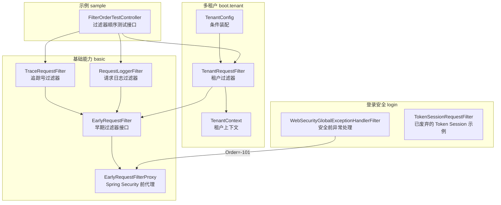
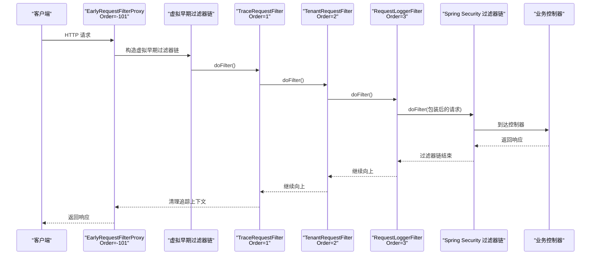
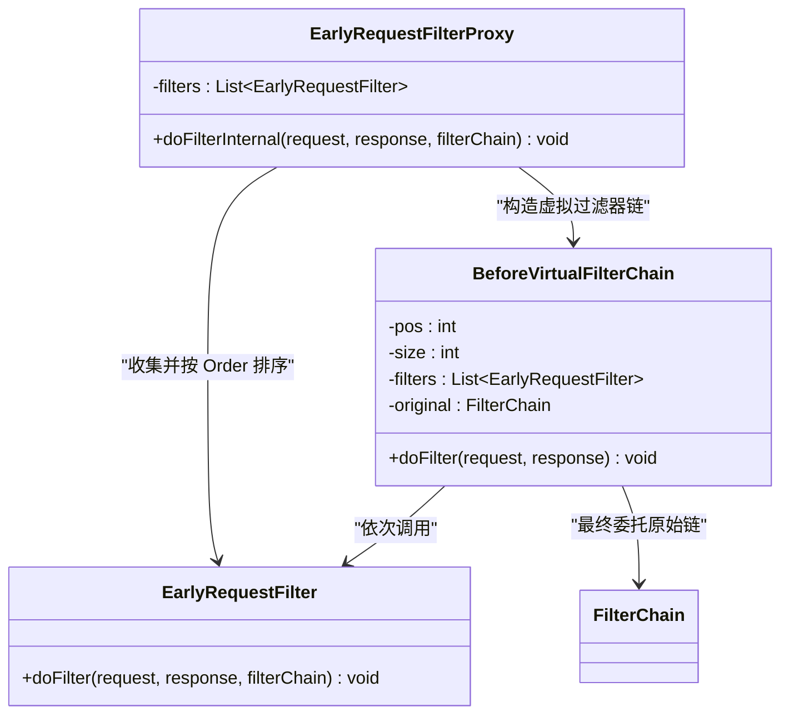
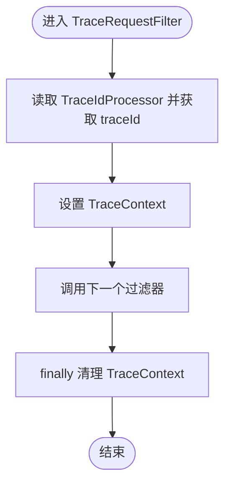
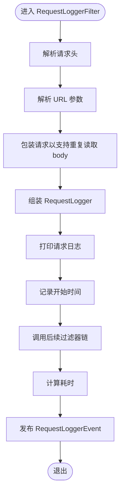
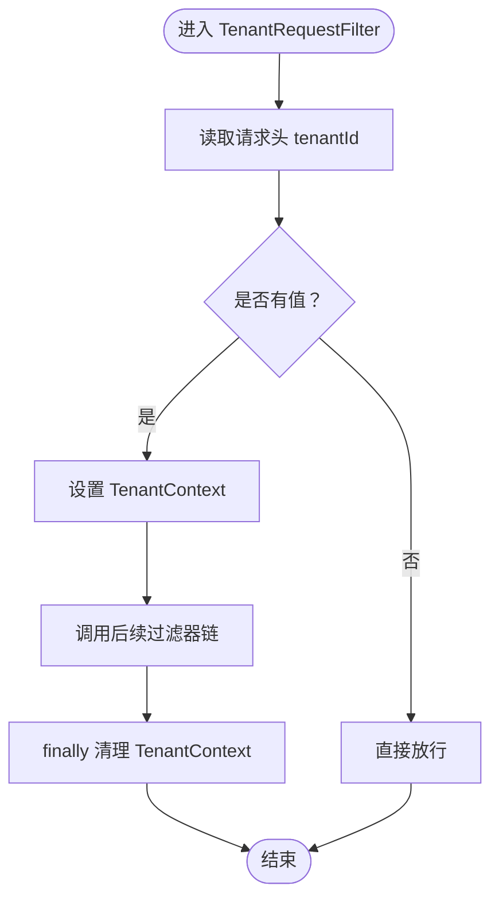
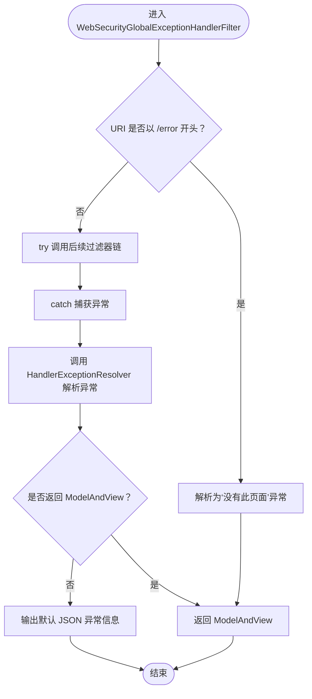
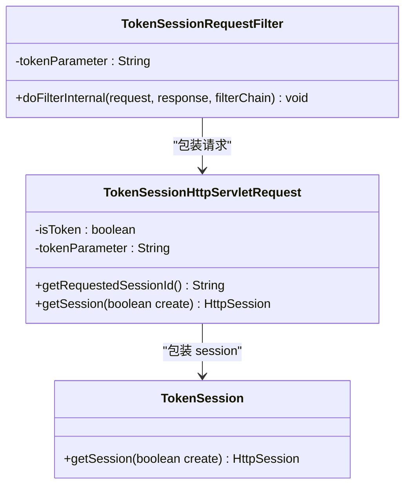
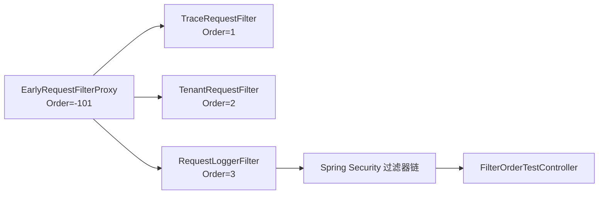
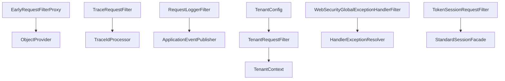

# 自定义安全过滤器

<cite>
**本文引用的文件**   
- [EarlyRequestFilter.java](file://basic/src/main/java/com/cu/framework/basic/filter/EarlyRequestFilter.java)
- [EarlyRequestFilterProxy.java](file://basic/src/main/java/com/cu/framework/basic/filter/EarlyRequestFilterProxy.java)
- [TraceRequestFilter.java](file://basic/src/main/java/com/cu/framework/basic/logger/TraceRequestFilter.java)
- [RequestLoggerFilter.java](file://basic/src/main/java/com/cu/framework/basic/logger/RequestLoggerFilter.java)
- [TenantRequestFilter.java](file://boot/tenant-spring-boot-starter/src/main/java/com/cu/framework/tenant/TenantRequestFilter.java)
- [TenantContext.java](file://boot/tenant-spring-boot-starter/src/main/java/com/cu/framework/tenant/TenantContext.java)
- [TenantConfig.java](file://boot/tenant-spring-boot-starter/src/main/java/com/cu/framework/tenant/config/TenantConfig.java)
- [WebSecurityGlobalExceptionHandlerFilter.java](file://login-spring-boot-starter/src/main/java/com/cu/framework/authentication/filter/WebSecurityGlobalExceptionHandlerFilter.java)
- [TokenSessionRequestFilter.java](file://login-spring-boot-starter/src/main/java/com/cu/framework/authentication/filter/TokenSessionRequestFilter.java)
- [FilterOrderTestController.java](file://sample/basic-boot-sample/src/main/java/com/cu/framework/sample/basic/controller/FilterOrderTestController.java)
</cite>

## 目录
1. [引言](#引言)
2. [项目结构](#项目结构)
3. [核心组件](#核心组件)
4. [架构总览](#架构总览)
5. [详细组件分析](#详细组件分析)
6. [依赖关系分析](#依赖关系分析)
7. [性能与异步处理](#性能与异步处理)
8. [调试与监控](#调试与监控)
9. [常见问题排查](#常见问题排查)
10. [结论](#结论)

## 引言
本指南面向需要在 Spring Web 请求链路中扩展安全与横切能力的开发者，重点围绕以下目标展开：
- 解释 Spring Security 过滤器链的进入时机、执行顺序与拦截范围。
- 基于项目现有实现，说明如何通过 `OncePerRequestFilter` 或框架内 `EarlyRequestFilter` 接口构建自定义过滤器。
- 提供可落地的场景示例：请求头解析、租户上下文注入、IP 白名单校验、请求限流等。
- 说明如何借助 `@Order`、`FilterRegistrationBean` 管理注册顺序与优先级。
- 覆盖异常处理、日志记录、异步请求注意事项、调试技巧与性能优化建议。

## 项目结构
仓库中与“自定义安全过滤器”直接相关的代码主要分布在三个模块：
- `basic`：提供早期过滤器抽象 `EarlyRequestFilter`、代理 `EarlyRequestFilterProxy`，以及通用日志与追踪过滤器。
- `boot/tenant-spring-boot-starter`：提供租户过滤器和租户上下文，演示如何把业务上下文从请求头注入到线程本地存储。
- `login-spring-boot-starter`：提供在 Spring Security 之前的全局异常处理过滤器和已废弃的 Token Session 过滤器示例。
- `sample/basic-boot-sample`：提供用于验证过滤器执行顺序的测试控制器。

**图表来源**
- [EarlyRequestFilter.java:1-23](file://basic/src/main/java/com/cu/framework/basic/filter/EarlyRequestFilter.java#L1-L23)
- [EarlyRequestFilterProxy.java:1-94](file://basic/src/main/java/com/cu/framework/basic/filter/EarlyRequestFilterProxy.java#L1-L94)
- [TraceRequestFilter.java:1-60](file://basic/src/main/java/com/cu/framework/basic/logger/TraceRequestFilter.java#L1-L60)
- [RequestLoggerFilter.java:1-133](file://basic/src/main/java/com/cu/framework/basic/logger/RequestLoggerFilter.java#L1-L133)
- [TenantRequestFilter.java:1-46](file://boot/tenant-spring-boot-starter/src/main/java/com/cu/framework/tenant/TenantRequestFilter.java#L1-L46)
- [TenantContext.java:1-43](file://boot/tenant-spring-boot-starter/src/main/java/com/cu/framework/tenant/TenantContext.java#L1-L43)
- [TenantConfig.java:1-22](file://boot/tenant-spring-boot-starter/src/main/java/com/cu/framework/tenant/config/TenantConfig.java#L1-L22)
- [WebSecurityGlobalExceptionHandlerFilter.java:1-71](file://login-spring-boot-starter/src/main/java/com/cu/framework/authentication/filter/WebSecurityGlobalExceptionHandlerFilter.java#L1-L71)
- [TokenSessionRequestFilter.java:1-210](file://login-spring-boot-starter/src/main/java/com/cu/framework/authentication/filter/TokenSessionRequestFilter.java#L1-L210)
- [FilterOrderTestController.java:1-24](file://sample/basic-boot-sample/src/main/java/com/cu/framework/sample/basic/controller/FilterOrderTestController.java#L1-L24)

**章节来源**
- [EarlyRequestFilter.java:1-23](file://basic/src/main/java/com/cu/framework/basic/filter/EarlyRequestFilter.java#L1-L23)
- [EarlyRequestFilterProxy.java:1-94](file://basic/src/main/java/com/cu/framework/basic/filter/EarlyRequestFilterProxy.java#L1-L94)
- [TraceRequestFilter.java:1-60](file://basic/src/main/java/com/cu/framework/basic/logger/TraceRequestFilter.java#L1-L60)
- [RequestLoggerFilter.java:1-133](file://basic/src/main/java/com/cu/framework/basic/logger/RequestLoggerFilter.java#L1-L133)
- [TenantRequestFilter.java:1-46](file://boot/tenant-spring-boot-starter/src/main/java/com/cu/framework/tenant/TenantRequestFilter.java#L1-L46)
- [TenantContext.java:1-43](file://boot/tenant-spring-boot-starter/src/main/java/com/cu/framework/tenant/TenantContext.java#L1-L43)
- [TenantConfig.java:1-22](file://boot/tenant-spring-boot-starter/src/main/java/com/cu/framework/tenant/config/TenantConfig.java#L1-L22)
- [WebSecurityGlobalExceptionHandlerFilter.java:1-71](file://login-spring-boot-starter/src/main/java/com/cu/framework/authentication/filter/WebSecurityGlobalExceptionHandlerFilter.java#L1-L71)
- [TokenSessionRequestFilter.java:1-210](file://login-spring-boot-starter/src/main/java/com/cu/framework/authentication/filter/TokenSessionRequestFilter.java#L1-L210)
- [FilterOrderTestController.java:1-24](file://sample/basic-boot-sample/src/main/java/com/cu/framework/sample/basic/controller/FilterOrderTestController.java#L1-L24)

## 核心组件
- `EarlyRequestFilter`：定义在请求进入时最早执行的统一入口，供业务侧以简单方法签名接入横切逻辑。
- `EarlyRequestFilterProxy`：基于 `OncePerRequestFilter` 的代理，按 `@Order` 收集容器中的 `EarlyRequestFilter`，并在 Spring Security 过滤器链之前执行。
- `TraceRequestFilter`：根据策略解析并注入请求追踪号，写入 `TraceContext`。
- `RequestLoggerFilter`：解析请求头、参数、JSON Body，统计耗时并发布事件，供监听方持久化。
- `TenantRequestFilter`：从请求头解析租户 ID，写入 `TenantContext`。
- `TenantContext`：使用 `InheritableThreadLocal` 维护当前线程的租户上下文。
- `TenantConfig`：通过配置开关控制租户过滤器是否启用。
- `WebSecurityGlobalExceptionHandlerFilter`：在 Spring Security 之前统一捕获异常，避免触发 Tomcat 默认错误页重定向。
- `TokenSessionRequestFilter`：展示将请求头 token 映射为 session ID 的思路（已标记废弃）。

**章节来源**
- [EarlyRequestFilter.java:1-23](file://basic/src/main/java/com/cu/framework/basic/filter/EarlyRequestFilter.java#L1-L23)
- [EarlyRequestFilterProxy.java:1-94](file://basic/src/main/java/com/cu/framework/basic/filter/EarlyRequestFilterProxy.java#L1-L94)
- [TraceRequestFilter.java:1-60](file://basic/src/main/java/com/cu/framework/basic/logger/TraceRequestFilter.java#L1-L60)
- [RequestLoggerFilter.java:1-133](file://basic/src/main/java/com/cu/framework/basic/logger/RequestLoggerFilter.java#L1-L133)
- [TenantRequestFilter.java:1-46](file://boot/tenant-spring-boot-starter/src/main/java/com/cu/framework/tenant/TenantRequestFilter.java#L1-L46)
- [TenantContext.java:1-43](file://boot/tenant-spring-boot-starter/src/main/java/com/cu/framework/tenant/TenantContext.java#L1-L43)
- [TenantConfig.java:1-22](file://boot/tenant-spring-boot-starter/src/main/java/com/cu/framework/tenant/config/TenantConfig.java#L1-L22)
- [WebSecurityGlobalExceptionHandlerFilter.java:1-71](file://login-spring-boot-starter/src/main/java/com/cu/framework/authentication/filter/WebSecurityGlobalExceptionHandlerFilter.java#L1-L71)
- [TokenSessionRequestFilter.java:1-210](file://login-spring-boot-starter/src/main/java/com/cu/framework/authentication/filter/TokenSessionRequestFilter.java#L1-L210)

## 架构总览
下图展示了“早期过滤器代理 + Spring Security + 业务 Controller”的整体调用路径，以及租户、日志、追踪等横切能力如何在请求进入阶段完成上下文准备。

**图表来源**
- [EarlyRequestFilterProxy.java:1-94](file://basic/src/main/java/com/cu/framework/basic/filter/EarlyRequestFilterProxy.java#L1-L94)
- [TraceRequestFilter.java:1-60](file://basic/src/main/java/com/cu/framework/basic/logger/TraceRequestFilter.java#L1-L60)
- [TenantRequestFilter.java:1-46](file://boot/tenant-spring-boot-starter/src/main/java/com/cu/framework/tenant/TenantRequestFilter.java#L1-L46)
- [RequestLoggerFilter.java:1-133](file://basic/src/main/java/com/cu/framework/basic/logger/RequestLoggerFilter.java#L1-L133)

## 详细组件分析

### 早期过滤器抽象与代理
- `EarlyRequestFilter` 定义了统一的早期过滤方法，便于业务以最小成本接入。
- `EarlyRequestFilterProxy` 继承 `OncePerRequestFilter`，并通过 `ObjectProvider` 收集容器中所有 `EarlyRequestFilter`，按 `@Order` 排序后组成“虚拟过滤器链”。该代理自身被标注 `@Order(-101)`，保证在 Spring Security 内置过滤器（默认 `-100`）之前执行。
- 当不存在早期过滤器时，代理直接放行原始过滤器链；存在时则依次执行每个 `EarlyRequestFilter`，最终委托给原始过滤器链。

**图表来源**
- [EarlyRequestFilter.java:1-23](file://basic/src/main/java/com/cu/framework/basic/filter/EarlyRequestFilter.java#L1-L23)
- [EarlyRequestFilterProxy.java:1-94](file://basic/src/main/java/com/cu/framework/basic/filter/EarlyRequestFilterProxy.java#L1-L94)

**章节来源**
- [EarlyRequestFilter.java:1-23](file://basic/src/main/java/com/cu/framework/basic/filter/EarlyRequestFilter.java#L1-L23)
- [EarlyRequestFilterProxy.java:1-94](file://basic/src/main/java/com/cu/framework/basic/filter/EarlyRequestFilterProxy.java#L1-L94)

### 追踪号过滤器
- `TraceRequestFilter` 实现了 `EarlyRequestFilter`，并通过 `ObjectProvider<TraceIdProcessor>` 获取追踪号解析策略；未注册时回退到基于请求头的处理器。
- 过滤器将追踪号写入 `TraceContext`，并在 finally 中清理，避免线程复用造成污染。

**图表来源**
- [TraceRequestFilter.java:1-60](file://basic/src/main/java/com/cu/framework/basic/logger/TraceRequestFilter.java#L1-L60)

**章节来源**
- [TraceRequestFilter.java:1-60](file://basic/src/main/java/com/cu/framework/basic/logger/TraceRequestFilter.java#L1-L60)

### 请求日志过滤器
- `RequestLoggerFilter` 同样实现 `EarlyRequestFilter`，负责：
  - 解析请求头、参数与 JSON Body。
  - 封装请求以便 body 可重复读取。
  - 记录请求 IP、URL、方法、参数、Body、耗时。
  - 发布 `RequestLoggerEvent`，交由监听器做持久化。

**图表来源**
- [RequestLoggerFilter.java:1-133](file://basic/src/main/java/com/cu/framework/basic/logger/RequestLoggerFilter.java#L1-L133)

**章节来源**
- [RequestLoggerFilter.java:1-133](file://basic/src/main/java/com/cu/framework/basic/logger/RequestLoggerFilter.java#L1-L133)

### 租户上下文过滤器
- `TenantRequestFilter` 从请求头中读取租户 ID，若存在则写入 `TenantContext`，并在 finally 中清理。
- `TenantContext` 使用 `InheritableThreadLocal<Long>` 保存租户 ID，并提供判断、获取、设置、清除等方法。
- `TenantConfig` 通过配置项开启租户过滤器 Bean 的装配。

**图表来源**
- [TenantRequestFilter.java:1-46](file://boot/tenant-spring-boot-starter/src/main/java/com/cu/framework/tenant/TenantRequestFilter.java#L1-L46)
- [TenantContext.java:1-43](file://boot/tenant-spring-boot-starter/src/main/java/com/cu/framework/tenant/TenantContext.java#L1-L43)

**章节来源**
- [TenantRequestFilter.java:1-46](file://boot/tenant-spring-boot-starter/src/main/java/com/cu/framework/tenant/TenantRequestFilter.java#L1-L46)
- [TenantContext.java:1-43](file://boot/tenant-spring-boot-starter/src/main/java/com/cu/framework/tenant/TenantContext.java#L1-L43)
- [TenantConfig.java:1-22](file://boot/tenant-spring-boot-starter/src/main/java/com/cu/framework/tenant/config/TenantConfig.java#L1-L22)

### 安全前全局异常处理过滤器
- `WebSecurityGlobalExceptionHandlerFilter` 继承 `OncePerRequestFilter`，`@Order(-101)`，在 Spring Security 过滤器链之前执行。
- 对 `/error` 路径进行特殊处理，其他请求在执行后续过滤器链时捕获异常，交给 `HandlerExceptionResolver` 解析，避免触发 Tomcat 的错误页重定向。

**图表来源**
- [WebSecurityGlobalExceptionHandlerFilter.java:1-71](file://login-spring-boot-starter/src/main/java/com/cu/framework/authentication/filter/WebSecurityGlobalExceptionHandlerFilter.java#L1-L71)

**章节来源**
- [WebSecurityGlobalExceptionHandlerFilter.java:1-71](file://login-spring-boot-starter/src/main/java/com/cu/framework/authentication/filter/WebSecurityGlobalExceptionHandlerFilter.java#L1-L71)

### Token Session 过滤器（已废弃）
- `TokenSessionRequestFilter` 展示将请求头 token 作为 session ID 的使用思路，包括请求包装、session 门面转换等。
- 该类已被标记为废弃，并建议在外部使用 Spring Session 提供的 header session id 解析方式替代。

**图表来源**
- [TokenSessionRequestFilter.java:1-210](file://login-spring-boot-starter/src/main/java/com/cu/framework/authentication/filter/TokenSessionRequestFilter.java#L1-L210)

**章节来源**
- [TokenSessionRequestFilter.java:1-210](file://login-spring-boot-starter/src/main/java/com/cu/framework/authentication/filter/TokenSessionRequestFilter.java#L1-L210)

### 过滤器执行顺序与依赖关系
- 代理类 `EarlyRequestFilterProxy` 使用 `@Order(-101)`，确保在 Spring Security 默认过滤器（`-100`）之前执行。
- 各早期过滤器通过 `@Order` 指定相对顺序：
  - `TraceRequestFilter`：`Order=1`
  - `TenantRequestFilter`：`Order=2`
  - `RequestLoggerFilter`：`Order=3`
- 示例控制器提供 `/filter/hello` 接口，可用于观察过滤器执行顺序。

**图表来源**
- [EarlyRequestFilterProxy.java:1-94](file://basic/src/main/java/com/cu/framework/basic/filter/EarlyRequestFilterProxy.java#L1-L94)
- [TraceRequestFilter.java:1-60](file://basic/src/main/java/com/cu/framework/basic/logger/TraceRequestFilter.java#L1-L60)
- [TenantRequestFilter.java:1-46](file://boot/tenant-spring-boot-starter/src/main/java/com/cu/framework/tenant/TenantRequestFilter.java#L1-L46)
- [RequestLoggerFilter.java:1-133](file://basic/src/main/java/com/cu/framework/basic/logger/RequestLoggerFilter.java#L1-L133)
- [FilterOrderTestController.java:1-24](file://sample/basic-boot-sample/src/main/java/com/cu/framework/sample/basic/controller/FilterOrderTestController.java#L1-L24)

**章节来源**
- [EarlyRequestFilterProxy.java:1-94](file://basic/src/main/java/com/cu/framework/basic/filter/EarlyRequestFilterProxy.java#L1-L94)
- [TraceRequestFilter.java:1-60](file://basic/src/main/java/com/cu/framework/basic/logger/TraceRequestFilter.java#L1-L60)
- [TenantRequestFilter.java:1-46](file://boot/tenant-spring-boot-starter/src/main/java/com/cu/framework/tenant/TenantRequestFilter.java#L1-L46)
- [RequestLoggerFilter.java:1-133](file://basic/src/main/java/com/cu/framework/basic/logger/RequestLoggerFilter.java#L1-L133)
- [FilterOrderTestController.java:1-24](file://sample/basic-boot-sample/src/main/java/com/cu/framework/sample/basic/controller/FilterOrderTestController.java#L1-L24)

## 依赖关系分析
- `EarlyRequestFilterProxy` 依赖 Spring 容器的 `ObjectProvider<EarlyRequestFilter>` 收集并排序所有早期过滤器，同时依赖 Servlet 原生 `FilterChain`。
- `TraceRequestFilter` 依赖 `TraceIdProcessor` 策略，通过 `ObjectProvider` 实现可选注入与回退。
- `RequestLoggerFilter` 依赖 `ApplicationEventPublisher` 发布日志事件，依赖工具类解析 IP、请求体、JSON。
- `TenantRequestFilter` 依赖 `TenantConstant` 与 `TenantContext`，由 `TenantConfig` 按需装配。
- `WebSecurityGlobalExceptionHandlerFilter` 依赖 `HandlerExceptionResolver`，在不适用 MVC 解析时降级为 JSON 文本响应。
- `TokenSessionRequestFilter` 依赖 `StandardSessionFacade` 包装 session，并缓存 token 与 session 的关系。

**图表来源**
- [EarlyRequestFilterProxy.java:1-94](file://basic/src/main/java/com/cu/framework/basic/filter/EarlyRequestFilterProxy.java#L1-L94)
- [TraceRequestFilter.java:1-60](file://basic/src/main/java/com/cu/framework/basic/logger/TraceRequestFilter.java#L1-L60)
- [RequestLoggerFilter.java:1-133](file://basic/src/main/java/com/cu/framework/basic/logger/RequestLoggerFilter.java#L1-L133)
- [TenantRequestFilter.java:1-46](file://boot/tenant-spring-boot-starter/src/main/java/com/cu/framework/tenant/TenantRequestFilter.java#L1-L46)
- [TenantContext.java:1-43](file://boot/tenant-spring-boot-starter/src/main/java/com/cu/framework/tenant/TenantContext.java#L1-L43)
- [TenantConfig.java:1-22](file://boot/tenant-spring-boot-starter/src/main/java/com/cu/framework/tenant/config/TenantConfig.java#L1-L22)
- [WebSecurityGlobalExceptionHandlerFilter.java:1-71](file://login-spring-boot-starter/src/main/java/com/cu/framework/authentication/filter/WebSecurityGlobalExceptionHandlerFilter.java#L1-L71)
- [TokenSessionRequestFilter.java:1-210](file://login-spring-boot-starter/src/main/java/com/cu/framework/authentication/filter/TokenSessionRequestFilter.java#L1-L210)

**章节来源**
- [EarlyRequestFilterProxy.java:1-94](file://basic/src/main/java/com/cu/framework/basic/filter/EarlyRequestFilterProxy.java#L1-L94)
- [TraceRequestFilter.java:1-60](file://basic/src/main/java/com/cu/framework/basic/logger/TraceRequestFilter.java#L1-L60)
- [RequestLoggerFilter.java:1-133](file://basic/src/main/java/com/cu/framework/basic/logger/RequestLoggerFilter.java#L1-L133)
- [TenantRequestFilter.java:1-46](file://boot/tenant-spring-boot-starter/src/main/java/com/cu/framework/tenant/TenantRequestFilter.java#L1-L46)
- [TenantContext.java:1-43](file://boot/tenant-spring-boot-starter/src/main/java/com/cu/framework/tenant/TenantContext.java#L1-L43)
- [TenantConfig.java:1-22](file://boot/tenant-spring-boot-starter/src/main/java/com/cu/framework/tenant/config/TenantConfig.java#L1-L22)
- [WebSecurityGlobalExceptionHandlerFilter.java:1-71](file://login-spring-boot-starter/src/main/java/com/cu/framework/authentication/filter/WebSecurityGlobalExceptionHandlerFilter.java#L1-L71)
- [TokenSessionRequestFilter.java:1-210](file://login-spring-boot-starter/src/main/java/com/cu/framework/authentication/filter/TokenSessionRequestFilter.java#L1-L210)

## 性能与异步处理

### 性能特性
- 早期过滤器在 Spring Security 之前执行，适合做轻量级横切逻辑；应避免在早期过滤器中进行重型 IO 操作。
- `RequestLoggerFilter` 会读取 body 并序列化，对于大体积请求应谨慎启用或限制日志级别。
- `EarlyRequestFilterProxy` 通过 `ObjectProvider` 懒加载容器 bean，减少启动期开销。

### 异步请求注意事项
- 过滤器中使用线程本地变量时，需考虑异步线程切换导致上下文丢失的问题。例如：
  - 租户上下文使用 `InheritableThreadLocal`，适用于子线程继承父线程上下文的场景，但需要确保异步任务仍运行在继承线程中。
  - 追踪号写入 `TraceContext`，应在 finally 中清理，防止线程池复用污染。
- 对于完全异步的 Servlet 3.1+ 异步请求，注意不要在过滤器中持有阻塞式 I/O 或长连接。

[本节为通用指导，不直接分析具体源码]

## 调试与监控

### 过滤器链调试技巧
- 使用示例接口 `/filter/hello` 观察过滤器执行顺序。
- 通过日志观察：
  - `TraceRequestFilter` 是否成功注入 traceId。
  - `TenantRequestFilter` 是否正确解析并清理租户上下文。
  - `RequestLoggerFilter` 是否记录完整请求头和 body。
- 对 `/error` 的请求，确认 `WebSecurityGlobalExceptionHandlerFilter` 是否避免触发 Tomcat 错误页。

### 性能监控方法
- 利用 `RequestLoggerFilter` 记录的执行耗时，结合日志聚合系统统计 P95/P99 耗时。
- 针对 body 解析导致的额外 CPU 与内存开销，可通过开关控制是否记录 body 或仅记录摘要。
- 使用 JVM 与中间件监控工具观察过滤器阶段的延迟分布。

[本节为通用指导，不直接分析具体源码]

## 常见问题排查

- 自定义过滤器未生效
  - 检查是否实现 `EarlyRequestFilter` 并被容器扫描到，或通过 `OncePerRequestFilter` 注册。
  - 若使用 `EarlyRequestFilterProxy`，确认代理未被覆盖或未启用。
  - 检查 `@Order` 是否导致过滤器被跳过或被其他更高优先级过滤器短路。

- 租户上下文为空
  - 确认请求头是否包含租户标识字段。
  - 检查 `TenantConfig` 是否启用。
  - 确认是否在 finally 中清理上下文，避免线程复用污染。

- Spring Security 异常导致错误页重定向
  - 确认 `WebSecurityGlobalExceptionHandlerFilter` 是否注册且 order 优先于 Spring Security。
  - 检查是否缺少 `HandlerExceptionResolver`，必要时启用默认 JSON 响应。

- 无法重复读取请求体
  - 确认是否使用支持重复读取 body 的请求包装类，或在过滤器链上游完成 body 解析。

- 异步任务中租户或追踪上下文丢失
  - 检查异步线程模型是否与 `InheritableThreadLocal` 一致。
  - 确认在异步回调中是否需要显式传递上下文。

**章节来源**
- [TenantRequestFilter.java:1-46](file://boot/tenant-spring-boot-starter/src/main/java/com/cu/framework/tenant/TenantRequestFilter.java#L1-L46)
- [TenantContext.java:1-43](file://boot/tenant-spring-boot-starter/src/main/java/com/cu/framework/tenant/TenantContext.java#L1-L43)
- [TenantConfig.java:1-22](file://boot/tenant-spring-boot-starter/src/main/java/com/cu/framework/tenant/config/TenantConfig.java#L1-L22)
- [WebSecurityGlobalExceptionHandlerFilter.java:1-71](file://login-spring-boot-starter/src/main/java/com/cu/framework/authentication/filter/WebSecurityGlobalExceptionHandlerFilter.java#L1-L71)
- [RequestLoggerFilter.java:1-133](file://basic/src/main/java/com/cu/framework/basic/logger/RequestLoggerFilter.java#L1-L133)

## 结论
本项目通过 `EarlyRequestFilter` 与 `EarlyRequestFilterProxy` 提供了在 Spring Security 之前执行早期横切能力的标准方式，并以 `TraceRequestFilter`、`TenantRequestFilter`、`RequestLoggerFilter` 展示了追踪、租户与日志的典型用法。`WebSecurityGlobalExceptionHandlerFilter` 提供了安全前异常兜底方案，`TokenSessionRequestFilter` 展示了历史演进与替代方案。开发者可在这些组件基础上扩展 IP 白名单校验、请求限流等常见安全能力，并通过 `@Order` 与 `FilterRegistrationBean` 精细控制执行顺序与优先级。