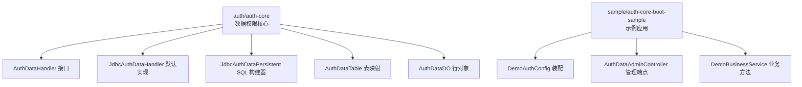
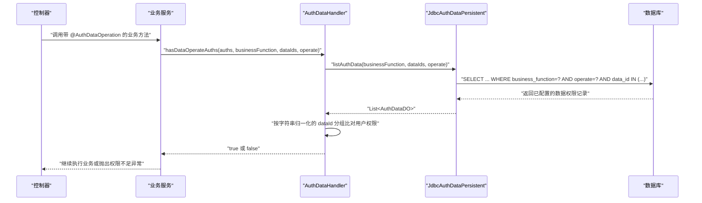
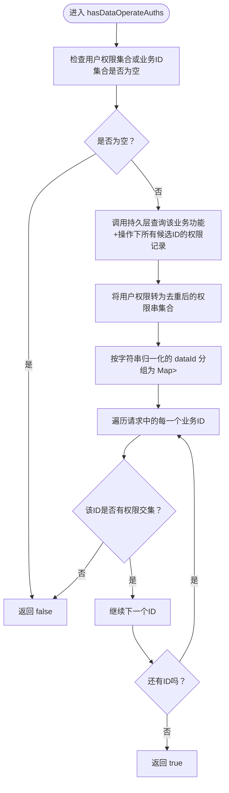
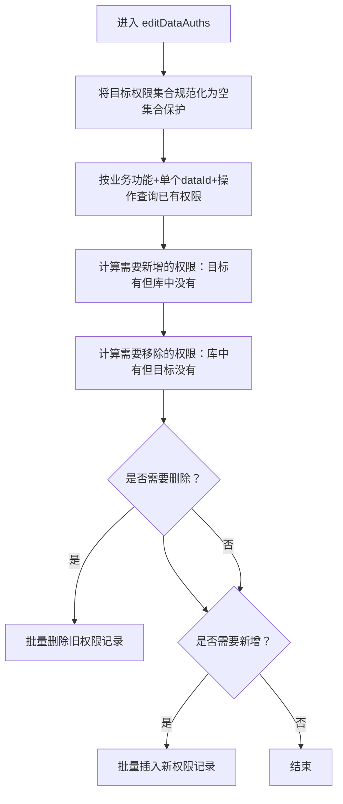
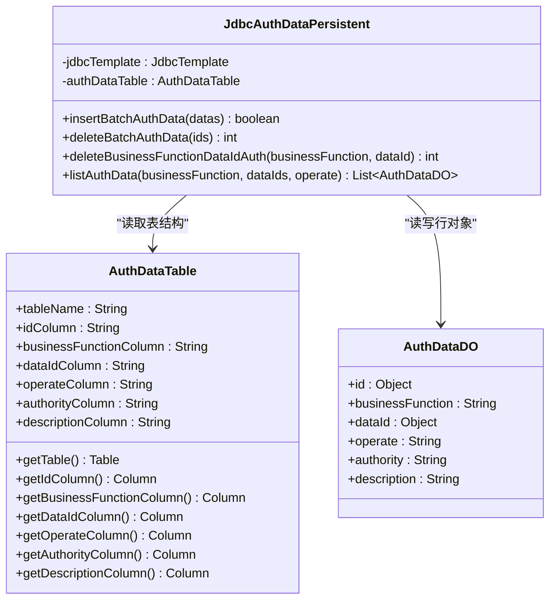
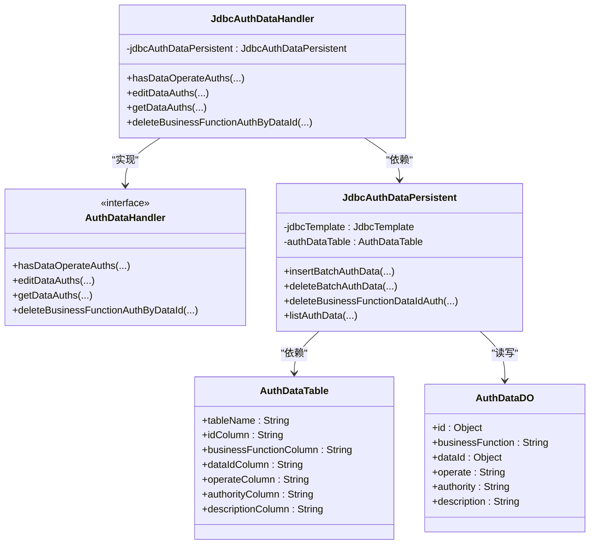

# 自定义数据权限处理器

<cite>
**本文引用的文件**   
- [AuthDataHandler.java](file://auth/auth-core/src/main/java/com/cu/framework/auth/core/data/AuthDataHandler.java)
- [JdbcAuthDataHandler.java](file://auth/auth-core/src/main/java/com/cu/framework/auth/core/data/JdbcAuthDataHandler.java)
- [JdbcAuthDataPersistent.java](file://auth/auth-core/src/main/java/com/cu/framework/auth/core/data/JdbcAuthDataPersistent.java)
- [AuthDataTable.java](file://auth/auth-core/src/main/java/com/cu/framework/auth/core/data/AuthDataTable.java)
- [AuthDataDO.java](file://auth/auth-core/src/main/java/com/cu/framework/auth/core/data/AuthDataDO.java)
- [DemoAuthConfig.java](file://sample/auth-core-boot-sample/src/main/java/com/cu/framework/sample/authcore/config/DemoAuthConfig.java)
- [AuthDataAdminController.java](file://sample/auth-core-boot-sample/src/main/java/com/cu/framework/sample/authcore/web/AuthDataAdminController.java)
- [DemoBusinessService.java](file://sample/auth-core-boot-sample/src/main/java/com/cu/framework/sample/authcore/service/DemoBusinessService.java)
- [AuthDataRow.java](file://sample/auth-core-boot-sample/src/main/java/com/cu/framework/sample/authcore/entity/AuthDataRow.java)
</cite>

## 目录
1. [引言](#引言)
2. [项目结构定位](#项目结构定位)
3. [核心组件概览](#核心组件概览)
4. [架构总览](#架构总览)
5. [AuthDataHandler 接口详解](#authdatahandler-接口详解)
6. [JdbcAuthDataHandler 默认实现分析](#jdbcauthdatahandler-默认实现分析)
7. [JdbcAuthDataPersistent 数据访问层](#jdbcauthdatapersistent-数据访问层)
8. [示例与扩展指南](#示例与扩展指南)
9. [依赖关系分析](#依赖关系分析)
10. [性能与并发注意事项](#性能与并发注意事项)
11. [故障排查](#故障排查)
12. [结论](#结论)

## 引言
本文面向需要扩展或替换框架中“数据权限”持久化逻辑的开发者，重点说明：
- 如何理解 `AuthDataHandler` 接口的业务语义。
- `JdbcAuthDataHandler` 默认的判定、编辑、查询、删除流程。
- 如何通过 `JdbcAuthDataPersistent` 和 `AuthDataTable` 定制数据访问层。
- 如何在示例工程中复用现有模式，并给出内存、文件、分布式缓存三类自定义实现的思路。

本指南不直接粘贴代码，而是通过源码路径和图示解释实现细节，方便读者自行查阅对应源码。

## 项目结构定位
数据权限相关代码集中在 `auth/auth-core` 模块中，核心类位于 `com.cu.framework.auth.core.data` 包；示例工程在 `sample/auth-core-boot-sample` 中演示如何装配和使用这些扩展点。

**图表来源**
- [AuthDataHandler.java:1-102](file://auth/auth-core/src/main/java/com/cu/framework/auth/core/data/AuthDataHandler.java#L1-L102)
- [JdbcAuthDataHandler.java:1-119](file://auth/auth-core/src/main/java/com/cu/framework/auth/core/data/JdbcAuthDataHandler.java#L1-L119)
- [JdbcAuthDataPersistent.java:1-179](file://auth/auth-core/src/main/java/com/cu/framework/auth/core/data/JdbcAuthDataPersistent.java#L1-L179)
- [AuthDataTable.java:1-113](file://auth/auth-core/src/main/java/com/cu/framework/auth/core/data/AuthDataTable.java#L1-L113)
- [AuthDataDO.java:1-54](file://auth/auth-core/src/main/java/com/cu/framework/auth/core/data/AuthDataDO.java#L1-L54)
- [DemoAuthConfig.java:1-104](file://sample/auth-core-boot-sample/src/main/java/com/cu/framework/sample/authcore/config/DemoAuthConfig.java#L1-L104)
- [AuthDataAdminController.java:1-76](file://sample/auth-core-boot-sample/src/main/java/com/cu/framework/sample/authcore/web/AuthDataAdminController.java#L1-L76)
- [DemoBusinessService.java:1-90](file://sample/auth-core-boot-sample/src/main/java/com/cu/framework/sample/authcore/service/DemoBusinessService.java#L1-L90)

**章节来源**
- [AuthDataHandler.java:1-102](file://auth/auth-core/src/main/java/com/cu/framework/auth/core/data/AuthDataHandler.java#L1-L102)
- [JdbcAuthDataHandler.java:1-119](file://auth/auth-core/src/main/java/com/cu/framework/auth/core/data/JdbcAuthDataHandler.java#L1-L119)
- [JdbcAuthDataPersistent.java:1-179](file://auth/auth-core/src/main/java/com/cu/framework/auth/core/data/JdbcAuthDataPersistent.java#L1-L179)
- [AuthDataTable.java:1-113](file://auth/auth-core/src/main/java/com/cu/framework/auth/core/data/AuthDataTable.java#L1-L113)
- [AuthDataDO.java:1-54](file://auth/auth-core/src/main/java/com/cu/framework/auth/core/data/AuthDataDO.java#L1-L54)
- [DemoAuthConfig.java:1-104](file://sample/auth-core-boot-sample/src/main/java/com/cu/framework/sample/authcore/config/DemoAuthConfig.java#L1-L104)
- [AuthDataAdminController.java:1-76](file://sample/auth-core-boot-sample/src/main/java/com/cu/framework/sample/authcore/web/AuthDataAdminController.java#L1-L76)
- [DemoBusinessService.java:1-90](file://sample/auth-core-boot-sample/src/main/java/com/cu/framework/sample/authcore/service/DemoBusinessService.java#L1-L90)

## 核心组件概览
- `AuthDataHandler`：数据权限操作抽象接口，定义“是否具备某条数据的指定操作权限”“编辑某条数据权限”“读取某条数据权限”“按业务功能+数据ID清理权限”等能力。
- `JdbcAuthDataHandler`：基于数据库的默认实现，负责把用户权限集合与持久化的数据权限记录进行比对，并提供增删改查的编排。
- `JdbcAuthDataPersistent`：使用 JSqlParser 构造 SQL，并通过 JdbcTemplate 执行批量插入、批量删除、条件删除和条件查询。
- `AuthDataTable`：描述权限表的表名和各列名，供 `JdbcAuthDataPersistent` 生成 SQL。
- `AuthDataDO`：一条数据权限记录的轻量对象，包含主键、业务功能、业务ID、操作类型、权限串、权限描述。

**章节来源**
- [AuthDataHandler.java:1-102](file://auth/auth-core/src/main/java/com/cu/framework/auth/core/data/AuthDataHandler.java#L1-L102)
- [JdbcAuthDataHandler.java:1-119](file://auth/auth-core/src/main/java/com/cu/framework/auth/core/data/JdbcAuthDataHandler.java#L1-L119)
- [JdbcAuthDataPersistent.java:1-179](file://auth/auth-core/src/main/java/com/cu/framework/auth/core/data/JdbcAuthDataPersistent.java#L1-L179)
- [AuthDataTable.java:1-113](file://auth/auth-core/src/main/java/com/cu/framework/auth/core/data/AuthDataTable.java#L1-L113)
- [AuthDataDO.java:1-54](file://auth/auth-core/src/main/java/com/cu/framework/auth/core/data/AuthDataDO.java#L1-L54)

## 架构总览
下图展示从业务请求到数据权限判定的主要调用链：业务注解触发校验，处理器委托持久层读权限，再与当前用户权限集合比较。

**图表来源**
- [JdbcAuthDataHandler.java:53-92](file://auth/auth-core/src/main/java/com/cu/framework/auth/core/data/JdbcAuthDataHandler.java#L53-L92)
- [JdbcAuthDataPersistent.java:117-170](file://auth/auth-core/src/main/java/com/cu/framework/auth/core/data/JdbcAuthDataPersistent.java#L117-L170)
- [DemoBusinessService.java:36-71](file://sample/auth-core-boot-sample/src/main/java/com/cu/framework/sample/authcore/service/DemoBusinessService.java#L36-L71)

## AuthDataHandler 接口详解
`AuthDataHandler` 是数据权限扩展的核心契约。它既支持直接传入用户权限集合，也支持通过 `IAuthObject` 获取基础权限列表。

| 方法 | 业务语义 | 输入 | 输出 | 关键行为 |
|---|---|---|---|---|
| `hasDataOperateAuths` | 判断用户是否对一组业务数据在指定操作槽位下拥有权限 | 用户权限集合、业务功能、业务ID集合、操作 | 布尔值 | 每个数据ID都必须命中；任一未命中即失败；空权限集合或空ID集合直接拒绝；ID按字符串归一化比较。 |
| `hasDataOperateAuths`（重载） | 基于权限对象做相同判定 | 权限对象、业务功能、业务ID集合、操作 | 布尔值 | 权限对象为空时返回 false，否则委托给前一个方法。 |
| `editDataAuths` | 编辑某条数据在某个操作槽位下的权限集合 | 业务功能、业务ID、操作、目标权限集合 | 无 | 典型默认实现会对比数据库已有权限，增量插入新增项，删除不再需要的旧项。 |
| `editDataAuths`（重载） | 基于权限对象编辑 | 业务功能、业务ID、操作、权限对象 | 无 | 权限对象为空时不做任何处理。 |
| `getDataAuths` | 读取某条数据在某个操作槽位下已配置的权限 | 业务功能、业务ID、操作 | 权限集合 | 默认实现通常从底层存储查询后转换为扁平权限对象。 |
| `fillDataAuths` | 将已配置权限填充到权限对象 | 业务功能、业务ID、操作、待填充权限对象 | 无 | 默认实现调用 `getDataAuths` 后设置权限属性。 |
| `deleteBusinessFunctionAuthByDataId` | 删除某业务功能下某条数据的全部权限 | 业务功能、业务ID | 无 | 常用于业务数据删除时的级联清理。 |

需要注意的设计约束：
- “权限槽位”由 `businessFunction + operate` 共同决定，不同槽位的权限互不影响。
- ID 比较必须稳定：即使业务主键是整数、长整型或字符串，也应按字符串归一化后比较，避免同一业务数据被当成多条。
- 不应让管理员接口直接编辑自身权限槽位，否则可能把自己关闭或越权授权。

**章节来源**
- [AuthDataHandler.java:1-102](file://auth/auth-core/src/main/java/com/cu/framework/auth/core/data/AuthDataHandler.java#L1-L102)

## JdbcAuthDataHandler 默认实现分析
`JdbcAuthDataHandler` 是 `AuthDataHandler` 的 JDBC 默认实现，它封装了“读权限—比权限—写权限”的流程。

### 权限判定算法
`hasDataOperateAuths` 的核心流程如下：

要点：
- 如果用户权限集合为空，或业务ID集合为空，直接返回 false。
- 数据ID使用 `String.valueOf(dataId)` 归一化，使 `1L` 和 `"1"` 视为同一条数据。
- 权限匹配使用集合不相交判断：只要某个ID对应的权限集合与用户权限集合没有交集，就判定失败。
- 用户权限集合的规模不可控，因此不在SQL中传递，而是在内存中比对。

**图表来源**
- [JdbcAuthDataHandler.java:53-92](file://auth/auth-core/src/main/java/com/cu/framework/auth/core/data/JdbcAuthDataHandler.java#L53-L92)
- [JdbcAuthDataPersistent.java:117-170](file://auth/auth-core/src/main/java/com/cu/framework/auth/core/data/JdbcAuthDataPersistent.java#L117-L170)

### 权限编辑逻辑
`editDataAuths` 的典型默认实现采用“差异计算 + 批量写入”的策略：

关键点：
- 新增时使用 `AuthDataDO` 的构造函数传入业务功能、dataId、operate、authority、description。
- 删除使用持久层提供的批量删除方法，参数是数据库中已有的主键。
- 新增和删除都走批量接口，减少数据库往返次数。

**图表来源**
- [JdbcAuthDataHandler.java:33-51](file://auth/auth-core/src/main/java/com/cu/framework/auth/core/data/JdbcAuthDataHandler.java#L33-L51)
- [JdbcAuthDataPersistent.java:66-115](file://auth/auth-core/src/main/java/com/cu/framework/auth/core/data/JdbcAuthDataPersistent.java#L66-L115)

### 读取权限
`getDataAuths` 根据业务功能、dataId、operate 查询权限记录，并转换为扁平权限对象集合。

### 删除业务功能+数据ID权限
`deleteBusinessFunctionAuthByDataId` 用于在业务数据删除时清理其全部权限，避免残留脏数据。

**章节来源**
- [JdbcAuthDataHandler.java:1-119](file://auth/auth-core/src/main/java/com/cu/framework/auth/core/data/JdbcAuthDataHandler.java#L1-L119)

## JdbcAuthDataPersistent 数据访问层
`JdbcAuthDataPersistent` 的职责是把业务语义转化为安全的SQL，而不是拼接字符串。它依赖两个外部组件：
- `JdbcTemplate`：执行SQL。
- `AuthDataTable`：描述权限表的表名和列名。

### SQL 构建策略
所有 SQL 都由 JSqlParser 构建，叶子节点使用 `JdbcParameter` 作为参数占位符。这样可以：
- 避免手动拼接导致的SQL注入风险。
- 避免把业务ID直接当字面量绑定，从而兼容不同主键类型。
- 统一表名和列名的来源，便于多环境或多库场景下调整映射。

### 批量插入
`insertBatchAuthData` 接收 `Collection<AuthDataDO>`，为每条记录构造一组参数，并以 `VALUES(...), (...)` 的形式一次性插入。返回值表示是否至少有一行写入。

### 批量删除
`deleteBatchAuthData` 按权限表主键列表删除，主键来自之前查询结果的原值，保证类型一致。

### 按业务功能+数据ID删除
`deleteBusinessFunctionDataIdAuth` 删除某个业务功能下某个业务ID的所有权限记录，常用于业务实体删除时的级联清理。

### 条件查询
`listAuthData` 只查询 `id`、`data_id`、`authority`、`description` 四列，WHERE 条件包括：
- `business_function = ?`
- `operate = ?`
- `data_id IN (?, ?, ...)`

参数顺序是：业务功能、操作类型、然后是所有 dataId。这保证了查询结果能按实际 dataId 区分命中的是哪条业务数据。

**图表来源**
- [JdbcAuthDataPersistent.java:1-179](file://auth/auth-core/src/main/java/com/cu/framework/auth/core/data/JdbcAuthDataPersistent.java#L1-L179)
- [AuthDataTable.java:1-113](file://auth/auth-core/src/main/java/com/cu/framework/auth/core/data/AuthDataTable.java#L1-L113)
- [AuthDataDO.java:1-54](file://auth/auth-core/src/main/java/com/cu/framework/auth/core/data/AuthDataDO.java#L1-L54)

**章节来源**
- [JdbcAuthDataPersistent.java:1-179](file://auth/auth-core/src/main/java/com/cu/framework/auth/core/data/JdbcAuthDataPersistent.java#L1-L179)
- [AuthDataTable.java:1-113](file://auth/auth-core/src/main/java/com/cu/framework/auth/core/data/AuthDataTable.java#L1-L113)
- [AuthDataDO.java:1-54](file://auth/auth-core/src/main/java/com/cu/framework/auth/core/data/AuthDataDO.java#L1-L54)

## 示例与扩展指南
### 示例工程如何装配数据权限处理器
示例应用中，`DemoAuthConfig` 注册了多个扩展点：
- 当前用户上下文。
- 菜单权限规则。
- 菜单API存储。
- `AuthDataAdaptor`，用于在服务层直接操作数据权限。
- 观察组件，用于追踪SQL和判定结果。
- 通过 `@Primary` 暴露一个包装默认 `JdbcAuthDataHandler` 的探针Bean，让框架自动配置中的默认实现让位。

这说明：
- 如果你提供自己的 `AuthDataHandler` Bean，框架默认实现会被替换。
- 示例中的探针只是包装默认实现，不改变判定逻辑，仅增强可观测性。

**章节来源**
- [DemoAuthConfig.java:1-104](file://sample/auth-core-boot-sample/src/main/java/com/cu/framework/sample/authcore/config/DemoAuthConfig.java#L1-L104)

### 业务方法如何使用数据权限
`DemoBusinessService` 展示了 `@AuthDataOperation` 标注在业务方法上的用法：
- 散参、集合、数组三种承载位置的ID都会被收集并参与权限判定。
- 只有判定通过后，业务方法体才会执行。
- 未声明权限的方法不会触发行级判定，适合不需要数据权限控制的内部更新。

**章节来源**
- [DemoBusinessService.java:1-90](file://sample/auth-core-boot-sample/src/main/java/com/cu/framework/sample/authcore/service/DemoBusinessService.java#L1-L90)

### 管理端点如何维护数据权限
`AuthDataAdminController` 提供三个管理端点：
- 授予权限：为某条目标数据在指定槽位上设置权限集合。
- 移除权限：清空某条目标数据的全部权限。
- 填充权限：把某条数据在指定槽位上的权限读回权限集合体。

这些端点使用独立的管理槽位 `demo_admin/unified`，与被维护的目标数据槽位分离，符合“不要编辑自身权限槽位”的安全建议。

**章节来源**
- [AuthDataAdminController.java:1-76](file://sample/auth-core-boot-sample/src/main/java/com/cu/framework/sample/authcore/web/AuthDataAdminController.java#L1-L76)

### 自定义实现示例思路
#### 基于内存存储的 AuthDataHandler
适用场景：单元测试、临时验证、单机开发。
设计要点：
- 使用线程安全集合，例如 `ConcurrentHashMap<String, Map<String, Set<String>>>`，外层 key 为 `businessFunction`，内层 key 为 `dataId` 的字符串形式，value 为操作到权限集合的映射。
- `hasDataOperateAuths` 直接查找内存结构，无需SQL。
- `editDataAuths` 先删除旧权限，再插入新权限，注意幂等和并发写保护。
- `deleteBusinessFunctionAuthByDataId` 清除对应业务功能和业务ID的条目。

并发安全建议：
- 使用 `ConcurrentHashMap` 配合 `computeIfAbsent`。
- 对单条数据权限写操作加细粒度锁，或使用 `ConcurrentHashMap` 的原子更新方法。
- 读多写少场景下，可考虑定期快照，降低竞争。

#### 基于文件存储的 AuthDataHandler
适用场景：小型项目、离线环境、简单权限矩阵。
设计要点：
- 用 JSON 或 YAML 文件存储权限矩阵，key 为 `businessFunction/dataId/operate`。
- 读写时加文件锁，防止并发写入损坏文件。
- 加载时做校验，确保权限串格式合法。
- 变更后可提供热重载接口，或重启生效。

并发安全建议：
- 写操作串行化，避免多进程同时修改同一文件。
- 使用临时文件+原子替换的方式写入，减少部分写入导致的不一致。

#### 基于分布式缓存的 AuthDataHandler
适用场景：高并发、跨实例共享权限数据、要求低延迟。
设计要点：
- 使用 Redis 等分布式缓存，key 为 `auth:{businessFunction}:{dataId}:{operate}`，value 为权限集合。
- 读操作走缓存，必要时可结合本地缓存提升性能。
- 写操作先更新缓存，再异步或事务外同步持久化，保证最终一致性。
- 提供缓存失效策略：业务数据删除时主动删除对应缓存键。

并发安全建议：
- 使用缓存层的原子操作，如 `SETNX`、`INCR`、Lua 脚本。
- 写扩散时考虑批量更新和限流。
- 防缓存穿透：空权限集合也应有明确语义，避免误判。

### 扩展 JdbcAuthDataPersistent 接口
虽然 `JdbcAuthDataPersistent` 本身不是接口，但你可以通过以下方式扩展数据访问层：
- 继承或组合 `JdbcAuthDataPersistent`，在其之上增加复杂查询、审计日志、分库分表路由。
- 提供新的 `AuthDataHandler` 实现，仍复用 `JdbcAuthDataPersistent` 的基础SQL能力。
- 自定义 `AuthDataTable`，将权限表映射到不同库、不同表名或不同列名。
- 在示例工程中参考 `DemoAuthConfig`，将新的持久化组件装配进容器。

**章节来源**
- [JdbcAuthDataPersistent.java:1-179](file://auth/auth-core/src/main/java/com/cu/framework/auth/core/data/JdbcAuthDataPersistent.java#L1-L179)
- [AuthDataTable.java:1-113](file://auth/auth-core/src/main/java/com/cu/framework/auth/core/data/AuthDataTable.java#L1-L113)
- [DemoAuthConfig.java:1-104](file://sample/auth-core-boot-sample/src/main/java/com/cu/framework/sample/authcore/config/DemoAuthConfig.java#L1-L104)

## 依赖关系分析
下图展示核心类之间的依赖方向：

**图表来源**
- [AuthDataHandler.java:1-102](file://auth/auth-core/src/main/java/com/cu/framework/auth/core/data/AuthDataHandler.java#L1-L102)
- [JdbcAuthDataHandler.java:1-119](file://auth/auth-core/src/main/java/com/cu/framework/auth/core/data/JdbcAuthDataHandler.java#L1-L119)
- [JdbcAuthDataPersistent.java:1-179](file://auth/auth-core/src/main/java/com/cu/framework/auth/core/data/JdbcAuthDataPersistent.java#L1-L179)
- [AuthDataTable.java:1-113](file://auth/auth-core/src/main/java/com/cu/framework/auth/core/data/AuthDataTable.java#L1-L113)
- [AuthDataDO.java:1-54](file://auth/auth-core/src/main/java/com/cu/framework/auth/core/data/AuthDataDO.java#L1-L54)

**章节来源**
- [AuthDataHandler.java:1-102](file://auth/auth-core/src/main/java/com/cu/framework/auth/core/data/AuthDataHandler.java#L1-L102)
- [JdbcAuthDataHandler.java:1-119](file://auth/auth-core/src/main/java/com/cu/framework/auth/core/data/JdbcAuthDataHandler.java#L1-L119)
- [JdbcAuthDataPersistent.java:1-179](file://auth/auth-core/src/main/java/com/cu/framework/auth/core/data/JdbcAuthDataPersistent.java#L1-L179)

## 性能与并发注意事项
### 批量操作最佳实践
- 优先使用 `insertBatchAuthData` 和 `deleteBatchAuthData`，减少数据库往返。
- 在 `editDataAuths` 中尽量合并多次写入，避免频繁全量覆盖。
- 对于大量 dataId 的判定，注意 `IN` 子句长度限制，必要时分批查询。

### 数据ID归一化
- 始终使用字符串形式比较业务ID，避免不同类型主键造成误判。
- 如果业务ID来源复杂，应在上层统一清洗后再交给权限处理器。

### 并发安全
- 权限读多写少的场景应优先优化读路径。
- 写操作要防止“读后写”竞态，必要时引入版本控制或乐观锁。
- 自定义实现若使用缓存，需要考虑缓存与持久化的最终一致性。

### 查询列最小化
- `listAuthData` 只查询必要列，有助于减少网络传输和对象映射开销。
- 如果业务需要额外字段，可在上层扩展查询方法，但不要破坏默认实现的最小列约定。

[本节为通用指导，不直接分析具体文件]

## 故障排查
常见问题及定位方式：

| 现象 | 可能原因 | 排查建议 |
|---|---|---|
| 权限判定总是失败 | 用户权限集合为空，或业务ID集合为空 | 检查上游是否成功加载用户权限；确认业务方法是否正确提取 dataId。 |
| 同一业务ID的不同类型被视为不同数据 | 自定义实现未按字符串归一化 | 检查 `normalize` 或等价逻辑，确保 `1L` 与 `"1"` 相等。 |
| 权限变更后立即查询不到 | 缓存未失效或事务未提交 | 检查缓存失效策略；确认写操作事务已提交。 |
| 批量写入性能差 | 逐条插入或删除 | 改用批量接口；合并重复写入；避免超大IN列表。 |
| 管理端点无法维护权限 | 使用了自身权限槽位 | 改用独立管理槽位，避免编辑自身权限。 |
| SQL异常或类型不匹配 | 业务ID类型与数据库不一致 | 检查 `AuthDataTable` 列定义和 `JdbcAuthDataPersistent` 参数绑定。 |

**章节来源**
- [JdbcAuthDataHandler.java:53-92](file://auth/auth-core/src/main/java/com/cu/framework/auth/core/data/JdbcAuthDataHandler.java#L53-L92)
- [JdbcAuthDataPersistent.java:117-170](file://auth/auth-core/src/main/java/com/cu/framework/auth/core/data/JdbcAuthDataPersistent.java#L117-L170)
- [AuthDataAdminController.java:1-76](file://sample/auth-core-boot-sample/src/main/java/com/cu/framework/sample/authcore/web/AuthDataAdminController.java#L1-L76)

## 结论
`AuthDataHandler` 提供了数据权限扩展的稳定入口，`JdbcAuthDataHandler` 给出了基于数据库的默认实现，而 `JdbcAuthDataPersistent` 与 `AuthDataTable` 则把SQL构建和表映射解耦出来，便于替换和扩展。

在实际项目中：
- 如果只是需要自定义存储介质，优先考虑实现新的 `AuthDataHandler`。
- 如果需要保留JDBC能力但调整表结构，优先调整 `AuthDataTable`。
- 如果需要在示例工程中快速验证，参考 `DemoAuthConfig`、`AuthDataAdminController` 和 `DemoBusinessService` 的装配与使用方式。
- 对于高并发场景，务必关注ID归一化、批量操作、缓存一致性和事务边界。

[本节为总结，不直接分析具体文件]