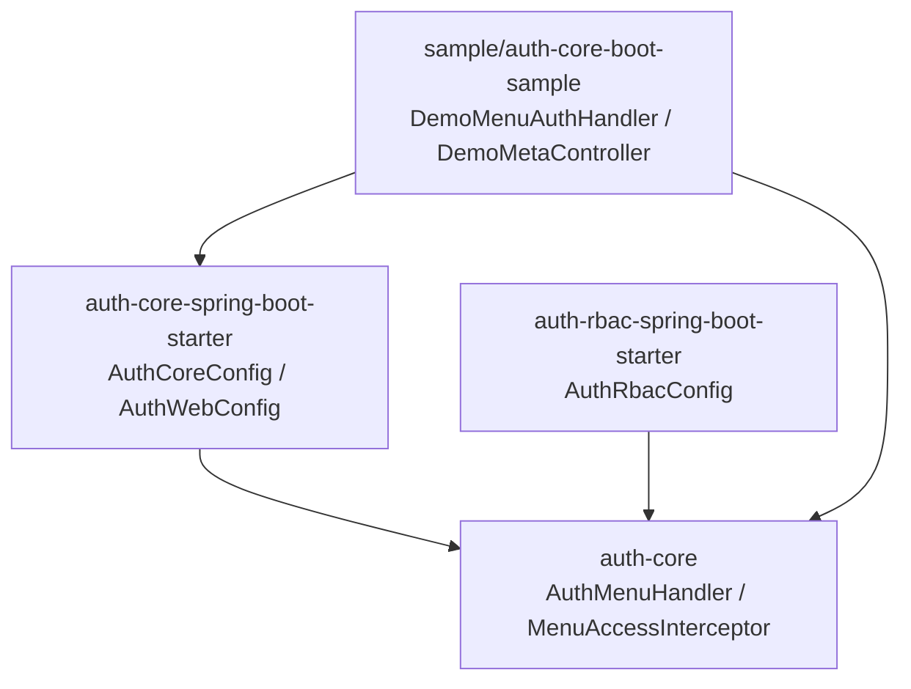
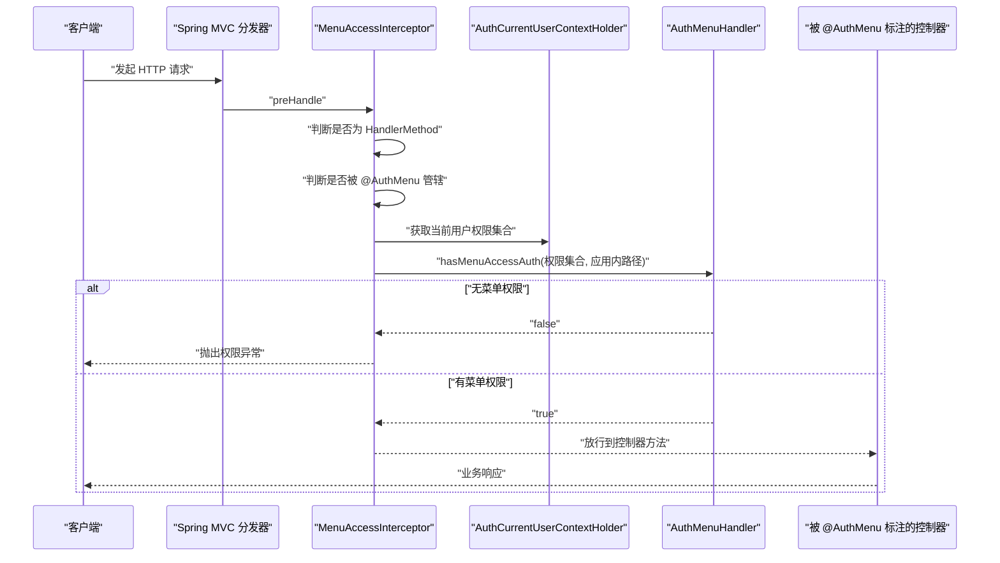
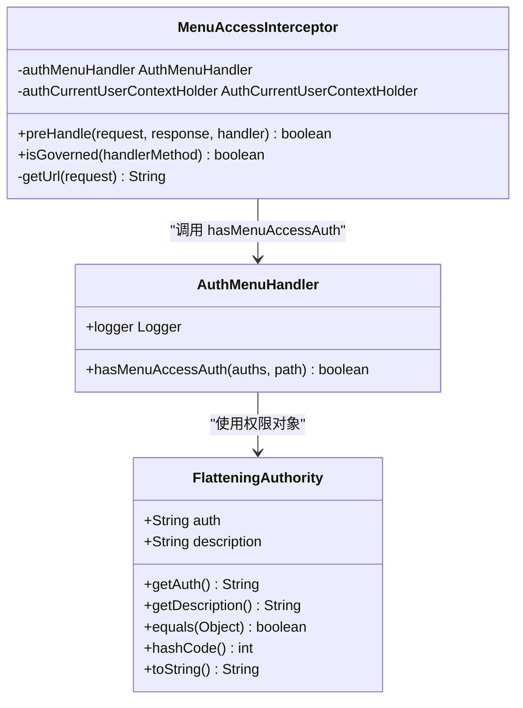
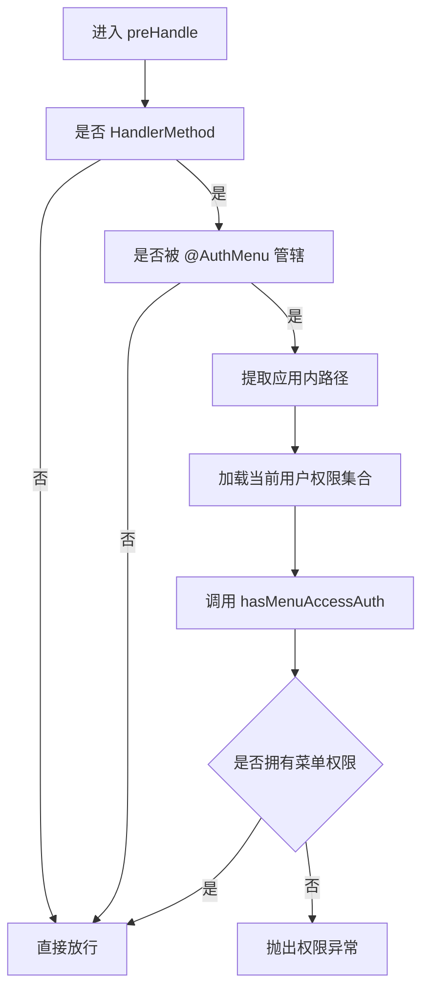
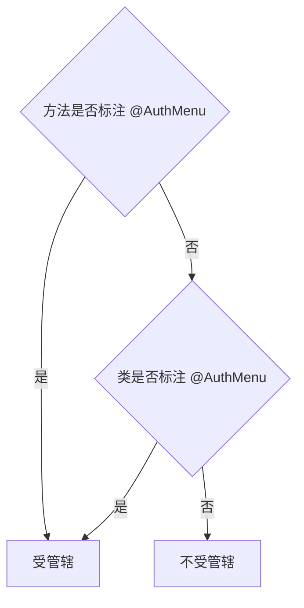
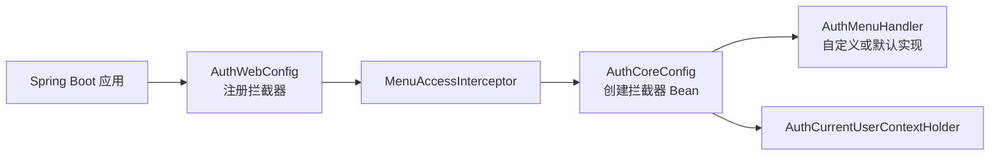
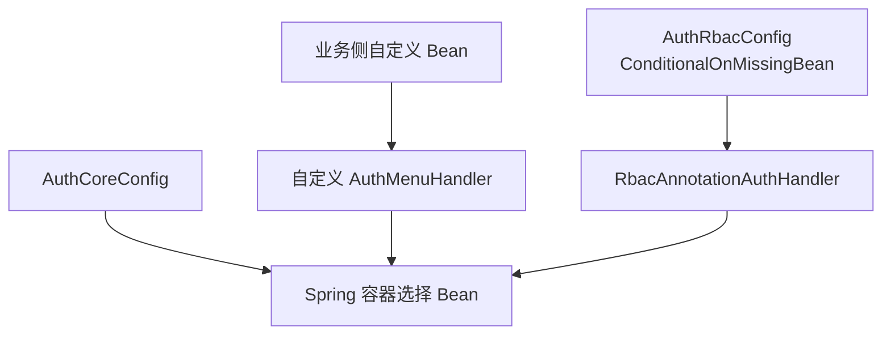
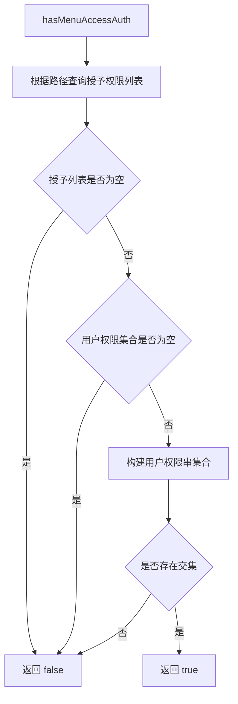
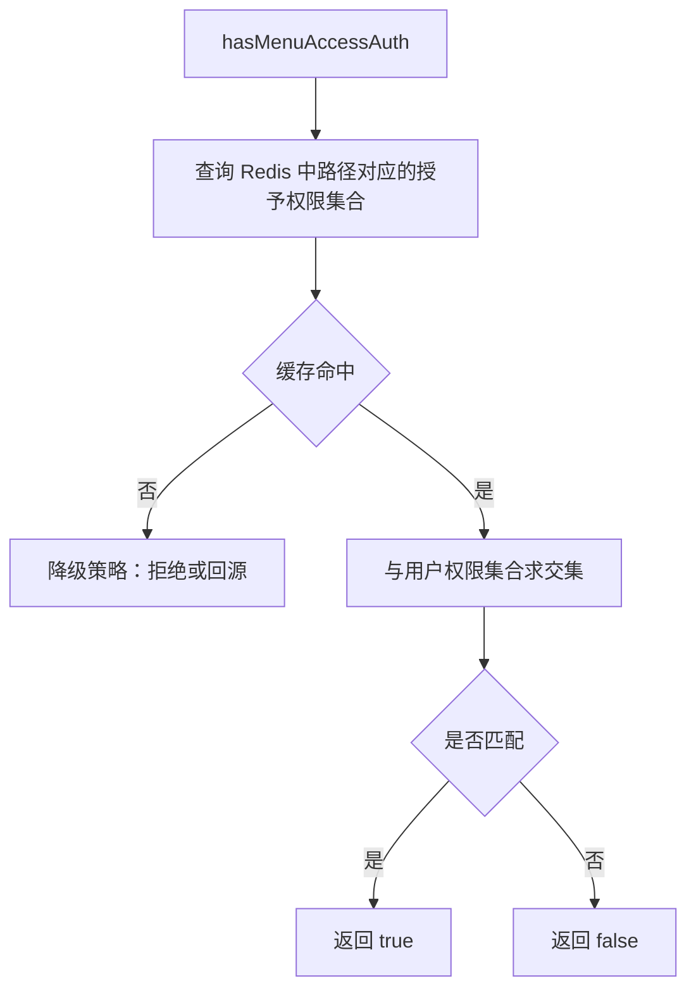
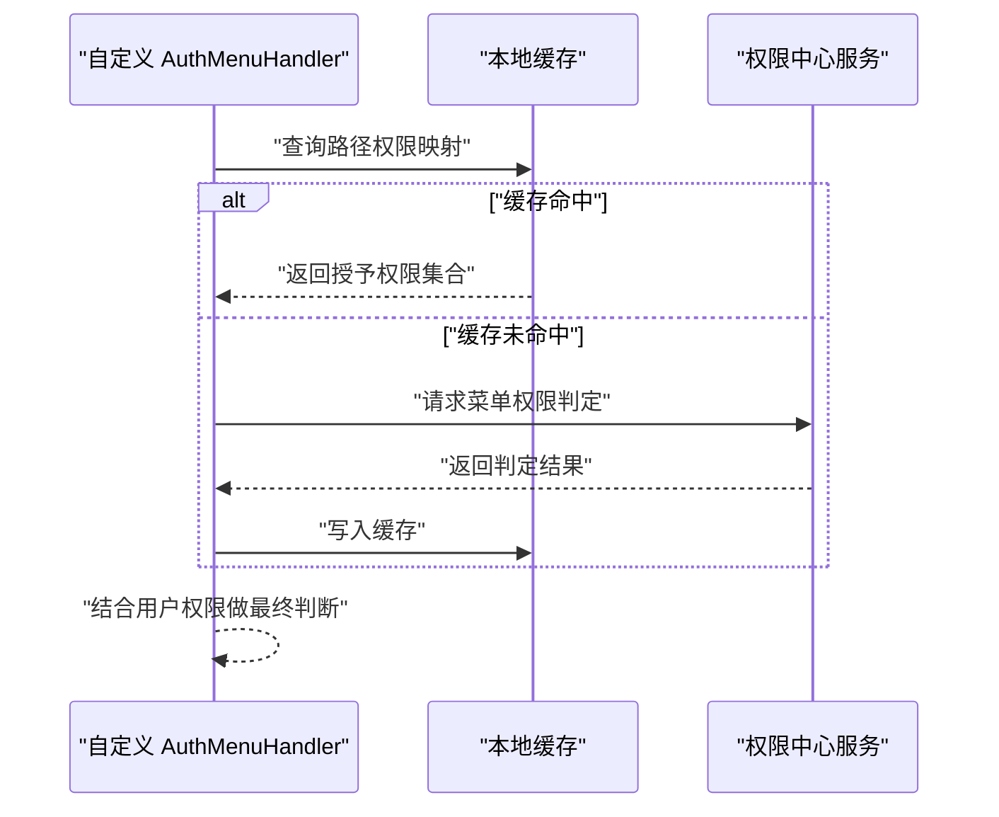

# 自定义菜单权限处理器

<cite>
**本文引用的文件**   
- [AuthMenuHandler.java](file://auth/auth-core/src/main/java/com/cu/framework/auth/core/menu/AuthMenuHandler.java)
- [MenuAccessInterceptor.java](file://auth/auth-core/src/main/java/com/cu/framework/auth/core/menu/MenuAccessInterceptor.java)
- [AuthMenu.java](file://auth/auth-core/src/main/java/com/cu/framework/auth/core/AuthMenu.java)
- [FlatteningAuthority.java](file://auth/auth-core/src/main/java/com/cu/framework/auth/core/entity/FlatteningAuthority.java)
- [AuthWebConfig.java](file://auth/auth-core-spring-boot-starter/src/main/java/com/cu/framework/boot/auth/core/config/AuthWebConfig.java)
- [AuthCoreConfig.java](file://auth/auth-core-spring-boot-starter/src/main/java/com/cu/framework/boot/auth/core/config/AuthCoreConfig.java)
- [AuthRbacConfig.java](file://auth/auth-rbac-spring-boot-starter/src/main/java/com/cu/framework/boot/auth/rbac/config/AuthRbacConfig.java)
- [DemoMenuAuthHandler.java](file://sample/auth-core-boot-sample/src/main/java/com/cu/framework/sample/authcore/context/DemoMenuAuthHandler.java)
- [DemoMenuAuthMapper.java](file://sample/auth-core-boot-sample/src/main/java/com/cu/framework/sample/authcore/mapper/DemoMenuAuthMapper.java)
- [DemoMetaController.java](file://sample/auth-core-boot-sample/src/main/java/com/cu/framework/sample/authcore/web/DemoMetaController.java)
</cite>

## 目录
1. [引言](#引言)
2. [项目结构定位](#项目结构定位)
3. [核心组件总览](#核心组件总览)
4. [架构与拦截流程](#架构与拦截流程)
5. [AuthMenuHandler 接口设计](#authmenuhandler-接口设计)
6. [MenuAccessInterceptor 拦截逻辑](#menuaccessinterceptor-拦截逻辑)
7. [Spring Boot 集成与注册](#spring-boot-集成与注册)
8. [自定义实现示例](#自定义实现示例)
9. [权限匹配策略](#权限匹配策略)
10. [性能优化建议](#性能优化建议)
11. [故障排查](#故障排查)
12. [总结](#总结)

## 引言
本文面向需要扩展菜单级访问控制能力的开发者，围绕 `AuthMenuHandler` 接口和 `MenuAccessInterceptor` 拦截器，说明如何在 Spring MVC 中实现“某个请求路径是否允许当前用户访问”的菜单权限判断。文档会解释：
- 为什么框架把菜单权限判定抽象成 `AuthMenuHandler`；
- 拦截器如何触发、如何获取当前用户权限；
- 如何通过 `@AuthMenu` 注解声明哪些端点受菜单权限约束；
- 如何编写基于数据库、缓存或外部服务的自定义处理器；
- 如何在 Spring Boot 应用中正确注册并覆盖默认实现；
- 常见权限匹配模式与性能优化要点。

## 项目结构定位
菜单权限相关代码分布在三个层次：
- 核心接口与拦截器位于 `auth-core` 模块；
- Spring Boot 自动装配与 Web 配置位于 `auth-core-spring-boot-starter` 模块；
- RBAC 默认实现和示例应用分别位于 `auth-rbac-spring-boot-starter` 与 `sample/auth-core-boot-sample`。

**图表来源**
- [AuthMenuHandler.java:1-27](file://auth/auth-core/src/main/java/com/cu/framework/auth/core/menu/AuthMenuHandler.java#L1-L27)
- [MenuAccessInterceptor.java:1-93](file://auth/auth-core/src/main/java/com/cu/framework/auth/core/menu/MenuAccessInterceptor.java#L1-L93)
- [AuthCoreConfig.java:1-200](file://auth/auth-core-spring-boot-starter/src/main/java/com/cu/framework/boot/auth/core/config/AuthCoreConfig.java#L1-L200)
- [AuthWebConfig.java:1-30](file://auth/auth-core-spring-boot-starter/src/main/java/com/cu/framework/boot/auth/core/config/AuthWebConfig.java#L1-L30)
- [AuthRbacConfig.java:1-75](file://auth/auth-rbac-spring-boot-starter/src/main/java/com/cu/framework/boot/auth/rbac/config/AuthRbacConfig.java#L1-L75)
- [DemoMenuAuthHandler.java:1-63](file://sample/auth-core-boot-sample/src/main/java/com/cu/framework/sample/authcore/context/DemoMenuAuthHandler.java#L1-L63)
- [DemoMetaController.java:1-200](file://sample/auth-core-boot-sample/src/main/java/com/cu/framework/sample/authcore/web/DemoMetaController.java#L1-L200)

**章节来源**
- [AuthMenuHandler.java:1-27](file://auth/auth-core/src/main/java/com/cu/framework/auth/core/menu/AuthMenuHandler.java#L1-L27)
- [MenuAccessInterceptor.java:1-93](file://auth/auth-core/src/main/java/com/cu/framework/auth/core/menu/MenuAccessInterceptor.java#L1-L93)
- [AuthCoreConfig.java:1-200](file://auth/auth-core-spring-boot-starter/src/main/java/com/cu/framework/boot/auth/core/config/AuthCoreConfig.java#L1-L200)
- [AuthWebConfig.java:1-30](file://auth/auth-core-spring-boot-starter/src/main/java/com/cu/framework/boot/auth/core/config/AuthWebConfig.java#L1-L30)
- [AuthRbacConfig.java:1-75](file://auth/auth-rbac-spring-boot-starter/src/main/java/com/cu/framework/boot/auth/rbac/config/AuthRbacConfig.java#L1-L75)

## 核心组件总览
| 组件 | 职责 | 关键行为 |
|---|---|---|
| `AuthMenuHandler` | 菜单权限判定策略接口 | 接收用户扁平化权限集合与应用内路径，返回是否有菜单访问权限 |
| `MenuAccessInterceptor` | Spring MVC 拦截器 | 在控制器方法执行前检查 `@AuthMenu` 管辖范围，调用处理器完成菜单权限校验 |
| `AuthMenu` | 菜单管辖注解 | 标记方法或类，表示该端点参与菜单权限控制 |
| `FlatteningAuthority` | 扁平化权限对象 | 以 `auth` 字符串作为唯一标识，承载权限串及描述 |
| `AuthWebConfig` | Web 配置 | 注册 `MenuAccessInterceptor` |
| `AuthCoreConfig` | 核心 Bean 装配 | 创建 `MenuAccessInterceptor`，并在缺少自定义处理器时让 RBAC 默认实现接管 |
| `AuthRbacConfig` | RBAC 启动器装配 | 提供默认 `AuthMenuHandler` 实现及菜单存储 Bean |
| `DemoMenuAuthHandler` | 示例处理器 | 从示例数据表读取某路径被授予的权限串，并与当前用户权限求交集 |

**章节来源**
- [AuthMenuHandler.java:1-27](file://auth/auth-core/src/main/java/com/cu/framework/auth/core/menu/AuthMenuHandler.java#L1-L27)
- [MenuAccessInterceptor.java:1-93](file://auth/auth-core/src/main/java/com/cu/framework/auth/core/menu/MenuAccessInterceptor.java#L1-L93)
- [AuthMenu.java:1-16](file://auth/auth-core/src/main/java/com/cu/framework/auth/core/AuthMenu.java#L1-L16)
- [FlatteningAuthority.java:1-63](file://auth/auth-core/src/main/java/com/cu/framework/auth/core/entity/FlatteningAuthority.java#L1-L63)
- [AuthWebConfig.java:1-30](file://auth/auth-core-spring-boot-starter/src/main/java/com/cu/framework/boot/auth/core/config/AuthWebConfig.java#L1-L30)
- [AuthCoreConfig.java:1-200](file://auth/auth-core-spring-boot-starter/src/main/java/com/cu/framework/boot/auth/core/config/AuthCoreConfig.java#L1-L200)
- [AuthRbacConfig.java:1-75](file://auth/auth-rbac-spring-boot-starter/src/main/java/com/cu/framework/boot/auth/rbac/config/AuthRbacConfig.java#L1-L75)
- [DemoMenuAuthHandler.java:1-63](file://sample/auth-core-boot-sample/src/main/java/com/cu/framework/sample/authcore/context/DemoMenuAuthHandler.java#L1-L63)

## 架构与拦截流程
菜单权限的整体调用链如下：

**图表来源**
- [MenuAccessInterceptor.java:1-93](file://auth/auth-core/src/main/java/com/cu/framework/auth/core/menu/MenuAccessInterceptor.java#L1-L93)
- [AuthWebConfig.java:1-30](file://auth/auth-core-spring-boot-starter/src/main/java/com/cu/framework/boot/auth/core/config/AuthWebConfig.java#L1-L30)
- [AuthMenu.java:1-16](file://auth/auth-core/src/main/java/com/cu/framework/auth/core/AuthMenu.java#L1-L16)

### 关键设计要点
- 非控制器方法请求直接放行；
- 未标注 `@AuthMenu` 的方法或类跳过菜单权限校验；
- 路径是去除 `contextPath` 后的应用内路径；
- 没有菜单权限时抛出 `AuthException`，由统一异常处理转为可识别的拒绝响应。

**章节来源**
- [MenuAccessInterceptor.java:20-93](file://auth/auth-core/src/main/java/com/cu/framework/auth/core/menu/MenuAccessInterceptor.java#L20-L93)
- [AuthWebConfig.java:15-30](file://auth/auth-core-spring-boot-starter/src/main/java/com/cu/framework/boot/auth/core/config/AuthWebConfig.java#L15-L30)

## AuthMenuHandler 接口设计

### 接口定义与目的
`AuthMenuHandler` 是菜单权限的核心扩展点。框架不关心权限最终来自数据库、Redis、内存还是外部服务，只要求实现类回答一个问题：**在当前用户持有的权限集合下，是否允许访问指定应用内路径。**

| 元素 | 含义 |
|---|---|
| 接口名称 | `AuthMenuHandler` |
| 主要方法 | `hasMenuAccessAuth(Collection<FlatteningAuthority> auths, String path)` |
| 输入参数 | `auths`：当前用户的扁平化权限集合；`path`：应用内请求路径 |
| 返回值 | `true` 表示允许访问；`false` 表示拒绝访问 |
| 设计原则 | 将“路径是否需要权限”“权限规则是什么”交给业务侧决定 |

**图表来源**
- [AuthMenuHandler.java:1-27](file://auth/auth-core/src/main/java/com/cu/framework/auth/core/menu/AuthMenuHandler.java#L1-L27)
- [MenuAccessInterceptor.java:1-93](file://auth/auth-core/src/main/java/com/cu/framework/auth/core/menu/MenuAccessInterceptor.java#L1-L93)
- [FlatteningAuthority.java:1-63](file://auth/auth-core/src/main/java/com/cu/framework/auth/core/entity/FlatteningAuthority.java#L1-L63)

### 方法参数语义
| 参数 | 类型 | 语义 | 注意事项 |
|---|---|---|---|
| `auths` | `Collection<FlatteningAuthority>` | 当前登录用户拥有的扁平化权限集合 | 可能为空；每个元素的 `auth` 字段是权限唯一标识 |
| `path` | `String` | 用于菜单权限判定的应用内路径 | 已去掉 `contextPath`；示例中为 `/demo/...` 形式 |

### 返回值语义
- 返回 `true`：认为当前用户具备该菜单路径的访问权限，拦截器放行；
- 返回 `false`：认为不具备菜单访问权限，拦截器抛出权限异常。

### 实现契约
实现类应满足以下契约：
1. 对空权限集合谨慎处理：通常不应仅因查不到记录而放行；
2. 对未登记路径采取保守策略：示例中“路径未登记视为无人被授予”，因此应返回 `false`；
3. 比较权限时应基于 `FlatteningAuthority.auth`；
4. 方法应保持幂等且尽量快速，因为每次受控请求都会调用；
5. 不要在处理器内部做与权限无关的业务副作用操作。

**章节来源**
- [AuthMenuHandler.java:10-27](file://auth/auth-core/src/main/java/com/cu/framework/auth/core/menu/AuthMenuHandler.java#L10-L27)
- [FlatteningAuthority.java:1-63](file://auth/auth-core/src/main/java/com/cu/framework/auth/core/entity/FlatteningAuthority.java#L1-L63)
- [DemoMenuAuthHandler.java:15-63](file://sample/auth-core-boot-sample/src/main/java/com/cu/framework/sample/authcore/context/DemoMenuAuthHandler.java#L15-L63)

## MenuAccessInterceptor 拦截逻辑

### 拦截入口
`MenuAccessInterceptor` 实现 Spring MVC 的 `HandlerInterceptor`，在 `preHandle` 中执行菜单权限前置检查。

#### 执行顺序
1. 判断目标是否为 `HandlerMethod`；
2. 判断是否被 `@AuthMenu` 管辖；
3. 提取应用内路径；
4. 从上下文获取当前用户权限集合；
5. 调用 `AuthMenuHandler.hasMenuAccessAuth`；
6. 无权限时抛出 `AuthException`，否则放行。

**图表来源**
- [MenuAccessInterceptor.java:20-93](file://auth/auth-core/src/main/java/com/cu/framework/auth/core/menu/MenuAccessInterceptor.java#L20-L93)

### 管辖判定
`isGoverned` 支持两种声明方式：
- 方法上标注 `@AuthMenu`；
- 类上标注 `@AuthMenu`，则该类所有端点均受菜单权限控制。

**图表来源**
- [MenuAccessInterceptor.java:64-73](file://auth/auth-core/src/main/java/com/cu/framework/auth/core/menu/MenuAccessInterceptor.java#L64-L73)
- [AuthMenu.java:1-16](file://auth/auth-core/src/main/java/com/cu/framework/auth/core/AuthMenu.java#L1-L16)

### 路径处理
拦截器会从 `HttpServletRequest.getRequestURI()` 中移除 `contextPath`，得到应用内路径。例如部署路径包含 `/coredemo` 时，实际传入处理器的路径不包含该前缀。

**章节来源**
- [MenuAccessInterceptor.java:20-93](file://auth/auth-core/src/main/java/com/cu/framework/auth/core/menu/MenuAccessInterceptor.java#L20-L93)
- [AuthMenu.java:1-16](file://auth/auth-core/src/main/java/com/cu/framework/auth/core/AuthMenu.java#L1-L16)

## Spring Boot 集成与注册

### 拦截器注册
`AuthWebConfig` 实现 `WebMvcConfigurer`，将 `MenuAccessInterceptor` 加入拦截器链。这意味着只要 starter 生效，所有匹配的请求都会经过菜单权限拦截。

### 处理器装配
`AuthCoreConfig` 负责创建 `MenuAccessInterceptor` Bean，注入 `AuthMenuHandler` 和 `AuthCurrentUserContextHolder`。

**图表来源**
- [AuthWebConfig.java:1-30](file://auth/auth-core-spring-boot-starter/src/main/java/com/cu/framework/boot/auth/core/config/AuthWebConfig.java#L1-L30)
- [AuthCoreConfig.java:1-200](file://auth/auth-core-spring-boot-starter/src/main/java/com/cu/framework/boot/auth/core/config/AuthCoreConfig.java#L1-L200)

### 默认实现与覆盖策略
当引入 RBAC 启动器且未提供自定义 `AuthMenuHandler` 时，`AuthRbacConfig` 会注册 `RbacAnnotationAuthHandler` 作为默认菜单权限处理器。若业务侧提供了自己的 `AuthMenuHandler` Bean，则默认实现会被替换。

**图表来源**
- [AuthRbacConfig.java:1-75](file://auth/auth-rbac-spring-boot-starter/src/main/java/com/cu/framework/boot/auth/rbac/config/AuthRbacConfig.java#L1-L75)
- [AuthCoreConfig.java:1-200](file://auth/auth-core-spring-boot-starter/src/main/java/com/cu/framework/boot/auth/core/config/AuthCoreConfig.java#L1-L200)

### 注册步骤建议
1. 创建自定义 `AuthMenuHandler` 实现类；
2. 将其声明为 Spring Bean；
3. 如需启用 RBAC 默认实现以外的逻辑，确保自定义 Bean 存在；
4. 在需要菜单权限控制的控制器方法或类上添加 `@AuthMenu`；
5. 通过示例中的权限透视接口或日志观察判定结果。

**章节来源**
- [AuthWebConfig.java:15-30](file://auth/auth-core-spring-boot-starter/src/main/java/com/cu/framework/boot/auth/core/config/AuthWebConfig.java#L15-L30)
- [AuthCoreConfig.java:160-200](file://auth/auth-core-spring-boot-starter/src/main/java/com/cu/framework/boot/auth/core/config/AuthCoreConfig.java#L160-L200)
- [AuthRbacConfig.java:25-45](file://auth/auth-rbac-spring-boot-starter/src/main/java/com/cu/framework/boot/auth/rbac/config/AuthRbacConfig.java#L25-L45)

## 自定义实现示例

### 示例一：基于数据库查询
示例工程中的 `DemoMenuAuthHandler` 展示了最直接的数据库策略：
- 根据应用内路径查询授予该路径的权限串列表；
- 如果路径未登记，返回 `false`；
- 如果当前用户权限为空，返回 `false`；
- 否则将用户权限转换为权限串集合，与授予列表求交集。

**图表来源**
- [DemoMenuAuthHandler.java:15-63](file://sample/auth-core-boot-sample/src/main/java/com/cu/framework/sample/authcore/context/DemoMenuAuthHandler.java#L15-L63)
- [DemoMenuAuthMapper.java:1-30](file://sample/auth-core-boot-sample/src/main/java/com/cu/framework/sample/authcore/mapper/DemoMenuAuthMapper.java#L1-L30)

#### 适用场景
- 权限规则简单明确；
- 路径与权限映射关系稳定；
- 可通过数据库维护菜单授权配置。

#### 注意事项
- 路径必须与拦截器传入的应用内路径一致；
- 不要对未登记路径误判为“所有人都能访问”；
- 避免在高频路径上重复执行慢查询。

**章节来源**
- [DemoMenuAuthHandler.java:15-63](file://sample/auth-core-boot-sample/src/main/java/com/cu/framework/sample/authcore/context/DemoMenuAuthHandler.java#L15-L63)
- [DemoMenuAuthMapper.java:1-30](file://sample/auth-core-boot-sample/src/main/java/com/cu/framework/sample/authcore/mapper/DemoMenuAuthMapper.java#L1-L30)

### 示例二：基于 Redis 缓存
推荐实现思路：
- 启动时将菜单路径与授予权限的映射加载到 Redis；
- 键可按路径精确匹配，也可按路径前缀或正则分组；
- 处理器先从缓存读取授予权限集合，再与用户权限求交集；
- 缓存失效或为空时走降级策略（例如直接拒绝或回源数据库）。

[本图为概念流程图，不直接对应具体源码文件]

#### 优化建议
- 使用本地小容量缓存减少热点路径的远程调用；
- 设置合理过期时间并结合刷新机制；
- 对批量预检接口增加去重和上限保护。

### 示例三：基于外部服务调用
推荐实现思路：
- 通过 Feign、RestTemplate 或内部 RPC 调用权限中心；
- 输入为用户权限集合和应用内路径；
- 输出为布尔值或结构化权限结果；
- 增加超时、重试、熔断与降级。

[本图为概念流程图，不直接对应具体源码文件]

#### 可靠性要求
- 外部服务不可用时应有安全降级；
- 禁止因网络异常导致正常业务大面积失败；
- 日志应记录路径、用户权限特征和判定依据。

## 权限匹配策略

### 精确匹配
适用于路径与权限一一对应的场景：
- 数据库或缓存中按完整路径存储授予权限；
- 处理器直接查找路径对应的权限列表；
- 优点是实现简单、语义清晰；
- 缺点是路径数量多时配置和维护成本高。

参考实现：
- [DemoMenuAuthHandler.java:15-63](file://sample/auth-core-boot-sample/src/main/java/com/cu/framework/sample/authcore/context/DemoMenuAuthHandler.java#L15-L63)
- [DemoMenuAuthMapper.java:10-30](file://sample/auth-core-boot-sample/src/main/java/com/cu/framework/sample/authcore/mapper/DemoMenuAuthMapper.java#L10-L30)

### 通配符匹配
适用于路径前缀或模块级控制：
- 可先尝试精确匹配；
- 再尝试路径前缀匹配；
- 或使用通配符库进行匹配；
- 注意前缀匹配可能造成权限范围过大，需配合其他维度控制。

示例匹配顺序建议：
1. 精确路径；
2. 模块前缀；
3. 全局默认策略；
4. 未匹配时拒绝。

### 正则匹配
适用于复杂路径模式：
- 适合动态路由、资源型 API；
- 正则表达式应提前编译并缓存；
- 性能较差时优先使用通配符或哈希索引；
- 避免回溯灾难性正则。

### 混合策略
推荐组合：
- 常用路径精确匹配；
- 大模块使用前缀或分组；
- 特殊路径使用正则；
- 所有策略都基于 `FlatteningAuthority.auth` 与用户权限求交集。

**章节来源**
- [DemoMenuAuthHandler.java:15-63](file://sample/auth-core-boot-sample/src/main/java/com/cu/framework/sample/authcore/context/DemoMenuAuthHandler.java#L15-L63)
- [FlatteningAuthority.java:1-63](file://auth/auth-core/src/main/java/com/cu/framework/auth/core/entity/FlatteningAuthority.java#L1-L63)

## 性能优化建议

### 缓存层设计
- 一级缓存：进程内本地缓存，存放热路径的授予权限集合；
- 二级缓存：Redis 或内存过期菜单存储；
- 缓存键建议包含租户、模块、路径或路径前缀；
- 缓存更新应覆盖路径变更、权限变更、菜单配置变更。

### 数据结构优化
- 将用户权限集合转换为 `Set<String>` 或哈希结构，降低交集判断复杂度；
- 将授予权限集合也使用哈希结构存储；
- 避免在高频路径上反复解析正则或构造复杂对象。

### I/O 优化
- 数据库查询增加索引；
- 减少 N+1 查询；
- 对批量预检接口合并路径查询；
- 外部服务调用增加连接池、超时和熔断。

### 拦截器开销控制
- 未标注 `@AuthMenu` 的请求应零成本跳过；
- 权限集合和路径解析应在拦截器中只做必要工作；
- 复杂匹配逻辑下沉到处理器内部缓存。

### 可观测性
- 记录路径、用户权限特征、匹配策略、耗时；
- 对频繁拒绝的路径告警；
- 对缓存未命中和回源次数监控。

[本节为通用性能建议，不直接分析具体源码文件]

## 故障排查

### 常见问题
| 现象 | 可能原因 | 排查方向 |
|---|---|---|
| 所有带 `@AuthMenu` 的路径都被拒绝 | 路径未登记、权限集合为空、处理器实现过于严格 | 检查数据库中路径对应的授予权限 |
| 某些路径可以绕过菜单权限 | 方法或类未标注 `@AuthMenu` | 确认控制器是否正确标注管辖注解 |
| 同一用户在测试环境与生产环境表现不同 | 路径前缀、部署上下文、权限数据来源不一致 | 对比 `contextPath` 与权限配置 |
| 自定义处理器未生效 | 未注册为 Bean，或被默认实现覆盖 | 检查 `AuthMenuHandler` Bean 定义 |
| 权限判定慢 | 频繁数据库查询、正则匹配、外部服务调用 | 增加缓存和优化匹配逻辑 |

### 调试建议
1. 使用示例中的权限透视接口观察当前身份权限和菜单判定结果；
2. 查看拦截器抛出的权限异常信息；
3. 在自定义处理器中添加路径与权限集合的特征日志；
4. 区分“路径未登记”和“权限不匹配”两类拒绝；
5. 对缓存实现补充命中率和回源统计。

**章节来源**
- [MenuAccessInterceptor.java:40-63](file://auth/auth-core/src/main/java/com/cu/framework/auth/core/menu/MenuAccessInterceptor.java#L40-L63)
- [DemoMenuAuthHandler.java:15-63](file://sample/auth-core-boot-sample/src/main/java/com/cu/framework/sample/authcore/context/DemoMenuAuthHandler.java#L15-L63)
- [DemoMetaController.java:150-200](file://sample/auth-core-boot-sample/src/main/java/com/cu/framework/sample/authcore/web/DemoMetaController.java#L150-L200)

## 总结
`AuthMenuHandler` 和 `MenuAccessInterceptor` 共同构成了菜单级访问控制的可插拔能力：
- 框架负责拦截、管辖判定、路径处理和异常转换；
- 业务侧通过实现 `AuthMenuHandler` 决定“哪个路径需要什么权限”；
- 示例演示了基于数据库的直接匹配策略；
- 生产环境建议结合缓存、通配符、正则和外部权限服务；
- 通过 `@AuthMenu` 精确声明需要菜单控制的端点；
- 通过自定义 Bean 覆盖默认处理器，获得完全可控的菜单权限行为。

在实际落地时，应优先考虑安全性、可观测性和性能：未登记路径默认拒绝，路径匹配优先使用高效策略，并对高频路径增加缓存与监控。