# 自定义认证源

<cite>
**本文引用的文件 **
- [SecurityUserDetailsService.java](file://login-spring-boot-starter/src/main/java/com/cu/framework/authentication/service/SecurityUserDetailsService.java)
- [SecurityUser.java](file://login-spring-boot-starter/src/main/java/com/cu/framework/authentication/model/SecurityUser.java)
- [SampleInMemorySecurityUserDetailsService.java](file://sample/login-boot-sample/src/main/java/com/cu/framework/sample/login/SampleInMemorySecurityUserDetailsService.java)
- [JsonLoginFilter.java](file://login-spring-boot-starter/src/main/java/com/cu/framework/authentication/password/filter/JsonLoginFilter.java)
- [JsonLoginAuthenticationFilterConfigurer.java](file://login-spring-boot-starter/src/main/java/com/cu/framework/authentication/password/config/JsonLoginAuthenticationFilterConfigurer.java)
- [PasswordSecurityConfig.java](file://login-spring-boot-starter/src/main/java/com/cu/framework/authentication/password/config/PasswordSecurityConfig.java)
- [SecurityConfig.java](file://login-spring-boot-starter/src/main/java/com/cu/framework/authentication/config/SecurityConfig.java)
- [KewenAuthConfig.java](file://login-spring-boot-starter/src/main/java/com/cu/framework/authentication/config/KewenAuthConfig.java)
- [AuthenticationExceptionAdviceHandler.java](file://login-spring-boot-starter/src/main/java/com/cu/framework/authentication/handler/AuthenticationExceptionAdviceHandler.java)
- [SecurityResponseBodyResultResolver.java](file://login-spring-boot-starter/src/main/java/com/cu/framework/authentication/handler/SecurityResponseBodyResultResolver.java)
- [application.yml](file://sample/login-boot-sample/src/main/resources/application.yml)
</cite>

## 目录
1. [引言](#引言)
2. [项目结构](#项目结构)
3. [核心组件](#核心组件)
4. [架构总览](#架构总览)
5. [详细组件分析](#详细组件分析)
6. [依赖关系分析](#依赖关系分析)
7. [性能考虑](#性能考虑)
8. [故障排查指南](#故障排查指南)
9. [结论](#结论)
10. [附录：实现清单与最佳实践](#附录实现清单与最佳实践)

## 引言
本文面向需要在 Spring Security 中接入“自定义认证源”的开发者，围绕框架提供的 `SecurityUserDetailsService` 接口，给出从接口设计、用户详情加载、密码更新、过滤器链集成、异常处理到多认证源并存的完整开发指南。文档重点解释以下目标：
- 理解 `loadUserByUsername` 与 `updatePassword` 的职责边界和实现要求。
- 基于不同用户源（LDAP、数据库、第三方系统）实现用户详情加载逻辑。
- 提供完整的自定义认证源示例，包括用户信息映射、密码加密验证、用户状态管理。
- 说明如何把自定义认证源注册到 Spring Security 过滤器链中，完成登录、会话、异常处理。
- 在多认证源并存场景下，明确优先级与扩展方式。

## 项目结构
本仓库将认证能力拆分为多个模块，其中与“自定义认证源”最相关的代码集中在以下位置：
- `login-spring-boot-starter`：认证基础设施，包含安全配置、JSON 登录过滤器、统一异常处理、响应封装等。
- `sample/login-boot-sample`：演示工程，提供内存版 `SecurityUserDetailsService` 实现样例。
- `auth/*`：权限模型、RBAC、启动器装配等，与本指南中的“自定义认证源”主题直接关联度较低。

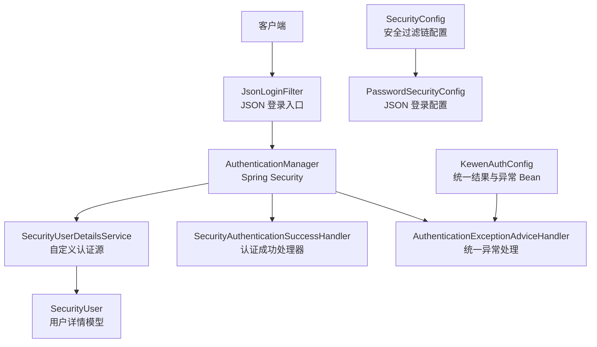

**图表来源**
- [JsonLoginFilter.java:1-55](file://login-spring-boot-starter/src/main/java/com/cu/framework/authentication/password/filter/JsonLoginFilter.java#L1-L55)
- [SecurityConfig.java:1-144](file://login-spring-boot-starter/src/main/java/com/cu/framework/authentication/config/SecurityConfig.java#L1-L144)
- [PasswordSecurityConfig.java:1-54](file://login-spring-boot-starter/src/main/java/com/cu/framework/authentication/password/config/PasswordSecurityConfig.java#L1-L54)
- [KewenAuthConfig.java:1-26](file://login-spring-boot-starter/src/main/java/com/cu/framework/authentication/config/KewenAuthConfig.java#L1-L26)

**章节来源**
- [SecurityConfig.java:1-144](file://login-spring-boot-starter/src/main/java/com/cu/framework/authentication/config/SecurityConfig.java#L1-L144)
- [application.yml:1-207](file://sample/login-boot-sample/src/main/resources/application.yml#L1-L207)

## 核心组件
本节聚焦自定义认证源相关的关键类型，解释其职责与协作方式。

- `SecurityUserDetailsService`：组合 Spring Security 的 `UserDetailsService` 与 `UserDetailsPasswordService`，对外暴露按用户名加载用户、更新用户密码两个能力。
- `SecurityUser`：框架的用户详情实体，实现 `UserDetails` 和 `AuthenticatedPrincipal`，承载账号状态、权限、过期时间、锁定截止时间等字段。
- `SampleInMemorySecurityUserDetailsService`：演示用内存认证源，展示如何构造 `SecurityUser`、存储密文密码、返回权限集合。
- `JsonLoginFilter` + `JsonLoginAuthenticationFilterConfigurer`：定义 JSON 登录请求入口及参数解析规则。
- `SecurityConfig` + `PasswordSecurityConfig`：把 `SecurityUserDetailsService` 注册到认证管理器，并把 JSON 登录过滤器接入安全过滤链。
- `AuthenticationExceptionAdviceHandler` + `SecurityResponseBodyResultResolver`：统一异常响应与认证成功数据封装。

**章节来源**
- [SecurityUserDetailsService.java:1-27](file://login-spring-boot-starter/src/main/java/com/cu/framework/authentication/service/SecurityUserDetailsService.java#L1-L27)
- [SecurityUser.java:1-161](file://login-spring-boot-starter/src/main/java/com/cu/framework/authentication/model/SecurityUser.java#L1-L161)
- [SampleInMemorySecurityUserDetailsService.java:1-78](file://sample/login-boot-sample/src/main/java/com/cu/framework/sample/login/SampleInMemorySecurityUserDetailsService.java#L1-L78)
- [JsonLoginFilter.java:1-55](file://login-spring-boot-starter/src/main/java/com/cu/framework/authentication/password/filter/JsonLoginFilter.java#L1-L55)
- [JsonLoginAuthenticationFilterConfigurer.java:1-59](file://login-spring-boot-starter/src/main/java/com/cu/framework/authentication/password/config/JsonLoginAuthenticationFilterConfigurer.java#L1-L59)
- [SecurityConfig.java:1-144](file://login-spring-boot-starter/src/main/java/com/cu/framework/authentication/config/SecurityConfig.java#L1-L144)
- [PasswordSecurityConfig.java:1-54](file://login-spring-boot-starter/src/main/java/com/cu/framework/authentication/password/config/PasswordSecurityConfig.java#L1-L54)
- [AuthenticationExceptionAdviceHandler.java:1-86](file://login-spring-boot-starter/src/main/java/com/cu/framework/authentication/handler/AuthenticationExceptionAdviceHandler.java#L1-L86)
- [SecurityResponseBodyResultResolver.java:1-28](file://login-spring-boot-starter/src/main/java/com/cu/framework/authentication/handler/SecurityResponseBodyResultResolver.java#L1-L28)

## 架构总览
下图展示一次典型 JSON 密码登录流程：前端发起 POST 请求，`JsonLoginFilter` 解析 JSON 凭证后交给 `AuthenticationManager`；认证管理器通过已注册的 `SecurityUserDetailsService` 加载用户详情，再交由密码编码器校验密码；成功后由成功处理器输出统一结果，失败时由全局异常处理器转为 JSON 错误响应。

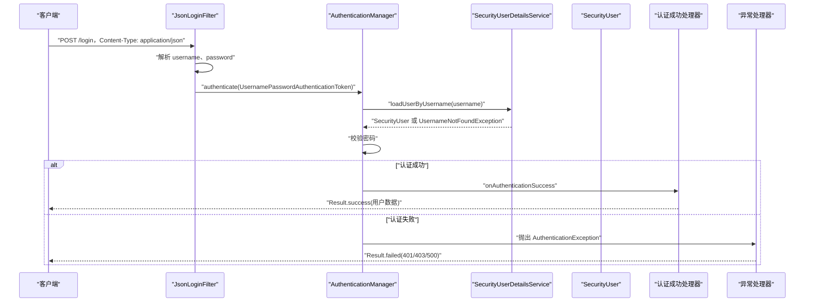

**图表来源**
- [JsonLoginFilter.java:1-55](file://login-spring-boot-starter/src/main/java/com/cu/framework/authentication/password/filter/JsonLoginFilter.java#L1-L55)
- [SecurityConfig.java:1-144](file://login-spring-boot-starter/src/main/java/com/cu/framework/authentication/config/SecurityConfig.java#L1-L144)
- [AuthenticationExceptionAdviceHandler.java:1-86](file://login-spring-boot-starter/src/main/java/com/cu/framework/authentication/handler/AuthenticationExceptionAdviceHandler.java#L1-L86)

## 详细组件分析

### SecurityUserDetailsService 接口设计
`SecurityUserDetailsService` 同时继承 `UserDetailsService` 与 `UserDetailsPasswordService`，把“读取用户”和“更新密码”统一到同一个服务上：
- `loadUserByUsername(username)`：必须根据用户名查询用户详情。如果用户不存在，应抛出 `UsernameNotFoundException`，以便 Spring Security 正确识别“未找到用户”。
- `updatePassword(user, encryptedNewPassword)`：用于刷新用户的旧密钥算法或重置密码后的密文写回。该方法的入参 `encryptedNewPassword` 已经是经配置的 `PasswordEncoder` 加密后的值，因此实现方不应再次加密。

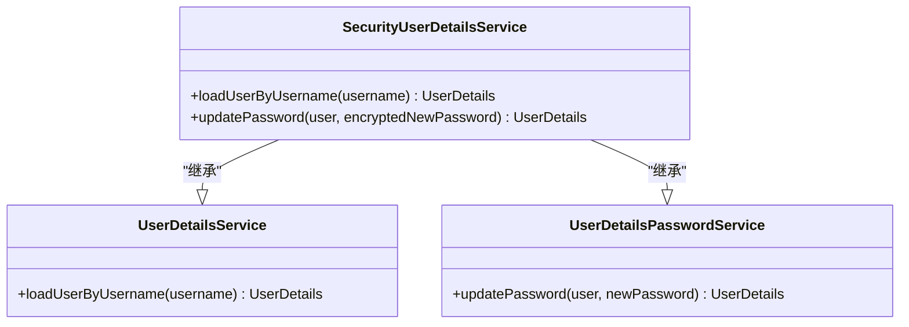

**图表来源**
- [SecurityUserDetailsService.java:1-27](file://login-spring-boot-starter/src/main/java/com/cu/framework/authentication/service/SecurityUserDetailsService.java#L1-L27)

**章节来源**
- [SecurityUserDetailsService.java:1-27](file://login-spring-boot-starter/src/main/java/com/cu/framework/authentication/service/SecurityUserDetailsService.java#L1-L27)

### SecurityUser 用户详情模型
`SecurityUser` 是框架内统一的 `UserDetails` 实现，除基础身份信息外，还提供账号状态控制语义：
- `enabled`：是否启用。
- `accountLockedDeadline`：账号锁定截止时间；为空或晚于当前时间视为未锁定。
- `passwordExpiredTime`：凭证过期时间；为空或晚于当前时间视为未过期。
- `userAuthorities`：权限集合，对应 `GrantedAuthority`。
- `isAccountNonExpired()`：当前实现恒返回 true，表示不做强账号过期限制。
- `isCredentialsNonExpired()`：依据 `passwordExpiredTime` 判断。
- `isAccountNonLocked()`：依据 `accountLockedDeadline` 判断。

实现自定义认证源时，应从外部用户源读取字段，映射到 `SecurityUser` 的属性，并保证 `enabled` 与 `userAuthorities` 非空，否则可能导致后续授权逻辑出现空指针。

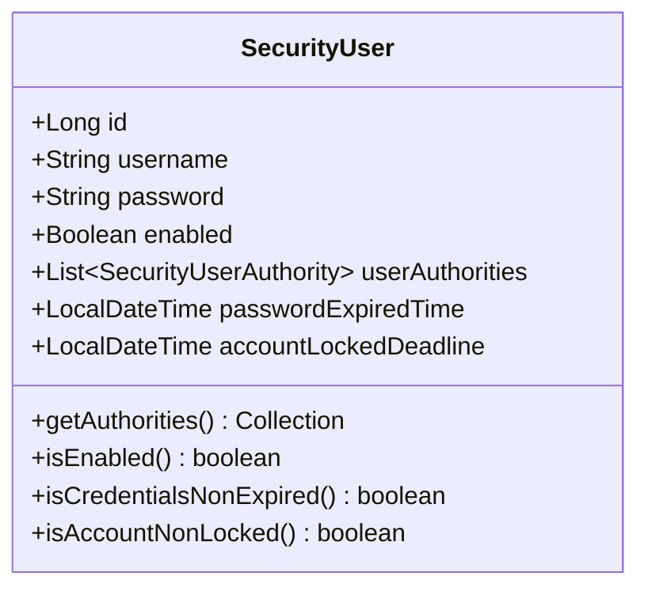

**图表来源**
- [SecurityUser.java:1-161](file://login-spring-boot-starter/src/main/java/com/cu/framework/authentication/model/SecurityUser.java#L1-L161)

**章节来源**
- [SecurityUser.java:1-161](file://login-spring-boot-starter/src/main/java/com/cu/framework/authentication/model/SecurityUser.java#L1-L161)

### 内存认证源示例：SampleInMemorySecurityUserDetailsService
该示例演示了最小可用的自定义认证源实现：
- 使用进程内 `Map<String, SecurityUser>` 模拟用户表。
- 构造用户时使用 `PasswordEncoder.encode(rawPassword)` 写入密文。
- `loadUserByUsername` 找不到用户时抛出 `UsernameNotFoundException`。
- `updatePassword` 直接把新密文写回内存用户。

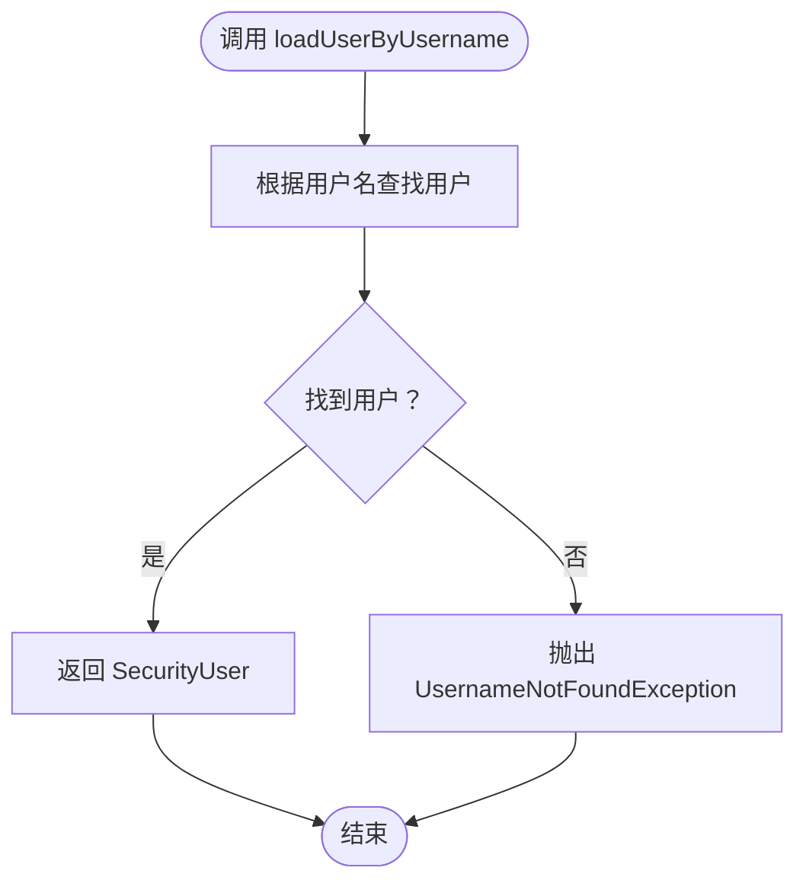

**图表来源**
- [SampleInMemorySecurityUserDetailsService.java:1-78](file://sample/login-boot-sample/src/main/java/com/cu/framework/sample/login/SampleInMemorySecurityUserDetailsService.java#L1-L78)

**章节来源**
- [SampleInMemorySecurityUserDetailsService.java:1-78](file://sample/login-boot-sample/src/main/java/com/cu/framework/sample/login/SampleInMemorySecurityUserDetailsService.java#L1-L78)

### 基于数据库的认证源实现要点
实现基于数据库的 `SecurityUserDetailsService` 时，建议遵循以下模式：
- 在 `loadUserByUsername` 中根据用户名查询数据库用户表。
- 将数据库字段映射为 `SecurityUser`，确保：
  - `username`、`password` 必填。
  - `enabled` 有明确布尔值。
  - `userAuthorities` 至少为空集合，不要为 null。
- 权限数据可从角色表、菜单权限表或权限码表中聚合。
- 密码比对由 Spring Security 的 `PasswordEncoder` 完成，不要把数据库密文再次加密。
- 如果需要密码算法升级，可在认证成功后调用 `updatePassword`，将新的加密密文写回数据库。

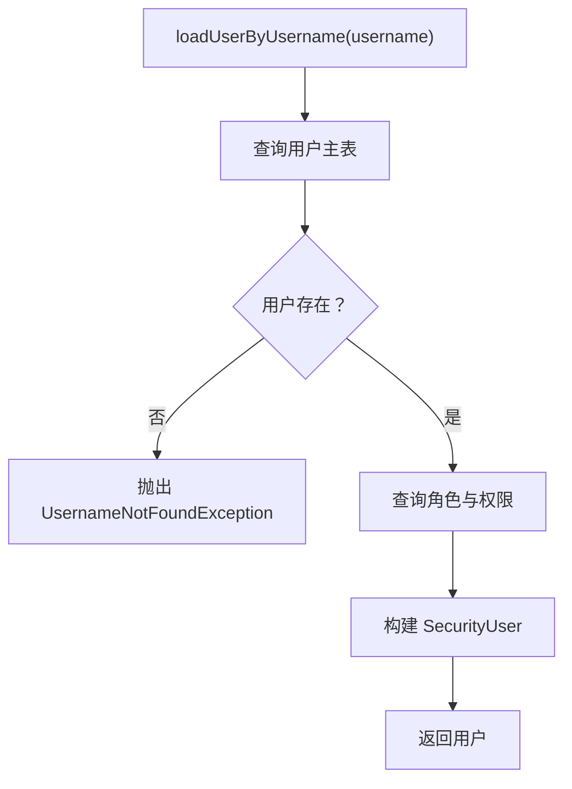

[本图为概念流程图，不绑定具体源码文件]

### 基于 LDAP 的认证源实现要点
对于 LDAP 用户源，通常有两种集成方式：
- 直接使用 Spring Security 的 LDAP 认证提供者，此时可把 `SecurityUserDetailsService` 作为“本地用户补充层”，负责把 LDAP 用户映射为 `SecurityUser`，并补充本地权限。
- 或者自行实现 `SecurityUserDetailsService`，内部调用 LDAP 客户端获取用户属性，再映射为 `SecurityUser`。

关键实现要求：
- 用户名来源可以是 LDAP `uid`、`sAMAccountName` 等业务字段。
- 如果密码不在本地，需要结合 LDAP 侧密码校验策略，例如先调用 LDAP 进行绑定校验，再加载本地权限。
- `updatePassword` 通常不直接修改 LDAP 密码，而是维护本地密码迁移记录或触发同步任务。

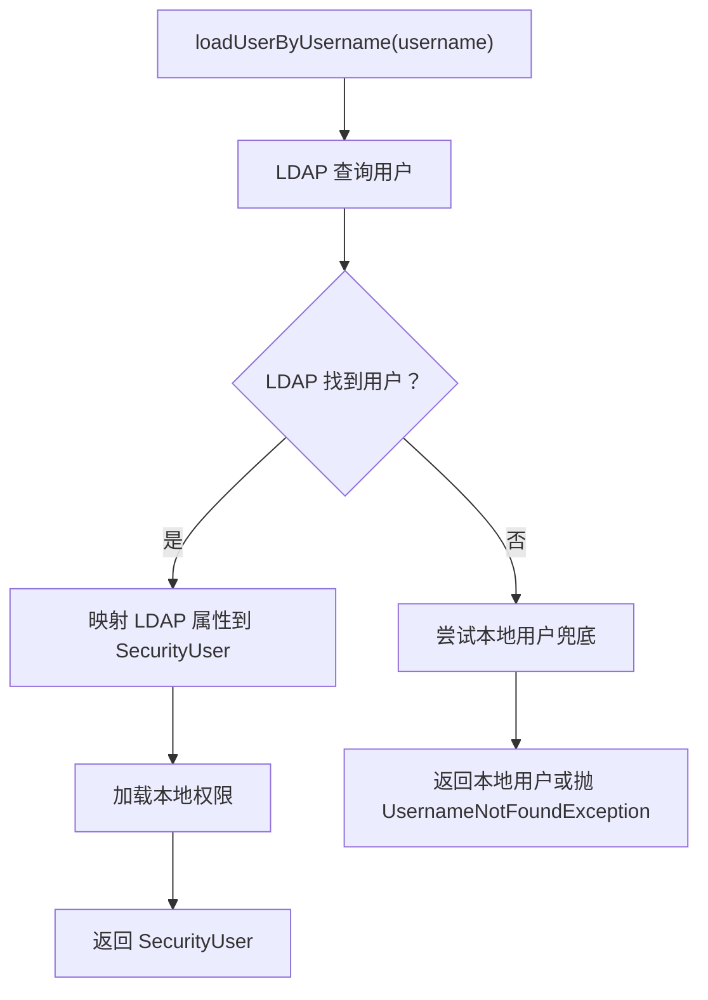

[本图为概念流程图，不绑定具体源码文件]

### 基于第三方系统的认证源实现要点
当用户数据位于第三方系统时，建议：
- 使用远程服务或消息通道加载用户。
- 对网络超时、鉴权失败、用户不存在等情况做明确分类，优先抛出 `UsernameNotFoundException`。
- 敏感字段如手机号、邮箱应按最小必要原则返回。
- 幂等性：重复登录不应产生副作用。
- 缓存：对高频查询的用户信息增加缓存，但注意缓存失效策略与密码变更联动。

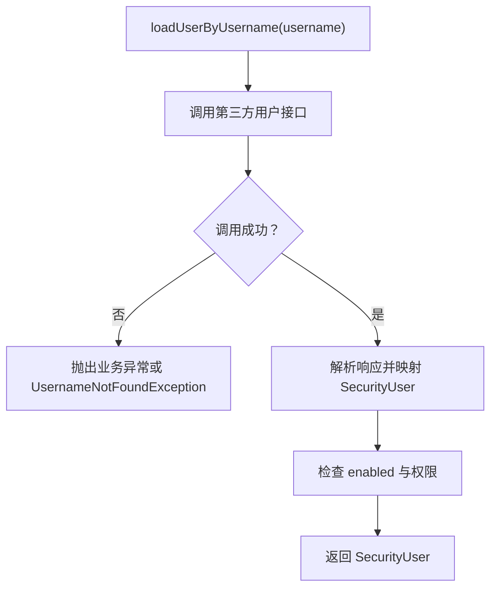

[本图为概念流程图，不绑定具体源码文件]

### 过滤器链集成：JSON 登录与自定义认证源
框架默认使用 JSON 登录方式，而不是表单登录：
- `JsonLoginFilter` 继承 `UsernamePasswordAuthenticationFilter`，仅支持 POST，且当 `Content-Type` 为 JSON 时从请求体解析用户名和密码。
- `JsonLoginAuthenticationFilterConfigurer` 继承 `AbstractAuthenticationFilterConfigurer`，用于注册 JSON 登录 URL、用户名字段名、密码字段名，并禁止配置 loginPage。
- `PasswordSecurityConfig` 实现 `HttpSecurityCustomizer`，在安全过滤链构建阶段应用 JSON 登录配置。
- `SecurityConfig` 把 `SecurityUserDetailsService` 注入 `AuthenticationManagerBuilder`，使其成为用户名密码认证的用户来源。

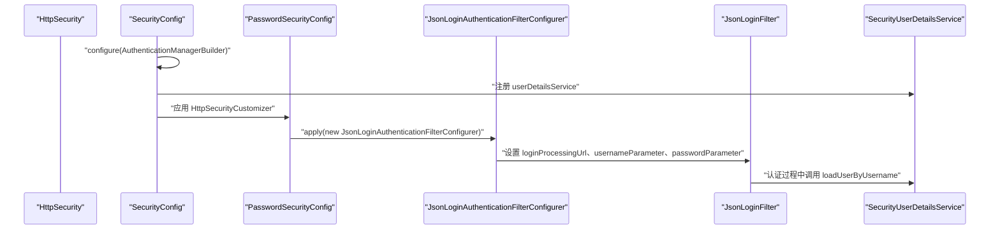

**图表来源**
- [SecurityConfig.java:1-144](file://login-spring-boot-starter/src/main/java/com/cu/framework/authentication/config/SecurityConfig.java#L1-L144)
- [PasswordSecurityConfig.java:1-54](file://login-spring-boot-starter/src/main/java/com/cu/framework/authentication/password/config/PasswordSecurityConfig.java#L1-L54)
- [JsonLoginAuthenticationFilterConfigurer.java:1-59](file://login-spring-boot-starter/src/main/java/com/cu/framework/authentication/password/config/JsonLoginAuthenticationFilterConfigurer.java#L1-L59)
- [JsonLoginFilter.java:1-55](file://login-spring-boot-starter/src/main/java/com/cu/framework/authentication/password/filter/JsonLoginFilter.java#L1-L55)

**章节来源**
- [SecurityConfig.java:1-144](file://login-spring-boot-starter/src/main/java/com/cu/framework/authentication/config/SecurityConfig.java#L1-L144)
- [PasswordSecurityConfig.java:1-54](file://login-spring-boot-starter/src/main/java/com/cu/framework/authentication/password/config/PasswordSecurityConfig.java#L1-L54)
- [JsonLoginAuthenticationFilterConfigurer.java:1-59](file://login-spring-boot-starter/src/main/java/com/cu/framework/authentication/password/config/JsonLoginAuthenticationFilterConfigurer.java#L1-L59)
- [JsonLoginFilter.java:1-55](file://login-spring-boot-starter/src/main/java/com/cu/framework/authentication/password/filter/JsonLoginFilter.java#L1-L55)

### 认证结果处理与统一响应
- 认证成功：由 `SecurityAuthenticationSuccessHandler` 处理，配合 `SecurityResponseBodyResultResolver` 将数据包装为 `Result.success`，并附加链路追踪信息。
- 访问拒绝或未登录：`AuthenticationExceptionAdviceHandler` 将 `AccessDeniedException`、`NoLoginException`、`AuthenticationException`、`InternalAuthenticationServiceException`、`InsufficientAuthenticationException` 等转换为统一的 JSON 响应。
- 全局异常兜底：`Throwable` 分支返回 500，便于快速发现未预期异常。

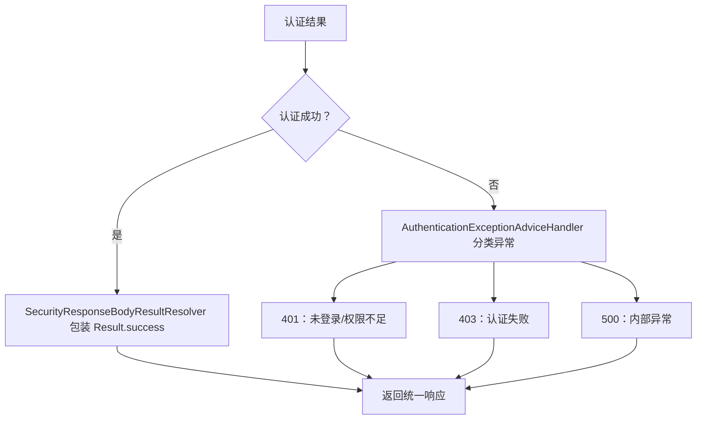

**图表来源**
- [AuthenticationExceptionAdviceHandler.java:1-86](file://login-spring-boot-starter/src/main/java/com/cu/framework/authentication/handler/AuthenticationExceptionAdviceHandler.java#L1-L86)
- [SecurityResponseBodyResultResolver.java:1-28](file://login-spring-boot-starter/src/main/java/com/cu/framework/authentication/handler/SecurityResponseBodyResultResolver.java#L1-L28)

**章节来源**
- [AuthenticationExceptionAdviceHandler.java:1-86](file://login-spring-boot-starter/src/main/java/com/cu/framework/authentication/handler/AuthenticationExceptionAdviceHandler.java#L1-L86)
- [SecurityResponseBodyResultResolver.java:1-28](file://login-spring-boot-starter/src/main/java/com/cu/framework/authentication/handler/SecurityResponseBodyResultResolver.java#L1-L28)

### 会话管理与多端登录
- `SecurityConfig` 中注册了 `HttpSessionEventPublisher`，使 Spring Security 能感知 session 销毁事件。
- `application.yml` 中配置了 `spring.session.store-type=jdbc`，并使用 `session.timeout` 控制会话超时。
- `cu.security.session.maximum-sessions` 与 `max-sessions-prevents-login` 用于并发 session 控制，默认行为允许最多指定数量的 session，超限时可阻止新登录或挤掉早期 session。
- `TokenSessionRequestFilter` 虽然提供了 token 作为 session ID 的能力，但当前类已标注废弃，官方推荐改用 spring-session 的请求头解析方案。

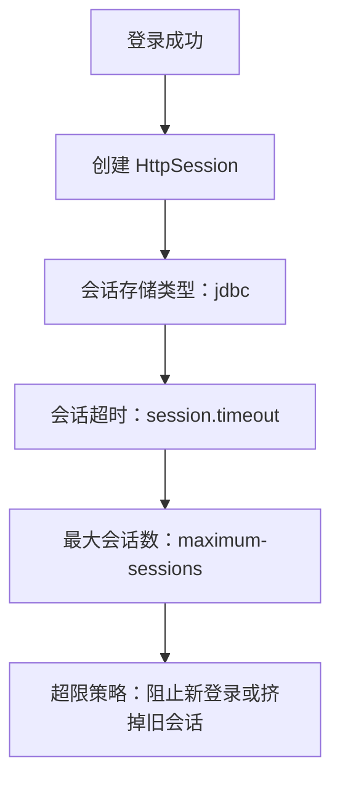

**图表来源**
- [SecurityConfig.java:1-144](file://login-spring-boot-starter/src/main/java/com/cu/framework/authentication/config/SecurityConfig.java#L1-L144)
- [application.yml:1-207](file://sample/login-boot-sample/src/main/resources/application.yml#L1-L207)

**章节来源**
- [SecurityConfig.java:1-144](file://login-spring-boot-starter/src/main/java/com/cu/framework/authentication/config/SecurityConfig.java#L1-L144)
- [application.yml:1-207](file://sample/login-boot-sample/src/main/resources/application.yml#L1-L207)

## 依赖关系分析
下图展示了自定义认证源与安全基础设施之间的依赖关系：

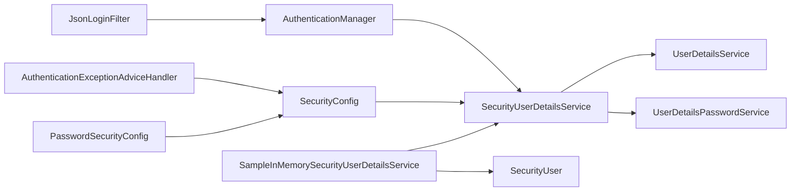

**图表来源**
- [SampleInMemorySecurityUserDetailsService.java:1-78](file://sample/login-boot-sample/src/main/java/com/cu/framework/sample/login/SampleInMemorySecurityUserDetailsService.java#L1-L78)
- [SecurityUserDetailsService.java:1-27](file://login-spring-boot-starter/src/main/java/com/cu/framework/authentication/service/SecurityUserDetailsService.java#L1-L27)
- [SecurityUser.java:1-161](file://login-spring-boot-starter/src/main/java/com/cu/framework/authentication/model/SecurityUser.java#L1-L161)
- [SecurityConfig.java:1-144](file://login-spring-boot-starter/src/main/java/com/cu/framework/authentication/config/SecurityConfig.java#L1-L144)
- [PasswordSecurityConfig.java:1-54](file://login-spring-boot-starter/src/main/java/com/cu/framework/authentication/password/config/PasswordSecurityConfig.java#L1-L54)
- [JsonLoginFilter.java:1-55](file://login-spring-boot-starter/src/main/java/com/cu/framework/authentication/password/filter/JsonLoginFilter.java#L1-L55)
- [AuthenticationExceptionAdviceHandler.java:1-86](file://login-spring-boot-starter/src/main/java/com/cu/framework/authentication/handler/AuthenticationExceptionAdviceHandler.java#L1-L86)

**章节来源**
- [SecurityConfig.java:1-144](file://login-spring-boot-starter/src/main/java/com/cu/framework/authentication/config/SecurityConfig.java#L1-L144)
- [PasswordSecurityConfig.java:1-54](file://login-spring-boot-starter/src/main/java/com/cu/framework/authentication/password/config/PasswordSecurityConfig.java#L1-L54)
- [SampleInMemorySecurityUserDetailsService.java:1-78](file://sample/login-boot-sample/src/main/java/com/cu/framework/sample/login/SampleInMemorySecurityUserDetailsService.java#L1-L78)

## 性能考虑
- 用户查询应尽量走缓存，避免每次登录都直连数据库或远程系统。
- 权限数据可延迟加载，或在登录后按需拉取，减少首次登录开销。
- `updatePassword` 应在认证成功后异步或同步写回，避免阻塞登录流程过久。
- 使用连接池与合理超时配置，防止认证源不可用时拖垮整个登录接口。
- 对高频查询的用户信息增加局部缓存，并注意密码变更后清理缓存。

[本节为通用性能建议，不直接分析具体源码文件]

## 故障排查指南
常见异常及处理方式：
- 用户名不存在：确认 `SecurityUserDetailsService.loadUserByUsername` 在未找到用户时抛出 `UsernameNotFoundException`。
- 密码错误：确认数据库中保存的是密文，且密码编码策略一致。
- 权限为空导致授权异常：确认 `userAuthorities` 不为 null，至少为空集合。
- 账号被锁定或凭证过期：检查 `accountLockedDeadline` 与 `passwordExpiredTime` 字段。
- JSON 登录 405 或解析失败：确认请求方法是 POST，且 `Content-Type` 为 JSON，字段名与配置一致。
- 登录成功却无会话：检查 `spring.session.store-type`、`session.timeout` 以及数据库会话表是否正确初始化。

**章节来源**
- [SampleInMemorySecurityUserDetailsService.java:1-78](file://sample/login-boot-sample/src/main/java/com/cu/framework/sample/login/SampleInMemorySecurityUserDetailsService.java#L1-L78)
- [JsonLoginFilter.java:1-55](file://login-spring-boot-starter/src/main/java/com/cu/framework/authentication/password/filter/JsonLoginFilter.java#L1-L55)
- [application.yml:1-207](file://sample/login-boot-sample/src/main/resources/application.yml#L1-L207)

## 结论
在本框架中，自定义认证源的核心是提供一个正确的 `SecurityUserDetailsService` 实现。它需要：
- 准确加载用户并返回 `SecurityUser`。
- 正确处理用户不存在、密码错误、账号禁用、锁定、凭证过期等状态。
- 支持密码更新，以适配密码算法迁移或重置场景。
- 与 JSON 登录过滤器、安全过滤链、统一异常处理和会话管理协同工作。

对于多认证源并存场景，推荐以 `SecurityUserDetailsService` 作为统一入口，内部按策略选择 LDAP、数据库或第三方系统；也可以注册多个 `UserDetailsService` 实现并通过 `AuthenticationManagerBuilder` 的组合机制决定优先级。无论采用哪种方式，都应保持接口契约稳定、异常语义清晰、权限数据可靠。

## 附录：实现清单与最佳实践

### 自定义认证源实现清单
- 新建实现类，实现 `SecurityUserDetailsService`。
- 在 `loadUserByUsername` 中查询用户，映射为 `SecurityUser`。
- 确保 `enabled`、`userAuthorities` 非空。
- 在 `updatePassword` 中写回新密文。
- 将实现类注册为 Spring Bean。
- 如需新增登录入口，可通过 `HttpSecurityCustomizer` 扩展，而不必改动 `SecurityConfig`。

**章节来源**
- [SecurityUserDetailsService.java:1-27](file://login-spring-boot-starter/src/main/java/com/cu/framework/authentication/service/SecurityUserDetailsService.java#L1-L27)
- [SecurityConfig.java:1-144](file://login-spring-boot-starter/src/main/java/com/cu/framework/authentication/config/SecurityConfig.java#L1-L144)
- [PasswordSecurityConfig.java:1-54](file://login-spring-boot-starter/src/main/java/com/cu/framework/authentication/password/config/PasswordSecurityConfig.java#L1-L54)

### 多认证源并存与优先级
- 单一入口策略：一个 `SecurityUserDetailsService` 内部按优先级选择 LDAP、数据库、第三方系统。
- 多提供者策略：注册多个 `UserDetailsService` 实现，由认证管理器按顺序尝试。
- 建议优先使用“单一入口策略”，便于统一权限聚合、审计和异常处理。

[本节为概念性说明，不直接分析具体源码文件]