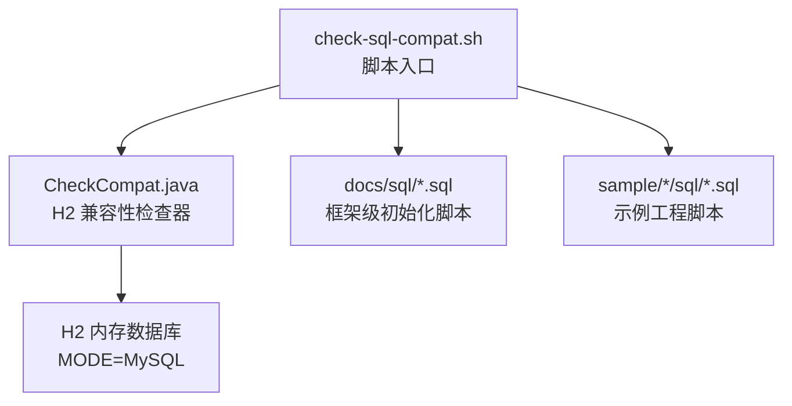
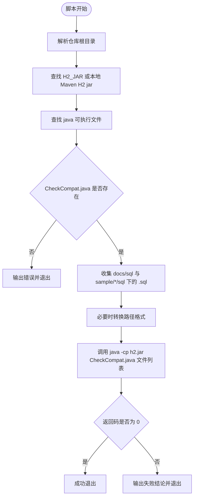
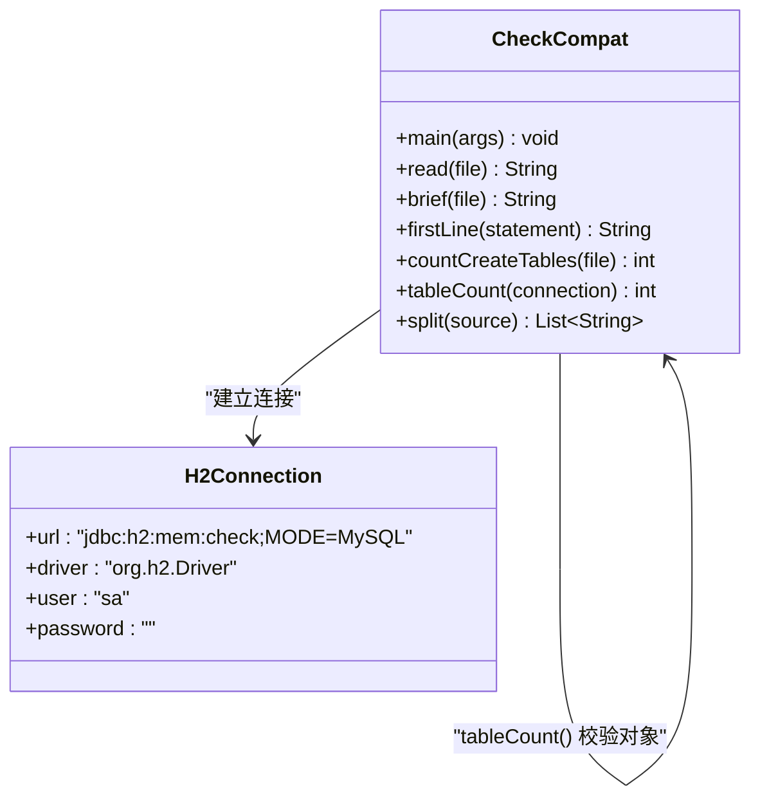
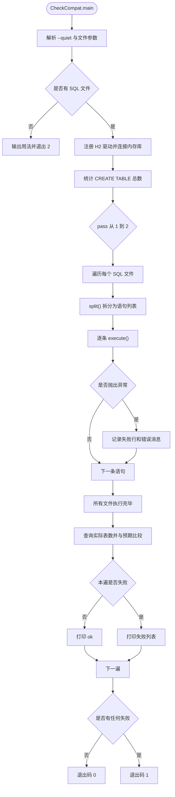
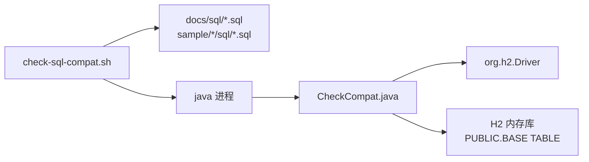
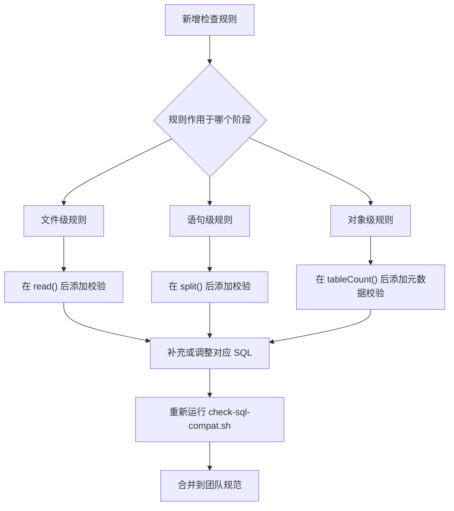

# SQL 兼容性检查

<cite>
**本文引用的文件**   
- [check-sql-compat.sh](file://scripts/check-sql-compat.sh)
- [CheckCompat.java](file://scripts/CheckCompat.java)
- [README.md](file://README.md)
- [auth-rbac.sql](file://docs/sql/auth-rbac.sql)
- [basic-support.sql](file://docs/sql/basic-support.sql)
- [schema.sql](file://sample/auth-core-boot-sample/sql/schema.sql)
- [seed-data.sql](file://sample/auth-core-boot-sample/sql/seed-data.sql)
</cite>

## 目录
1. [引言](#引言)
2. [项目结构](#项目结构)
3. [核心组件](#核心组件)
4. [架构总览](#架构总览)
5. [详细组件分析](#详细组件分析)
6. [依赖关系分析](#依赖关系分析)
7. [性能与执行特性](#性能与执行特性)
8. [常见 SQL 兼容性问题与解决方案](#常见-sql-兼容性问题与解决方案)
9. [跨数据库迁移注意事项](#跨数据库迁移注意事项)
10. [SQL 版本管理与向后兼容策略](#sql-版本管理与向后兼容策略)
11. [自定义 SQL 检查规则开发指南](#自定义-sql-检查规则开发指南)
12. [故障排查](#故障排查)
13. [结论](#结论)

## 引言
本指南围绕仓库中的 SQL 兼容性检查和修复机制展开，重点说明 `scripts/check-sql-compat.sh` 与 `scripts/CheckCompat.java` 如何协同工作，用 H2 的 MySQL 兼容模式验证框架和示例工程中的 SQL 脚本。其目标有三：
- 语法兼容：每条 SQL 必须能被 H2 在 `MODE=MySQL` 下接受。
- 可重复执行：脚本应支持重复运行，不会因已存在对象而失败。
- 对象真实存在：最终建出的表数量应与脚本中 `CREATE TABLE` 的数量一致。

该工具不替代 MySQL 侧的最终验证；它只保证双方都接受的语法能跑通，实际部署到 MySQL 时仍需再走一遍。

**章节来源**
- [README.md:178-187](file://README.md#L178-L187)
- [README.md:233-241](file://README.md#L233-L241)

## 项目结构
SQL 兼容性相关代码集中在仓库根目录下的 `scripts` 目录，受检 SQL 则分散在 `docs/sql` 和各 `sample/*/sql` 目录。



**图示来源**
- [check-sql-compat.sh:1-32](file://scripts/check-sql-compat.sh#L1-L32)
- [CheckCompat.java:1-144](file://scripts/CheckCompat.java#L1-L144)

**章节来源**
- [check-sql-compat.sh:1-32](file://scripts/check-sql-compat.sh#L1-L32)
- [CheckCompat.java:1-144](file://scripts/CheckCompat.java#L1-L144)

## 核心组件
本节从使用者角度总结两个组件的职责边界。

| 组件 | 职责 | 关键行为 | 输出或副作用 |
|---|---|---|---|
| `check-sql-compat.sh` | 脚本编排与环境准备 | 查找 H2 jar、收集 `.sql` 文件、统一路径、调用 Java 程序 | 返回非零表示检查失败 |
| `CheckCompat.java` | 逐条执行 SQL 并断言结果 | 连接 H2 MySQL 兼容模式、拆分语句、执行两遍、统计表数 | 标准输出检查结果，进程退出码为 0 或 1 |

**章节来源**
- [check-sql-compat.sh:1-32](file://scripts/check-sql-compat.sh#L1-L32)
- [CheckCompat.java:1-144](file://scripts/CheckCompat.java#L1-L144)

## 架构总览
整体执行流程是“Shell 收集 + Java 执行”的两段式结构。Shell 负责文件系统层和进程层，Java 负责 SQL 解析层和数据库语义层。

```mermaid
sequenceDiagram
    participant Dev as "开发者"
    participant Shell as "check-sql-compat.sh"
    participant FS as "文件系统"
    participant JVM as "JVM"
    participant Checker as "CheckCompat.java"
    participant H2 as "H2 内存库"

    Dev->>Shell: 执行 bash scripts/check-sql-compat.sh
    Shell->>FS: 查找 docs/sql 与 sample/*/sql
    Shell->>Shell: 定位 H2_JAR 与 JAVA_BIN
    Shell->>Checker: 传入所有 .sql 文件路径
    Checker->>H2: 建立 jdbc:h2:mem:check;MODE=MySQL 连接
    loop 对每个 SQL 文件
        Checker->>Checker: 按分号切分语句
        Checker->>H2: 逐条 s.execute(st)
    end
    Checker->>H2: 查询 INFORMATION_SCHEMA.TABLES
    Checker-->>Dev: 打印两遍结果并返回退出码
```

**图示来源**
- [check-sql-compat.sh:12-32](file://scripts/check-sql-compat.sh#L12-L32)
- [CheckCompat.java:14-66](file://scripts/CheckCompat.java#L14-L66)

## 详细组件分析

### check-sql-compat.sh 工作原理
该脚本是统一入口，主要完成以下任务：

1. **确定根目录与检查器路径**  
   通过当前脚本所在目录推导仓库根目录，并固定检查器位于 `scripts/CheckCompat.java`。

2. **加载 H2 jar**  
   默认优先使用 `H2_JAR` 环境变量；若未设置，则扫描本地 Maven 仓库中最新的 `h2-*.jar`，并排除 sources 与 javadoc。

3. **选择 Java 可执行文件**  
   默认使用系统 `java`，可通过 `JAVA_BIN` 覆盖。

4. **发现待检查 SQL**  
   使用通配匹配 `docs/sql/*.sql` 和 `sample/*/sql/*.sql`，排序后交给 Java 程序。

5. **路径兼容处理**  
   如果存在 `cygpath`，则将 Windows 风格路径转换为 H2 可识别的形式。

6. **调用 CheckCompat.java**  
   以 `-Dfile.encoding=UTF-8 -cp "$H2_JAR"` 的方式启动 Java，并把所有 SQL 文件作为参数传入。

7. **结果解释**  
   若 Java 进程返回非零，脚本提示“存在 H2(MySQL 模式) 不接受的写法，或对象没建成”。



**图示来源**
- [check-sql-compat.sh:1-32](file://scripts/check-sql-compat.sh#L1-L32)

**章节来源**
- [check-sql-compat.sh:1-32](file://scripts/check-sql-compat.sh#L1-L32)

### CheckCompat.java 实现逻辑
CheckCompat.java 是真正的兼容性检查器，核心逻辑如下：

#### 命令行参数与入口
- 支持可选参数 `--quiet`。
- 其他参数被视为 SQL 文件路径。
- 如果没有传入任何 SQL 文件，输出用法提示并以退出码 2 结束。

#### JDBC 连接管理
- 连接 URL 使用 `jdbc:h2:mem:check;MODE=MySQL;DATABASE_TO_LOWER=TRUE;CASE_INSENSITIVE_IDENTIFIERS=TRUE`。
- 显式加载 `org.h2.Driver`，避免 ServiceLoader 在某些环境下找不到驱动。
- 用户名和密码为空字符串，符合 H2 内存库默认配置。

#### SQL 解析与逐条执行
- 读取整个文件内容。
- 使用自定义 `split` 方法按分号拆分语句，避免误把字符串字面量中的分号当作语句分隔符。
- 跳过行注释和块注释，防止注释内的关键字干扰判断。
- 对每条语句创建独立 Statement 并执行，捕获 `SQLException` 并记录简要信息。

#### 对象存在性验证
- 首次遍历前统计每个文件中真正出现在语句位置的 `CREATE TABLE` 数量。
- 每次执行完成后查询 `INFORMATION_SCHEMA.TABLES`，筛选 `PUBLIC` schema 且类型为 `BASE TABLE` 的对象。
- 如果实际表数小于预期，记录失败。

#### 可重复执行验证
- 对全部 SQL 文件执行两遍。
- 第一遍用于检测初始构建是否成功；第二遍用于检测幂等性。
- 两遍都必须无失败才算通过。



**图示来源**
- [CheckCompat.java:14-144](file://scripts/CheckCompat.java#L14-L144)



**图示来源**
- [CheckCompat.java:14-66](file://scripts/CheckCompat.java#L14-L66)

**章节来源**
- [CheckCompat.java:14-144](file://scripts/CheckCompat.java#L14-L144)

## 依赖关系分析
SQL 兼容性检查依赖三层关系：

1. **Shell 与 Java 进程**  
   Shell 负责发现文件和启动 JVM；Java 负责 SQL 语义检查。
2. **Java 与 H2 驱动**  
   CheckCompat 通过类名加载 H2 驱动，并通过 JDBC URL 指定 MySQL 兼容模式。
3. **SQL 文件与数据库对象**  
   脚本不仅检查语法，还检查最终建出的表是否与 `CREATE TABLE` 数量一致。



**图示来源**
- [check-sql-compat.sh:12-32](file://scripts/check-sql-compat.sh#L12-L32)
- [CheckCompat.java:20-30](file://scripts/CheckCompat.java#L20-L30)
- [CheckCompat.java:105-115](file://scripts/CheckCompat.java#L105-L115)

**章节来源**
- [check-sql-compat.sh:12-32](file://scripts/check-sql-compat.sh#L12-L32)
- [CheckCompat.java:20-30](file://scripts/CheckCompat.java#L20-L30)
- [CheckCompat.java:105-115](file://scripts/CheckCompat.java#L105-L115)

## 性能与执行特性
- **内存数据库**：H2 使用 `mem:` 连接，每次执行都是全新实例，不会污染磁盘数据。
- **逐条执行**：不是直接调用 H2 的 `RUNSCRIPT`，而是逐条 `execute()`，这样更容易定位具体失败的语句。
- **两遍执行**：第一遍检查初始构建，第二遍检查幂等性；失败会累积但不会中断后续文件处理。
- **时间复杂度**：大致与“文件数 × 语句数”成正比；对象存在性校验只查一次每遍。
- **空间复杂度**：主要为 SQL 全文和语句列表缓存，适合中小型初始化脚本。

[本节为通用性能讨论，不直接分析具体文件]

## 常见 SQL 兼容性问题与解决方案

### 数据类型差异
- **建议**：优先使用 MySQL 与 H2 公共子集的数据类型，例如整数、变长字符、定长字符、布尔、日期、时间戳、数值等。
- **避免**：只在 MySQL 上存在、H2 不支持的类型或扩展类型。
- **实践参考**：仓库中的框架级脚本明确声明“MySQL 与 H2(MODE=MySQL) 通用”，并在头部注明由兼容性检查实测。

**章节来源**
- [auth-rbac.sql:1-3](file://docs/sql/auth-rbac.sql#L1-L3)
- [basic-support.sql:1-3](file://docs/sql/basic-support.sql#L1-L3)

### 函数调用差异
- **建议**：避免使用 MySQL 特有函数；如确需空值处理或常量，应确认 H2 的 MySQL 兼容模式是否支持。
- **实践参考**：设计文档中提到，若 H2 不接受某些 `SELECT ... WHERE NOT EXISTS` 的写法，需要改用双方都支持的语法形式。

**章节来源**
- [README.md:233-241](file://README.md#L233-L241)

### 约束定义差异
- **主键与自增**：使用双方都能接受的自增主键语法；避免仅在某一数据库生效的引擎级选项。
- **唯一索引与作用域**：不同数据库可能将索引名作用域限制在表内或全库；冲突时应统一命名，例如使用带表名前缀的唯一索引名。
- **字符集与排序规则**：不在脚本中写死 MySQL 特定字符集或排序规则，交由目标数据库默认值处理。

**章节来源**
- [docs\说明文档\已废弃实现与决策记录.md:151-161](file://docs/说明文档/已废弃实现与决策记录.md#L151-L161)

### 语句幂等性
- **建表**：应使用幂等建表方式，避免重复执行时报对象已存在。
- **种子数据**：应避免无条件插入重复主键；可使用条件插入或外部控制。
- **检查器行为**：CheckCompat 要求脚本能被重复执行，因此任何 `CREATE TABLE IF NOT EXISTS` 之外的破坏性语句都会导致第二遍失败。

**章节来源**
- [CheckCompat.java:33-66](file://scripts/CheckCompat.java#L33-L66)

## 跨数据库迁移注意事项

### 在 MySQL 与 H2 间迁移 SQL 脚本的原则
1. **单一事实源**  
   `docs/sql` 是框架初始化 SQL 的唯一存放位置，同一份脚本应同时适用于 MySQL 和 H2。
2. **只写公共子集**  
   不写仅 MySQL 有效、H2 无法识别的方言。
3. **测试优先**  
   新增或修改 SQL 后必须运行 `bash scripts/check-sql-compat.sh`，确保 H2 MySQL 兼容模式通过。
4. **MySQL 仍要回归**  
   该检查不能代替 MySQL 环境验证；部署到 MySQL 前应再执行一次。

**章节来源**
- [README.md:233-241](file://README.md#L233-L241)

### 示例工程脚本规范
- 示例工程的 `schema.sql` 和 `seed-data.sql` 也遵循相同原则：MySQL 与 H2 双方接受的语法，并由兼容性检查覆盖。
- 示例 README 中明确说明，兼容性由 `scripts/check-sql-compat.sh` 用 H2 实测校验。

**章节来源**
- [schema.sql:1-6](file://sample/auth-core-boot-sample/sql/schema.sql#L1-L6)
- [seed-data.sql:3-3](file://sample/auth-core-boot-sample/sql/seed-data.sql#L3-L3)

## SQL 版本管理与向后兼容策略

### 脚本可重复执行的维护策略
- **DDL 幂等化**：建表语句应支持重复执行，避免删除已有对象。
- **种子数据幂等化**：避免重复插入相同主键；如需重置，应提供明确的外部操作，而不是让脚本自动清空生产数据。
- **执行顺序约定**：脚本按文件名排序执行，因此 schema 必须在 seed data 之前。
- **两遍验证**：利用 CheckCompat 的两遍执行能力，强制暴露非幂等问题。

**章节来源**
- [check-sql-compat.sh:22-32](file://scripts/check-sql-compat.sh#L22-L32)
- [CheckCompat.java:33-66](file://scripts/CheckCompat.java#L33-L66)

### 向后兼容性与变更影响
- 对于已有用户数据的场景，不应引入会破坏现有结构的脚本。
- 新增字段或索引应评估旧版本数据库能否平滑升级。
- 视图、存储过程、触发器等复杂对象也应纳入兼容性检查范围，因为它们同样可能被 H2 拒绝或在 MySQL 上产生不同行为。

[本节为通用版本管理建议，不直接分析具体文件]

## 自定义 SQL 检查规则开发指南

### 何时扩展 CheckCompat.java
当团队希望增加超出“语法通过 + 两遍执行 + 表数正确”的检查规则时，可以在 CheckCompat.java 基础上扩展。典型场景包括：
- 禁止特定危险语句，例如无条件删除或更新。
- 强制表名、列名命名规范。
- 要求包含版本标记或变更说明。
- 检查外键、索引、注释等元数据是否符合规范。

### 推荐扩展点
| 扩展点 | 用途 | 建议实现思路 |
|---|---|---|
| 文件预处理 | 校验文件头、版本标签 | 在读取文件后、split 前进行文本检查 |
| 语句级规则 | 拦截危险或不符合规范的语句 | 在 split 后逐条分析 firstLine |
| 对象级规则 | 检查建出对象的元数据 | 在 tableCount 之后查询更多信息，例如索引、列注释 |
| 报告输出 | 生成结构化检查结果 | 将 failures 扩展为结构化日志或测试结果 |

### 保持与现有工具链兼容
- 保留 shell 脚本的调用方式，避免破坏 CI 或本地开发流程。
- 不要改变退出码含义：0 表示通过，非 0 表示失败。
- 如果新增规则属于“建议而非阻断”，可在输出中区分严重级别。
- 新增规则应配合既有 SQL 脚本先行修正，否则会导致历史问题堆积。



**图示来源**
- [CheckCompat.java:14-144](file://scripts/CheckCompat.java#L14-L144)

**章节来源**
- [CheckCompat.java:14-144](file://scripts/CheckCompat.java#L14-L144)

## 故障排查

### 找不到 H2 jar
- **现象**：脚本提示找不到 H2 jar。
- **原因**：本地 Maven 仓库中没有可用 H2 jar，或未设置 `H2_JAR`。
- **解决**：先拉取依赖，或使用环境变量指定 H2 jar 路径。

**章节来源**
- [check-sql-compat.sh:15-18](file://scripts/check-sql-compat.sh#L15-L18)

### 没有发现任何 .sql
- **现象**：脚本提示没有发现任何 `.sql`。
- **原因**：`docs/sql` 和 `sample/*/sql` 下没有 SQL 文件，或通配路径在当前仓库结构中不匹配。
- **解决**：确认 SQL 文件是否在预期目录，并检查仓库结构是否变化。

**章节来源**
- [check-sql-compat.sh:20-21](file://scripts/check-sql-compat.sh#L20-L21)

### 某条 SQL 被拒绝
- **现象**：CheckCompat 输出具体语句和错误消息。
- **原因**：H2 的 MySQL 兼容模式不支持该写法。
- **解决**：改为 MySQL 与 H2 公共子集语法，并重新运行检查。

**章节来源**
- [CheckCompat.java:38-50](file://scripts/CheckCompat.java#L38-L50)

### 表数不足
- **现象**：提示只建出若干张表，但脚本中有更多 `CREATE TABLE`。
- **原因**：部分建表语句失败、被注释、使用了非公共语法，或被提前删除。
- **解决**：检查失败语句，确保建表语句幂等且语法兼容。

**章节来源**
- [CheckCompat.java:52-60](file://scripts/CheckCompat.java#L52-L60)
- [CheckCompat.java:90-103](file://scripts/CheckCompat.java#L90-L103)

### 第二遍失败
- **现象**：第一遍通过，第二遍失败。
- **原因**：脚本不是幂等的，例如重复插入主键、重复创建对象。
- **解决**：将 DDL 和种子数据改为幂等形式。

**章节来源**
- [CheckCompat.java:33-66](file://scripts/CheckCompat.java#L33-L66)

## 结论
`scripts/check-sql-compat.sh` 与 `scripts/CheckCompat.java` 共同构成了仓库中 SQL 兼容性检查的基础设施。它们通过 H2 的 MySQL 兼容模式，把“语法能通过”“可以重复执行”“对象确实建成”这三项要求自动化。对于团队而言，最佳实践是：
- 把所有初始化 SQL 写成 MySQL 与 H2 公共子集。
- 把 schema 放在 seed data 之前。
- 新增或修改 SQL 后始终运行兼容性检查。
- 在 MySQL 环境中再做一次最终回归。
- 根据团队规范扩展 CheckCompat.java，逐步沉淀更严格的 SQL 编写约束。

[本节为总结性内容，不直接分析具体文件]