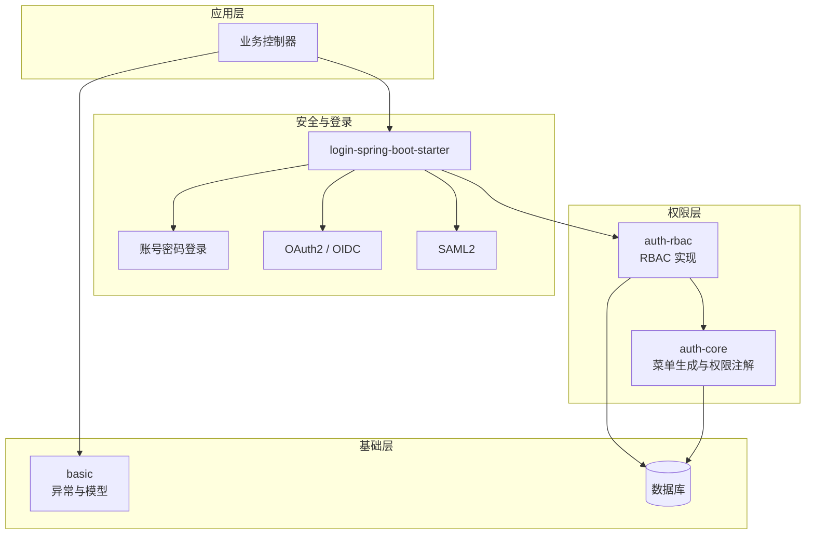
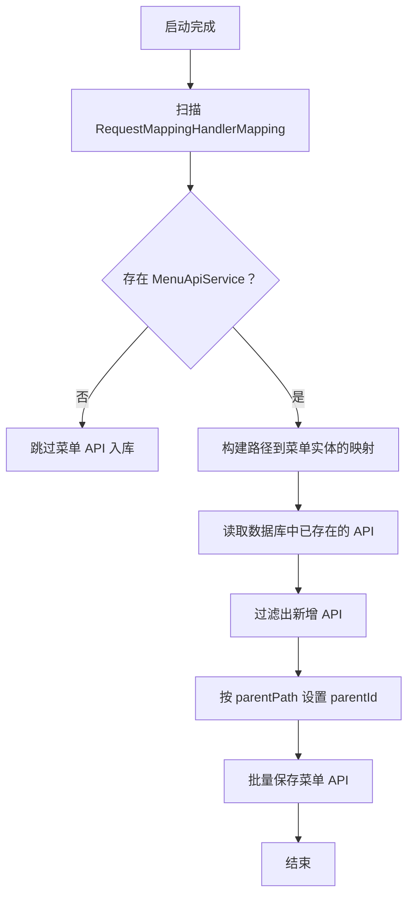
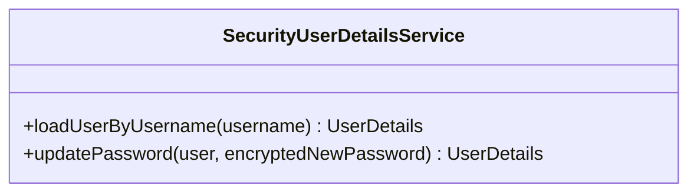
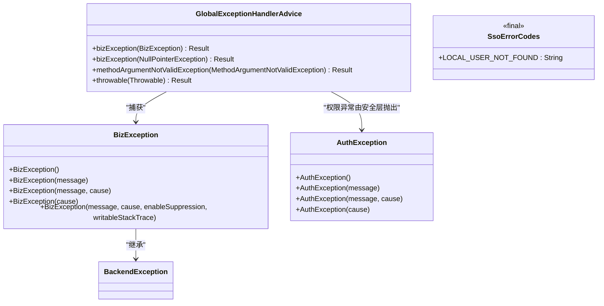
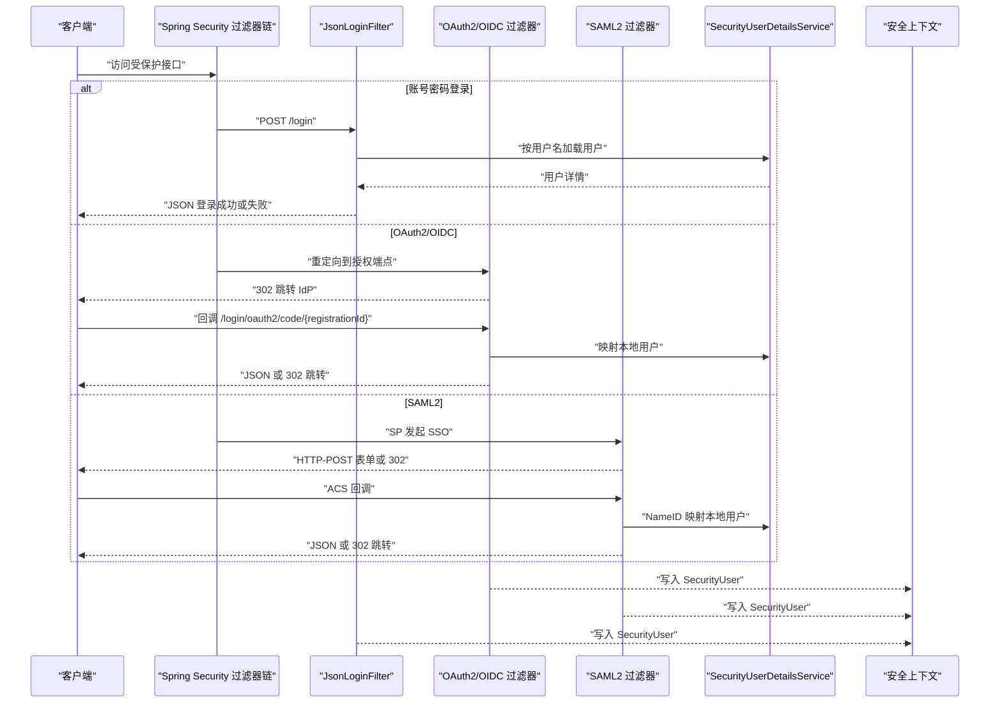

# 常见问题解答

<cite>
**本文引用的文件**   
- [README_Auth.md](file://README_Auth.md)
- [login-spring-boot-starter/README.md](file://login-spring-boot-starter/README.md)
- [login-spring-boot-starter/README-SSO.md](file://login-spring-boot-starter/README-SSO.md)
- [docs/application.yml](file://docs/application.yml)
- [docs/说明文档/SAML2_SP_Metadata配置指南.md](file://docs/说明文档/SAML2_SP_Metadata配置指南.md)
- [docs/说明文档/oidc接入踩坑记录.md](file://docs/说明文档/oidc接入踩坑记录.md)
- [basic/src/main/java/com/cu/framework/basic/exception/BizException.java](file://basic/src/main/java/com/cu/framework/basic/exception/BizException.java)
- [basic/src/main/java/com/cu/framework/basic/exception/GlobalExceptionHandlerAdvice.java](file://basic/src/main/java/com/cu/framework/basic/exception/GlobalExceptionHandlerAdvice.java)
- [auth/auth-core/src/main/java/com/cu/framework/auth/core/exception/AuthException.java](file://auth/auth-core/src/main/java/com/cu/framework/auth/core/exception/AuthException.java)
- [auth/auth-core/src/main/java/com/cu/framework/auth/core/menu/MenuApiGeneratorProcessor.java](file://auth/auth-core/src/main/java/com/cu/framework/auth/core/menu/MenuApiGeneratorProcessor.java)
- [login-spring-boot-starter/src/main/java/com/cu/framework/authentication/service/SecurityUserDetailsService.java](file://login-spring-boot-starter/src/main/java/com/cu/framework/authentication/service/SecurityUserDetailsService.java)
- [login-spring-boot-starter/src/main/java/com/cu/framework/authentication/exception/SsoErrorCodes.java](file://login-spring-boot-starter/src/main/java/com/cu/framework/authentication/exception/SsoErrorCodes.java)
- [docs/sql/auth-rbac.sql](file://docs/sql/auth-rbac.sql)
- [scripts/check-sql-compat.sh](file://scripts/check-sql-compat.sh)
- [scripts/CheckCompat.java](file://scripts/CheckCompat.java)
</cite>

## 目录
1. [简介](#简介)
2. [项目结构总览](#项目结构总览)
3. [核心组件与异常体系](#核心组件与异常体系)
4. [架构与认证流程](#架构与认证流程)
5. [权限配置问题排查](#权限配置问题排查)
6. [认证失败问题排查](#认证失败问题排查)
7. [业务异常与系统异常处理](#业务异常与系统异常处理)
8. [基础设施与数据库初始化问题](#基础设施与数据库初始化问题)
9. [错误码对照表](#错误码对照表)
10. [最小可复现示例与快速修复清单](#最小可复现示例与快速修复清单)
11. [结论](#结论)

## 简介
本文面向使用 Kewen Framework 的开发者，聚焦以下高频问题：
- 权限配置类：`@AuthMenu` 注解不生效、菜单权限未加载、角色权限分配后仍无法访问。
- 认证失败类：账号密码登录失败、OAuth2/OIDC 连接超时或令牌验证失败、SAML2 元数据解析错误。
- 异常处理类：业务异常、参数校验异常、全局未捕获异常的日志和返回形态。
- 基础设施类：数据库初始化失败、SQL 语法不兼容、H2 兼容性检查。

文档按“触发条件 → 日志特征 → 原因分析 → 修复步骤 → 最小复现”的结构组织，帮助在最短时间内定位并解决问题。

## 项目结构总览
Kewen Framework 中与安全、权限、异常相关的主要模块如下：
- `auth-core`：权限注解、菜单生成处理器、权限模型与权限异常。
- `auth-rbac`：基于用户-部门-角色的 RBAC 实现、控制器及映射资源。
- `login-spring-boot-starter`：统一安全与登录入口，包含账号密码、OAuth2/OIDC、SAML2 三种协议。
- `basic`：通用异常定义、全局异常处理器、请求模型与工具。
- `docs`：参考配置、SQL 脚本、SAML2 与 OIDC 说明文档。
- `scripts`：SQL 兼容性检查脚本。

**图示来源**
- [README_Auth.md:1-90](file://README_Auth.md#L1-L90)
- [login-spring-boot-starter/README.md:1-80](file://login-spring-boot-starter/README.md#L1-L80)
- [docs/application.yml:1-40](file://docs/application.yml#L1-L40)

**章节来源**
- [README_Auth.md:1-90](file://README_Auth.md#L1-L90)
- [login-spring-boot-starter/README.md:1-80](file://login-spring-boot-starter/README.md#L1-L80)
- [docs/application.yml:1-40](file://docs/application.yml#L1-L40)

## 核心组件与异常体系

### 权限注解与菜单生成
- `@AuthMenu`：用于声明接口是否受菜单权限控制。
- `MenuApiGeneratorProcessor`：启动时扫描带 `@AuthMenu` 的控制器方法，提取请求路径、名称、父路径，并与数据库中已有 API 对比，为新接口生成 ID、组装父节点 ID，最后批量入库。
- 若容器中没有 `MenuApiService`，该处理器会跳过菜单 API 入库；若父路径缺失，则降级为根节点，避免静默失败。

**图示来源**
- [auth/auth-core/src/main/java/com/cu/framework/auth/core/menu/MenuApiGeneratorProcessor.java:1-214](file://auth/auth-core/src/main/java/com/cu/framework/auth/core/menu/MenuApiGeneratorProcessor.java#L1-L214)

**章节来源**
- [auth/auth-core/src/main/java/com/cu/framework/auth/core/menu/MenuApiGeneratorProcessor.java:1-214](file://auth/auth-core/src/main/java/com/cu/framework/auth/core/menu/MenuApiGeneratorProcessor.java#L1-L214)
- [README_Auth.md:1-90](file://README_Auth.md#L1-L90)

### 认证用户详情服务
框架要求业务实现 `SecurityUserDetailsService`，这是账号密码登录加载用户的必要依赖。单点登录（OAuth2/OIDC/SAML2）的用户主体来自身份源，但进入本系统后仍需通过本地用户映射获得完整权限信息。

**图示来源**
- [login-spring-boot-starter/src/main/java/com/cu/framework/authentication/service/SecurityUserDetailsService.java:1-27](file://login-spring-boot-starter/src/main/java/com/cu/framework/authentication/service/SecurityUserDetailsService.java#L1-L27)

**章节来源**
- [login-spring-boot-starter/README.md:1-80](file://login-spring-boot-starter/README.md#L1-L80)
- [login-spring-boot-starter/src/main/java/com/cu/framework/authentication/service/SecurityUserDetailsService.java:1-27](file://login-spring-boot-starter/src/main/java/com/cu/framework/authentication/service/SecurityUserDetailsService.java#L1-L27)

### 异常体系概览
- `BizException`：业务异常基类，继承 `BackendException`。
- `GlobalExceptionHandlerAdvice`：全局异常处理器，统一处理业务异常、空指针、参数校验异常和未捕获异常。
- `AuthException`：权限异常，包装原始异常消息，便于权限问题与业务问题区分。
- `SsoErrorCodes.LOCAL_USER_NOT_FOUND`：单点登录成功但本地账号不存在时的错误码。

**图示来源**
- [basic/src/main/java/com/cu/framework/basic/exception/BizException.java:1-27](file://basic/src/main/java/com/cu/framework/basic/exception/BizException.java#L1-L27)
- [basic/src/main/java/com/cu/framework/basic/exception/GlobalExceptionHandlerAdvice.java:1-83](file://basic/src/main/java/com/cu/framework/basic/exception/GlobalExceptionHandlerAdvice.java#L1-L83)
- [auth/auth-core/src/main/java/com/cu/framework/auth/core/exception/AuthException.java:1-23](file://auth/auth-core/src/main/java/com/cu/framework/auth/core/exception/AuthException.java#L1-L23)
- [login-spring-boot-starter/src/main/java/com/cu/framework/authentication/exception/SsoErrorCodes.java:1-19](file://login-spring-boot-starter/src/main/java/com/cu/framework/authentication/exception/SsoErrorCodes.java#L1-L19)

**章节来源**
- [basic/src/main/java/com/cu/framework/basic/exception/BizException.java:1-27](file://basic/src/main/java/com/cu/framework/basic/exception/BizException.java#L1-L27)
- [basic/src/main/java/com/cu/framework/basic/exception/GlobalExceptionHandlerAdvice.java:1-83](file://basic/src/main/java/com/cu/framework/basic/exception/GlobalExceptionHandlerAdvice.java#L1-L83)
- [auth/auth-core/src/main/java/com/cu/framework/auth/core/exception/AuthException.java:1-23](file://auth/auth-core/src/main/java/com/cu/framework/auth/core/exception/AuthException.java#L1-L23)
- [login-spring-boot-starter/src/main/java/com/cu/framework/authentication/exception/SsoErrorCodes.java:1-19](file://login-spring-boot-starter/src/main/java/com/cu/framework/authentication/exception/SsoErrorCodes.java#L1-L19)

## 架构与认证流程

### 登录流程总览
login-spring-boot-starter 在同一 Spring Security 过滤器链上挂载三类登录方式：账号密码、OAuth2/OIDC、SAML2。它们共享登出、成功/失败处理器、放行 URL 收集器与结果解析器，但配置前缀、端点和认证源独立。

**图示来源**
- [login-spring-boot-starter/README.md:1-120](file://login-spring-boot-starter/README.md#L1-L120)
- [login-spring-boot-starter/README-SSO.md:1-60](file://login-spring-boot-starter/README-SSO.md#L1-L60)

**章节来源**
- [login-spring-boot-starter/README.md:1-120](file://login-spring-boot-starter/README.md#L1-L120)
- [login-spring-boot-starter/README-SSO.md:1-60](file://login-spring-boot-starter/README-SSO.md#L1-L60)

## 权限配置问题排查

### 问题一：`@AuthMenu` 注解不生效
**触发条件**
- 控制器或方法标注了 `@AuthMenu`，但接口仍可被未授权用户访问。
- 前端菜单路由可见，但后端接口鉴权未拦截。

**日志输出特征**
- 可能没有明确的菜单生成日志。
- 如果缺少 `MenuApiService`，控制台可能出现“菜单 API 生成处理器未执行”或类似跳过提示。

**原因分析**
1. 容器中未提供 `MenuApiService`，导致菜单 API 生成处理器直接跳过。
2. 控制器类上的 `@RequestMapping` 为空或根路径，虚拟父路径未创建，导致菜单层级不完整。
3. 数据库已存在相同路径，本次扫描不会重复入库，需要确认数据库中是否存在对应 API。
4. 父路径不存在时，菜单会降级为根节点，可能导致菜单树结构与预期不一致。

**修复步骤**
1. 确认已引入 `auth-core-spring-boot-starter` 与 `auth-rbac-spring-boot-starter`。
2. 检查容器是否提供 `MenuApiService` Bean；若无，需补充对应的持久化实现。
3. 确保控制器类上有非空的 `@RequestMapping` 值，以便生成虚拟父路径。
4. 检查数据库 `sys_menu_api` 表，确认路径、父 ID、删除标记是否正确。
5. 重启应用，观察菜单生成日志是否出现新增 API 列表。

**最小可复现示例**
- 创建一个仅含 `@RequestMapping("/demo")` 的控制器类，并在方法上加 `@AuthMenu`。
- 启动应用后查询 `sys_menu_api`，确认 `/demo/**` 是否入库。
- 若未入库，优先检查 `MenuApiService` 是否存在。

**快速修复方案**
- 补全 `MenuApiService` Bean。
- 给控制器类加上明确路径，如 `@RequestMapping("/api/demo")`。
- 清理或更新数据库中已有菜单路径，重新生成。

**章节来源**
- [auth/auth-core/src/main/java/com/cu/framework/auth/core/menu/MenuApiGeneratorProcessor.java:1-214](file://auth/auth-core/src/main/java/com/cu/framework/auth/core/menu/MenuApiGeneratorProcessor.java#L1-L214)
- [README_Auth.md:1-90](file://README_Auth.md#L1-L90)

### 问题二：菜单权限未加载
**触发条件**
- 启动后菜单管理界面无新菜单。
- 管理员配置了菜单权限，但前端菜单不显示。

**日志输出特征**
- 可能输出“添加的接口有：...”或“没有生成新的 API 接口”。
- 若父路径缺失，可能输出“菜单的父路径未在已注册菜单中找到，按根节点入库”。

**原因分析**
1. 扫描到的路径与数据库路径不一致。
2. `parentPath` 指向的路径未被扫描或未入库，导致父节点缺失。
3. 菜单类型或权限字符串未正确维护。
4. 菜单缓存开启后，未刷新缓存导致旧菜单继续生效。

**修复步骤**
1. 检查控制器路径是否与 `@AuthMenu` 生成的路径一致。
2. 检查数据库中 `sys_menu_api` 的路径、父 ID 和删除标记。
3. 检查菜单权限表 `sys_auth_menu` 中是否有对应 API 的权限字符串。
4. 如果启用菜单缓存，清除缓存或重启应用。

**最小可复现示例**
- 在 demo 控制器方法上加 `@AuthMenu`，重启后查看日志是否输出新增 API。
- 查询 `sys_menu_api` 与 `sys_auth_menu`，确认路径和权限是否匹配。

**快速修复方案**
- 修正控制器路径或 `parentPath`。
- 在菜单管理中绑定正确的 API 与权限字符串。
- 关闭菜单缓存或清理缓存后重试。

**章节来源**
- [auth/auth-core/src/main/java/com/cu/framework/auth/core/menu/MenuApiGeneratorProcessor.java:1-214](file://auth/auth-core/src/main/java/com/cu/framework/auth/core/menu/MenuApiGeneratorProcessor.java#L1-L214)
- [docs/sql/auth-rbac.sql:1-148](file://docs/sql/auth-rbac.sql#L1-L148)

### 问题三：角色权限分配后仍无法访问
**触发条件**
- 已将用户分配到角色，并将菜单权限授予角色，但访问接口仍被拒绝。

**日志输出特征**
- 安全层通常返回“请求的权限不足，需要提升，请重新登录”或 HTTP 状态码与业务码组合。
- 如果是权限判断逻辑抛出的权限异常，可能看到 `AuthException` 相关信息。

**原因分析**
1. 菜单权限未绑定到具体 API。
2. 用户未实际分配到该角色，或用户主部门与数据权限范围不匹配。
3. 接口未使用 `@AuthMenu` 声明菜单权限。
4. 会话中的用户快照未及时刷新，修改权限后需重新登录。

**修复步骤**
1. 确认接口标注了 `@AuthMenu`。
2. 确认 `sys_menu_api` 中存在对应路径。
3. 确认 `sys_auth_menu` 中将菜单权限字符串绑定到该 API。
4. 确认用户-角色、角色-权限关系正确。
5. 退出后重新登录，使会话中的权限快照生效。

**最小可复现示例**
- 新建一个带 `@AuthMenu` 的接口。
- 在数据库中为该接口创建菜单 API，并分配权限字符串。
- 将角色绑定该权限，再将用户绑定该角色。
- 登录后调用接口，确认是否放行。

**快速修复方案**
- 补齐菜单 API、权限字符串和用户-角色绑定。
- 重新登录刷新会话。
- 如使用数据权限，同时检查数据范围和数据操作权限。

**章节来源**
- [auth/auth-core/src/main/java/com/cu/framework/auth/core/exception/AuthException.java:1-23](file://auth/auth-core/src/main/java/com/cu/framework/auth/core/exception/AuthException.java#L1-L23)
- [docs/sql/auth-rbac.sql:1-148](file://docs/sql/auth-rbac.sql#L1-L148)

## 认证失败问题排查

### 问题四：账号密码登录失败
**触发条件**
- 调用 POST `/login`，传入 JSON 用户名和密码，返回失败。

**日志输出特征**
- 可能记录参数校验失败、空指针或业务异常。
- 若未配置统一异常处理，可能返回兜底字符串。

**原因分析**
1. Content-Type 不是 `application/json` 或大小写不一致，导致 JSON 分支未命中。
2. 用户名或密码错误。
3. 数据库密码没有 `{id}` 前缀，导致解码失败。
4. 未实现 `SecurityUserDetailsService`，启动即失败或登录阶段找不到用户。

**修复步骤**
1. 前端使用 `Content-Type: application/json`。
2. 检查用户名、密码是否正确。
3. 若历史密码没有 `{id}` 前缀，补前缀或自定义 `PasswordEncoder`。
4. 确保项目中实现了 `SecurityUserDetailsService`。

**最小可复现示例**
- 启动 `login-boot-sample`。
- 使用 curl 调用 POST `/login`，body 为 JSON。
- 若启动失败，检查是否缺少 `SecurityUserDetailsService` 实现。

**快速修复方案**
- 修正 Content-Type。
- 修正密码编码格式。
- 补充用户详情服务实现。

**章节来源**
- [login-spring-boot-starter/README.md:80-200](file://login-spring-boot-starter/README.md#L80-L200)
- [login-spring-boot-starter/src/main/java/com/cu/framework/authentication/service/SecurityUserDetailsService.java:1-27](file://login-spring-boot-starter/src/main/java/com/cu/framework/authentication/service/SecurityUserDetailsService.java#L1-L27)

### 问题五：OAuth2/OIDC 连接超时或令牌验证失败
**触发条件**
- 访问 `/oauth2/authorization/{registrationId}` 后回调失败。
- OIDC 模式下 ID Token 验签失败。

**日志输出特征**
- 可能看到 Discovery 文档解析失败、HTTP 响应内容为 HTML。
- 可能看到 JWT 验签失败，提示期望算法或找不到匹配密钥。

**原因分析**
1. Discovery 地址配置错误，拼接出双重 `/.well-known/openid-configuration`。
2. 非标准 IdP 的 JWKS 端点需要携带 `client_id`，但自动发现返回的标准 `jwks_uri` 不带参数。
3. 网络不可达、证书校验失败或代理配置错误。
4. `user-name-attribute-name` 配置字段不对应本地用户名。

**修复步骤**
1. 将 `issuer-uri` 设置为 IdP 基础地址，不要带上 `/.well-known/openid-configuration`。
2. 对非标准 IdP，手动配置 `jwk-set-uri`，带上必需的 `client_id`。
3. 检查网络连通性、SSL 证书和代理配置。
4. 确认 `user-name-attribute-name` 能映射到本地用户名。

**最小可复现示例**
- 配置一个本地 OIDC Provider。
- 先只配 `issuer-uri`，观察是否能拉取 Discovery。
- 若 JWKS 返回空密钥，手动覆盖 `jwk-set-uri`。

**快速修复方案**
- 修正 Discovery 基础地址。
- 覆盖非标准 IdP 的 JWKS 地址。
- 调整用户名字段映射。

**章节来源**
- [docs/说明文档/oidc接入踩坑记录.md:1-200](file://docs/说明文档/oidc接入踩坑记录.md#L1-L200)
- [docs/application.yml:120-200](file://docs/application.yml#L120-L200)

### 问题六：SAML2 元数据解析错误
**触发条件**
- 启动时报错，无法解析 IdP 的 `metadata-resource`。
- 访问 SP metadata 端点失败。

**日志输出特征**
- 可能报 XML 解析错误、EntityDescriptor 缺失、证书无效等。
- 也可能因 `registrations` 为空导致启动 NPE。

**原因分析**
1. `metadata-resource` 路径错误或 classpath 下无对应 XML。
2. IdP 元数据不符合 SAML2 规范。
3. `registrations` 配置为空，导致 SAML 配置初始化失败。
4. SP Entity ID 与 IdP 侧 Audience 不一致。

**修复步骤**
1. 将 IdP 的 `metadata.xml` 放入 classpath，并检查路径。
2. 检查 XML 是否包含 EntityDescriptor、SSO 端点、签名证书等。
3. 确保至少配置一条 `registrations`。
4. 核对 SP Entity ID 与 IdP 配置。

**最小可复现示例**
- 准备一个合法的 IdP metadata XML。
- 配置 `cu.security.login.saml.registrations` 至少一项。
- 启动应用并访问 `/saml2/service-provider-metadata/{registrationId}`。

**快速修复方案**
- 修正 metadata 路径和内容。
- 补充 SAML registrations。
- 对齐 SP Entity ID。

**章节来源**
- [docs/说明文档/SAML2_SP_Metadata配置指南.md:1-200](file://docs/说明文档/SAML2_SP_Metadata配置指南.md#L1-L200)
- [docs/application.yml:160-200](file://docs/application.yml#L160-L200)
- [login-spring-boot-starter/README-SSO.md:1-60](file://login-spring-boot-starter/README-SSO.md#L1-L60)

## 业务异常与系统异常处理

### 业务异常
**触发条件**
- 业务逻辑主动抛出 `BizException`。
- 发生空指针异常。

**日志输出特征**
- 业务异常日志以 `bizException >>` 开头。
- 空指针异常日志以 `nullPointerException >>` 开头。
- 返回体使用统一的 `Result.failed` 结构。

**原因分析**
- 业务规则校验失败。
- 代码中存在空对象调用。

**修复步骤**
1. 定位日志中的异常堆栈。
2. 检查业务输入参数和中间对象是否为空。
3. 将可控的业务错误封装为 `BizException`，而不是让框架当作未知异常处理。

**最小可复现示例**
- 在控制器中抛出 `BizException("测试业务异常")`。
- 观察返回体和日志。

**快速修复方案**
- 修复业务逻辑或空引用。
- 使用业务异常表达可预期的错误。

**章节来源**
- [basic/src/main/java/com/cu/framework/basic/exception/BizException.java:1-27](file://basic/src/main/java/com/cu/framework/basic/exception/BizException.java#L1-L27)
- [basic/src/main/java/com/cu/framework/basic/exception/GlobalExceptionHandlerAdvice.java:1-83](file://basic/src/main/java/com/cu/framework/basic/exception/GlobalExceptionHandlerAdvice.java#L1-L83)

### 参数校验异常
**触发条件**
- 使用 Bean Validation 注解的参数校验失败。

**日志输出特征**
- 全局异常处理器会捕获 `MethodArgumentNotValidException`。
- 返回体使用参数校验失败错误码。

**原因分析**
- 请求参数不满足 `@NotNull`、`@Size`、`@Pattern` 等约束。

**修复步骤**
1. 查看返回消息中的字段名和校验失败信息。
2. 修正前端传参或后端校验规则。

**最小可复现示例**
- 控制器方法参数加 `@NotBlank`，传空值。
- 观察返回体是否聚合多个字段错误。

**快速修复方案**
- 修正请求参数。
- 调整校验注解。

**章节来源**
- [basic/src/main/java/com/cu/framework/basic/exception/GlobalExceptionHandlerAdvice.java:1-83](file://basic/src/main/java/com/cu/framework/basic/exception/GlobalExceptionHandlerAdvice.java#L1-L83)

### 未捕获系统异常
**触发条件**
- 任何未处理的 `Throwable`。

**日志输出特征**
- 日志以 `throwable >>` 开头。
- 返回体使用异常消息作为失败描述。

**原因分析**
- 代码缺陷、第三方库异常、NPE、SQL 异常等。

**修复步骤**
1. 查看完整堆栈。
2. 补充异常处理或修复底层逻辑。
3. 生产环境建议保留更详细的诊断信息，但不要泄露敏感数据。

**最小可复现示例**
- 在控制器中抛出运行时异常。
- 观察全局异常处理器是否捕获。

**快速修复方案**
- 修复代码缺陷。
- 增加局部 try-catch 或细化全局异常处理。

**章节来源**
- [basic/src/main/java/com/cu/framework/basic/exception/GlobalExceptionHandlerAdvice.java:1-83](file://basic/src/main/java/com/cu/framework/basic/exception/GlobalExceptionHandlerAdvice.java#L1-L83)

## 基础设施与数据库初始化问题

### 问题七：数据库初始化失败
**触发条件**
- 启动时执行 SQL 脚本失败。
- 表未创建或视图创建失败。

**日志输出特征**
- SQL 执行异常堆栈。
- H2 兼容性检查脚本可能输出“存在 H2(MySQL 模式) 不接受的写法，或对象没建成”。

**原因分析**
1. 数据库驱动或连接配置错误。
2. SQL 脚本包含 MySQL 特有语法，H2 的 MySQL 兼容模式无法接受。
3. 脚本中有注释或字符串误判分号，导致语句拆分错误。
4. 重复执行脚本时对象已存在但未正确处理。

**修复步骤**
1. 检查 `spring.datasource.*` 配置。
2. 使用 `scripts/check-sql-compat.sh` 运行 H2 兼容性检查。
3. 根据 CheckCompat 输出的失败语句，替换为 MySQL 与 H2 都接受的语法。
4. 避免在 SQL 中使用 ENGINE、CHARACTER SET、COLLATE、ROW_FORMAT 等强依赖项。
5. 在 MySQL 环境中再次手工执行脚本验证。

**最小可复现示例**
- 执行 `scripts/check-sql-compat.sh`。
- 若失败，根据输出定位具体 SQL 语句并修复。

**快速修复方案**
- 使用仓库提供的 `docs/sql/auth-rbac.sql`。
- 移除 MySQL 专属语法。
- 在目标数据库上重新初始化。

**章节来源**
- [docs/sql/auth-rbac.sql:1-148](file://docs/sql/auth-rbac.sql#L1-L148)
- [scripts/check-sql-compat.sh:1-32](file://scripts/check-sql-compat.sh#L1-L32)
- [scripts/CheckCompat.java:1-144](file://scripts/CheckCompat.java#L1-L144)

### 问题八：SQL 语法不兼容
**触发条件**
- 修改过 SQL 脚本后，H2 兼容性检查失败。
- 开发环境与生产数据库行为不一致。

**日志输出特征**
- CheckCompat 逐条执行 SQL，打印失败语句和异常首行。
- 第二次执行时会统计建出表数与期望表数。

**原因分析**
1. 使用了 H2 MySQL 模式不支持的数据类型或关键字。
2. 脚本中的字符串或注释包含分号，被错误分割。
3. 某些数据库对象创建失败，导致后续依赖对象也无法建立。

**修复步骤**
1. 用 H2 MySQL 模式复现问题。
2. 将复杂 SQL 拆分为简单语句单独验证。
3. 保证脚本可重复执行，必要时使用 `DROP IF EXISTS`。
4. 最终在真实 MySQL 上验证一次。

**最小可复现示例**
- 编写一段包含特殊字符的 SQL。
- 通过 CheckCompat 检查是否被正确解析和执行。

**快速修复方案**
- 简化 SQL 语法。
- 使用标准 SQL 与 MyBatis Plus 兼容写法。
- 回归使用官方提供的 auth-rbac 初始化脚本。

**章节来源**
- [scripts/CheckCompat.java:1-144](file://scripts/CheckCompat.java#L1-L144)
- [docs/sql/auth-rbac.sql:1-148](file://docs/sql/auth-rbac.sql#L1-L148)

## 错误码对照表

### 业务与系统异常
| 异常或场景 | 典型触发条件 | 日志特征 | 返回含义 | 建议处理方式 |
|---|---|---|---|---|
| `BizException` | 业务规则校验失败 | `bizException >>` | 业务失败 | 修正业务输入或逻辑 |
| `NullPointerException` | 空对象调用 | `nullPointerException >>` | 业务失败 | 修复空引用 |
| `MethodArgumentNotValidException` | 参数校验失败 | 参数校验失败消息聚合 | 参数校验失败 | 修正前端传参或校验规则 |
| 其他 `Throwable` | 未捕获异常 | `throwable >>` | 通用失败 | 修复代码缺陷或补充异常处理 |

**章节来源**
- [basic/src/main/java/com/cu/framework/basic/exception/GlobalExceptionHandlerAdvice.java:1-83](file://basic/src/main/java/com/cu/framework/basic/exception/GlobalExceptionHandlerAdvice.java#L1-L83)
- [basic/src/main/java/com/cu/framework/basic/exception/BizException.java:1-27](file://basic/src/main/java/com/cu/framework/basic/exception/BizException.java#L1-L27)

### 权限异常
| 异常或场景 | 典型触发条件 | 日志特征 | 返回含义 | 建议处理方式 |
|---|---|---|---|---|
| `AuthException` | 权限校验失败 | 权限异常相关堆栈 | 权限不足 | 检查菜单权限、角色权限、用户会话 |

**章节来源**
- [auth/auth-core/src/main/java/com/cu/framework/auth/core/exception/AuthException.java:1-23](file://auth/auth-core/src/main/java/com/cu/framework/auth/core/exception/AuthException.java#L1-L23)

### 单点登录异常
| 错误码 | 含义 | 触发条件 | 建议处理方式 |
|---|---|---|---|
| `sso_local_user_not_found` | 身份源认证成功，但本系统不存在对应本地账号 | OAuth2/OIDC/SAML2 登录后无法映射到本地用户 | 检查 `user-name-attribute-name`、SAML NameID、本地用户名映射 |

**章节来源**
- [login-spring-boot-starter/src/main/java/com/cu/framework/authentication/exception/SsoErrorCodes.java:1-19](file://login-spring-boot-starter/src/main/java/com/cu/framework/authentication/exception/SsoErrorCodes.java#L1-L19)
- [login-spring-boot-starter/README-SSO.md:1-60](file://login-spring-boot-starter/README-SSO.md#L1-L60)

## 最小可复现示例与快速修复清单

### 权限配置最小复现
1. 引入 `login-spring-boot-starter` 与 `auth-rbac-spring-boot-starter`。
2. 初始化 `docs/sql/auth-rbac.sql`。
3. 创建控制器方法并标注 `@AuthMenu`。
4. 启动应用，检查日志是否输出新增菜单 API。
5. 查询 `sys_menu_api` 与 `sys_auth_menu`，确认路径和权限已入库。
6. 分配角色权限并登录测试。

**快速修复清单**
- 补全 `MenuApiService`。
- 给控制器类加非空 `@RequestMapping`。
- 检查数据库菜单表和权限表。
- 重新登录刷新会话。

**章节来源**
- [auth/auth-core/src/main/java/com/cu/framework/auth/core/menu/MenuApiGeneratorProcessor.java:1-214](file://auth/auth-core/src/main/java/com/cu/framework/auth/core/menu/MenuApiGeneratorProcessor.java#L1-L214)
- [docs/sql/auth-rbac.sql:1-148](file://docs/sql/auth-rbac.sql#L1-L148)

### 账号密码登录最小复现
1. 启动 `login-boot-sample`。
2. 未登录访问受保护接口，观察统一 JSON 返回。
3. 调用 POST `/login`，传入 JSON 用户名和密码。
4. 使用 Cookie 再次访问受保护接口，确认登录态生效。
5. 调用 POST `/logout`，确认登出。

**快速修复清单**
- 修正 Content-Type。
- 修正密码编码格式。
- 补充 `SecurityUserDetailsService`。

**章节来源**
- [login-spring-boot-starter/README.md:80-200](file://login-spring-boot-starter/README.md#L80-L200)

### OAuth2/OIDC 最小复现
1. 配置一个可访问的 IdP。
2. 填写 `registration-id`、`client-id`、`client-secret`。
3. OIDC 模式填写 `issuer-uri`；手动模式填写 `authorization-uri`、`token-uri`、`user-info-uri`。
4. 访问 `/oauth2/authorization/{registrationId}`。
5. 若 JWKS 验签失败，手动配置 `jwk-set-uri`。

**快速修复清单**
- 修正 Discovery 基础地址。
- 覆盖非标准 IdP 的 JWKS 地址。
- 配置正确的用户名字段。

**章节来源**
- [docs/说明文档/oidc接入踩坑记录.md:1-200](file://docs/说明文档/oidc接入踩坑记录.md#L1-L200)
- [docs/application.yml:120-200](file://docs/application.yml#L120-L200)

### SAML2 最小复现
1. 从 IdP 导出 metadata.xml。
2. 将文件放入 classpath。
3. 配置 `cu.security.login.saml.registrations` 至少一项。
4. 启动应用并访问 SP metadata 端点。
5. 在 IdP 侧完成 SP 配置后发起 SSO。

**快速修复清单**
- 修正 metadata 路径和内容。
- 补充 SAML registrations。
- 对齐 SP Entity ID 与 Audience。

**章节来源**
- [docs/说明文档/SAML2_SP_Metadata配置指南.md:1-200](file://docs/说明文档/SAML2_SP_Metadata配置指南.md#L1-L200)
- [docs/application.yml:160-200](file://docs/application.yml#L160-L200)

### 数据库初始化最小复现
1. 执行 `scripts/check-sql-compat.sh`。
2. 若失败，根据输出定位具体 SQL。
3. 替换为 MySQL 与 H2 兼容语法。
4. 在目标 MySQL 数据库上手工执行脚本验证。

**快速修复清单**
- 使用官方 auth-rbac 初始化脚本。
- 移除 MySQL 专属语法。
- 确保数据库连接和权限正确。

**章节来源**
- [scripts/check-sql-compat.sh:1-32](file://scripts/check-sql-compat.sh#L1-L32)
- [scripts/CheckCompat.java:1-144](file://scripts/CheckCompat.java#L1-L144)
- [docs/sql/auth-rbac.sql:1-148](file://docs/sql/auth-rbac.sql#L1-L148)

## 结论
Kewen Framework 的安全与权限能力建立在 login-spring-boot-starter、auth-core 和 auth-rbac 三个核心部分之上。排查问题时，应先从“登录链路 → 用户映射 → 菜单权限 → 数据权限 → 异常返回”的顺序逐步缩小范围：
- 登录失败优先看协议配置、Content-Type、Discovery/JWKS、SAML metadata。
- 权限问题优先看 `@AuthMenu`、菜单 API 是否入库、权限字符串是否绑定、用户是否重新登录。
- 异常问题优先看全局异常处理器日志和返回体结构。
- 基础设施问题优先用 H2 兼容性脚本定位 SQL 差异，再在生产数据库验证。

通过上述结构和最小复现方法，可以在最短时间内定位问题并完成修复。