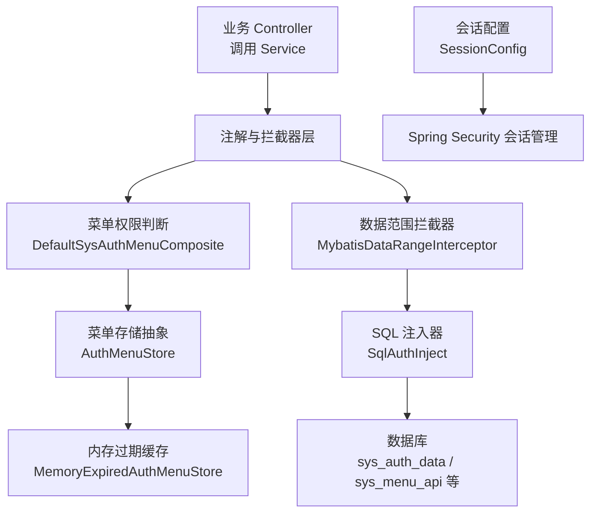
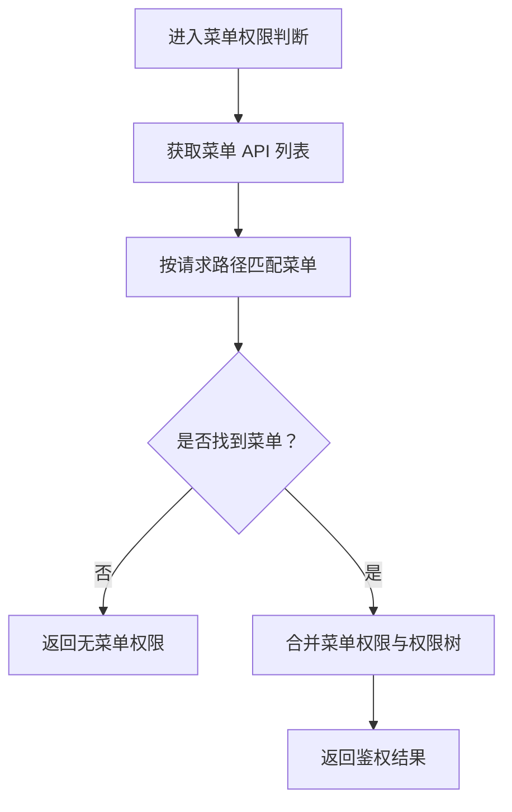
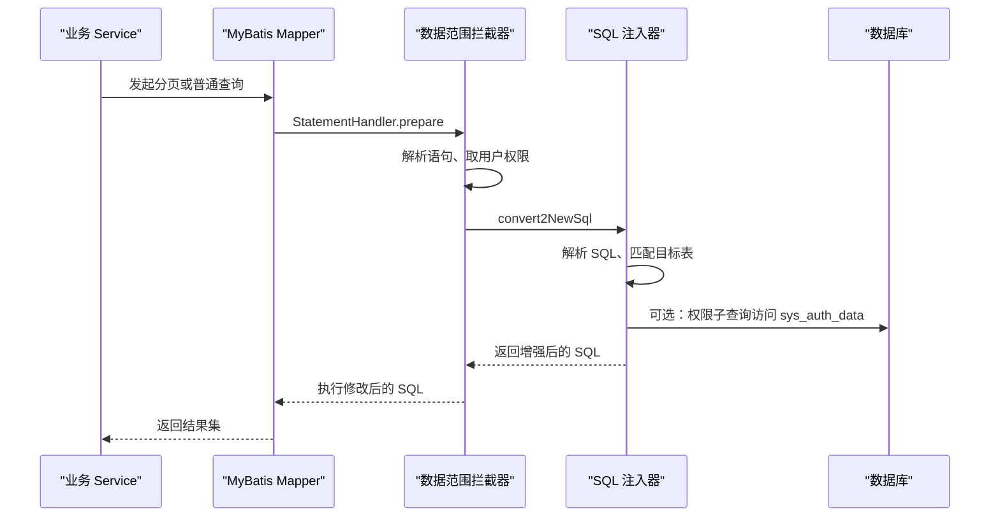
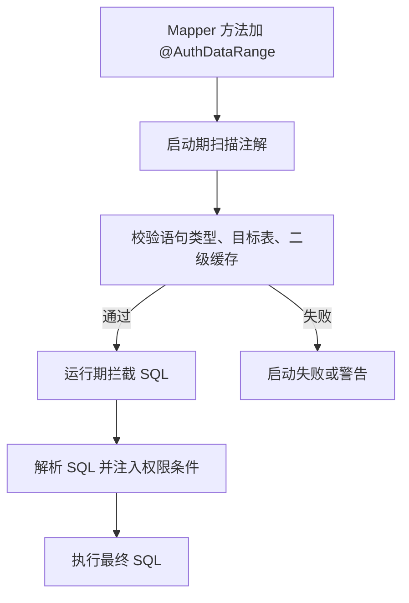
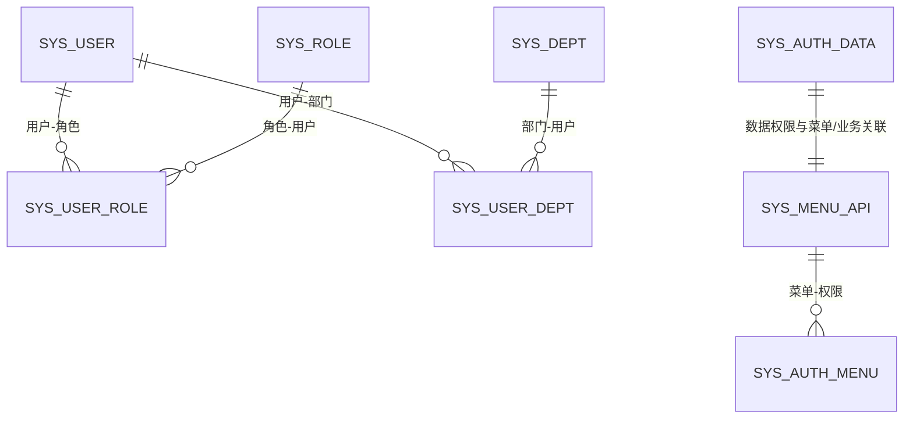
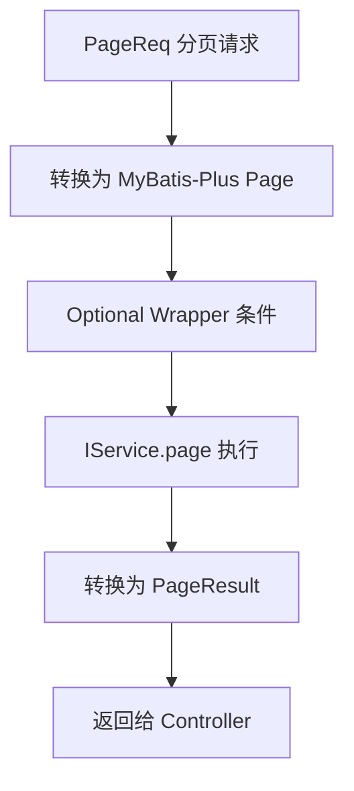
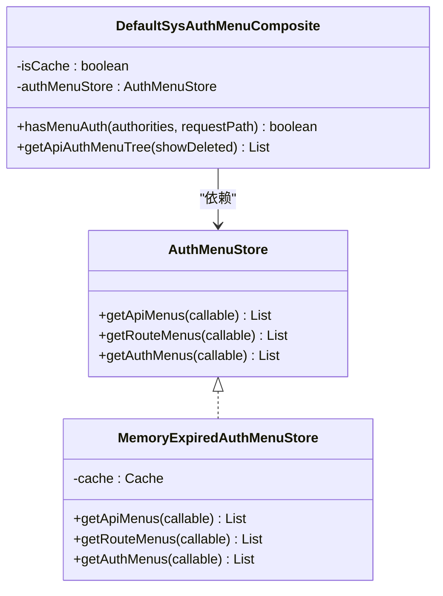
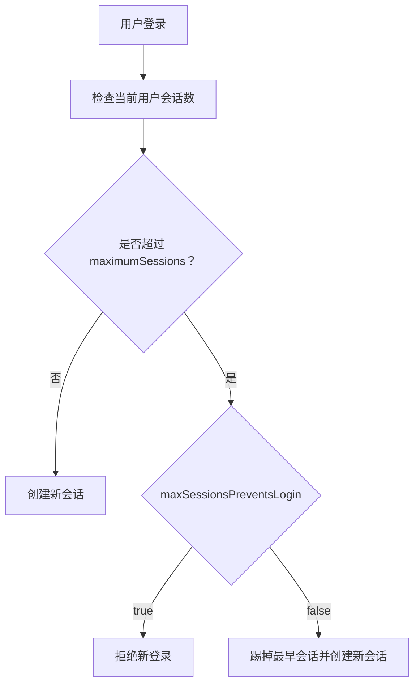

# 性能调优指南

<cite>
**本文引用的文件**   
- [README_Auth.md](file://README_Auth.md)
- [pom.xml](file://pom.xml)
- [docs/application.yml](file://docs/application.yml)
- [docs/sql/auth-rbac.sql](file://docs/sql/auth-rbac.sql)
- [auth-core-spring-boot-starter/AuthCoreConfig.java](file://auth/auth-core-spring-boot-starter/src/main/java/com/cu/framework/boot/auth/core/config/AuthCoreConfig.java)
- [auth-rbac-spring-boot-starter/AuthRbacConfig.java](file://auth/auth-rbac-spring-boot-starter/src/main/java/com/cu/framework/boot/auth/rbac/config/AuthRbacConfig.java)
- [MenuApiGeneratorProcessor.java](file://auth/auth-core/src/main/java/com/cu/framework/auth/core/menu/MenuApiGeneratorProcessor.java)
- [DefaultSysAuthMenuComposite.java](file://auth/auth-rbac/src/main/java/com/cu/framework/auth/rbac/composite/impl/DefaultSysAuthMenuComposite.java)
- [AuthMenuStore.java](file://auth/auth-rbac/src/main/java/com/cu/framework/auth/rbac/composite/AuthMenuStore.java)
- [MemoryExpiredAuthMenuStore.java](file://auth/auth-rbac/src/main/java/com/cu/framework/auth/rbac/composite/impl/MemoryExpiredAuthMenuStore.java)
- [MybatisDataRangeInterceptor.java](file://auth/auth-core/src/main/java/com/cu/framework/auth/core/data/range/MybatisDataRangeInterceptor.java)
- [SqlAuthInject.java](file://auth/auth-core/src/main/java/com/cu/framework/auth/core/data/range/SqlAuthInject.java)
- [AuthRangeCache.java](file://auth/auth-core/src/main/java/com/cu/framework/auth/core/data/range/AuthRangeCache.java)
- [JdbcAuthDataHandler.java](file://auth/auth-core/src/main/java/com/cu/framework/auth/core/data/JdbcAuthDataHandler.java)
- [SessionConfig.java](file://login-spring-boot-starter/src/main/java/com/cu/framework/authentication/config/SessionConfig.java)
- [SessionProperties.java](file://login-spring-boot-starter/src/main/java/com/cu/framework/authentication/properties/SessionProperties.java)
- [MybatisPageExecutor.java](file://basic-support/src/main/java/com/cu/framework/basic/support/utils/MybatisPageExecutor.java)
- [sample/login-boot-sample/application.yml](file://sample/login-boot-sample/src/main/resources/application.yml)
- [sample/auth-rbac-boot-sample/application.yml](file://sample/auth-rbac-boot-sample/src/main/resources/application.yml)
</cite>

## 目录
1. [引言](#引言)
2. [项目结构与性能相关组件定位](#项目结构与性能相关组件定位)
3. [权限系统性能瓶颈分析](#权限系统性能瓶颈分析)
4. [菜单权限查询优化](#菜单权限查询优化)
5. [数据权限 SQL 拼接与执行优化](#数据权限-sql-拼接与执行优化)
6. [数据库索引优化建议](#数据库索引优化建议)
7. [MyBatis-Plus 分页查询性能调优](#mybatis-plus-分页查询性能调优)
8. [权限缓存策略与 Redis 集成方案](#权限缓存策略与-redis-集成方案)
9. [高并发会话管理与登录控制](#高并发会话管理与登录控制)
10. [JVM、线程池与连接池调优](#jvm线程池与连接池调优)
11. [性能监控与基准测试方法](#性能监控与基准测试方法)
12. [不同规模应用的最佳实践与参考配置](#不同规模应用的最佳实践与参考配置)
13. [故障排查清单](#故障排查清单)
14. [结论](#结论)

## 引言
本指南围绕 Kewen Framework 的权限系统与基础支撑能力，从代码实现出发总结性能瓶颈、优化手段和可落地配置。框架采用 Spring Boot 2.7、Spring Security、MyBatis-Plus、HikariCP、P6Spy 等技术栈；权限体系以 RBAC 为基础，同时提供注解驱动的菜单权限和数据权限，支持启动期扫描菜单 API、运行时通过 MyBatis 拦截器注入数据范围条件，并内置内存型菜单缓存接口。

核心性能关注点包括：
- 菜单权限查询是否被无意义地重复查库。
- 数据权限 SQL 在解析、拼接、子查询生成阶段的开销。
- 用户-角色、角色-菜单、部门-权限等关联查询是否命中合适索引。
- 大数据量分页查询是否使用合理分页模型与 SQL。
- 会话并发控制在高并发登录场景下的行为。
- JVM、连接池、线程池、日志采集对吞吐和延迟的影响。

**章节来源**
- [README_Auth.md:1-50](file://README_Auth.md#L1-L50)
- [pom.xml:1-80](file://pom.xml#L1-L80)

## 项目结构与性能相关组件定位
Kewen Framework 中与性能直接相关的代码主要分布在以下模块：
- `auth/auth-core`：权限注解、数据范围声明、MyBatis 拦截器、SQL 注入、权限表持久化。
- `auth/auth-rbac`：RBAC 默认实现、菜单与权限聚合服务、菜单存储抽象及内存缓存实现。
- `auth/auth-core-spring-boot-starter`：权限核心 Bean 装配、启动校验、菜单 API 生成流程。
- `auth/auth-rbac-spring-boot-starter`：RBAC Bean 装配、默认菜单存储 Bean。
- `login-spring-boot-starter`：安全会话配置、最大会话数、Remember-Me、Header/Cookie Session ID 解析。
- `basic-support`：MyBatis-Plus 分页转换工具。
- `docs/sql/auth-rbac.sql`：权限相关建表脚本。
- 各 sample 应用的 `application.yml`：示例中的会话超时、数据库连接池、菜单缓存开关。

**图表来源**
- [DefaultSysAuthMenuComposite.java:1-120](file://auth/auth-rbac/src/main/java/com/cu/framework/auth/rbac/composite/impl/DefaultSysAuthMenuComposite.java#L1-L120)
- [MybatisDataRangeInterceptor.java:1-120](file://auth/auth-core/src/main/java/com/cu/framework/auth/core/data/range/MybatisDataRangeInterceptor.java#L1-L120)
- [AuthMenuStore.java:1-23](file://auth/auth-rbac/src/main/java/com/cu/framework/auth/rbac/composite/AuthMenuStore.java#L1-L23)
- [MemoryExpiredAuthMenuStore.java:1-69](file://auth/auth-rbac/src/main/java/com/cu/framework/auth/rbac/composite/impl/MemoryExpiredAuthMenuStore.java#L1-L69)
- [SqlAuthInject.java:1-120](file://auth/auth-core/src/main/java/com/cu/framework/auth/core/data/range/SqlAuthInject.java#L1-L120)
- [SessionConfig.java:1-124](file://login-spring-boot-starter/src/main/java/com/cu/framework/authentication/config/SessionConfig.java#L1-L124)

**章节来源**
- [README_Auth.md:1-50](file://README_Auth.md#L1-L50)
- [auth-core-spring-boot-starter/AuthCoreConfig.java:1-120](file://auth/auth-core-spring-boot-starter/src/main/java/com/cu/framework/boot/auth/core/config/AuthCoreConfig.java#L1-L120)
- [auth-rbac-spring-boot-starter/AuthRbacConfig.java:1-75](file://auth/auth-rbac-spring-boot-starter/src/main/java/com/cu/framework/boot/auth/rbac/config/AuthRbacConfig.java#L1-L75)

## 权限系统性能瓶颈分析
### 菜单权限查询瓶颈
菜单权限判定由 `DefaultSysAuthMenuComposite` 负责。当前实现会先获取菜单 API 列表、再根据请求路径查找匹配的菜单项，并在需要时合并菜单权限树。若未启用菜单缓存，每次请求都可能触发菜单 API、菜单路由、菜单权限的数据库读取。虽然内部有 `@Value("${cu.auth.cache-auth:false}")` 开关，但默认值为 `false`，意味着生产环境若不显式开启缓存或替换为 Redis 实现，菜单权限查询容易成为热点读瓶颈。

**图表来源**
- [DefaultSysAuthMenuComposite.java:60-120](file://auth/auth-rbac/src/main/java/com/cu/framework/auth/rbac/composite/impl/DefaultSysAuthMenuComposite.java#L60-L120)

### 数据权限 SQL 注入瓶颈
数据权限通过 `MybatisDataRangeInterceptor` 在 MyBatis `StatementHandler.prepare` 阶段拦截每条物理 SQL，再通过 `SqlAuthInject` 使用 JSQLParser 解析 SQL 并注入权限条件。该过程涉及：
- 解析原始 SQL。
- 递归查找目标表。
- 构造 `IN` 或 `EXISTS` 权限子查询。
- 将新 SQL 写回 `BoundSql`。

当数据权限集合较大、SQL 结构复杂、存在多层嵌套子查询时，SQL 解析和拼接会成为 CPU 热点。更严重的是，如果权限集合为空，框架会注入恒假条件，导致整条查询返回空结果，这可能被误判为“查询慢”，实际是语义上的“零行可见”。

**图表来源**
- [MybatisDataRangeInterceptor.java:80-160](file://auth/auth-core/src/main/java/com/cu/framework/auth/core/data/range/MybatisDataRangeInterceptor.java#L80-L160)
- [SqlAuthInject.java:1-120](file://auth/auth-core/src/main/java/com/cu/framework/auth/core/data/range/SqlAuthInject.java#L1-L120)

### 权限数据编辑与比对成本
`JdbcAuthDataHandler` 在处理批量数据权限编辑和单条数据操作权限判定时，会把数据库返回的权限记录映射为 `data_id -> authority` 的内存结构，并与用户权限集合进行比对。其时间复杂度大致为：
- 权限集合转哈希集合：O(U)。
- 权限记录遍历构建 dataId 映射：O(R)。
- 逐条 dataId 比对：O(D × U)，其中 D 是业务 dataId 数量，U 是用户权限字符串数量。

因此，当单次请求的数据 ID 数量很大，或用户权限字符串集合很大时，内存比对可能成为瓶颈。

**章节来源**
- [DefaultSysAuthMenuComposite.java:60-180](file://auth/auth-rbac/src/main/java/com/cu/framework/auth/rbac/composite/impl/DefaultSysAuthMenuComposite.java#L60-L180)
- [MybatisDataRangeInterceptor.java:80-200](file://auth/auth-core/src/main/java/com/cu/framework/auth/core/data/range/MybatisDataRangeInterceptor.java#L80-L200)
- [SqlAuthInject.java:1-200](file://auth/auth-core/src/main/java/com/cu/framework/auth/core/data/range/SqlAuthInject.java#L1-L200)
- [JdbcAuthDataHandler.java:1-119](file://auth/auth-core/src/main/java/com/cu/framework/auth/core/data/JdbcAuthDataHandler.java#L1-L119)

## 菜单权限查询优化
### 启用菜单缓存开关
配置文件 `docs/application.yml` 中定义了 `cu.auth.cache-auth`，默认 `false`。当该值为 `true` 且存在 `AuthMenuStore` Bean 时，`DefaultSysAuthMenuComposite` 可通过存储抽象读取菜单 API、菜单路由、菜单权限。RBAC Starter 默认注册 `MemoryExpiredAuthMenuStore`，即进程内基于 Guava Cache 的过期缓存。

建议：
- 单机或小集群：先开启 `cu.auth.cache-auth=true`，观察菜单变更频率与缓存命中率。
- 多实例部署：优先替换 `AuthMenuStore` 为 Redis 实现，避免各实例各自维护一份内存缓存导致不一致。
- 菜单变更后应主动失效对应缓存键，否则可能出现旧权限延迟生效。

### 减少菜单树遍历成本
`getApiAuthMenuTree` 会把全部菜单 API 和权限合并成树，并对每个菜单节点填充权限对象。如果前端只需要某用户已授权的路由，应优先使用带权限过滤的方法，例如 `getRouteAuthMenuTree(Collection<FlatteningAuthority>)`，避免把全部菜单树传给前端再做二次过滤。

### 菜单 API 生成器启动期优化
`MenuApiGeneratorProcessor` 在启动时扫描 `RequestMapping`，对比数据库中已有路径，仅新增缺失菜单。该流程适合低频变更场景；若频繁新增 Controller 或路径，建议在生产环境关闭自动入库，改为运维侧手动同步菜单。

**章节来源**
- [docs/application.yml:80-100](file://docs/application.yml#L80-L100)
- [DefaultSysAuthMenuComposite.java:1-120](file://auth/auth-rbac/src/main/java/com/cu/framework/auth/rbac/composite/impl/DefaultSysAuthMenuComposite.java#L1-L120)
- [AuthMenuStore.java:1-23](file://auth/auth-rbac/src/main/java/com/cu/framework/auth/rbac/composite/AuthMenuStore.java#L1-L23)
- [MemoryExpiredAuthMenuStore.java:1-69](file://auth/auth-rbac/src/main/java/com/cu/framework/auth/rbac/composite/impl/MemoryExpiredAuthMenuStore.java#L1-L69)
- [MenuApiGeneratorProcessor.java:1-120](file://auth/auth-core/src/main/java/com/cu/framework/auth/core/menu/MenuApiGeneratorProcessor.java#L1-L120)

## 数据权限 SQL 拼接与执行优化
### 使用合适的 matchMethod
`SqlAuthInject` 支持 `IN` 和 `EXISTS` 两种匹配方式。对于小数据量、固定数量的 dataId 过滤，`IN` 通常更直观；对于大表关联或复杂条件，`EXISTS` 更利于数据库优化器选择执行计划。应避免在高频查询中使用过大的 `IN` 列表。

### 控制权限集合大小
当用户角色很多、权限字符串很多时，生成的权限子查询会包含大量 `authority IN (...)`。建议：
- 精简权限字符串粒度，避免把业务状态码、枚举值全部作为权限串。
- 对高频角色做权限预热，减少首次加载时的 SQL 长度。
- 在数据权限编辑接口中，避免一次性写入过多无关权限。

### 避免空权限导致的“零行”假象
当用户没有数据权限时，`SqlAuthInject` 会注入 `1 = 0`。这属于正确语义，不是性能问题。排查时应区分“查询慢”和“查询结果为空”。

### 启动期 SQL 校验降低运行时风险
`AuthRangeStartupValidator` 会在启动期扫描 `@AuthDataRange` 声明，检查语句是否为查询、是否存在二级缓存、静态 SQL 中目标表是否存在。这能提前暴露错误配置，减少运行期失败和不可预测的性能退化。

**图表来源**
- [AuthRangeCache.java:1-120](file://auth/auth-core/src/main/java/com/cu/framework/auth/core/data/range/AuthRangeCache.java#L1-L120)
- [MybatisDataRangeInterceptor.java:120-200](file://auth/auth-core/src/main/java/com/cu/framework/auth/core/data/range/MybatisDataRangeInterceptor.java#L120-L200)
- [SqlAuthInject.java:120-220](file://auth/auth-core/src/main/java/com/cu/framework/auth/core/data/range/SqlAuthInject.java#L120-L220)

**章节来源**
- [SqlAuthInject.java:1-220](file://auth/auth-core/src/main/java/com/cu/framework/auth/core/data/range/SqlAuthInject.java#L1-L220)
- [MybatisDataRangeInterceptor.java:1-200](file://auth/auth-core/src/main/java/com/cu/framework/auth/core/data/range/MybatisDataRangeInterceptor.java#L1-L200)
- [AuthRangeCache.java:1-155](file://auth/auth-core/src/main/java/com/cu/framework/auth/core/data/range/AuthRangeCache.java#L1-L155)

## 数据库索引优化建议
### 现有索引情况
`docs/sql/auth-rbac.sql` 中已经定义了一些关键索引：
- `sys_auth_data`：复合索引 `(business_function, operate, data_id, authority)`，用于数据权限查询。
- `sys_user_dept`：索引 `(user_id, dept_id)`，用于用户-部门关联查询。
- `sys_user_role`：索引 `(user_id, role_id)`，用于用户-角色关联查询。
- `sys_menu_api`：唯一索引 `uk_sys_menu_api_path`，用于菜单路径去重和快速查找。
- `sys_user`：用户名和手机号唯一索引。

**图表来源**
- [docs/sql/auth-rbac.sql:1-148](file://docs/sql/auth-rbac.sql#L1-L148)

### 推荐补充索引
#### 用户-角色表
当前 `sys_user_role` 已有 `(user_id, role_id)` 索引，足够覆盖按用户查角色的常见场景。若存在按角色反查用户的场景，建议补充反向复合索引：
- `(role_id, user_id)`

#### 角色-菜单表
菜单权限主表是 `sys_auth_menu`，字段包括 `api_id`、`authority`、`description`。若菜单管理界面经常按 `api_id` 删除或更新权限，建议增加：
- `(api_id, authority)`

若菜单权限查询频繁按权限串反查菜单，也可考虑：
- `(authority, api_id)`

#### 部门-权限关联
框架中部门维度主要通过用户-部门关系参与数据权限。若业务扩展出“部门-权限”直连表，应根据查询方向建立索引：
- 按部门查权限：`(dept_id, authority)`
- 按权限查部门：`(authority, dept_id)`

#### 数据权限表
`sys_auth_data` 的复合索引 `(business_function, operate, data_id, authority)` 已经比较完整。若存在按 `business_function + authority` 统计权限的场景，可考虑前缀索引或覆盖索引，但需结合真实 SQL 评估。

#### 菜单 API 视图
`view_menu_api_auth` 是基于 `sys_menu_api` 与 `sys_auth_menu` 的视图，只筛选 `deleted=0` 且 `auth_type=1` 的记录。建议在 `sys_menu_api` 上保留 `path` 唯一索引；若视图查询成为热点，可在 `sys_menu_api` 上增加 `(deleted, auth_type)` 辅助索引，或在业务层缓存视图结果。

**章节来源**
- [docs/sql/auth-rbac.sql:1-148](file://docs/sql/auth-rbac.sql#L1-L148)

## MyBatis-Plus 分页查询性能调优
### 框架提供的分页工具
`MybatisPageExecutor` 提供 `PageReq`、MyBatis-Plus `Page` 与项目 `PageResult` 之间的转换，并提供直接调用 `IService.page` 的方法。它本身不改变分页 SQL 生成逻辑，而是封装了参数转换和结果包装。

**图表来源**
- [MybatisPageExecutor.java:1-118](file://basic-support/src/main/java/com/cu/framework/basic/support/utils/MybatisPageExecutor.java#L1-L118)

### 大数据量分页优化建议
1. **限制页大小**：避免前端传入超大 `size`，服务端应设置上限。
2. **避免深分页**：当 `page` 非常大时，MyBatis-Plus 默认 `LIMIT offset, size` 会导致数据库扫描大量无用行。可改用基于上次最大 ID 的分页游标模式，或在 SQL 层用 `WHERE id > last_id LIMIT size`。
3. **减少不必要字段**：只在列表接口查询必要列，避免 `SELECT *`。
4. **合理使用 Wrapper**：条件尽量走索引列，避免函数包裹索引列。
5. **注意数据权限注入**：数据权限会向 WHERE 追加权限条件，可能使原本简单的分页变成子查询或复杂 JOIN。务必确保权限相关列有索引。

### 复杂查询 SQL 优化
- 若 `@AuthDataRange` 的目标表不在外层 FROM，而是在子查询中，`SqlAuthInject` 会尝试递归匹配；但仍建议把最常被权限过滤的表放在外层，降低解析和子查询复杂度。
- 对高频报表类查询，不建议直接使用通用数据权限注入，可单独编写高性能 SQL 并通过业务权限校验替代自动注入。

**章节来源**
- [MybatisPageExecutor.java:1-118](file://basic-support/src/main/java/com/cu/framework/basic/support/utils/MybatisPageExecutor.java#L1-L118)
- [SqlAuthInject.java:120-220](file://auth/auth-core/src/main/java/com/cu/framework/auth/core/data/range/SqlAuthInject.java#L120-L220)

## 权限缓存策略与 Redis 集成方案
### 当前内存缓存机制
`MemoryExpiredAuthMenuStore` 使用 Guava `CacheBuilder` 创建进程内缓存，三个键分别对应菜单 API、菜单路由、菜单权限，写入后 10 分钟过期。优点是简单、无外部依赖；缺点是多实例之间不一致、重启丢失、无法跨进程共享热点权限数据。

**图表来源**
- [AuthMenuStore.java:1-23](file://auth/auth-rbac/src/main/java/com/cu/framework/auth/rbac/composite/AuthMenuStore.java#L1-L23)
- [MemoryExpiredAuthMenuStore.java:1-69](file://auth/auth-rbac/src/main/java/com/cu/framework/auth/rbac/composite/impl/MemoryExpiredAuthMenuStore.java#L1-L69)
- [DefaultSysAuthMenuComposite.java:1-120](file://auth/auth-rbac/src/main/java/com/cu/framework/auth/rbac/composite/impl/DefaultSysAuthMenuComposite.java#L1-L120)

### Redis 缓存设计建议
建议实现新的 `AuthMenuStore`，使用 Redis 作为后端：
- 键命名：
  - `kewen:auth:menu:api`
  - `kewen:auth:menu:route`
  - `kewen:auth:menu:auth`
- 过期策略：
  - 菜单数据变化时主动删除对应键。
  - 设置较短 TTL（如 5-15 分钟）作为兜底。
- 热点处理：
  - 对热门租户或热门角色，可增加本地二级缓存（如 Caffeine），避免 Redis 热点 Key 打满。
  - 对权限字符串集合较大的用户，可在登录成功后预计算并缓存到会话或用户级缓存。
- 一致性：
  - 菜单权限编辑接口必须发布缓存失效事件。
  - 多实例订阅同一频道，保证一致失效。

**章节来源**
- [AuthMenuStore.java:1-23](file://auth/auth-rbac/src/main/java/com/cu/framework/auth/rbac/composite/AuthMenuStore.java#L1-L23)
- [MemoryExpiredAuthMenuStore.java:1-69](file://auth/auth-rbac/src/main/java/com/cu/framework/auth/rbac/composite/impl/MemoryExpiredAuthMenuStore.java#L1-L69)
- [DefaultSysAuthMenuComposite.java:1-120](file://auth/auth-rbac/src/main/java/com/cu/framework/auth/rbac/composite/impl/DefaultSysAuthMenuComposite.java#L1-L120)

## 高并发会话管理与登录控制
### 最大会话数限制
`SessionProperties` 定义 `maximumSessions` 和 `maxSessionsPreventsLogin`，`SessionConfig` 将其应用到 Spring Security 的 `sessionManagement()`。默认最大会话数为 10；达到上限时，若 `maxSessionsPreventsLogin=false`，则挤掉最早会话；若为 `true`，则阻止新登录。

示例配置：
- `sample/login-boot-sample/application.yml`：最大会话数 10，允许挤下线。
- `sample/auth-rbac-boot-sample/application.yml`：最大会话数 10，阻止新登录。

**图表来源**
- [SessionProperties.java:1-22](file://login-spring-boot-starter/src/main/java/com/cu/framework/authentication/properties/SessionProperties.java#L1-L22)
- [SessionConfig.java:80-124](file://login-spring-boot-starter/src/main/java/com/cu/framework/authentication/config/SessionConfig.java#L80-L124)

### 防并发登录实现原理
当前实现基于 Spring Security 的 `maximumSessions` 和 `expiredSessionStrategy`。会话过期时会返回 401 JSON，提示“登录状态失效，请重新登录”。需要注意的是，注释中提到的 `SpringSessionBackedSessionRegistry` 已被注释，说明框架当前并未强制使用 Spring Session 的 SessionRegistry 来精确统计全局会话；实际并发控制由 Spring Security 的会话管理机制配合 `SessionProperties` 完成。

建议：
- 使用分布式会话时，确保所有实例共享同一会话存储。
- 设置合理的会话超时时间，避免长时间占用会话资源。
- 在高并发登录场景下，结合限流和验证码防止暴力登录。

**章节来源**
- [SessionProperties.java:1-22](file://login-spring-boot-starter/src/main/java/com/cu/framework/authentication/properties/SessionProperties.java#L1-L22)
- [SessionConfig.java:1-124](file://login-spring-boot-starter/src/main/java/com/cu/framework/authentication/config/SessionConfig.java#L1-L124)
- [sample/login-boot-sample/application.yml:30-50](file://sample/login-boot-sample/src/main/resources/application.yml#L30-L50)
- [sample/auth-rbac-boot-sample/application.yml:30-50](file://sample/auth-rbac-boot-sample/src/main/resources/application.yml#L30-L50)

## JVM、线程池与连接池调优
### 连接池调优
各 sample 应用使用 HikariCP，示例中 `maximum-pool-size=5`、`minimum-idle=2`。这是开发环境的保守值，不适合高并发生产环境。连接池大小应与数据库连接能力、CPU 核数、事务长度、SQL 耗时共同评估。

建议基线：
- 小规模应用：`maximum-pool-size=10~20`。
- 中等规模应用：`maximum-pool-size=20~50`。
- 大规模应用：根据压测结果调整，并配合数据库连接池管理工具监控。

### 线程池调优
框架中 `boot/basic-spring-boot-starter` 提供了异步配置入口，但未在本文档中展开具体实现。对于权限校验、菜单生成、日志异步落盘等场景，建议使用独立线程池，避免阻塞 Web 线程。

### JVM 参数调优
虽然仓库未直接给出 JVM 启动参数，但结合框架依赖（Spring Boot 2.7、Fastjson、Hutool、MyBatis-Plus）和权限系统的 SQL 解析开销，建议关注：
- 堆内存：根据应用峰值内存和会话规模设置 `-Xms` 与 `-Xmx`，保持相等以减少 GC 抖动。
- GC 策略：优先使用 G1GC，设置合理的堆分区和停顿目标。
- Metaspace：权限注解扫描、菜单 API 生成会加载较多类，适当增大 Metaspace。
- 日志输出：生产环境关闭 DEBUG 级别日志，尤其是 SQL 日志，仅在压测和问题复现时临时开启。

### P6Spy 与 SQL 监控
框架依赖 P6Spy，可用于生产环境 SQL 性能分析。建议：
- 正常生产关闭详细 SQL 日志。
- 压测或问题排查时开启 P6Spy，收集慢 SQL。
- 结合数据库慢查询日志交叉验证。

**章节来源**
- [pom.xml:80-160](file://pom.xml#L80-L160)
- [sample/basic-boot-sample/application.yml:30-79](file://sample/basic-boot-sample/src/main/resources/application.yml#L30-L79)
- [sample/auth-rbac-boot-sample/application.yml:60-117](file://sample/auth-rbac-boot-sample/src/main/resources/application.yml#L60-L117)

## 性能监控与基准测试方法
### 压测建议
- 使用 JMeter、wrk、Artillery 或 Gatling 模拟登录、菜单权限查询、数据权限分页查询。
- 分场景压测：
  - 登录接口：验证会话并发控制、密码校验、SSO 回调。
  - 菜单接口：验证 `cache-auth=true/false` 的差异。
  - 数据权限分页：验证大表分页、复杂 WHERE 条件、权限子查询性能。
- 压测指标：
  - 吞吐量 TPS/QPS。
  - 平均响应时间、P95、P99。
  - CPU、内存、GC 次数、数据库连接池使用率。
  - SQL 执行时间和慢查询比例。

### 性能指标收集
- 应用层：Spring Boot Actuator、Micrometer、Prometheus。
- JVM 层：JFR、Arthas、GC 日志。
- 数据库层：慢查询日志、执行计划、锁等待。
- 中间件层：Redis 监控、连接池监控。

### 基准测试建议
- 针对 `MenuApiGeneratorProcessor`：比较首次启动扫描与后续启动差异。
- 针对 `DefaultSysAuthMenuComposite`：对比缓存命中与未命中的菜单树生成时间。
- 针对 `MybatisDataRangeInterceptor`：对比有无数据权限 SQL 注入的延迟差异。
- 针对 `JdbcAuthDataHandler`：对比不同数据 ID 数量和权限字符串集合下的内存比对耗时。

**章节来源**
- [MenuApiGeneratorProcessor.java:1-120](file://auth/auth-core/src/main/java/com/cu/framework/auth/core/menu/MenuApiGeneratorProcessor.java#L1-L120)
- [DefaultSysAuthMenuComposite.java:60-180](file://auth/auth-rbac/src/main/java/com/cu/framework/auth/rbac/composite/impl/DefaultSysAuthMenuComposite.java#L60-L180)
- [MybatisDataRangeInterceptor.java:80-200](file://auth/auth-core/src/main/java/com/cu/framework/auth/core/data/range/MybatisDataRangeInterceptor.java#L80-L200)
- [JdbcAuthDataHandler.java:60-119](file://auth/auth-core/src/main/java/com/cu/framework/auth/core/data/JdbcAuthDataHandler.java#L60-L119)

## 不同规模应用的最佳实践与参考配置
### 小型应用
- 特点：用户少、菜单少、权限结构简单。
- 建议：
  - 使用内存缓存 `MemoryExpiredAuthMenuStore`。
  - 开启 `cu.auth.cache-auth=true`。
  - 连接池 10 左右即可。
  - 不需要复杂 Redis 缓存。

### 中型应用
- 特点：多角色、多菜单、部分数据权限。
- 建议：
  - 启用菜单缓存。
  - 引入 Redis 缓存菜单 API、菜单路由、菜单权限。
  - 数据库增加角色-菜单、部门-权限相关索引。
  - 连接池 20~50，视数据库能力调整。
  - 压测重点：菜单树生成、数据权限分页。

### 大型应用
- 特点：高并发、多实例、多租户、复杂数据权限。
- 建议：
  - 使用 Redis 或分布式缓存实现 `AuthMenuStore`。
  - 对热门角色、热门菜单做本地二级缓存。
  - 数据权限 SQL 尽量简化，必要时绕过自动注入。
  - 连接池按数据库连接数和 CPU 核数评估，避免连接耗尽。
  - 严格限制页大小，避免深分页。
  - 启用会话持久化，并确保多实例共享会话存储。
  - 压测覆盖登录风暴、菜单热更新、权限变更传播。

**章节来源**
- [docs/application.yml:80-110](file://docs/application.yml#L80-L110)
- [sample/auth-rbac-boot-sample/application.yml:10-50](file://sample/auth-rbac-boot-sample/src/main/resources/application.yml#L10-L50)
- [sample/login-boot-sample/application.yml:10-50](file://sample/login-boot-sample/src/main/resources/application.yml#L10-L50)

## 故障排查清单
- 菜单权限无效：
  - 检查 `cu.auth.cache-auth` 是否启用。
  - 检查 `AuthMenuStore` 是否正确注册。
  - 检查菜单 API 是否已入库。
- 数据权限返回空：
  - 检查用户是否有数据权限。
  - 检查 `@AuthDataRange` 的目标表和别名是否正确。
  - 检查是否因空权限集合注入了恒假条件。
- SQL 解析失败：
  - 检查 SQL 是否被 JSQLParser 正确解析。
  - 检查目标表是否在可匹配位置。
- 会话被踢出：
  - 检查 `maximumSessions` 和 `maxSessionsPreventsLogin`。
  - 检查会话超时时间。
- 分页查询慢：
  - 检查是否深分页。
  - 检查是否 SELECT 了多余字段。
  - 检查数据权限是否导致复杂子查询。
- 菜单缓存不一致：
  - 检查是否多实例各自维护内存缓存。
  - 检查菜单变更后是否主动失效缓存。

**章节来源**
- [DefaultSysAuthMenuComposite.java:60-180](file://auth/auth-rbac/src/main/java/com/cu/framework/auth/rbac/composite/impl/DefaultSysAuthMenuComposite.java#L60-L180)
- [MybatisDataRangeInterceptor.java:120-200](file://auth/auth-core/src/main/java/com/cu/framework/auth/core/data/range/MybatisDataRangeInterceptor.java#L120-L200)
- [SqlAuthInject.java:120-220](file://auth/auth-core/src/main/java/com/cu/framework/auth/core/data/range/SqlAuthInject.java#L120-L220)
- [SessionConfig.java:80-124](file://login-spring-boot-starter/src/main/java/com/cu/framework/authentication/config/SessionConfig.java#L80-L124)

## 结论
Kewen Framework 的权限系统在注解驱动、RBAC 默认实现和 MyBatis 拦截器方面提供了良好的可扩展性，但也带来若干性能挑战：菜单权限未缓存时重复查库、数据权限 SQL 动态解析和子查询拼接消耗 CPU、权限集合过大影响内存比对、以及高并发会话管理的边界行为。

最有效的优化路径是：
1. 启用并完善菜单缓存，生产环境优先使用 Redis。
2. 优化数据权限 SQL 和目标表设计，确保索引有效。
3. 控制分页大小，避免深分页和无必要字段查询。
4. 合理配置会话并发限制和超时。
5. 通过压测和监控持续验证 JVM、连接池、线程池、缓存和数据库的性能表现。