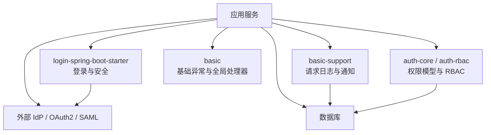
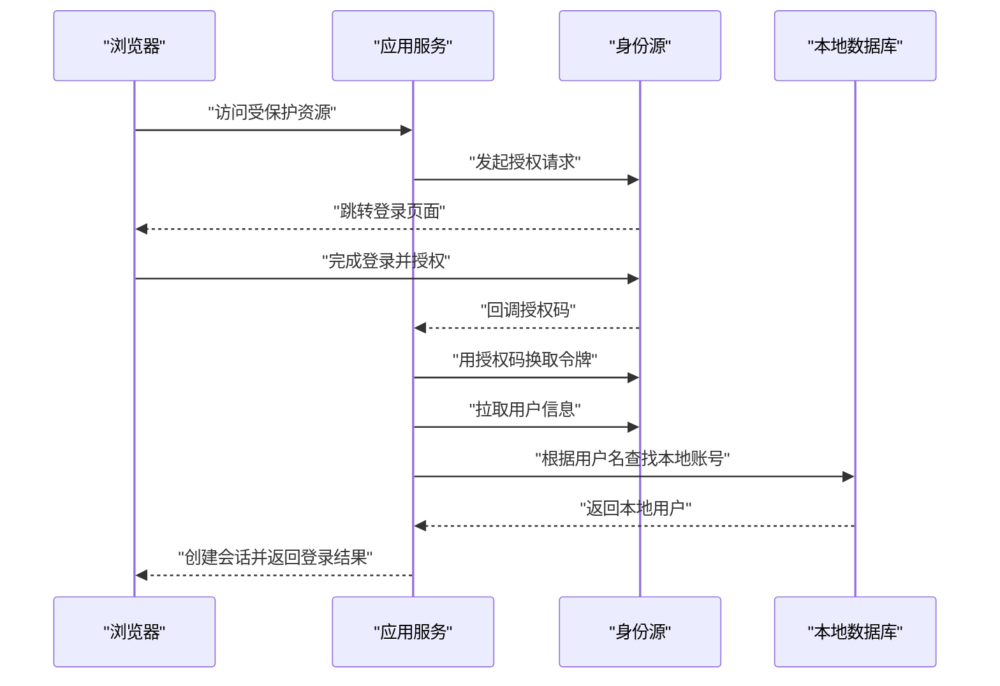
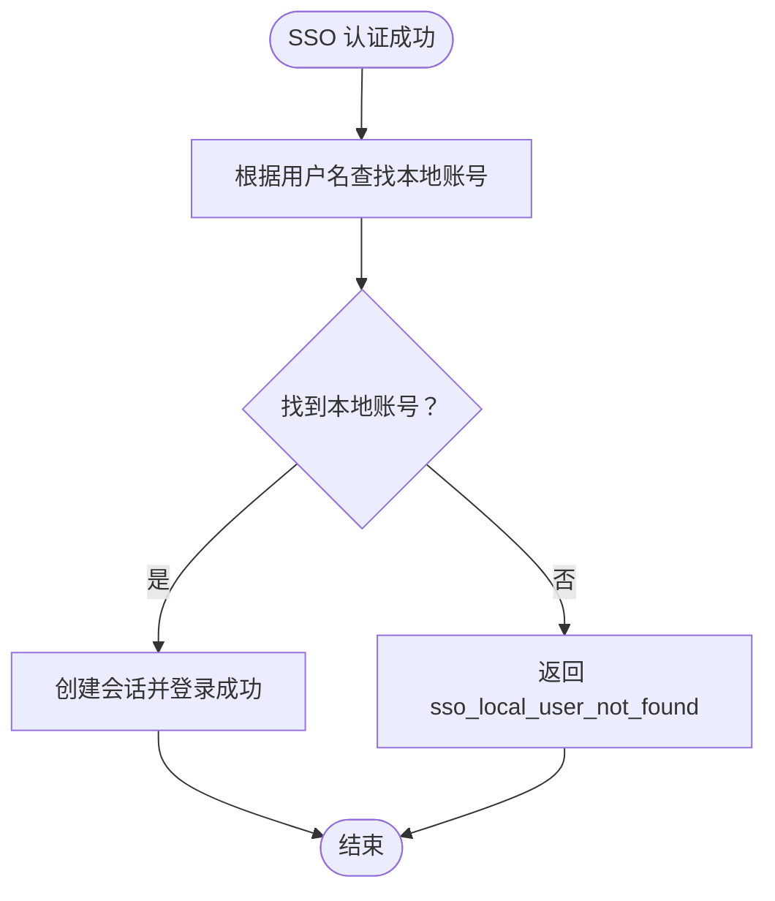
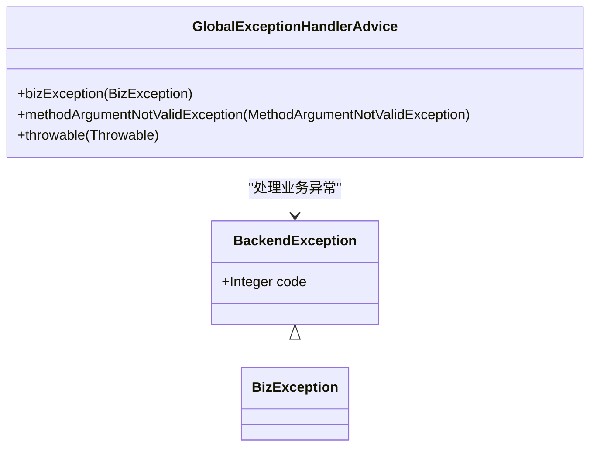
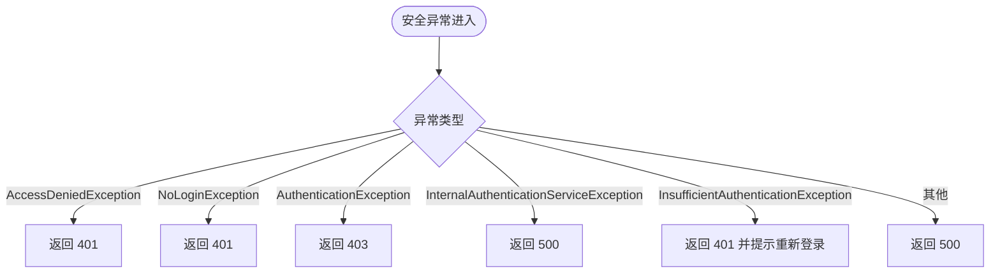
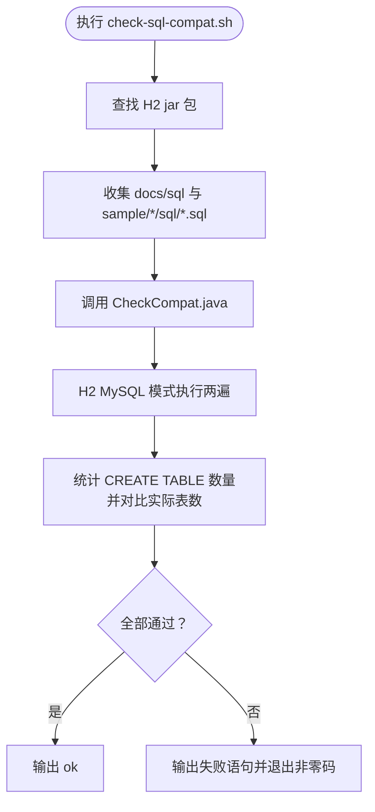

# 故障排除

<cite>
**本文引用的文件**   
- [README_Auth.md](file://README_Auth.md)
- [docs/application.yml](file://docs/application.yml)
- [basic/src/main/java/com/cu/framework/basic/exception/BackendException.java](file://basic/src/main/java/com/cu/framework/basic/exception/BackendException.java)
- [basic/src/main/java/com/cu/framework/basic/exception/BizException.java](file://basic/src/main/java/com/cu/framework/basic/exception/BizException.java)
- [basic/src/main/java/com/cu/framework/basic/exception/GlobalExceptionHandlerAdvice.java](file://basic/src/main/java/com/cu/framework/basic/exception/GlobalExceptionHandlerAdvice.java)
- [basic/src/main/java/com/cu/framework/basic/exception/ExceptionConstant.java](file://basic/src/main/java/com/cu/framework/basic/exception/ExceptionConstant.java)
- [login-spring-boot-starter/src/main/java/com/cu/framework/authentication/handler/AuthenticationExceptionAdviceHandler.java](file://login-spring-boot-starter/src/main/java/com/cu/framework/authentication/handler/AuthenticationExceptionAdviceHandler.java)
- [login-spring-boot-starter/src/main/java/com/cu/framework/authentication/filter/WebSecurityGlobalExceptionHandlerFilter.java](file://login-spring-boot-starter/src/main/java/com/cu/framework/authentication/filter/WebSecurityGlobalExceptionHandlerFilter.java)
- [login-spring-boot-starter/src/main/java/com/cu/framework/authentication/exception/NoLoginException.java](file://login-spring-boot-starter/src/main/java/com/cu/framework/authentication/exception/NoLoginException.java)
- [login-spring-boot-starter/src/main/java/com/cu/framework/authentication/exception/SsoErrorCodes.java](file://login-spring-boot-starter/src/main/java/com/cu/framework/authentication/exception/SsoErrorCodes.java)
- [login-spring-boot-starter/README-SSO.md](file://login-spring-boot-starter/README-SSO.md)
- [auth/auth-core-spring-boot-starter/src/test/java/com/cu/framework/boot/auth/core/config/AuthExceptionHandlerAssemblyTest.java](file://auth/auth-core-spring-boot-starter/src/test/java/com/cu/framework/boot/auth/core/config/AuthExceptionHandlerAssemblyTest.java)
- [scripts/CheckCompat.java](file://scripts/CheckCompat.java)
- [scripts/check-sql-compat.sh](file://scripts/check-sql-compat.sh)
</cite>

## 目录
1. [简介](#简介)
2. [项目结构与排查范围](#项目结构与排查范围)
3. [常见故障分类与快速定位](#常见故障分类与快速定位)
4. [权限配置问题排查](#权限配置问题排查)
5. [认证失败问题排查](#认证失败问题排查)
6. [性能问题排查](#性能问题排查)
7. [调试技巧与工具](#调试技巧与工具)
8. [错误码与异常信息对照](#错误码与异常信息对照)
9. [SQL 兼容性检查与修复](#sql-兼容性检查与修复)
10. [系统监控与告警建议](#系统监控与告警建议)
11. [社区支持与获取帮助](#社区支持与获取帮助)
12. [结论](#结论)

## 简介
本指南面向使用 Kewen Framework 的开发者与运维人员，聚焦以下典型问题：
- 权限不生效、越权访问
- 单点登录连接失败、令牌验证错误
- 权限查询缓慢、内存占用过高
- 全局异常返回不一致、Spring Security 错误页重定向
- SQL 脚本在不同数据库或重复执行时的兼容性问题

文档按“现象—原因—定位步骤—解决方案”的结构组织，并提供代码级引用和可视化流程图，帮助快速定位根因。

## 项目结构与排查范围
Kewen Framework 在权限与认证方面主要由以下模块构成：
- `auth`：权限核心模型、RBAC 实现及 Spring Boot Starter 装配。
- `login-spring-boot-starter`：安全登录、OAuth2/OIDC/SAML2 接入、统一异常处理、过滤器链。
- `basic`：基础异常体系、参数校验异常处理、通用响应结构。
- `basic-support`：请求日志持久化、方糖消息通知等支撑能力。
- `boot`：租户、存储、Magic 等启动器。
- `scripts`：SQL 兼容性检查工具。

**图表来源**
- [login-spring-boot-starter/src/main/java/com/cu/framework/authentication/handler/AuthenticationExceptionAdviceHandler.java:1-86](file://login-spring-boot-starter/src/main/java/com/cu/framework/authentication/handler/AuthenticationExceptionAdviceHandler.java#L1-L86)
- [basic/src/main/java/com/cu/framework/basic/exception/GlobalExceptionHandlerAdvice.java:1-83](file://basic/src/main/java/com/cu/framework/basic/exception/GlobalExceptionHandlerAdvice.java#L1-L83)
- [docs/application.yml:1-211](file://docs/application.yml#L1-L211)

**章节来源**
- [README_Auth.md:1-200](file://README_Auth.md#L1-L200)
- [docs/application.yml:1-211](file://docs/application.yml#L1-L211)

## 常见故障分类与快速定位
| 类别 | 典型现象 | 优先检查项 | 主要参考文件 |
|---|---|---|---|
| 权限配置 | 菜单可见但接口被拒、数据范围未生效 | 注解、RBAC 表、缓存开关、Starter 装配 | [docs/application.yml](file://docs/application.yml), [auth/auth-core-spring-boot-starter/src/test/java/.../AuthExceptionHandlerAssemblyTest.java](file://auth/auth-core-spring-boot-starter/src/test/java/com/cu/framework/boot/auth/core/config/AuthExceptionHandlerAssemblyTest.java) |
| 认证失败 | SSO 回调失败、本地用户找不到、令牌校验错误 | OAuth2/OIDC/SAML 配置、IdP 端点、用户名映射 | [login-spring-boot-starter/README-SSO.md](file://login-spring-boot-starter/README-SSO.md), [docs/application.yml](file://docs/application.yml) |
| 性能问题 | 权限查询慢、CPU 或内存高 | 权限缓存、数据库索引、会话大小、日志量 | [docs/application.yml](file://docs/application.yml), [basic-support](file://basic-support) |
| 异常返回异常 | 出现 Tomcat 错误页、状态码混乱 | WebSecurity 过滤器异常处理、全局异常处理器 | [WebSecurityGlobalExceptionHandlerFilter.java](file://login-spring-boot-starter/src/main/java/com/cu/framework/authentication/filter/WebSecurityGlobalExceptionHandlerFilter.java), [GlobalExceptionHandlerAdvice.java](file://basic/src/main/java/com/cu/framework/basic/exception/GlobalExceptionHandlerAdvice.java) |
| SQL 兼容 | 启动时建表失败、重复执行报错 | H2 MySQL 模式兼容性、脚本幂等性 | [scripts/CheckCompat.java](file://scripts/CheckCompat.java), [scripts/check-sql-compat.sh](file://scripts/check-sql-compat.sh) |

## 权限配置问题排查
### 权限不生效
可能原因：
- 引入 Starter 不完整，缺少 `login-spring-boot-starter` 或 `auth-rbac-spring-boot-starter`。
- 权限数据表名、列名与 `cu.auth.auth-data-table.*` 配置不一致。
- 菜单与权限数据未入库或缓存未刷新。
- RBAC 相关 Bean 未正确装配。

排查步骤：
1. 确认依赖已引入 `login-spring-boot-starter` 与 `auth-rbac-spring-boot-starter`。
2. 检查 `cu.auth.auth-data-table.table-name`、`business-function-column`、`data-id-column`、`operate-column`、`authority-column`、`description-column` 是否与数据库一致。
3. 如启用 `cu.auth.cache-auth=true`，修改权限后需重启或清理缓存；否则每次直接查库。
4. 通过示例工程或单元测试思路验证 RBAC 自动装配是否生效。

**章节来源**
- [README_Auth.md:1-200](file://README_Auth.md#L1-L200)
- [docs/application.yml:1-211](file://docs/application.yml#L1-L211)
- [auth/auth-core-spring-boot-starter/src/test/java/com/cu/framework/boot/auth/core/config/AuthExceptionHandlerAssemblyTest.java:1-101](file://auth/auth-core-spring-boot-starter/src/test/java/com/cu/framework/boot/auth/core/config/AuthExceptionHandlerAssemblyTest.java#L1-L101)

### 越权访问
可能原因：
- 接口未添加菜单权限注解或数据操作注解。
- 数据范围注解未正确使用，导致查询列表过滤失效。
- 权限拒绝出口未按预期装配，退化为 HTTP 500。

排查步骤：
1. 确认业务接口是否正确声明菜单权限和数据权限注解。
2. 检查 RBAC 中角色、用户、部门与权限的关联关系。
3. 观察返回结果是否为统一的 JSON 失败响应；若非，检查 `AuthExceptionHandler` 装配逻辑。
4. 若测试发现拒绝通道缺失，说明 Starter 装配或扫描路径存在问题。

**章节来源**
- [README_Auth.md:1-200](file://README_Auth.md#L1-L200)
- [auth/auth-core-spring-boot-starter/src/test/java/com/cu/framework/boot/auth/core/config/AuthExceptionHandlerAssemblyTest.java:1-101](file://auth/auth-core-spring-boot-starter/src/test/java/com/cu/framework/boot/auth/core/config/AuthExceptionHandlerAssemblyTest.java#L1-L101)

## 认证失败问题排查
### SSO 连接失败
常见表现：
- 浏览器跳转 IdP 后回调失败。
- 控制台出现 SSL、端点不可达、授权码无效等错误。
- 成功回调但未创建会话。

排查要点：
1. 确认 `cu.security.login.oauth2.sso-authorization-uri`、`login-processing-url`、客户端列表配置完整。
2. 检查 IdP 分配的 `client-id`、`client-secret`、回调地址模板是否与应用侧一致。
3. OIDC 模式下确认 `issuer-uri`、`user-info-uri`、`jwk-set-uri` 可访问且证书有效；必要时开启 `ignore-ssl`（仅测试环境）。
4. 若使用 SAML，检查 metadata 资源路径、SP Entity ID、ACS 回调地址。

**图表来源**
- [login-spring-boot-starter/README-SSO.md:1-200](file://login-spring-boot-starter/README-SSO.md#L1-L200)
- [docs/application.yml:1-211](file://docs/application.yml#L1-L211)

**章节来源**
- [login-spring-boot-starter/README-SSO.md:1-200](file://login-spring-boot-starter/README-SSO.md#L1-L200)
- [docs/application.yml:1-211](file://docs/application.yml#L1-L211)

### 令牌验证错误
可能原因：
- `user-name-attribute-name` 配置的值与 IdP 实际字段不一致。
- OIDC 的 JWK Set 不可用或密钥过期。
- 回调地址与 IdP 侧登记不一致。
- 网络代理或证书链导致 TLS 握手失败。

排查步骤：
1. 打开 OAuth2/OIDC 日志，观察 token 请求和用户信息请求是否成功。
2. 核对 `user-name-attribute-name` 是否指向本系统用户名，而非 IdP 的 `sub`。
3. 若启用 OIDC，确认 `.well-known/openid-configuration` 和 JWK Set 可达。
4. 检查 `ignore-ssl=false` 时证书链是否完整；测试环境可临时设为 true 以缩小问题范围。

**章节来源**
- [login-spring-boot-starter/README-SSO.md:1-200](file://login-spring-boot-starter/README-SSO.md#L1-L200)
- [docs/application.yml:1-211](file://docs/application.yml#L1-L211)

### 本地用户未找到
框架在身份源认证成功但本地不存在对应账号时，会给出明确的单点登录失败原因码。

诊断要点：
- 关注异常中的 error code，例如 `sso_local_user_not_found`。
- 确认 IdP 返回的用户名字段与本地系统用户名一致。
- 检查 `SecurityUserDetailsService` 或对应的本地用户加载逻辑是否能根据该用户名查到用户。

**图表来源**
- [login-spring-boot-starter/src/main/java/com/cu/framework/authentication/exception/SsoErrorCodes.java:1-19](file://login-spring-boot-starter/src/main/java/com/cu/framework/authentication/exception/SsoErrorCodes.java#L1-L19)

**章节来源**
- [login-spring-boot-starter/src/main/java/com/cu/framework/authentication/exception/SsoErrorCodes.java:1-19](file://login-spring-boot-starter/src/main/java/com/cu/framework/authentication/exception/SsoErrorCodes.java#L1-L19)

## 性能问题排查
### 权限查询缓慢
可能原因：
- 权限数据未缓存，每次请求都查库。
- 权限表缺少必要索引。
- 权限范围过大，导致单次查询数据量过高。

优化建议：
- 在稳定环境下开启 `cu.auth.cache-auth=true`，减少频繁查库。
- 为权限相关表建立合理索引，尤其按业务功能、数据 ID、操作类型查询的列。
- 结合业务场景限制数据范围，避免一次性拉取超大权限集合。

**章节来源**
- [docs/application.yml:1-211](file://docs/application.yml#L1-L211)

### 内存占用过高
可能原因：
- 会话中保存了大量身份信息、原始声明或 ID Token。
- 请求日志持久化开启但写入量大。
- 权限对象或上下文持有过大的静态缓存。

优化建议：
- 评估是否需要将请求日志持久化到数据库；若不需要，关闭 `cu.request.persistent.database`。
- 控制会话并发数和会话生命周期，避免过多长会话。
- 避免在上下文中保存不必要的敏感大对象；对大型权限集合做分页或按需加载。

**章节来源**
- [docs/application.yml:1-211](file://docs/application.yml#L1-L211)

## 调试技巧与工具
### 日志级别调整
- 观察业务异常时，检查 `GlobalExceptionHandlerAdvice` 记录的业务异常日志。
- 观察安全相关异常时，检查 `AuthenticationExceptionAdviceHandler` 记录的安全异常日志。
- 若出现 `/error` 重定向或 Tomcat 默认错误页，检查 `WebSecurityGlobalExceptionHandlerFilter` 是否捕获了 Spring Security 过滤器链中的异常。

建议：
- 开发环境提高关键包日志级别，便于跟踪认证、权限、异常处理链路。
- 生产环境保持 INFO 及以上，仅在复现问题时短期提升。

**章节来源**
- [basic/src/main/java/com/cu/framework/basic/exception/GlobalExceptionHandlerAdvice.java:1-83](file://basic/src/main/java/com/cu/framework/basic/exception/GlobalExceptionHandlerAdvice.java#L1-L83)
- [login-spring-boot-starter/src/main/java/com/cu/framework/authentication/handler/AuthenticationExceptionAdviceHandler.java:1-86](file://login-spring-boot-starter/src/main/java/com/cu/framework/authentication/handler/AuthenticationExceptionAdviceHandler.java#L1-L86)
- [login-spring-boot-starter/src/main/java/com/cu/framework/authentication/filter/WebSecurityGlobalExceptionHandlerFilter.java:1-71](file://login-spring-boot-starter/src/main/java/com/cu/framework/authentication/filter/WebSecurityGlobalExceptionHandlerFilter.java#L1-L71)

### 断点调试
推荐断点位置：
- 认证入口：OAuth2/OIDC 授权端点、回调端点、SAML ACS 端点。
- 用户加载：本地用户服务加载逻辑，确认用户名映射是否正确。
- 权限校验：菜单权限和数据权限注解处理逻辑。
- 异常处理：`AuthenticationExceptionAdviceHandler` 和 `GlobalExceptionHandlerAdvice`。

### 性能分析
- 针对权限查询慢：使用数据库慢查询日志、EXPLAIN 分析权限相关 SQL。
- 针对内存高：使用 JVM 堆 dump 分析会话对象、权限对象、请求日志对象。
- 针对请求吞吐低：结合线程 dump 观察阻塞点，区分 IO 等待和业务逻辑计算。

## 错误码与异常信息对照
### 基础异常体系
- `BackendException`：基础运行时异常，默认错误码 500。
- `BizException`：业务异常，继承 `BackendException`。
- `ExceptionConstant.BIZ_FAILED`：业务失败错误码常量。
- `ExceptionConstant.PARAM_VALID_FAILED`：参数校验失败错误码常量。

`GlobalExceptionHandlerAdvice` 会将以下异常统一转换为 JSON 失败响应：
- `BizException`
- `NullPointerException`
- 参数校验异常 `MethodArgumentNotValidException`
- 兜底 `Throwable`

**图表来源**
- [basic/src/main/java/com/cu/framework/basic/exception/BackendException.java:1-31](file://basic/src/main/java/com/cu/framework/basic/exception/BackendException.java#L1-L31)
- [basic/src/main/java/com/cu/framework/basic/exception/BizException.java:1-27](file://basic/src/main/java/com/cu/framework/basic/exception/BizException.java#L1-L27)
- [basic/src/main/java/com/cu/framework/basic/exception/GlobalExceptionHandlerAdvice.java:1-83](file://basic/src/main/java/com/cu/framework/basic/exception/GlobalExceptionHandlerAdvice.java#L1-L83)
- [basic/src/main/java/com/cu/framework/basic/exception/ExceptionConstant.java:1-13](file://basic/src/main/java/com/cu/framework/basic/exception/ExceptionConstant.java#L1-L13)

**章节来源**
- [basic/src/main/java/com/cu/framework/basic/exception/BackendException.java:1-31](file://basic/src/main/java/com/cu/framework/basic/exception/BackendException.java#L1-L31)
- [basic/src/main/java/com/cu/framework/basic/exception/BizException.java:1-27](file://basic/src/main/java/com/cu/framework/basic/exception/BizException.java#L1-L27)
- [basic/src/main/java/com/cu/framework/basic/exception/GlobalExceptionHandlerAdvice.java:1-83](file://basic/src/main/java/com/cu/framework/basic/exception/GlobalExceptionHandlerAdvice.java#L1-L83)
- [basic/src/main/java/com/cu/framework/basic/exception/ExceptionConstant.java:1-13](file://basic/src/main/java/com/cu/framework/basic/exception/ExceptionConstant.java#L1-L13)

### 安全认证异常
`AuthenticationExceptionAdviceHandler` 负责将安全异常转换为统一 JSON：
- `AccessDeniedException`：返回 401。
- `NoLoginException`：返回 401。
- `AuthenticationException`：返回 403。
- `InternalAuthenticationServiceException`：返回 500。
- `InsufficientAuthenticationException`：返回 401，提示需要重新登录。
- 兜底 `Throwable`：返回 500。

**图表来源**
- [login-spring-boot-starter/src/main/java/com/cu/framework/authentication/handler/AuthenticationExceptionAdviceHandler.java:1-86](file://login-spring-boot-starter/src/main/java/com/cu/framework/authentication/handler/AuthenticationExceptionAdviceHandler.java#L1-L86)
- [login-spring-boot-starter/src/main/java/com/cu/framework/authentication/exception/NoLoginException.java:1-20](file://login-spring-boot-starter/src/main/java/com/cu/framework/authentication/exception/NoLoginException.java#L1-L20)

**章节来源**
- [login-spring-boot-starter/src/main/java/com/cu/framework/authentication/handler/AuthenticationExceptionAdviceHandler.java:1-86](file://login-spring-boot-starter/src/main/java/com/cu/framework/authentication/handler/AuthenticationExceptionAdviceHandler.java#L1-L86)
- [login-spring-boot-starter/src/main/java/com/cu/framework/authentication/exception/NoLoginException.java:1-20](file://login-spring-boot-starter/src/main/java/com/cu/framework/authentication/exception/NoLoginException.java#L1-L20)

## SQL 兼容性检查与修复
### 工具说明
仓库提供两个 SQL 兼容性检查工具：
- `scripts/CheckCompat.java`：使用 H2 的 MySQL 兼容模式逐条执行 SQL，检查语法兼容、可重复执行、对象是否建成。
- `scripts/check-sql-compat.sh`：Shell 脚本，自动收集 `docs/sql` 与各 sample 下的 SQL 文件，调用 Java 检查器。

**图表来源**
- [scripts/check-sql-compat.sh:1-32](file://scripts/check-sql-compat.sh#L1-L32)
- [scripts/CheckCompat.java:1-144](file://scripts/CheckCompat.java#L1-L144)

**章节来源**
- [scripts/CheckCompat.java:1-144](file://scripts/CheckCompat.java#L1-L144)
- [scripts/check-sql-compat.sh:1-32](file://scripts/check-sql-compat.sh#L1-L32)

### 常见问题与修复建议
- 注释或字符串中包含分号导致语句拆分错误：工具已处理引号和注释，但仍应避免复杂嵌套。
- 非幂等的 `INSERT`：改为 `INSERT IGNORE`、`MERGE` 或先判断是否存在。
- 数据库关键字冲突：使用反引号或双引号包裹标识符。
- 字符集与排序规则不一致：确保 DDL 指定统一字符集。
- H2 MySQL 模式接受的语法与 MySQL 不完全一致：脚本通过后仍需在实际 MySQL 环境验证。

## 系统监控与告警建议
### 监控指标
- 认证成功率与失败率：按协议维度统计 OAuth2/OIDC/SAML 成功与失败次数。
- 本地用户匹配失败率：重点监控 `sso_local_user_not_found`。
- 权限拒绝率：统计 401、403 返回比例。
- 数据库慢查询：权限相关 SQL 的执行时间、扫描行数。
- 会话数量与大小：监控会话表增长趋势。
- 请求日志写入量：若开启 `cu.request.persistent.database`，监控写入延迟与表增长。

### 告警策略
- 认证失败率突增：触发告警并通知安全团队。
- 本地用户未找到比例升高：检查 IdP 用户名映射和本地用户数据。
- 权限拒绝率突然下降：可能表示权限校验失效，存在越权风险。
- 数据库慢查询增多：优化权限表索引或关闭非必要缓存。
- 会话表增长过快：检查会话生命周期和并发登录策略。

### 日志采集
- 集中采集应用日志，重点关注 `AuthenticationExceptionAdviceHandler`、`GlobalExceptionHandlerAdvice`、`WebSecurityGlobalExceptionHandlerFilter` 的输出。
- 将认证失败、权限拒绝、参数校验失败作为关键事件埋点。
- 对敏感信息脱敏后再落盘，避免泄露密码、token、会话内容。

[本节为通用运维建议，不直接分析具体代码文件]

## 社区支持与获取帮助
- 项目仓库 Issue 模板位于 `.gitee/.gitee\ISSUE_TEMPLATE.zh-CN.md`。
- Pull Request 模板位于 `.gitee/.gitee\PULL_REQUEST_TEMPLATE.zh-CN.md`。
- SSO 接入常见问题可参考 `login-spring-boot-starter/README-SSO.md`。
- 权限框架整体介绍可参考 `README_Auth.md`。

**章节来源**
- [.gitee/.gitee\ISSUE_TEMPLATE.zh-CN.md](file://.gitee/.gitee\ISSUE_TEMPLATE.zh-CN.md)
- [.gitee/.gitee\PULL_REQUEST_TEMPLATE.zh-CN.md](file://.gitee/.gitee\PULL_REQUEST_TEMPLATE.zh-CN.md)
- [login-spring-boot-starter/README-SSO.md:1-200](file://login-spring-boot-starter/README-SSO.md#L1-L200)
- [README_Auth.md:1-200](file://README_Auth.md#L1-L200)

## 结论
Kewen Framework 在权限与认证方面提供了注解驱动、RBAC 默认实现、统一异常处理和 SSO 接入能力。排查问题时，应优先从“配置—异常—日志—数据库—外部依赖”五个维度逐步收敛；遇到权限拒绝语义不一致时，关注 Starter 装配和全局异常处理器；遇到 SSO 失败时，优先核对 IdP 端点和用户名映射；遇到 SQL 问题时使用内置兼容性工具提前发现隐患。配合合理的监控与告警，可在问题扩大前及时发现并处理。