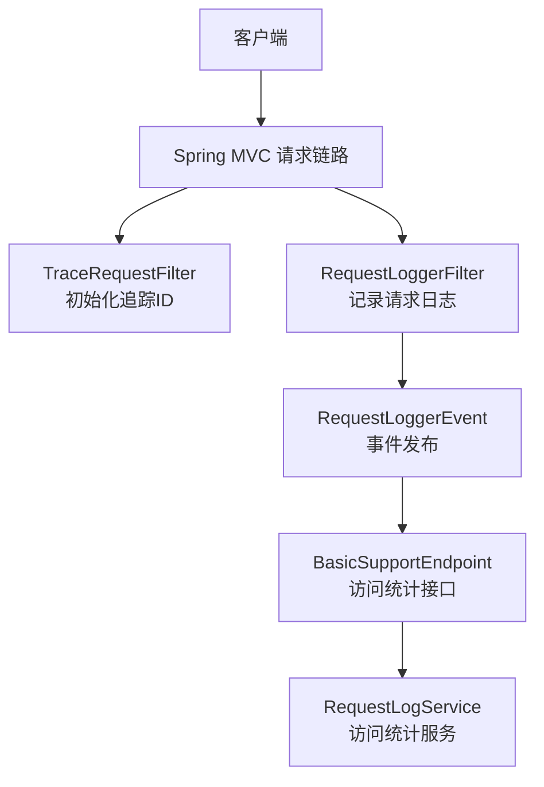
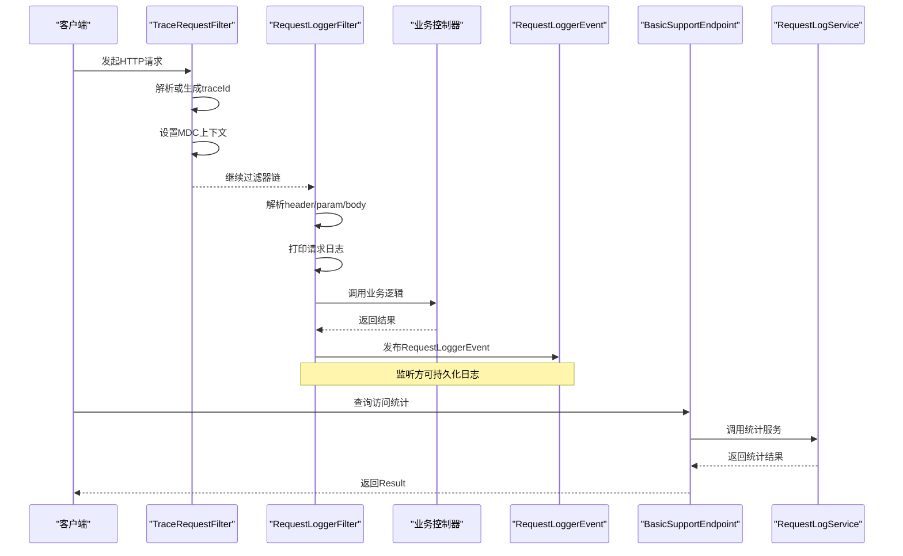
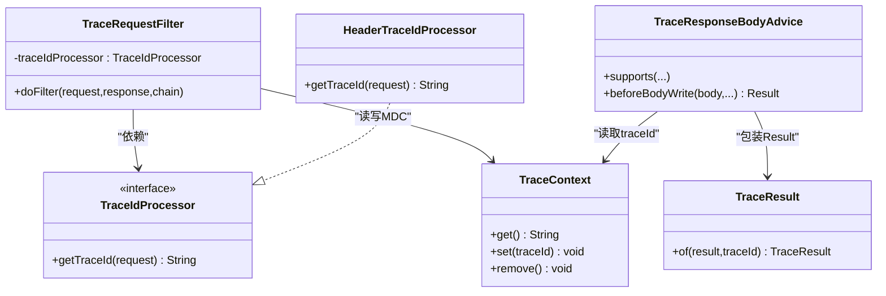
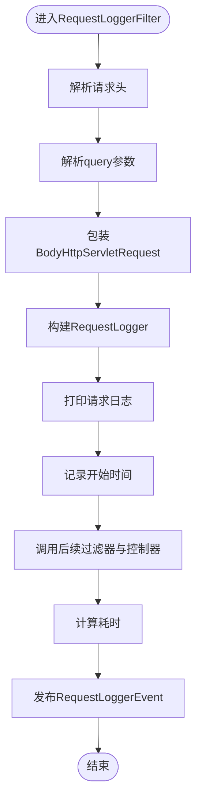
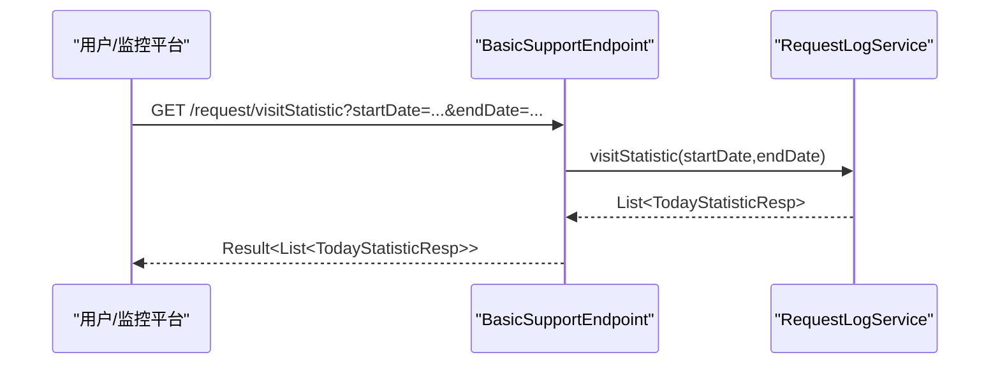
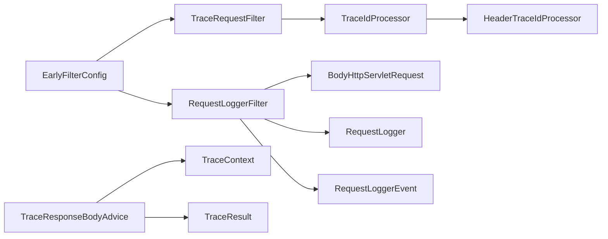

# 调试技巧与工具

<cite>
**本文引用的文件**   
- [RequestLoggerFilter.java](file://basic/src/main/java/com/cu/framework/basic/logger/RequestLoggerFilter.java)
- [TraceRequestFilter.java](file://basic/src/main/java/com/cu/framework/basic/logger/TraceRequestFilter.java)
- [LoggerConstant.java](file://basic/src/main/java/com/cu/framework/basic/logger/LoggerConstant.java)
- [RequestLogger.java](file://basic/src/main/java/com/cu/framework/basic/logger/request/RequestLogger.java)
- [BodyHttpServletRequest.java](file://basic/src/main/java/com/cu/framework/basic/logger/request/BodyHttpServletRequest.java)
- [RequestLoggerEvent.java](file://basic/src/main/java/com/cu/framework/basic/logger/request/RequestLoggerEvent.java)
- [TraceContext.java](file://basic/src/main/java/com/cu/framework/basic/logger/trace/TraceContext.java)
- [HeaderTraceIdProcessor.java](file://basic/src/main/java/com/cu/framework/basic/logger/trace/HeaderTraceIdProcessor.java)
- [TraceIdProcessor.java](file://basic/src/main/java/com/cu/framework/basic/logger/trace/TraceIdProcessor.java)
- [TraceResponseBodyAdvice.java](file://basic/src/main/java/com/cu/framework/basic/logger/trace/TraceResponseBodyAdvice.java)
- [TraceResult.java](file://basic/src/main/java/com/cu/framework/basic/logger/trace/TraceResult.java)
- [EarlyFilterConfig.java](file://boot/basic-spring-boot-starter/src/main/java/com/cu/framework/boot/basic/config/EarlyFilterConfig.java)
- [BasicSupportEndpoint.java](file://basic-support/src/main/java/com/cu/framework/basic/support/BasicSupportEndpoint.java)
- [RequestLogService.java](file://basic-support/src/main/java/com/cu/framework/basic/support/log/persistent/RequestLogService.java)
- [README-SSO.md](file://login-spring-boot-starter/login-spring-boot-starter/README-SSO.md)
</cite>

## 目录
1. [简介](#简介)
2. [项目结构](#项目结构)
3. [核心组件](#核心组件)
4. [架构总览](#架构总览)
5. [详细组件分析](#详细组件分析)
6. [依赖关系分析](#依赖关系分析)
7. [性能与可观测性](#性能与可观测性)
8. [网络请求与协议调试](#网络请求与协议调试)
9. [常见调试场景](#常见调试场景)
10. [结论](#结论)

## 简介
本指南面向 Kewen Framework 使用者，聚焦“如何高效定位和修复问题”。内容覆盖：
- 调整日志级别与格式：请求日志、追踪日志、权限审计日志。
- 启用 Spring Boot Actuator 端点并查看监控指标。
- 断点调试关键组件：权限拦截器、认证过滤器、AOP 切面等。
- 性能分析：CPU、内存、慢查询。
- 网络请求调试：OAuth2/SAML2 握手跟踪、令牌流转分析。
- 开启 Security 详细日志，观察认证授权决策过程。
- SQL 执行日志分析，排查数据权限注入问题。
- 典型调试案例：权限不生效、SSO 集成问题等。

## 项目结构
Kewen Framework 的调试能力主要分布在以下模块：
- basic：提供请求日志、追踪上下文、响应体包装等基础可观测能力。
- boot.basic-spring-boot-starter：将早期过滤器（追踪、请求日志）装配到容器。
- basic-support：暴露请求访问统计端点，并提供持久化监听扩展点。
- login-spring-boot-starter：统一身份认证与 SSO 集成能力，包含 OAuth2、SAML2 相关实现与文档。

**图示来源**
- [TraceRequestFilter.java:1-60](file://basic/src/main/java/com/cu/framework/basic/logger/TraceRequestFilter.java#L1-L60)
- [RequestLoggerFilter.java:1-133](file://basic/src/main/java/com/cu/framework/basic/logger/RequestLoggerFilter.java#L1-L133)
- [RequestLoggerEvent.java:1-23](file://basic/src/main/java/com/cu/framework/basic/logger/request/RequestLoggerEvent.java#L1-L23)
- [BasicSupportEndpoint.java:1-46](file://basic-support/src/main/java/com/cu/framework/basic/support/BasicSupportEndpoint.java#L1-L46)
- [RequestLogService.java:1-60](file://basic-support/src/main/java/com/cu/framework/basic/support/log/persistent/RequestLogService.java#L1-L60)

**章节来源**
- [TraceRequestFilter.java:1-60](file://basic/src/main/java/com/cu/framework/basic/logger/TraceRequestFilter.java#L1-L60)
- [RequestLoggerFilter.java:1-133](file://basic/src/main/java/com/cu/framework/basic/logger/RequestLoggerFilter.java#L1-L133)
- [BasicSupportEndpoint.java:1-46](file://basic-support/src/main/java/com/cu/framework/basic/support/BasicSupportEndpoint.java#L1-L46)
- [RequestLogService.java:1-60](file://basic-support/src/main/java/com/cu/framework/basic/support/log/persistent/RequestLogService.java#L1-L60)

## 核心组件
- 追踪上下文与过滤链
  - TraceRequestFilter：在请求进入时生成或复用 traceId，写入 MDC 上下文，供后续日志使用。
  - TraceContext：对 MDC 中 traceId 的读写封装。
  - HeaderTraceIdProcessor：默认从请求头读取 traceId，缺失则生成随机 ID。
  - TraceIdProcessor：自定义 traceId 策略的可插拔接口。
- 请求日志与事件
  - RequestLoggerFilter：解析请求头、参数、JSON Body，记录日志并发布 RequestLoggerEvent。
  - BodyHttpServletRequest：缓存 JSON body，支持重复读取。
  - RequestLogger：请求日志模型，包含 traceId、URL、方法、参数、body、IP、headers、耗时等。
  - RequestLoggerEvent：Spring 应用事件，供监听方做持久化或转发。
- 启动器装配
  - EarlyFilterConfig：注册 TraceRequestFilter、RequestLoggerFilter 与 EarlyRequestFilterProxy。
- 访问统计端点
  - BasicSupportEndpoint：对外暴露 /request/visitStatistic，按日期区间统计独立 IP 与用户数。
  - RequestLogService：基于 sys_request_log 表进行统计聚合。

**章节来源**
- [TraceRequestFilter.java:1-60](file://basic/src/main/java/com/cu/framework/basic/logger/TraceRequestFilter.java#L1-L60)
- [TraceContext.java:1-22](file://basic/src/main/java/com/cu/framework/basic/logger/trace/TraceContext.java#L1-L22)
- [HeaderTraceIdProcessor.java:1-27](file://basic/src/main/java/com/cu/framework/basic/logger/trace/HeaderTraceIdProcessor.java#L1-L27)
- [TraceIdProcessor.java:1-18](file://basic/src/main/java/com/cu/framework/basic/logger/trace/TraceIdProcessor.java#L1-L18)
- [RequestLoggerFilter.java:1-133](file://basic/src/main/java/com/cu/framework/basic/logger/RequestLoggerFilter.java#L1-L133)
- [BodyHttpServletRequest.java:1-117](file://basic/src/main/java/com/cu/framework/basic/logger/request/BodyHttpServletRequest.java#L1-L117)
- [RequestLogger.java:1-40](file://basic/src/main/java/com/cu/framework/basic/logger/request/RequestLogger.java#L1-L40)
- [RequestLoggerEvent.java:1-23](file://basic/src/main/java/com/cu/framework/basic/logger/request/RequestLoggerEvent.java#L1-L23)
- [EarlyFilterConfig.java:1-47](file://boot/basic-spring-boot-starter/src/main/java/com/cu/framework/boot/basic/config/EarlyFilterConfig.java#L1-L47)
- [BasicSupportEndpoint.java:1-46](file://basic-support/src/main/java/com/cu/framework/basic/support/BasicSupportEndpoint.java#L1-L46)
- [RequestLogService.java:1-60](file://basic-support/src/main/java/com/cu/framework/basic/support/log/persistent/RequestLogService.java#L1-L60)

## 架构总览
下面的序列图展示了单次 HTTP 请求经过框架时的关键路径：追踪上下文建立、请求日志记录、事件发布与统计查询。

**图示来源**
- [TraceRequestFilter.java:1-60](file://basic/src/main/java/com/cu/framework/basic/logger/TraceRequestFilter.java#L1-L60)
- [RequestLoggerFilter.java:1-133](file://basic/src/main/java/com/cu/framework/basic/logger/RequestLoggerFilter.java#L1-L133)
- [RequestLoggerEvent.java:1-23](file://basic/src/main/java/com/cu/framework/basic/logger/request/RequestLoggerEvent.java#L1-L23)
- [BasicSupportEndpoint.java:1-46](file://basic-support/src/main/java/com/cu/framework/basic/support/BasicSupportEndpoint.java#L1-L46)
- [RequestLogService.java:1-60](file://basic-support/src/main/java/com/cu/framework/basic/support/log/persistent/RequestLogService.java#L1-L60)

## 详细组件分析

### 追踪上下文与响应包装
- TraceRequestFilter
  - 作用：最早执行的早期过滤器之一，负责从请求头获取或生成 traceId，写入 MDC。
  - 可插拔：通过 ObjectProvider<TraceIdProcessor> 支持自定义策略；未注册时使用 HeaderTraceIdProcessor。
  - 清理：finally 中移除 MDC 中的 traceId，避免线程复用污染。
- HeaderTraceIdProcessor
  - 默认策略：优先从请求头读取 traceId；若缺失，生成无连字符 UUID。
- TraceContext
  - 封装 MDC 的 get/set/remove，常量键 LoggerConstant.TRACE_ID_KEY。
- TraceResponseBodyAdvice 与 TraceResult
  - ResponseBodyAdvice 仅拦截返回类型为 Result 的接口，在写出前将当前 traceId 附加到 TraceResult。
  - TraceResult 继承 Result，新增 traceId 字段，便于前端或网关关联请求与响应。

**图示来源**
- [TraceRequestFilter.java:1-60](file://basic/src/main/java/com/cu/framework/basic/logger/TraceRequestFilter.java#L1-L60)
- [HeaderTraceIdProcessor.java:1-27](file://basic/src/main/java/com/cu/framework/basic/logger/trace/HeaderTraceIdProcessor.java#L1-L27)
- [TraceIdProcessor.java:1-18](file://basic/src/main/java/com/cu/framework/basic/logger/trace/TraceIdProcessor.java#L1-L18)
- [TraceContext.java:1-22](file://basic/src/main/java/com/cu/framework/basic/logger/trace/TraceContext.java#L1-L22)
- [TraceResponseBodyAdvice.java:1-42](file://basic/src/main/java/com/cu/framework/basic/logger/trace/TraceResponseBodyAdvice.java#L1-L42)
- [TraceResult.java:1-39](file://basic/src/main/java/com/cu/framework/basic/logger/trace/TraceResult.java#L1-L39)

**章节来源**
- [TraceRequestFilter.java:1-60](file://basic/src/main/java/com/cu/framework/basic/logger/TraceRequestFilter.java#L1-L60)
- [HeaderTraceIdProcessor.java:1-27](file://basic/src/main/java/com/cu/framework/basic/logger/trace/HeaderTraceIdProcessor.java#L1-L27)
- [TraceContext.java:1-22](file://basic/src/main/java/com/cu/framework/basic/logger/trace/TraceContext.java#L1-L22)
- [TraceResponseBodyAdvice.java:1-42](file://basic/src/main/java/com/cu/framework/basic/logger/trace/TraceResponseBodyAdvice.java#L1-L42)
- [TraceResult.java:1-39](file://basic/src/main/java/com/cu/framework/basic/logger/trace/TraceResult.java#L1-L39)

### 请求日志与持久化事件
- RequestLoggerFilter
  - 职责：解析请求头、query 参数、JSON body，组装 RequestLogger；记录日志；计算耗时；发布 RequestLoggerEvent。
  - 顺序：@Order(3)，属于早期过滤器，早于多数业务处理。
  - 关键点：BodyHttpServletRequest 用于缓存 JSON body，以便多次读取。
- BodyHttpServletRequest
  - 行为：仅当 Content-Type 为 application/json 开头时缓存 body；否则直接透传原始输入流。
- RequestLogger
  - 字段：traceId、url、method、params、body、ip、headers、execMillisecond。
- RequestLoggerEvent
  - 用途：将 RequestLogger 作为事件载荷，供监听方做数据库持久化、消息队列发送等。

**图示来源**
- [RequestLoggerFilter.java:1-133](file://basic/src/main/java/com/cu/framework/basic/logger/RequestLoggerFilter.java#L1-L133)
- [BodyHttpServletRequest.java:1-117](file://basic/src/main/java/com/cu/framework/basic/logger/request/BodyHttpServletRequest.java#L1-L117)
- [RequestLogger.java:1-40](file://basic/src/main/java/com/cu/framework/basic/logger/request/RequestLogger.java#L1-L40)
- [RequestLoggerEvent.java:1-23](file://basic/src/main/java/com/cu/framework/basic/logger/request/RequestLoggerEvent.java#L1-L23)

**章节来源**
- [RequestLoggerFilter.java:1-133](file://basic/src/main/java/com/cu/framework/basic/logger/RequestLoggerFilter.java#L1-L133)
- [BodyHttpServletRequest.java:1-117](file://basic/src/main/java/com/cu/framework/basic/logger/request/BodyHttpServletRequest.java#L1-L117)
- [RequestLogger.java:1-40](file://basic/src/main/java/com/cu/framework/basic/logger/request/RequestLogger.java#L1-L40)
- [RequestLoggerEvent.java:1-23](file://basic/src/main/java/com/cu/framework/basic/logger/request/RequestLoggerEvent.java#L1-L23)

### 启动器装配与早期过滤器
- EarlyFilterConfig
  - 注册 TraceRequestFilter、RequestLoggerFilter，以及 EarlyRequestFilterProxy，确保追踪与请求日志在业务之前执行。
  - 通过 ObjectProvider 注入自定义 TraceIdProcessor，保持可扩展性。

**章节来源**
- [EarlyFilterConfig.java:1-47](file://boot/basic-spring-boot-starter/src/main/java/com/cu/framework/boot/basic/config/EarlyFilterConfig.java#L1-L47)

### 访问统计端点
- BasicSupportEndpoint
  - GET /request/visitStatistic，支持 startDate、endDate 可选参数；默认查询当天。
  - 返回 Result<List<TodayStatisticResp>>。
- RequestLogService
  - 基于 sys_request_log 表，按天分组统计独立 IP 与独立用户数。
  - 区间查询闭区间：[startDate 00:00, endDate+1 天 00:00)。

**图示来源**
- [BasicSupportEndpoint.java:1-46](file://basic-support/src/main/java/com/cu/framework/basic/support/BasicSupportEndpoint.java#L1-L46)
- [RequestLogService.java:1-60](file://basic-support/src/main/java/com/cu/framework/basic/support/log/persistent/RequestLogService.java#L1-L60)

**章节来源**
- [BasicSupportEndpoint.java:1-46](file://basic-support/src/main/java/com/cu/framework/basic/support/BasicSupportEndpoint.java#L1-L46)
- [RequestLogService.java:1-60](file://basic-support/src/main/java/com/cu/framework/basic/support/log/persistent/RequestLogService.java#L1-L60)

## 依赖关系分析
- 过滤器依赖
  - TraceRequestFilter 依赖 TraceIdProcessor（可替换），默认使用 HeaderTraceIdProcessor。
  - RequestLoggerFilter 依赖 BodyHttpServletRequest、RequestLogger、ApplicationEventPublisher。
  - 两者均通过 EarlyFilterConfig 注册。
- 上下文依赖
  - TraceContext 依赖 LoggerConstant.TRACE_ID_KEY 作为 MDC 键。
  - TraceResponseBodyAdvice 依赖 TraceContext 读取 traceId，并将 Result 包装为 TraceResult。
- 持久化扩展点
  - RequestLoggerEvent 是松耦合扩展点，监听方可根据需求实现数据库持久化、消息发送等。

**图示来源**
- [TraceRequestFilter.java:1-60](file://basic/src/main/java/com/cu/framework/basic/logger/TraceRequestFilter.java#L1-L60)
- [HeaderTraceIdProcessor.java:1-27](file://basic/src/main/java/com/cu/framework/basic/logger/trace/HeaderTraceIdProcessor.java#L1-L27)
- [RequestLoggerFilter.java:1-133](file://basic/src/main/java/com/cu/framework/basic/logger/RequestLoggerFilter.java#L1-L133)
- [BodyHttpServletRequest.java:1-117](file://basic/src/main/java/com/cu/framework/basic/logger/request/BodyHttpServletRequest.java#L1-L117)
- [RequestLogger.java:1-40](file://basic/src/main/java/com/cu/framework/basic/logger/request/RequestLogger.java#L1-L40)
- [RequestLoggerEvent.java:1-23](file://basic/src/main/java/com/cu/framework/basic/logger/request/RequestLoggerEvent.java#L1-L23)
- [EarlyFilterConfig.java:1-47](file://boot/basic-spring-boot-starter/src/main/java/com/cu/framework/boot/basic/config/EarlyFilterConfig.java#L1-L47)
- [TraceResponseBodyAdvice.java:1-42](file://basic/src/main/java/com/cu/framework/basic/logger/trace/TraceResponseBodyAdvice.java#L1-L42)
- [TraceContext.java:1-22](file://basic/src/main/java/com/cu/framework/basic/logger/trace/TraceContext.java#L1-L22)
- [TraceResult.java:1-39](file://basic/src/main/java/com/cu/framework/basic/logger/trace/TraceResult.java#L1-L39)

**章节来源**
- [TraceRequestFilter.java:1-60](file://basic/src/main/java/com/cu/framework/basic/logger/TraceRequestFilter.java#L1-L60)
- [RequestLoggerFilter.java:1-133](file://basic/src/main/java/com/cu/framework/basic/logger/RequestLoggerFilter.java#L1-L133)
- [EarlyFilterConfig.java:1-47](file://boot/basic-spring-boot-starter/src/main/java/com/cu/framework/boot/basic/config/EarlyFilterConfig.java#L1-L47)
- [TraceResponseBodyAdvice.java:1-42](file://basic/src/main/java/com/cu/framework/basic/logger/trace/TraceResponseBodyAdvice.java#L1-L42)

## 性能与可观测性

### 日志级别与格式调整
- 请求日志
  - RequestLoggerFilter 使用 SLF4J 输出 info 级日志，包含 IP、URL、方法、params、body。
  - 建议：生产环境按需降低频率或关闭敏感 body 日志；开发环境保留完整信息以辅助定位。
- 追踪日志
  - TraceRequestFilter 将 traceId 写入 MDC；建议在日志格式中加入 %X{traceId}，以便统一检索。
  - 可通过自定义 TraceIdProcessor 接入外部追踪系统（如链路追踪平台）。
- 权限审计日志
  - 权限相关日志通常由安全模块输出；结合 MDC 中的 traceId，可将权限判断、数据范围注入、菜单访问控制等日志与请求关联。

### Spring Boot Actuator 端点
- 启用方式
  - 引入 spring-boot-starter-actuator 依赖。
  - 在配置文件中开启需要暴露的端点，例如 health、info、metrics、env、beans、httptrace 等。
- 常用指标
  - /actuator/metrics：查看 JVM、系统、应用层指标。
  - /actuator/health：查看健康检查状态。
  - /actuator/info：查看应用元信息。
- 结合框架
  - 可在 actuator 输出中结合 traceId 与业务日志，形成端到端可观测链路。

### 断点调试关键组件
- 权限拦截器
  - 在权限校验逻辑处打断点，观察当前用户、角色、资源、权限规则匹配情况。
- 认证过滤器
  - 在认证过滤器入口与成功/失败分支打断点，确认认证流程是否进入预期分支。
- AOP 切面
  - 在切点表达式匹配的类或方法上打断点，验证切面是否触发、参数与返回值是否符合预期。

### 性能分析工具
- CPU 使用率分析
  - 使用 jstack 抓取线程快照，结合 top 或 perf 定位热点线程与方法。
- 内存泄漏检测
  - 使用 jmap 导出堆转储，用 MAT 或 VisualVM 分析大对象与引用链。
- 慢查询识别
  - 开启 MyBatis/SQL 日志，结合 slow query log 与数据库 EXPLAIN 分析执行计划。
  - 结合 RequestLogger.execMillisecond 与 SQL 日志 traceId 关联请求与 SQL。

**章节来源**
- [RequestLoggerFilter.java:1-133](file://basic/src/main/java/com/cu/framework/basic/logger/RequestLoggerFilter.java#L1-L133)
- [TraceRequestFilter.java:1-60](file://basic/src/main/java/com/cu/framework/basic/logger/TraceRequestFilter.java#L1-L60)
- [TraceContext.java:1-22](file://basic/src/main/java/com/cu/framework/basic/logger/trace/TraceContext.java#L1-L22)

## 网络请求与协议调试

### OAuth2/SAML2 握手跟踪
- 启用调试日志
  - 将 Spring Security、OAuth2、SAML2 相关包设为 debug 级别，观察握手、重定向、回调、令牌交换等流程。
- 抓包与签名校验
  - 使用浏览器开发者工具或 Wireshark/TCPDump 抓包，核对请求头、签名、nonce、timestamp 等参数。
- 令牌流转分析
  - 关注 access_token、refresh_token、id_token 的获取、刷新、注销流程。
  - 结合 traceId 与各阶段日志，串联跨服务的令牌传递。

### Security 详细日志
- 开启 Security 调试日志后，可看到：
  - 认证管理器尝试的认证提供者。
  - 授权决策器的决策过程（permit/deny/abstain）。
  - 资源访问控制是否命中特定规则。
- 常见问题定位
  - 未登录访问被拒绝：检查认证过滤器是否放行、会话是否正确创建。
  - 权限不生效：检查授权决策器是否加载正确角色/权限数据。

### SQL 执行日志分析
- 开启 SQL 日志
  - 配置 MyBatis 或 JPA 日志级别为 debug，打印 SQL、参数与执行时间。
- 数据权限注入排查
  - 结合 traceId 定位具体请求对应的 SQL。
  - 检查数据范围注解、拦截器是否注入 WHERE 条件。
  - 对比预期数据与返回数据，确认权限过滤是否生效。

**章节来源**
- [README-SSO.md](file://login-spring-boot-starter/login-spring-boot-starter/README-SSO.md)

## 常见调试场景

### 权限不生效
- 现象
  - 用户登录后访问受限资源仍被拒绝，或不应放行的资源被放行。
- 排查步骤
  - 开启 Security debug 日志，确认认证与授权决策过程。
  - 在权限拦截器与授权决策器处打断点，检查当前用户、角色、资源标识。
  - 检查权限数据源（角色-权限、菜单-权限）是否正确加载。
  - 使用 BasicSupportEndpoint 的访问统计接口，确认该请求是否被记录、traceId 是否一致。

### SSO 集成问题
- 现象
  - 单点登录无法跳转、回调失败、令牌无效或用户信息不一致。
- 排查步骤
  - 开启 OAuth2/SAML2 调试日志，观察授权服务器交互。
  - 核对 client_id、client_secret、redirect_uri、scopes、metadata 配置。
  - 抓包分析重定向 URL、签名、state/nonce 参数。
  - 检查本地会话与远程令牌的生命周期管理。

### 请求日志缺失或 body 为空
- 现象
  - 控制台未打印请求日志，或 body 字段为 null。
- 排查步骤
  - 确认 RequestLoggerFilter 已注册且执行顺序靠前。
  - 检查 Content-Type 是否为 application/json；非 JSON 不会缓存 body。
  - 检查是否存在其他过滤器提前消费输入流导致不可重复读取。

### 访问统计结果为空
- 现象
  - /request/visitStatistic 返回空列表。
- 排查步骤
  - 确认 sys_request_log 表有数据。
  - 检查 RequestLogService 的日期区间查询是否正确。
  - 确认 RequestLoggerEvent 监听器已将日志持久化至数据库。

**章节来源**
- [BasicSupportEndpoint.java:1-46](file://basic-support/src/main/java/com/cu/framework/basic/support/BasicSupportEndpoint.java#L1-L46)
- [RequestLogService.java:1-60](file://basic-support/src/main/java/com/cu/framework/basic/support/log/persistent/RequestLogService.java#L1-L60)
- [RequestLoggerFilter.java:1-133](file://basic/src/main/java/com/cu/framework/basic/logger/RequestLoggerFilter.java#L1-L133)
- [BodyHttpServletRequest.java:1-117](file://basic/src/main/java/com/cu/framework/basic/logger/request/BodyHttpServletRequest.java#L1-L117)

## 结论
Kewen Framework 通过早期过滤器与事件机制提供了稳定的请求日志与追踪能力，并通过 BasicSupportEndpoint 暴露访问统计接口，便于快速掌握系统负载趋势。配合 Spring Security 的调试日志、Actuator 指标与主流性能分析工具，可以高效定位权限、认证、网络与数据库相关问题。建议在开发环境开启详细日志，在生产环境选择性地启用必要指标与审计日志，并结合 traceId 构建端到端的可观测链路。