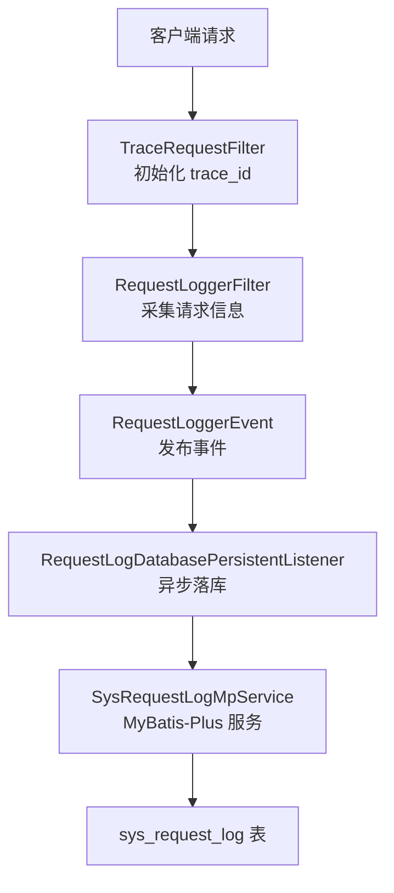
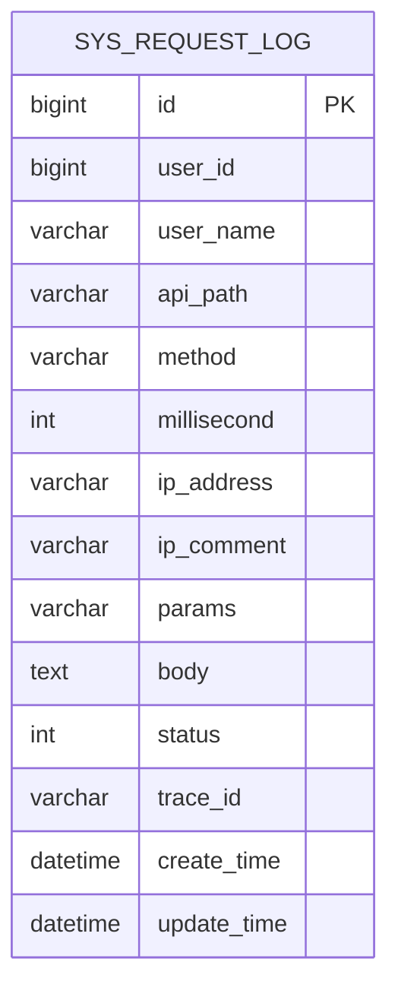
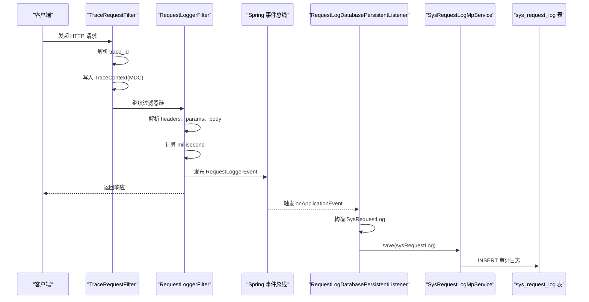

# 审计日志表结构

<cite>
**本文引用的文件**   
- [docs/sql/basic-support.sql](file://docs/sql/basic-support.sql)
- [SysRequestLog.java](file://basic-support/src/main/java/com/cu/framework/basic/support/mp/entity/SysRequestLog.java)
- [RequestLogDatabasePersistentListener.java](file://basic-support/src/main/java/com/cu/framework/basic/support/log/RequestLogDatabasePersistentListener.java)
- [TraceRequestFilter.java](file://basic/src/main/java/com/cu/framework/basic/logger/TraceRequestFilter.java)
- [RequestLoggerFilter.java](file://basic/src/main/java/com/cu/framework/basic/logger/RequestLoggerFilter.java)
- [TraceContext.java](file://basic/src/main/java/com/cu/framework/basic/logger/trace/TraceContext.java)
- [RequestIpUtil.java](file://basic/src/main/java/com/cu/framework/basic/utils/RequestIpUtil.java)
- [SysRequestLogMpService.java](file://basic-support/src/main/java/com/cu/framework/basic/support/mp/service/SysRequestLogMpService.java)
- [docs/application.yml](file://docs/application.yml)
</cite>

## 目录
1. [引言](#引言)
2. [项目结构与定位](#项目结构与定位)
3. [核心数据模型与字段规范](#核心数据模型与字段规范)
4. [请求日志采集与持久化流程](#请求日志采集与持久化流程)
5. [关键审计字段说明](#关键审计字段说明)
6. [存储策略、归档与清理](#存储策略归档与清理)
7. [性能特征与优化建议](#性能特征与优化建议)
8. [日志查询与分析最佳实践](#日志查询与分析最佳实践)
9. [监控告警配置建议](#监控告警配置建议)
10. [故障排查要点](#故障排查要点)
11. [结论](#结论)

## 引言
本文聚焦 Kewen Framework 中的审计日志能力，围绕 `sys_request_log` 表结构展开，说明该表如何记录用户信息、API 调用轨迹、请求参数、响应状态、耗时统计和追踪号等关键审计维度。文档同时给出日志采集链路、异步落库机制、字段语义、索引与归档建议、常见分析 SQL 以及监控告警思路，帮助运维、开发和审计人员在不直接阅读源码的情况下理解并正确使用该审计体系。

## 项目结构与定位
`sys_request_log` 属于基础支撑层的能力：
- 数据库建表脚本位于 `docs/sql/basic-support.sql`。
- 实体映射类位于 `basic-support` 模块的 MyBatis-Plus 实体中。
- 日志采集由 `basic` 模块的过滤器完成。
- 异步持久化监听器位于 `basic-support` 模块。
- 全局跟踪号初始化由 `basic` 模块的过滤器与 MDC 上下文配合实现。
- 客户端 IP 解析工具在 `basic` 模块的工具类中提供。
- 是否启用数据库持久化通过配置文件控制。

**图表来源**
- [TraceRequestFilter.java:1-60](file://basic/src/main/java/com/cu/framework/basic/logger/TraceRequestFilter.java#L1-L60)
- [RequestLoggerFilter.java:1-133](file://basic/src/main/java/com/cu/framework/basic/logger/RequestLoggerFilter.java#L1-L133)
- [RequestLogDatabasePersistentListener.java:1-66](file://basic-support/src/main/java/com/cu/framework/basic/support/log/RequestLogDatabasePersistentListener.java#L1-L66)
- [SysRequestLogMpService.java:1-17](file://basic-support/src/main/java/com/cu/framework/basic/support/mp/service/SysRequestLogMpService.java#L1-L17)
- [docs/sql/basic-support.sql:53-79](file://docs/sql/basic-support.sql#L53-L79)

**章节来源**
- [docs/sql/basic-support.sql:53-79](file://docs/sql/basic-support.sql#L53-L79)
- [SysRequestLog.java:1-123](file://basic-support/src/main/java/com/cu/framework/basic/support/mp/entity/SysRequestLog.java#L1-L123)
- [RequestLoggerFilter.java:1-133](file://basic/src/main/java/com/cu/framework/basic/logger/RequestLoggerFilter.java#L1-L133)
- [RequestLogDatabasePersistentListener.java:1-66](file://basic-support/src/main/java/com/cu/framework/basic/support/log/RequestLogDatabasePersistentListener.java#L1-L66)

## 核心数据模型与字段规范
`sys_request_log` 用于记录每次 HTTP 请求的审计信息，主键为自增 `id`。对应 Java 实体 `SysRequestLog` 使用 MyBatis-Plus 注解映射到该表，并继承 `Model<SysRequestLog>` 以支持 ActiveRecord 模式。

| 字段 | 类型 | 可空 | 默认值 | 业务含义 | 备注 |
|---|---|---:|---|---|---|
| `id` | bigint | 否 | 自增 | 主键 | 推荐作为分片或分区键的一部分，便于按时间归档 |
| `user_id` | bigint | 是 | NULL | 用户标识 | 当前实现未自动填充，需上层鉴权逻辑补充 |
| `user_name` | varchar(64) | 是 | NULL | 用户姓名 | 当前实现未自动填充，需上层鉴权逻辑补充 |
| `api_path` | varchar(255) | 是 | NULL | API 路径 | 对应 `request.getRequestURI()` |
| `method` | varchar(32) | 是 | NULL | HTTP 方法 | GET、POST、PUT、DELETE 等 |
| `millisecond` | int | 是 | NULL | 请求耗时（毫秒） | 从请求开始到过滤链结束的时间差 |
| `ip_address` | varchar(64) | 是 | NULL | 客户端 IP | 优先从代理头获取，回退到远端地址 |
| `ip_comment` | varchar(64) | 是 | NULL | IP 描述 | 当前持久化固定为空字符串，可用于扩展归属地或网络区域标记 |
| `params` | varchar(512) | 是 | NULL | URL 参数快照 | 多值参数会转为数组结构再序列化 |
| `body` | text | 是 | NULL | 请求体快照 | JSON 字符串形式入库；大 body 可能影响写入性能 |
| `status` | int | 是 | NULL | 请求状态 | 当前实现未设置具体状态码，可结合业务扩展 |
| `trace_id` | varchar(64) | 是 | NULL | 请求跟踪号 | 来自 `TraceContext`，跨组件串联一次请求 |
| `create_time` | datetime | 否 | 当前时间 | 记录创建时间 | 主要审计时间戳 |
| `update_time` | datetime | 否 | 自动更新 | 记录更新时间 | 审计场景下通常不变 |

**图表来源**
- [docs/sql/basic-support.sql:53-79](file://docs/sql/basic-support.sql#L53-L79)
- [SysRequestLog.java:1-123](file://basic-support/src/main/java/com/cu/framework/basic/support/mp/entity/SysRequestLog.java#L1-L123)

**章节来源**
- [docs/sql/basic-support.sql:53-79](file://docs/sql/basic-support.sql#L53-L79)
- [SysRequestLog.java:1-123](file://basic-support/src/main/java/com/cu/framework/basic/support/mp/entity/SysRequestLog.java#L1-L123)

## 请求日志采集与持久化流程
整个审计日志流程分为“采集”和“持久化”两段：

1. **初始化跟踪号**  
   `TraceRequestFilter` 在请求进入时从上游传递的请求头解析 `trace_id`，写入 `TraceContext`（基于 SLF4J MDC），并在请求结束时清理。若容器未注册自定义处理器，则默认使用基于请求头的处理器。

2. **采集请求信息**  
   `RequestLoggerFilter` 负责：
   - 读取请求头、URL、HTTP 方法。
   - 解析 URL 参数并序列化为字符串。
   - 包装请求以支持重复读取 body，并将 body 解析为对象后序列化为 JSON 字符串。
   - 计算请求耗时：记录开始时间，执行完业务过滤链后计算毫秒差。
   - 将采集结果封装成 `RequestLogger`，并发布 `RequestLoggerEvent`。

3. **异步持久化到数据库**  
   `RequestLogDatabasePersistentListener` 监听日志事件，使用 `@Async` 异步保存。它从事件携带的 `RequestLogger` 构造 `SysRequestLog`，并从事件数据中取得 `traceId`，避免异步线程丢失 ThreadLocal。最终通过 `SysRequestLogMpService` 调用 MyBatis-Plus 插入记录。

**图表来源**
- [TraceRequestFilter.java:1-60](file://basic/src/main/java/com/cu/framework/basic/logger/TraceRequestFilter.java#L1-L60)
- [TraceContext.java:1-22](file://basic/src/main/java/com/cu/framework/basic/logger/trace/TraceContext.java#L1-L22)
- [RequestLoggerFilter.java:1-133](file://basic/src/main/java/com/cu/framework/basic/logger/RequestLoggerFilter.java#L1-L133)
- [RequestLogDatabasePersistentListener.java:1-66](file://basic-support/src/main/java/com/cu/framework/basic/support/log/RequestLogDatabasePersistentListener.java#L1-L66)
- [SysRequestLogMpService.java:1-17](file://basic-support/src/main/java/com/cu/framework/basic/support/mp/service/SysRequestLogMpService.java#L1-L17)
- [docs/sql/basic-support.sql:53-79](file://docs/sql/basic-support.sql#L53-L79)

**章节来源**
- [TraceRequestFilter.java:1-60](file://basic/src/main/java/com/cu/framework/basic/logger/TraceRequestFilter.java#L1-L60)
- [TraceContext.java:1-22](file://basic/src/main/java/com/cu/framework/basic/logger/trace/TraceContext.java#L1-L22)
- [RequestLoggerFilter.java:1-133](file://basic/src/main/java/com/cu/framework/basic/logger/RequestLoggerFilter.java#L1-L133)
- [RequestLogDatabasePersistentListener.java:1-66](file://basic-support/src/main/java/com/cu/framework/basic/support/log/RequestLogDatabasePersistentListener.java#L1-L66)

## 关键审计字段说明

### 用户信息记录
- `user_id`、`user_name` 用于关联系统用户。
- 当前采集链路没有自动填充这两个字段，需要在上层鉴权、安全上下文或业务拦截器中将当前用户信息注入到日志对象。
- 建议在统一认证或权限模块中扩展 `RequestLogger` 或监听器，使其在落库前补全用户信息。

### API 调用追踪
- `api_path` 记录接口路径，适合按接口维度统计访问量、失败率与慢接口。
- `method` 区分 HTTP 方法，便于对写接口进行更严格的审计。
- `trace_id` 贯穿整次请求，适合做端到端排障和关联调用链。

### 请求参数捕获
- `params` 记录 URL 参数，适用于表单提交、GET 参数等轻量参数场景。
- `body` 记录请求体，并以 JSON 字符串存储，适合 RESTful JSON 接口。
- 注意：当请求体较大时，JSON 序列化会增加 CPU 和内存压力，应评估是否需要采样或截断。

### 响应状态记录
- `status` 表示成功或失败，但当前实现未赋值，因此默认可能为空。
- 建议在业务异常处理或响应增强阶段填充状态码，例如 200、401、403、500 等，以便直接统计错误率。

### 其他重要字段
- `millisecond`：请求总耗时，用于识别慢接口和性能瓶颈。
- `ip_address`：客户端真实 IP，支持多级代理头。
- `ip_comment`：IP 描述字段，当前固定为空，可作为扩展点记录地域、机房、内部网段等。
- `create_time`：记录创建时间，是审计查询的主要时间维度。

**章节来源**
- [RequestLoggerFilter.java:1-133](file://basic/src/main/java/com/cu/framework/basic/logger/RequestLoggerFilter.java#L1-L133)
- [RequestLogDatabasePersistentListener.java:1-66](file://basic-support/src/main/java/com/cu/framework/basic/support/log/RequestLogDatabasePersistentListener.java#L1-L66)
- [RequestIpUtil.java:1-46](file://basic/src/main/java/com/cu/framework/basic/utils/RequestIpUtil.java#L1-L46)

## 存储策略、归档与清理
### 存储策略
- 表结构未定义额外索引，仅依赖主键 `id`。
- 所有请求都会尝试落库，实际写入行为受配置开关控制：`cu.request.persistent.database` 为 `false` 时不启用数据库持久化。
- `ip_comment` 当前实现固定为空，如需扩展请修改监听器或增加外部数据源。

### 归档建议
由于日志增长较快，建议按时间维度归档：
- 按月或按季度拆分物理表，如 `sys_request_log_2026_10`。
- 将 `create_time` 作为分区键，或使用 MySQL 分区表功能。
- 将历史数据迁移至冷存储或数据仓库，保留热数据在在线库。

### 清理策略
- 删除超过保留期的旧数据，例如保留最近 90 天。
- 先归档再删除，避免长时间锁表。
- 对大 `body` 字段优先裁剪或删除敏感内容后再归档。
- 定期重建索引或优化表，减少碎片。

### 当前代码中的清理机制
当前仓库未提供定时清理任务或归档脚本。归档和清理应由应用外部的运维任务、数据库作业或专门的数据治理服务承担。

**章节来源**
- [docs/sql/basic-support.sql:53-79](file://docs/sql/basic-support.sql#L53-L79)
- [docs/application.yml:1-200](file://docs/application.yml#L1-L200)
- [RequestLogDatabasePersistentListener.java:1-66](file://basic-support/src/main/java/com/cu/framework/basic/support/log/RequestLogDatabasePersistentListener.java#L1-L66)

## 性能特征与优化建议
### 现有性能特征
- 日志持久化使用 Spring `@Async`，不会阻塞主请求线程。
- 请求体使用 Fastjson2 解析并再次序列化为 JSON 字符串，存在双重序列化开销。
- URL 参数和请求头会被遍历并转换为 Map 或字符串，高并发下有一定 CPU 消耗。
- 表缺少常用查询索引，按 `create_time`、`api_path`、`trace_id`、`ip_address` 查询可能产生全表扫描。

### 优化建议
- 在 `sys_request_log` 上建立复合索引：
  - `(create_time, api_path)`
  - `(create_time, trace_id)`
  - `(create_time, ip_address)`
  - `(trace_id)`
- 对 `body` 字段设置长度上限或采样策略，避免超大日志拖垮写入。
- 根据业务量开启异步线程池隔离，避免日志写入阻塞业务线程。
- 对高频接口考虑关闭 body 记录或只记录摘要。
- 将 `status` 填实，避免后续统计依赖业务侧推断。

**章节来源**
- [RequestLoggerFilter.java:1-133](file://basic/src/main/java/com/cu/framework/basic/logger/RequestLoggerFilter.java#L1-L133)
- [RequestLogDatabasePersistentListener.java:1-66](file://basic-support/src/main/java/com/cu/framework/basic/support/log/RequestLogDatabasePersistentListener.java#L1-L66)
- [docs/sql/basic-support.sql:53-79](file://docs/sql/basic-support.sql#L53-L79)

## 日志查询与分析最佳实践
以下示例面向 `sys_request_log` 表，假设已启用数据库持久化并填充必要字段。实际使用时请结合业务时间范围、租户和脱敏要求调整。

### 常见审计场景与 SQL 思路
- 按时间段查询接口访问记录  
  筛选 `create_time` 范围，并按 `api_path` 排序，便于观察某段时间内的接口调用情况。

- 查询某个用户的操作轨迹  
  使用 `user_id` 过滤，并结合 `api_path`、`method`、`create_time` 还原用户操作顺序。

- 按追踪号排查完整请求  
  使用 `trace_id` 精确查找一次请求的所有审计记录，尤其适合分布式链路排障。

- 统计接口成功率与失败率  
  依赖 `status` 字段聚合统计成功与失败数量；若未填充状态码，应先在业务层补齐。

- 定位慢接口  
  筛选 `millisecond` 大于阈值的记录，按 `api_path` 分组统计平均耗时、P95、P99。

- 按 IP 分析访问来源  
  使用 `ip_address` 统计访问来源分布，结合 `ip_comment` 扩展地域或网络区域信息。

### 查询注意事项
- 避免不带时间范围的 `SELECT *`，尽量限定 `create_time`。
- 对 `body` 字段查询要谨慎，文本字段不适合频繁全文检索。
- 审计查询建议走只读副本或 OLAP 引擎，避免影响在线库性能。
- 输出包含敏感参数时应脱敏，特别是密码、令牌、身份证号等。

[本节为通用查询实践说明，不直接分析特定代码文件]

## 监控告警配置建议
- **日志写入失败告警**  
  监听异步持久化过程中的异常，当数据库不可用或写入失败次数突增时告警。
- **高延迟告警**  
  统计单位时间内 `millisecond` 超阈值的比例，超过阈值时通知接口性能问题。
- **错误率告警**  
  若 `status` 被填充，可对失败状态占比设置阈值告警。
- **异常 IP 访问告警**  
  对异常 `ip_address` 或短时间内大量失败请求的来源 IP 进行限流和告警。
- **追踪号缺失告警**  
  若 `trace_id` 为空，说明上游链路未正确注入追踪号，应检查网关或前置过滤器。

[本节为通用监控建议，不直接分析特定代码文件]

## 故障排查要点
- **未生成数据库日志**  
  检查配置项 `cu.request.persistent.database` 是否为 `true`。默认值为 `false`，不开启则不会写入数据库。
- **trace_id 为空**  
  确认 `TraceRequestFilter` 是否生效，上游是否正确传递追踪号请求头，以及 `TraceContext` 是否在过滤器链中正确设置和清理。
- **body 过大导致性能问题**  
  检查业务接口是否上传大文件或直接记录大请求体；必要时改为只记录摘要或禁用 body 记录。
- **status 始终为空**  
  当前实现未设置该字段，需在业务异常处理或响应增强阶段填充状态码。
- **ip_address 不准确**  
  检查反向代理是否透传 `x-forwarded-for`、`X-Forwarded-For`、`X-Real-IP` 等头部；工具类会按固定优先级解析这些头部。

**章节来源**
- [docs/application.yml:1-200](file://docs/application.yml#L1-L200)
- [TraceRequestFilter.java:1-60](file://basic/src/main/java/com/cu/framework/basic/logger/TraceRequestFilter.java#L1-L60)
- [RequestLoggerFilter.java:1-133](file://basic/src/main/java/com/cu/framework/basic/logger/RequestLoggerFilter.java#L1-L133)
- [RequestIpUtil.java:1-46](file://basic/src/main/java/com/cu/framework/basic/utils/RequestIpUtil.java#L1-L46)

## 结论
`sys_request_log` 是 Kewen Framework 的基础审计表，能够记录请求路径、方法、耗时、IP、参数、请求体和追踪号等核心审计维度。其优势在于通过过滤器采集、事件驱动和异步持久化降低对主流程的影响；不足在于当前实现未自动填充用户信息、状态码和部分描述字段，且表结构缺少常用索引。生产环境建议结合业务需求补全关键字段、建立合理索引、实施时间维度的归档与清理策略，并通过监控告警保障审计数据的可用性和可追溯性。