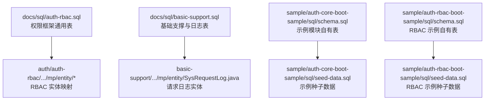
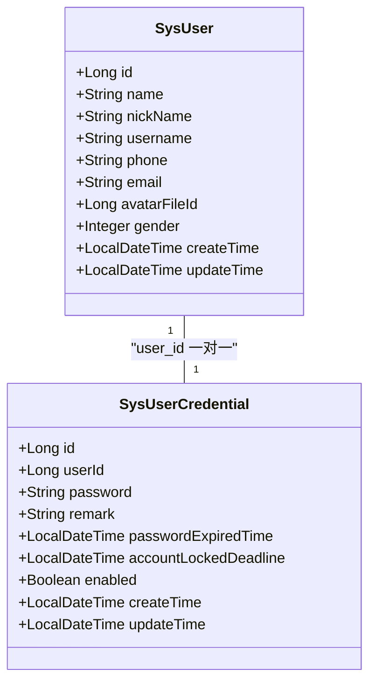
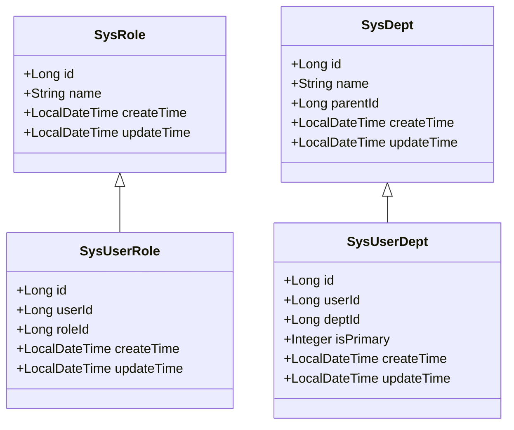
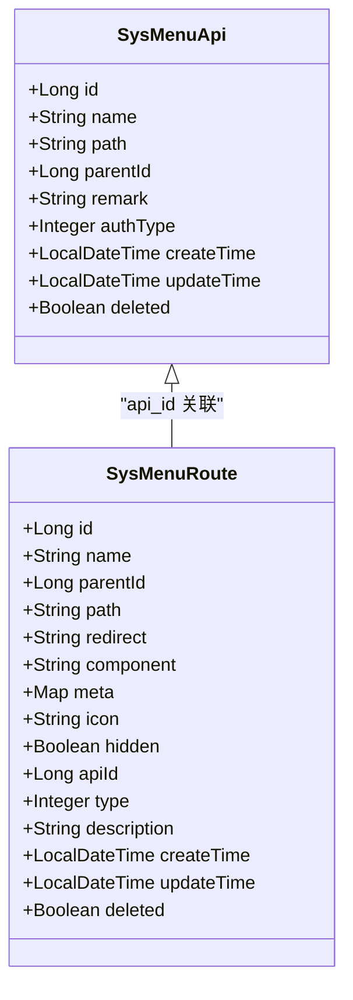
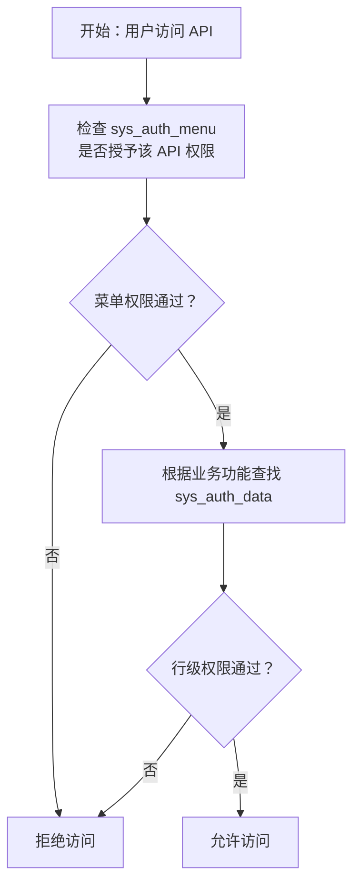
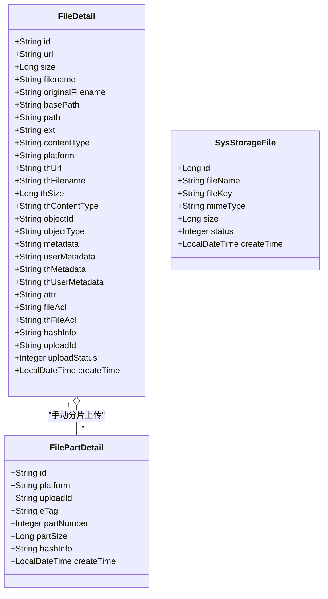
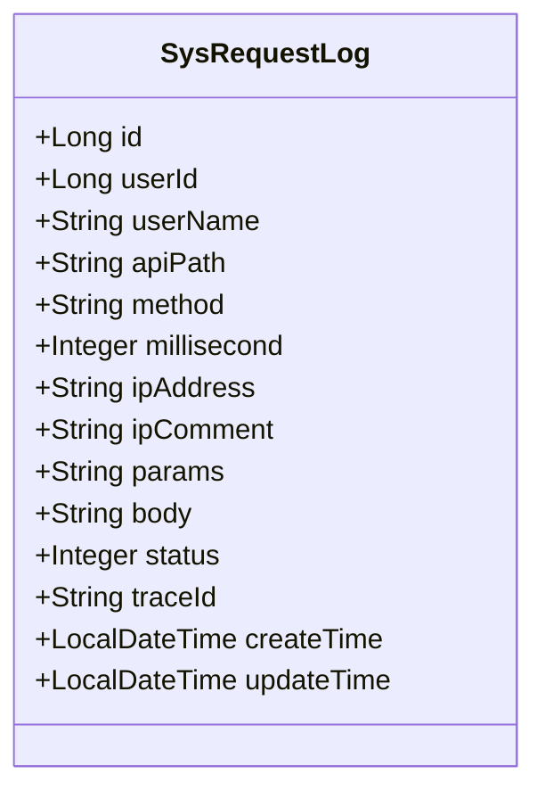
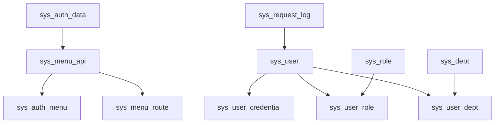

# 数据库设计

<cite>
**本文引用的文件 **   
- [docs/sql/auth-rbac.sql](file://docs/sql/auth-rbac.sql)
- [docs/sql/basic-support.sql](file://docs/sql/basic-support.sql)
- [auth/auth-rbac/src/main/java/com/cu/framework/auth/rbac/mp/entity/SysAuthData.java](file://auth/auth-rbac/src/main/java/com/cu/framework/auth/rbac/mp/entity/SysAuthData.java)
- [auth/auth-rbac/src/main/java/com/cu/framework/auth/rbac/mp/entity/SysUser.java](file://auth/auth-rbac/src/main/java/com/cu/framework/auth/rbac/mp/entity/SysUser.java)
- [auth/auth-rbac/src/main/java/com/cu/framework/auth/rbac/mp/entity/SysRole.java](file://auth/auth-rbac/src/main/java/com/cu/framework/auth/rbac/mp/entity/SysRole.java)
- [auth/auth-rbac/src/main/java/com/cu/framework/auth/rbac/mp/entity/SysDept.java](file://auth/auth-rbac/src/main/java/com/cu/framework/auth/rbac/mp/entity/SysDept.java)
- [auth/auth-rbac/src/main/java/com/cu/framework/auth/rbac/mp/entity/SysMenuApi.java](file://auth/auth-rbac/src/main/java/com/cu/framework/auth/rbac/mp/entity/SysMenuApi.java)
- [auth/auth-rbac/src/main/java/com/cu/framework/auth/rbac/mp/entity/SysMenuRoute.java](file://auth/auth-rbac/src/main/java/com/cu/framework/auth/rbac/mp/entity/SysMenuRoute.java)
- [auth/auth-rbac/src/main/java/com/cu/framework/auth/rbac/mp/entity/SysUserCredential.java](file://auth/auth-rbac/src/main/java/com/cu/framework/auth/rbac/mp/entity/SysUserCredential.java)
- [auth/auth-rbac/src/main/java/com/cu/framework/auth/rbac/mp/entity/SysUserDept.java](file://auth/auth-rbac/src/main/java/com/cu/framework/auth/rbac/mp/entity/SysUserDept.java)
- [auth/auth-rbac/src/main/java/com/cu/framework/auth/rbac/mp/entity/SysUserRole.java](file://auth/auth-rbac/src/main/java/com/cu/framework/auth/rbac/mp/entity/SysUserRole.java)
- [basic-support/src/main/java/com/cu/framework/basic/support/mp/entity/SysRequestLog.java](file://basic-support/src/main/java/com/cu/framework/basic/support/mp/entity/SysRequestLog.java)
- [sample/auth-core-boot-sample/sql/schema.sql](file://sample/auth-core-boot-sample/sql/schema.sql)
- [sample/auth-core-boot-sample/sql/seed-data.sql](file://sample/auth-core-boot-sample/sql/seed-data.sql)
</cite>

## 目录
1. [引言](#引言)
2. [项目结构](#项目结构)
3. [核心数据模型](#核心数据模型)
4. [架构总览](#架构总览)
5. [详细组件分析](#详细组件分析)
6. [依赖与关系分析](#依赖与关系分析)
7. [性能与索引设计](#性能与索引设计)
8. [迁移与版本管理](#迁移与版本管理)
9. [初始化与维护指南](#初始化与维护指南)
10. [结论](#结论)

## 引言
本文件面向 Kewen Framework 的数据库设计，聚焦权限体系、系统配置和审计日志三类数据。文档基于仓库中的 SQL 初始化脚本及对应的 MyBatis-Plus 实体类，说明用户、角色、部门、菜单、路由、凭证、应用行级权限槽位、文件记录、请求日志等表的结构、业务含义、约束、索引、视图以及示例模块自定义表的用途。同时给出完整的 ER 图、建表范围、迁移策略和维护建议，帮助读者在理解框架约定后，安全扩展自己的业务表和权限槽位。

## 项目结构
Kewen Framework 的数据库定义主要分布在三个位置：
- 框架通用权限与基础支撑脚本：`docs/sql/auth-rbac.sql`、`docs/sql/basic-support.sql`
- 示例模块自有表：`sample/auth-core-boot-sample/sql/schema.sql`、`sample/auth-core-boot-sample/sql/seed-data.sql`、`sample/auth-rbac-boot-sample/sql/schema.sql`
- 对应 Java 实体：`auth/auth-rbac/.../mp/entity/*`、`basic-support/.../mp/entity/SysRequestLog.java`



**图表来源**
- [docs/sql/auth-rbac.sql:1-148](file://docs/sql/auth-rbac.sql#L1-L148)
- [docs/sql/basic-support.sql:1-79](file://docs/sql/basic-support.sql#L1-L79)
- [sample/auth-core-boot-sample/sql/schema.sql:1-120](file://sample/auth-core-boot-sample/sql/schema.sql#L1-L120)
- [sample/auth-core-boot-sample/sql/seed-data.sql:1-181](file://sample/auth-core-boot-sample/sql/seed-data.sql#L1-L181)
- [sample/auth-rbac-boot-sample/sql/schema.sql:1-36](file://sample/auth-rbac-boot-sample/sql/schema.sql#L1-L36)

**章节来源**
- [docs/sql/auth-rbac.sql:1-148](file://docs/sql/auth-rbac.sql#L1-L148)
- [docs/sql/basic-support.sql:1-79](file://docs/sql/basic-support.sql#L1-L79)
- [sample/auth-core-boot-sample/sql/schema.sql:1-120](file://sample/auth-core-boot-sample/sql/schema.sql#L1-L120)

## 核心数据模型
Kewen Framework 的数据库模型可以划分为四类：
- 身份与组织：用户、角色、部门、用户凭证、用户部门关联、用户角色关联
- 权限与菜单：应用行级权限槽位、菜单 API、菜单路由、菜单权限关联
- 基础支撑：文件详情、文件分片、存储任务、请求日志
- 示例业务：示例模块为演示行级数据权限和业务场景而定义的额外表

### 身份与组织表族
| 表名 | 主键 | 关键字段 | 业务含义 | 关键约束 |
|---|---:|---|---|---|
| `sys_user` | `id` | `username`、`phone`、`email`、`gender`、头像 ID | 系统用户基本信息 | `username`、`phone` 唯一；默认时间戳 |
| `sys_user_credential` | `id` | `user_id`、`password`、过期时间、锁定截止时间、启用标志 | 用户登录凭证与安全控制 | `user_id` 唯一；支持免密登录扩展 |
| `sys_role` | `id` | `name` | 角色名称 | 默认时间戳 |
| `sys_dept` | `id` | `name`、`parent_id` | 部门树，`parent_id=0` 表示根部门 | 自引用层级 |
| `sys_user_dept` | `id` | `user_id`、`dept_id`、`is_primary` | 用户多部门归属，标记主要部门 | 复合索引 `(user_id, dept_id)` |
| `sys_user_role` | `id` | `user_id`、`role_id` | 用户与角色的多对多关系 | 复合索引 `(user_id, role_id)` |

**章节来源**
- [docs/sql/auth-rbac.sql:41-123](file://docs/sql/auth-rbac.sql#L41-L123)
- [auth/auth-rbac/src/main/java/com/cu/framework/auth/rbac/mp/entity/SysUser.java:1-95](file://auth/auth-rbac/src/main/java/com/cu/framework/auth/rbac/mp/entity/SysUser.java#L1-L95)
- [auth/auth-rbac/src/main/java/com/cu/framework/auth/rbac/mp/entity/SysRole.java:1-60](file://auth/auth-rbac/src/main/java/com/cu/framework/auth/rbac/mp/entity/SysRole.java#L1-L60)
- [auth/auth-rbac/src/main/java/com/cu/framework/auth/rbac/mp/entity/SysDept.java:1-66](file://auth/auth-rbac/src/main/java/com/cu/framework/auth/rbac/mp/entity/SysDept.java#L1-L66)
- [auth/auth-rbac/src/main/java/com/cu/framework/auth/rbac/mp/entity/SysUserCredential.java:1-90](file://auth/auth-rbac/src/main/java/com/cu/framework/auth/rbac/mp/entity/SysUserCredential.java#L1-L90)
- [auth/auth-rbac/src/main/java/com/cu/framework/auth/rbac/mp/entity/SysUserDept.java:1-72](file://auth/auth-rbac/src/main/java/com/cu/framework/auth/rbac/mp/entity/SysUserDept.java#L1-L72)
- [auth/auth-rbac/src/main/java/com/cu/framework/auth/rbac/mp/entity/SysUserRole.java:1-66](file://auth/auth-rbac/src/main/java/com/cu/framework/auth/rbac/mp/entity/SysUserRole.java#L1-L66)

### 权限与菜单表族
| 表名 | 主键 | 关键字段 | 业务含义 | 关键约束 |
|---|---:|---|---|---|
| `sys_auth_data` | `id` | `business_function`、`operate`、`data_id`、`authority`、`description` | 应用行级数据权限槽位，按业务功能、操作和数据 ID 授权 | 复合索引 `(business_function, operate, data_id, authority)` |
| `sys_menu_api` | `id` | `path`、`name`、`parent_id`、`auth_type`、`deleted` | 后端 API 菜单节点，路径唯一，支持自身或父级权限继承 | `path` 唯一；逻辑删除 |
| `sys_menu_route` | `id` | `name`、`path`、`redirect`、`component`、`meta`、`icon`、`hidden`、`api_id`、`type`、`description`、`deleted` | 前端路由菜单，包含组件、图标、元信息和关联 API | JSON 元信息；逻辑删除 |
| `sys_auth_menu` | `id` | `api_id`、`authority`、`description` | 将权限字符串授予某个 API 菜单 | 与 `sys_menu_api.id` 语义关联 |

**章节来源**
- [docs/sql/auth-rbac.sql:1-40](file://docs/sql/auth-rbac.sql#L1-L40)
- [docs/sql/auth-rbac.sql:41-148](file://docs/sql/auth-rbac.sql#L41-L148)
- [auth/auth-rbac/src/main/java/com/cu/framework/auth/rbac/mp/entity/SysAuthData.java:1-84](file://auth/auth-rbac/src/main/java/com/cu/framework/auth/rbac/mp/entity/SysAuthData.java#L1-L84)
- [auth/auth-rbac/src/main/java/com/cu/framework/auth/rbac/mp/entity/SysMenuApi.java:1-94](file://auth/auth-rbac/src/main/java/com/cu/framework/auth/rbac/mp/entity/SysMenuApi.java#L1-L94)
- [auth/auth-rbac/src/main/java/com/cu/framework/auth/rbac/mp/entity/SysMenuRoute.java:1-129](file://auth/auth-rbac/src/main/java/com/cu/framework/auth/rbac/mp/entity/SysMenuRoute.java#L1-L129)

### 基础支撑与审计日志表族
| 表名 | 主键 | 关键字段 | 业务含义 | 关键约束 |
|---|---:|---|---|---|
| `file_detail` | `id` | `url`、`size`、`filename`、`original_filename`、`base_path`、`path`、`ext`、`content_type`、`platform`、缩略图字段、对象标识、元数据、ACL、哈希、上传状态 | 文件访问与存储元数据 | 主键为文件 ID；大量可选扩展字段 |
| `file_part_detail` | `id` | `upload_id`、`e_tag`、`part_number`、`part_size` | 手动分片上传的分片记录 | 主键为分片 ID |
| `sys_storage_file` | `id` | `file_name`、`file_key`、`mime_type`、`size`、`status` | 预上传 token 与直传成功后的持久化任务 | 状态枚举；自增主键 |
| `sys_request_log` | `id` | `user_id`、`user_name`、`api_path`、`method`、`millisecond`、`ip_address`、`params`、`body`、`status`、`trace_id` | 请求审计日志，包含用户、接口、耗时、IP、参数、追踪号 | 自增主键；适合按时间和追踪号归档 |

**章节来源**
- [docs/sql/basic-support.sql:1-79](file://docs/sql/basic-support.sql#L1-L79)
- [basic-support/src/main/java/com/cu/framework/basic/support/mp/entity/SysRequestLog.java:1-123](file://basic-support/src/main/java/com/cu/framework/basic/support/mp/entity/SysRequestLog.java#L1-L123)

### 示例模块自定义表族
示例模块为演示行级数据权限、菜单授权、多表别名、批量上限等业务能力，定义了以下表：
- `demo_auth_data`：示例权限槽位，映射框架约定的业务功能、操作、数据 ID 和权限串
- `demo_menu_auth`：示例菜单授权，将路径与权限串绑定
- `demo_menu_api`：示例菜单 API，由注解扫描注册，使用雪花算法 ID
- `demo_user_auth`：示例用户权限表，作为当前用户上下文的数据源
- `demo_work_order`、`demo_asset`、`demo_customer`：示例业务表，用于验证同一张表多别名、非标准主键列、关联表权限
- `demo_execution_log`：副作用证据表，证明受管辖写方法是否真正执行

**章节来源**
- [sample/auth-core-boot-sample/sql/schema.sql:1-120](file://sample/auth-core-boot-sample/sql/schema.sql#L1-L120)
- [sample/auth-core-boot-sample/sql/seed-data.sql:1-181](file://sample/auth-core-boot-sample/sql/seed-data.sql#L1-L181)

## 架构总览
下图展示权限相关表的核心关系：用户通过用户角色和用户部门获得角色与部门，角色可授权菜单权限，API 菜单再与行级权限槽位结合，实现对具体业务数据的细粒度访问控制。

```mermaid
erDiagram
  SYS_USER {
    bigint id PK
    string name
    string nick_name
    string username UK
    string phone UK
    string email
    bigint avatar_file_id
    tinyint gender
    datetime create_time
    datetime update_time
  }

  SYS_USER_CREDENTIAL {
    bigint id PK
    bigint user_id UK
    string password
    string remark
    datetime password_expired_time
    datetime account_locked_deadline
    tinyint enabled
    datetime create_time
    datetime update_time
  }

  SYS_ROLE {
    bigint id PK
    string name
    datetime create_time
    datetime update_time
  }

  SYS_DEPT {
    bigint id PK
    string name
    bigint parent_id
    datetime create_time
    datetime update_time
  }

  SYS_USER_ROLE {
    bigint id PK
    bigint user_id
    bigint role_id
    datetime create_time
    datetime update_time
  }

  SYS_USER_DEPT {
    bigint id PK
    bigint user_id
    bigint dept_id
    tinyint is_primary
    datetime create_time
    datetime update_time
  }

  SYS_MENU_API {
    bigint id PK
    string path UK
    string name
    bigint parent_id
    text remark
    tinyint auth_type
    datetime create_time
    datetime update_time
    tinyint deleted
  }

  SYS_MENU_ROUTE {
    bigint id PK
    string name
    bigint parent_id
    string path
    string redirect
    string component
    json meta
    string icon
    tinyint hidden
    bigint api_id
    tinyint type
    text description
    datetime create_time
    datetime update_time
    tinyint deleted
  }

  SYS_AUTH_MENU {
    bigint id PK
    bigint api_id
    string authority
    string description
    datetime create_time
    datetime update_time
  }

  SYS_AUTH_DATA {
    bigint id PK
    string business_function
    bigint data_id
    string operate
    string authority
    string description
    datetime create_time
    datetime update_time
  }

  SYS_REQUEST_LOG {
    bigint id PK
    bigint user_id
    string user_name
    string api_path
    string method
    int millisecond
    string ip_address
    string ip_comment
    string params
    text body
    int status
    string trace_id
    datetime create_time
    datetime update_time
  }

  FILE_DETAIL {
    varchar id PK
    string url
    bigint size
    string filename
    string original_filename
    string base_path
    string path
    string ext
    string content_type
    string platform
    string th_url
    string th_filename
    bigint th_size
    string th_content_type
    string object_id
    string object_type
    text metadata
    text user_metadata
    text th_metadata
    text th_user_metadata
    text attr
    string file_acl
    string th_file_acl
    text hash_info
    string upload_id
    int upload_status
    datetime create_time
  }

  FILE_PART_DETAIL {
    varchar id PK
    string platform
    string upload_id
    string e_tag
    int part_number
    bigint part_size
    text hash_info
    datetime create_time
  }

  SYS_STORAGE_FILE {
    bigint id PK
    string file_name
    string file_key
    string mime_type
    bigint size
    int status
    datetime create_time
  }

  SYS_USER ||--o{ SYS_USER_CREDENTIAL : "一对一凭证"
  SYS_USER ||--o{ SYS_USER_ROLE : "多对多角色"
  SYS_ROLE ||--o{ SYS_USER_ROLE : "多对多角色"
  SYS_USER ||--o{ SYS_USER_DEPT : "多对多部门"
  SYS_DEPT ||--o{ SYS_USER_DEPT : "多对多部门"
  SYS_MENU_API ||--o{ SYS_AUTH_MENU : "菜单权限"
  SYS_MENU_API ||--o{ SYS_MENU_ROUTE : "路由关联"
  SYS_AUTH_DATA ||.. SYS_MENU_API : "按业务功能与数据ID授权"
  SYS_REQUEST_LOG ||.. SYS_USER : "按用户审计"
```

**图表来源**
- [docs/sql/auth-rbac.sql:1-148](file://docs/sql/auth-rbac.sql#L1-L148)
- [docs/sql/basic-support.sql:1-79](file://docs/sql/basic-support.sql#L1-L79)
- [auth/auth-rbac/src/main/java/com/cu/framework/auth/rbac/mp/entity/SysAuthData.java:1-84](file://auth/auth-rbac/src/main/java/com/cu/framework/auth/rbac/mp/entity/SysAuthData.java#L1-L84)
- [auth/auth-rbac/src/main/java/com/cu/framework/auth/rbac/mp/entity/SysMenuApi.java:1-94](file://auth/auth-rbac/src/main/java/com/cu/framework/auth/rbac/mp/entity/SysMenuApi.java#L1-L94)
- [auth/auth-rbac/src/main/java/com/cu/framework/auth/rbac/mp/entity/SysMenuRoute.java:1-129](file://auth/auth-rbac/src/main/java/com/cu/framework/auth/rbac/mp/entity/SysMenuRoute.java#L1-L129)
- [basic-support/src/main/java/com/cu/framework/basic/support/mp/entity/SysRequestLog.java:1-123](file://basic-support/src/main/java/com/cu/framework/basic/support/mp/entity/SysRequestLog.java#L1-L123)

## 详细组件分析

### 用户与凭证模型
用户表提供身份信息，凭证表负责密码、过期、锁定和启用状态。两者通过 `user_id` 形成一对一关系，允许未来接入免密登录或多凭证类型。性别、邮箱、手机号、头像等字段用于用户资料；创建与更新时间由数据库默认值或更新触发。



**图表来源**
- [auth/auth-rbac/src/main/java/com/cu/framework/auth/rbac/mp/entity/SysUser.java:1-95](file://auth/auth-rbac/src/main/java/com/cu/framework/auth/rbac/mp/entity/SysUser.java#L1-L95)
- [auth/auth-rbac/src/main/java/com/cu/framework/auth/rbac/mp/entity/SysUserCredential.java:1-90](file://auth/auth-rbac/src/main/java/com/cu/framework/auth/rbac/mp/entity/SysUserCredential.java#L1-L90)

**章节来源**
- [docs/sql/auth-rbac.sql:79-106](file://docs/sql/auth-rbac.sql#L79-L106)
- [docs/sql/auth-rbac.sql:106-123](file://docs/sql/auth-rbac.sql#L106-L123)

### 角色与部门模型
角色表是 RBAC 的角色维度；部门表是组织架构维度。用户通过 `sys_user_role` 和 `sys_user_dept` 分别关联角色和部门。部门采用自引用 `parent_id` 构建树形结构，示例数据中根部门 `parent_id=0`，总部、研发部、外部合作部构成多棵树。



**图表来源**
- [auth/auth-rbac/src/main/java/com/cu/framework/auth/rbac/mp/entity/SysRole.java:1-60](file://auth/auth-rbac/src/main/java/com/cu/framework/auth/rbac/mp/entity/SysRole.java#L1-L60)
- [auth/auth-rbac/src/main/java/com/cu/framework/auth/rbac/mp/entity/SysDept.java:1-66](file://auth/auth-rbac/src/main/java/com/cu/framework/auth/rbac/mp/entity/SysDept.java#L1-L66)
- [auth/auth-rbac/src/main/java/com/cu/framework/auth/rbac/mp/entity/SysUserRole.java:1-66](file://auth/auth-rbac/src/main/java/com/cu/framework/auth/rbac/mp/entity/SysUserRole.java#L1-L66)
- [auth/auth-rbac/src/main/java/com/cu/framework/auth/rbac/mp/entity/SysUserDept.java:1-72](file://auth/auth-rbac/src/main/java/com/cu/framework/auth/rbac/mp/entity/SysUserDept.java#L1-L72)

**章节来源**
- [docs/sql/auth-rbac.sql:60-79](file://docs/sql/auth-rbac.sql#L60-L79)
- [docs/sql/auth-rbac.sql:106-148](file://docs/sql/auth-rbac.sql#L106-L148)

### 菜单 API 与路由模型
`sys_menu_api` 表示后端 API 菜单，路径具有唯一性；`auth_type` 决定权限继承策略：值为 1 表示基于自身权限，值为 2 表示基于父权限。`sys_menu_route` 表示前端路由，包含组件、图标、隐藏标志、JSON 元信息等，并通过 `api_id` 与 API 菜单关联。二者都支持逻辑删除字段 `deleted`。



**图表来源**
- [auth/auth-rbac/src/main/java/com/cu/framework/auth/rbac/mp/entity/SysMenuApi.java:1-94](file://auth/auth-rbac/src/main/java/com/cu/framework/auth/rbac/mp/entity/SysMenuApi.java#L1-L94)
- [auth/auth-rbac/src/main/java/com/cu/framework/auth/rbac/mp/entity/SysMenuRoute.java:1-129](file://auth/auth-rbac/src/main/java/com/cu/framework/auth/rbac/mp/entity/SysMenuRoute.java#L1-L129)

**章节来源**
- [docs/sql/auth-rbac.sql:60-106](file://docs/sql/auth-rbac.sql#L60-L106)

### 菜单权限与行级数据权限模型
`sys_auth_menu` 将权限字符串授予某个 API 菜单；`sys_auth_data` 则把权限字符串授予具体的业务数据。权限判断通常先走菜单权限，再走行级数据权限。框架还提供视图 `view_menu_api_auth`，便于查询以自身权限为主的 API 菜单及其权限。



**图表来源**
- [docs/sql/auth-rbac.sql:1-40](file://docs/sql/auth-rbac.sql#L1-L40)
- [docs/sql/auth-rbac.sql:123-148](file://docs/sql/auth-rbac.sql#L123-L148)

**章节来源**
- [docs/sql/auth-rbac.sql:1-40](file://docs/sql/auth-rbac.sql#L1-L40)
- [docs/sql/auth-rbac.sql:123-148](file://docs/sql/auth-rbac.sql#L123-L148)

### 文件与存储模型
文件模型分为三层：
- `file_detail`：完整文件元数据，包括 URL、大小、原始文件名、存储路径、MIME、平台、缩略图、对象标识、元数据、ACL、哈希、上传状态等
- `file_part_detail`：手动分片上传时的分片信息，包含分片号、ETag、大小、哈希
- `sys_storage_file`：预上传 token 与直传成功后落库的任务表，便于后续跟踪



**图表来源**
- [docs/sql/basic-support.sql:1-79](file://docs/sql/basic-support.sql#L1-L79)

**章节来源**
- [docs/sql/basic-support.sql:1-79](file://docs/sql/basic-support.sql#L1-L79)

### 审计日志模型
`sys_request_log` 记录每次请求的用户、路径、方法、耗时、IP、参数、Body、状态、追踪号和创建时间。它属于审计日志范畴，常用于排查问题、分析性能和安全审计。由于 Body 可能较大，生产环境应配合日志归档、脱敏和保留策略。



**图表来源**
- [basic-support/src/main/java/com/cu/framework/basic/support/mp/entity/SysRequestLog.java:1-123](file://basic-support/src/main/java/com/cu/framework/basic/support/mp/entity/SysRequestLog.java#L1-L123)
- [docs/sql/basic-support.sql:54-79](file://docs/sql/basic-support.sql#L54-L79)

**章节来源**
- [docs/sql/basic-support.sql:54-79](file://docs/sql/basic-support.sql#L54-L79)
- [basic-support/src/main/java/com/cu/framework/basic/support/mp/entity/SysRequestLog.java:1-123](file://basic-support/src/main/java/com/cu/framework/basic/support/mp/entity/SysRequestLog.java#L1-L123)

## 依赖与关系分析
- 用户到凭证：一对一，凭证表通过 `user_id` 唯一键保证一个用户一条凭证
- 用户到角色：多对多，通过 `sys_user_role` 解耦
- 用户到部门：多对多，通过 `sys_user_dept` 解耦，并支持主要部门标记
- 部门到部门：自引用树形结构，根部门 `parent_id=0`
- 菜单 API 到菜单权限：一对多，`sys_auth_menu.api_id` 指向 `sys_menu_api.id`
- 菜单 API 到菜单路由：一对多，`sys_menu_route.api_id` 指向 `sys_menu_api.id`
- 菜单 API 到行级权限：间接关联，通过 `business_function`、`operate`、`data_id`、`authority` 组合判定
- 请求日志到用户：逻辑关联，通过 `user_id` 与 `sys_user.id` 对应



**图表来源**
- [docs/sql/auth-rbac.sql:1-148](file://docs/sql/auth-rbac.sql#L1-L148)
- [docs/sql/basic-support.sql:54-79](file://docs/sql/basic-support.sql#L54-L79)

**章节来源**
- [docs/sql/auth-rbac.sql:1-148](file://docs/sql/auth-rbac.sql#L1-L148)

## 性能与索引设计
现有脚本已针对高频查询建立必要索引：
- `sys_auth_data`：`(business_function, operate, data_id, authority)` 复合索引，优化行级权限匹配
- `sys_menu_api.path`：唯一索引，避免路径冲突并加速菜单查询
- `sys_user.username`、`sys_user.phone`：唯一索引，保证用户标识唯一
- `sys_user_role(user_id, role_id)`：优化用户角色查询
- `sys_user_dept(user_id, dept_id)`：优化用户部门查询
- `sys_user_credential.user_id`：唯一索引，保证凭证一对一

建议补充：
- `sys_request_log` 按 `create_time`、`trace_id`、`api_path` 建立查询索引，提升审计检索效率
- `file_detail.url`、`file_detail.object_id`、`file_detail.platform` 视使用情况建立索引
- `sys_menu_route.deleted`、`sys_menu_route.type` 若频繁过滤，可考虑复合索引
- 大表建议分区或归档，尤其是 `sys_request_log`、`file_detail`

**章节来源**
- [docs/sql/auth-rbac.sql:1-148](file://docs/sql/auth-rbac.sql#L1-L148)
- [docs/sql/basic-support.sql:1-79](file://docs/sql/basic-support.sql#L1-L79)

## 迁移与版本管理
仓库采用“脚本即事实”的方式管理数据库结构：
- 框架通用脚本位于 `docs/sql`，不写引擎、字符集、排序规则，交由目标库默认值
- 兼容性通过 `scripts/check-sql-compat.sh` 用 H2 实测校验
- 示例模块脚本使用 `CREATE TABLE IF NOT EXISTS`，避免重复建表；种子数据使用幂等插入守卫
- 示例 RBAC 模块的种子数据注释明确区分 H2 profile 自动执行与 MySQL 手动导入

迁移建议：
- 新增表时遵循 `docs/sql` 风格：兼容 MySQL 与 H2(MODE=MySQL)，不写存储引擎和字符集
- 增量变更优先使用 `ALTER TABLE`，并在变更脚本中标注版本和回滚方案
- 保持实体类、SQL 脚本、业务注释三者一致，避免 MyBatis-Plus 字段映射错乱
- 对大表变更谨慎进行在线 DDL，必要时分批迁移

**章节来源**
- [docs/sql/auth-rbac.sql:1-10](file://docs/sql/auth-rbac.sql#L1-L10)
- [docs/sql/basic-support.sql:1-10](file://docs/sql/basic-support.sql#L1-L10)
- [sample/auth-core-boot-sample/sql/schema.sql:1-10](file://sample/auth-core-boot-sample/sql/schema.sql#L1-L10)
- [sample/auth-rbac-boot-sample/sql/seed-data.sql:1-10](file://sample/auth-rbac-boot-sample/sql/seed-data.sql#L1-L10)

## 初始化与维护指南

### 初始化步骤
1. 先执行框架通用脚本：`docs/sql/auth-rbac.sql`、`docs/sql/basic-support.sql`
2. 再执行示例模块自有表脚本：`sample/auth-core-boot-sample/sql/schema.sql`、`sample/auth-rbac-boot-sample/sql/schema.sql`
3. 根据需要执行种子数据：
   - 示例 core：`sample/auth-core-boot-sample/sql/seed-data.sql`
   - 示例 rbac：`sample/auth-rbac-boot-sample/sql/seed-data.sql`（注意其注释说明 MySQL 侧需手动导入）

### 常见维护操作
- 用户与凭证：
  - 修改密码时应同步更新 `password` 与 `password_expired_time`
  - 锁定账号时设置 `account_locked_deadline`；解除锁定时清空或设为早于当前时间
  - 禁用账号时将 `enabled` 置为 0
- 角色与部门：
  - 调整部门层级时注意 `parent_id` 一致性，避免环路
  - 为用户分配多个部门时，仅将一个设为主要部门
- 菜单与权限：
  - 新增 API 后登记 `sys_menu_api`，并根据需要登记 `sys_auth_menu`
  - 行级权限通过 `sys_auth_data` 授予具体业务数据，确保 `business_function`、`operate`、`data_id`、`authority` 组合正确
- 文件与存储：
  - 手动分片上传完成后，核对 `file_part_detail` 与 `sys_storage_file.status`
  - 清理无效缩略图和冗余元数据，释放存储空间
- 审计日志：
  - 按 `create_time` 归档历史日志
  - 对敏感 `body`、`params` 做脱敏处理
  - 使用 `trace_id` 关联一次请求的多条日志

### 示例数据说明
示例种子数据强调幂等性和可读性：
- 使用 `WHERE NOT EXISTS` 防止重复插入
- 演示不同权限串、引号载荷、部门继承、多表别名、批量上限等边界情况
- 示例菜单授权与权限槽位数据配合，便于验证行级判定是否正确生效

**章节来源**
- [sample/auth-core-boot-sample/sql/seed-data.sql:1-181](file://sample/auth-core-boot-sample/sql/seed-data.sql#L1-L181)
- [sample/auth-rbac-boot-sample/sql/seed-data.sql:1-200](file://sample/auth-rbac-boot-sample/sql/seed-data.sql#L1-L200)

## 结论
Kewen Framework 的数据库设计以 RBAC 为核心，围绕用户、角色、部门、菜单、路由和行级数据权限构建灵活的安全模型；同时提供文件存储和请求日志等基础支撑表。现有脚本注重跨数据库兼容性，并通过示例模块展示行级权限、菜单授权、部门继承、多表别名等典型用法。实际项目中，应在保持框架约定前提下，扩展业务表和权限槽位，完善索引、归档和迁移策略，使权限控制、可观测性与可维护性达到一致水平。