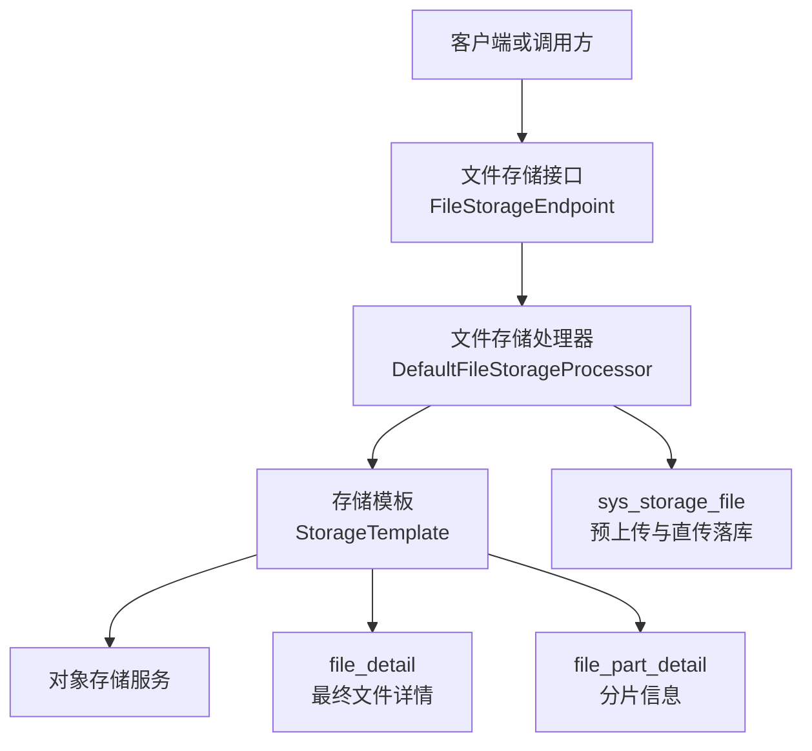
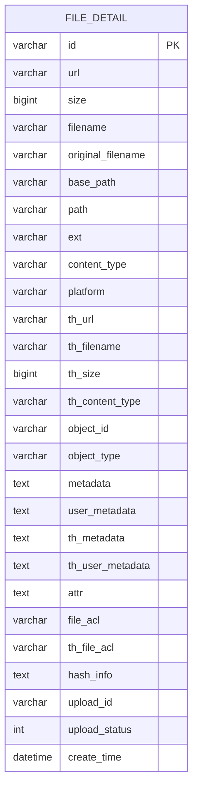
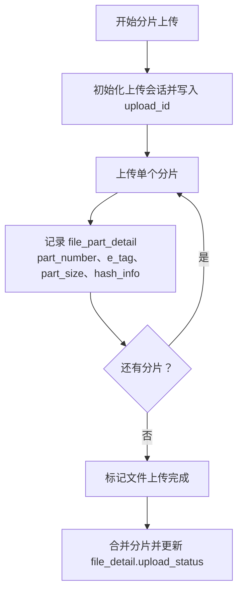
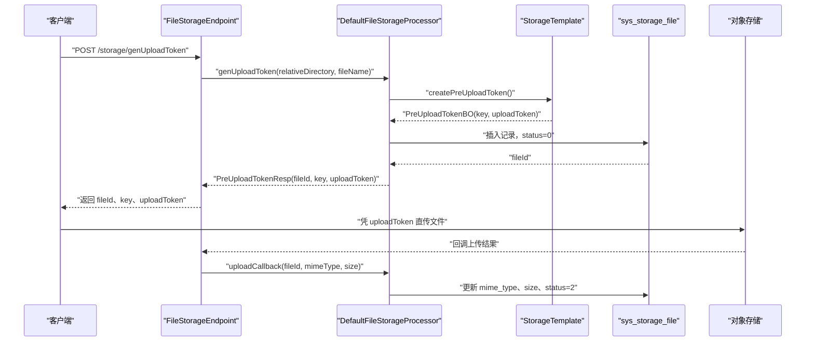
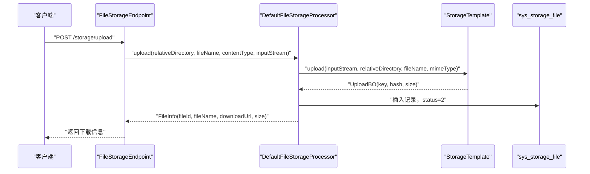
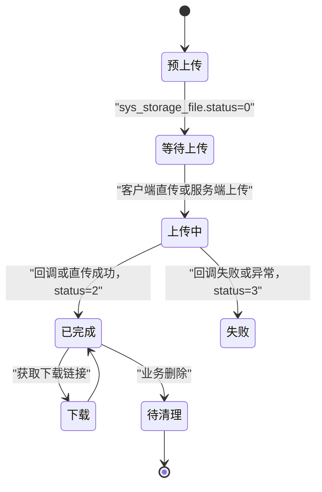
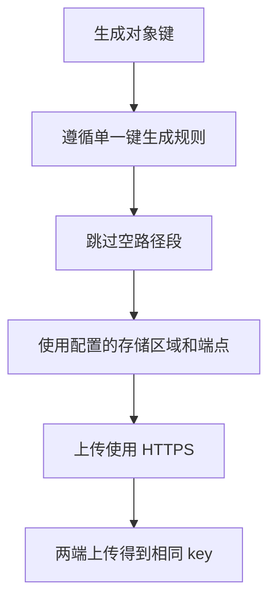
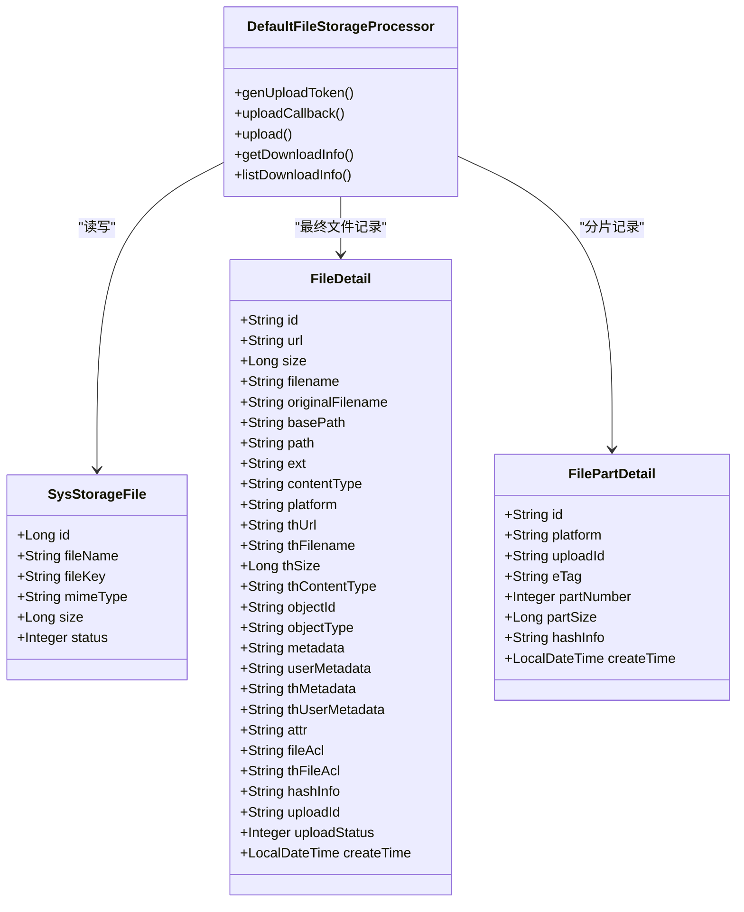
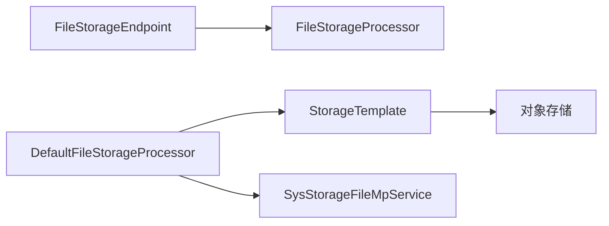

# 文件存储表结构

<cite>
**本文引用的文件**   
- [FileDetail.java](file://boot/storage-spring-boot-starter/src/main/java/com/cu/framework/storage/web/mp/entity/FileDetail.java)
- [FilePartDetail.java](file://boot/storage-spring-boot-starter/src/main/java/com/cu/framework/storage/web/mp/entity/FilePartDetail.java)
- [SysStorageFile.java](file://boot/storage-spring-boot-starter/src/main/java/com/cu/framework/storage/web/mp/entity/SysStorageFile.java)
- [basic-support.sql](file://docs/sql/basic-support.sql)
- [DefaultFileStorageProcessor.java](file://boot/storage-spring-boot-starter/src/main/java/com/cu/framework/storage/web/impl/DefaultFileStorageProcessor.java)
- [FileStorageEndpoint.java](file://boot/storage-spring-boot-starter/src/main/java/com/cu/framework/storage/web/FileStorageEndpoint.java)
- [FileInfo.java](file://boot/storage-spring-boot-starter/src/main/java/com/cu/framework/storage/core/model/FileInfo.java)
- [PreUploadTokenBO.java](file://boot/storage-spring-boot-starter/src/main/java/com/cu/framework/storage/core/model/PreUploadTokenBO.java)
- [UploadBO.java](file://boot/storage-spring-boot-starter/src/main/java/com/cu/framework/storage/core/model/UploadBO.java)
- [PreUploadTokenReq.java](file://boot/storage-spring-boot-starter/src/main/java/com/cu/framework/storage/web/model/PreUploadTokenReq.java)
- [PreUploadTokenResp.java](file://boot/storage-spring-boot-starter/src/main/java/com/cu/framework/storage/web/model/PreUploadTokenResp.java)
- [spec.md](file://openspec/specs/storage/file-storage/spec.md)
</cite>

## 目录
1. [引言](#引言)
2. [项目结构与定位](#项目结构与定位)
3. [核心数据模型总览](#核心数据模型总览)
4. [文件详情表 file_detail](#文件详情表-file_detail)
5. [文件分片信息表 file_part_detail](#文件分片信息表-file_part_detail)
6. [文件存储表 sys_storage_file](#文件存储表-sys_storage_file)
7. [完整生命周期与流程](#完整生命周期与流程)
8. [依赖关系与架构视图](#依赖关系与架构视图)
9. [性能优化建议](#性能优化建议)
10. [存储空间管理最佳实践](#存储空间管理最佳实践)
11. [故障排查指南](#故障排查指南)
12. [结论](#结论)

## 引言
本文围绕 Kewen Framework 的文件存储子系统，系统性梳理三类数据库表的设计与使用方式：  
- `file_detail`：用于记录最终落库的文件详情、路径、缩略图及元数据。  
- `file_part_detail`：用于手动分片上传场景的分片编号、ETag、哈希等状态信息。  
- `sys_storage_file`：用于预上传凭证管理与直传成功后落库的轻量级文件记录表。

文档同时给出上传流程、存储策略、访问控制、删除机制以及性能与空间管理建议，帮助开发者在设计业务模块时正确使用这些表。

## 项目结构与定位
文件存储能力位于 `boot/storage-spring-boot-starter` 中，提供 Web 接口、处理器、实体模型和 MyBatis-Plus 持久化封装；SQL 建表脚本位于 `docs/sql/basic-support.sql`；对象键生成与端点配置规范在 `openspec/specs/storage/file-storage/spec.md` 中约束。

**图示来源**  
- [FileStorageEndpoint.java:1-98](file://boot/storage-spring-boot-starter/src/main/java/com/cu/framework/storage/web/FileStorageEndpoint.java#L1-L98)
- [DefaultFileStorageProcessor.java:1-122](file://boot/storage-spring-boot-starter/src/main/java/com/cu/framework/storage/web/impl/DefaultFileStorageProcessor.java#L1-L122)
- [basic-support.sql:1-79](file://docs/sql/basic-support.sql#L1-L79)

**章节来源**  
- [FileStorageEndpoint.java:1-98](file://boot/storage-spring-boot-starter/src/main/java/com/cu/framework/storage/web/FileStorageEndpoint.java#L1-L98)
- [basic-support.sql:1-79](file://docs/sql/basic-support.sql#L1-L79)
- [spec.md:1-65](file://openspec/specs/storage/file-storage/spec.md#L1-L65)

## 核心数据模型总览
| 表名 | 主键类型 | 主要用途 | 关键字段 | 典型状态或扩展字段 |
|---|---|---|---|---|
| `file_detail` | 字符串型 `id` | 最终文件详情、路径、缩略图、元数据、ACL、哈希、分片关联信息 | `url`、`path`、`base_path`、`ext`、`content_type`、`platform`、`th_url`、`object_id`、`metadata`、`hash_info`、`upload_id`、`upload_status` | 支持缩略图字段前缀 `th_`，支持 JSON 文本元数据 |
| `file_part_detail` | 字符串型 `id` | 手动分片上传的分片记录 | `upload_id`、`e_tag`、`part_number`、`part_size`、`hash_info` | 按分片号排序可完成合并校验 |
| `sys_storage_file` | 自增整型 `id` | 预上传 token 管理与直传成功后落库 | `file_name`、`file_key`、`mime_type`、`size`、`status` | `status`：0 等待上传、1 上传中、2 完成、3 失败 |

三张表分别对应“最终文件记录”“分片中间态记录”“预上传与快速直传落库”，彼此通过 `upload_id`、`file_key`、`file_id` 等业务标识建立逻辑关联。

**章节来源**  
- [FileDetail.java:1-199](file://boot/storage-spring-boot-starter/src/main/java/com/cu/framework/storage/web/mp/entity/FileDetail.java#L1-L199)
- [FilePartDetail.java:1-85](file://boot/storage-spring-boot-starter/src/main/java/com/cu/framework/storage/web/mp/entity/FilePartDetail.java#L1-L85)
- [SysStorageFile.java:1-74](file://boot/storage-spring-boot-starter/src/main/java/com/cu/framework/storage/web/mp/entity/SysStorageFile.java#L1-L74)
- [basic-support.sql:1-79](file://docs/sql/basic-support.sql#L1-L79)

## 文件详情表 file_detail
### 设计目标
`file_detail` 是文件上传完成后面向业务系统的最终文件记录表。它同时承载以下职责：
- 文件基本信息：文件名、原始文件名、大小、扩展名、MIME 类型。
- 存储路径信息：基础路径、实际存储路径、访问 URL。
- 缩略图信息：缩略图 URL、名称、大小、MIME 类型、元数据和 ACL。
- 元数据存储：系统元数据、用户自定义元数据、附加属性。
- 安全与完整性：文件 ACL、缩略图 ACL、哈希信息。
- 分片关联：通过 `upload_id` 与 `upload_status` 关联手动分片上传过程。
- 业务绑定：通过 `object_id` 与 `object_type` 将文件挂载到具体业务对象。

### 字段分组说明
| 分组 | 字段 | 含义 |
|---|---|---|
| 文件基本信息 | `id`、`filename`、`original_filename`、`size`、`ext`、`content_type` | 描述文件本身的基础属性 |
| 存储路径 | `base_path`、`path`、`url`、`platform` | 描述文件在对象存储中的位置与对外访问地址 |
| 缩略图信息 | `th_url`、`th_filename`、`th_size`、`th_content_type` | 缩略图访问路径、名称、大小、类型 |
| 元数据 | `metadata`、`user_metadata`、`th_metadata`、`th_user_metadata`、`attr` | 系统元数据、用户元数据、附加属性 |
| 访问控制 | `file_acl`、`th_file_acl` | 文件和缩略图的 ACL 控制 |
| 完整性 | `hash_info` | 文件哈希或 ETag 等信息 |
| 分片关联 | `upload_id`、`upload_status` | 仅手动分片上传时使用 |
| 业务关联 | `object_id`、`object_type` | 文件所属业务对象 ID 和类型 |
| 时间戳 | `create_time` | 创建时间 |

### 设计要点
- `metadata`、`user_metadata`、`th_metadata`、`th_user_metadata`、`attr`、`hash_info` 使用文本类型，适合保存 JSON 结构，便于扩展而不修改表结构。
- 缩略图字段采用统一前缀 `th_`，使主文件与缩略图在同一行内保持强关联，减少跨表查询。
- `upload_id` 与 `upload_status` 只在手动分片上传场景中有效，避免对普通上传造成语义污染。
- `object_id` 与 `object_type` 实现“文件—业务对象”的多对一绑定，例如头像、附件、评价图片等。

**图示来源**  
- [FileDetail.java:1-199](file://boot/storage-spring-boot-starter/src/main/java/com/cu/framework/storage/web/mp/entity/FileDetail.java#L1-L199)
- [basic-support.sql:1-46](file://docs/sql/basic-support.sql#L1-L46)

**章节来源**  
- [FileDetail.java:1-199](file://boot/storage-spring-boot-starter/src/main/java/com/cu/framework/storage/web/mp/entity/FileDetail.java#L1-L199)
- [basic-support.sql:1-46](file://docs/sql/basic-support.sql#L1-L46)

## 文件分片信息表 file_part_detail
### 设计目标
`file_part_detail` 专门服务于手动分片上传。它不关心文件最终如何拼接，只负责记录每个分片的标识、序号、大小、哈希和存储平台，从而保证分片上传的可追溯、可重试、可合并。

### 关键字段
| 字段 | 含义 |
|---|---|
| `id` | 分片记录主键 |
| `platform` | 存储平台标识 |
| `upload_id` | 上传会话 ID，同一文件的多个分片共享该值 |
| `e_tag` | 分片在对象存储中的 ETag，用于去重与完整性校验 |
| `part_number` | 分片编号，通常取值范围是 1~10000 |
| `part_size` | 分片字节大小 |
| `hash_info` | 分片哈希信息 |
| `create_time` | 分片记录创建时间 |

### 设计要点
- `upload_id` 是连接 `file_detail.upload_id` 与多条 `file_part_detail` 记录的关键外键语义字段。
- `part_number` 需要严格递增且唯一，以便服务端或对象存储进行有序合并。
- `e_tag` 可用于判断分片是否已存在，减少重复上传。
- `hash_info` 可与 `file_detail.hash_info` 一起参与完整性校验。

**图示来源**  
- [FilePartDetail.java:1-85](file://boot/storage-spring-boot-starter/src/main/java/com/cu/framework/storage/web/mp/entity/FilePartDetail.java#L1-L85)
- [basic-support.sql:48-63](file://docs/sql/basic-support.sql#L48-L63)
- [FileDetail.java:140-172](file://boot/storage-spring-boot-starter/src/main/java/com/cu/framework/storage/web/mp/entity/FileDetail.java#L140-L172)

**章节来源**  
- [FilePartDetail.java:1-85](file://boot/storage-spring-boot-starter/src/main/java/com/cu/framework/storage/web/mp/entity/FilePartDetail.java#L1-L85)
- [basic-support.sql:48-63](file://docs/sql/basic-support.sql#L48-L63)
- [FileDetail.java:128-172](file://boot/storage-spring-boot-starter/src/main/java/com/cu/framework/storage/web/mp/entity/FileDetail.java#L128-L172)

## 文件存储表 sys_storage_file
### 设计目标
`sys_storage_file` 是一个轻量级文件记录表，主要用于两类场景：
1. **预上传 token 管理**：先写一条状态为“等待上传”的记录，返回 `fileId`、`key`、`uploadToken`，由客户端凭凭证直传到对象存储。
2. **直传成功后落库**：对象存储回调通知后，将 MIME 类型、文件大小和状态更新为“完成”。

此外，处理器也支持服务端直接上传后立即落库，状态直接设为“完成”。

### 关键字段
| 字段 | 含义 |
|---|---|
| `id` | 自增主键，即 `PreUploadTokenResp.fileId` |
| `file_name` | 文件名 |
| `file_key` | 对象存储中的完整 key |
| `mime_type` | MIME 类型 |
| `size` | 文件大小 |
| `status` | 0 等待上传、1 上传中、2 完成、3 失败 |

### 预上传与回调流程

**图示来源**  
- [FileStorageEndpoint.java:37-63](file://boot/storage-spring-boot-starter/src/main/java/com/cu/framework/storage/web/FileStorageEndpoint.java#L37-L63)
- [DefaultFileStorageProcessor.java:28-56](file://boot/storage-spring-boot-starter/src/main/java/com/cu/framework/storage/web/impl/DefaultFileStorageProcessor.java#L28-L56)
- [PreUploadTokenReq.java:1-19](file://boot/storage-spring-boot-starter/src/main/java/com/cu/framework/storage/web/model/PreUploadTokenReq.java#L1-L19)
- [PreUploadTokenResp.java:1-22](file://boot/storage-spring-boot-starter/src/main/java/com/cu/framework/storage/web/model/PreUploadTokenResp.java#L1-L22)
- [PreUploadTokenBO.java:1-19](file://boot/storage-spring-boot-starter/src/main/java/com/cu/framework/storage/core/model/PreUploadTokenBO.java#L1-L19)
- [SysStorageFile.java:1-74](file://boot/storage-spring-boot-starter/src/main/java/com/cu/framework/storage/web/mp/entity/SysStorageFile.java#L1-L74)

### 服务端直传落库流程

**图示来源**  
- [FileStorageEndpoint.java:66-86](file://boot/storage-spring-boot-starter/src/main/java/com/cu/framework/storage/web/FileStorageEndpoint.java#L66-L86)
- [DefaultFileStorageProcessor.java:72-93](file://boot/storage-spring-boot-starter/src/main/java/com/cu/framework/storage/web/impl/DefaultFileStorageProcessor.java#L72-L93)
- [UploadBO.java:1-19](file://boot/storage-spring-boot-starter/src/main/java/com/cu/framework/storage/core/model/UploadBO.java#L1-L19)
- [FileInfo.java:1-28](file://boot/storage-spring-boot-starter/src/main/java/com/cu/framework/storage/core/model/FileInfo.java#L1-L28)

**章节来源**  
- [SysStorageFile.java:1-74](file://boot/storage-spring-boot-starter/src/main/java/com/cu/framework/storage/web/mp/entity/SysStorageFile.java#L1-L74)
- [basic-support.sql:65-75](file://docs/sql/basic-support.sql#L65-L75)
- [DefaultFileStorageProcessor.java:28-93](file://boot/storage-spring-boot-starter/src/main/java/com/cu/framework/storage/web/impl/DefaultFileStorageProcessor.java#L28-L93)
- [FileStorageEndpoint.java:37-93](file://boot/storage-spring-boot-starter/src/main/java/com/cu/framework/storage/web/FileStorageEndpoint.java#L37-L93)

## 完整生命周期与流程
### 生命周期阶段
1. **预上传准备**：客户端请求预上传 token，系统生成对象存储 key 和凭证，并在 `sys_storage_file` 中插入“等待上传”记录。
2. **客户端直传**：客户端使用凭证直接上传到对象存储。
3. **回调落库**：对象存储回调通知服务，系统根据 `fileId` 更新 MIME、大小和状态为“完成”。
4. **下载获取**：业务系统通过 `fileId` 获取下载链接，底层使用 `file_key` 计算下载 URL。
5. **最终文件详情**：若需要更丰富的文件记录，可将文件写入 `file_detail`，包含路径、缩略图、元数据、ACL、哈希和业务绑定信息。
6. **手动分片上传**：使用 `upload_id` 管理分片，`file_part_detail` 记录每个分片，最后合并并更新 `file_detail.upload_status`。
7. **删除与清理**：业务侧应同步删除对象存储文件、缩略图、`file_detail`、`file_part_detail` 和 `sys_storage_file` 中的相关记录。

### 存储策略约束
- 对象键生成规则必须与服务端直传和客户端直传保持一致。
- 空路径段不得产生多余分隔符。
- 存储区域、异步处理通知地址等端点参数应由配置提供，不应硬编码第三方域名。
- 与对象存储 API 的上传通信应使用 HTTPS；下载链接是否使用 HTTPS 可配置。

**图示来源**  
- [spec.md:1-65](file://openspec/specs/storage/file-storage/spec.md#L1-L65)

**章节来源**  
- [DefaultFileStorageProcessor.java:28-122](file://boot/storage-spring-boot-starter/src/main/java/com/cu/framework/storage/web/impl/DefaultFileStorageProcessor.java#L28-L122)
- [FileStorageEndpoint.java:37-98](file://boot/storage-spring-boot-starter/src/main/java/com/cu/framework/storage/web/FileStorageEndpoint.java#L37-L98)
- [spec.md:1-65](file://openspec/specs/storage/file-storage/spec.md#L1-L65)

## 依赖关系与架构视图
### 类与表关系

**图示来源**  
- [FileDetail.java:1-199](file://boot/storage-spring-boot-starter/src/main/java/com/cu/framework/storage/web/mp/entity/FileDetail.java#L1-L199)
- [FilePartDetail.java:1-85](file://boot/storage-spring-boot-starter/src/main/java/com/cu/framework/storage/web/mp/entity/FilePartDetail.java#L1-L85)
- [SysStorageFile.java:1-74](file://boot/storage-spring-boot-starter/src/main/java/com/cu/framework/storage/web/mp/entity/SysStorageFile.java#L1-L74)
- [DefaultFileStorageProcessor.java:1-122](file://boot/storage-spring-boot-starter/src/main/java/com/cu/framework/storage/web/impl/DefaultFileStorageProcessor.java#L1-L122)

### 接口与处理器关系

**图示来源**  
- [FileStorageEndpoint.java:1-98](file://boot/storage-spring-boot-starter/src/main/java/com/cu/framework/storage/web/FileStorageEndpoint.java#L1-L98)
- [DefaultFileStorageProcessor.java:1-122](file://boot/storage-spring-boot-starter/src/main/java/com/cu/framework/storage/web/impl/DefaultFileStorageProcessor.java#L1-L122)

**章节来源**  
- [FileStorageEndpoint.java:1-98](file://boot/storage-spring-boot-starter/src/main/java/com/cu/framework/storage/web/FileStorageEndpoint.java#L1-L98)
- [DefaultFileStorageProcessor.java:1-122](file://boot/storage-spring-boot-starter/src/main/java/com/cu/framework/storage/web/impl/DefaultFileStorageProcessor.java#L1-L122)

## 性能优化建议
- **批量下载信息查询**：优先使用批量查询接口，减少多次数据库往返；处理器已提供批量下载信息查询能力。
- **分页与过滤**：对 `file_detail` 的大表查询应结合 `object_type`、`object_id`、`platform`、`create_time` 做条件过滤，避免全表扫描。
- **索引建议**：
  - `file_detail`：建议在 `object_id`、`object_type`、`platform`、`upload_id`、`create_time` 上建立复合索引，以支撑业务对象查询、平台统计和分片关联查询。
  - `file_part_detail`：建议在 `upload_id`、`part_number` 上建立索引，确保分片有序合并。
  - `sys_storage_file`：建议在 `status`、`file_key`、`create_time` 上建立索引，支撑预上传任务查询和失败重试。
- **大文件上传**：优先使用分片上传；合理设置分片大小，平衡网络开销与重试成本。
- **缩略图缓存**：缩略图访问频繁，应在 CDN 或应用层缓存命中 URL，减少对象存储读取压力。
- **URL 生成一致性**：遵循对象键生成规范，避免服务端直传与客户端直传产生不同 key，导致重复存储。
- **HTTPS 与安全**：上传走 HTTPS；下载链接是否启用 HTTPS 应按部署环境配置，避免证书缺失导致的访问问题。

[本节为通用性能指导，不直接分析特定代码文件]

## 存储空间管理最佳实践
- **单文件与缩略图分离**：主文件与缩略图共用 `file_detail` 一行，但应分别管理其 URL、大小、ACL 和元数据，避免误删缩略图影响预览。
- **分片临时数据清理**：手动分片上传完成后，应及时清理未合并的 `file_part_detail` 记录，防止脏数据累积。
- **预上传记录清理**：长时间处于“等待上传”状态的 `sys_storage_file` 记录应定期清理或告警，避免占用数据库资源。
- **软删除优先**：业务删除文件时，建议先将 `file_detail`、`file_part_detail`、`sys_storage_file` 标记为不可用，再异步删除对象存储文件，降低误删风险。
- **元数据压缩**：JSON 元数据过大时应评估压缩或拆分到独立表，避免拖慢主表查询。
- **命名规范**：对象键应包含租户、业务域、相对目录和文件名，避免多业务冲突，便于审计和清理。
- **容量监控**：基于 `size` 字段统计各平台、各业务域的存储空间，结合对象存储控制台做容量预警。

[本节为通用空间管理指导，不直接分析特定代码文件]

## 故障排查指南
### 常见问题
| 现象 | 可能原因 | 排查方向 |
|---|---|---|
| 预上传 token 返回后一直“等待上传” | 客户端未直传或回调未到达 | 检查 `sys_storage_file.status` 是否为 0，确认回调是否触发 |
| 回调失败提示无文件 | `fileId` 不存在或已被删除 | 检查回调请求中的 `fileId` 与数据库记录是否一致 |
| 下载链接无效 | `file_key` 错误或对象存储权限不足 | 检查 `file_key` 是否与对象存储中实际 key 一致 |
| 分片上传无法合并 | `part_number` 不连续或 `e_tag` 不一致 | 检查 `file_part_detail` 中分片顺序和 ETag |
| 对象键不一致 | 客户端与服务端路径拼接规则不一致 | 对照对象键生成规范，检查根目录、相对目录、文件名 |

### 关键流程错误处理
- 回调中如果找不到文件记录，处理器会抛出运行时异常，调用方需记录日志并人工介入。
- 下载信息查询中如果 `fileId` 不存在，处理器返回空结果，调用方应避免前端展示无效链接。
- 分片上传过程中应维护 `upload_id`，并在所有分片完成后更新 `file_detail.upload_status`，避免状态长期停留在中间态。

**章节来源**  
- [DefaultFileStorageProcessor.java:57-70](file://boot/storage-spring-boot-starter/src/main/java/com/cu/framework/storage/web/impl/DefaultFileStorageProcessor.java#L57-L70)
- [DefaultFileStorageProcessor.java:94-122](file://boot/storage-spring-boot-starter/src/main/java/com/cu/framework/storage/web/impl/DefaultFileStorageProcessor.java#L94-L122)
- [FilePartDetail.java:1-85](file://boot/storage-spring-boot-starter/src/main/java/com/cu/framework/storage/web/mp/entity/FilePartDetail.java#L1-L85)
- [FileDetail.java:128-172](file://boot/storage-spring-boot-starter/src/main/java/com/cu/framework/storage/web/mp/entity/FileDetail.java#L128-L172)

## 结论
Kewen Framework 的文件存储表结构设计清晰分层：  
- `sys_storage_file` 承担预上传凭证与快速直传落库职责，适合轻量场景。  
- `file_detail` 承担最终文件详情、缩略图和元数据职责，适合需要完整文件画像的业务。  
- `file_part_detail` 承担手动分片上传中间态职责，保障大文件上传的可控性和可恢复性。

在实际使用中，应根据业务复杂度选择表组合：小文件可使用 `sys_storage_file` 快速上线；需要缩略图、元数据、ACL 和对象绑定则补充 `file_detail`；大文件或高可靠场景则引入 `file_part_detail`。配合对象键生成规范和 HTTPS 传输要求，可以构建稳定、可扩展、可观测的文件存储体系。