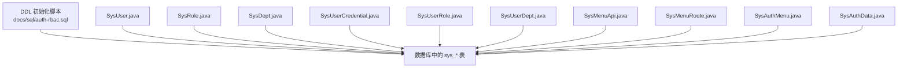
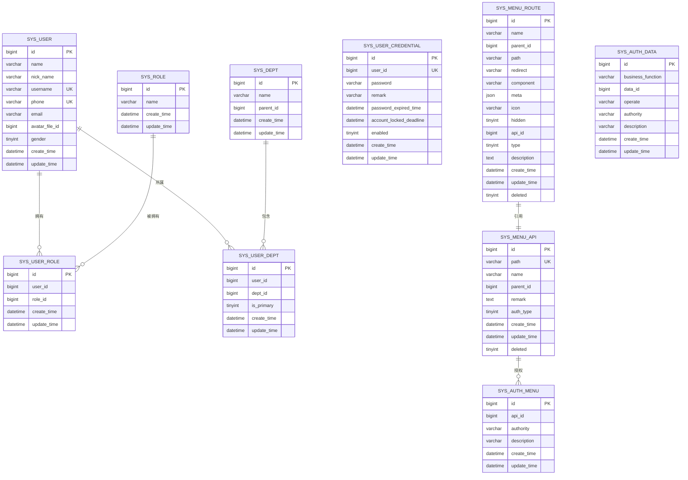
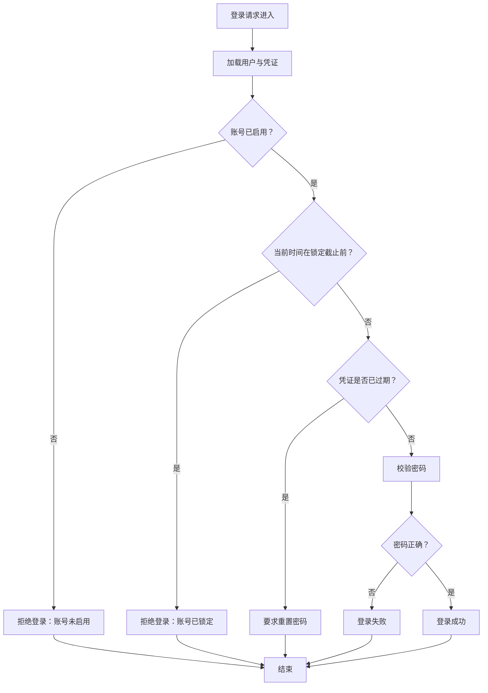
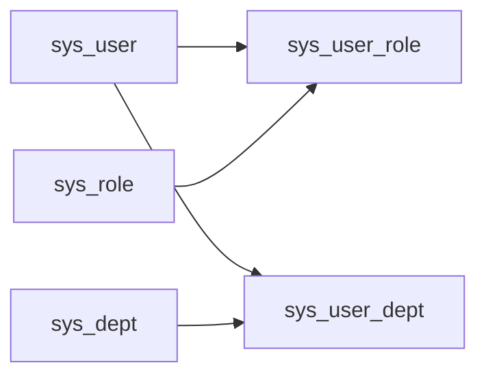
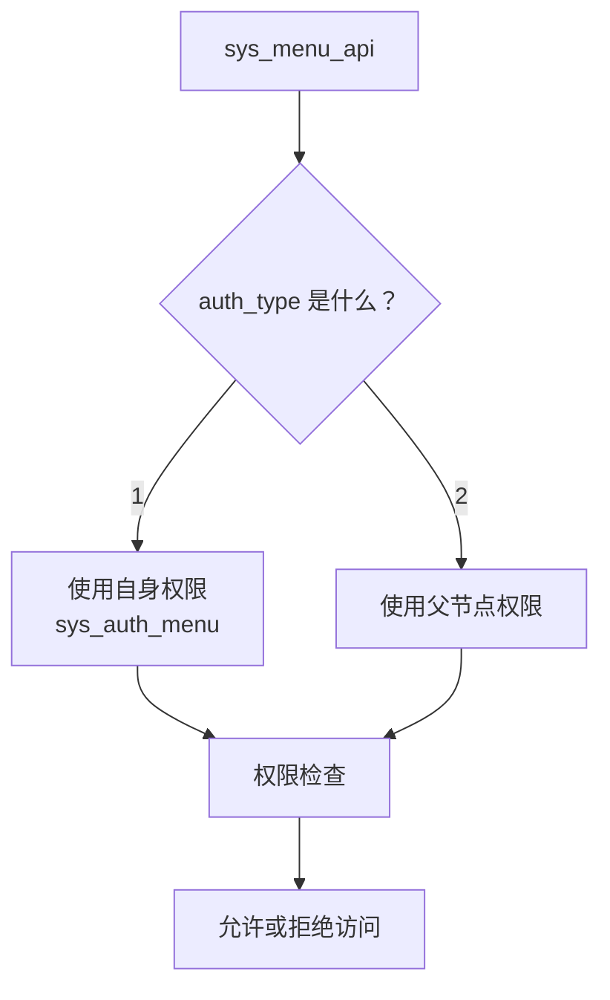
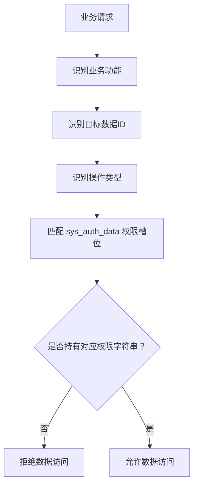

# 权限相关表结构

<cite>
**本文引用的文件**   
- [docs/sql/auth-rbac.sql](file://docs/sql/auth-rbac.sql)
- [auth/auth-rbac/src/main/java/com/cu/framework/auth/rbac/mp/entity/SysUser.java](file://auth/auth-rbac/src/main/java/com/cu/framework/auth/rbac/mp/entity/SysUser.java)
- [auth/auth-rbac/src/main/java/com/cu/framework/auth/rbac/mp/entity/SysRole.java](file://auth/auth-rbac/src/main/java/com/cu/framework/auth/rbac/mp/entity/SysRole.java)
- [auth/auth-rbac/src/main/java/com/cu/framework/auth/rbac/mp/entity/SysDept.java](file://auth/auth-rbac/src/main/java/com/cu/framework/auth/rbac/mp/entity/SysDept.java)
- [auth/auth-rbac/src/main/java/com/cu/framework/auth/rbac/mp/entity/SysUserCredential.java](file://auth/auth-rbac/src/main/java/com/cu/framework/auth/rbac/mp/entity/SysUserCredential.java)
- [auth/auth-rbac/src/main/java/com/cu/framework/auth/rbac/mp/entity/SysUserRole.java](file://auth/auth-rbac/src/main/java/com/cu/framework/auth/rbac/mp/entity/SysUserRole.java)
- [auth/auth-rbac/src/main/java/com/cu/framework/auth/rbac/mp/entity/SysUserDept.java](file://auth/auth-rbac/src/main/java/com/cu/framework/auth/rbac/mp/entity/SysUserDept.java)
- [auth/auth-rbac/src/main/java/com/cu/framework/auth/rbac/mp/entity/SysMenuApi.java](file://auth/auth-rbac/src/main/java/com/cu/framework/auth/rbac/mp/entity/SysMenuApi.java)
- [auth/auth-rbac/src/main/java/com/cu/framework/auth/rbac/mp/entity/SysMenuRoute.java](file://auth/auth-rbac/src/main/java/com/cu/framework/auth/rbac/mp/entity/SysMenuRoute.java)
- [auth/auth-rbac/src/main/java/com/cu/framework/auth/rbac/mp/entity/SysAuthMenu.java](file://auth/auth-rbac/src/main/java/com/cu/framework/auth/rbac/mp/entity/SysAuthMenu.java)
- [auth/auth-rbac/src/main/java/com/cu/framework/auth/rbac/mp/entity/SysAuthData.java](file://auth/auth-rbac/src/main/java/com/cu/framework/auth/rbac/mp/entity/SysAuthData.java)
</cite>

## 目录
1. [引言](#引言)
2. [项目结构与数据来源](#项目结构与数据来源)
3. [核心实体与表关系概览](#核心实体与表关系概览)
4. [基础主数据表设计](#基础主数据表设计)
5. [用户凭证与安全机制](#用户凭证与安全机制)
6. [多对多关联模型](#多对多关联模型)
7. [菜单权限体系](#菜单权限体系)
8. [应用数据权限控制](#应用数据权限控制)
9. [完整关系图与索引优化建议](#完整关系图与索引优化建议)
10. [查询性能与使用注意事项](#查询性能与使用注意事项)
11. [常见问题排查](#常见问题排查)
12. [结论](#结论)

## 引言
本文面向 Kewen Framework 中 RBAC 权限模块的数据库层，系统性说明以下表的字段定义、业务含义、约束规则与使用方式：
- 基础主数据：用户表 `sys_user`、角色表 `sys_role`、部门表 `sys_dept`。
- 安全凭证：用户凭证表 `sys_user_credential`，涵盖密码存储、账号启用/锁定、凭证过期等安全语义。
- 多对多关联：用户-角色关联表 `sys_user_role`、用户-部门关联表 `sys_user_dept`。
- 菜单权限：菜单 API 表 `sys_menu_api`、菜单路由表 `sys_menu_route`、菜单权限表 `sys_auth_menu`，以及权限继承策略。
- 数据权限：应用权限表 `sys_auth_data`，以“业务功能 + 数据 ID + 操作类型 + 权限字符串”组合实现行级数据访问控制。

文档同时给出 ER 图、索引分析与常见查询场景的性能建议，帮助开发者在扩展权限体系时保持结构与查询一致性。

## 项目结构与数据来源
权限相关的物理表结构由统一的初始化脚本维护，Java 实体类则作为 MyBatis-Plus 的数据映射对象。二者共同构成“数据库表结构 + Java 实体”的一致性契约。



**图表来源** 
- [docs/sql/auth-rbac.sql:1-148](file://docs/sql/auth-rbac.sql#L1-L148)
- [auth/auth-rbac/src/main/java/com/cu/framework/auth/rbac/mp/entity/SysUser.java:1-95](file://auth/auth-rbac/src/main/java/com/cu/framework/auth/rbac/mp/entity/SysUser.java#L1-L95)
- [auth/auth-rbac/src/main/java/com/cu/framework/auth/rbac/mp/entity/SysRole.java:1-60](file://auth/auth-rbac/src/main/java/com/cu/framework/auth/rbac/mp/entity/SysRole.java#L1-L60)
- [auth/auth-rbac/src/main/java/com/cu/framework/auth/rbac/mp/entity/SysDept.java:1-66](file://auth/auth-rbac/src/main/java/com/cu/framework/auth/rbac/mp/entity/SysDept.java#L1-L66)
- [auth/auth-rbac/src/main/java/com/cu/framework/auth/rbac/mp/entity/SysUserCredential.java:1-90](file://auth/auth-rbac/src/main/java/com/cu/framework/auth/rbac/mp/entity/SysUserCredential.java#L1-L90)
- [auth/auth-rbac/src/main/java/com/cu/framework/auth/rbac/mp/entity/SysUserRole.java:1-66](file://auth/auth-rbac/src/main/java/com/cu/framework/auth/rbac/mp/entity/SysUserRole.java#L1-L66)
- [auth/auth-rbac/src/main/java/com/cu/framework/auth/rbac/mp/entity/SysUserDept.java:1-72](file://auth/auth-rbac/src/main/java/com/cu/framework/auth/rbac/mp/entity/SysUserDept.java#L1-L72)
- [auth/auth-rbac/src/main/java/com/cu/framework/auth/rbac/mp/entity/SysMenuApi.java:1-94](file://auth/auth-rbac/src/main/java/com/cu/framework/auth/rbac/mp/entity/SysMenuApi.java#L1-L94)
- [auth/auth-rbac/src/main/java/com/cu/framework/auth/rbac/mp/entity/SysMenuRoute.java:1-129](file://auth/auth-rbac/src/main/java/com/cu/framework/auth/rbac/mp/entity/SysMenuRoute.java#L1-L129)
- [auth/auth-rbac/src/main/java/com/cu/framework/auth/rbac/mp/entity/SysAuthMenu.java:1-72](file://auth/auth-rbac/src/main/java/com/cu/framework/auth/rbac/mp/entity/SysAuthMenu.java#L1-L72)
- [auth/auth-rbac/src/main/java/com/cu/framework/auth/rbac/mp/entity/SysAuthData.java:1-84](file://auth/auth-rbac/src/main/java/com/cu/framework/auth/rbac/mp/entity/SysAuthData.java#L1-L84)

**章节来源**
- [docs/sql/auth-rbac.sql:1-148](file://docs/sql/auth-rbac.sql#L1-L148)

## 核心实体与表关系概览
Kewen Framework 的权限模型围绕“用户、角色、部门、菜单、API、权限字符串、数据范围”展开。核心关系如下：
- 一个用户可以拥有多个角色；一个角色可被多个用户拥有。
- 一个用户可属于多个部门，并可标记其中一个为主要归属部门。
- 菜单 API 是后端接口路径的元数据；菜单路由是前端路由展示元数据；两者通过 `api_id` 关联。
- 菜单权限表将“API + 权限字符串 + 描述”绑定到具体菜单 API。
- 应用数据权限表为每条业务数据附加“谁能在哪个业务功能下执行什么操作”。



**图表来源**
- [docs/sql/auth-rbac.sql:1-148](file://docs/sql/auth-rbac.sql#L1-L148)
- [auth/auth-rbac/src/main/java/com/cu/framework/auth/rbac/mp/entity/SysUser.java:1-95](file://auth/auth-rbac/src/main/java/com/cu/framework/auth/rbac/mp/entity/SysUser.java#L1-L95)
- [auth/auth-rbac/src/main/java/com/cu/framework/auth/rbac/mp/entity/SysRole.java:1-60](file://auth/auth-rbac/src/main/java/com/cu/framework/auth/rbac/mp/entity/SysRole.java#L1-L60)
- [auth/auth-rbac/src/main/java/com/cu/framework/auth/rbac/mp/entity/SysDept.java:1-66](file://auth/auth-rbac/src/main/java/com/cu/framework/auth/rbac/mp/entity/SysDept.java#L1-L66)
- [auth/auth-rbac/src/main/java/com/cu/framework/auth/rbac/mp/entity/SysUserCredential.java:1-90](file://auth/auth-rbac/src/main/java/com/cu/framework/auth/rbac/mp/entity/SysUserCredential.java#L1-L90)
- [auth/auth-rbac/src/main/java/com/cu/framework/auth/rbac/mp/entity/SysUserRole.java:1-66](file://auth/auth-rbac/src/main/java/com/cu/framework/auth/rbac/mp/entity/SysUserRole.java#L1-L66)
- [auth/auth-rbac/src/main/java/com/cu/framework/auth/rbac/mp/entity/SysUserDept.java:1-72](file://auth/auth-rbac/src/main/java/com/cu/framework/auth/rbac/mp/entity/SysUserDept.java#L1-L72)
- [auth/auth-rbac/src/main/java/com/cu/framework/auth/rbac/mp/entity/SysMenuApi.java:1-94](file://auth/auth-rbac/src/main/java/com/cu/framework/auth/rbac/mp/entity/SysMenuApi.java#L1-L94)
- [auth/auth-rbac/src/main/java/com/cu/framework/auth/rbac/mp/entity/SysMenuRoute.java:1-129](file://auth/auth-rbac/src/main/java/com/cu/framework/auth/rbac/mp/entity/SysMenuRoute.java#L1-L129)
- [auth/auth-rbac/src/main/java/com/cu/framework/auth/rbac/mp/entity/SysAuthMenu.java:1-72](file://auth/auth-rbac/src/main/java/com/cu/framework/auth/rbac/mp/entity/SysAuthMenu.java#L1-L72)
- [auth/auth-rbac/src/main/java/com/cu/framework/auth/rbac/mp/entity/SysAuthData.java:1-84](file://auth/auth-rbac/src/main/java/com/cu/framework/auth/rbac/mp/entity/SysAuthData.java#L1-L84)

## 基础主数据表设计

### 用户表 `sys_user`
用户表记录系统登录主体的基本信息，包括姓名、昵称、用户名、手机号、邮箱、头像文件 ID、性别及审计时间戳。

| 字段 | 类型 | 是否必填 | 默认值 | 业务含义 | 约束 |
|---|---|---:|---:|---|---|
| `id` | `bigint` | 是 | 自增 | 用户主键 | 主键 |
| `name` | `varchar(100)` | 否 | 空 | 真实姓名 | — |
| `nick_name` | `varchar(100)` | 否 | 空 | 用户昵称 | — |
| `username` | `varchar(100)` | 是 | — | 登录用户名 | 唯一索引 |
| `phone` | `varchar(20)` | 否 | 空 | 手机号 | 唯一索引 |
| `email` | `varchar(32)` | 否 | 空 | 邮箱 | — |
| `avatar_file_id` | `bigint` | 否 | 空 | 头像文件 ID | — |
| `gender` | `tinyint` | 是 | `1` | 性别：`1` 男、`2` 女、`3` 其他 | 枚举语义由业务约定 |
| `create_time` | `datetime` | 是 | 当前时间 | 创建时间 | 默认值 |
| `update_time` | `datetime` | 否 | 空 | 修改时间 | 更新时自动刷新 |

**设计要点**
- `username` 和 `phone` 均设置唯一索引，避免重复注册或绑定。
- 用户实体使用 MyBatis-Plus 的自动 ID 策略，主键类型为 `Long`。
- 性别采用小整数编码，便于扩展未来更多性别选项。

**章节来源**
- [docs/sql/auth-rbac.sql:73-91](file://docs/sql/auth-rbac.sql#L73-L91)
- [auth/auth-rbac/src/main/java/com/cu/framework/auth/rbac/mp/entity/SysUser.java:1-95](file://auth/auth-rbac/src/main/java/com/cu/framework/auth/rbac/mp/entity/SysUser.java#L1-L95)

### 角色表 `sys_role`
角色表是最基础的 RBAC 角色主数据，仅包含角色标识、名称和审计时间戳。

| 字段 | 类型 | 是否必填 | 默认值 | 业务含义 | 约束 |
|---|---|---:|---:|---|---|
| `id` | `bigint` | 是 | 自增 | 角色主键 | 主键 |
| `name` | `varchar(100)` | 是 | — | 角色名称 | — |
| `create_time` | `datetime` | 是 | 当前时间 | 创建时间 | 默认值 |
| `update_time` | `datetime` | 否 | 空 | 修改时间 | 更新时自动刷新 |

**设计要点**
- 角色表结构简单，适合做细粒度权限分配的基础维度。
- 实际菜单和数据权限通常通过“角色 → 用户”间接赋予，而不是直接在角色表中硬编码菜单列表。

**章节来源**
- [docs/sql/auth-rbac.sql:61-71](file://docs/sql/auth-rbac.sql#L61-L71)
- [auth/auth-rbac/src/main/java/com/cu/framework/auth/rbac/mp/entity/SysRole.java:1-60](file://auth/auth-rbac/src/main/java/com/cu/framework/auth/rbac/mp/entity/SysRole.java#L1-L60)

### 部门表 `sys_dept`
部门表用于构建组织树，支持父子层级结构。根部门通过 `parent_id=0` 表示。

| 字段 | 类型 | 是否必填 | 默认值 | 业务含义 | 约束 |
|---|---|---:|---:|---|---|
| `id` | `bigint` | 是 | 自增 | 部门主键 | 主键 |
| `name` | `varchar(100)` | 是 | — | 部门名称 | — |
| `parent_id` | `bigint` | 是 | — | 父部门 ID；`0` 表示根部门 | — |
| `create_time` | `datetime` | 是 | 当前时间 | 创建时间 | 默认值 |
| `update_time` | `datetime` | 否 | 空 | 修改时间 | 更新时自动刷新 |

**设计要点**
- 采用邻接表模式表达树形结构，适合中小型组织架构。
- 若部门层级较深且频繁查询祖先链，可在应用层缓存或使用闭包表/路径编码优化。

**章节来源**
- [docs/sql/auth-rbac.sql:35-45](file://docs/sql/auth-rbac.sql#L35-L45)
- [auth/auth-rbac/src/main/java/com/cu/framework/auth/rbac/mp/entity/SysDept.java:1-66](file://auth/auth-rbac/src/main/java/com/cu/framework/auth/rbac/mp/entity/SysDept.java#L1-L66)

## 用户凭证与安全机制

### 用户凭证表 `sys_user_credential`
该表与用户表分离，专门承载认证与安全状态信息。它允许同一用户存在多种凭证来源（例如本地密码、第三方免密登录），并为后续扩展预留空间。

| 字段 | 类型 | 是否必填 | 默认值 | 业务含义 | 约束 |
|---|---|---:|---:|---|---|
| `id` | `bigint` | 是 | 自增 | 凭证主键 | 主键 |
| `user_id` | `bigint` | 是 | — | 关联用户表主键 | 唯一索引 |
| `password` | `varchar(200)` | 否 | 空 | 密码值；可为空以支持免密登录 | — |
| `remark` | `varchar(64)` | 否 | 空 | 备注信息 | — |
| `password_expired_time` | `datetime` | 否 | 空 | 凭证过期时间；为空表示无过期限制 | — |
| `account_locked_deadline` | `datetime` | 否 | 空 | 账号锁定截止时间；为空或早于当前时间表示不锁定 | — |
| `enabled` | `tinyint(1)` | 是 | `1` | 账号是否启用 | — |
| `create_time` | `datetime` | 是 | 当前时间 | 创建时间 | 默认值 |
| `update_time` | `datetime` | 否 | 空 | 修改时间 | 更新时自动刷新 |

**安全机制说明**
- **密码存储**：`password` 字段允许为空，这是为了兼容免密登录场景；生产环境应存储加密后的密码值，而非明文。
- **凭证过期**：每次修改密码时应更新 `password_expired_time`；校验逻辑可据此判断是否需要强制改密。
- **账号锁定**：`account_locked_deadline` 提供基于时间的锁定窗口，常用于失败次数过多后的临时封禁。
- **账号启用状态**：`enabled` 字段可用于快速禁用账号，无需删除用户。



**图表来源**
- [docs/sql/auth-rbac.sql:93-111](file://docs/sql/auth-rbac.sql#L93-L111)
- [auth/auth-rbac/src/main/java/com/cu/framework/auth/rbac/mp/entity/SysUserCredential.java:1-90](file://auth/auth-rbac/src/main/java/com/cu/framework/auth/rbac/mp/entity/SysUserCredential.java#L1-L90)

**章节来源**
- [docs/sql/auth-rbac.sql:93-111](file://docs/sql/auth-rbac.sql#L93-L111)
- [auth/auth-rbac/src/main/java/com/cu/framework/auth/rbac/mp/entity/SysUserCredential.java:1-90](file://auth/auth-rbac/src/main/java/com/cu/framework/auth/rbac/mp/entity/SysUserCredential.java#L1-L90)

## 多对多关联模型

### 用户-角色关联表 `sys_user_role`
该表实现用户与角色的多对多关系。每个记录表示某个用户被授予某个角色。

| 字段 | 类型 | 是否必填 | 默认值 | 业务含义 | 约束 |
|---|---|---:|---:|---|---|
| `id` | `bigint` | 是 | 自增 | 关联记录主键 | 主键 |
| `user_id` | `bigint` | 是 | — | 用户主键 | 复合索引 |
| `role_id` | `bigint` | 是 | — | 角色主键 | 复合索引 |
| `create_time` | `datetime` | 是 | 当前时间 | 创建时间 | 默认值 |
| `update_time` | `datetime` | 否 | 空 | 修改时间 | 更新时自动刷新 |

**设计要点**
- 复合索引 `(user_id, role_id)` 有利于按用户查角色、按角色查用户的批量查询。
- 建议在业务层保证 `(user_id, role_id)` 唯一，避免重复授权。

### 用户-部门关联表 `sys_user_dept`
该表实现用户与部门的多对多关系，并引入“主要归属部门”概念。

| 字段 | 类型 | 是否必填 | 默认值 | 业务含义 | 约束 |
|---|---|---:|---:|---|---|
| `id` | `bigint` | 是 | 自增 | 关联记录主键 | 主键 |
| `user_id` | `bigint` | 是 | — | 用户主键 | 复合索引 |
| `dept_id` | `bigint` | 是 | — | 部门主键 | 复合索引 |
| `is_primary` | `tinyint` | 是 | `0` | 是否主要归属部门：`1` 为主部门，`0` 为非主部门 | — |
| `create_time` | `datetime` | 是 | 当前时间 | 创建时间 | 默认值 |
| `update_time` | `datetime` | 否 | 空 | 修改时间 | 更新时自动刷新 |

**设计要点**
- 复合索引 `(user_id, dept_id)` 支持按用户获取部门集合。
- “主要归属部门”可用于决定默认数据范围、默认租户上下文或默认报表维度。
- 业务上应限制每个用户最多一个主部门，避免歧义。



**图表来源**
- [docs/sql/auth-rbac.sql:113-141](file://docs/sql/auth-rbac.sql#L113-L141)
- [auth/auth-rbac/src/main/java/com/cu/framework/auth/rbac/mp/entity/SysUserRole.java:1-66](file://auth/auth-rbac/src/main/java/com/cu/framework/auth/rbac/mp/entity/SysUserRole.java#L1-L66)
- [auth/auth-rbac/src/main/java/com/cu/framework/auth/rbac/mp/entity/SysUserDept.java:1-72](file://auth/auth-rbac/src/main/java/com/cu/framework/auth/rbac/mp/entity/SysUserDept.java#L1-L72)

**章节来源**
- [docs/sql/auth-rbac.sql:113-141](file://docs/sql/auth-rbac.sql#L113-L141)
- [auth/auth-rbac/src/main/java/com/cu/framework/auth/rbac/mp/entity/SysUserRole.java:1-66](file://auth/auth-rbac/src/main/java/com/cu/framework/auth/rbac/mp/entity/SysUserRole.java#L1-L66)
- [auth/auth-rbac/src/main/java/com/cu/framework/auth/rbac/mp/entity/SysUserDept.java:1-72](file://auth/auth-rbac/src/main/java/com/cu/framework/auth/rbac/mp/entity/SysUserDept.java#L1-L72)

## 菜单权限体系

### 菜单 API 表 `sys_menu_api`
菜单 API 表描述后端接口路径及其元信息，是权限控制和菜单生成的核心锚点。

| 字段 | 类型 | 是否必填 | 默认值 | 业务含义 | 约束 |
|---|---|---:|---:|---|---|
| `id` | `bigint` | 是 | — | API 主键 | 主键 |
| `path` | `varchar(256)` | 是 | — | 请求路径 | 唯一索引 |
| `name` | `varchar(255)` | 否 | 空 | 请求名称 | — |
| `parent_id` | `bigint` | 是 | `0` | 父节点 ID；`0` 表示根节点 | — |
| `remark` | `text` | 否 | 空 | 备注 | — |
| `auth_type` | `tinyint` | 是 | `1` | 权限类型：`1` 基于自身权限，`2` 基于父权限 | — |
| `create_time` | `datetime` | 是 | 当前时间 | 创建时间 | 默认值 |
| `update_time` | `datetime` | 否 | 空 | 修改时间 | 更新时自动刷新 |
| `deleted` | `tinyint` | 否 | `0` | 逻辑删除标记 | — |

**权限继承机制**
- `auth_type=1`：该 API 的权限判断基于自身绑定的菜单权限。
- `auth_type=2`：该 API 的权限判断基于其父节点的权限；适合按钮、子菜单等继承父菜单权限的场景。
- 框架提供了视图 `view_menu_api_auth`，用于只查询以自身权限为主的 API 与其权限字符串，便于权限透视和调试。

### 菜单路由表 `sys_menu_route`
菜单路由表描述前端路由、组件、图标、隐藏策略以及与 API 的关系，主要用于前端菜单渲染。

| 字段 | 类型 | 是否必填 | 默认值 | 业务含义 | 约束 |
|---|---|---:|---:|---|---|
| `id` | `bigint` | 是 | 自增 | 路由主键 | 主键 |
| `name` | `varchar(200)` | 否 | 空 | 路由名 | — |
| `parent_id` | `bigint` | 否 | 空 | 父路由 ID | — |
| `path` | `varchar(512)` | 否 | 空 | 链接或路径 | — |
| `redirect` | `varchar(64)` | 否 | 空 | 重定向路由 | — |
| `component` | `varchar(64)` | 否 | 空 | 组件名 | — |
| `meta` | `json` | 否 | 空 | 元信息 | JSON 类型 |
| `icon` | `varchar(512)` | 否 | 空 | 图标地址 | — |
| `hidden` | `tinyint(1)` | 否 | `0` | 是否隐藏菜单 | — |
| `api_id` | `bigint` | 否 | 空 | 关联的 API ID | — |
| `type` | `tinyint` | 是 | `1` | 类型：`1` 菜单、`2` 按钮、`3` 外部链接 | — |
| `description` | `text` | 否 | 空 | 描述 | — |
| `create_time` | `datetime` | 是 | 当前时间 | 创建时间 | 默认值 |
| `update_time` | `datetime` | 否 | 空 | 修改时间 | 更新时自动刷新 |
| `deleted` | `tinyint` | 否 | `0` | 逻辑删除标记 | — |

**设计要点**
- `meta` 使用 JSON 存储，便于扩展前端路由所需的动态配置。
- `api_id` 将前端路由与后端 API 关联，形成“前端路由 → 后端接口 → 权限字符串”的完整链路。

### 菜单权限表 `sys_auth_menu`
菜单权限表将“API + 权限字符串 + 权限描述”绑定在一起，供权限系统判定用户是否有权访问某个 API。

| 字段 | 类型 | 是否必填 | 默认值 | 业务含义 | 约束 |
|---|---|---:|---:|---|---|
| `id` | `bigint` | 是 | 自增 | 权限记录主键 | 主键 |
| `api_id` | `bigint` | 是 | — | 关联菜单 API 主键 | — |
| `authority` | `varchar(100)` | 是 | — | 权限字符串 | — |
| `description` | `varchar(200)` | 是 | — | 权限描述 | — |
| `create_time` | `datetime` | 是 | 当前时间 | 创建时间 | 默认值 |
| `update_time` | `datetime` | 否 | 空 | 修改时间 | 更新时自动刷新 |

**权限继承流程示意**


**图表来源**
- [docs/sql/auth-rbac.sql:47-91](file://docs/sql/auth-rbac.sql#L47-L91)
- [auth/auth-rbac/src/main/java/com/cu/framework/auth/rbac/mp/entity/SysMenuApi.java:1-94](file://auth/auth-rbac/src/main/java/com/cu/framework/auth/rbac/mp/entity/SysMenuApi.java#L1-L94)
- [auth/auth-rbac/src/main/java/com/cu/framework/auth/rbac/mp/entity/SysMenuRoute.java:1-129](file://auth/auth-rbac/src/main/java/com/cu/framework/auth/rbac/mp/entity/SysMenuRoute.java#L1-L129)
- [auth/auth-rbac/src/main/java/com/cu/framework/auth/rbac/mp/entity/SysAuthMenu.java:1-72](file://auth/auth-rbac/src/main/java/com/cu/framework/auth/rbac/mp/entity/SysAuthMenu.java#L1-L72)

**章节来源**
- [docs/sql/auth-rbac.sql:47-91](file://docs/sql/auth-rbac.sql#L47-L91)
- [auth/auth-rbac/src/main/java/com/cu/framework/auth/rbac/mp/entity/SysMenuApi.java:1-94](file://auth/auth-rbac/src/main/java/com/cu/framework/auth/rbac/mp/entity/SysMenuApi.java#L1-L94)
- [auth/auth-rbac/src/main/java/com/cu/framework/auth/rbac/mp/entity/SysMenuRoute.java:1-129](file://auth/auth-rbac/src/main/java/com/cu/framework/auth/rbac/mp/entity/SysMenuRoute.java#L1-L129)
- [auth/auth-rbac/src/main/java/com/cu/framework/auth/rbac/mp/entity/SysAuthMenu.java:1-72](file://auth/auth-rbac/src/main/java/com/cu/framework/auth/rbac/mp/entity/SysAuthMenu.java#L1-L72)

## 应用数据权限控制

### 应用权限表 `sys_auth_data`
该表实现行级数据权限控制，即“哪些用户在哪些业务功能下可以对哪些数据执行哪些操作”。

| 字段 | 类型 | 是否必填 | 默认值 | 业务含义 | 约束 |
|---|---|---:|---:|---|---|
| `id` | `bigint` | 是 | 自增 | 权限槽位主键 | 主键 |
| `business_function` | `varchar(64)` | 是 | — | 业务功能标识 | 复合索引 |
| `data_id` | `bigint` | 是 | — | 业务数据的主键 ID | 复合索引 |
| `operate` | `varchar(64)` | 是 | `unified` | 操作类型：如 `unified`、`modify`、`delete` 等 | 复合索引 |
| `authority` | `varchar(100)` | 是 | — | 权限字符串 | 复合索引 |
| `description` | `varchar(200)` | 是 | — | 权限描述 | — |
| `create_time` | `datetime` | 是 | 当前时间 | 创建时间 | 默认值 |
| `update_time` | `datetime` | 否 | 空 | 修改时间 | 更新时自动刷新 |

**组合策略说明**
- 数据权限不是单纯依赖用户或角色，而是通过“业务功能 + 数据 ID + 操作类型 + 权限字符串”的组合进行精确控制。
- 该设计支持同一数据在不同业务功能下具有不同权限，也支持同一业务功能对不同数据行开放不同权限。
- 示例模块还定义了自有权限槽位表 `demo_auth_data`，用于演示如何自定义数据权限表结构并与框架配合。



**图表来源**
- [docs/sql/auth-rbac.sql:9-23](file://docs/sql/auth-rbac.sql#L9-L23)
- [auth/auth-rbac/src/main/java/com/cu/framework/auth/rbac/mp/entity/SysAuthData.java:1-84](file://auth/auth-rbac/src/main/java/com/cu/framework/auth/rbac/mp/entity/SysAuthData.java#L1-L84)

**章节来源**
- [docs/sql/auth-rbac.sql:9-23](file://docs/sql/auth-rbac.sql#L9-L23)
- [auth/auth-rbac/src/main/java/com/cu/framework/auth/rbac/mp/entity/SysAuthData.java:1-84](file://auth/auth-rbac/src/main/java/com/cu/framework/auth/rbac/mp/entity/SysAuthData.java#L1-L84)

## 完整关系图与索引优化建议

### 实体关系总览
下图汇总了权限相关表的完整关系，包括主数据、凭证、关联表、菜单权限和数据权限。

```mermaid
graph TB
    subgraph "身份主数据"
      U["sys_user"]
      R["sys_role"]
      D["sys_dept"]
      C["sys_user_credential"]
    end

    subgraph "关联关系"
      UR["sys_user_role"]
      UD["sys_user_dept"]
    end

    subgraph "菜单与路由"
      MA["sys_menu_api"]
      MR["sys_menu_route"]
      AM["sys_auth_menu"]
    end

    subgraph "数据权限"
      AD["sys_auth_data"]
    end

    U --> UR
    R --> UR
    U --> UD
    D --> UD
    C --> U
    MA --> AM
    MR --> MA
    AD -.-> "按业务功能、数据ID、操作、权限串过滤"
```

**图表来源**
- [docs/sql/auth-rbac.sql:9-148](file://docs/sql/auth-rbac.sql#L9-L148)
- [auth/auth-rbac/src/main/java/com/cu/framework/auth/rbac/mp/entity/SysUser.java:1-95](file://auth/auth-rbac/src/main/java/com/cu/framework/auth/rbac/mp/entity/SysUser.java#L1-L95)
- [auth/auth-rbac/src/main/java/com/cu/framework/auth/rbac/mp/entity/SysRole.java:1-60](file://auth/auth-rbac/src/main/java/com/cu/framework/auth/rbac/mp/entity/SysRole.java#L1-L60)
- [auth/auth-rbac/src/main/java/com/cu/framework/auth/rbac/mp/entity/SysDept.java:1-66](file://auth/auth-rbac/src/main/java/com/cu/framework/auth/rbac/mp/entity/SysDept.java#L1-L66)
- [auth/auth-rbac/src/main/java/com/cu/framework/auth/rbac/mp/entity/SysUserCredential.java:1-90](file://auth/auth-rbac/src/main/java/com/cu/framework/auth/rbac/mp/entity/SysUserCredential.java#L1-L90)
- [auth/auth-rbac/src/main/java/com/cu/framework/auth/rbac/mp/entity/SysUserRole.java:1-66](file://auth/auth-rbac/src/main/java/com/cu/framework/auth/rbac/mp/entity/SysUserRole.java#L1-L66)
- [auth/auth-rbac/src/main/java/com/cu/framework/auth/rbac/mp/entity/SysUserDept.java:1-72](file://auth/auth-rbac/src/main/java/com/cu/framework/auth/rbac/mp/entity/SysUserDept.java#L1-L72)
- [auth/auth-rbac/src/main/java/com/cu/framework/auth/rbac/mp/entity/SysMenuApi.java:1-94](file://auth/auth-rbac/src/main/java/com/cu/framework/auth/rbac/mp/entity/SysMenuApi.java#L1-L94)
- [auth/auth-rbac/src/main/java/com/cu/framework/auth/rbac/mp/entity/SysMenuRoute.java:1-129](file://auth/auth-rbac/src/main/java/com/cu/framework/auth/rbac/mp/entity/SysMenuRoute.java#L1-L129)
- [auth/auth-rbac/src/main/java/com/cu/framework/auth/rbac/mp/entity/SysAuthMenu.java:1-72](file://auth/auth-rbac/src/main/java/com/cu/framework/auth/rbac/mp/entity/SysAuthMenu.java#L1-L72)
- [auth/auth-rbac/src/main/java/com/cu/framework/auth/rbac/mp/entity/SysAuthData.java:1-84](file://auth/auth-rbac/src/main/java/com/cu/framework/auth/rbac/mp/entity/SysAuthData.java#L1-L84)

### 索引现状与建议
| 表 | 现有索引 | 建议补充索引 | 原因 |
|---|---|---|---|
| `sys_user` | 主键、`username` 唯一、`phone` 唯一 | 可按常用查询条件加联合索引，例如 `(username, enabled)` | 登录查询常同时判断用户名与启用状态 |
| `sys_user_credential` | 主键、`user_id` 唯一 | 可按需添加 `(account_locked_deadline, enabled)` | 批量扫描锁定账号或统计可用凭证更高效 |
| `sys_user_role` | 主键、`(user_id, role_id)` | 可增加 `(role_id, user_id)` | 提升按角色反查用户的性能 |
| `sys_user_dept` | 主键、`(user_id, dept_id)` | 可增加 `(dept_id, user_id)` 或 `(dept_id, is_primary)` | 提升按部门查成员、按部门查主成员的性能 |
| `sys_menu_api` | 主键、`path` 唯一 | 可按需添加 `(parent_id, auth_type)` | 提升按父节点查询、按权限类型筛选的性能 |
| `sys_menu_route` | 主键 | 可按需添加 `(api_id)`、`(parent_id)` | 提升按 API 反向查找路由、按父路由构建树的性能 |
| `sys_auth_menu` | 主键 | 增加 `(api_id, authority)` | 提升按 API 查询权限字符串的性能 |
| `sys_auth_data` | 主键、`(business_function, operate, data_id, authority)` | 可按业务查询模式增加 `(business_function, data_id)` 或 `(data_id, operate)` | 根据实际高频查询调整覆盖索引 |

**章节来源**
- [docs/sql/auth-rbac.sql:9-148](file://docs/sql/auth-rbac.sql#L9-L148)

## 查询性能与使用注意事项

### 典型查询模式
- **按用户查角色**：优先使用 `sys_user_role` 的 `(user_id, role_id)` 索引。
- **按角色查用户**：若无反向索引，应考虑建立 `(role_id, user_id)` 索引。
- **按用户查部门**：优先使用 `(user_id, dept_id)` 索引。
- **按部门查用户**：建议建立 `(dept_id, user_id)` 索引，尤其是需要区分主部门时。
- **按 API 查权限**：建议为 `sys_auth_menu.api_id` 建立索引，并结合 `authority` 查询。
- **按业务功能查数据权限**：`sys_auth_data` 已有复合索引，可根据实际热点增加更短的前缀索引。

### 分页与大数据量
- 权限相关表通常是低频写、高频读；适合通过应用层缓存用户权限集合、菜单树、路由树。
- 对于大数据量的 `sys_auth_data`，应避免全表扫描，始终带上 `business_function`、`data_id`、`operate` 等关键过滤条件。

### 软删除与逻辑删除
- `sys_menu_api` 和 `sys_menu_route` 包含 `deleted` 字段，表示逻辑删除。
- 查询菜单、路由时应过滤 `deleted=0`，避免返回已废弃菜单。

### 事务与一致性
- 用户-角色、用户-部门变更属于强一致场景，应在事务内完成授权、回收、日志记录等操作。
- 数据权限变更可能影响大量业务数据查询，建议结合异步刷新或权限缓存失效策略。

[本节为通用性能建议，不直接分析特定代码文件]

## 常见问题排查

### 登录失败但用户存在
- 检查 `sys_user.enabled` 是否为启用状态。
- 检查 `sys_user_credential.account_locked_deadline` 是否仍在锁定时间内。
- 检查 `sys_user_credential.password_expired_time` 是否已过期。
- 确认 `sys_user_credential.user_id` 是否正确关联到 `sys_user.id`。

### 用户无法看到菜单或按钮
- 检查 `sys_menu_api.auth_type` 是否正确设置为自身权限或父权限。
- 检查 `sys_auth_menu` 是否已为该 API 配置权限字符串。
- 检查用户是否拥有对应角色，角色是否对应所需权限。

### 数据权限不生效
- 检查 `sys_auth_data.business_function`、`data_id`、`operate`、`authority` 是否与业务调用一致。
- 注意框架示例中数据权限槽位表可以自定义，例如 `demo_auth_data`，需确认实际使用的表名与列名映射。

### 部门树查询性能差
- 若部门层级深且频繁查询祖先链，考虑在应用层缓存部门树或使用闭包表方案。
- 对高频按部门查用户的场景，确保存在 `(dept_id, user_id)` 或 `(dept_id, is_primary)` 索引。

**章节来源**
- [docs/sql/auth-rbac.sql:35-148](file://docs/sql/auth-rbac.sql#L35-L148)
- [sample/auth-core-boot-sample/sql/schema.sql:1-120](file://sample/auth-core-boot-sample/sql/schema.sql#L1-L120)

## 结论
Kewen Framework 的权限相关表结构以 RBAC 为基础，同时扩展了部门维度、菜单路由展示、菜单权限继承以及行级数据权限控制。整体设计具有以下特点：
- 主体清晰：用户、角色、部门三张主数据表职责明确。
- 安全可扩展：凭证表与用户表分离，支持密码过期、账号锁定、启用状态和免密登录扩展。
- 权限精细化：菜单权限与数据权限分离，既能控制接口访问，又能控制数据行访问。
- 可演进性强：菜单路由支持 JSON 元信息，数据权限槽位允许业务自定义表结构。

在实际使用中，建议结合业务查询热点完善索引、合理缓存权限结果，并在授权变更时保证事务一致性与缓存一致性。