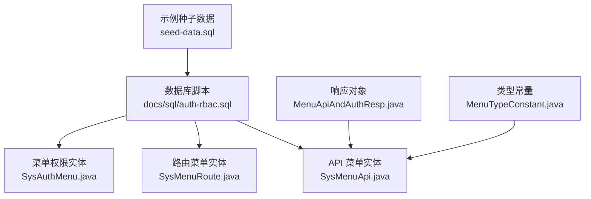
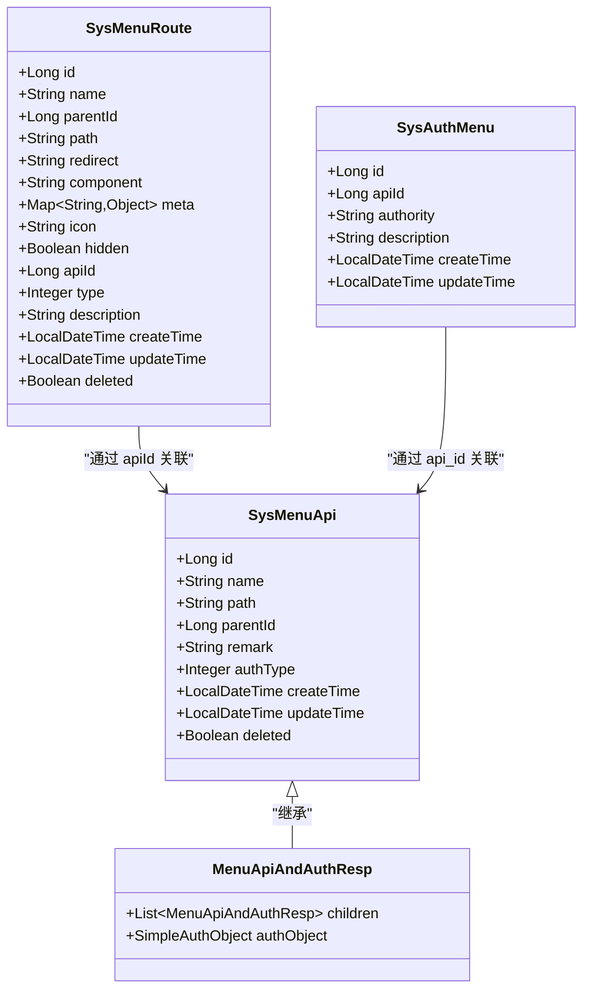
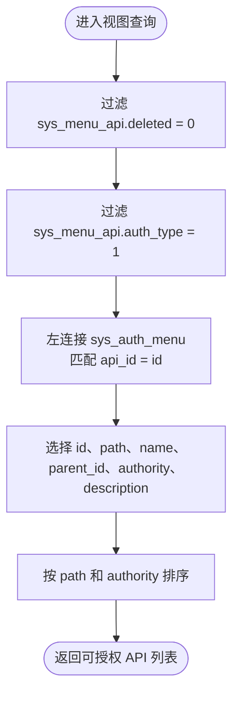
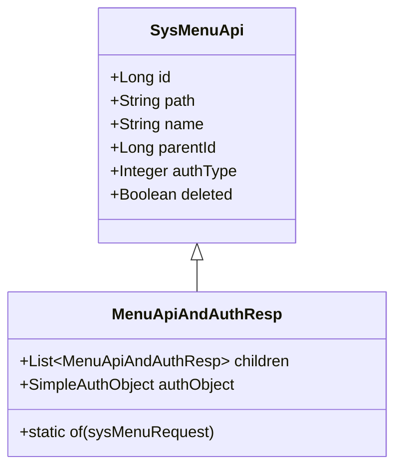
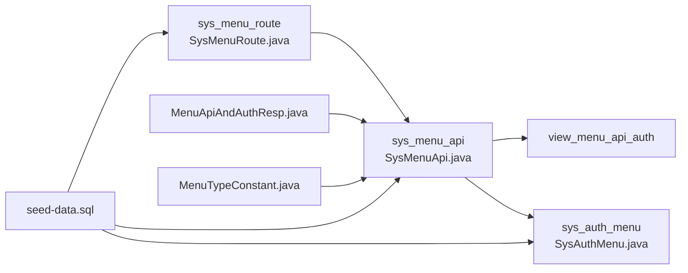

# 系统配置表结构

<cite>
**本文引用的文件**   
- [auth-rbac.sql](file://docs/sql/auth-rbac.sql)
- [SysMenuApi.java](file://auth/auth-rbac/src/main/java/com/cu/framework/auth/rbac/mp/entity/SysMenuApi.java)
- [SysMenuRoute.java](file://auth/auth-rbac/src/main/java/com/cu/framework/auth/rbac/mp/entity/SysMenuRoute.java)
- [SysAuthMenu.java](file://auth/auth-rbac/src/main/java/com/cu/framework/auth/rbac/mp/entity/SysAuthMenu.java)
- [MenuApiAndAuthResp.java](file://auth/auth-rbac/src/main/java/com/cu/framework/auth/rbac/model/resp/MenuApiAndAuthResp.java)
- [MenuTypeConstant.java](file://auth/auth-rbac/src/main/java/com/cu/framework/auth/rbac/model/MenuTypeConstant.java)
- [seed-data.sql](file://sample/auth-rbac-boot-sample/sql/seed-data.sql)
</cite>

## 目录
1. [引言](#引言)
2. [项目结构与定位](#项目结构与定位)
3. [核心数据模型](#核心数据模型)
4. [架构总览](#架构总览)
5. [详细表结构分析](#详细表结构分析)
6. [菜单权限与视图查询逻辑](#菜单权限与视图查询逻辑)
7. [依赖关系分析](#依赖关系分析)
8. [初始化与维护指南](#初始化与维护指南)
9. [性能优化建议](#性能优化建议)
10. [故障排查要点](#故障排查要点)
11. [结论](#结论)

## 引言
本文聚焦 Kewen Framework 中“菜单配置相关”的系统表结构，围绕以下目标展开：
- 说明 `sys_menu_api` 的请求路径映射、权限类型配置和层级关系管理。
- 说明 `sys_menu_route` 的菜单路由配置，包括路由嵌套、组件绑定、元信息存储和隐藏菜单控制。
- 解释 `sys_auth_menu` 的权限字符串管理与描述信息存储。
- 解释系统视图 `view_menu_api_auth` 的设计目的和查询逻辑，并说明如何基于自身权限为主进行 API 权限查询。
- 提供菜单配置的初始化方法和维护指南，包括菜单层级管理的最佳实践与性能优化建议。

## 项目结构与定位
该文档关注的数据定义位于框架的权限模块和数据库脚本中：
- 数据库建表脚本：`docs/sql/auth-rbac.sql`
- MyBatis Plus 实体类：`auth/auth-rbac/.../mp/entity/SysMenuApi.java`、`SysMenuRoute.java`、`SysAuthMenu.java`
- 响应模型与常量：`MenuApiAndAuthResp.java`、`MenuTypeConstant.java`
- 示例种子数据：`sample/auth-rbac-boot-sample/sql/seed-data.sql`

**图表来源**
- [auth-rbac.sql:1-148](file://docs/sql/auth-rbac.sql#L1-L148)
- [SysMenuApi.java:1-94](file://auth/auth-rbac/src/main/java/com/cu/framework/auth/rbac/mp/entity/SysMenuApi.java#L1-L94)
- [SysMenuRoute.java:1-129](file://auth/auth-rbac/src/main/java/com/cu/framework/auth/rbac/mp/entity/SysMenuRoute.java#L1-L129)
- [SysAuthMenu.java:1-72](file://auth/auth-rbac/src/main/java/com/cu/framework/auth/rbac/mp/entity/SysAuthMenu.java#L1-L72)
- [MenuApiAndAuthResp.java:1-37](file://auth/auth-rbac/src/main/java/com/cu/framework/auth/rbac/model/resp/MenuApiAndAuthResp.java#L1-L37)
- [MenuTypeConstant.java:1-71](file://auth/auth-rbac/src/main/java/com/cu/framework/auth/rbac/model/MenuTypeConstant.java#L1-L71)
- [seed-data.sql:1-200](file://sample/auth-rbac-boot-sample/sql/seed-data.sql#L1-L200)

**章节来源**
- [auth-rbac.sql:1-148](file://docs/sql/auth-rbac.sql#L1-L148)

## 核心数据模型
本系统的菜单与权限相关核心模型如下：

| 模型 | 对应表 | 主要职责 |
|---|---|---|
| `SysMenuApi` | `sys_menu_api` | 记录后端请求路径、父级路径、权限类型、软删除等 |
| `SysMenuRoute` | `sys_menu_route` | 记录前端路由、组件名、元信息、是否隐藏、关联 API 菜单等 |
| `SysAuthMenu` | `sys_auth_menu` | 将权限字符串绑定到某个 API 菜单 |
| `MenuApiAndAuthResp` | 无直接表 | 面向前端的 API 菜单树响应对象，携带子节点和权限集合体 |
| `MenuTypeConstant` | 无直接表 | 集中定义菜单类型与权限类型的枚举值 |

**章节来源**
- [SysMenuApi.java:1-94](file://auth/auth-rbac/src/main/java/com/cu/framework/auth/rbac/mp/entity/SysMenuApi.java#L1-L94)
- [SysMenuRoute.java:1-129](file://auth/auth-rbac/src/main/java/com/cu/framework/auth/rbac/mp/entity/SysMenuRoute.java#L1-L129)
- [SysAuthMenu.java:1-72](file://auth/auth-rbac/src/main/java/com/cu/framework/auth/rbac/mp/entity/SysAuthMenu.java#L1-L72)
- [MenuApiAndAuthResp.java:1-37](file://auth/auth-rbac/src/main/java/com/cu/framework/auth/rbac/model/resp/MenuApiAndAuthResp.java#L1-L37)
- [MenuTypeConstant.java:1-71](file://auth/auth-rbac/src/main/java/com/cu/framework/auth/rbac/model/MenuTypeConstant.java#L1-L71)

## 架构总览
菜单配置在系统中分为三层：
1. **API 层**：`sys_menu_api` 以路径为核心，组织接口级别的菜单树。
2. **路由层**：`sys_menu_route` 以页面路由为核心，组织前端导航树，并可绑定组件、元信息和图标。
3. **权限层**：`sys_auth_menu` 把权限字符串挂载到某个 API 菜单；配合视图 `view_menu_api_auth` 输出“以自身权限为主”的可授权 API 列表。

**图表来源**
- [SysMenuApi.java:1-94](file://auth/auth-rbac/src/main/java/com/cu/framework/auth/rbac/mp/entity/SysMenuApi.java#L1-L94)
- [SysMenuRoute.java:1-129](file://auth/auth-rbac/src/main/java/com/cu/framework/auth/rbac/mp/entity/SysMenuRoute.java#L1-L129)
- [SysAuthMenu.java:1-72](file://auth/auth-rbac/src/main/java/com/cu/framework/auth/rbac/mp/entity/SysAuthMenu.java#L1-L72)
- [MenuApiAndAuthResp.java:1-37](file://auth/auth-rbac/src/main/java/com/cu/framework/auth/rbac/model/resp/MenuApiAndAuthResp.java#L1-L37)

## 详细表结构分析

### sys_menu_api：API 菜单与路径层级
`sys_menu_api` 是后端接口菜单的核心表，用于按路径组织菜单树，并通过 `auth_type` 决定权限判断策略。

| 字段 | 类型 | 含义 | 设计要点 |
|---|---|---|---|
| `id` | bigint | 主键 | 作为 API 菜单的唯一标识，供 `sys_auth_menu.api_id` 引用 |
| `path` | varchar(256) | 请求路径 | 唯一索引，确保每个 API 菜单路径不重复 |
| `name` | varchar(255) | 请求名称 | 便于展示和操作日志理解 |
| `parent_id` | bigint | 父级 ID | 默认 0 表示根路径；支持多级路径层级 |
| `remark` | text | 备注 | 补充说明 |
| `auth_type` | tinyint | 权限类型 | 1 表示基于自身权限，2 表示基于父权限 |
| `create_time` / `update_time` | datetime | 时间戳 | 审计追踪 |
| `deleted` | tinyint | 软删除标记 | 默认未删除，参与视图过滤 |

**权限类型语义**
- `auth_type = 1`：当前接口的权限判断以自身绑定的权限为主；视图 `view_menu_api_auth` 只包含这类记录。
- `auth_type = 2`：当前接口不独立声明权限，而是继承父级菜单的权限判定结果。

**层级管理要点**
- 根节点通常使用 `parent_id = 0`。
- 子节点通过 `parent_id` 指向父节点 ID，形成树形结构。
- 示例种子数据中，很多子路径使用“父路径>子操作”的命名方式，便于人类阅读。

**章节来源**
- [auth-rbac.sql:37-63](file://docs/sql/auth-rbac.sql#L37-L63)
- [SysMenuApi.java:1-94](file://auth/auth-rbac/src/main/java/com/cu/framework/auth/rbac/mp/entity/SysMenuApi.java#L1-L94)
- [MenuTypeConstant.java:45-71](file://auth/auth-rbac/src/main/java/com/cu/framework/auth/rbac/model/MenuTypeConstant.java#L45-L71)
- [seed-data.sql:117-200](file://sample/auth-rbac-boot-sample/sql/seed-data.sql#L117-L200)

### sys_menu_route：前端路由菜单配置
`sys_menu_route` 是前端导航菜单的配置表，负责渲染路由树、绑定组件、存储元信息，并控制是否在菜单列表中显示。

| 字段 | 类型 | 含义 | 设计要点 |
|---|---|---|---|
| `id` | bigint | 主键 | 路由节点唯一标识 |
| `name` | varchar(200) | 路由名 | 用于 UI 展示或调试 |
| `parent_id` | bigint | 父路由 ID | 支持嵌套路由 |
| `path` | varchar(512) | 链接或路径 | 前端路由地址 |
| `redirect` | varchar(64) | 重定向路由 | 可设置默认跳转 |
| `component` | varchar(64) | 组件名 | 前端路由绑定的组件标识 |
| `meta` | json | 元信息 | 使用 FastjsonTypeHandler 处理 JSON 字段 |
| `icon` | varchar(512) | 图标地址 | 菜单图标资源地址 |
| `hidden` | tinyint(1) | 是否隐藏菜单 | 隐藏时仅加载路由，不在菜单列表显示 |
| `api_id` | bigint | 关联 API 菜单 | 与 `sys_menu_api.id` 建立业务关联 |
| `type` | tinyint | 类型 | 1 菜单、2 按钮、3 外部链接（代码注释） |
| `description` | text | 描述 | 菜单说明 |
| `create_time` / `update_time` | datetime | 时间戳 | 审计追踪 |
| `deleted` | tinyint | 软删除标记 | 默认未删除 |

**路由嵌套**
- 通过 `parent_id` 构建父子路由关系，支持多层级菜单。
- 示例数据中，“首页”“文档”“组织机构管理”为一级路由，而“部门管理”挂在“组织机构管理”下。

**组件绑定与元信息**
- `component` 字段绑定前端组件。
- `meta` 字段以 JSON 形式存储扩展元信息，例如固定标签页、外链标志等。

**隐藏菜单控制**
- `hidden = 1` 表示隐藏菜单：路由仍可访问，但不会出现在常规菜单列表中，适合后台功能入口。

**章节来源**
- [auth-rbac.sql:65-94](file://docs/sql/auth-rbac.sql#L65-L94)
- [SysMenuRoute.java:1-129](file://auth/auth-rbac/src/main/java/com/cu/framework/auth/rbac/mp/entity/SysMenuRoute.java#L1-L129)
- [seed-data.sql:201-210](file://sample/auth-rbac-boot-sample/sql/seed-data.sql#L201-L210)

### sys_auth_menu：菜单权限绑定
`sys_auth_menu` 将权限字符串绑定到具体的 API 菜单，实现“哪个菜单允许哪些权限”。

| 字段 | 类型 | 含义 | 设计要点 |
|---|---|---|---|
| `id` | bigint | 主键 | 权限绑定记录主键 |
| `api_id` | bigint | 菜单 ID | 指向 `sys_menu_api.id` |
| `authority` | varchar(100) | 权限字符串 | 典型如角色或用户维度权限标识 |
| `description` | varchar(200) | 权限描述 | 便于权限管理和展示 |
| `create_time` / `update_time` | datetime | 时间戳 | 审计追踪 |

**权限字符串管理**
- 权限字符串由应用侧约定，常见形式包括角色权限、用户权限、部门范围权限等。
- 示例种子数据中包含 `ROLE__超级管理员`、`RELATIONDEPT__总部` 等，体现角色与部门范围两种权限语义。

**与 API 菜单的关系**
- 一条 `sys_auth_menu` 记录表示某个 API 菜单允许某个权限字符串。
- 一个 API 菜单可以绑定多个权限字符串，形成“菜单→权限集合”的多对一关系。

**章节来源**
- [auth-rbac.sql:22-35](file://docs/sql/auth-rbac.sql#L22-L35)
- [SysAuthMenu.java:1-72](file://auth/auth-rbac/src/main/java/com/cu/framework/auth/rbac/mp/entity/SysAuthMenu.java#L1-L72)
- [seed-data.sql:30-55](file://sample/auth-rbac-boot-sample/sql/seed-data.sql#L30-L55)

## 菜单权限与视图查询逻辑

### view_menu_api_auth：以自身权限为主的 API 权限视图
`view_menu_api_auth` 是一个数据库视图，用于快速查看“应该被分配权限的 API 菜单”，其核心规则是：
- 只选择 `sys_menu_api.deleted = 0` 的记录。
- 只选择 `sys_menu_api.auth_type = 1` 的记录，即“基于自身权限”的 API 菜单。
- 左连接 `sys_auth_menu`，获取该 API 菜单已绑定的权限字符串和描述。
- 按 `path` 和 `authority` 排序，便于生成权限矩阵或权限透视台。

**图表来源**
- [auth-rbac.sql:141-148](file://docs/sql/auth-rbac.sql#L141-L148)

**设计目的**
- 避免把“基于父权限”的 API 菜单也当成需要单独授权的对象。
- 为权限分配界面、权限透视台、权限校验流程提供统一数据源。
- 让前端或运维人员能直观看到“哪些 API 菜单需要分配权限字符串”。

**查询逻辑说明**
- 如果某个 API 菜单没有绑定任何权限，`authority` 和 `description` 可能为空，但仍会出现在视图中。
- 如果某个 API 菜单绑定了多个权限，会返回多行，便于逐条维护。

**章节来源**
- [auth-rbac.sql:141-148](file://docs/sql/auth-rbac.sql#L141-L148)

### MenuApiAndAuthResp：API 菜单树响应对象
`MenuApiAndAuthResp` 继承 `SysMenuApi`，并扩展了两个关键能力：
- `children`：用于构建 API 菜单树。
- `authObject`：封装该菜单挂载的权限集合体，来源于 `sys_auth_menu`。

**图表来源**
- [SysMenuApi.java:1-94](file://auth/auth-rbac/src/main/java/com/cu/framework/auth/rbac/mp/entity/SysMenuApi.java#L1-L94)
- [MenuApiAndAuthResp.java:1-37](file://auth/auth-rbac/src/main/java/com/cu/framework/auth/rbac/model/resp/MenuApiAndAuthResp.java#L1-L37)

**使用场景**
- 后端组装 API 菜单树时，将 `SysMenuApi` 转换为 `MenuApiAndAuthResp`。
- 前端可基于 `children` 渲染树形菜单，基于 `authObject` 渲染按钮权限或操作权限。

**章节来源**
- [MenuApiAndAuthResp.java:1-37](file://auth/auth-rbac/src/main/java/com/cu/framework/auth/rbac/model/resp/MenuApiAndAuthResp.java#L1-L37)

## 依赖关系分析

**图表来源**
- [auth-rbac.sql:1-148](file://docs/sql/auth-rbac.sql#L1-L148)
- [SysMenuApi.java:1-94](file://auth/auth-rbac/src/main/java/com/cu/framework/auth/rbac/mp/entity/SysMenuApi.java#L1-L94)
- [SysMenuRoute.java:1-129](file://auth/auth-rbac/src/main/java/com/cu/framework/auth/rbac/mp/entity/SysMenuRoute.java#L1-L129)
- [SysAuthMenu.java:1-72](file://auth/auth-rbac/src/main/java/com/cu/framework/auth/rbac/mp/entity/SysAuthMenu.java#L1-L72)
- [MenuApiAndAuthResp.java:1-37](file://auth/auth-rbac/src/main/java/com/cu/framework/auth/rbac/model/resp/MenuApiAndAuthResp.java#L1-L37)
- [MenuTypeConstant.java:1-71](file://auth/auth-rbac/src/main/java/com/cu/framework/auth/rbac/model/MenuTypeConstant.java#L1-L71)
- [seed-data.sql:1-200](file://sample/auth-rbac-boot-sample/sql/seed-data.sql#L1-L200)

**耦合与内聚分析**
- `sys_menu_api` 是权限判断的核心锚点，被视图和权限表引用，内聚性较高。
- `sys_menu_route` 与 `sys_menu_api` 通过 `api_id` 解耦，路由层不直接关心权限字符串，只关心业务上应关联哪个 API 菜单。
- `sys_auth_menu` 与 `sys_menu_api` 通过 `api_id` 关联，保持“菜单→权限”关系的清晰边界。
- `MenuApiAndAuthResp` 是面向前端的聚合响应，降低前端同时处理多个实体的复杂度。

**潜在风险**
- 若 `sys_menu_api.path` 重复，会导致唯一约束冲突。
- 若 `sys_menu_route.api_id` 指向不存在的 `sys_menu_api.id`，会造成路由无法正确关联 API 菜单。
- 若 `sys_auth_menu.api_id` 指向不存在的 `sys_menu_api.id`，会影响权限绑定和数据一致性。

**章节来源**
- [auth-rbac.sql:1-148](file://docs/sql/auth-rbac.sql#L1-L148)
- [seed-data.sql:1-200](file://sample/auth-rbac-boot-sample/sql/seed-data.sql#L1-L200)

## 初始化与维护指南

### 初始化方法
1. **执行建表脚本**  
   使用 `docs/sql/auth-rbac.sql` 初始化权限相关表结构和视图。该脚本兼容 MySQL 与 H2（MySQL 模式），并通过脚本校验兼容性。

2. **导入示例种子数据**  
   示例项目中 `sample/auth-rbac-boot-sample/sql/seed-data.sql` 提供了演示用的菜单、权限、部门和用户关联数据。注意：
   - 该脚本依赖 `auth-rbac.sql` 已建表。
   - 种子数据非幂等，主要用于演示环境。
   - MySQL 环境建议按需手动导入一次，不要混入自动初始化流程。

3. **根据业务创建 API 菜单**  
   - 新增后端接口后，向 `sys_menu_api` 插入路径、名称、父级 ID 和权限类型。
   - 根级菜单使用 `parent_id = 0`。
   - 对于需要独立权限控制的接口，设置 `auth_type = 1`。
   - 对于继承父级权限的接口，设置 `auth_type = 2`。

4. **配置前端路由菜单**  
   - 在 `sys_menu_route` 中新增路由节点，填写 `name`、`path`、`component`、`meta`、`icon`、`hidden` 等。
   - 如需关联后端 API 菜单，填写 `api_id`。
   - 如需隐藏菜单但保留路由，设置 `hidden = 1`。

5. **绑定菜单权限**  
   - 在 `sys_auth_menu` 中为需要的 API 菜单添加权限字符串。
   - 权限字符串应与业务系统中的角色、用户、部门等权限体系保持一致。

**章节来源**
- [auth-rbac.sql:1-148](file://docs/sql/auth-rbac.sql#L1-L148)
- [seed-data.sql:1-200](file://sample/auth-rbac-boot-sample/sql/seed-data.sql#L1-L200)

### 菜单层级管理最佳实践
- **统一路径规范**：建议路径体现业务域，例如 `/rbac/dept/page`、`/meetingRoom/page`。
- **合理使用父级**：不要把每个小接口都当成根节点；同一业务域的接口应共享父级路径。
- **明确权限类型**：
  - 父级菜单一般用于分组展示，不一定需要独立权限。
  - 真正需要权限控制的接口设置为 `auth_type = 1`。
  - 继承父级权限的子接口设置为 `auth_type = 2`，减少重复授权。
- **命名可读性**：示例中使用“父路径>子操作”的方式命名 `name`，便于运维和测试理解。
- **路由与 API 分离**：
  - `sys_menu_route` 关注前端展示和路由。
  - `sys_menu_api` 关注后端接口权限。
  - 通过 `api_id` 建立关联，避免耦合。

**章节来源**
- [seed-data.sql:117-210](file://sample/auth-rbac-boot-sample/sql/seed-data.sql#L117-L210)
- [MenuTypeConstant.java:1-71](file://auth/auth-rbac/src/main/java/com/cu/framework/auth/rbac/model/MenuTypeConstant.java#L1-L71)

## 性能优化建议
- **利用视图过滤条件**  
  `view_menu_api_auth` 已经过滤了软删除记录和“基于父权限”的记录，可直接用于权限矩阵查询，避免应用层再次筛选。

- **路径唯一索引**  
  `sys_menu_api.path` 有唯一索引，防止重复路径导致查询异常和维护混乱。

- **避免深层递归查询**  
  菜单树通常在应用层组装，而不是在数据库中进行复杂递归查询；可通过多次查询或批量查询配合内存树构建提升性能。

- **JSON 字段谨慎使用**  
  `sys_menu_route.meta` 使用 JSON 类型，便于扩展，但不宜存放过大或频繁变化的数据；否则会影响序列化性能和查询效率。

- **软删除字段参与查询**  
  表和视图普遍使用 `deleted` 字段，查询时应始终带上软删除过滤，避免读到历史数据。

- **权限绑定粒度控制**  
  不要在 `sys_auth_menu` 中为每个微小操作都新增权限字符串；优先复用已有权限，并结合数据范围权限机制控制细粒度数据访问。

[本节为通用性能建议，不直接分析具体代码文件]

## 故障排查要点
- **API 菜单路径重复**  
  现象：插入 `sys_menu_api` 时报唯一索引冲突。  
  排查：检查 `path` 是否重复，确认是否需要合并或调整路径。

- **权限透视台看不到某个 API**  
  现象：调用 `view_menu_api_auth` 没有期望记录。  
  排查：
  - 检查 `deleted` 是否为 0。
  - 检查 `auth_type` 是否为 1。
  - 检查是否存在该 `path` 的 API 菜单。

- **路由没有菜单显示**  
  现象：路由可访问，但菜单列表不显示。  
  排查：检查 `sys_menu_route.hidden` 是否为 1。

- **路由无法关联 API 菜单**  
  现象：路由存在但权限树不完整。  
  排查：检查 `sys_menu_route.api_id` 是否指向有效的 `sys_menu_api.id`。

- **权限绑定无效**  
  现象：用户有角色但无法访问菜单。  
  排查：
  - 检查 `sys_auth_menu.api_id` 是否正确。
  - 检查权限字符串是否与当前用户的角色或部门范围匹配。
  - 检查菜单的 `auth_type` 是否影响权限继承。

**章节来源**
- [auth-rbac.sql:37-148](file://docs/sql/auth-rbac.sql#L37-L148)
- [seed-data.sql:30-210](file://sample/auth-rbac-boot-sample/sql/seed-data.sql#L30-L210)

## 结论
Kewen Framework 的菜单配置体系通过三张核心表和一张视图完成“路径—路由—权限”的分层建模：
- `sys_menu_api` 以 API 路径为中心，管理接口菜单层级和权限类型。
- `sys_menu_route` 以路由为中心，管理前端导航、组件绑定和显示控制。
- `sys_auth_menu` 将权限字符串绑定到 API 菜单，形成可维护的权限清单。
- `view_menu_api_auth` 聚焦“基于自身权限”的 API 菜单，为权限分配和权限透视提供稳定数据源。

在实际维护中，应严格区分 API 菜单和路由菜单的职责边界，合理设置 `auth_type`，并使用视图和常量枚举保证权限语义一致。通过规范化路径、合理使用父级菜单、控制权限绑定粒度和遵循软删除规范，可以在复杂业务场景中保持菜单与权限体系的可读性和可维护性。