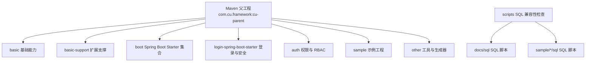
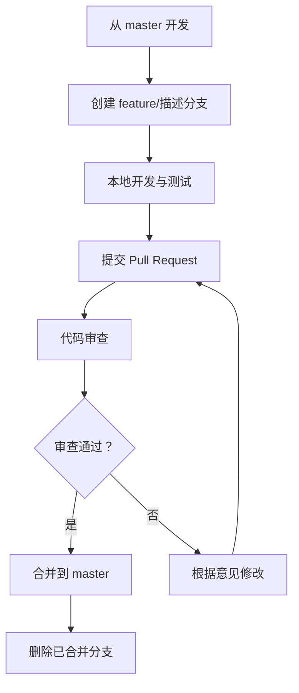
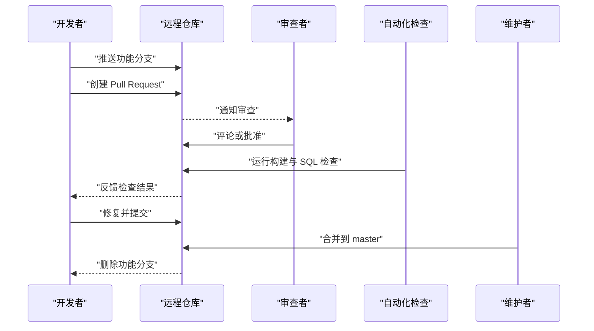
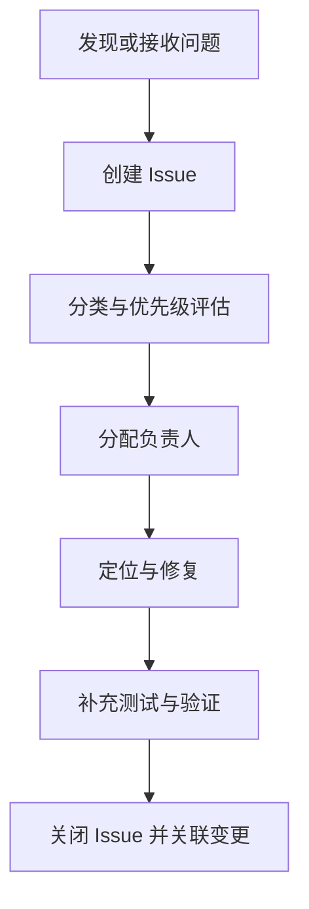
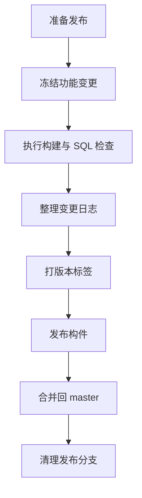
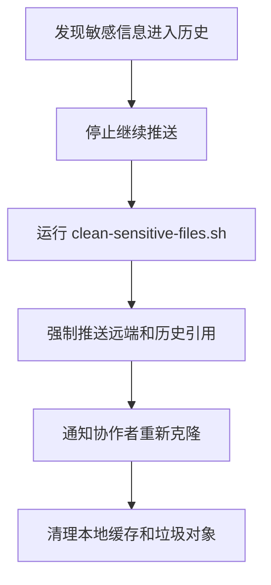
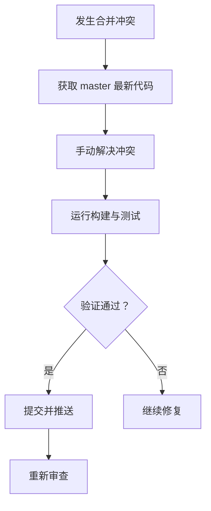
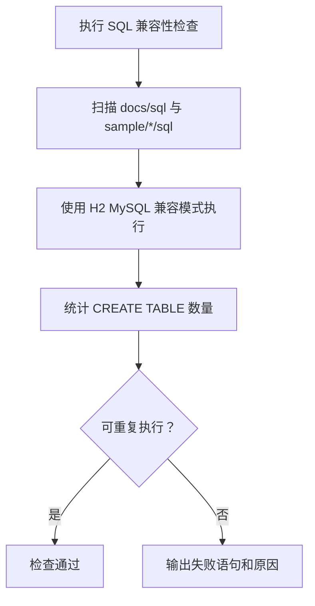
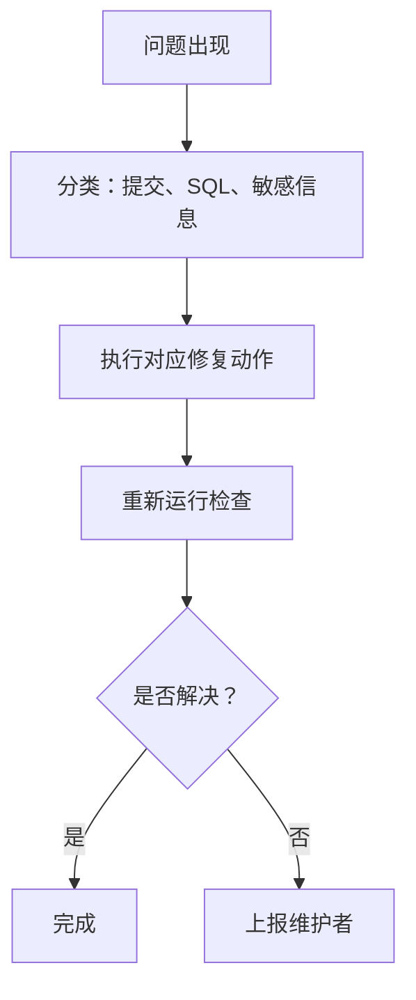

# Git 工作流与提交规范

<cite>
**本文引用的文件**   
- [.gitignore](file://.gitignore)
- [clean-sensitive-files.sh](file://clean-sensitive-files.sh)
- [scripts/CheckCompat.java](file://scripts/CheckCompat.java)
- [scripts/check-sql-compat.sh](file://scripts/check-sql-compat.sh)
- [pom.xml](file://pom.xml)
- [.gitee/.gitee\ISSUE_TEMPLATE.zh-CN.md](file://.gitee/.gitee\ISSUE_TEMPLATE.zh-CN.md)
- [.gitee/.gitee\PULL_REQUEST_TEMPLATE.zh-CN.md](file://.gitee/.gitee\PULL_REQUEST_TEMPLATE.zh-CN.md)
</cite>

## 目录
1. [引言](#引言)
2. [项目结构与协作范围](#项目结构与协作范围)
3. [分支管理策略](#分支管理策略)
4. [提交信息规范](#提交信息规范)
5. [代码审查与合并流程](#代码审查与合并流程)
6. [Issue 跟踪与问题报告](#issue-跟踪与问题报告)
7. [版本发布与变更日志](#版本发布与变更日志)
8. [Git 操作最佳实践](#git-操作最佳实践)
9. [冲突解决与回滚指南](#冲突解决与回滚指南)
10. [依赖、构建与质量门禁](#依赖构建与质量门禁)
11. [常见问题排查](#常见问题排查)
12. [结论](#结论)

## 引言
本规范面向 Kewen Framework 的 Git 协作，目标是通过统一的分支命名、提交格式、审查标准和发布流程，降低多模块仓库中的协作成本。Kewen Framework 是一个基于 Maven 的多模块 Java 工程，核心模块包括基础能力、登录与安全、权限体系、示例工程及工具脚本等。

本仓库已经具备：
- Gitee Issue 和 Pull Request 模板；
- 敏感文件忽略规则与历史清理脚本；
- SQL 兼容性检查工具；
- 以 `com.cu.framework` 为根坐标的 Maven 父工程；
- 多个业务与示例模块。

因此，本文在结合现有仓库结构的基础上，定义适合该仓库的 Git 工作流和协作规范。

**章节来源**
- [pom.xml:1-25](file://pom.xml#L1-L25)
- [.gitee/.gitee\ISSUE_TEMPLATE.zh-CN.md](file://.gitee/.gitee\ISSUE_TEMPLATE.zh-CN.md)
- [.gitee/.gitee\PULL_REQUEST_TEMPLATE.zh-CN.md](file://.gitee/.gitee\PULL_REQUEST_TEMPLATE.zh-CN.md)

## 项目结构与协作范围
Kewen Framework 采用 Maven 多模块结构，根 `pom.xml` 声明了多个子模块，例如基础能力、登录安全、权限、示例工程等。协作时应注意：
- 根 `pom.xml` 控制全局版本、依赖管理和模块清单；
- `auth`、`login-spring-boot-starter`、`basic`、`boot`、`sample`、`other` 等模块之间存在依赖关系；
- `scripts` 下提供 SQL 兼容性检查工具，应作为开发阶段的质量门禁；
- `.gitee` 下的模板用于统一 Issue 和 Pull Request 填写格式；
- `.gitignore` 明确排除构建产物、IDE 配置、日志、密钥类敏感文件。

**图表来源**
- [pom.xml:1-25](file://pom.xml#L1-L25)
- [scripts/check-sql-compat.sh:1-32](file://scripts/check-sql-compat.sh#L1-L32)
- [scripts/CheckCompat.java:1-20](file://scripts/CheckCompat.java#L1-L20)

**章节来源**
- [pom.xml:1-25](file://pom.xml#L1-L25)
- [scripts/check-sql-compat.sh:1-32](file://scripts/check-sql-compat.sh#L1-L32)

## 分支管理策略
建议采用“主干稳定 + 功能分支 + 短期修复 + 可选发布分支”的模式。

| 分支类型 | 命名约定 | 用途 | 创建者 | 生命周期 |
|---|---|---|---|---|
| 主分支 | `master` | 可发布的稳定基线 | 维护者 | 长期存在 |
| 功能分支 | `feature/描述性名称` | 实现新需求或新功能 | 开发者 | 合并后删除 |
| 修复分支 | `fix/描述性名称` | 修复非紧急缺陷 | 开发者 | 合并后删除 |
| 紧急修复分支 | `hotfix/描述性名称` | 线上紧急修复 | 授权开发者 | 合并后删除 |
| 发布分支（可选） | `release/版本号` | 冻结发布内容、回归验证 | 发布负责人 | 发布完成后删除 |

### 使用规则
- 所有开发从 `master` 拉出功能分支；
- 功能完成并自测通过后，发起 Pull Request 合并到 `master`；
- 线上紧急问题通过 `hotfix` 分支快速修复，并在 `master` 同步；
- 正式发版时可使用 `release/x.y.z` 进行冻结和回归；
- 分支命名要简短、可读、语义清晰，避免过长或使用无意义缩写。

**图表来源**
- [pom.xml:1-25](file://pom.xml#L1-L25)

**章节来源**
- [pom.xml:1-25](file://pom.xml#L1-L25)

## 提交信息规范
本项目推荐采用约定式提交（Conventional Commits），使提交历史更易检索、自动生成变更日志更可靠。

### 提交消息格式
提交消息应包含以下部分：

| 字段 | 说明 |
|---|---|
| 类型 | `feat`、`fix`、`docs`、`style`、`refactor`、`perf`、`test`、`build`、`ci`、`chore`、`revert` |
| 作用域 | 可选，表示影响的模块，如 `auth`、`basic`、`sample/auth-core-boot-sample` |
| 主题 | 一句话描述变更，不超过 50 个字符 |
| 正文 | 可选，说明动机、影响范围和注意事项 |
| 关联项 | 可选，关联 Issue、Pull Request 编号 |

### 常用类型
| 类型 | 含义 | 是否可能进入变更日志 |
|---|---|---|
| `feat` | 新增功能 | 是 |
| `fix` | 修复缺陷 | 是 |
| `docs` | 文档变更 | 否，除非对用户使用有影响 |
| `style` | 不影响逻辑的代码风格调整 | 否 |
| `refactor` | 重构代码 | 视影响而定 |
| `perf` | 性能优化 | 视影响而定 |
| `test` | 补充或修改测试 | 否 |
| `build` | 构建系统或外部依赖变更 | 视影响而定 |
| `ci` | 持续集成配置变更 | 否 |
| `chore` | 日常杂务 | 否 |
| `revert` | 回滚某次提交 | 是 |

### 提交示例
- `feat(auth): 增加数据权限范围注解校验`
- `fix(login-spring-boot-starter): 修正认证异常返回格式`
- `docs(sample): 补充 auth-core 启动说明`
- `refactor(basic): 提取通用工具方法`
- `test(sample/basic-boot-sample): 增加控制器接口测试`
- `chore: 更新依赖版本`

### 提交要求
- 每次提交只聚焦一个变更点；
- 提交信息要能独立表达变更目的；
- 不要提交临时调试代码、注释掉的实现或无意义文件；
- 不要在提交信息中粘贴长日志、大段配置或敏感值。

**章节来源**
- [pom.xml:1-25](file://pom.xml#L1-L25)

## 代码审查与合并流程
Pull Request 是代码进入 `master` 的唯一入口。

### 创建 Pull Request
- 从个人功能分支创建 Pull Request；
- 选择目标分支为 `master`；
- 使用仓库提供的 Pull Request 模板，完整填写变更内容、影响模块、测试情况；
- 关联相关 Issue 或设计文档。

### 审查标准
- 代码是否符合约定式提交和模块边界；
- 是否存在明显逻辑错误、空指针、资源未释放；
- 是否引入新的安全风险或敏感信息；
- 是否破坏 SQL 兼容性或数据库脚本可重复执行；
- 是否影响其他模块的依赖版本；
- 是否缺少必要测试或测试用例不完整；
- 是否带来兼容性问题，尤其是对外 API 或注解。

### 合并要求
- 至少一名相关模块贡献者或维护者审查通过；
- 自动化检查通过，包括编译、SQL 兼容性检查；
- 本地测试通过；
- 合并前确保分支与 `master` 最新状态一致；
- 合并后删除已合并的功能分支。

**图表来源**
- [.gitee/.gitee\PULL_REQUEST_TEMPLATE.zh-CN.md](file://.gitee/.gitee\PULL_REQUEST_TEMPLATE.zh-CN.md)
- [scripts/check-sql-compat.sh:1-32](file://scripts/check-sql-compat.sh#L1-L32)

**章节来源**
- [.gitee/.gitee\PULL_REQUEST_TEMPLATE.zh-CN.md](file://.gitee/.gitee\PULL_REQUEST_TEMPLATE.zh-CN.md)

## Issue 跟踪与问题报告
仓库已提供中文 Issue 模板，所有问题应通过 Issue 跟踪，避免口头沟通导致遗漏。

### Issue 分类建议
| 分类 | 适用场景 |
|---|---|
| Bug | 可复现的缺陷、异常行为 |
| 功能请求 | 新功能、增强能力 |
| 文档改进 | 说明文档、配置示例、示例工程文档 |
| 任务 | 架构调整、重构、技术债务 |
| 安全问题 | 漏洞、敏感信息泄露风险 |

### Issue 必填信息
- 问题背景；
- 复现步骤；
- 期望结果与实际结果；
- 受影响模块；
- 相关配置、日志摘要；
- 是否影响生产环境；
- 关联的 Pull Request 或变更设计。

**图表来源**
- [.gitee/.gitee\ISSUE_TEMPLATE.zh-CN.md](file://.gitee/.gitee\ISSUE_TEMPLATE.zh-CN.md)

**章节来源**
- [.gitee/.gitee\ISSUE_TEMPLATE.zh-CN.md](file://.gitee/.gitee\ISSUE_TEMPLATE.zh-CN.md)

## 版本发布与变更日志
Kewen Framework 当前使用 Maven 多模块管理，根工程版本为快照版本。发布时应遵循以下原则：

### 版本命名
- 建议使用语义化版本：`主版本.次版本.修订号`；
- `主版本`：不兼容变更；
- `次版本`：向后兼容的新功能；
- `修订号`：向后兼容的缺陷修复。

### 发布流程
1. 从 `master` 创建 `release/x.y.z`；
2. 冻结变更，仅允许修复阻塞发布的缺陷；
3. 执行全量构建、SQL 兼容性检查、示例工程验证；
4. 生成变更日志，按提交类型汇总；
5. 打标签并发布构件；
6. 将发布分支合并回 `master`，并删除发布分支。

### 变更日志维护
- 变更记录应与提交类型对应；
- 新增功能记录在“新增”；
- 缺陷修复记录在“修复”；
- 重大重构或破坏性变更单独说明；
- 涉及模块应在变更日志中标注作用域；
- 发布后保留变更记录，便于用户升级评估。

**图表来源**
- [pom.xml:1-25](file://pom.xml#L1-L25)

**章节来源**
- [pom.xml:1-25](file://pom.xml#L1-L25)

## Git 操作最佳实践
### 频繁提交
- 每个逻辑单元尽量拆分为一次提交；
- 提交粒度要小，便于回滚和审查；
- 不要把所有改动堆到最后一次性提交。

### 有意义的提交信息
- 使用约定式提交类型；
- 主题句要简洁准确；
- 正文解释为什么改、影响哪些模块；
- 关联 Issue 或 Pull Request。

### 避免敏感信息泄露
仓库已通过 `.gitignore` 排除密钥、证书、日志、构建产物和部分配置文件，同时提供清理历史脚本。

#### 禁止提交的内容
- 密钥、证书、私钥；
- 生产环境密码；
- 内网地址、真实数据库连接串；
- 日志文件；
- IDE 配置、本地临时文件；
- 打包产物。

#### 已排除的敏感模式
- `.jks`、`.p12`、`.pfx`、`.keystore`；
- `**/logs/`；
- `**/target/`；
- `*-kewen.yml`；
- 示例数据库文件。

#### 历史清理
若敏感信息已经提交，应立即使用仓库提供的脚本清理 Git 历史，然后强制推送并通知协作者重新克隆。

**图表来源**
- [.gitignore:1-50](file://.gitignore#L1-L50)
- [clean-sensitive-files.sh:1-42](file://clean-sensitive-files.sh#L1-L42)

**章节来源**
- [.gitignore:1-50](file://.gitignore#L1-L50)
- [clean-sensitive-files.sh:1-42](file://clean-sensitive-files.sh#L1-L42)

## 冲突解决与回滚指南
### 冲突解决
- 优先从 `master` rebase 或 merge 最新代码；
- 解决冲突后再次运行构建和 SQL 兼容性检查；
- 确认没有引入无关改动；
- 提交修复冲突的变更；
- 必要时重新触发 Pull Request 审查。

### 代码回滚
- 如果只是局部错误，优先用新提交修复；
- 如果必须撤销，使用 `revert` 类型提交；
- 严重误合并时可考虑交互式 rebase 或 reset，但需团队共识；
- 回滚后应补充测试，防止同类问题复发。

**图表来源**
- [pom.xml:1-25](file://pom.xml#L1-L25)

**章节来源**
- [pom.xml:1-25](file://pom.xml#L1-L25)

## 依赖、构建与质量门禁
### Maven 多模块约束
- 根 `pom.xml` 统一管理依赖版本；
- 子模块不应随意覆盖父工程依赖版本；
- 新增依赖需要评估是否影响所有模块；
- 对外暴露的模块应保持向后兼容。

### SQL 兼容性检查
仓库提供了 H2 MySQL 兼容模式下的 SQL 检查脚本，用于验证 `docs/sql` 和各 sample 的 SQL 脚本语法、可重复执行以及建表结果。

**图表来源**
- [scripts/check-sql-compat.sh:1-32](file://scripts/check-sql-compat.sh#L1-L32)
- [scripts/CheckCompat.java:1-20](file://scripts/CheckCompat.java#L1-L20)

### 质量门禁建议
- 提交前本地执行 SQL 兼容性检查；
- Pull Request 自动运行构建、测试和 SQL 检查；
- 发布前执行全量样本工程验证；
- 对外 API、注解、配置变更需额外审查。

**章节来源**
- [scripts/check-sql-compat.sh:1-32](file://scripts/check-sql-compat.sh#L1-L32)
- [scripts/CheckCompat.java:1-20](file://scripts/CheckCompat.java#L1-L20)

## 常见问题排查
### 提交被拒绝或审查不通过
- 提交信息不符合约定式提交；
- 未运行 SQL 兼容性检查；
- 代码风格或逻辑存在问题；
- 缺少测试；
- 引入了敏感文件或日志。

### SQL 检查失败
- SQL 语法不被 H2 MySQL 兼容模式接受；
- 脚本不可重复执行；
- 实际建出的表数量少于预期；
- 脚本中存在注释干扰或分号处理异常。

### 敏感信息泄露
- 提交了 `.jks`、`.p12`、`.keystore` 等证书文件；
- 提交了 `logs` 目录或 `target` 构建产物；
- 提交了 `-kewen.yml` 等配置文件；
- 需要在团队范围内重新初始化工作区并清理历史。

**图表来源**
- [.gitignore:1-50](file://.gitignore#L1-L50)
- [clean-sensitive-files.sh:1-42](file://clean-sensitive-files.sh#L1-L42)
- [scripts/check-sql-compat.sh:1-32](file://scripts/check-sql-compat.sh#L1-L32)

**章节来源**
- [.gitignore:1-50](file://.gitignore#L1-L50)
- [clean-sensitive-files.sh:1-42](file://clean-sensitive-files.sh#L1-L42)
- [scripts/check-sql-compat.sh:1-32](file://scripts/check-sql-compat.sh#L1-L32)

## 结论
Kewen Framework 的 Git 工作流应以 `master` 为主干，围绕功能分支、修复分支和可选发布分支展开；提交信息应采用约定式提交，保证历史可读性和可自动化处理；代码审查应覆盖逻辑、安全、SQL 兼容性和测试；Issue 必须结构化记录；发布流程应冻结变更、验证构建、生成变更日志并打标签。配合仓库已有的 `.gitignore`、SQL 兼容性检查工具和清理脚本，可以显著降低协作风险和发布风险。