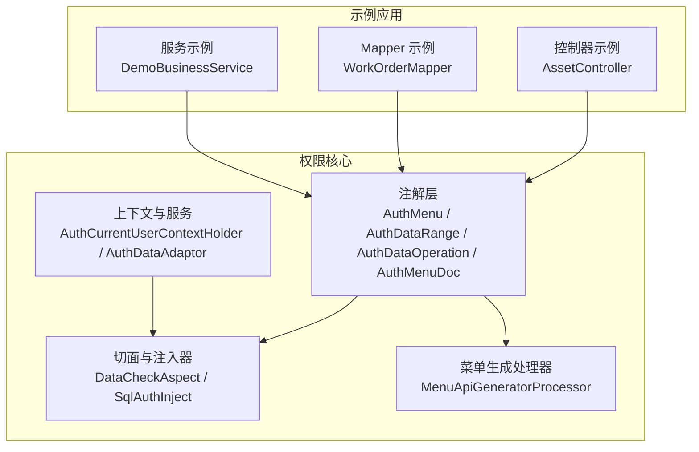
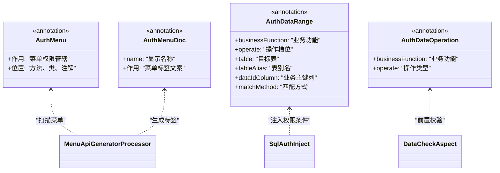
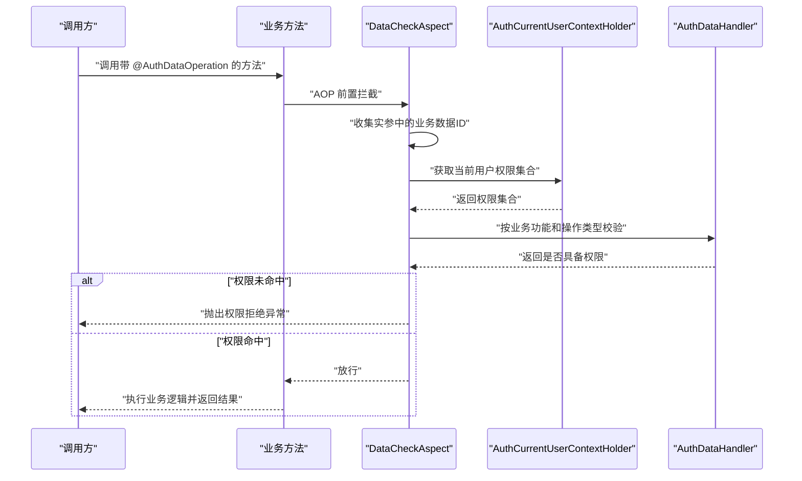
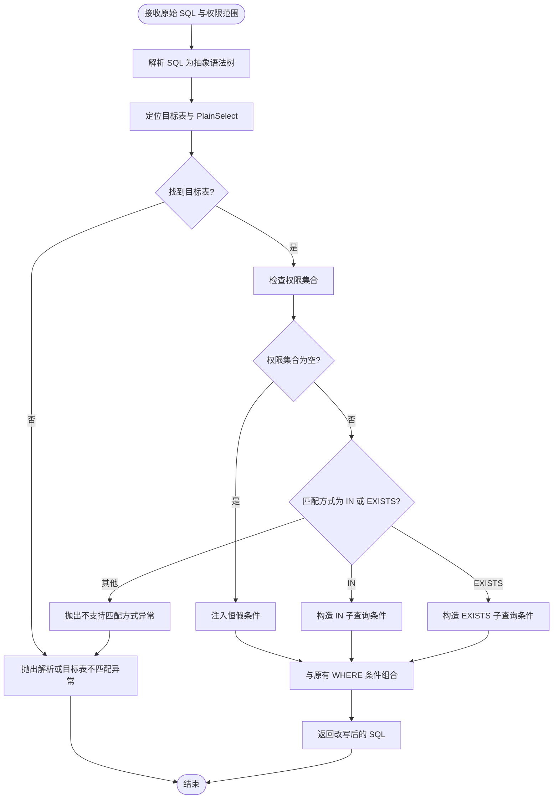

# 代码注释规范

<cite>
**本文引用的文件**   
- [AuthMenu.java](file://auth/auth-core/src/main/java/com/cu/framework/auth/core/AuthMenu.java)
- [AuthDataRange.java](file://auth/auth-core/src/main/java/com/cu/framework/auth/core/AuthDataRange.java)
- [AuthMenuDoc.java](file://auth/auth-core/src/main/java/com/cu/framework/auth/core/AuthMenuDoc.java)
- [AuthCurrentUserContextHolder.java](file://auth/auth-core/src/main/java/com/cu/framework/auth/core/AuthCurrentUserContextHolder.java)
- [AuthDataAdaptor.java](file://auth/auth-core/src/main/java/com/cu/framework/auth/core/AuthDataAdaptor.java)
- [AuthDataOperation.java](file://auth/auth-core/src/main/java/com/cu/framework/auth/core/AuthDataOperation.java)
- [package-info.java](file://auth/auth-core/src/main/java/com/cu/framework/auth/core/package-info.java)
- [DataCheckAspect.java](file://auth/auth-core/src/main/java/com/cu/framework/auth/core/data/edit/DataCheckAspect.java)
- [SqlAuthInject.java](file://auth/auth-core/src/main/java/com/cu/framework/auth/core/data/range/SqlAuthInject.java)
- [MenuApiGeneratorProcessor.java](file://auth/auth-core/src/main/java/com/cu/framework/auth/core/menu/MenuApiGeneratorProcessor.java)
- [AssetController.java](file://sample/auth-core-boot-sample/src/main/java/com/cu/framework/sample/authcore/web/AssetController.java)
- [WorkOrderMapper.java](file://sample/auth-core-boot-sample/src/main/java/com/cu/framework/sample/authcore/mapper/WorkOrderMapper.java)
- [DemoBusinessService.java](file://sample/auth-core-boot-sample/src/main/java/com/cu/framework/sample/authcore/service/DemoBusinessService.java)
</cite>

## 目录
1. [引言](#引言)
2. [项目结构与适用范围](#项目结构与适用范围)
3. [Javadoc 注释规范](#javadoc-注释规范)
4. [注解注释规范](#注解注释规范)
5. [复杂逻辑的 inline comment 规范](#复杂逻辑的-inline-comment-规范)
6. [代码块标记规范](#代码块标记规范)
7. [正面与反面示例](#正面与反面示例)
8. [注释维护与一致性要求](#注释维护与一致性要求)
9. [附录：核心注解与处理流程参考](#附录核心注解与处理流程参考)

## 引言
本规范面向 Kewen Framework 及其业务应用，目标是统一 Java 源码中的 Javadoc、方法级注释、类级注释、inline comment、注解文档以及 TODO/FIXME/NOTE 等代码块标记。规范以权限核心模块 `auth-core` 和示例应用 `sample/auth-core-boot-sample` 中的现有实现为依据，重点覆盖菜单权限、数据范围权限、数据操作权限相关代码。

规范的核心价值观是：注释不是装饰，而是契约。代码变更必须同步更新注释；无法更新的注释比没有注释更危险。

## 项目结构与适用范围
Kewen Framework 中与安全、权限相关的注释规范应优先参照以下结构：

**图表来源** 
- [AuthMenu.java:1-16](file://auth/auth-core/src/main/java/com/cu/framework/auth/core/AuthMenu.java#L1-L16)
- [AuthDataRange.java:1-81](file://auth/auth-core/src/main/java/com/cu/framework/auth/core/AuthDataRange.java#L1-L81)
- [AuthDataOperation.java:1-51](file://auth/auth-core/src/main/java/com/cu/framework/auth/core/AuthDataOperation.java#L1-L51)
- [AuthMenuDoc.java:1-22](file://auth/auth-core/src/main/java/com/cu/framework/auth/core/AuthMenuDoc.java#L1-L22)
- [AuthCurrentUserContextHolder.java:1-25](file://auth/auth-core/src/main/java/com/cu/framework/auth/core/AuthCurrentUserContextHolder.java#L1-L25)
- [AuthDataAdaptor.java:1-45](file://auth/auth-core/src/main/java/com/cu/framework/auth/core/AuthDataAdaptor.java#L1-L45)
- [DataCheckAspect.java:1-149](file://auth/auth-core/src/main/java/com/cu/framework/auth/core/data/edit/DataCheckAspect.java#L1-L149)
- [SqlAuthInject.java:1-200](file://auth/auth-core/src/main/java/com/cu/framework/auth/core/data/range/SqlAuthInject.java#L1-L200)
- [MenuApiGeneratorProcessor.java:1-200](file://auth/auth-core/src/main/java/com/cu/framework/auth/core/menu/MenuApiGeneratorProcessor.java#L1-L200)
- [AssetController.java:1-148](file://sample/auth-core-boot-sample/src/main/java/com/cu/framework/sample/authcore/web/AssetController.java#L1-L148)
- [WorkOrderMapper.java:1-132](file://sample/auth-core-boot-sample/src/main/java/com/cu/framework/sample/authcore/mapper/WorkOrderMapper.java#L1-L132)
- [DemoBusinessService.java:1-90](file://sample/auth-core-boot-sample/src/main/java/com/cu/framework/sample/authcore/service/DemoBusinessService.java#L1-L90)

**章节来源**
- [package-info.java:1-8](file://auth/auth-core/src/main/java/com/cu/framework/auth/core/package-info.java#L1-L8)

## Javadoc 注释规范

### 1. 类级 Javadoc
所有公开类、接口、枚举、注解都应包含类级 Javadoc，至少说明以下内容：
- 用途：解决什么问题、属于哪一层、承担什么职责。
- 关键约束：调用方需要注意的限制、并发语义、线程安全、生命周期。
- 作者：使用 `@author`。
- 版本：使用 `@since` 或配合仓库版本。
- 对外依赖：如果类与外部组件强耦合，应在注释中指明。

示例参考路径：
- 权限核心包描述：[package-info.java:1-8](file://auth/auth-core/src/main/java/com/cu/framework/auth/core/package-info.java#L1-L8)
- 数据操作切面：[DataCheckAspect.java:1-149](file://auth/auth-core/src/main/java/com/cu/framework/auth/core/data/edit/DataCheckAspect.java#L1-L149)
- SQL 权限注入器：[SqlAuthInject.java:1-200](file://auth/auth-core/src/main/java/com/cu/framework/auth/core/data/range/SqlAuthInject.java#L1-L200)
- 菜单 API 生成处理器：[MenuApiGeneratorProcessor.java:1-200](file://auth/auth-core/src/main/java/com/cu/framework/auth/core/menu/MenuApiGeneratorProcessor.java#L1-L200)

### 2. 方法级 Javadoc
对公共 API、可被其他模块调用的方法、切面入口、适配器等，必须编写方法级 Javadoc，包括：
- 行为说明：方法做什么，不做什么。
- 参数说明：每个参数的含义、取值范围、空值语义。
- 返回值说明：返回类型含义、空集合、空对象、异常前的部分结果。
- 异常说明：抛出异常的触发条件及分类，例如用法错误与业务拒绝要区分。
- 副作用：是否修改全局状态、缓存、上下文、日志或数据库。

示例参考路径：
- 当前用户上下文接口：[AuthCurrentUserContextHolder.java:1-25](file://auth/auth-core/src/main/java/com/cu/framework/auth/core/AuthCurrentUserContextHolder.java#L1-L25)
- 数据权限适配器：[AuthDataAdaptor.java:1-45](file://auth/auth-core/src/main/java/com/cu/framework/auth/core/AuthDataAdaptor.java#L1-L45)
- 数据操作切面前置校验：[DataCheckAspect.java:60-149](file://auth/auth-core/src/main/java/com/cu/framework/auth/core/data/edit/DataCheckAspect.java#L60-L149)

### 3. 字段与内部常量
- 对外暴露的常量应通过 Javadoc 说明业务含义。
- 内部魔法数字、上限、默认值应写在附近注释中，不得让读者猜测。
- 示例参考：单次校验允许的业务数据 ID 数量上限位于切面类中，应在注释中明确其边界意义。

**章节来源**
- [AuthCurrentUserContextHolder.java:1-25](file://auth/auth-core/src/main/java/com/cu/framework/auth/core/AuthCurrentUserContextHolder.java#L1-L25)
- [AuthDataAdaptor.java:1-45](file://auth/auth-core/src/main/java/com/cu/framework/auth/core/AuthDataAdaptor.java#L1-L45)
- [DataCheckAspect.java:1-149](file://auth/auth-core/src/main/java/com/cu/framework/auth/core/data/edit/DataCheckAspect.java#L1-L149)

## 注解注释规范

### 1. 注解类级 Javadoc
自定义注解的类级注释必须回答三个问题：
- 声明位置：可以放在类、方法还是注解上。
- 作用时机：启动期、运行期、请求期、SQL 执行期。
- 与其他注解的关系：哪些注解共同工作，哪些注解互斥。

示例参考路径：
- 菜单权限管辖注解：[AuthMenu.java:1-16](file://auth/auth-core/src/main/java/com/cu/framework/auth/core/AuthMenu.java#L1-L16)
- 菜单显示文案注解：[AuthMenuDoc.java:1-22](file://auth/auth-core/src/main/java/com/cu/framework/auth/core/AuthMenuDoc.java#L1-L22)
- 数据范围查询注解：[AuthDataRange.java:1-81](file://auth/auth-core/src/main/java/com/cu/framework/auth/core/AuthDataRange.java#L1-L81)
- 数据操作权限注解：[AuthDataOperation.java:1-51](file://auth/auth-core/src/main/java/com/cu/framework/auth/core/AuthDataOperation.java#L1-L51)

### 2. 注解属性注释
每个属性都必须有明确的 Javadoc，说明：
- 业务含义。
- 必填还是可选。
- 默认值。
- 取值约束。
- 多表联查、别名、主键列名、匹配方式等框架特有属性的语义。

重点参考：
- `businessFunction`：业务功能标识。
- `operate`：操作槽位，如统一、编辑、审批等。
- `table`、`tableAlias`：多表联查时目标表与别名。
- `dataIdColumn`：业务主键列名。
- `matchMethod`：IN 或 EXISTS 匹配策略。

**章节来源**
- [AuthMenu.java:1-16](file://auth/auth-core/src/main/java/com/cu/framework/auth/core/AuthMenu.java#L1-L16)
- [AuthMenuDoc.java:1-22](file://auth/auth-core/src/main/java/com/cu/framework/auth/core/AuthMenuDoc.java#L1-L22)
- [AuthDataRange.java:1-81](file://auth/auth-core/src/main/java/com/cu/framework/auth/core/AuthDataRange.java#L1-L81)
- [AuthDataOperation.java:1-51](file://auth/auth-core/src/main/java/com/cu/framework/auth/core/AuthDataOperation.java#L1-L51)

## 复杂逻辑的 inline comment 规范

### 1. 什么时候写 inline comment
在以下情况必须补充 inline comment：
- 算法思路不是由命名直接能看出来的。
- 存在边界条件、降级策略、异常分支。
- 与业务规则、安全策略、权限判定紧密相关。
- 使用了第三方库、解析器、动态 SQL 拼接、反射或 AOP。
- 存在性能敏感路径、批量上限、去重逻辑。

### 2. 应该解释什么
- 输入到输出的变换关系。
- 失败路径和降级路径。
- 与外部系统、数据库、权限表的交互约定。
- 为什么选择某种实现，而不是另一种。
- 当前实现的限制和后续优化方向。

### 3. 不应写什么
- 重复方法签名已经说明的内容。
- 与实现无关的“这是赋值”“这里判断是否为空”这类浅层注释。
- 过时注释，尤其是已被重构删除的逻辑仍保留的注释。
- 无意义的空行注释。

### 4. 示例参考
- 数据操作权限切面中收集并去重业务 ID 的逻辑，需要解释承载对象识别、空值处理、上限控制。
- SQL 权限注入器中根据权限集合为空、IN、EXISTS 三种分支构造不同条件的逻辑，需要解释恒假条件、子查询注入、WHERE 组合。
- 菜单 API 生成处理器扫描 Controller、合并类与方法标签、构建父子层级时的降级逻辑。

**章节来源**
- [DataCheckAspect.java:60-149](file://auth/auth-core/src/main/java/com/cu/framework/auth/core/data/edit/DataCheckAspect.java#L60-L149)
- [SqlAuthInject.java:1-200](file://auth/auth-core/src/main/java/com/cu/framework/auth/core/data/range/SqlAuthInject.java#L1-L200)
- [MenuApiGeneratorProcessor.java:1-200](file://auth/auth-core/src/main/java/com/cu/framework/auth/core/menu/MenuApiGeneratorProcessor.java#L1-L200)

## 代码块标记规范

### 1. TODO
用于记录未完成但计划完成的工作。格式建议：
- 开头标注 `TODO`。
- 写明责任人或关联需求编号。
- 写明具体待办内容。
- 不要长期保留无上下文的 `TODO`。

适用场景：
- 新增权限槽位尚未接入。
- 某条 Mapper 语句尚未添加数据范围声明。
- 某个注解属性还未支持默认值。

### 2. FIXME
用于记录已知缺陷或临时方案。格式建议：
- 开头标注 `FIXME`。
- 说明缺陷现象、影响范围。
- 给出临时规避方式。
- 必须关联后续修复任务。

适用场景：
- 动态 SQL 在某些条件下拼不出目标表。
- 某些旧接口暂未迁移到新权限模型。
- 第三方解析器或兼容层存在已知限制。

### 3. NOTE
用于记录重要背景信息、设计决策、注意事项。格式建议：
- 开头标注 `NOTE`。
- 说明背景、原因、替代方案对比。
- 明确该注意项的作用域，避免误读为通用规则。

适用场景：
- 解释为何采用 IN 或 EXISTS。
- 说明权限集合为空时为何注入恒假条件。
- 说明类级与 Method 级注解的组合语义。

### 4. 标记的使用原则
- 一个标记对应一个问题，不要把多个问题堆在一个注释里。
- 标记必须可追踪，不能成为“注释坟场”。
- 代码审查时应把 TODO/FIXME 视为技术债务清单。
- 上线前必须清理已解决的标记。

**章节来源**
- [WorkOrderMapper.java:1-132](file://sample/auth-core-boot-sample/src/main/java/com/cu/framework/sample/authcore/mapper/WorkOrderMapper.java#L1-L132)

## 正面与反面示例

### 1. 类级注释
- 正面示例参考：
  - 权限核心包描述，清楚说明包职责和登录无关的边界。
  - 数据操作切面类注释说明切面单位、判定行为和异常分类。
  - SQL 权限注入器注释说明 SQL 构造目标、子查询支持和权限集合为空语义。
- 反面示例应避免：
  - 只写“权限工具类”“数据访问类”等空泛描述。
  - 复制类名作为注释。
  - 忘记说明线程安全、调用方约束或外部依赖。

**章节来源**
- [package-info.java:1-8](file://auth/auth-core/src/main/java/com/cu/framework/auth/core/package-info.java#L1-L8)
- [DataCheckAspect.java:1-149](file://auth/auth-core/src/main/java/com/cu/framework/auth/core/data/edit/DataCheckAspect.java#L1-L149)
- [SqlAuthInject.java:1-200](file://auth/auth-core/src/main/java/com/cu/framework/auth/core/data/range/SqlAuthInject.java#L1-L200)

### 2. 方法级注释
- 正面示例参考：
  - `AuthCurrentUserContextHolder.getAuths()` 明确返回空集合语义。
  - `AuthDataAdaptor` 中编辑、删除、填充数据权限的方法分别说明入参与用途。
  - `DataCheckAspect.checkDataOperationAuths` 明确参数、业务功能、操作类型和两类异常。
- 反面示例应避免：
  - 只写“校验权限”，不说明校验维度、失败语义、是否抛异常。
  - 忽略参数可为空、集合为空、ID 超上限等边界。
  - 把内部异常细节泄露给调用方，却不说明统一对外语义。

**章节来源**
- [AuthCurrentUserContextHolder.java:1-25](file://auth/auth-core/src/main/java/com/cu/framework/auth/core/AuthCurrentUserContextHolder.java#L1-L25)
- [AuthDataAdaptor.java:1-45](file://auth/auth-core/src/main/java/com/cu/framework/auth/core/AuthDataAdaptor.java#L1-L45)
- [DataCheckAspect.java:60-149](file://auth/auth-core/src/main/java/com/cu/framework/auth/core/data/edit/DataCheckAspect.java#L60-L149)

### 3. 注解注释
- 正面示例参考：
  - `AuthDataRange` 明确声明位置是 MyBatis Mapper 查询方法，说明启动期校验、二级缓存限制、静态 SQL 目标表匹配。
  - `AuthMenu` 明确“管不管辖”的职责，文案由 `AuthMenuDoc` 负责。
  - `AuthDataOperation` 明确业务方法上的数据 ID 收集、去重上限、统一拒绝语义。
- 反面示例应避免：
  - 只列出属性名，不说明默认值、约束和多表场景。
  - 不说明注解与切面、处理器之间的协作关系。
  - 把注解注释写成 API 文档副本，缺少框架语义。

**章节来源**
- [AuthDataRange.java:1-81](file://auth/auth-core/src/main/java/com/cu/framework/auth/core/AuthDataRange.java#L1-L81)
- [AuthMenu.java:1-16](file://auth/auth-core/src/main/java/com/cu/framework/auth/core/AuthMenu.java#L1-L16)
- [AuthDataOperation.java:1-51](file://auth/auth-core/src/main/java/com/cu/framework/auth/core/AuthDataOperation.java#L1-L51)

### 4. inline comment
- 正面示例参考：
  - 示例控制器和方法注释说明 dataIdColumn、整数形态、分散承载、未声明对照等测试意图。
  - 示例 Mapper 注释说明同一槽位不同操作、嵌套语句、多表别名、动态 SQL 失败面。
  - 示例服务注释说明切面走 Spring AOP、实参三类承载位置、未声明判定的对照行为。
- 反面示例应避免：
  - 只写“更新资产”“返回列表”这种与签名完全重复的注释。
  - 不解释为什么用 IN 或 EXISTS。
  - 不说明动态 SQL 可能缺失目标表的运行期风险。

**章节来源**
- [AssetController.java:1-148](file://sample/auth-core-boot-sample/src/main/java/com/cu/framework/sample/authcore/web/AssetController.java#L1-L148)
- [WorkOrderMapper.java:1-132](file://sample/auth-core-boot-sample/src/main/java/com/cu/framework/sample/authcore/mapper/WorkOrderMapper.java#L1-L132)
- [DemoBusinessService.java:1-90](file://sample/auth-core-boot-sample/src/main/java/com/cu/framework/sample/authcore/service/DemoBusinessService.java#L1-L90)

## 注释维护与一致性要求

### 1. 代码与注释同步
- 新增或修改权限槽位时，必须同步更新 `AuthDataRange`、`AuthDataOperation` 及相关示例注释。
- 修改注解属性时，必须同步更新属性 Javadoc 和使用示例。
- 修改切面或注入器逻辑时，必须同步更新 inline comment 和异常说明。
- 删除代码时必须删除对应注释，禁止保留“历史遗迹”。

### 2. 注释质量检查点
- 类级注释是否说明职责、约束、作者、版本。
- 公共方法是否说明参数、返回值、异常。
- 注解属性是否说明默认值、取值约束、多表场景。
- 复杂逻辑是否有算法、边界、降级、失败路径说明。
- TODO/FIXME/NOTE 是否有上下文和可追踪性。

### 3. 代码审查要求
- 审查者应把注释当作 API 契约的一部分。
- 对模糊注释、过时注释、无意义注释提出修改意见。
- 对权限相关注释遗漏导致的安全误判零容忍。
- 对示例代码注释应验证其是否与真实行为一致。

**章节来源**
- [DataCheckAspect.java:1-149](file://auth/auth-core/src/main/java/com/cu/framework/auth/core/data/edit/DataCheckAspect.java#L1-L149)
- [SqlAuthInject.java:1-200](file://auth/auth-core/src/main/java/com/cu/framework/auth/core/data/range/SqlAuthInject.java#L1-L200)
- [MenuApiGeneratorProcessor.java:1-200](file://auth/auth-core/src/main/java/com/cu/framework/auth/core/menu/MenuApiGeneratorProcessor.java#L1-L200)

## 附录：核心注解与处理流程参考

### 1. 权限注解体系

**图表来源**
- [AuthMenu.java:1-16](file://auth/auth-core/src/main/java/com/cu/framework/auth/core/AuthMenu.java#L1-L16)
- [AuthMenuDoc.java:1-22](file://auth/auth-core/src/main/java/com/cu/framework/auth/core/AuthMenuDoc.java#L1-L22)
- [AuthDataRange.java:1-81](file://auth/auth-core/src/main/java/com/cu/framework/auth/core/AuthDataRange.java#L1-L81)
- [AuthDataOperation.java:1-51](file://auth/auth-core/src/main/java/com/cu/framework/auth/core/AuthDataOperation.java#L1-L51)
- [DataCheckAspect.java:1-149](file://auth/auth-core/src/main/java/com/cu/framework/auth/core/data/edit/DataCheckAspect.java#L1-L149)
- [MenuApiGeneratorProcessor.java:1-200](file://auth/auth-core/src/main/java/com/cu/framework/auth/core/menu/MenuApiGeneratorProcessor.java#L1-L200)
- [SqlAuthInject.java:1-200](file://auth/auth-core/src/main/java/com/cu/framework/auth/core/data/range/SqlAuthInject.java#L1-L200)

### 2. 数据操作权限校验流程

**图表来源**
- [DataCheckAspect.java:60-149](file://auth/auth-core/src/main/java/com/cu/framework/auth/core/data/edit/DataCheckAspect.java#L60-L149)
- [AuthDataOperation.java:1-51](file://auth/auth-core/src/main/java/com/cu/framework/auth/core/AuthDataOperation.java#L1-L51)
- [AuthCurrentUserContextHolder.java:1-25](file://auth/auth-core/src/main/java/com/cu/framework/auth/core/AuthCurrentUserContextHolder.java#L1-L25)

### 3. SQL 权限条件注入流程

**图表来源**
- [SqlAuthInject.java:1-200](file://auth/auth-core/src/main/java/com/cu/framework/auth/core/data/range/SqlAuthInject.java#L1-L200)
- [AuthDataRange.java:1-81](file://auth/auth-core/src/main/java/com/cu/framework/auth/core/AuthDataRange.java#L1-L81)