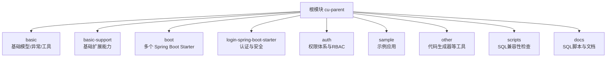
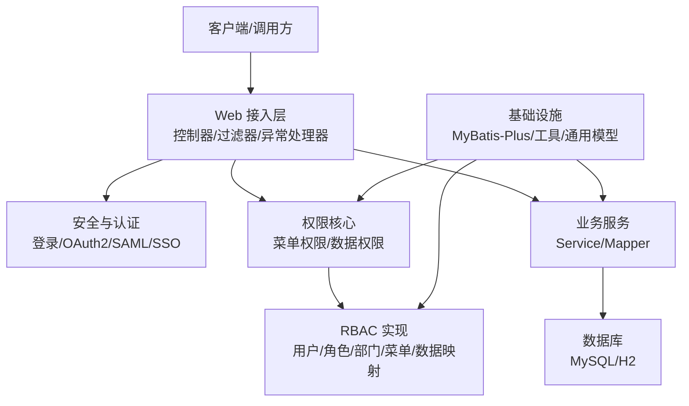
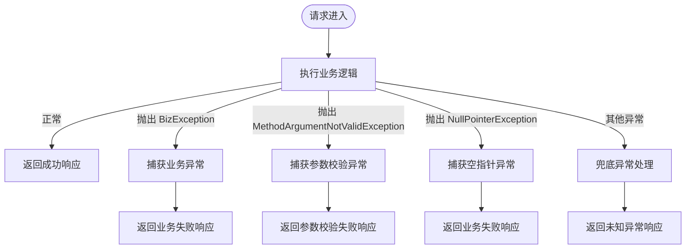
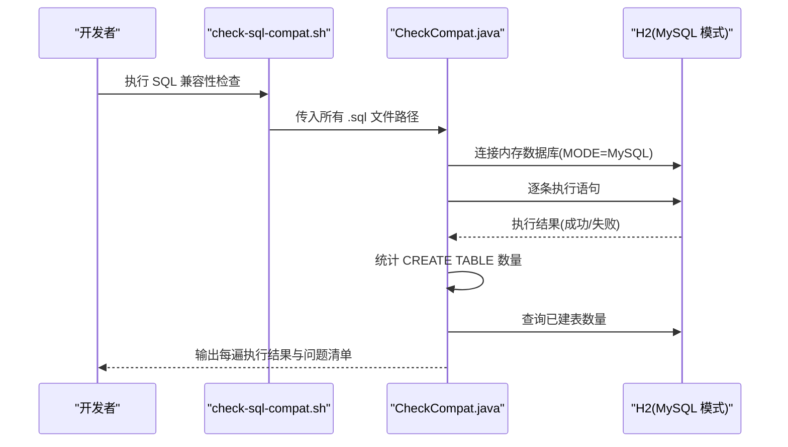
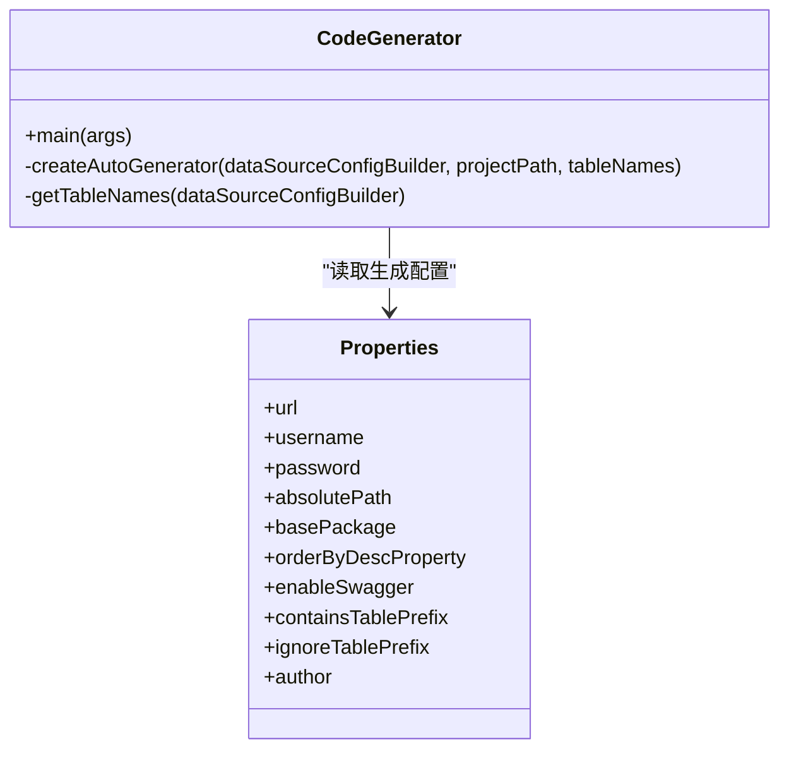
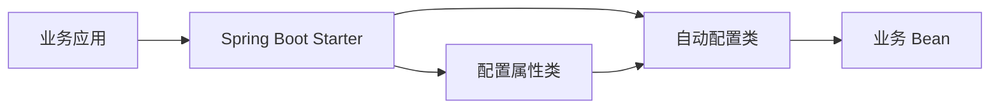
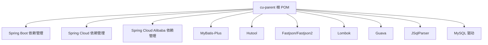

# 代码规范与开发约定

<cite>
**本文引用的文件**   
- [pom.xml](file://pom.xml)
- [README_Auth.md](file://README_Auth.md)
- [.gitignore](file://.gitignore)
- [BizException.java](file://basic/src/main/java/com/cu/framework/basic/exception/BizException.java)
- [GlobalExceptionHandlerAdvice.java](file://basic/src/main/java/com/cu/framework/basic/exception/GlobalExceptionHandlerAdvice.java)
- [CodeGenerator.java](file://other/code-generator/src/main/java/com/cu/framework/code/generator/CodeGenerator.java)
- [Properties.java](file://other/code-generator/src/main/java/com/cu/framework/code/generator/Properties.java)
- [CheckCompat.java](file://scripts/CheckCompat.java)
- [check-sql-compat.sh](file://scripts/check-sql-compat.sh)
</cite>

## 目录
1. [引言](#引言)
2. [项目结构](#项目结构)
3. [核心组件](#核心组件)
4. [架构总览](#架构总览)
5. [详细组件分析](#详细组件分析)
6. [依赖分析](#依赖分析)
7. [性能考虑](#性能考虑)
8. [故障排查指南](#故障排查指南)
9. [结论](#结论)
10. [附录：命名、注释、测试、Git 与质量检查约定](#附录：命名注释测试git-与质量检查约定)

## 引言
本指南面向 Kewen Framework 的开发者与维护者，目标是在现有工程基础上沉淀一套可执行的代码规范与开发约定。内容覆盖包结构与命名、注释标准、测试要求、Git 工作流、以及代码质量工具配置；并结合仓库中已有的异常处理、SQL 兼容性校验、代码生成器、Spring Boot Starter 装配等实现，给出“应该怎么做”和“为什么这样做”的说明。

## 项目结构
仓库采用 Maven 多模块组织，根模块 `com.cu.framework:cu-parent` 统一收敛版本与依赖管理，子模块按功能域划分：

- `basic`：基础模型、全局异常、日志、工具类
- `basic-support`：对 basic 的扩展（日志持久化、分页执行器、雪花ID等）
- `boot`：若干 Spring Boot Starter（基础能力、存储、租户、示例 Magic 应用）
- `login-spring-boot-starter`：安全、登录、OAuth2/SAML/SSO 相关能力
- `auth`：权限体系，包括 auth-core、RBAC 实现及多个 Starter
- `sample`：示例应用，演示各模块用法
- `other`：工具，如 MyBatis-Plus 代码生成器
- `scripts`：SQL 兼容性检查脚本
- `docs`：数据库脚本与说明文档
- `openspec`：基于 OpenSpec 的设计与变更规格归档

图表来源
- [pom.xml:1-20](file://pom.xml#L1-L20)
- [README_Auth.md:1-40](file://README_Auth.md#L1-L40)

章节来源
- [pom.xml:1-20](file://pom.xml#L1-L20)
- [README_Auth.md:1-40](file://README_Auth.md#L1-L40)

## 核心组件
围绕代码规范与开发约定，仓库中最能体现既有约定的关键组件如下：

- 全局异常与返回模型：定义业务异常类型与统一返回结构，是接口契约的基础
- SQL 兼容性校验脚本：通过 H2 MySQL 兼容模式验证建表脚本的可重复执行性
- 代码生成器：使用 MyBatis-Plus 模板生成 entity/mapper/service/controller，固化命名风格
- Spring Boot Starter 装配：大量 starter 模块通过 spring.factories 自动装配配置
- 依赖与构建：根 POM 统一管理版本，Java 8 编译目标

章节来源
- [BizException.java:1-27](file://basic/src/main/java/com/cu/framework/basic/exception/BizException.java#L1-L27)
- [GlobalExceptionHandlerAdvice.java:1-83](file://basic/src/main/java/com/cu/framework/basic/exception/GlobalExceptionHandlerAdvice.java#L1-L83)
- [CheckCompat.java:1-144](file://scripts/CheckCompat.java#L1-L144)
- [check-sql-compat.sh:1-32](file://scripts/check-sql-compat.sh#L1-L32)
- [CodeGenerator.java:1-200](file://other/code-generator/src/main/java/com/cu/framework/code/generator/CodeGenerator.java#L1-L200)
- [Properties.java:1-76](file://other/code-generator/src/main/java/com/cu/framework/code/generator/Properties.java#L1-L76)
- [pom.xml:1-20](file://pom.xml#L1-L20)

## 架构总览
Kewen Framework 的整体架构以 Spring Boot 为基础，分层清晰：

- 接入层：Controller、过滤器、拦截器、异常处理器
- 领域层：认证、授权、RBAC、租户、存储等业务能力
- 基础设施层：MyBatis-Plus、数据源、工具类、通用模型
- 自动化层：Starter 自动装配、代码生成器、SQL 校验脚本

图表来源
- [README_Auth.md:1-40](file://README_Auth.md#L1-L40)
- [GlobalExceptionHandlerAdvice.java:1-83](file://basic/src/main/java/com/cu/framework/basic/exception/GlobalExceptionHandlerAdvice.java#L1-L83)

## 详细组件分析

### 全局异常与统一返回
全局异常处理器负责将业务异常、参数校验异常和未知异常转换为统一的响应结构，避免框架差异导致的前端解析问题。

- 业务异常：`BizException` 继承后端异常基类，用于表达业务规则失败
- 全局异常处理器：`GlobalExceptionHandlerAdvice` 使用 `@RestControllerAdvice` 捕获多种异常并返回统一结果
- 参数校验：对 `MethodArgumentNotValidException` 进行字段级错误拼接
- 空指针异常：作为业务异常处理，便于定位逻辑错误
- 未知异常：兜底处理并记录日志

图表来源
- [GlobalExceptionHandlerAdvice.java:1-83](file://basic/src/main/java/com/cu/framework/basic/exception/GlobalExceptionHandlerAdvice.java#L1-L83)
- [BizException.java:1-27](file://basic/src/main/java/com/cu/framework/basic/exception/BizException.java#L1-L27)

章节来源
- [GlobalExceptionHandlerAdvice.java:1-83](file://basic/src/main/java/com/cu/framework/basic/exception/GlobalExceptionHandlerAdvice.java#L1-L83)
- [BizException.java:1-27](file://basic/src/main/java/com/cu/framework/basic/exception/BizException.java#L1-L27)

### SQL 兼容性检查
仓库提供基于 H2 MySQL 兼容模式的 SQL 校验脚本，确保建表脚本在 H2 与 MySQL 之间具备良好兼容性，并可重复执行。

- `CheckCompat.java`：逐条执行 SQL，统计 CREATE TABLE 数量，检查两次执行是否都能成功创建对象
- `check-sql-compat.sh`：自动发现 `docs/sql` 与 `sample/*/sql` 下的脚本，调用 Java 检查器

图表来源
- [check-sql-compat.sh:1-32](file://scripts/check-sql-compat.sh#L1-L32)
- [CheckCompat.java:1-144](file://scripts/CheckCompat.java#L1-L144)

章节来源
- [check-sql-compat.sh:1-32](file://scripts/check-sql-compat.sh#L1-L32)
- [CheckCompat.java:1-144](file://scripts/CheckCompat.java#L1-L144)

### 代码生成器
代码生成器基于 MyBatis-Plus FastAutoGenerator，结合 Velocity 模板，统一生成 entity、mapper、service、controller，固化命名与结构风格。

- 包路径：父包为 `basePackage.mp`，controller/service/entity 分别落在对应包
- 命名策略：表名下划线转驼峰，实体主键类型固定，启用 Lombok
- 文件命名：Mapper 后缀 `MpMapper`，Service 接口后缀 `MpService`，Controller 后缀 `MpController`
- XML 输出：resources/mapper/mp 下生成 Mapper XML
- 模板变量：注入 `orderByDescProperty` 等变量，控制排序字段

图表来源
- [CodeGenerator.java:1-200](file://other/code-generator/src/main/java/com/cu/framework/code/generator/CodeGenerator.java#L1-L200)
- [Properties.java:1-76](file://other/code-generator/src/main/java/com/cu/framework/code/generator/Properties.java#L1-L76)

章节来源
- [CodeGenerator.java:1-200](file://other/code-generator/src/main/java/com/cu/framework/code/generator/CodeGenerator.java#L1-L200)
- [Properties.java:1-76](file://other/code-generator/src/main/java/com/cu/framework/code/generator/Properties.java#L1-L76)

### Spring Boot Starter 装配与配置
仓库包含多个 Spring Boot Starter，通常通过 `spring.factories` 或自动配置类装配 Bean，并通过 properties 类暴露配置项。该模式体现了“配置优先、约定优于配置”的风格。

- 典型 Starter：`storage-spring-boot-starter`、`basic-spring-boot-starter`、`tenant-spring-boot-starter`
- 配置属性：例如 `StorageProperties`、`SecurityProperties`、`SsoLoginProperties`
- 自动装配：通过 `META-INF/spring.factories` 注册自动配置类

图表来源
- [README_Auth.md:40-120](file://README_Auth.md#L40-L120)

章节来源
- [README_Auth.md:40-120](file://README_Auth.md#L40-L120)

## 依赖分析
根 POM 集中声明第三方依赖版本，减少子模块冲突风险。主要依赖包括 Spring Boot、Spring Cloud、Spring Cloud Alibaba、MyBatis-Plus、Hutool、Fastjson、Lombok、Guava、JSqlParser、MySQL 驱动等。

图表来源
- [pom.xml:1-200](file://pom.xml#L1-L200)
- [pom.xml:201-279](file://pom.xml#L201-L279)

章节来源
- [pom.xml:1-200](file://pom.xml#L1-L200)
- [pom.xml:201-279](file://pom.xml#L201-L279)

## 性能考虑
- 统一异常处理应尽量避免在高频路径中进行复杂字符串拼接或额外 IO，当前参数校验异常聚合字段错误的方式适用于常规场景，但在大批量字段校验时可考虑使用更高效的收集方式
- SQL 兼容性检查仅在 CI 或本地预检时运行，不应影响运行时性能
- 代码生成器在开发阶段运行，不影响生产环境

[本节为通用指导，不涉及具体文件分析]

## 故障排查指南
- 业务异常未正确返回：检查是否抛出 `BizException` 并被 `GlobalExceptionHandlerAdvice` 捕获
- 参数校验失败但前端收到不明确错误：确认 `MethodArgumentNotValidException` 分支是否正确拼接字段错误信息
- 空指针异常被当作业务异常：确认是否在业务入口对可能为空的输入做前置校验
- SQL 脚本在 H2 中不可重复执行：使用 `check-sql-compat.sh` 检查语法与重复执行问题
- 代码生成结果不符合预期：检查 `Properties.java` 中的包名、前缀过滤、排序字段等配置

章节来源
- [GlobalExceptionHandlerAdvice.java:1-83](file://basic/src/main/java/com/cu/framework/basic/exception/GlobalExceptionHandlerAdvice.java#L1-L83)
- [check-sql-compat.sh:1-32](file://scripts/check-sql-compat.sh#L1-L32)
- [Properties.java:1-76](file://other/code-generator/src/main/java/com/cu/framework/code/generator/Properties.java#L1-L76)

## 结论
Kewen Framework 的代码规范与开发约定可从三个层面落地：工程结构、编码实践、质量保障。工程结构由 Maven 多模块与 Starter 装配统一；编码实践通过全局异常、代码生成器与注解驱动权限体系形成约束；质量保障通过 SQL 兼容性脚本与依赖集中管理提升稳定性。后续可在本仓库引入静态分析、格式化工具与覆盖率报告，进一步完善质量门禁。

[本节为总结性内容，不涉及具体文件分析]

## 附录：命名、注释、测试、Git 与质量检查约定

### 一、命名规范
- 包名
  - 统一使用小写域名倒序：`com.cu.framework.*`
  - 功能域细分：`auth.core`、`auth.rbac`、`authentication`、`basic.support`、`storage`、`tenant`
- 类名
  - 使用大驼峰，语义明确：`GlobalExceptionHandlerAdvice`、`BizException`、`CodeGenerator`
  - 控制器、服务、实体、Mapper 等命名遵循代码生成器约定：`*MpController`、`*MpService`、`*MpMapper`、`entity` 下实体类
- 方法名
  - 动词+名词：`bizException`、`methodArgumentNotValidException`、`getTableNames`
  - 布尔判断可使用 `isXxx` 形式（配合 Lombok 可移除 is 前缀）
- 变量名
  - 小驼峰，语义清晰：`bindingResult`、`fieldErrors`、`builder`
- 常量名
  - 全大写+下划线：建议统一放在常量类或枚举中，避免魔法值散落

章节来源
- [GlobalExceptionHandlerAdvice.java:1-83](file://basic/src/main/java/com/cu/framework/basic/exception/GlobalExceptionHandlerAdvice.java#L1-L83)
- [CodeGenerator.java:1-200](file://other/code-generator/src/main/java/com/cu/framework/code/generator/CodeGenerator.java#L1-L200)

### 二、注释标准
- 类注释
  - 至少包含作者、描述、版本时间戳；参考 `BizException`、`Properties`、`CodeGenerator` 的 Javadoc
- 方法注释
  - 公共 API 与方法入参、返回值、异常说明需补充 Javadoc；参考 `GlobalExceptionHandlerAdvice` 的方法注释
- 复杂逻辑注释
  - 对复杂分支、算法、外部协议交互增加行内注释，解释“为什么”，而非重复代码本身
- 配置注释
  - 配置类字段应注明用途与默认值；参考 `Properties.java` 中的配置字段注释

章节来源
- [BizException.java:1-27](file://basic/src/main/java/com/cu/framework/basic/exception/BizException.java#L1-L27)
- [Properties.java:1-76](file://other/code-generator/src/main/java/com/cu/framework/code/generator/Properties.java#L1-L76)
- [GlobalExceptionHandlerAdvice.java:1-83](file://basic/src/main/java/com/cu/framework/basic/exception/GlobalExceptionHandlerAdvice.java#L1-L83)

### 三、测试要求与覆盖率
- 单元测试
  - 每个核心类应有对应的单元测试，尤其是工具类、转换器、解析器
  - 测试类命名建议：`XxxTest`；断言应覆盖正常路径、边界条件与异常路径
- 集成测试
  - Web 层建议使用 SpringBootTest 进行端到端验证，模拟请求并断言响应结构
  - 数据访问层应避免直接依赖真实数据库，优先使用内存库或 Testcontainers
- 测试数据管理
  - 使用独立的测试资源目录存放 SQL 与 JSON 数据
  - 敏感数据不得提交至版本控制，应使用环境变量或密钥管理服务
- 覆盖率标准
  - 建议新增代码行覆盖率不低于 80%，分支覆盖率不低于 70%
  - 覆盖率报告应在 CI 中阻断合并

[本节为通用指导，不涉及具体文件分析]

### 四、Git 工作流与提交规范
- 分支管理
  - `master`：受保护的主分支，仅允许通过 Pull Request 合并
  - `feature/*`：功能分支，按需求拆分
  - `fix/*`：修复分支
  - `release/*`：发布候选分支
  - `hotfix/*`：线上紧急修复分支
- 提交信息格式
  - 建议采用 Conventional Commits：`type(scope): description`
  - type 可选：feat、fix、docs、style、refactor、test、chore
  - scope 可选：模块名，如 auth、basic、login
  - description 简洁明确，中文或英文均可
- 代码审查流程
  - 所有变更必须通过 Pull Request
  - 至少一名 reviewer 批准后方可合并
  - 合并前应通过构建、测试与质量检查任务

章节来源
- [.gitignore:1-50](file://.gitignore#L1-L50)

### 五、代码质量检查工具配置与使用
- 静态代码分析
  - 建议引入 SonarQube 或 Checkstyle/PMD/SpotBugs，在 CI 中执行
  - 将规则收敛到仓库根目录的规则文件中，避免各自为政
- 依赖安全检查
  - 建议引入 OWASP Dependency-Check 或 Snyk，扫描已知漏洞依赖
  - 高危漏洞应阻断合并
- 代码格式化
  - 建议引入 Google Java Format 或 Alibaba Java Coding Guidelines 插件
  - 在 IDE 与 CI 中保持一致
- 构建产物与源码
  - 根 POM 已启用 `maven-source-plugin` 生成源码包，利于发布与审计

章节来源
- [pom.xml:201-279](file://pom.xml#L201-L279)

### 六、项目模板与脚手架
- 使用代码生成器
  - 通过 `other/code-generator` 生成 entity/mapper/service/controller
  - 修改 `Properties.java` 中的包名、表名前缀过滤、排序字段等配置
  - 生成的 Controller 默认使用 REST 风格，命名后缀 `MpController`
- 使用 Starter 模板
  - 新服务可直接引入 `basic-spring-boot-starter`、`login-spring-boot-starter`、`auth-rbac-spring-boot-starter`
  - 根据 README 快速启动最小可用系统，再逐步扩展
- 示例工程
  - `sample/auth-core-boot-sample`、`sample/auth-rbac-boot-sample`、`sample/basic-boot-sample` 可作为新项目的起点

章节来源
- [CodeGenerator.java:1-200](file://other/code-generator/src/main/java/com/cu/framework/code/generator/CodeGenerator.java#L1-L200)
- [Properties.java:1-76](file://other/code-generator/src/main/java/com/cu/framework/code/generator/Properties.java#L1-L76)
- [README_Auth.md:40-120](file://README_Auth.md#L40-L120)