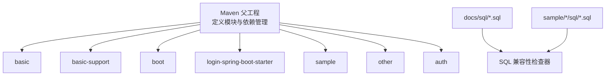
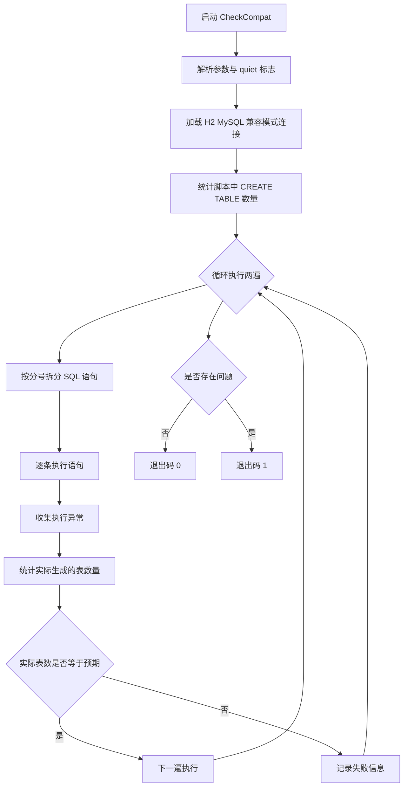
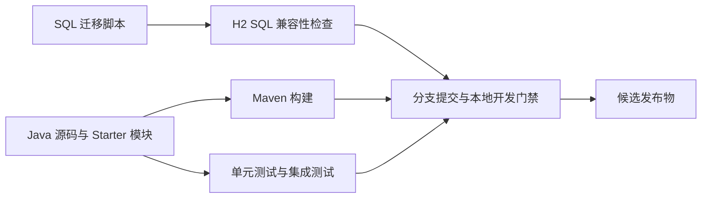
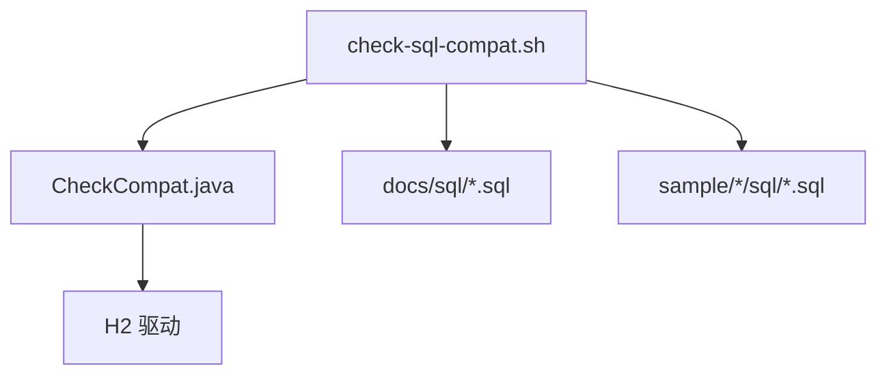

# 代码质量检查工具

<cite>
**本文引用的文件**   
- [pom.xml](file://pom.xml)
- [CheckCompat.java](file://scripts/CheckCompat.java)
- [check-sql-compat.sh](file://scripts/check-sql-compat.sh)
- [auth-rbac.sql](file://docs/sql/auth-rbac.sql)
- [basic-support.sql](file://docs/sql/basic-support.sql)
</cite>

## 目录
1. [引言](#引言)
2. [项目结构](#项目结构)
3. [核心组件](#核心组件)
4. [架构总览](#架构总览)
5. [详细组件分析](#详细组件分析)
6. [依赖关系分析](#依赖关系分析)
7. [性能与成本考量](#性能与成本考量)
8. [故障排查指南](#故障排查指南)
9. [结论](#结论)
10. [附录：建议的扩展方案](#附录建议的扩展方案)

## 引言
本仓库目前以 Maven 多模块组织，Java 源码、Spring Boot Starter、示例应用和 SQL 脚本并存。现有仓库中并未内置 SonarQube、Checkstyle、SpotBugs、PMD、Jacoco、OWASP Dependency Check 等静态分析与安全扫描插件；也未发现 `.editorconfig`、`.mvn`、CI 配置文件或专门的代码格式化工具配置。因此，当前“代码质量检查工具链”的实际能力集中在以下方面：
- 通过 H2 MySQL 兼容模式对数据库迁移脚本进行语法与可重复执行校验。
- 通过 Java 源文件和 Spring Boot Starter 机制保证基础框架的可编译性与运行期装配。
- 通过示例工程提供测试样例，便于后续接入更完整的静态分析与质量门禁。

本说明先如实描述现有实现，再给出面向团队的可落地扩展建议，帮助你在不破坏现有结构的前提下，逐步引入 SonarQube、Checkstyle、依赖安全检查、SQL 兼容性检查、持续集成门禁和质量指标报告。

## 项目结构
仓库根 POM 定义了多个模块：basic、basic-support、boot、login-spring-boot-starter、sample、other、auth。构建目标由父 POM 统一声明 Java 版本、编码方式以及第三方依赖管理。SQL 脚本位于 `docs/sql` 与各 sample 工程的 `sql` 目录下，SQL 兼容性检查脚本会扫描这些位置。



**图示来源**
- [pom.xml:1-200](file://pom.xml#L1-L200)
- [check-sql-compat.sh:1-32](file://scripts/check-sql-compat.sh#L1-L32)

**章节来源**
- [pom.xml:1-200](file://pom.xml#L1-L200)

## 核心组件
### SQL 兼容性检查器
`scripts/CheckCompat.java` 是一个独立 Java 程序，使用 H2 的 MySQL 兼容模式逐条解析并执行 SQL 脚本，重点验证：
- 每条语句在 H2 MySQL 模式下是否可被接受。
- 脚本是否可以重复执行。
- 脚本中的 `CREATE TABLE` 最终是否真的生成表对象。

它按分号切分 SQL，同时处理单引号、双引号、反引号、行注释和块注释，避免把字符串内容误判为语句分隔符。随后在内存数据库中执行两遍，统计建出的表数量是否与脚本中 `CREATE TABLE` 数量一致，并汇总失败信息。



**图示来源**
- [CheckCompat.java:1-144](file://scripts/CheckCompat.java#L1-L144)

**章节来源**
- [CheckCompat.java:1-144](file://scripts/CheckCompat.java#L1-L144)

### SQL 兼容性检查入口脚本
`scripts/check-sql-compat.sh` 负责：
- 定位 `scripts/CheckCompat.java`。
- 自动查找本地 Maven 仓库中的 H2 jar。
- 扫描 `docs/sql` 与 `sample/*/sql` 下的所有 SQL 文件。
- 调用 `CheckCompat.java` 完成兼容性检查。
- 根据返回码判断检查是否成功。

该脚本强调：MySQL 侧仍需人工或额外流程验证，因为脚本只保证 H2 MySQL 兼容写法，不能代表所有 MySQL 方言行为完全一致。

```mermaid
sequenceDiagram
    Dev as "开发者"
    Shell as "check-sql-compat.sh"
    FS as "文件系统"
    H2 as "H2 驱动"
    Checker as "CheckCompat.java"

    Dev->>Shell: 执行 SQL 兼容性检查
    Shell->>FS: 查找 CheckCompat.java
    Shell->>FS: 查找 H2 jar
    Shell->>FS: 扫描 docs/sql 与 sample/*/sql
    Shell->>Checker: java -cp h2.jar CheckCompat file1.sql file2.sql ...
    Checker->>H2: 建立 MySQL 兼容内存数据库连接
    Checker->>Checker: 解析并执行 SQL
    Checker-->>Shell: 返回成功或失败码
    Shell-->>Dev: 输出检查结果
```

**图示来源**
- [check-sql-compat.sh:1-32](file://scripts/check-sql-compat.sh#L1-L32)
- [CheckCompat.java:1-144](file://scripts/CheckCompat.java#L1-L144)

**章节来源**
- [check-sql-compat.sh:1-32](file://scripts/check-sql-compat.sh#L1-L32)

### 受检 SQL 脚本
仓库中包含两类主要 SQL：
- `docs/sql/auth-rbac.sql`：RBAC 相关权限数据初始化脚本。
- `docs/sql/basic-support.sql`：基础支撑功能所需的数据结构或初始数据。

这两个文件会被 `check-sql-compat.sh` 自动纳入检查范围。若新增数据库迁移脚本，应放在 `docs/sql` 或对应 sample 的 `sql` 目录，并遵循 H2 MySQL 兼容语法。

**章节来源**
- [auth-rbac.sql](file://docs/sql/auth-rbac.sql)
- [basic-support.sql](file://docs/sql/basic-support.sql)

## 架构总览
从“代码质量检查工具链”的角度看，当前仓库可理解为“轻量型质量门禁”，其核心边界如下：



当前质量门禁主要由两部分组成：
1. Maven 构建与测试：由父 POM 统一约束 Java 版本与依赖管理。
2. SQL 兼容性检查：通过 shell 脚本与 Java 检查器保障 SQL 可重复执行、语法兼容。

尚未看到 SonarQube、Checkstyle、SpotBugs、PMD、Jacoco、OWASP Dependency Check 等工具的 Maven 插件或 CI 任务。

**图示来源**
- [pom.xml:1-200](file://pom.xml#L1-L200)
- [check-sql-compat.sh:1-32](file://scripts/check-sql-compat.sh#L1-L32)
- [CheckCompat.java:1-144](file://scripts/CheckCompat.java#L1-L144)

## 详细组件分析

### Maven 构建与依赖管理现状
父 POM 定义：
- 模块集合：basic、basic-support、boot、login-spring-boot-starter、sample、other、auth。
- 全局属性：Java 源和目标版本为 8，项目编码为 UTF-8。
- 依赖管理：统一管理 Spring Boot、Spring Cloud、MyBatis-Plus、Fastjson、Hutool、Lombok 等依赖版本。

这意味着构建阶段已经具备稳定的编译环境，适合在此基础上接入静态分析和质量插件。

**章节来源**
- [pom.xml:1-200](file://pom.xml#L1-L200)

### SQL 兼容性检查器实现要点
`CheckCompat.java` 的关键设计点包括：
- 使用 `jdbc:h2:mem:check;MODE=MySQL;DATABASE_TO_LOWER=TRUE;CASE_INSENSITIVE_IDENTIFIERS=TRUE` 模拟 MySQL 兼容语义。
- 显式加载 `org.h2.Driver`，避免因 ServiceLoader 未找到驱动导致连接失败。
- 先统计脚本中 `CREATE TABLE` 的数量作为预期值，再比较实际建出的表数量。
- 对 SQL 文本做简单但实用的分词：识别引号、转义、行注释、块注释，避免错误切分。
- 两遍执行保证脚本幂等性，便于模拟 Spring SQL init 多次执行场景。
- 非静默模式下打印每遍结果，并通过进程退出码区分成功与失败。

复杂度方面：
- SQL 解析是线性扫描，时间复杂度近似 O(n)，其中 n 为 SQL 字符总量。
- 表数量比较为 O(1)。
- 每次执行都会创建内存数据库并执行全部 SQL，整体开销与脚本规模成正比。

**章节来源**
- [CheckCompat.java:1-144](file://scripts/CheckCompat.java#L1-L144)

### SQL 兼容性检查脚本职责
`check-sql-compat.sh` 的职责是编排：
- 查找 Java 检查器类。
- 查找 H2 jar（支持通过环境变量覆盖）。
- 枚举需要检查的 SQL 文件。
- 将 Windows/Cygwin 路径转换为 Java 可识别形式。
- 调用 Java 检查器并透传退出码。

该脚本适合作为 Git Hook、预提交钩子或 CI 中的一个步骤。

**章节来源**
- [check-sql-compat.sh:1-32](file://scripts/check-sql-compat.sh#L1-L32)

### 代码格式化工具现状
仓库中没有发现 `.editorconfig`、`formatter-maven-plugin`、`google-java-format`、`checkstyle` 或 P3C 等格式化与风格规则配置。当前团队风格约束需要通过文档约定或 IDE 配置达成，而不是构建强制。

### 静态代码分析与依赖安全检查现状
仓库中没有发现：
- SonarQube 配置。
- Checkstyle 配置。
- SpotBugs、PMD、Error Prone、Forbidden APIs 等静态分析插件。
- OWASP Dependency Check、Dependency Management、Trivy 等依赖安全扫描插件。
- Jacoco 覆盖率配置。
- License 头检查插件。

因此，当前无法通过构建直接产出 SonarQube 报告、Checkstyle 报告、依赖漏洞清单或覆盖率报告。

## 依赖关系分析
当前与“代码质量检查”直接相关的依赖关系如下：



**图示来源**
- [check-sql-compat.sh:1-32](file://scripts/check-sql-compat.sh#L1-L32)
- [CheckCompat.java:1-144](file://scripts/CheckCompat.java#L1-L144)

**章节来源**
- [check-sql-compat.sh:1-32](file://scripts/check-sql-compat.sh#L1-L32)
- [CheckCompat.java:1-144](file://scripts/CheckCompat.java#L1-L144)

## 性能与成本考量
- H2 SQL 兼容性检查只在内存数据库执行，不需要真实 MySQL 实例，适合频繁触发。
- 如果 SQL 脚本较大或包含大量初始数据，两遍执行会带来一定 CPU 和内存开销。
- 建议在大型仓库中将 SQL 兼容性检查限定为变更 SQL 文件，或通过 CI 缓存 H2 jar 和 Maven 依赖。
- 后续接入 SonarQube、Checkstyle、依赖安全检查时，应考虑增量扫描、并行执行和缓存策略，避免显著拉长构建时间。

## 故障排查指南

### SQL 兼容性检查失败
常见问题及排查思路：
- H2 jar 未找到：确认 `H2_JAR` 环境变量或本地 Maven 仓库中存在 H2 jar。
- SQL 语法不被 H2 MySQL 模式接受：检查是否使用了 MySQL 特有语法。
- 表未真正创建：检查 `CREATE TABLE` 语句是否被注释包裹、拼写错误或事务回滚。
- 脚本不可重复执行：检查是否存在幂等问题，例如重复插入主键冲突或未使用 `IF NOT EXISTS`。
- 路径问题：Windows 下注意路径转换，确保 Java 能读取 SQL 文件。

参考实现位置：
- [check-sql-compat.sh:1-32](file://scripts/check-sql-compat.sh#L1-L32)
- [CheckCompat.java:1-144](file://scripts/CheckCompat.java#L1-L144)

### Maven 构建失败
由于父 POM 固定 Java 版本为 8，请确认：
- JDK 版本符合构建要求。
- 依赖下载正常。
- 模块间依赖版本由父 POM 统一管理，避免子模块自行升级造成不一致。

参考实现位置：
- [pom.xml:1-200](file://pom.xml#L1-L200)

## 结论
当前 Kewen Framework 仓库已具备：
- 稳定的 Maven 多模块构建与依赖管理。
- 针对数据库迁移脚本的 H2 MySQL 兼容性检查工具。
- 清晰的脚本入口与检查逻辑，便于扩展为本地预提交钩子或 CI 步骤。

尚未内置：
- SonarQube、Checkstyle、SpotBugs、PMD、Error Prone、Forbidden APIs。
- OWASP Dependency Check 等依赖安全扫描。
- Jacoco 覆盖率统计。
- 代码格式化工具与 `.editorconfig`。
- 持续集成质量门禁与质量阈值。

建议在保持现有 SQL 兼容性检查的基础上，逐步引入静态分析、依赖安全扫描、格式化和覆盖率检测，并在持续集成中设置明确的质量门禁。

## 附录：建议的扩展方案

### 静态代码分析集成建议
可在父 POM 中集中引入并统一配置以下插件：
- SonarQube：用于统一质量门禁、重复率、复杂度、技术债务、单元测试覆盖趋势。
- Checkstyle：统一 Java 代码风格，结合 Google Java Style 或团队自定义规则。
- SpotBugs / Error Prone：捕获常见 bug、空指针、资源泄漏、线程安全问题。
- PMD：补充规则集，聚焦可维护性和最佳实践。
- Forbidden APIs：禁止使用危险或不推荐 API。

SonarQube 通常配合 Sonar Scanner 使用，构建阶段生成报告后上传至 SonarQube 服务端，再由质量门禁判定是否放行。

### 依赖安全检查机制
建议引入 OWASP Dependency Check 或 Maven 官方依赖管理插件，定期扫描第三方库漏洞，并结合告警渠道（邮件、IM、CI 失败）形成闭环。对于关键依赖，可制定最低安全版本策略。

### 代码格式化工具
建议引入 `formatter-maven-plugin` 或 `google-java-format-maven-plugin`，并在提交前通过 Git Hook 或 CI 强制执行。同时提供 `.editorconfig`，让 IDE 与编辑器保持一致缩进、换行、空格和文件结尾行为。

### SQL 兼容性检查扩展
当前脚本已覆盖基础需求，可扩展方向包括：
- 支持排除文件或白名单 SQL。
- 支持指定 H2 版本。
- 输出结构化 JSON 报告，便于 CI 归档。
- 增加对索引、视图、存储过程、函数等的存在性校验。

### 持续集成质量门禁
建议在 CI 中至少执行：
- 编译与单元测试。
- SQL 兼容性检查。
- 静态分析：Checkstyle、SpotBugs、PMD、Error Prone。
- 依赖安全检查。
- 覆盖率与 SonarQube 质量阈值。

质量门禁条件可包括：
- 构建必须成功。
- 单元测试通过率不低于阈值。
- 新代码覆盖率不低于阈值。
- 无严重或阻断级静态分析问题。
- 无高危依赖漏洞。
- SonarQube 质量门通过。

### 代码质量指标监控与报告
建议通过 SonarQube Dashboard 长期跟踪：
- 重复代码比例。
- 代码异味数量。
- 技术债务比率。
- 单元测试覆盖率。
- 安全漏洞数量。
- 依赖漏洞数量。

报告可通过 SonarQube Webhook、邮件或 BI 系统导出，供团队复盘。

### 常见代码质量问题与修复指南
- 空指针风险：启用 SpotBugs 或 Error Prone 的空指针规则，优先使用 Optional、判空工具或防御式编程。
- 资源泄漏：确保 IO、连接、流等资源在 finally 或 try-with-resources 中关闭。
- 日志不规范：统一日志级别、上下文字段、敏感信息脱敏。
- 异常吞掉：避免空 catch 或仅打印堆栈而不向上抛出。
- 魔法值：提取常量、枚举或配置项。
- 方法过长：拆分为职责单一的小方法。
- 复杂条件：提取布尔表达式或使用策略模式。

### IDE 插件配置建议
- IntelliJ IDEA：安装 SonarLint、Checkstyle-IDEA、SpotBugs、PMD、Google Java Format 插件，并在项目中启用相应规则。
- Eclipse：安装 Checkstyle、SpotBugs、PMD、SonarLint 插件。
- VS Code：安装 SonarLint、Checkstyle、Prettier 或 Java 格式化扩展。
- 统一 `.editorconfig`，减少不同编辑器之间的差异。