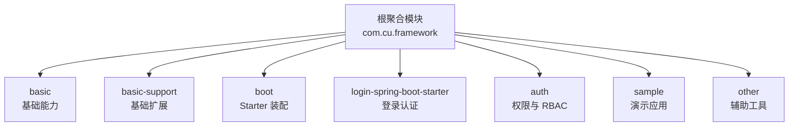
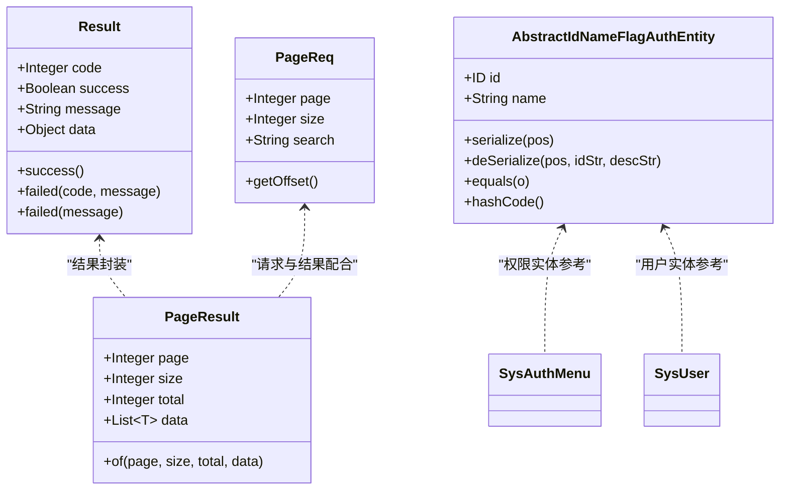
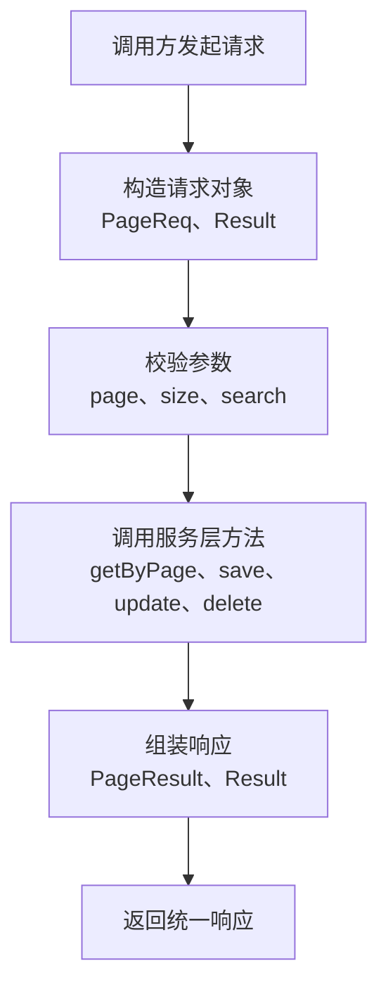
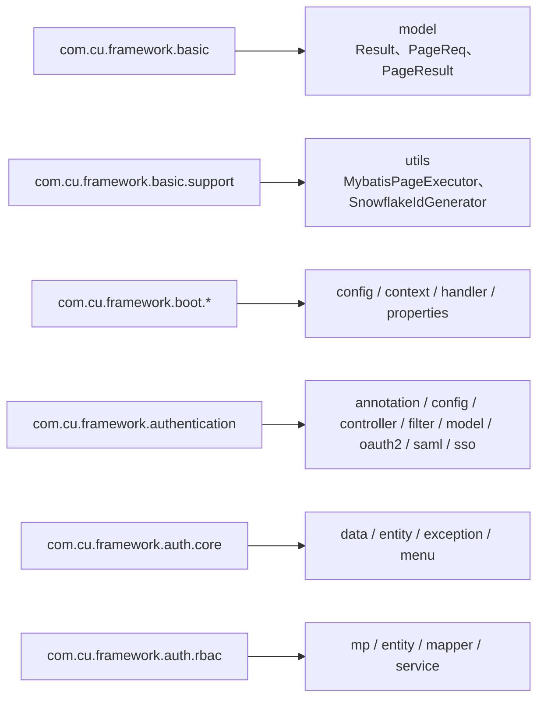
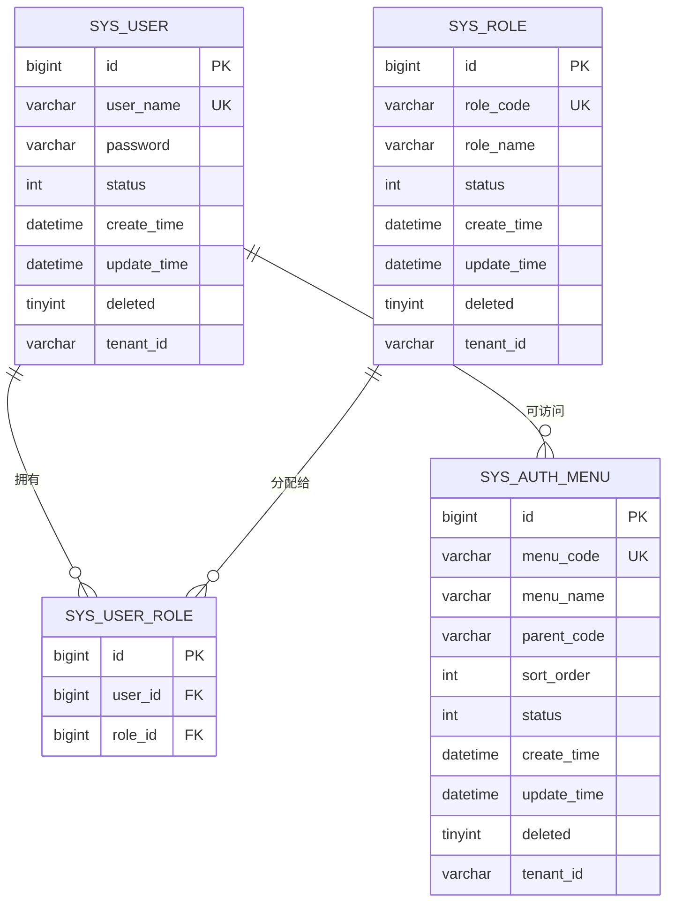
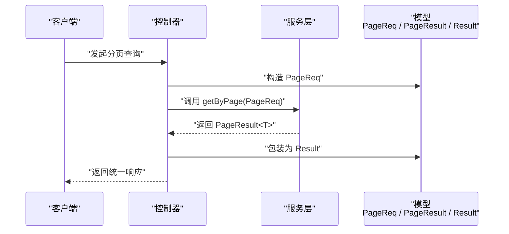

# 命名规范

<cite>
**本文引用的文件**   
- [pom.xml](file://pom.xml)
- [Result.java](file://basic/src/main/java/com/cu/framework/basic/model/Result.java)
- [PageReq.java](file://basic/src/main/java/com/cu/framework/basic/model/PageReq.java)
- [PageResult.java](file://basic/src/main/java/com/cu/framework/basic/model/PageResult.java)
- [AbstractIdNameFlagAuthEntity.java](file://auth/auth-core/src/main/java/com/cu/framework/auth/core/entity/AbstractIdNameFlagAuthEntity.java)
- [SysAuthMenu.java](file://auth/auth-rbac/src/main/java/com/cu/framework/auth/rbac/mp/entity/SysAuthMenu.java)
- [SysUser.java](file://auth/auth-rbac/src/main/java/com/cu/framework/auth/rbac/mp/entity/SysUser.java)
- [auth-rbac.sql](file://docs/sql/auth-rbac.sql)
</cite>

## 目录
1. [引言](#引言)
2. [项目结构与包组织](#项目结构与包组织)
3. [类与接口命名约定](#类与接口命名约定)
4. [方法命名约定](#方法命名约定)
5. [变量、字段与常量命名约定](#变量字段与常量命名约定)
6. [包结构组织原则](#包结构组织原则)
7. [数据库表名与字段名约定](#数据库表名与字段名约定)
8. [Java 实体与数据库表映射约定](#java-实体与数据库表映射约定)
9. [典型命名示例与反例对照](#典型命名示例与反例对照)
10. [架构与数据流中的命名体现](#架构与数据流中的命名体现)
11. [常见问题与排错建议](#常见问题与排错建议)
12. [结论](#结论)

## 引言
本规范面向 Kewen Framework 及其业务模块，统一 Java 代码的命名风格，覆盖类、接口、枚举、方法、变量、常量、包路径、数据库表名与字段名，以及与 Java 类的映射关系。目标是通过一致的命名降低阅读成本、减少沟通歧义，并让新增模块在 auth、basic、boot、sample 等功能域中保持统一结构。

## 项目结构与包组织
Kewen Framework 采用多模块 Maven 工程，根聚合模块定义公共依赖与版本，主要功能域包括：
- basic：基础通用能力，如异常、过滤器、日志、通用模型、工具类。
- basic-support：对 basic 能力的扩展支持，如持久化监听、分页执行器、雪花 ID 等。
- boot：Spring Boot Starter 装配层，提供自动配置与启动入口。
- login-spring-boot-starter：登录认证相关 Starter。
- auth：权限体系核心与 RBAC 实现。
- sample：各功能域的演示应用。
- other：代码生成器等辅助工具。

**图表来源**
- [pom.xml:1-40](file://pom.xml#L1-L40)

**章节来源**
- [pom.xml:1-40](file://pom.xml#L1-L40)

## 类与接口命名约定
### 总体规则
- 使用大驼峰（UpperCamelCase）命名所有类、接口、枚举。
- 类名应表达领域名词或明确职责，避免无意义前缀或后缀。
- 抽象基类以 Abstract 开头；具体实现类直接表达业务对象。
- 接口以行为语义命名，必要时用 I 前缀表示接口契约，但更推荐语义化名称。
- 控制器统一以 Controller 结尾；服务统一以 Service 结尾；数据访问层可用 Mapper、Repository 等。

### 框架内已有模式
- 通用响应模型 Result，作为统一返回包装类型。
- 分页请求 PageReq、分页结果 PageResult，用于参数传递与结果封装。
- 权限实体抽象基类 AbstractIdNameFlagAuthEntity，体现权限对象的通用结构。
- RBAC 领域实体 SysUser、SysAuthMenu 等，体现“系统 + 领域 + 实体”命名。

**图表来源**
- [Result.java:1-73](file://basic/src/main/java/com/cu/framework/basic/model/Result.java#L1-L73)
- [PageReq.java:1-39](file://basic/src/main/java/com/cu/framework/basic/model/PageReq.java#L1-L39)
- [PageResult.java:1-44](file://basic/src/main/java/com/cu/framework/basic/model/PageResult.java#L1-L44)
- [AbstractIdNameFlagAuthEntity.java:1-91](file://auth/auth-core/src/main/java/com/cu/framework/auth/core/entity/AbstractIdNameFlagAuthEntity.java#L1-L91)
- [SysAuthMenu.java](file://auth/auth-rbac/src/main/java/com/cu/framework/auth/rbac/mp/entity/SysAuthMenu.java)
- [SysUser.java](file://auth/auth-rbac/src/main/java/com/cu/framework/auth/rbac/mp/entity/SysUser.java)

**章节来源**
- [Result.java:1-73](file://basic/src/main/java/com/cu/framework/basic/model/Result.java#L1-L73)
- [PageReq.java:1-39](file://basic/src/main/java/com/cu/framework/basic/model/PageReq.java#L1-L39)
- [PageResult.java:1-44](file://basic/src/main/java/com/cu/framework/basic/model/PageResult.java#L1-L44)
- [AbstractIdNameFlagAuthEntity.java:1-91](file://auth/auth-core/src/main/java/com/cu/framework/auth/core/entity/AbstractIdNameFlagAuthEntity.java#L1-L91)

## 方法命名约定
### 动词-名词组合
- 查询类方法：get + 资源 + By + 条件，例如 getUserById、getMenuByRole。
- 保存类方法：save + 资源，例如 saveAuthMenu、saveUserRole。
- 更新类方法：update + 资源，例如 updateUserInfo、updateMenuRoute。
- 删除类方法：delete + 资源，例如 deleteUser、deleteRole。
- 批量操作：batch + 动词 + 资源，例如 batchSaveMenus、batchDeleteUsers。
- 校验类方法：validate + 资源 + 动作，例如 validatePermission、validateTenant。

### 工厂方法与构造辅助
- 静态工厂方法使用 of、create、build 等词，例如 PageResult.of、Result.success、Result.failed。
- 内部构建方法使用 build、assemble、wrap，例如 assemblePageResult、wrapResponse。

### 框架内的实践
- Result 提供 success、failed 工厂方法，区分成功与失败响应。
- PageResult 提供 of 工厂方法，接收页码、大小、总数与数据列表。
- PageReq 提供 getOffset 计算偏移量，将 1-based 页码转换为 0-based 偏移。

**图表来源**
- [PageReq.java:1-39](file://basic/src/main/java/com/cu/framework/basic/model/PageReq.java#L1-L39)
- [PageResult.java:1-44](file://basic/src/main/java/com/cu/framework/basic/model/PageResult.java#L1-L44)
- [Result.java:1-73](file://basic/src/main/java/com/cu/framework/basic/model/Result.java#L1-L73)

**章节来源**
- [PageReq.java:1-39](file://basic/src/main/java/com/cu/framework/basic/model/PageReq.java#L1-L39)
- [PageResult.java:1-44](file://basic/src/main/java/com/cu/framework/basic/model/PageResult.java#L1-L44)
- [Result.java:1-73](file://basic/src/main/java/com/cu/framework/basic/model/Result.java#L1-L73)

## 变量、字段与常量命名约定
### 局部变量与成员变量
- 使用小驼峰（lowerCamelCase），例如 userId、menuCode、pageSize。
- 集合变量使用复数名词，例如 users、menus、roles。
- 布尔变量避免 isXxx 作为方法名时的歧义，优先使用 hasXxx、canXxx、isXxxEnabled 等清晰语义。

### 常量
- 全大写下划线分隔，例如 MAX_PAGE_SIZE、DEFAULT_CODE、AUTH_MENU_PREFIX。
- 配置键常量放在 Properties 或 Constant 类中，例如 TenantConstant、LoggerConstant。

### 字段与注解字段
- 实体字段与数据库列对应时使用下划线风格转小驼峰，例如 user_name -> userName。
- Lombok @Data 生成的 getter/setter 遵循小驼峰命名。

**章节来源**
- [Result.java:1-73](file://basic/src/main/java/com/cu/framework/basic/model/Result.java#L1-L73)
- [PageReq.java:1-39](file://basic/src/main/java/com/cu/framework/basic/model/PageReq.java#L1-L39)

## 包结构组织原则
### 按功能域划分
- com.cu.framework.basic：基础能力包，包含异常、过滤器、日志、通用模型、工具。
- com.cu.framework.basic.support：基础能力扩展包，包含持久化监听、分页执行器、消息通知、工具。
- com.cu.framework.boot.*：Boot Starter 装配包，包含 config、context、handler、properties 等。
- com.cu.framework.authentication：登录认证包，包含 annotation、config、controller、exception、extension、filter、handler、model、oauth2、password、properties、response、saml、service、sso 等子包。
- com.cu.framework.auth.core：权限核心包，包含 data、entity、exception、menu 等子包。
- com.cu.framework.auth.rbac：RBAC 实现包，包含 mp、entity、mapper、service 等子包。
- com.cu.framework.sample.*：演示应用包，按业务域再分 controller、entity、mapper、service 等。

**图表来源**
- [Result.java:1-10](file://basic/src/main/java/com/cu/framework/basic/model/Result.java#L1-L10)
- [PageReq.java:1-10](file://basic/src/main/java/com/cu/framework/basic/model/PageReq.java#L1-L10)
- [PageResult.java:1-10](file://basic/src/main/java/com/cu/framework/basic/model/PageResult.java#L1-L10)
- [AbstractIdNameFlagAuthEntity.java:1-10](file://auth/auth-core/src/main/java/com/cu/framework/auth/core/entity/AbstractIdNameFlagAuthEntity.java#L1-L10)

**章节来源**
- [Result.java:1-10](file://basic/src/main/java/com/cu/framework/basic/model/Result.java#L1-L10)
- [PageReq.java:1-10](file://basic/src/main/java/com/cu/framework/basic/model/PageReq.java#L1-L10)
- [PageResult.java:1-10](file://basic/src/main/java/com/cu/framework/basic/model/PageResult.java#L1-L10)
- [AbstractIdNameFlagAuthEntity.java:1-10](file://auth/auth-core/src/main/java/com/cu/framework/auth/core/entity/AbstractIdNameFlagAuthEntity.java#L1-L10)

## 数据库表名与字段名约定
### 表名约定
- 使用小写下划线分隔的复数名词，例如 sys_user、sys_role、sys_auth_menu。
- 系统级表以 sys_ 前缀标识，业务表按领域命名，例如 dept_info、order_item。
- 关联表使用两个实体名组合，例如 sys_user_role、sys_user_dept。

### 字段名约定
- 主键统一使用 id，类型为 bigint 或 varchar(64)，视业务而定。
- 创建时间、更新时间使用 create_time、update_time。
- 逻辑删除使用 deleted 或 is_deleted。
- 状态字段使用 status，取值通过枚举或字典维护。
- 租户字段使用 tenant_id。
- 用户名、菜单名等文本字段使用 user_name、menu_name。

### SQL 依据
- docs/sql/auth-rbac.sql 定义了 RBAC 相关表结构，可作为表名与字段命名的权威参考。

**章节来源**
- [auth-rbac.sql](file://docs/sql/auth-rbac.sql)

## Java 实体与数据库表映射约定
### 实体命名
- 实体类名使用大驼峰，并与表名形成稳定映射，例如 sys_user -> SysUser，sys_auth_menu -> SysAuthMenu。
- 权限实体继承抽象基类时，保留抽象类职责，子类聚焦领域语义，例如 SysUser、SysAuthMenu。

### 字段映射
- 实体字段与数据库列通过 MyBatis-Plus 注解或默认下划线转小驼峰规则映射。
- 常用字段如 id、name、status、deleted、tenant_id 在实体中保持一致语义。
- 复杂权限对象可使用抽象基类承载通用序列化与反序列化逻辑。

**图表来源**
- [auth-rbac.sql](file://docs/sql/auth-rbac.sql)
- [SysUser.java](file://auth/auth-rbac/src/main/java/com/cu/framework/auth/rbac/mp/entity/SysUser.java)
- [SysAuthMenu.java](file://auth/auth-rbac/src/main/java/com/cu/framework/auth/rbac/mp/entity/SysAuthMenu.java)

**章节来源**
- [auth-rbac.sql](file://docs/sql/auth-rbac.sql)
- [SysUser.java](file://auth/auth-rbac/src/main/java/com/cu/framework/auth/rbac/mp/entity/SysUser.java)
- [SysAuthMenu.java](file://auth/auth-rbac/src/main/java/com/cu/framework/auth/rbac/mp/entity/SysAuthMenu.java)

## 典型命名示例与反例对照
### 类与接口
| 场景 | 推荐命名 | 不推荐命名 | 说明 |
| --- | --- | --- | --- |
| 控制器 | UserAdminController | AdminUserController | 控制器以 Controller 结尾，领域在前 |
| 服务 | AuthService | UserServiceInterface | 服务以 Service 结尾，避免冗余 Interface |
| 实体 | SysAuthMenu | MenuEntity | 使用领域前缀与具体业务语义 |
| 抽象基类 | AbstractIdNameFlagAuthEntity | BaseAuthEntity | 抽象类以 Abstract 开头，表达通用能力 |
| 枚举 | MenuStatus | MENU_STATUS | 枚举类使用大驼峰，值使用大写 |

### 方法
| 场景 | 推荐命名 | 不推荐命名 | 说明 |
| --- | --- | --- | --- |
| 查询 | getUserById | queryUserById | 使用 get + 资源 + By + 条件 |
| 保存 | saveAuthMenu | addAuthMenu | 使用 save 表达增改语义，避免模糊动词 |
| 更新 | updateUserInfo | changeUserInfo | 使用 update 表达修改语义 |
| 删除 | deleteRole | removeRole | 使用 delete 表达删除语义 |
| 工厂 | PageResult.of | PageResult.create | 工厂方法使用 of 表达构造语义 |

### 变量与常量
| 场景 | 推荐命名 | 不推荐命名 | 说明 |
| --- | --- | --- | --- |
| 局部变量 | pageSize | size | 语义清晰，避免单字母 |
| 集合变量 | menus | menuList | 集合使用复数名词 |
| 常量 | MAX_PAGE_SIZE | maxPageSize | 常量使用全大写下划线 |
| 字段 | userName | user_Name | 字段使用小驼峰 |

## 架构与数据流中的命名体现
### 统一响应与分页
- 控制器返回 Result<T>，内部携带 code、success、message、data。
- 分页查询返回 PageResult<T>，包含 page、size、total、data。
- 分页请求使用 PageReq，提供 getOffset 将 1-based 页码转为 0-based 偏移。

**图表来源**
- [Result.java:1-73](file://basic/src/main/java/com/cu/framework/basic/model/Result.java#L1-L73)
- [PageReq.java:1-39](file://basic/src/main/java/com/cu/framework/basic/model/PageReq.java#L1-L39)
- [PageResult.java:1-44](file://basic/src/main/java/com/cu/framework/basic/model/PageResult.java#L1-L44)

**章节来源**
- [Result.java:1-73](file://basic/src/main/java/com/cu/framework/basic/model/Result.java#L1-L73)
- [PageReq.java:1-39](file://basic/src/main/java/com/cu/framework/basic/model/PageReq.java#L1-L39)
- [PageResult.java:1-44](file://basic/src/main/java/com/cu/framework/basic/model/PageResult.java#L1-L44)

## 常见问题与排错建议
- 控制器与服务命名不一致：确保控制器以 Controller 结尾，服务以 Service 结尾，避免混用。
- 实体与表名映射错误：检查实体类名与表名的映射关系，确认字段是否遵循下划线转小驼峰规则。
- 分页偏移计算错误：PageReq.getOffset 基于 (page-1)*size，确保前端传入的 page 从 1 开始。
- 常量命名不规范：将全局常量提取到 Constant 或 Properties 类，并使用全大写下划线分隔。
- 方法语义不清：优先使用 get/save/update/delete/batch 等动词，避免 query/add/change/remove 等模糊动词。

**章节来源**
- [PageReq.java:1-39](file://basic/src/main/java/com/cu/framework/basic/model/PageReq.java#L1-L39)

## 结论
本规范通过统一的类、接口、枚举、方法、变量、常量、包路径、数据库表名与字段名约定，使 Kewen Framework 的代码具备一致性与可维护性。团队应在新增模块时严格遵循：
- 类与接口使用大驼峰，控制器以 Controller 结尾，服务以 Service 结尾。
- 方法使用动词-名词组合，工厂方法使用 of/create/build。
- 变量使用小驼峰，常量使用全大写下划线分隔。
- 包结构按 auth、basic、boot、sample 等功能域划分。
- 数据库表名与字段名使用小写下划线分隔，实体类名与表名稳定映射。