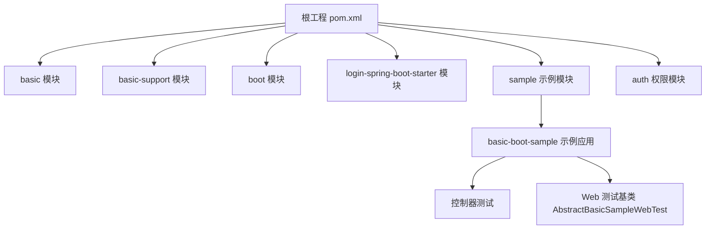
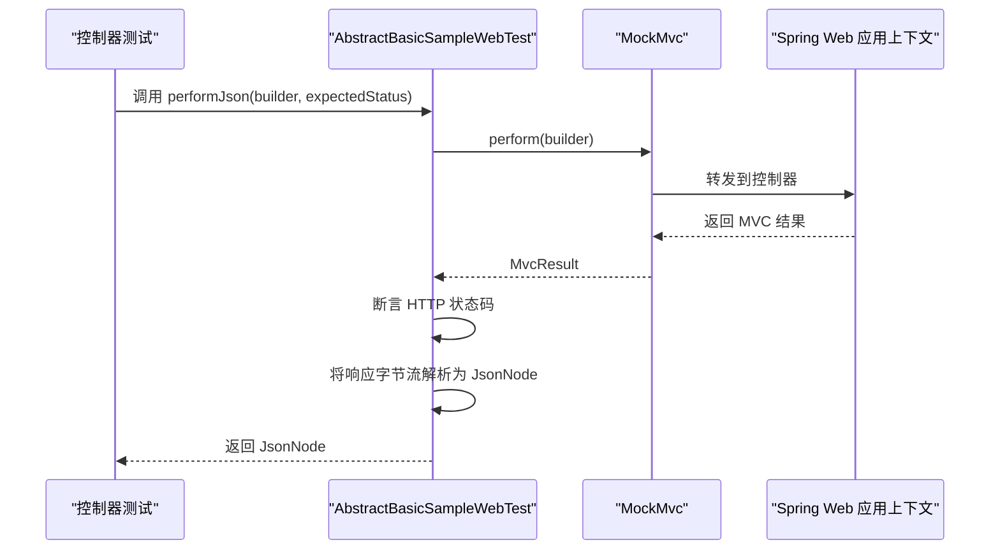
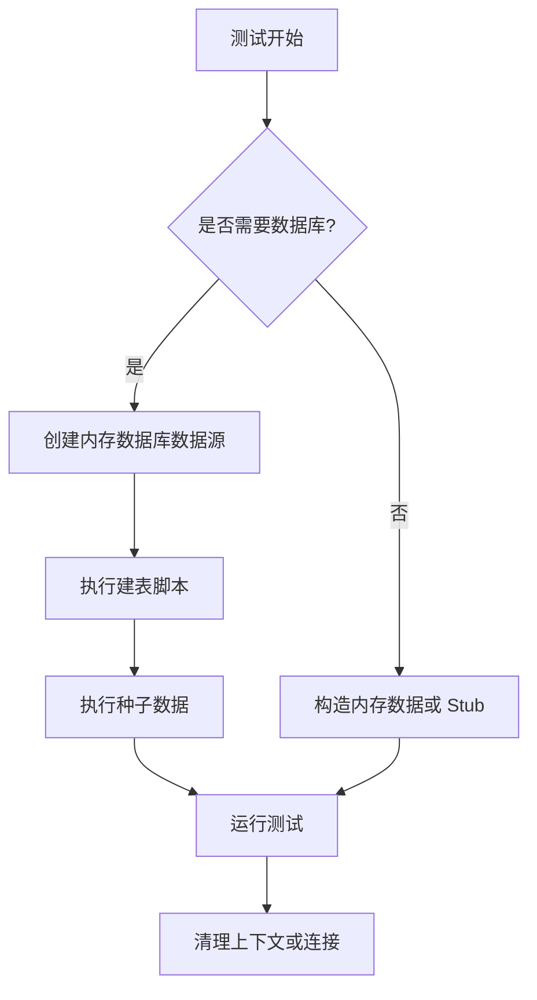
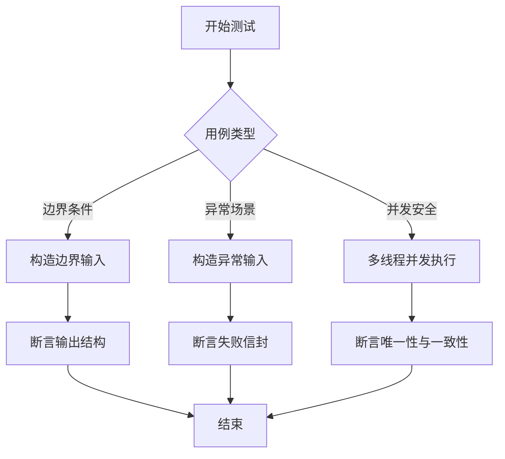
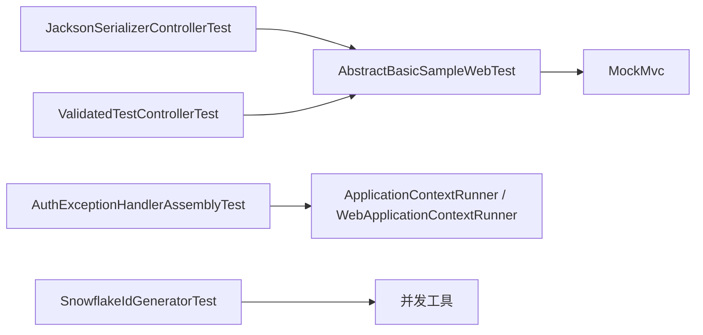

# 测试要求与规范

<cite>
**本文引用的文件**   
- [AbstractBasicSampleWebTest.java](file://sample/basic-boot-sample/src/test/java/com/cu/framework/sample/basic/controller/AbstractBasicSampleWebTest.java)
- [JacksonSerializerControllerTest.java](file://sample/basic-boot-sample/src/test/java/com/cu/framework/sample/basic/controller/JacksonSerializerControllerTest.java)
- [ValidatedTestControllerTest.java](file://sample/basic-boot-sample/src/test/java/com/cu/framework/sample/basic/controller/ValidatedTestControllerTest.java)
- [AuthExceptionHandlerAssemblyTest.java](file://auth/auth-core-spring-boot-starter/src/test/java/com/cu/framework/boot/auth/core/config/AuthExceptionHandlerAssemblyTest.java)
- [SnowflakeIdGeneratorTest.java](file://basic-support/src/test/java/com/cu/framework/basic/support/utils/SnowflakeIdGeneratorTest.java)
- [pom.xml](file://pom.xml)
</cite>

## 目录
1. [引言](#引言)
2. [项目结构中的测试组织](#项目结构中的测试组织)
3. [单元测试编写标准](#单元测试编写标准)
4. [集成测试设计原则](#集成测试设计原则)
5. [测试数据准备与管理策略](#测试数据准备与管理策略)
6. [代码覆盖率要求](#代码覆盖率要求)
7. [测试用例最佳实践](#测试用例最佳实践)
8. [测试环境配置与隔离机制](#测试环境配置与隔离机制)
9. [性能测试与压力测试指导原则](#性能测试与压力测试指导原则)
10. [依赖关系分析](#依赖关系分析)
11. [故障排查指南](#故障排查指南)
12. [结论](#结论)

## 引言
本规范面向 Kewen Framework 的所有模块，目标是统一单元测试、集成测试、性能测试的编写方式，明确命名约定、断言风格、Web 层测试基类使用方式、测试数据管理策略、覆盖率门槛以及测试环境隔离要求。规范以仓库中现有测试为参考依据，并在此基础上给出可执行的工程化约束，帮助开发人员在本地、持续集成和发布前保持一致的测试质量。

## 项目结构中的测试组织
Kewen Framework 是 Maven 多模块工程，测试代码遵循 Java 通用结构：
- 每个业务或框架模块在 `src/main` 下放置实现，在 `src/test` 下放置对应测试。
- Web 相关示例放在 `sample/basic-boot-sample` 中，其控制器测试位于 `sample/basic-boot-sample/src/test/java/.../controller`。
- 框架核心模块如 `auth`、`login-spring-boot-starter`、`basic-support`、`boot/storage-spring-boot-starter` 等各自拥有独立的测试包。
- 根级 `pom.xml` 负责聚合子模块，但当前未集中声明测试依赖管理；具体测试依赖由各子模块引入。

**图表来源**
- [pom.xml:1-40](file://pom.xml#L1-L40)
- [AbstractBasicSampleWebTest.java:1-49](file://sample/basic-boot-sample/src/test/java/com/cu/framework/sample/basic/controller/AbstractBasicSampleWebTest.java#L1-L49)

**章节来源**
- [pom.xml:1-40](file://pom.xml#L1-L40)

## 单元测试编写标准
### 类与方法命名
- 测试类名应以后缀 `Test` 结尾，例如 `JacksonSerializerControllerTest`、`SnowflakeIdGeneratorTest`、`AuthExceptionHandlerAssemblyTest`。
- 测试方法应以 `test` 开头或使用 JUnit 5 的 `@Test` 注解标注；方法名应表达被测行为，例如 `validDateParamsAreAccepted`、`registersRejectionChannelWithoutAnyUserConfig`。
- 当测试需要表达复杂语义时，可使用清晰的方法名而非仅用 `testXxx`，同时配合注释说明被测场景。

### 断言语句使用
- 推荐使用 JUnit 5 的 `Assertions`，例如 `assertEquals`、`assertTrue`、`assertFalse`、`assertNotNull`。
- 对 HTTP 响应体，优先解析为 JSON 节点后再进行字段级断言，避免直接比较整段字符串。
- 对异常路径，应显式断言失败信封中的关键字段，例如 `success`、`code`、`message`、`data`、`traceId`，而不是只断言 HTTP 状态码。

### 测试结构建议
- 每个测试方法只验证一个主要行为。
- 将公共请求构造逻辑提取到基类或工具方法中，减少重复。
- 对外部依赖（数据库、消息通知、存储）使用内嵌数据库、内存数据源或最小 Stub Bean 的方式隔离。

**章节来源**
- [JacksonSerializerControllerTest.java:1-145](file://sample/basic-boot-sample/src/test/java/com/cu/framework/sample/basic/controller/JacksonSerializerControllerTest.java#L1-L145)
- [ValidatedTestControllerTest.java:1-55](file://sample/basic-boot-sample/src/test/java/com/cu/framework/sample/basic/controller/ValidatedTestControllerTest.java#L1-L55)
- [AuthExceptionHandlerAssemblyTest.java:1-101](file://auth/auth-core-spring-boot-starter/src/test/java/com/cu/framework/boot/auth/core/config/AuthExceptionHandlerAssemblyTest.java#L1-L101)
- [SnowflakeIdGeneratorTest.java:1-200](file://basic-support/src/test/java/com/cu/framework/basic/support/utils/SnowflakeIdGeneratorTest.java#L1-L200)

## 集成测试设计原则
### Web 层测试基类 `AbstractBasicSampleWebTest`
`AbstractBasicSampleWebTest` 是 basic-boot-sample 的 Web 层测试基类，承担以下职责：
- 使用 `@SpringBootTest(webEnvironment = SpringBootTest.WebEnvironment.MOCK)` 启动 Mock Web 上下文，不依赖真实 Servlet 容器。
- 通过 `@AutoConfigureMockMvc` 启用 `MockMvc`，用于模拟 HTTP 请求。
- 通过 `@ActiveProfiles("h2")` 指定 H2 测试配置，确保使用内存数据库。
- 通过 `@TestPropertySource` 关闭第三方通知能力，避免外部依赖影响测试稳定性。
- 提供受保护的 `performJson` 方法，统一发起请求、断言 HTTP 状态码，并将响应体反序列化为 `JsonNode`，便于后续字段断言。

**图表来源**
- [AbstractBasicSampleWebTest.java:1-49](file://sample/basic-boot-sample/src/test/java/com/cu/framework/sample/basic/controller/AbstractBasicSampleWebTest.java#L1-L49)

### Web 测试最佳实践
- 所有控制器测试继承 `AbstractBasicSampleWebTest`，复用 MockMvc 和 JSON 解析能力。
- 正常路径断言成功信封：`success=true`、`code=200`、`data` 字段符合预期。
- 异常路径断言失败信封：`success=false`、`code=500`、包含 `message`、`data`、`traceId`。
- 对日期绑定、序列化、参数校验等行为，分别设计“有效值”“缺失值”“非法值”三类用例。

**章节来源**
- [AbstractBasicSampleWebTest.java:1-49](file://sample/basic-boot-sample/src/test/java/com/cu/framework/sample/basic/controller/AbstractBasicSampleWebTest.java#L1-L49)
- [JacksonSerializerControllerTest.java:1-145](file://sample/basic-boot-sample/src/test/java/com/cu/framework/sample/basic/controller/JacksonSerializerControllerTest.java#L1-L145)
- [ValidatedTestControllerTest.java:1-55](file://sample/basic-boot-sample/src/test/java/com/cu/framework/sample/basic/controller/ValidatedTestControllerTest.java#L1-L55)

## 测试数据准备与管理策略
### 测试数据库初始化
- 对于需要数据库的集成测试，优先使用 H2 内存数据库，并通过 `DriverManagerDataSource` 或 Spring 配置注入。
- `AuthExceptionHandlerAssemblyTest` 展示了如何在测试中构造最小 DataSource 和 JdbcTemplate，避免启动完整应用服务器。
- 若业务依赖表结构和初始数据，应将 SQL 脚本放在模块资源目录中，并在测试启动前执行 schema 和 seed data。

### Mock 数据生成
- 对无状态的 ID 生成器、工具类，直接在测试中构造输入并断言输出，例如雪花算法 ID 的唯一性、递增性、正数性。
- 对认证上下文、用户信息、菜单权限等对象，可在测试类内部定义最小 Stub 实现，只暴露被测逻辑需要的接口方法。
- 避免在测试中使用真实外部服务；必要时使用内存实现或简单返回固定数据的 Stub。

**图表来源**
- [AuthExceptionHandlerAssemblyTest.java:1-101](file://auth/auth-core-spring-boot-starter/src/test/java/com/cu/framework/boot/auth/core/config/AuthExceptionHandlerAssemblyTest.java#L1-L101)
- [SnowflakeIdGeneratorTest.java:1-200](file://basic-support/src/test/java/com/cu/framework/basic/support/utils/SnowflakeIdGeneratorTest.java#L1-L200)

**章节来源**
- [AuthExceptionHandlerAssemblyTest.java:1-101](file://auth/auth-core-spring-boot-starter/src/test/java/com/cu/framework/boot/auth/core/config/AuthExceptionHandlerAssemblyTest.java#L1-L101)
- [SnowflakeIdGeneratorTest.java:1-200](file://basic-support/src/test/java/com/cu/framework/basic/support/utils/SnowflakeIdGeneratorTest.java#L1-L200)

## 代码覆盖率要求
### 最低覆盖率目标
- 核心模块的行覆盖率应至少达到 **80%**。
- 核心模块包括：基础模型、异常处理、权限核心、登录认证、基础支撑工具等关键实现。
- 非核心示例模块可适当放宽，但新增业务逻辑仍建议覆盖边界条件与异常分支。

### 覆盖率统计建议
- 使用 JaCoCo 或同类覆盖率插件，在 Maven 构建阶段收集单元测试和集成测试的覆盖率。
- 排除纯配置类、DTO、枚举、静态常量等非逻辑代码。
- 在持续集成流水线中设置覆盖率门禁，低于阈值时构建失败。

### 覆盖率检查范围
- 重点覆盖：
  - 异常处理链路与全局错误信封。
  - 参数校验、格式化、序列化逻辑。
  - 权限判断、菜单访问控制、数据范围注入。
  - ID 生成、分页、树形结构工具。
  - Web 层控制器契约。

[本节为通用规范要求，不直接分析具体文件]

## 测试用例最佳实践
### 边界条件测试
- 对日期类型：测试合法格式、缺失字段、非法格式。
- 对必填字段：测试全部缺失、部分缺失、单字段缺失。
- 对数值范围：测试最小值、最大值、负数、零值。
- 对集合字段：测试空集合、单元素、超长列表。

### 异常场景测试
- 参数绑定失败应被全局异常处理器捕获，返回统一失败信封。
- JSON 解析失败不应返回默认 Spring 错误页，而应返回带 `message`、`traceId` 的结构化响应。
- 自动装配类在非 Web 环境下不应注册控制器相关组件。

### 并发安全测试
- 对分布式 ID 生成器等线程安全组件，使用多线程并发生成 ID，并验证唯一性。
- 使用 `ExecutorService`、`CountDownLatch`、`AtomicLong` 等并发工具组织测试。
- 并发测试应避免共享可变全局状态；每个测试方法重新构造被测对象。

**图表来源**
- [JacksonSerializerControllerTest.java:1-145](file://sample/basic-boot-sample/src/test/java/com/cu/framework/sample/basic/controller/JacksonSerializerControllerTest.java#L1-L145)
- [ValidatedTestControllerTest.java:1-55](file://sample/basic-boot-sample/src/test/java/com/cu/framework/sample/basic/controller/ValidatedTestControllerTest.java#L1-L55)
- [SnowflakeIdGeneratorTest.java:1-200](file://basic-support/src/test/java/com/cu/framework/basic/support/utils/SnowflakeIdGeneratorTest.java#L1-L200)

**章节来源**
- [JacksonSerializerControllerTest.java:1-145](file://sample/basic-boot-sample/src/test/java/com/cu/framework/sample/basic/controller/JacksonSerializerControllerTest.java#L1-L145)
- [ValidatedTestControllerTest.java:1-55](file://sample/basic-boot-sample/src/test/java/com/cu/framework/sample/basic/controller/ValidatedTestControllerTest.java#L1-L55)
- [SnowflakeIdGeneratorTest.java:1-200](file://basic-support/src/test/java/com/cu/framework/basic/support/utils/SnowflakeIdGeneratorTest.java#L1-L200)

## 测试环境配置与隔离机制
### 测试环境配置
- Web 层测试使用 `@SpringBootTest(WebEnvironment.MOCK)`，避免启动真实 Tomcat。
- 通过 `@ActiveProfiles` 切换测试配置，例如 `h2` profile 使用内存数据库。
- 通过 `@TestPropertySource` 禁用外部通知、日志上报等可能引入网络依赖的功能。

### 测试隔离机制
- 每个测试类应保持独立上下文；Web 层测试共用缓存的 Spring 上下文，但请求之间互不影响。
- 数据库测试使用内存数据库，每次测试进程结束后数据自然消失。
- 对需要持久化的集成测试，应在测试开始前初始化 schema，测试结束后不保留脏数据。
- 对上下文敏感的数据，例如当前用户、租户信息、追踪上下文，应在测试方法中显式设置或在基类中重置。

### 可重复性要求
- 测试不依赖外部系统、时间漂移、随机数不可控状态。
- 对时间相关行为，应使用固定时间或可替换的时间源。
- 对并发测试，应保证多次运行的结果稳定，避免因线程调度差异导致偶发失败。

**章节来源**
- [AbstractBasicSampleWebTest.java:1-49](file://sample/basic-boot-sample/src/test/java/com/cu/framework/sample/basic/controller/AbstractBasicSampleWebTest.java#L1-L49)
- [AuthExceptionHandlerAssemblyTest.java:1-101](file://auth/auth-core-spring-boot-starter/src/test/java/com/cu/framework/boot/auth/core/config/AuthExceptionHandlerAssemblyTest.java#L1-L101)

## 性能测试与压力测试指导原则
### 单元测试中的轻量性能验证
- 对高频工具方法，可加入小批量生成测试，例如连续生成大量 ID，验证耗时是否合理。
- 不将性能回归作为普通单元测试的必要条件，但可作为专项用例保留。

### 压力测试建议
- 对 Web 接口，可使用 JMeter、Gatling 或类似压测工具，在独立环境执行。
- 压测目标应包括：吞吐量、响应时间、错误率、资源占用。
- 压测数据应与功能测试数据分离，避免污染功能测试结果。
- 压测报告应纳入版本发布评审，重点关注退化趋势。

[本节为通用规范要求，不直接分析具体文件]

## 依赖关系分析
现有测试对框架能力的依赖如下：
- Web 层测试依赖 Spring Boot Test、MockMvc、Jackson。
- 自动化装配测试依赖 Spring Boot `ApplicationContextRunner` 和 `WebApplicationContextRunner`。
- 工具类测试依赖 JUnit 4 或 JUnit 5，取决于模块历史选择。
- 数据库相关测试依赖 H2、JDBC、MyBatis Plus。

**图表来源**
- [JacksonSerializerControllerTest.java:1-145](file://sample/basic-boot-sample/src/test/java/com/cu/framework/sample/basic/controller/JacksonSerializerControllerTest.java#L1-L145)
- [ValidatedTestControllerTest.java:1-55](file://sample/basic-boot-sample/src/test/java/com/cu/framework/sample/basic/controller/ValidatedTestControllerTest.java#L1-L55)
- [AbstractBasicSampleWebTest.java:1-49](file://sample/basic-boot-sample/src/test/java/com/cu/framework/sample/basic/controller/AbstractBasicSampleWebTest.java#L1-L49)
- [AuthExceptionHandlerAssemblyTest.java:1-101](file://auth/auth-core-spring-boot-starter/src/test/java/com/cu/framework/boot/auth/core/config/AuthExceptionHandlerAssemblyTest.java#L1-L101)
- [SnowflakeIdGeneratorTest.java:1-200](file://basic-support/src/test/java/com/cu/framework/basic/support/utils/SnowflakeIdGeneratorTest.java#L1-L200)

**章节来源**
- [pom.xml:1-80](file://pom.xml#L1-L80)

## 故障排查指南
### Web 测试失败
- 如果控制器返回非预期状态码，先确认 `performJson` 期望的状态与实际响应是否一致。
- 如果 JSON 字段缺失，检查响应信封结构是否符合 `success`、`code`、`message`、`data`、`traceId`。
- 如果日期绑定失败，检查请求参数格式是否为 `yyyy-MM-dd` 或 `yyyy-MM-dd HH:mm:ss`。

### 自动装配问题
- 如果拒绝处理器未生效，检查是否在 Web 环境中加载了正确配置。
- 如果使用方自定义了同类型处理器，应确认框架默认处理器已让位，不会出现多个处理器竞争。

### 并发测试不稳定
- 检查是否在每个测试方法前重建被测对象。
- 检查是否有共享全局状态未被清理。
- 适当增加并发迭代次数，但不要过度放大测试时长。

**章节来源**
- [JacksonSerializerControllerTest.java:1-145](file://sample/basic-boot-sample/src/test/java/com/cu/framework/sample/basic/controller/JacksonSerializerControllerTest.java#L1-L145)
- [ValidatedTestControllerTest.java:1-55](file://sample/basic-boot-sample/src/test/java/com/cu/framework/sample/basic/controller/ValidatedTestControllerTest.java#L1-L55)
- [AuthExceptionHandlerAssemblyTest.java:1-101](file://auth/auth-core-spring-boot-starter/src/test/java/com/cu/framework/boot/auth/core/config/AuthExceptionHandlerAssemblyTest.java#L1-L101)
- [SnowflakeIdGeneratorTest.java:1-200](file://basic-support/src/test/java/com/cu/framework/basic/support/utils/SnowflakeIdGeneratorTest.java#L1-L200)

## 结论
Kewen Framework 的测试体系应以现有测试为基础，统一测试类命名、方法命名、断言风格和 Web 层测试基类使用方式；通过 H2 内存数据库、Stub Bean、MockMvc 等方式实现测试隔离；为核心模块设定不低于 80% 的行覆盖率；补充边界条件、异常路径和并发安全测试；并将性能测试与压力测试纳入独立流程。这样可以在保证测试稳定性的同时，持续提升框架的可维护性和发布质量。