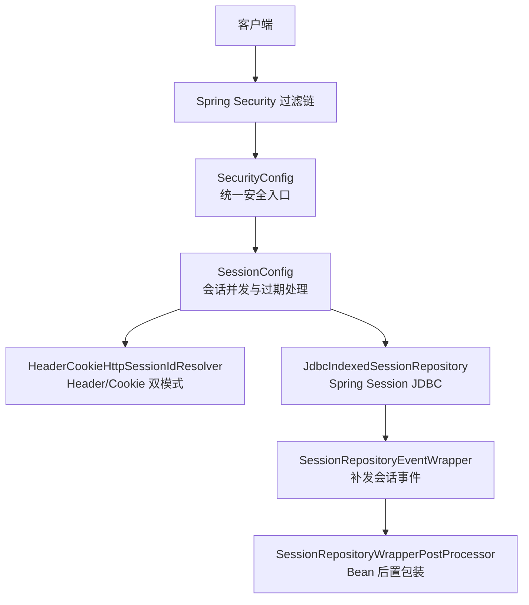
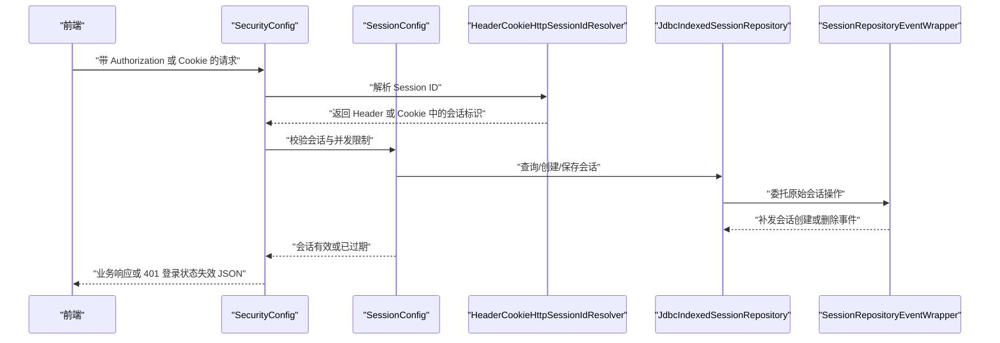
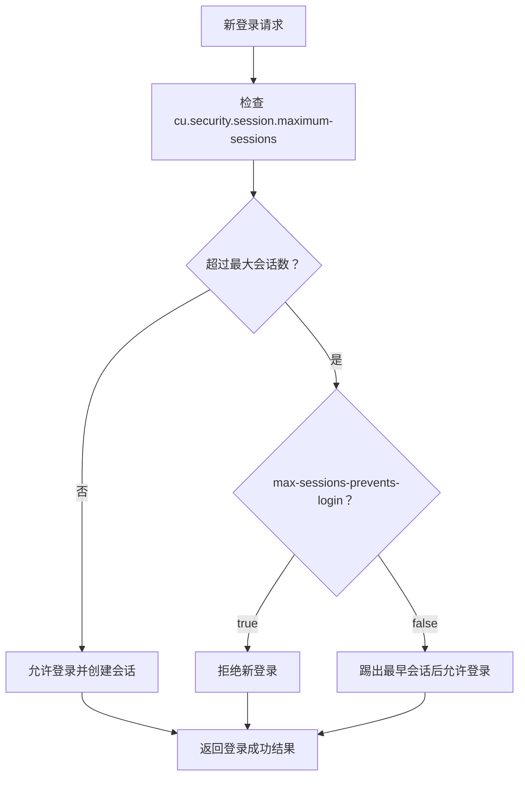
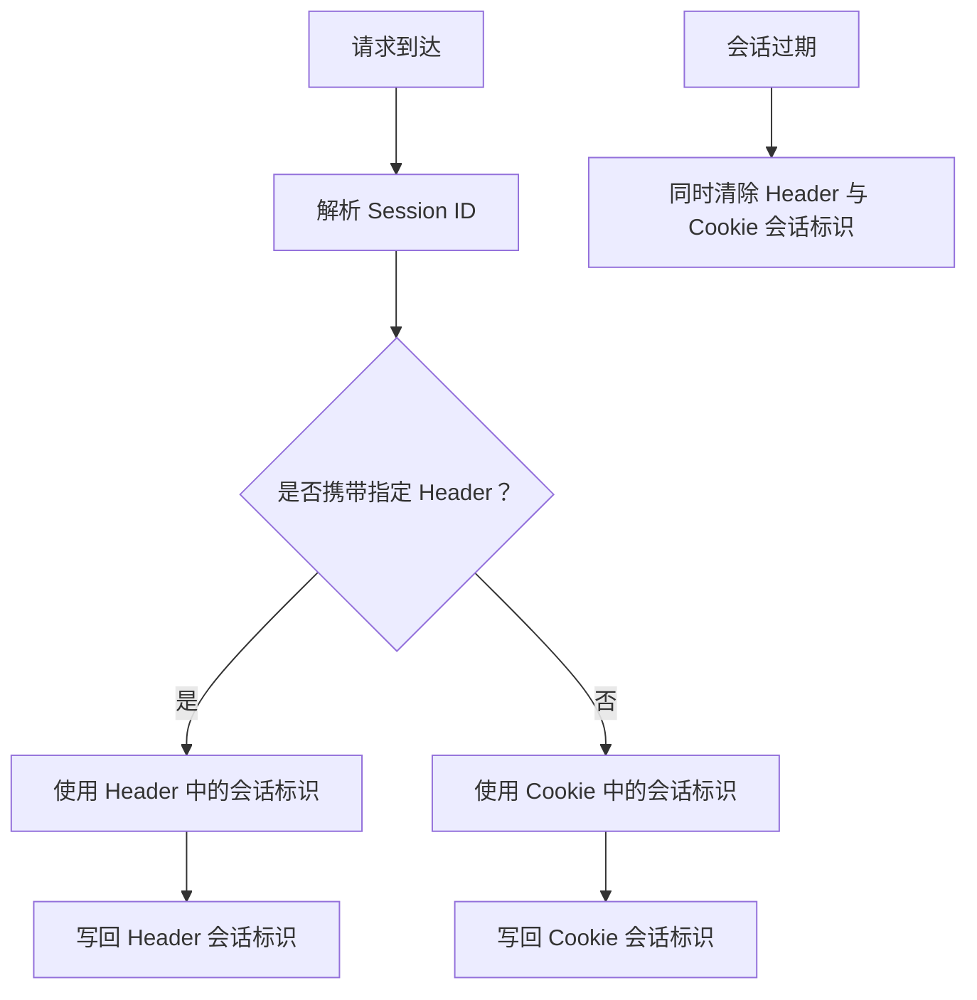
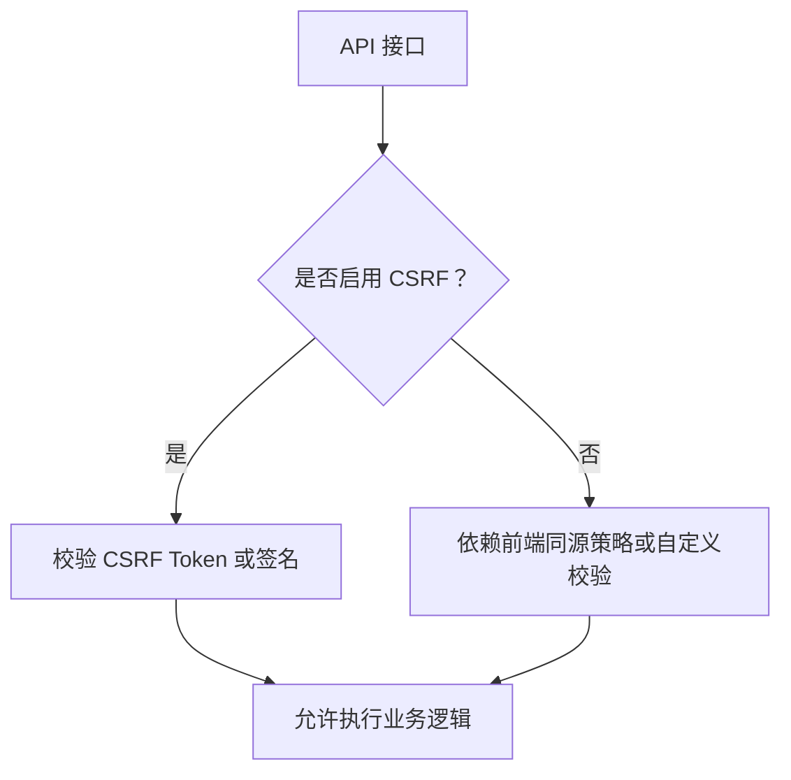
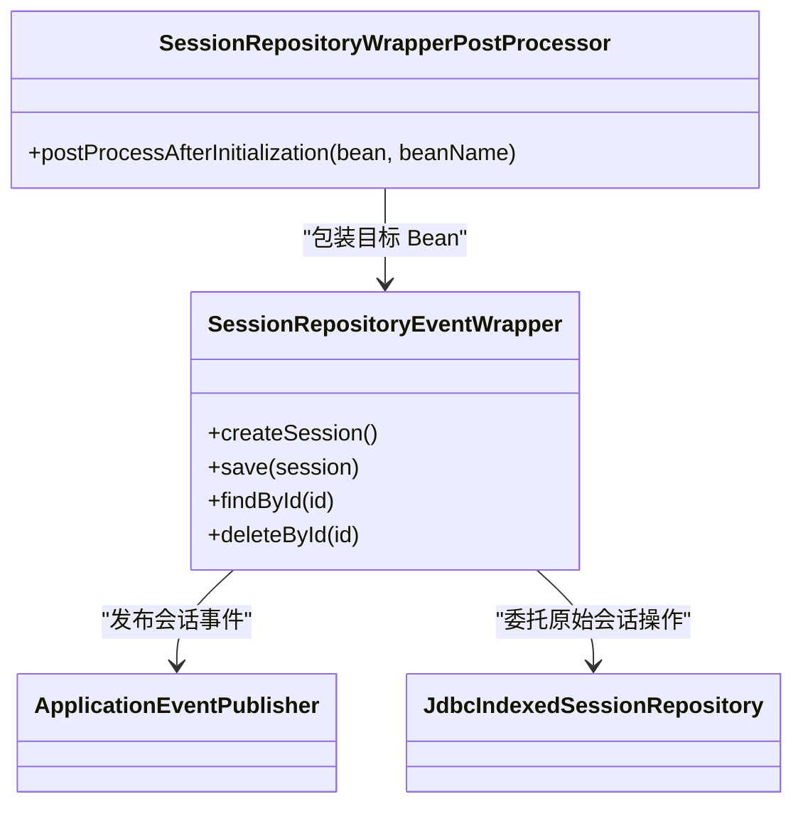
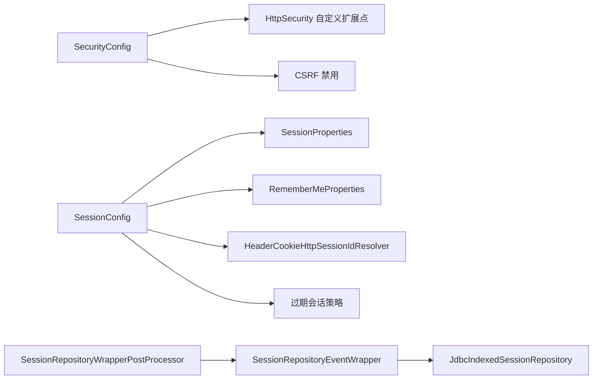

# 会话安全管理

<cite>
**本文引用的文件**   
- [login-spring-boot-starter/SessionProperties.java](file://login-spring-boot-starter/src/main/java/com/cu/framework/authentication/properties/SessionProperties.java)
- [login-spring-boot-starter/SessionConfig.java](file://login-spring-boot-starter/src/main/java/com/cu/framework/authentication/config/SessionConfig.java)
- [login-spring-boot-starter/SecurityConfig.java](file://login-spring-boot-starter/src/main/java/com/cu/framework/authentication/config/SecurityConfig.java)
- [login-spring-boot-starter/HeaderCookieHttpSessionIdResolver.java](file://login-spring-boot-starter/src/main/java/com/cu/framework/authentication/extension/HeaderCookieHttpSessionIdResolver.java)
- [login-spring-boot-starter/TokenSessionRequestFilter.java](file://login-spring-boot-starter/src/main/java/com/cu/framework/authentication/filter/TokenSessionRequestFilter.java)
- [login-spring-boot-starter/RememberMeProperties.java](file://login-spring-boot-starter/src/main/java/com/cu/framework/authentication/properties/RememberMeProperties.java)
- [login-spring-boot-starter/LoginSuccessResult.java](file://login-spring-boot-starter/src/main/java/com/cu/framework/authentication/response/LoginSuccessResult.java)
- [login-spring-boot-starter/SessionRepositoryEventAspect.java](file://login-spring-boot-starter/src/main/java/com/cu/framework/authentication/handler/SessionRepositoryEventAspect.java)
- [login-spring-boot-starter/SessionRepositoryEventWrapper.java](file://login-spring-boot-starter/src/main/java/com/cu/framework/authentication/handler/SessionRepositoryEventWrapper.java)
- [login-spring-boot-starter/SessionRepositoryWrapperPostProcessor.java](file://login-spring-boot-starter/src/main/java/com/cu/framework/authentication/config/SessionRepositoryWrapperPostProcessor.java)
- [docs/application.yml](file://docs/application.yml)
- [sample/login-boot-sample/application.yml](file://sample/login-boot-sample/src/main/resources/application.yml)
- [sample/auth-rbac-boot-sample/application.yml](file://sample/auth-rbac-boot-sample/src/main/resources/application.yml)
</cite>

## 目录
1. [引言](#引言)
2. [项目结构与安全边界](#项目结构与安全边界)
3. [核心会话安全组件](#核心会话安全组件)
4. [架构总览](#架构总览)
5. [详细组件分析](#详细组件分析)
6. [依赖关系分析](#依赖关系分析)
7. [性能与扩展性考量](#性能与扩展性考量)
8. [故障排查指南](#故障排查指南)
9. [结论](#结论)

## 引言
本指南聚焦 Kewen Framework 中与会话生命周期、并发登录控制、跨站请求伪造防护、会话劫持防护以及审计事件相关的实现，并给出可落地的配置策略和部署建议。框架使用 Spring Security 作为认证访问控制基础，结合 Spring Session JDBC 进行会话持久化，并通过自定义解析器支持“请求头 Token + Cookie”双模式会话标识。

## 项目结构与安全边界
Kewen Framework 的会话安全能力主要分布在 `login-spring-boot-starter` 模块中：
- 属性类定义会话并发限制与记住我参数；
- 安全配置类注册 Spring Security 过滤器链、禁用 CSRF、暴露 HTTP 安全定制点；
- 会话配置类设置最大会话数、会话过期响应、RememberMe 服务；
- 会话 ID 解析器支持从 Header 或 Cookie 解析会话标识；
- JDBC 会话仓库包装处理器为数据库存储补发会话创建/删除事件；
- 示例应用提供不同 profile 下的完整配置参考。

**图示来源**
- [login-spring-boot-starter/SecurityConfig.java:60-144](file://login-spring-boot-starter/src/main/java/com/cu/framework/authentication/config/SecurityConfig.java#L60-L144)
- [login-spring-boot-starter/SessionConfig.java:30-124](file://login-spring-boot-starter/src/main/java/com/cu/framework/authentication/config/SessionConfig.java#L30-L124)
- [login-spring-boot-starter/HeaderCookieHttpSessionIdResolver.java:1-80](file://login-spring-boot-starter/src/main/java/com/cu/framework/authentication/extension/HeaderCookieHttpSessionIdResolver.java#L1-L80)
- [login-spring-boot-starter/SessionRepositoryEventWrapper.java:1-87](file://login-spring-boot-starter/src/main/java/com/cu/framework/authentication/handler/SessionRepositoryEventWrapper.java#L1-L87)
- [login-spring-boot-starter/SessionRepositoryWrapperPostProcessor.java:1-51](file://login-spring-boot-starter/src/main/java/com/cu/framework/authentication/config/SessionRepositoryWrapperPostProcessor.java#L1-L51)

**章节来源**
- [login-spring-boot-starter/SecurityConfig.java:1-144](file://login-spring-boot-starter/src/main/java/com/cu/framework/authentication/config/SecurityConfig.java#L1-L144)
- [login-spring-boot-starter/SessionConfig.java:1-124](file://login-spring-boot-starter/src/main/java/com/cu/framework/authentication/config/SessionConfig.java#L1-L124)
- [docs/application.yml:1-209](file://docs/application.yml#L1-L209)

## 核心会话安全组件
- 会话并发控制属性：定义单用户最大会话数和超限策略。
- Spring Security 主配置：统一放行 URL、JSON 成功/异常处理、禁用 CSRF、开放 HTTP 安全定制扩展点。
- 会话配置：设置最大会话数、过期返回 JSON、RememberMe 服务、Header/Cookie 双模式会话 ID 解析。
- 会话事件增强：通过 Bean 后置处理器包装 JDBC 会话仓库，补发会话创建与删除事件，使并发会话控制等监听器正常工作。
- 登录成功结果对象：封装 token（即当前 Session ID）、用户基本信息与权限集合。

**章节来源**
- [login-spring-boot-starter/SessionProperties.java:1-22](file://login-spring-boot-starter/src/main/java/com/cu/framework/authentication/properties/SessionProperties.java#L1-L22)
- [login-spring-boot-starter/SecurityConfig.java:60-144](file://login-spring-boot-starter/src/main/java/com/cu/framework/authentication/config/SecurityConfig.java#L60-L144)
- [login-spring-boot-starter/SessionConfig.java:30-124](file://login-spring-boot-starter/src/main/java/com/cu/framework/authentication/config/SessionConfig.java#L30-L124)
- [login-spring-boot-starter/SessionRepositoryEventWrapper.java:1-87](file://login-spring-boot-starter/src/main/java/com/cu/framework/authentication/handler/SessionRepositoryEventWrapper.java#L1-L87)
- [login-spring-boot-starter/LoginSuccessResult.java:1-96](file://login-spring-boot-starter/src/main/java/com/cu/framework/authentication/response/LoginSuccessResult.java#L1-L96)

## 架构总览
下图展示一次鉴权请求在 Kewen Framework 中的关键路径：前端携带 Authorization Header 或 Cookie 发起请求，Spring Security 过滤链完成认证与授权，会话管理根据配置限制并发会话，过期时返回统一 JSON，JDBC 会话仓库通过包装器发布会话事件。

**图示来源**
- [login-spring-boot-starter/SecurityConfig.java:80-144](file://login-spring-boot-starter/src/main/java/com/cu/framework/authentication/config/SecurityConfig.java#L80-L144)
- [login-spring-boot-starter/SessionConfig.java:60-124](file://login-spring-boot-starter/src/main/java/com/cu/framework/authentication/config/SessionConfig.java#L60-L124)
- [login-spring-boot-starter/HeaderCookieHttpSessionIdResolver.java:20-80](file://login-spring-boot-starter/src/main/java/com/cu/framework/authentication/extension/HeaderCookieHttpSessionIdResolver.java#L20-L80)
- [login-spring-boot-starter/SessionRepositoryEventWrapper.java:40-87](file://login-spring-boot-starter/src/main/java/com/cu/framework/authentication/handler/SessionRepositoryEventWrapper.java#L40-L87)

## 详细组件分析

### 会话超时与空闲超时配置
- 绝对超时时间由 Spring Session 的 `spring.session.timeout` 决定；示例应用设置为两天。
- 框架未暴露独立的“空闲超时”属性；若需要空闲行为，应基于会话过期策略、应用层心跳续期或 Redis/MongoDB 会话存储的 TTL 策略实现。
- 最佳实践建议：
  - 将 `spring.session.timeout` 设为与应用业务节奏匹配的值，避免过短导致频繁重登。
  - 对外部浏览器端 Token 缓存设置独立有效期，且不应长于服务器会话绝对超时。
  - 对无状态 API 调用建议使用短期 Token，并在服务端配合会话刷新策略。

**章节来源**
- [sample/login-boot-sample/application.yml:1-120](file://sample/login-boot-sample/src/main/resources/application.yml#L1-L120)
- [sample/auth-rbac-boot-sample/application.yml:1-60](file://sample/auth-rbac-boot-sample/src/main/resources/application.yml#L1-L60)

### 最大会话数与并发登录控制
- 单用户最大会话数由 `cu.security.session.maximum-sessions` 控制，默认值为 10。
- 达到上限时的行为由 `cu.security.session.max-sessions-prevents-login` 控制：
  - `false`：挤掉最早会话，允许新登录；
  - `true`：阻止新登录。
- 该机制用于防止单用户无限设备登录，但并非细粒度并发防护；更严格的并发控制需要结合业务令牌、设备指纹与后端策略。

**图示来源**
- [login-spring-boot-starter/SessionProperties.java:10-22](file://login-spring-boot-starter/src/main/java/com/cu/framework/authentication/properties/SessionProperties.java#L10-L22)
- [login-spring-boot-starter/SessionConfig.java:90-124](file://login-spring-boot-starter/src/main/java/com/cu/framework/authentication/config/SessionConfig.java#L90-L124)
- [sample/auth-rbac-boot-sample/application.yml:30-40](file://sample/auth-rbac-boot-sample/src/main/resources/application.yml#L30-L40)

**章节来源**
- [login-spring-boot-starter/SessionProperties.java:1-22](file://login-spring-boot-starter/src/main/java/com/cu/framework/authentication/properties/SessionProperties.java#L1-L22)
- [login-spring-boot-starter/SessionConfig.java:90-124](file://login-spring-boot-starter/src/main/java/com/cu/framework/authentication/config/SessionConfig.java#L90-L124)
- [docs/application.yml:100-120](file://docs/application.yml#L100-L120)
- [sample/auth-rbac-boot-sample/application.yml:30-40](file://sample/auth-rbac-boot-sample/src/main/resources/application.yml#L30-L40)

### 会话劫持防护措施
- 请求头与 Cookie 双模式：`HeaderCookieHttpSessionIdResolver` 优先从指定 Header（如 Authorization）读取会话 ID，否则回退到 Cookie。
- 写入策略：当本次请求通过 Header 解析时，会话 ID 写回 Header；否则写回 Cookie；过期时同时清除 Header 与 Cookie。
- 注意：当前实现未强制 HTTPS，也未显式启用 Cookie Secure、HttpOnly、SameSite 属性；生产环境应在网关或反向代理层强制 HTTPS，并根据部署需求配置 Cookie 安全属性。
- 会话固定攻击防护：框架未在 Spring Security 主配置中显式启用会话固定保护；如需严格防护，应在业务自定义的 `HttpSecurityCustomizer` 中启用会话固定策略，并确保登录后更换会话标识。

**图示来源**
- [login-spring-boot-starter/HeaderCookieHttpSessionIdResolver.java:20-80](file://login-spring-boot-starter/src/main/java/com/cu/framework/authentication/extension/HeaderCookieHttpSessionIdResolver.java#L20-L80)
- [login-spring-boot-starter/SecurityConfig.java:80-144](file://login-spring-boot-starter/src/main/java/com/cu/framework/authentication/config/SecurityConfig.java#L80-L144)

**章节来源**
- [login-spring-boot-starter/HeaderCookieHttpSessionIdResolver.java:1-80](file://login-spring-boot-starter/src/main/java/com/cu/framework/authentication/extension/HeaderCookieHttpSessionIdResolver.java#L1-L80)
- [login-spring-boot-starter/SecurityConfig.java:80-144](file://login-spring-boot-starter/src/main/java/com/cu/framework/authentication/config/SecurityConfig.java#L80-L144)

### 跨站请求伪造防护
- 框架默认禁用 CSRF：`http.csrf().disable()`。
- 这意味着仅凭会话即可执行写操作，前端与后端需共同承担 CSRF 防护责任：
  - 推荐在前端使用同源策略、CSRF Token 校验或 SameSite Cookie 策略；
  - 在后端通过自定义 `HttpSecurityCustomizer` 启用 CSRF 并对 API 接口实施额外校验；
  - 对于纯 Token 调用的无状态接口，应使用短期 Token 并结合签名或一次性 nonce。

**图示来源**
- [login-spring-boot-starter/SecurityConfig.java:100-144](file://login-spring-boot-starter/src/main/java/com/cu/framework/authentication/config/SecurityConfig.java#L100-L144)

**章节来源**
- [login-spring-boot-starter/SecurityConfig.java:80-144](file://login-spring-boot-starter/src/main/java/com/cu/framework/authentication/config/SecurityConfig.java#L80-L144)

### 会话监控与审计
- 会话事件增强：`SessionRepositoryEventWrapper` 在创建、保存、删除会话时补发 `SessionCreatedEvent` 与 `SessionDestroyedEvent`，使依赖这些事件的监听器能够感知会话变化。
- 旧方案：`SessionRepositoryEventAspect` 通过 AOP 方式补发事件，已被标记废弃；新方案使用 `SessionRepositoryWrapperPostProcessor` 在 Bean 初始化后包装 JDBC 会话仓库。
- 建议的实践：
  - 订阅会话创建/销毁事件，记录用户 ID、会话 ID、来源 IP、来源方式（Header 或 Cookie）、时间戳；
  - 检测异常登录：同一用户短时间内多设备登录、异地 IP 变更、长时间活跃但无操作；
  - 对会话过期、并发踢出、认证失败等事件输出结构化日志，便于审计与告警。

**图示来源**
- [login-spring-boot-starter/SessionRepositoryEventWrapper.java:1-87](file://login-spring-boot-starter/src/main/java/com/cu/framework/authentication/handler/SessionRepositoryEventWrapper.java#L1-L87)
- [login-spring-boot-starter/SessionRepositoryWrapperPostProcessor.java:1-51](file://login-spring-boot-starter/src/main/java/com/cu/framework/authentication/config/SessionRepositoryWrapperPostProcessor.java#L1-L51)

**章节来源**
- [login-spring-boot-starter/SessionRepositoryEventAspect.java:1-72](file://login-spring-boot-starter/src/main/java/com/cu/framework/authentication/handler/SessionRepositoryEventAspect.java#L1-L72)
- [login-spring-boot-starter/SessionRepositoryEventWrapper.java:1-87](file://login-spring-boot-starter/src/main/java/com/cu/framework/authentication/handler/SessionRepositoryEventWrapper.java#L1-L87)
- [login-spring-boot-starter/SessionRepositoryWrapperPostProcessor.java:1-51](file://login-spring-boot-starter/src/main/java/com/cu/framework/authentication/config/SessionRepositoryWrapperPostProcessor.java#L1-L51)

### 记住我与登录成功响应
- 记住我功能通过 `SpringSessionRememberMeServices` 提供，参数名与有效期来自 `cu.security.remember-me.*`。
- 登录成功响应对象包含 token（当前 Session ID）、用户信息与权限集合；token 字段可用于前端后续请求携带。
- 建议：
  - 在生产环境中谨慎开启记住我，缩短有效期并绑定设备指纹；
  - 前端应将 token 视为敏感信息，避免泄露到日志、URL 或第三方 SDK。

**章节来源**
- [login-spring-boot-starter/RememberMeProperties.java:1-26](file://login-spring-boot-starter/src/main/java/com/cu/framework/authentication/properties/RememberMeProperties.java#L1-L26)
- [login-spring-boot-starter/LoginSuccessResult.java:1-96](file://login-spring-boot-starter/src/main/java/com/cu/framework/authentication/response/LoginSuccessResult.java#L1-L96)
- [sample/login-boot-sample/application.yml:1-120](file://sample/login-boot-sample/src/main/resources/application.yml#L1-L120)

### 历史 Token 会话过滤器的注意事项
- `TokenSessionRequestFilter` 被标记为废弃，其注释说明 spring-session 自身已支持基于 Header 的 sessionId 传入方式；当前推荐使用 `HeaderCookieHttpSessionIdResolver`。
- 如果项目中仍存在该过滤器，应避免与新的 Header/Cookie 双模式解析器产生冲突。

**章节来源**
- [login-spring-boot-starter/TokenSessionRequestFilter.java:1-210](file://login-spring-boot-starter/src/main/java/com/cu/framework/authentication/filter/TokenSessionRequestFilter.java#L1-L210)

## 依赖关系分析
- `SecurityConfig` 负责统一安全入口、静态资源放行、JSON 成功与异常处理、禁用 CSRF，并暴露 `HttpSecurityCustomizer` 扩展点。
- `SessionConfig` 依赖 `SessionProperties` 和 `RememberMeProperties`，装配会话并发控制、过期响应、RememberMe 服务与会话 ID 解析器。
- `SessionRepositoryWrapperPostProcessor` 在 Spring Session JDBC 自动配置完成后，包装 `JdbcIndexedSessionRepository`，使其具备事件发布能力。
- 示例应用通过 `application.yml` 明确配置 `spring.session.store-type=jdbc` 与 `spring.session.timeout`，确保会话持久化与超时行为符合预期。

**图示来源**
- [login-spring-boot-starter/SecurityConfig.java:60-144](file://login-spring-boot-starter/src/main/java/com/cu/framework/authentication/config/SecurityConfig.java#L60-L144)
- [login-spring-boot-starter/SessionConfig.java:30-124](file://login-spring-boot-starter/src/main/java/com/cu/framework/authentication/config/SessionConfig.java#L30-L124)
- [login-spring-boot-starter/SessionRepositoryWrapperPostProcessor.java:1-51](file://login-spring-boot-starter/src/main/java/com/cu/framework/authentication/config/SessionRepositoryWrapperPostProcessor.java#L1-L51)

**章节来源**
- [login-spring-boot-starter/SecurityConfig.java:1-144](file://login-spring-boot-starter/src/main/java/com/cu/framework/authentication/config/SecurityConfig.java#L1-L144)
- [login-spring-boot-starter/SessionConfig.java:1-124](file://login-spring-boot-starter/src/main/java/com/cu/framework/authentication/config/SessionConfig.java#L1-L124)
- [login-spring-boot-starter/SessionRepositoryWrapperPostProcessor.java:1-51](file://login-spring-boot-starter/src/main/java/com/cu/framework/authentication/config/SessionRepositoryWrapperPostProcessor.java#L1-L51)

## 性能与扩展性考量
- 并发会话控制会增加会话查找与计数开销；在高并发场景下建议评估最大会话数与用户基数，避免过大导致内存与数据库压力上升。
- JDBC 会话存储适合中小规模系统；大规模分布式系统可考虑 Redis 会话存储以获得更好吞吐与更低延迟。
- 会话事件增强通过装饰器实现，对原有会话操作影响较小；但大量会话创建/删除会触发事件发布，需在审计监听器中避免阻塞主流程。
- 建议在网关层统一处理 HTTPS、CORS、速率限制与访问审计，减轻应用层负担。

[本节为通用指导，不直接分析具体代码文件]

## 故障排查指南
- 登录成功后仍提示登录状态失效：
  - 检查 `spring.session.timeout` 是否过短；
  - 检查会话是否因并发超限被踢出；
  - 检查前端是否正确传递 Authorization Header 或 Cookie。
- 新设备无法登录：
  - 若 `max-sessions-prevents-login=true`，达到最大会话数后会阻止新登录；
  - 调整为 `false` 以允许挤掉最早会话。
- 会话事件未触发：
  - 确认使用的是 JDBC 会话存储；
  - 确认 `SessionRepositoryWrapperPostProcessor` 已启用；
  - 检查是否存在自定义 `SessionRepository` Bean 导致自动配置条件短路。
- CSRF 相关异常：
  - 由于框架默认禁用 CSRF，若启用了自定义 CSRF 策略，请确认请求是否携带合法 Token 或满足同源策略。

**章节来源**
- [sample/login-boot-sample/application.yml:1-120](file://sample/login-boot-sample/src/main/resources/application.yml#L1-L120)
- [sample/auth-rbac-boot-sample/application.yml:30-40](file://sample/auth-rbac-boot-sample/src/main/resources/application.yml#L30-L40)
- [login-spring-boot-starter/SessionRepositoryWrapperPostProcessor.java:1-51](file://login-spring-boot-starter/src/main/java/com/cu/framework/authentication/config/SessionRepositoryWrapperPostProcessor.java#L1-L51)
- [login-spring-boot-starter/SecurityConfig.java:100-144](file://login-spring-boot-starter/src/main/java/com/cu/framework/authentication/config/SecurityConfig.java#L100-L144)

## 结论
Kewen Framework 的会话安全管理围绕 Spring Security 与 Spring Session JDBC 构建，提供了最大会话数控制、过期会话 JSON 响应、Header/Cookie 双模式会话标识、JDBC 会话事件增强与记住我服务。生产部署时应结合网关层强制 HTTPS、细化 CSRF 策略、合理设置会话绝对超时与并发限制，并通过会话事件完善审计与异常检测。不同部署环境下，可通过 sample 应用的 application.yml 快速调整会话与认证配置，并在业务层按需扩展 HTTP 安全策略。