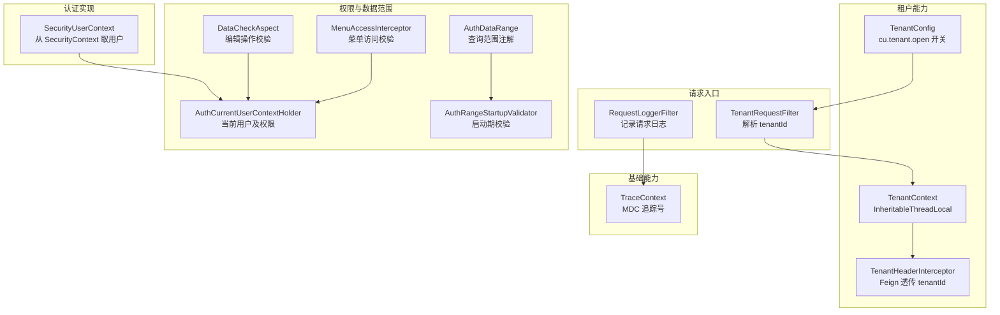
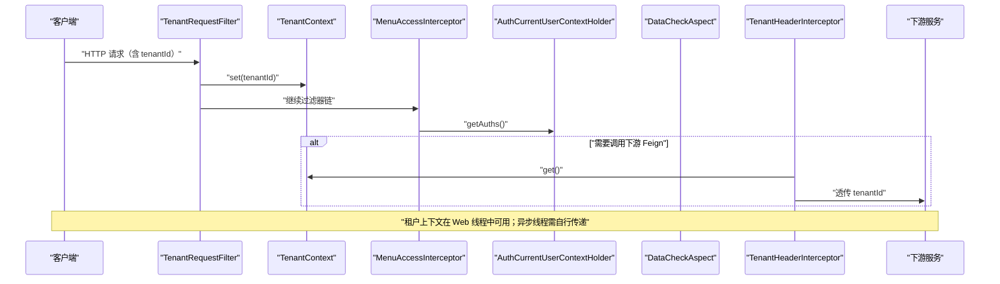
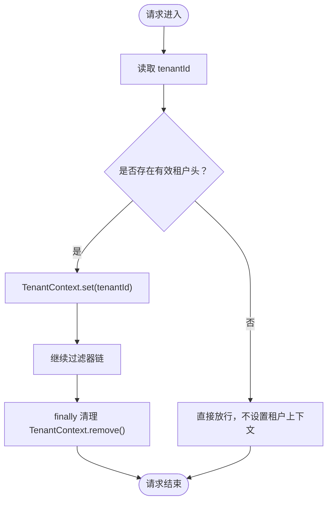
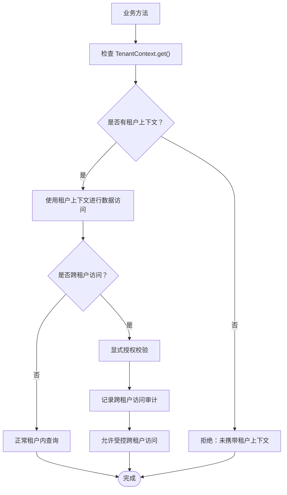
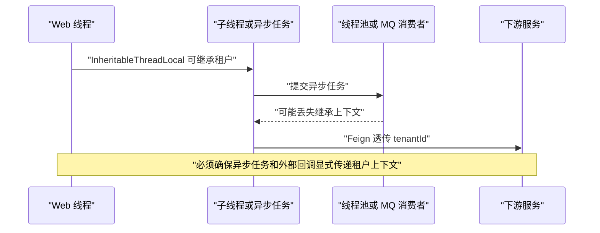
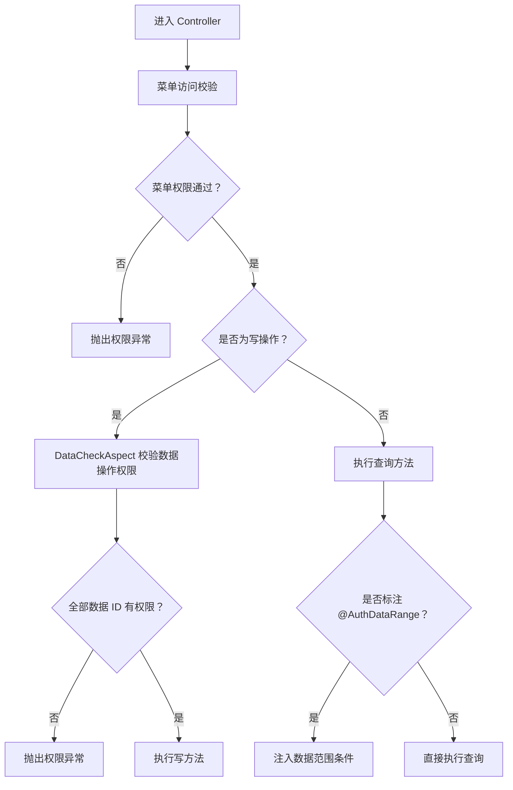
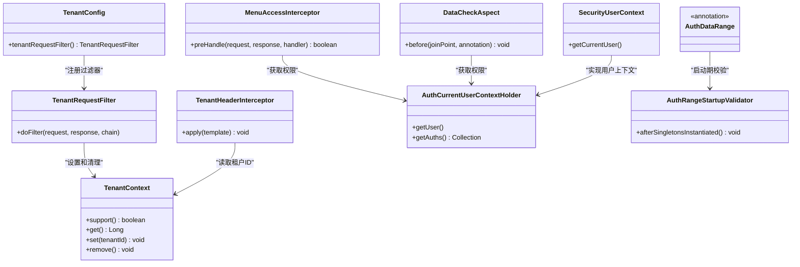

# 多租户数据安全

<cite>
**本文引用的文件**   
- [TenantContext.java](file://boot/tenant-spring-boot-starter/src/main/java/com/cu/framework/tenant/TenantContext.java)
- [TenantRequestFilter.java](file://boot/tenant-spring-boot-starter/src/main/java/com/cu/framework/tenant/TenantRequestFilter.java)
- [TenantConstant.java](file://boot/tenant-spring-boot-starter/src/main/java/com/cu/framework/tenant/TenantConstant.java)
- [TenantConfig.java](file://boot/tenant-spring-boot-starter/src/main/java/com/cu/framework/tenant/config/TenantConfig.java)
- [TenantHeaderInterceptor.java](file://boot/tenant-spring-boot-starter/src/main/java/com/cu/framework/tenant/feign/TenantHeaderInterceptor.java)
- [application.yml（多租户示例）](file://sample/tenant-boot-sample/src/main/resources/application.yml)
- [AuthDataRange.java](file://auth/auth-core/src/main/java/com/cu/framework/auth/core/AuthDataRange.java)
- [AuthDataOperation.java](file://auth/auth-core/src/main/java/com/cu/framework/auth/core/AuthDataOperation.java)
- [AuthDataAdaptor.java](file://auth/auth-core/src/main/java/com/cu/framework/auth/core/AuthDataAdaptor.java)
- [AuthCurrentUserContextHolder.java](file://auth/auth-core/src/main/java/com/cu/framework/auth/core/AuthCurrentUserContextHolder.java)
- [AuthRangeStartupValidator.java](file://auth/auth-core/src/main/java/com/cu/framework/auth/core/data/range/AuthRangeStartupValidator.java)
- [DataCheckAspect.java](file://auth/auth-core/src/main/java/com/cu/framework/auth/core/data/edit/DataCheckAspect.java)
- [MenuAccessInterceptor.java](file://auth/auth-core/src/main/java/com/cu/framework/auth/core/menu/MenuAccessInterceptor.java)
- [SecurityUserContext.java](file://login-spring-boot-starter/src/main/java/com/cu/framework/authentication/SecurityUserContext.java)
- [TraceContext.java](file://basic/src/main/java/com/cu/framework/basic/logger/trace/TraceContext.java)
- [RequestLoggerFilter.java](file://basic/src/main/java/com/cu/framework/basic/logger/RequestLoggerFilter.java)
</cite>

## 目录
1. [引言](#引言)
2. [项目结构](#项目结构)
3. [核心组件](#核心组件)
4. [架构总览](#架构总览)
5. [详细组件分析](#详细组件分析)
6. [依赖关系分析](#依赖关系分析)
7. [性能与安全特性](#性能与安全特性)
8. [故障排查指南](#故障排查指南)
9. [结论](#结论)

## 引言
本实施指南面向 Kewen Framework 的多租户数据安全落地，聚焦以下目标：
- 明确数据源隔离策略的选择标准与实现边界，说明框架当前提供的逻辑隔离能力。
- 梳理租户上下文的生命周期、传播路径与线程安全保证。
- 基于现有权限体系，解释跨租户访问防护的默认拒绝策略、显式授权机制和越权检测阻断。
- 给出租户级别安全配置的实践建议，包括加密密钥、访问控制策略与审计日志隔离。
- 提供数据备份恢复的安全考虑，以及多租户环境下的渗透测试和安全审计实践。

## 项目结构
Kewen Framework 将多租户能力集中在 `boot/tenant-spring-boot-starter`，将权限和数据范围控制集中在 `auth/auth-core`，并将认证用户上下文抽象在 `auth/auth-core` 中，由登录模块 `login-spring-boot-starter` 注入具体实现；基础追踪能力位于 `basic` 模块。

**图表来源**
- [TenantRequestFilter.java:18-45](file://boot/tenant-spring-boot-starter/src/main/java/com/cu/framework/tenant/TenantRequestFilter.java#L18-L45)
- [TenantContext.java:10-42](file://boot/tenant-spring-boot-starter/src/main/java/com/cu/framework/tenant/TenantContext.java#L10-L42)
- [TenantHeaderInterceptor.java:19-35](file://boot/tenant-spring-boot-starter/src/main/java/com/cu/framework/tenant/feign/TenantHeaderInterceptor.java#L19-L35)
- [TenantConfig.java:14-21](file://boot/tenant-spring-boot-starter/src/main/java/com/cu/framework/tenant/config/TenantConfig.java#L14-L21)
- [MenuAccessInterceptor.java:28-92](file://auth/auth-core/src/main/java/com/cu/framework/auth/core/menu/MenuAccessInterceptor.java#L28-L92)
- [DataCheckAspect.java:38-148](file://auth/auth-core/src/main/java/com/cu/framework/auth/core/data/edit/DataCheckAspect.java#L38-L148)
- [AuthDataRange.java:12-81](file://auth/auth-core/src/main/java/com/cu/framework/auth/core/AuthDataRange.java#L12-L81)
- [AuthRangeStartupValidator.java:34-162](file://auth/auth-core/src/main/java/com/cu/framework/auth/core/data/range/AuthRangeStartupValidator.java#L34-L162)
- [SecurityUserContext.java:18-36](file://login-spring-boot-starter/src/main/java/com/cu/framework/authentication/SecurityUserContext.java#L18-L36)
- [TraceContext.java:12-21](file://basic/src/main/java/com/cu/framework/basic/logger/trace/TraceContext.java#L12-L21)

**章节来源**
- [TenantRequestFilter.java:1-46](file://boot/tenant-spring-boot-starter/src/main/java/com/cu/framework/tenant/TenantRequestFilter.java#L1-L46)
- [TenantContext.java:1-43](file://boot/tenant-spring-boot-starter/src/main/java/com/cu/framework/tenant/TenantContext.java#L1-L43)
- [TenantHeaderInterceptor.java:1-36](file://boot/tenant-spring-boot-starter/src/main/java/com/cu/framework/tenant/feign/TenantHeaderInterceptor.java#L1-L36)
- [TenantConfig.java:1-22](file://boot/tenant-spring-boot-starter/src/main/java/com/cu/framework/tenant/config/TenantConfig.java#L1-L22)
- [application.yml（多租户示例）:1-37](file://sample/tenant-boot-sample/src/main/resources/application.yml#L1-L37)

## 核心组件
- **租户上下文**：`TenantContext` 使用 `InheritableThreadLocal<Long>` 保存当前租户 ID，并提供判断、获取、设置和清除方法。
- **租户过滤器**：`TenantRequestFilter` 从请求头 `tenantId` 解析租户 ID，写入上下文并在 finally 中清理；若请求头为空则直接放行，不设置租户上下文。
- **租户常量**：`TenantConstant.TENANT_ID` 定义租户请求头键为 `tenantId`。
- **租户配置开关**：`TenantConfig` 通过 `cu.tenant.open=true` 启用租户过滤器和 Feign 拦截器。
- **Feign 租户透传**：`TenantHeaderInterceptor` 在发起 Feign 请求前，将当前 `TenantContext` 中的租户 ID 写入下游请求头。
- **当前用户上下文接口**：`AuthCurrentUserContextHolder` 暴露当前用户和扁平化权限集合，具体实现由登录模块注入。
- **菜单访问控制**：`MenuAccessInterceptor` 对标注了菜单权限声明的控制器方法进行 URL 级权限校验，未命中时抛出统一异常。
- **数据操作权限校验**：`DataCheckAspect` 对标注 `@AuthDataOperation` 的方法收集业务数据 ID，逐个判定权限，任一未命中即整体拒绝。
- **数据范围注解**：`@AuthDataRange` 用于 MyBatis Mapper 查询方法，按业务功能、操作类型和用户权限动态注入 SQL 过滤条件。
- **数据范围启动校验**：`AuthRangeStartupValidator` 在启动阶段校验注解位置、语句类型、二级缓存冲突和目标表存在性，错误直接导致启动失败。
- **请求日志与追踪**：`RequestLoggerFilter` 记录请求信息并发布持久化事件；`TraceContext` 基于 MDC 维护追踪号。

**章节来源**
- [TenantContext.java:10-42](file://boot/tenant-spring-boot-starter/src/main/java/com/cu/framework/tenant/TenantContext.java#L10-L42)
- [TenantRequestFilter.java:18-45](file://boot/tenant-spring-boot-starter/src/main/java/com/cu/framework/tenant/TenantRequestFilter.java#L18-L45)
- [TenantConstant.java:6-10](file://boot/tenant-spring-boot-starter/src/main/java/com/cu/framework/tenant/TenantConstant.java#L6-L10)
- [TenantConfig.java:14-21](file://boot/tenant-spring-boot-starter/src/main/java/com/cu/framework/tenant/config/TenantConfig.java#L14-L21)
- [TenantHeaderInterceptor.java:19-35](file://boot/tenant-spring-boot-starter/src/main/java/com/cu/framework/tenant/feign/TenantHeaderInterceptor.java#L19-L35)
- [AuthCurrentUserContextHolder.java:12-24](file://auth/auth-core/src/main/java/com/cu/framework/auth/core/AuthCurrentUserContextHolder.java#L12-L24)
- [MenuAccessInterceptor.java:28-92](file://auth/auth-core/src/main/java/com/cu/framework/auth/core/menu/MenuAccessInterceptor.java#L28-L92)
- [DataCheckAspect.java:38-148](file://auth/auth-core/src/main/java/com/cu/framework/auth/core/data/edit/DataCheckAspect.java#L38-L148)
- [AuthDataRange.java:12-81](file://auth/auth-core/src/main/java/com/cu/framework/auth/core/AuthDataRange.java#L12-L81)
- [AuthRangeStartupValidator.java:34-162](file://auth/auth-core/src/main/java/com/cu/framework/auth/core/data/range/AuthRangeStartupValidator.java#L34-L162)
- [RequestLoggerFilter.java:34-132](file://basic/src/main/java/com/cu/framework/basic/logger/RequestLoggerFilter.java#L34-L132)
- [TraceContext.java:12-21](file://basic/src/main/java/com/cu/framework/basic/logger/trace/TraceContext.java#L12-L21)

## 架构总览
下图展示一次带租户的请求在多租户权限体系中的处理流程：

**图表来源**
- [TenantRequestFilter.java:18-45](file://boot/tenant-spring-boot-starter/src/main/java/com/cu/framework/tenant/TenantRequestFilter.java#L18-L45)
- [TenantContext.java:10-42](file://boot/tenant-spring-boot-starter/src/main/java/com/cu/framework/tenant/TenantContext.java#L10-L42)
- [MenuAccessInterceptor.java:28-92](file://auth/auth-core/src/main/java/com/cu/framework/auth/core/menu/MenuAccessInterceptor.java#L28-L92)
- [AuthCurrentUserContextHolder.java:12-24](file://auth/auth-core/src/main/java/com/cu/framework/auth/core/AuthCurrentUserContextHolder.java#L12-L24)
- [DataCheckAspect.java:38-148](file://auth/auth-core/src/main/java/com/cu/framework/auth/core/data/edit/DataCheckAspect.java#L38-L148)
- [TenantHeaderInterceptor.java:19-35](file://boot/tenant-spring-boot-starter/src/main/java/com/cu/framework/tenant/feign/TenantHeaderInterceptor.java#L19-L35)

## 详细组件分析

### 租户上下文与请求生命周期
`TenantContext` 使用可继承的线程本地变量保存租户 ID，提供：
- `support()`：判断当前线程是否已设置租户。
- `get()`：获取当前租户 ID。
- `set(tenantId)`：设置租户 ID。
- `remove()`：清理租户上下文。

`TenantRequestFilter` 在过滤器链早期解析请求头 `tenantId`，解析成功则写入上下文并继续处理，finally 中确保清理；若请求头为空，则不设置租户上下文，直接放行。该行为意味着：**没有租户头不会自动拒绝请求，而是以“无租户上下文”的方式进入业务层**。

**图表来源**
- [TenantRequestFilter.java:18-45](file://boot/tenant-spring-boot-starter/src/main/java/com/cu/framework/tenant/TenantRequestFilter.java#L18-L45)
- [TenantContext.java:10-42](file://boot/tenant-spring-boot-starter/src/main/java/com/cu/framework/tenant/TenantContext.java#L10-L42)

**章节来源**
- [TenantContext.java:10-42](file://boot/tenant-spring-boot-starter/src/main/java/com/cu/framework/tenant/TenantContext.java#L10-L42)
- [TenantRequestFilter.java:18-45](file://boot/tenant-spring-boot-starter/src/main/java/com/cu/framework/tenant/TenantRequestFilter.java#L18-L45)

### 动态数据源切换与跨租户数据访问控制
仓库当前未提供通用动态数据源路由实现。多租户示例应用通过 `cu.tenant.open=true` 启用租户能力，但示例仅演示从 `TenantContext` 获取租户 ID，并未根据租户切换数据源。因此，**Kewen Framework 当前提供的是逻辑隔离支持，而不是物理数据源隔离能力**。

实际项目中可采用如下策略：
- **逻辑隔离优先**：在所有业务表和审计表中保留 `tenant_id`，结合 `@AuthDataRange` 和 `@AuthDataOperation` 在 SQL 层强制租户隔离。
- **物理隔离可选扩展**：在现有过滤器之后接入自定义数据源路由，依据 `TenantContext.get()` 选择数据库连接或分库分表规则。该扩展应放在租户过滤器之后、业务 DAO 之前，避免绕过租户上下文。
- **跨租户访问控制**：默认拒绝跨租户访问。业务代码如需跨租户访问，应通过显式授权接口和审计日志记录，不得直接修改 `TenantContext` 来绕过隔离。

**图表来源**
- [TenantContext.java:10-42](file://boot/tenant-spring-boot-starter/src/main/java/com/cu/framework/tenant/TenantContext.java#L10-L42)
- [AuthDataRange.java:12-81](file://auth/auth-core/src/main/java/com/cu/framework/auth/core/AuthDataRange.java#L12-L81)
- [AuthDataOperation.java:12-51](file://auth/auth-core/src/main/java/com/cu/framework/auth/core/AuthDataOperation.java#L12-L51)

**章节来源**
- [application.yml（多租户示例）:1-37](file://sample/tenant-boot-sample/src/main/resources/application.yml#L1-L37)
- [AuthDataRange.java:12-81](file://auth/auth-core/src/main/java/com/cu/framework/auth/core/AuthDataRange.java#L12-L81)
- [AuthDataOperation.java:12-51](file://auth/auth-core/src/main/java/com/cu/framework/auth/core/AuthDataOperation.java#L12-L51)

### 租户上下文传播与线程安全
- **Web 请求线程**：`TenantRequestFilter` 设置上下文，业务线程可读取；finally 清理确保线程复用不会泄漏租户。
- **子线程继承**：`TenantContext` 底层使用 `InheritableThreadLocal`，主线程创建子线程时可继承租户 ID。
- **异步调用风险**：若使用独立线程池、消息队列消费者或定时任务，不能保证继承到父线程上下文，应在任务入口处显式设置租户 ID。
- **Feign 下游透传**：`TenantHeaderInterceptor` 在 Feign 请求前将租户 ID 写入请求头，使下游服务可通过相同过滤器解析。

**图表来源**
- [TenantContext.java:10-42](file://boot/tenant-spring-boot-starter/src/main/java/com/cu/framework/tenant/TenantContext.java#L10-L42)
- [TenantHeaderInterceptor.java:19-35](file://boot/tenant-spring-boot-starter/src/main/java/com/cu/framework/tenant/feign/TenantHeaderInterceptor.java#L19-L35)

**章节来源**
- [TenantContext.java:10-42](file://boot/tenant-spring-boot-starter/src/main/java/com/cu/framework/tenant/TenantContext.java#L10-L42)
- [TenantHeaderInterceptor.java:19-35](file://boot/tenant-spring-boot-starter/src/main/java/com/cu/framework/tenant/feign/TenantHeaderInterceptor.java#L19-L35)

### 跨租户访问防护
框架在多个层面体现默认拒绝和显式授权原则：
- **菜单访问控制**：`MenuAccessInterceptor` 在未命中菜单权限时抛出 `AuthException`，实现 URL 级默认拒绝。
- **数据操作校验**：`DataCheckAspect` 对写操作逐个校验数据 ID 权限，任一未命中即整体拒绝，并抛出统一异常。
- **数据范围注入**：`@AuthDataRange` 仅在声明的 Mapper 查询方法上注入权限条件，未声明方法不受增强，需开发者显式标注。
- **启动期强校验**：`AuthRangeStartupValidator` 发现注解位置错误、语句类型错误或二级缓存冲突时直接启动失败，避免运行期静默放开。

**图表来源**
- [MenuAccessInterceptor.java:28-92](file://auth/auth-core/src/main/java/com/cu/framework/auth/core/menu/MenuAccessInterceptor.java#L28-L92)
- [DataCheckAspect.java:38-148](file://auth/auth-core/src/main/java/com/cu/framework/auth/core/data/edit/DataCheckAspect.java#L38-L148)
- [AuthDataRange.java:12-81](file://auth/auth-core/src/main/java/com/cu/framework/auth/core/AuthDataRange.java#L12-L81)
- [AuthRangeStartupValidator.java:34-162](file://auth/auth-core/src/main/java/com/cu/framework/auth/core/data/range/AuthRangeStartupValidator.java#L34-L162)

**章节来源**
- [MenuAccessInterceptor.java:28-92](file://auth/auth-core/src/main/java/com/cu/framework/auth/core/menu/MenuAccessInterceptor.java#L28-L92)
- [DataCheckAspect.java:38-148](file://auth/auth-core/src/main/java/com/cu/framework/auth/core/data/edit/DataCheckAspect.java#L38-L148)
- [AuthDataRange.java:12-81](file://auth/auth-core/src/main/java/com/cu/framework/auth/core/AuthDataRange.java#L12-L81)
- [AuthRangeStartupValidator.java:34-162](file://auth/auth-core/src/main/java/com/cu/framework/auth/core/data/range/AuthRangeStartupValidator.java#L34-L162)

### 租户级别安全配置建议
虽然仓库未提供“租户级加密密钥”或“租户级访问策略”的直接实现，但可基于现有组件做如下部署级设计：
- **租户特定加密密钥**：将密钥管理置于外部密钥管理系统，应用按租户标识选择密钥；所有敏感字段落盘前按租户加密，解密前校验租户一致性。
- **租户访问控制策略**：沿用 `AuthCurrentUserContextHolder` 返回的权限集合，结合租户维度扩展权限模型，例如增加 `tenant_id` 作为权限作用域。
- **审计日志隔离**：利用 `RequestLoggerFilter` 和 `TraceContext` 将租户 ID 加入审计日志，确保不同租户的请求可区分、可追溯。
- **开关控制**：通过 `cu.tenant.open=true` 控制租户过滤器和 Feign 拦截器是否生效，便于灰度发布和回滚。

**章节来源**
- [AuthCurrentUserContextHolder.java:12-24](file://auth/auth-core/src/main/java/com/cu/framework/auth/core/AuthCurrentUserContextHolder.java#L12-L24)
- [RequestLoggerFilter.java:34-132](file://basic/src/main/java/com/cu/framework/basic/logger/RequestLoggerFilter.java#L34-L132)
- [TraceContext.java:12-21](file://basic/src/main/java/com/cu/framework/basic/logger/trace/TraceContext.java#L12-L21)
- [TenantConfig.java:14-21](file://boot/tenant-spring-boot-starter/src/main/java/com/cu/framework/tenant/config/TenantConfig.java#L14-L21)

### 数据备份与恢复的安全考虑
仓库未包含备份恢复实现，但从多租户安全角度应遵循：
- **租户数据独立备份**：按租户标识导出或分区备份，避免跨租户数据混入同一备份集。
- **加密传输**：备份数据在上传至对象存储或异地容灾节点时使用加密通道和静态加密。
- **灾难恢复策略**：恢复前验证租户映射、权限数据和加密密钥版本，确保恢复后租户上下文、权限范围和加解密一致性。
- **最小权限恢复**：恢复账号仅具备必要恢复权限，恢复过程全程审计。

[本节为通用安全实践建议，不直接分析具体源码]

### 多租户渗透测试与安全审计实践
- **租户逃逸测试**：构造缺少 `tenantId`、伪造 `tenantId`、跨租户 ID 的参数组合，验证是否发生跨租户数据访问。
- **越权访问测试**：使用低权限租户账户访问高权限租户资源，验证菜单拦截、数据操作校验和数据范围注入是否生效。
- **异步链路测试**：覆盖线程池、定时任务、消息消费者，验证租户上下文是否正确传递。
- **审计完整性测试**：检查请求日志、操作日志是否包含租户标识和追踪号，确认无法篡改或删除。
- **配置扫描**：检查 `cu.tenant.open`、数据源配置、权限表结构和加密密钥配置是否按环境隔离。

[本节为通用安全实践建议，不直接分析具体源码]

## 依赖关系分析
多租户与权限组件之间的关键依赖如下：

**图表来源**
- [TenantRequestFilter.java:18-45](file://boot/tenant-spring-boot-starter/src/main/java/com/cu/framework/tenant/TenantRequestFilter.java#L18-L45)
- [TenantContext.java:10-42](file://boot/tenant-spring-boot-starter/src/main/java/com/cu/framework/tenant/TenantContext.java#L10-L42)
- [TenantHeaderInterceptor.java:19-35](file://boot/tenant-spring-boot-starter/src/main/java/com/cu/framework/tenant/feign/TenantHeaderInterceptor.java#L19-L35)
- [TenantConfig.java:14-21](file://boot/tenant-spring-boot-starter/src/main/java/com/cu/framework/tenant/config/TenantConfig.java#L14-L21)
- [AuthCurrentUserContextHolder.java:12-24](file://auth/auth-core/src/main/java/com/cu/framework/auth/core/AuthCurrentUserContextHolder.java#L12-L24)
- [MenuAccessInterceptor.java:28-92](file://auth/auth-core/src/main/java/com/cu/framework/auth/core/menu/MenuAccessInterceptor.java#L28-L92)
- [DataCheckAspect.java:38-148](file://auth/auth-core/src/main/java/com/cu/framework/auth/core/data/edit/DataCheckAspect.java#L38-L148)
- [AuthDataRange.java:12-81](file://auth/auth-core/src/main/java/com/cu/framework/auth/core/AuthDataRange.java#L12-L81)
- [AuthRangeStartupValidator.java:34-162](file://auth/auth-core/src/main/java/com/cu/framework/auth/core/data/range/AuthRangeStartupValidator.java#L34-L162)
- [SecurityUserContext.java:18-36](file://login-spring-boot-starter/src/main/java/com/cu/framework/authentication/SecurityUserContext.java#L18-L36)

**章节来源**
- [TenantRequestFilter.java:1-46](file://boot/tenant-spring-boot-starter/src/main/java/com/cu/framework/tenant/TenantRequestFilter.java#L1-L46)
- [TenantContext.java:1-43](file://boot/tenant-spring-boot-starter/src/main/java/com/cu/framework/tenant/TenantContext.java#L1-L43)
- [TenantHeaderInterceptor.java:1-36](file://boot/tenant-spring-boot-starter/src/main/java/com/cu/framework/tenant/feign/TenantHeaderInterceptor.java#L1-L36)
- [TenantConfig.java:1-22](file://boot/tenant-spring-boot-starter/src/main/java/com/cu/framework/tenant/config/TenantConfig.java#L1-L22)
- [AuthCurrentUserContextHolder.java:1-25](file://auth/auth-core/src/main/java/com/cu/framework/auth/core/AuthCurrentUserContextHolder.java#L1-L25)
- [MenuAccessInterceptor.java:1-93](file://auth/auth-core/src/main/java/com/cu/framework/auth/core/menu/MenuAccessInterceptor.java#L1-L93)
- [DataCheckAspect.java:1-149](file://auth/auth-core/src/main/java/com/cu/framework/auth/core/data/edit/DataCheckAspect.java#L1-L149)
- [AuthDataRange.java:1-81](file://auth/auth-core/src/main/java/com/cu/framework/auth/core/AuthDataRange.java#L1-L81)
- [AuthRangeStartupValidator.java:1-163](file://auth/auth-core/src/main/java/com/cu/framework/auth/core/data/range/AuthRangeStartupValidator.java#L1-L163)
- [SecurityUserContext.java:1-37](file://login-spring-boot-starter/src/main/java/com/cu/framework/authentication/SecurityUserContext.java#L1-L37)

## 性能与安全特性
- **租户上下文开销极低**：`TenantContext` 使用线程本地变量，读写为常数时间。
- **Feign 透传开销可控**：仅在启用了租户开关且存在租户上下文时添加请求头。
- **数据操作权限校验上限保护**：`DataCheckAspect` 限制单次去重后的业务数据 ID 数量，防止批量越权攻击。
- **启动期校验降低运行期风险**：`AuthRangeStartupValidator` 在启动阶段发现问题直接失败，避免生产环境静默放行。
- **菜单拦截轻量**：仅对标注菜单权限的端点进行校验，未标注端点直接放行，减少不必要权限计算。

**章节来源**
- [TenantContext.java:10-42](file://boot/tenant-spring-boot-starter/src/main/java/com/cu/framework/tenant/TenantContext.java#L10-L42)
- [TenantHeaderInterceptor.java:19-35](file://boot/tenant-spring-boot-starter/src/main/java/com/cu/framework/tenant/feign/TenantHeaderInterceptor.java#L19-L35)
- [DataCheckAspect.java:38-148](file://auth/auth-core/src/main/java/com/cu/framework/auth/core/data/edit/DataCheckAspect.java#L38-L148)
- [AuthRangeStartupValidator.java:34-162](file://auth/auth-core/src/main/java/com/cu/framework/auth/core/data/range/AuthRangeStartupValidator.java#L34-L162)
- [MenuAccessInterceptor.java:28-92](file://auth/auth-core/src/main/java/com/cu/framework/auth/core/menu/MenuAccessInterceptor.java#L28-L92)

## 故障排查指南
- **租户上下文未生效**
  - 检查是否启用 `cu.tenant.open=true`。
  - 检查请求是否携带 `tenantId` 请求头。
  - 检查是否在异步线程中丢失上下文，需要在任务入口重新设置。
- **菜单访问被拒绝**
  - 检查控制器方法或类是否标注菜单权限注解。
  - 检查当前用户的扁平化权限集合是否包含对应 URL。
- **数据操作权限被拒绝**
  - 检查是否标注 `@AuthDataOperation`。
  - 检查方法参数是否包含有效的业务数据 ID。
  - 检查业务数据 ID 数量是否超过上限。
- **查询未受数据范围控制**
  - 检查是否将 `@AuthDataRange` 标注在 MyBatis Mapper 查询方法上。
  - 检查是否误将注解放在 Service 或 Controller。
  - 检查是否启用了二级缓存，二级缓存与数据范围增强冲突会导致启动失败。
- **审计日志缺失租户信息**
  - 检查 `RequestLoggerFilter` 是否启用。
  - 检查是否将租户 ID 加入日志内容。
  - 检查 `TraceContext` 是否正确设置追踪号。

**章节来源**
- [TenantConfig.java:14-21](file://boot/tenant-spring-boot-starter/src/main/java/com/cu/framework/tenant/config/TenantConfig.java#L14-L21)
- [TenantRequestFilter.java:18-45](file://boot/tenant-spring-boot-starter/src/main/java/com/cu/framework/tenant/TenantRequestFilter.java#L18-L45)
- [MenuAccessInterceptor.java:28-92](file://auth/auth-core/src/main/java/com/cu/framework/auth/core/menu/MenuAccessInterceptor.java#L28-L92)
- [DataCheckAspect.java:38-148](file://auth/auth-core/src/main/java/com/cu/framework/auth/core/data/edit/DataCheckAspect.java#L38-L148)
- [AuthRangeStartupValidator.java:34-162](file://auth/auth-core/src/main/java/com/cu/framework/auth/core/data/range/AuthRangeStartupValidator.java#L34-L162)
- [RequestLoggerFilter.java:34-132](file://basic/src/main/java/com/cu/framework/basic/logger/RequestLoggerFilter.java#L34-L132)
- [TraceContext.java:12-21](file://basic/src/main/java/com/cu/framework/basic/logger/trace/TraceContext.java#L12-L21)

## 结论
Kewen Framework 的多租户数据安全能力以**逻辑隔离为主**：通过 `TenantContext` 提供租户上下文，通过 `TenantRequestFilter` 和 `TenantHeaderInterceptor` 实现请求头和下游透传，并通过权限体系在菜单、数据操作和数据范围三个层面实现默认拒绝和显式授权。对于物理数据源隔离，当前仓库未提供通用实现，可在租户过滤器之后按需扩展。生产环境中应重点防范异步上下文丢失、越权批量操作、租户逃逸和审计缺失等风险，并结合外部密钥管理、加密传输和严格审计实现完整的租户安全闭环。