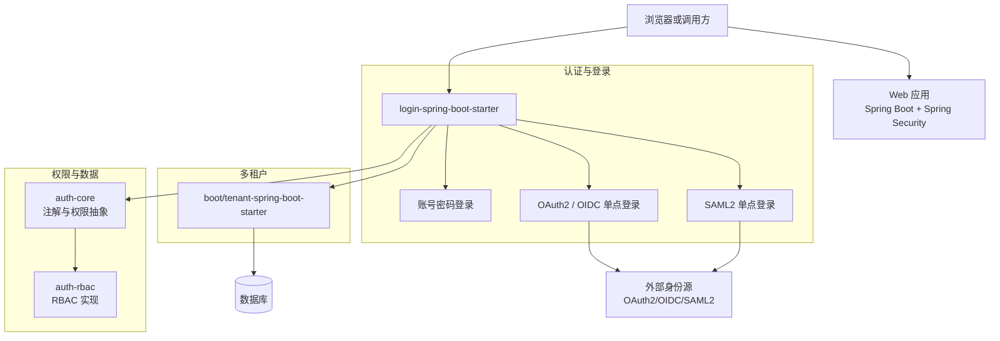
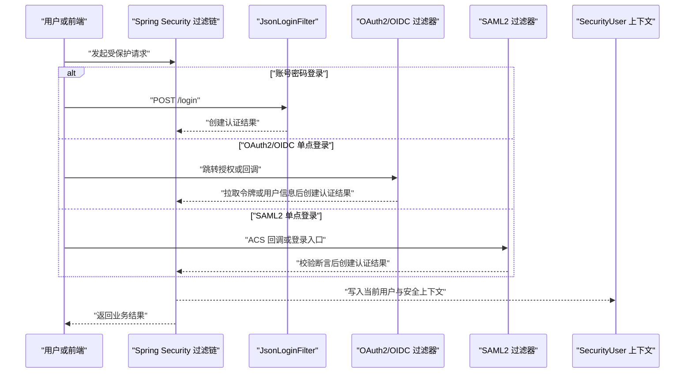
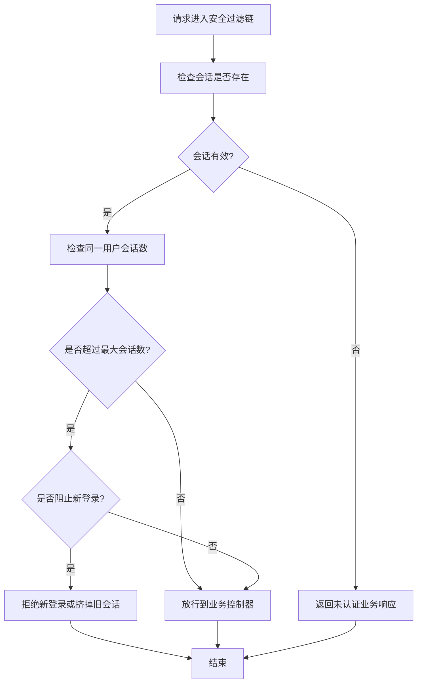
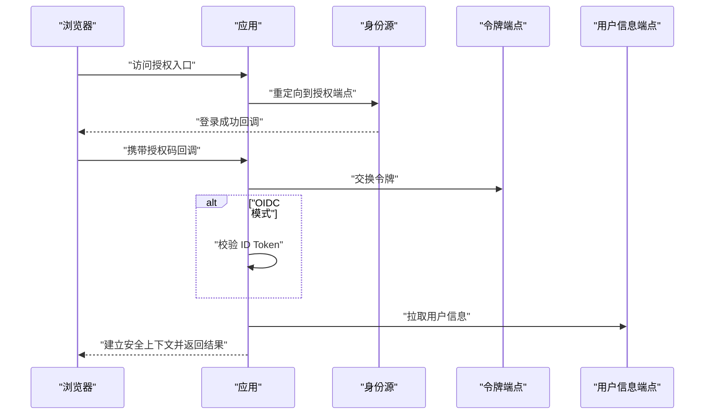
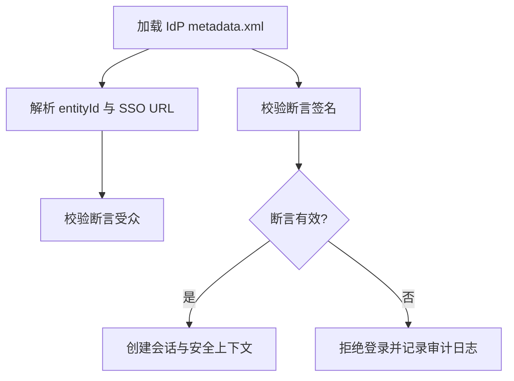
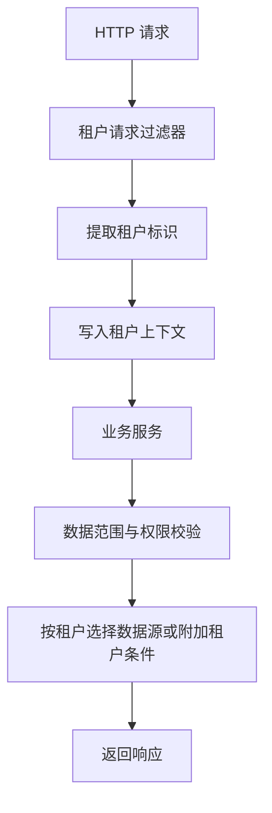
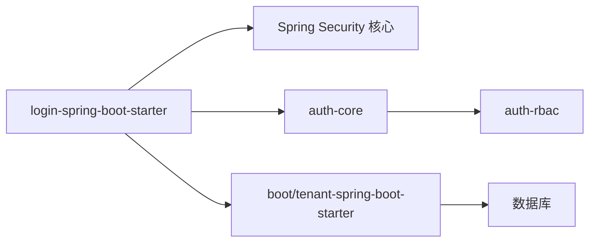

# 安全最佳实践

<cite>
**本文引用的文件**   
- [README_Auth.md](file://README_Auth.md)
- [login-spring-boot-starter/README.md](file://login-spring-boot-starter/README.md)
- [docs/application.yml](file://docs/application.yml)
- [docs/说明文档/SAML2_SP_Metadata配置指南.md](file://docs/说明文档/SAML2_SP_Metadata配置指南.md)
- [docs/说明文档/oidc接入踩坑记录.md](file://docs/说明文档/oidc接入踩坑记录.md)
</cite>

## 目录
1. [引言](#引言)
2. [项目结构与安全边界](#项目结构与安全边界)
3. [核心安全组件](#核心安全组件)
4. [架构总览](#架构总览)
5. [详细安全实践](#详细安全实践)
6. [依赖关系分析](#依赖关系分析)
7. [性能与可扩展性考虑](#性能与可扩展性考虑)
8. [故障排查与安全审计清单](#故障排查与安全审计清单)
9. [结论](#结论)

## 引言
本指南面向 Kewen Framework 使用者与维护者，聚焦密码安全、会话管理、输入输出防护、认证协议安全、多租户数据隔离等关键安全问题。内容基于仓库中 `auth`、`basic`、`boot/tenant-spring-boot-starter`、`login-spring-boot-starter` 以及配置与说明文档的实际实现，避免空泛建议，所有实践均对应到具体模块、过滤器、配置项或文档条目。

Kewen Framework 以 Spring Security 为基础，提供账号密码登录、OAuth2/OIDC 单点登录、SAML2 单点登录三种认证方式，并通过 RBAC 注解完成菜单与数据权限控制。框架还通过租户 starter 提供租户上下文和请求拦截能力，为多租户环境下的数据安全隔离提供基础支撑。

## 项目结构与安全边界
仓库围绕“认证入口 + 权限核心 + 业务示例”组织：

- `login-spring-boot-starter`：统一的安全与登录入口，承载 JSON 登录、OAuth2/OIDC、SAML2、会话策略、异常处理、登录方式发现接口。
- `auth/auth-core` 与 `auth/auth-rbac`：RBAC 权限模型、注解驱动的数据范围与操作校验、当前用户上下文。
- `boot/tenant-spring-boot-starter`：租户上下文、租户请求过滤器、Feign 租户头拦截器。
- `sample/*`：可启动示例，包括登录、RBAC、租户、存储等场景。
- `docs/application.yml`：starter 配置参考手册，标记必填、默认值、未接线字段。
- `docs/说明文档`：SAML2 SP Metadata 配置指南、OIDC 对接踩坑记录等安全相关文档。

**图表来源**
- [login-spring-boot-starter/README.md:1-60](file://login-spring-boot-starter/README.md#L1-L60)
- [README_Auth.md:1-60](file://README_Auth.md#L1-L60)

**章节来源**
- [README_Auth.md:1-60](file://README_Auth.md#L1-L60)
- [login-spring-boot-starter/README.md:1-60](file://login-spring-boot-starter/README.md#L1-L60)

## 核心安全组件
| 组件 | 职责 | 安全意义 |
|---|---|---|
| `SecurityConfig` | 统一安全过滤链、静态资源放行、登出、认证入口、拒绝处理器、禁用 CSRF、聚合自定义定制器 | 决定哪些请求受保护、哪些放行，是所有攻击面的入口边界 |
| `JsonLoginFilter` | 账号密码 JSON 登录过滤器 | 替代默认表单登录，支持前后端分离；要求正确 Content-Type 与参数名 |
| `Oauth2Config` | 注册 OAuth2/OIDC 登录、客户端注册仓库、回调处理 | 将外部身份源纳入统一安全上下文 |
| `SamlConfig` | 注册 SAML2 登录、登出、SP Metadata 暴露 | 通过 IdP metadata 与证书完成 SAML 信任链 |
| `SessionConfig` | 会话解析器、最大并发会话数、RememberMe Bean、JDBC 会话仓库包装 | 控制会话生命周期、并发登录与劫持风险 |
| `SecurityAuthenticationExceptionResolverHandler` | 统一未认证/无权限响应 | 避免敏感错误堆栈泄露，统一业务码 |
| `TenantRequestFilter` | 从请求提取租户上下文并注入租户信息 | 多租户数据隔离的基础 |
| `AuthCurrentUserContextHolder` | 当前认证用户上下文 | 为数据范围、菜单权限提供主体信息 |

**章节来源**
- [login-spring-boot-starter/README.md:1-60](file://login-spring-boot-starter/README.md#L1-L60)
- [README_Auth.md:1-60](file://README_Auth.md#L1-L60)

## 架构总览
Kewen Framework 的认证流程可以理解为“三通道进入同一安全上下文”。

**图表来源**
- [login-spring-boot-starter/README.md:1-60](file://login-spring-boot-starter/README.md#L1-L60)
- [login-spring-boot-starter/README.md:201-280](file://login-spring-boot-starter/README.md#L201-L280)
- [login-spring-boot-starter/README.md:301-400](file://login-spring-boot-starter/README.md#L301-L400)

## 详细安全实践

### 密码安全策略
Kewen Framework 的账号密码登录使用 Spring Security 默认的 `DelegatingPasswordEncoder`，并在未自定义 Bean 时自动装配。该设计允许数据库中的密码带前缀标识不同算法，例如 `{bcrypt}`，从而支持渐进迁移。

#### 密码加密算法选择
- 推荐在生产中使用强哈希算法，如 bcrypt 或更现代的算法，并由业务侧显式提供 `PasswordEncoder` Bean 覆盖默认行为。
- 若历史库中存在裸密文或无前缀哈希，直接引入框架会触发解码失败，需要在数据层补前缀或在业务侧提供兼容编码器。
- 不应自行在业务代码中拼接明文密码或绕过框架提供的编码机制。

**章节来源**
- [login-spring-boot-starter/README.md:201-260](file://login-spring-boot-starter/README.md#L201-L260)

#### 盐值生成
- `DelegatingPasswordEncoder` 内部负责随机盐值生成，开发者不需要手动维护盐值。
- 密码存储应仅保存编码后的字符串，不额外缓存明文、半明文或可逆加密结果。
- 如需扩展算法，应在统一 Bean 处替换编码器，而不是在各登录路径重复实现。

#### 密码强度验证
- 当前 starter 对 `/login` 的请求体只做参数读取与认证流程分支，没有内置密码复杂度规则（如长度、字符集、字典校验）。
- 建议在业务层的 `SecurityUserDetailsService` 或密码校验扩展点中加入强度检查，并在失败时返回明确但不过度泄露的信息。
- 对高频登录失败应结合日志与访问频率限制，防止暴力破解。

#### 输入校验与防注入
- 账号密码登录过滤器优先按 JSON 读取用户名和密码，非 JSON 回退 form 模式。
- 前端必须使用正确的 `Content-Type`，否则可能误入 form 分支导致字段缺失，表现为认证失败。
- 后端应避免将原始用户输入拼接到 SQL、命令或模板中；框架未替代 MyBatis/JPA 的 SQL 安全，业务仍应使用参数化查询。

**章节来源**
- [login-spring-boot-starter/README.md:201-260](file://login-spring-boot-starter/README.md#L201-L260)

### 会话安全管理
会话安全由 `SessionConfig` 与通用安全配置共同承担，涵盖会话解析、并发控制、记住我 Bean、JDBC 会话仓库包装。

#### 会话超时与持久化
- 会话持久化依赖 `spring-session-jdbc` 与数据源；存在 JDBC 会话仓库时会注册包装器。
- 生产环境应启用会话持久化，以便集群环境下共享会话状态，同时配合合理的超时时间。
- 需要区分“会话过期”和“认证失效”，未认证请求通常返回统一业务码，而非单纯依赖 HTTP 401。

#### 最大会话数控制
- 配置项 `cu.security.session.maximum-sessions` 控制同一用户的最大并发会话数。
- 配置项 `cu.security.session.max-sessions-prevents-login` 控制达到上限时是否阻止新登录；默认 false 表示挤掉最早会话。
- 高并发系统应结合登录日志监控异常集中登录，必要时增加设备指纹、IP 白名单或二次验证。

#### 防并发登录策略
- 当 `max-sessions-prevents-login=true` 时，适合严格禁止同一账号多端同时在线的场景。
- 当为 false 时，适合允许“挤掉旧会话”的业务，但要确保登出事件能通知前端清理状态。
- 对于管理员、财务等高风险账号，建议单独收紧最大会话数或强制单点在线。

#### 会话劫持防护
- 框架当前禁用 CSRF，因为登录走 session/cookie，且是前后端分离场景；但这意味着不能把 CSRF 作为唯一防护手段。
- 建议：
  - 使用 HTTPS 传输会话 Cookie。
  - 设置 Cookie 的 `Secure`、`HttpOnly`、`SameSite` 属性。
  - 会话绑定 IP 或设备指纹需由业务扩展实现，框架未内置。
  - 对敏感操作增加二次确认或短期验证码。

**图表来源**
- [login-spring-boot-starter/README.md:1-60](file://login-spring-boot-starter/README.md#L1-L60)
- [docs/application.yml:20-60](file://docs/application.yml#L20-L60)

**章节来源**
- [login-spring-boot-starter/README.md:1-60](file://login-spring-boot-starter/README.md#L1-L60)
- [docs/application.yml:20-60](file://docs/application.yml#L20-L60)

### 输入验证与输出编码
#### SQL 注入防护
- 框架未接管 ORM 层 SQL 构建；SQL 注入防护依赖 MyBatis Plus、JPA 的参数化查询。
- 严禁使用字符串拼接构造 SQL，尤其不要拼接用户名、租户 ID、排序字段。
- 分页、排序、模糊查询应使用框架或 ORM 提供的安全 API。

#### XSS 攻击防护
- 框架未提供统一的输出编码过滤器，业务应将不可信数据交给前端模板引擎或前端框架处理。
- 后端返回的 HTML、JSON、文件名、下载链接都应进行转义或白名单校验。
- 文件上传需校验类型、大小、命名，避免执行恶意脚本或覆盖系统文件。

#### CSRF 防护
- 当前 starter 全局禁用 CSRF，原因是 JSON 登录和前后端分离。
- 若改用表单提交或同站 Cookie 敏感操作，应重新评估 CSRF 策略，例如启用 CSRF Token 或使用 SameSite Cookie。
- 单点登录回调、登出接口应按最小权限原则放行，避免被第三方站点诱导触发。

**章节来源**
- [login-spring-boot-starter/README.md:201-260](file://login-spring-boot-starter/README.md#L201-L260)

### 认证协议安全配置

#### OAuth2/OIDC 令牌安全
- OAuth2/OIDC 通过 `Oauth2Config` 注册，共享同一条过滤器链；OIDC 在此基础上进行 ID Token 校验并可拉取 userinfo。
- 生产环境应：
  - 固定 `issuer-uri` 为身份源基础地址，而非完整 Discovery URL。
  - 校验 ID Token 签名与受众，避免接受任意 IDP 签发的令牌。
  - 谨慎配置 `ignore-ssl`，它只影响 userinfo 请求，不影响 Discovery 和 JWK Set 拉取。
  - 对非标准 IdP 的 JWKS 端点，可通过 `jwk-set-uri` 覆盖自动发现结果。
- 回调地址模板必须与 `login-processing-url` 匹配，否则 IDP 回调可能落到无过滤器拦截的路径。

**图表来源**
- [login-spring-boot-starter/README.md:201-280](file://login-spring-boot-starter/README.md#L201-L280)
- [docs/说明文档/oidc接入踩坑记录.md:1-120](file://docs/说明文档/oidc接入踩坑记录.md#L1-L120)

**章节来源**
- [login-spring-boot-starter/README.md:201-280](file://login-spring-boot-starter/README.md#L201-L280)
- [docs/说明文档/oidc接入踩坑记录.md:1-120](file://docs/说明文档/oidc接入踩坑记录.md#L1-L120)

#### SAML2 证书管理与元数据验证
- SAML2 通过 `SamlConfig` 注册登录、登出，并手动挂接 `Saml2MetadataFilter` 暴露 SP metadata。
- IdP 的 `metadata-resource` 用于解析 entityId、SSO URL、验签证书和 SLO URL。
- 若 IdP 要求 `WantAuthnRequestsSigned=true`，必须配置 `sp-signing-keystore`，否则 SP 发出的认证请求无签名会被拒。
- `sp-entity-id` 必须与 IdP 配置的 Audience 一致，否则断言校验失败。
- SP metadata 端点默认路径为 `/saml2/service-provider-metadata/{registrationId}`，应由 IdP 管理员获取，不应向无关网络暴露敏感内部信息。

**图表来源**
- [login-spring-boot-starter/README.md:301-400](file://login-spring-boot-starter/README.md#L301-L400)
- [docs/说明文档/SAML2_SP_Metadata配置指南.md:1-120](file://docs/说明文档/SAML2_SP_Metadata配置指南.md#L1-L120)

**章节来源**
- [login-spring-boot-starter/README.md:301-400](file://login-spring-boot-starter/README.md#L301-L400)
- [docs/说明文档/SAML2_SP_Metadata配置指南.md:1-120](file://docs/说明文档/SAML2_SP_Metadata配置指南.md#L1-L120)
- [docs/application.yml:120-208](file://docs/application.yml#L120-L208)

### 多租户环境下的数据安全隔离
Kewen Framework 通过租户 starter 提供租户开关、请求过滤器和 Feign 租户头拦截器；权限核心提供当前用户上下文和数据范围注解。

#### 数据源隔离
- 多租户可按租户拆分数据库，也可在同一数据库中通过租户列隔离。
- 若使用独立数据源，应通过动态数据源路由将租户上下文映射到对应连接。
- 连接池、事务边界、慢 SQL 日志应按租户维度记录，便于审计和定位越权问题。

#### 上下文管理
- `TenantRequestFilter` 负责从请求提取租户信息。
- `AuthCurrentUserContextHolder` 提供当前认证用户上下文，供 RBAC 数据范围使用。
- 跨服务调用应通过 Feign 拦截器传递租户头，避免下游服务丢失租户信息。

#### 跨租户访问控制
- 所有涉及租户数据的查询都应附加租户条件，不能依赖前端传参。
- 使用 `@AuthDataRange`、`@AuthDataOperation` 等注解时，应确保数据范围逻辑包含租户维度。
- 管理员跨租户操作应走审批流程，并记录审计日志，不可仅凭角色绕过租户隔离。

**图表来源**
- [docs/application.yml:60-120](file://docs/application.yml#L60-L120)
- [README_Auth.md:1-60](file://README_Auth.md#L1-L60)

**章节来源**
- [docs/application.yml:60-120](file://docs/application.yml#L60-L120)
- [README_Auth.md:1-60](file://README_Auth.md#L1-L60)

### 安全配置示例与常见漏洞防护
以下示例来自仓库配置参考与说明文档，实际部署时应替换占位值、密钥、域名和证书路径。

| 安全主题 | 推荐配置要点 | 对应位置 |
|---|---|---|
| 免登录放行 | 通过 `cu.auth.permit-url` 或 `@SecurityIgnore` 收集放行 URL，避免误放敏感接口 | [docs/application.yml:60-120](file://docs/application.yml#L60-L120) |
| 会话并发 | 设置 `cu.security.session.maximum-sessions`，并根据业务选择是否阻止新登录 | [docs/application.yml:20-60](file://docs/application.yml#L20-L60) |
| 账号密码登录 | 使用 JSON 登录，注意 Content-Type 与参数名；数据库密码使用带前缀的强哈希 | [login-spring-boot-starter/README.md:201-260](file://login-spring-boot-starter/README.md#L201-L260) |
| OAuth2/OIDC | 配置至少一个 client；OIDC 使用 `issuer-uri` 基础地址；非标准 JWKS 用 `jwk-set-uri` 覆盖 | [login-spring-boot-starter/README.md:201-280](file://login-spring-boot-starter/README.md#L201-L280) |
| SAML2 | 配置 IdP metadata、SP entity-id、可选签名 keystore；暴露 SP metadata 给 IdP | [login-spring-boot-starter/README.md:301-400](file://login-spring-boot-starter/README.md#L301-L400) |
| 租户开关 | 通过 `cu.tenant.open` 启用租户过滤器与 Feign 拦截器 | [docs/application.yml:60-120](file://docs/application.yml#L60-L120) |

常见漏洞防护措施：

| 漏洞类型 | 风险表现 | 防护措施 |
|---|---|---|
| 暴力破解 | 频繁失败登录 | 限制登录频率、锁定账户、记录审计日志 |
| 会话劫持 | 窃取 Cookie 或 Token | 使用 HTTPS、HttpOnly Cookie、会话绑定、短会话 |
| SQL 注入 | 拼接用户输入构造 SQL | 参数化查询、ORM 安全 API、禁止拼接 |
| XSS | 输出恶意脚本 | 输出转义、前端框架渲染、白名单校验 |
| CSRF | 第三方站点伪造请求 | 谨慎禁用 CSRF，敏感操作加 Token 或 SameSite |
| 越权访问 | 跨租户或跨数据访问 | 数据范围注解、租户上下文、服务端强制校验 |
| 令牌泄露 | 日志、URL、前端缓存泄露 | 不在日志打印敏感字段，使用 HTTPS，限制令牌有效期 |
| 配置泄露 | 元数据、密钥、client-secret 泄露 | 最小化公开接口，不暴露敏感配置 |

**章节来源**
- [docs/application.yml:20-208](file://docs/application.yml#L20-L208)
- [login-spring-boot-starter/README.md:201-521](file://login-spring-boot-starter/README.md#L201-L521)

## 依赖关系分析
Kewen Framework 的安全依赖主要分布在三个层次：

- 安全入口层：`login-spring-boot-starter` 提供过滤器链、认证处理器、会话配置、登录方式发现接口。
- 权限核心层：`auth-core` 与 `auth-rbac` 提供注解、RBAC 模型、数据范围、当前用户上下文。
- 多租户层：`boot/tenant-spring-boot-starter` 提供租户上下文与请求拦截。

**图表来源**
- [README_Auth.md:1-60](file://README_Auth.md#L1-L60)
- [login-spring-boot-starter/README.md:1-60](file://login-spring-boot-starter/README.md#L1-L60)
- [docs/application.yml:60-120](file://docs/application.yml#L60-L120)

**章节来源**
- [README_Auth.md:1-60](file://README_Auth.md#L1-L60)
- [login-spring-boot-starter/README.md:1-60](file://login-spring-boot-starter/README.md#L1-L60)
- [docs/application.yml:60-120](file://docs/application.yml#L60-L120)

## 性能与可扩展性考虑
- 会话持久化会增加数据库压力，应合理设置会话超时和批量清理策略。
- OIDC 启动阶段会同步访问 Discovery 文档，身份源不可用时会影响应用启动；测试环境可使用 OAuth2 模式减少网络依赖。
- 菜单与权限数据可通过 `cu.auth.cache-auth` 控制缓存，减少每次请求查库开销。
- 多租户上下文应轻量传递，避免在过滤器中执行重型查询。
- 登录失败、鉴权失败、租户缺失等关键路径应输出结构化审计日志，但不打印敏感字段。

**章节来源**
- [login-spring-boot-starter/README.md:201-280](file://login-spring-boot-starter/README.md#L201-L280)
- [docs/application.yml:60-120](file://docs/application.yml#L60-L120)

## 故障排查与安全审计清单

### 登录相关常见问题
- `/login` GET 被拦截：框架未启用默认登录页，需显式放行登录页或业务页面。
- JSON 登录失败：检查 `Content-Type` 是否为 `application/json`，参数名是否与配置一致。
- 历史密码解码失败：数据库密码缺少 `{id}` 前缀，需在数据层修复或覆盖 `PasswordEncoder`。
- 未认证响应不是 HTTP 401：框架返回统一业务码，调用方应判断 `code` 和 `success`。

**章节来源**
- [login-spring-boot-starter/README.md:201-260](file://login-spring-boot-starter/README.md#L201-L260)

### OAuth2/OIDC 常见问题
- 启动阶段 Discovery 失败：检查 `issuer-uri` 是否为身份源基础地址，而非完整 Discovery URL。
- JWT 签名校验失败：非标准 IdP 可能需要手动覆盖 `jwk-set-uri`。
- `ignore-ssl=true` 无效：该选项只影响 userinfo，Discovery 和 JWK 仍走标准 SSL 校验。
- 回调 404：回调地址模板与 `login-processing-url` 不匹配。

**章节来源**
- [docs/说明文档/oidc接入踩坑记录.md:1-120](file://docs/说明文档/oidc接入踩坑记录.md#L1-L120)
- [login-spring-boot-starter/README.md:201-280](file://login-spring-boot-starter/README.md#L201-L280)

### SAML2 常见问题
- `registrations` 为空：启动 NPE，至少配置一条 registration。
- `WantAuthnRequestsSigned` 拆箱异常：metadata 中必须显式写布尔值。
- `sp-entity-id` 与 IdP Audience 不一致：断言校验失败。
- 未配置签名 keystore 但 IdP 要求签名：SP 发出的认证请求被拒。
- SP metadata 暴露：应仅提供给可信 IdP，不要对公网匿名开放敏感内部信息。

**章节来源**
- [login-spring-boot-starter/README.md:301-400](file://login-spring-boot-starter/README.md#L301-L400)
- [docs/说明文档/SAML2_SP_Metadata配置指南.md:1-120](file://docs/说明文档/SAML2_SP_Metadata配置指南.md#L1-L120)

### 多租户审计清单
- 是否启用 `cu.tenant.open`？
- 租户标识是否从请求可靠提取？
- 是否所有租户相关查询都附加租户条件？
- 跨租户操作是否有审批与审计日志？
- 是否避免将租户 ID 作为前端可控参数直接用于 SQL？

**章节来源**
- [docs/application.yml:60-120](file://docs/application.yml#L60-L120)

## 结论
Kewen Framework 的安全能力建立在 Spring Security 之上，并通过登录 starter 统一账号密码、OAuth2/OIDC、SAML2 三种认证入口，再通过 auth-core 与 rbac 提供注解驱动的权限控制，最后由 tenant starter 提供多租户上下文基础。安全最佳实践的核心在于：

- 使用强密码编码算法，不自行拼接明文，必要时覆盖 `PasswordEncoder`。
- 将会话持久化、并发会话数和 CSRF 策略纳入生产基线。
- 严格校验 OAuth2/OIDC 的 issuer、JWKS、回调地址，谨慎对待 `ignore-ssl`。
- 规范 SAML2 的 metadata、entity-id、签名 keystore，并控制 SP metadata 暴露范围。
- 在所有数据访问路径中强制租户隔离，避免前端参数驱动数据边界。
- 通过统一异常处理和登录方式发现接口，减少敏感信息泄露面。

以上实践可直接对照仓库中的 starter 文档、配置参考和安全说明文档落地实施。