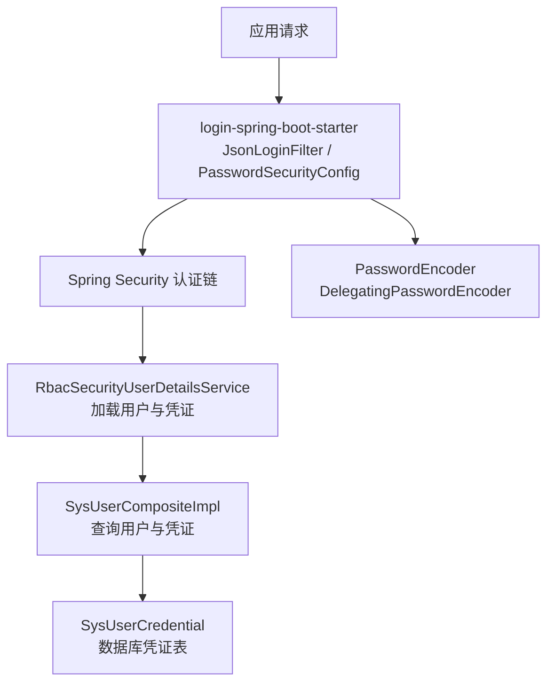
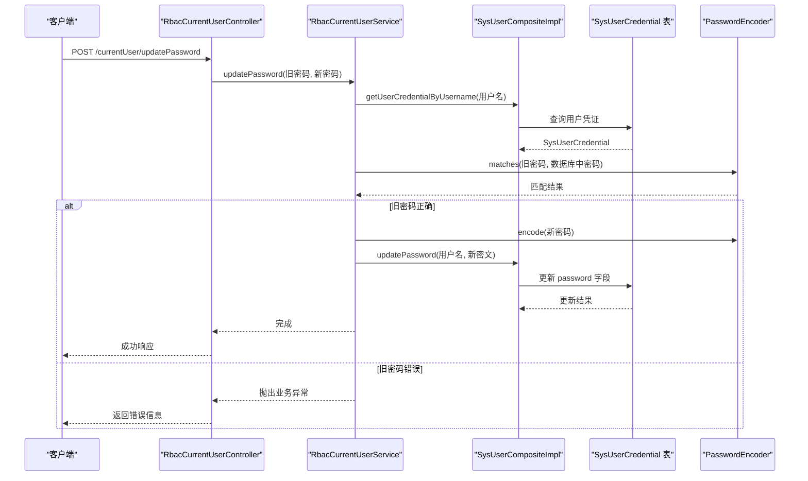
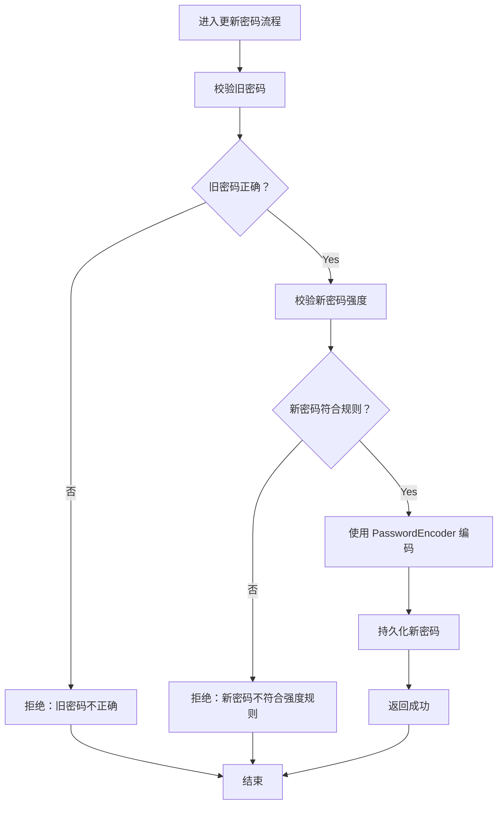
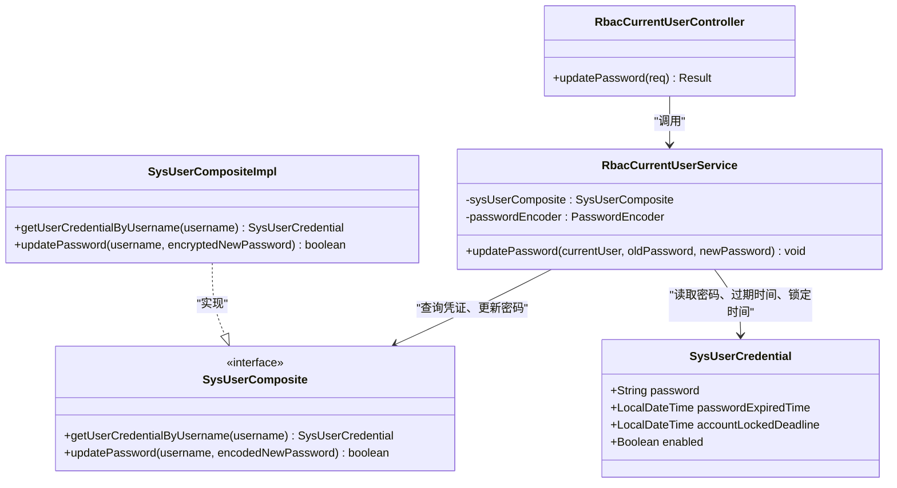
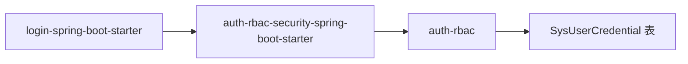

# 密码安全策略

<cite>
**本文引用的文件**   
- [SecurityBeanConfig.java](file://login-spring-boot-starter/src/main/java/com/cu/framework/authentication/config/SecurityBeanConfig.java)
- [PasswordSecurityConfig.java](file://login-spring-boot-starter/src/main/java/com/cu/framework/authentication/password/config/PasswordSecurityConfig.java)
- [SecurityLoginProperties.java](file://login-spring-boot-starter/src/main/java/com/cu/framework/authentication/password/properties/SecurityLoginProperties.java)
- [README.md（login-spring-boot-starter）](file://login-spring-boot-starter/README.md)
- [application.yml（示例配置）](file://docs/application.yml)
- [SysUserCredential.java](file://auth/auth-rbac/src/main/java/com/cu/framework/auth/rbac/mp/entity/SysUserCredential.java)
- [RbacCurrentUserService.java](file://auth/auth-rbac/src/main/java/com/cu/framework/auth/rbac/extension/RbacCurrentUserService.java)
- [UpdatePasswordReq.java](file://auth/auth-rbac/src/main/java/com/cu/framework/auth/rbac/model/req/UpdatePasswordReq.java)
- [RbacCurrentUserController.java](file://auth/auth-rbac/src/main/java/com/cu/framework/auth/rbac/controller/RbacCurrentUserController.java)
- [SysUserComposite.java](file://auth/auth-rbac/src/main/java/com/cu/framework/auth/rbac/composite/SysUserComposite.java)
- [SysUserCompositeImpl.java](file://auth/auth-rbac/src/main/java/com/cu/framework/auth/rbac/composite/impl/SysUserCompositeImpl.java)
- [RbacSecurityUserDetailsService.java](file://auth/auth-rbac-security-spring-boot-starter/src/main/java/com/cu/framework/auth/rbac/security/RbacSecurityUserDetailsService.java)
</cite>

## 目录
1. [引言](#引言)
2. [项目结构与相关模块](#项目结构与相关模块)
3. [核心组件总览](#核心组件总览)
4. [架构与数据流](#架构与数据流)
5. [密码加密算法与盐值机制](#密码加密算法与盐值机制)
6. [密码强度验证规则](#密码强度验证规则)
7. [密码更新与重置流程](#密码更新与重置流程)
8. [依赖关系分析](#依赖关系分析)
9. [性能与安全注意事项](#性能与安全注意事项)
10. [故障排查](#故障排查)
11. [最佳实践建议](#最佳实践建议)
12. [结论](#结论)

## 引言
本文面向 Kewen Framework 中“账号密码”这一认证方式，系统梳理密码安全策略在框架中的实现位置、数据模型、配置项和扩展点。重点包括：

- 密码加密默认使用 Spring Security 的 `DelegatingPasswordEncoder`，通过 `{id}` 前缀区分不同算法；当前仓库未内置 BCrypt、PBKDF2、Argon2 等具体算法的选择器，而是由该委派编码器统一处理。
- 密码以密文形式存储在 `sys_user_credential` 表中，字段为 `password`；同时提供过期时间、锁定截止时间、启用状态等凭证控制字段。
- 当前实现未内置密码复杂度校验、常见弱密码检测、密码历史去重等策略；这些能力需要业务侧基于现有接口扩展。
- 密码更新流程已实现旧密码校验、新密码编码和持久化，但尚未集成密码历史、过期强制更换等增强逻辑。

## 项目结构与相关模块
本主题涉及三个主要子模块：

| 模块 | 职责 | 与本主题相关的关键类 |
|---|---|---|
| `login-spring-boot-starter` | 提供账号密码登录入口、JSON 登录过滤器、默认 `PasswordEncoder` Bean | `SecurityBeanConfig`、`PasswordSecurityConfig`、`SecurityLoginProperties` |
| `auth-rbac` | 提供 RBAC 用户、部门、权限数据访问及当前用户服务 | `SysUserCredential`、`RbacCurrentUserService`、`SysUserComposite` |
| `auth-rbac-security-spring-boot-starter` | 将 RBAC 接入 Spring Security 认证体系 | `RbacSecurityUserDetailsService` |

**图示来源**
- [PasswordSecurityConfig.java:29-53](file://login-spring-boot-starter/src/main/java/com/cu/framework/authentication/password/config/PasswordSecurityConfig.java#L29-L53)
- [SecurityBeanConfig.java:50-58](file://login-spring-boot-starter/src/main/java/com/cu/framework/authentication/config/SecurityBeanConfig.java#L50-L58)
- [RbacSecurityUserDetailsService.java:55-93](file://auth/auth-rbac-security-spring-boot-starter/src/main/java/com/cu/framework/auth/rbac/security/RbacSecurityUserDetailsService.java#L55-L93)
- [SysUserCompositeImpl.java:92-122](file://auth/auth-rbac/src/main/java/com/cu/framework/auth/rbac/composite/impl/SysUserCompositeImpl.java#L92-L122)
- [SysUserCredential.java:38-56](file://auth/auth-rbac/src/main/java/com/cu/framework/auth/rbac/mp/entity/SysUserCredential.java#L38-L56)

**章节来源**
- [README.md（login-spring-boot-starter）](file://login-spring-boot-starter/README.md)
- [application.yml（示例配置）](file://docs/application.yml)

## 核心组件总览

### 密码编码器装配
- `SecurityBeanConfig` 在容器中不存在自定义 `PasswordEncoder` 时，注册 Spring Security 默认的 `DelegatingPasswordEncoder`。
- 这意味着数据库中的密码必须采用带 `{id}` 前缀的格式，例如 `{bcrypt}...`、`{pbkdf2}...`、`{argon2}...`；若数据库是裸哈希值，会触发解码器无法识别前缀的错误。

**章节来源**
- [SecurityBeanConfig.java:50-58](file://login-spring-boot-starter/src/main/java/com/cu/framework/authentication/config/SecurityBeanConfig.java#L50-L58)
- [README.md（login-spring-boot-starter）](file://login-spring-boot-starter/README.md)

### 账号密码登录配置
- `SecurityLoginProperties` 暴露 `cu.security.login.password.*` 配置项，包括登录路径、用户名参数名和密码参数名。
- `PasswordSecurityConfig` 将这些属性注入到 JSON 登录过滤器配置中，并指定登录成功处理器和安全异常解析处理器。

**章节来源**
- [SecurityLoginProperties.java:12-28](file://login-spring-boot-starter/src/main/java/com/cu/framework/authentication/password/properties/SecurityLoginProperties.java#L12-L28)
- [PasswordSecurityConfig.java:29-53](file://login-spring-boot-starter/src/main/java/com/cu/framework/authentication/password/config/PasswordSecurityConfig.java#L29-L53)

### 用户凭证实体
`SysUserCredential` 是密码存储的核心实体，关键字段如下：

| 字段 | 类型 | 含义 |
|---|---|---|
| `userId` | Long | 关联用户主键 |
| `password` | String | 存储经 `PasswordEncoder.encode()` 编码后的密码字符串 |
| `passwordExpiredTime` | LocalDateTime | 密码过期时间；为空表示无强制过期策略 |
| `accountLockedDeadline` | LocalDateTime | 账号锁定截止时间；为空或早于当前时间表示不锁定 |
| `enabled` | Boolean | 账号是否启用 |
| `createTime` | LocalDateTime | 创建时间 |
| `updateTime` | LocalDateTime | 更新时间 |

**章节来源**
- [SysUserCredential.java:17-89](file://auth/auth-rbac/src/main/java/com/cu/framework/auth/rbac/mp/entity/SysUserCredential.java#L17-L89)

## 架构与数据流

### 密码更新调用链
当前密码更新入口是 `/currentUser/updatePassword`，调用链如下：

**图示来源**
- [RbacCurrentUserController.java:43-55](file://auth/auth-rbac/src/main/java/com/cu/framework/auth/rbac/controller/RbacCurrentUserController.java#L43-L55)
- [RbacCurrentUserService.java:24-41](file://auth/auth-rbac/src/main/java/com/cu/framework/auth/rbac/extension/RbacCurrentUserService.java#L24-L41)
- [SysUserCompositeImpl.java:92-122](file://auth/auth-rbac/src/main/java/com/cu/framework/auth/rbac/composite/impl/SysUserCompositeImpl.java#L92-L122)
- [SysUserCredential.java:38-56](file://auth/auth-rbac/src/main/java/com/cu/framework/auth/rbac/mp/entity/SysUserCredential.java#L38-L56)

### 登录时用户与凭证装载
`RbacSecurityUserDetailsService.loadUserByUsername` 从 `SysUserComposite` 加载用户、凭证和权限，并把凭证中的密码、过期时间和锁定时间写入 `SecurityUser`，供 Spring Security 后续比对。

**章节来源**
- [RbacSecurityUserDetailsService.java:55-93](file://auth/auth-rbac-security-spring-boot-starter/src/main/java/com/cu/framework/auth/rbac/security/RbacSecurityUserDetailsService.java#L55-L93)
- [SysUserCompositeImpl.java:124-151](file://auth/auth-rbac/src/main/java/com/cu/framework/auth/rbac/composite/impl/SysUserCompositeImpl.java#L124-L151)

## 密码加密算法与盐值机制

### 当前实现的加密方式
仓库没有直接定义 BCrypt、PBKDF2、Argon2 的具体 Bean；密码加密委托给 Spring Security 的 `DelegatingPasswordEncoder`。其关键行为是：

- 编码时生成带算法标识前缀的字符串，例如 `{bcrypt}`、`{pbkdf2}`、`{argon2}`。
- 验证时使用 `matches` 方法解析前缀，选择对应底层编码器进行比对。
- 因此，“选择算法”实际上体现在数据库中密码字符串的前缀上。

### 算法适用场景对比
以下说明基于 Spring Security 默认委派编码器的语义和通用密码学实践，并结合仓库中“密码以密文存储、支持过期时间与锁定时间”的设计背景给出建议：

| 算法 | 适用场景 | 性能特点 | 安全性考虑 |
|---|---|---|---|
| BCrypt | 通用 Web 应用、传统系统迁移 | 计算较慢，适合在线登录验证 | 内置随机盐，天然抗彩虹表；对 CPU 资源有一定消耗 |
| PBKDF2 | 合规要求明确、希望使用标准迭代参数的场景 | 可调节迭代次数；CPU 密集，内存占用低 | 需要业务方选择合适的迭代次数；不支持并行度优化 |
| Argon2 | 高安全等级、对抗 GPU/ASIC 攻击的场景 | 内存密集，现代硬件下更安全 | 推荐 Argon2id；需合理设置内存、迭代数和并行度 |

仓库本身未暴露 `bc`、`pbkdf2`、`argon2` 等算法选择配置项；若业务希望固定某种算法，应通过自定义 `PasswordEncoder` Bean 覆盖默认委派编码器，或在数据迁移阶段统一输出目标算法前缀。

**章节来源**
- [SecurityBeanConfig.java:50-58](file://login-spring-boot-starter/src/main/java/com/cu/framework/authentication/config/SecurityBeanConfig.java#L50-L58)
- [README.md（login-spring-boot-starter）](file://login-spring-boot-starter/README.md)

### 盐值生成机制
在当前实现中，盐值不是业务代码显式生成或存储的独立字段：

- 密码密文直接存入 `SysUserCredential.password`。
- 如果使用 BCrypt，盐值通常嵌入在 BCrypt 字符串内部。
- 如果使用 PBKDF2 或 Argon2，盐值通常嵌入在最终编码字符串中。
- 框架未维护单独的 `salt` 列，也没有在 `SysUserCredential` 中记录使用的算法名称；算法标识由密码字符串前缀表达。

因此，盐值的“生成”由底层 `PasswordEncoder` 负责；“存储”就是密码字段整体；“读取”由 `PasswordEncoder.matches` 根据前缀自动解析。

**章节来源**
- [SysUserCredential.java:38-56](file://auth/auth-rbac/src/main/java/com/cu/framework/auth/rbac/mp/entity/SysUserCredential.java#L38-L56)
- [RbacCurrentUserService.java:30-39](file://auth/auth-rbac/src/main/java/com/cu/framework/auth/rbac/extension/RbacCurrentUserService.java#L30-L39)

## 密码强度验证规则

### 当前实现现状
仓库中没有发现专门用于密码强度校验的配置类、正则表达式、常见弱密码库或复杂度检查器。现有约束集中在两个层面：

1. **传输层输入约束**：`UpdatePasswordReq` 使用 `@NotBlank` 校验旧密码和新密码不能为空。
2. **业务层基本校验**：`RbacCurrentUserService.updatePassword` 只校验旧密码是否正确，然后对新密码执行 `encode`。

| 能力 | 是否内置 | 说明 |
|---|---|---|
| 最小长度 | 否 | 仅 `@NotBlank`，不限制字符数 |
| 最大长度 | 否 | 无显式上限 |
| 大小写字母要求 | 否 | 无正则或复杂度检查 |
| 数字要求 | 否 | 无正则或复杂度检查 |
| 特殊字符要求 | 否 | 无正则或复杂度检查 |
| 常见弱密码检测 | 否 | 未引入字典或黑名单 |
| 明文日志脱敏 | 否 | 文档未提供密码字段脱敏实现 |

### 建议的扩展方向
如果业务需要密码强度规则，可在 `RbacCurrentUserService.updatePassword` 之前增加一个独立的密码策略校验器：

- 先校验旧密码。
- 再校验新密码是否符合最小长度、字符类别、复杂度分数或弱密码黑名单。
- 通过后再生成密文并持久化。

**图示来源**
- [RbacCurrentUserService.java:24-41](file://auth/auth-rbac/src/main/java/com/cu/framework/auth/rbac/extension/RbacCurrentUserService.java#L24-L41)
- [UpdatePasswordReq.java:13-20](file://auth/auth-rbac/src/main/java/com/cu/framework/auth/rbac/model/req/UpdatePasswordReq.java#L13-L20)

**章节来源**
- [UpdatePasswordReq.java:13-20](file://auth/auth-rbac/src/main/java/com/cu/framework/auth/rbac/model/req/UpdatePasswordReq.java#L13-L20)
- [RbacCurrentUserService.java:24-41](file://auth/auth-rbac/src/main/java/com/cu/framework/auth/rbac/extension/RbacCurrentUserService.java#L24-L41)

## 密码更新与重置流程

### 密码更新
当前密码更新流程如下：

1. 前端调用 `/currentUser/updatePassword`，提交旧密码和新密码。
2. 控制器获取当前登录用户，并调用 `RbacCurrentUserService.updatePassword`。
3. 服务层通过 `SysUserComposite.getUserCredentialByUsername` 查询用户凭证。
4. 使用 `PasswordEncoder.matches` 校验旧密码。
5. 校验通过后使用 `PasswordEncoder.encode` 生成新密文。
6. 调用 `SysUserComposite.updatePassword` 更新数据库。

**图示来源**
- [RbacCurrentUserController.java:43-55](file://auth/auth-rbac/src/main/java/com/cu/framework/auth/rbac/controller/RbacCurrentUserController.java#L43-L55)
- [RbacCurrentUserService.java:24-41](file://auth/auth-rbac/src/main/java/com/cu/framework/auth/rbac/extension/RbacCurrentUserService.java#L24-L41)
- [SysUserComposite.java:29-48](file://auth/auth-rbac/src/main/java/com/cu/framework/auth/rbac/composite/SysUserComposite.java#L29-L48)
- [SysUserCompositeImpl.java:92-151](file://auth/auth-rbac/src/main/java/com/cu/framework/auth/rbac/composite/impl/SysUserCompositeImpl.java#L92-L151)
- [SysUserCredential.java:38-89](file://auth/auth-rbac/src/main/java/com/cu/framework/auth/rbac/mp/entity/SysUserCredential.java#L38-L89)

### 密码重置
仓库未提供独立的“管理员重置密码”接口。如果需要：

- 管理员重置：可以直接调用 `SysUserComposite.updatePassword`，但应在业务层额外校验管理员身份、审计日志和操作原因。
- 用户忘记密码：建议结合邮箱验证码、短信验证码或外部单点登录重新设置密码；不应直接绕过旧密码校验。

当前实现缺少“密码历史防止重复使用”，即允许用户把密码改回最近使用过的历史密码。若业务需要该能力，需要在 `updatePassword` 前查询最近 N 次密码并与新密码比较。

**章节来源**
- [RbacCurrentUserService.java:24-41](file://auth/auth-rbac/src/main/java/com/cu/framework/auth/rbac/extension/RbacCurrentUserService.java#L24-L41)
- [SysUserComposite.java:41-48](file://auth/auth-rbac/src/main/java/com/cu/framework/auth/rbac/composite/SysUserComposite.java#L41-L48)
- [SysUserCompositeImpl.java:124-151](file://auth/auth-rbac/src/main/java/com/cu/framework/auth/rbac/composite/impl/SysUserCompositeImpl.java#L124-L151)

## 依赖关系分析

### 模块间依赖
- `login-spring-boot-starter` 提供通用登录基础设施和默认 `PasswordEncoder`。
- `auth-rbac` 提供 RBAC 数据模型和用户凭证操作。
- `auth-rbac-security-spring-boot-starter` 把 RBAC 的用户、凭证和权限加载到 Spring Security 的安全上下文中。

**图示来源**
- [SecurityBeanConfig.java:50-58](file://login-spring-boot-starter/src/main/java/com/cu/framework/authentication/config/SecurityBeanConfig.java#L50-L58)
- [RbacSecurityUserDetailsService.java:55-93](file://auth/auth-rbac-security-spring-boot-starter/src/main/java/com/cu/framework/auth/rbac/security/RbacSecurityUserDetailsService.java#L55-L93)
- [SysUserCredential.java:17-89](file://auth/auth-rbac/src/main/java/com/cu/framework/auth/rbac/mp/entity/SysUserCredential.java#L17-L89)

### 配置依赖
- 账号密码登录路径、用户名参数、密码参数来自 `SecurityLoginProperties`。
- 完整示例参考 `docs/application.yml` 中 `login-spring-boot-starter` 分节。
- README 明确指出密码编码器为 `DelegatingPasswordEncoder`，且数据库 hash 需带 `{bcrypt}` 等前缀。

**章节来源**
- [SecurityLoginProperties.java:12-28](file://login-spring-boot-starter/src/main/java/com/cu/framework/authentication/password/properties/SecurityLoginProperties.java#L12-L28)
- [application.yml（示例配置）](file://docs/application.yml)
- [README.md（login-spring-boot-starter）](file://login-spring-boot-starter/README.md)

## 性能与安全注意事项

### 性能注意事项
- `DelegatingPasswordEncoder` 本身只是委派器，实际性能取决于底层算法。
- BCrypt 和 PBKDF2 都是 CPU 密集型算法，频繁登录验证会产生一定开销。
- Argon2 更偏向内存密集，在高并发环境下需要评估内存峰值。
- 当前实现每次密码更新都会执行一次编码；批量初始化或迁移密码时应避免同步阻塞主线程。

### 安全注意事项
- 密码始终以密文形式存储，不应在日志、监控或调试输出中打印原始密码。
- `SysUserCredential.password` 是敏感字段，数据库备份、导出报表和错误堆栈中应脱敏。
- 当前未实现密码历史、强制过期、失败次数锁定等策略；如需合规要求，应在此基础上扩展。
- 传输层应使用 HTTPS，避免密码在浏览器与服务端之间明文传输。

[本节为通用指导，不直接分析具体代码文件]

## 故障排查

### 常见问题
| 问题 | 可能原因 | 处理方式 |
|---|---|---|
| 启动时报密码编码器找不到映射 | 数据库密码不含 `{id}` 前缀 | 将历史密码迁移为带前缀格式，或自定义 `PasswordEncoder` |
| 修改密码报旧密码不正确 | 旧密码错误，或数据库中密码是裸哈希 | 确认用户输入的旧密码，并检查密码编码前缀 |
| 登录失败 | 用户名不存在、凭证缺失、密码不匹配、账号禁用或锁定 | 检查 `SysUserCredential.enabled`、`accountLockedDeadline`、`passwordExpiredTime` |
| 登录接口 401 或参数无效 | Content-Type 或参数字段名不一致 | 使用 `application/json`，并确保字段名为 `username`、`password` |

**章节来源**
- [README.md（login-spring-boot-starter）](file://login-spring-boot-starter/README.md)
- [SecurityLoginProperties.java:12-28](file://login-spring-boot-starter/src/main/java/com/cu/framework/authentication/password/properties/SecurityLoginProperties.java#L12-L28)
- [SysUserCredential.java:38-89](file://auth/auth-rbac/src/main/java/com/cu/framework/auth/rbac/mp/entity/SysUserCredential.java#L38-L89)

## 最佳实践建议

### 传输层加密
- 所有包含密码的请求都应走 HTTPS。
- 登录接口应避免返回详细错误信息，防止泄露用户名是否存在。

### 存储加密
- 使用 `PasswordEncoder.encode` 生成密文后再写入 `SysUserCredential.password`。
- 不要保存明文密码到数据库、日志、缓存或第三方服务。
- 若未来切换算法，应优先支持 `DelegatingPasswordEncoder` 的多前缀兼容模式，逐步迁移历史密码。

### 日志脱敏
- 对用户输入中的 `oldPassword`、`newPassword`、`password`、`token`、`secret` 等字段做脱敏处理。
- 错误日志中禁止打印原始密码或完整凭证对象。

### 密码策略扩展建议
- 在 `RbacCurrentUserService.updatePassword` 之前加入密码强度校验器。
- 可选扩展：
  - 最小长度、最大长度。
  - 至少包含大写字母、小写字母、数字、特殊字符中的若干类。
  - 常见弱密码黑名单。
  - 密码历史去重。
  - 密码强制过期策略。
  - 登录失败次数锁定。

### 配置示例参考
仓库中账号密码登录的基础配置位于 `docs/application.yml`，前缀为 `cu.security.login.password`：

- `login-url`：登录接口路径，默认 `/login`。
- `username-parameter`：用户名参数名，默认 `username`。
- `password-parameter`：密码参数名，默认 `password`。

生产环境建议在此基础上补充：

- 自定义 `PasswordEncoder` Bean，如果需要固定算法或兼容历史格式。
- 自定义密码强度校验器，并在更新密码流程中调用。
- 审计日志记录密码修改操作，但不记录密码内容。
- 数据库备份加密，并对 `sys_user_credential` 表字段访问做最小权限控制。

**章节来源**
- [application.yml（示例配置）](file://docs/application.yml)
- [SecurityBeanConfig.java:50-58](file://login-spring-boot-starter/src/main/java/com/cu/framework/authentication/config/SecurityBeanConfig.java#L50-L58)
- [RbacCurrentUserService.java:24-41](file://auth/auth-rbac/src/main/java/com/cu/framework/auth/rbac/extension/RbacCurrentUserService.java#L24-L41)

## 结论
Kewen Framework 当前在密码安全方面提供了可靠的基础设施：

- 使用 Spring Security 的 `DelegatingPasswordEncoder` 作为默认密码编码器。
- 将密码密文存储在 `sys_user_credential` 表的 `password` 字段。
- 提供完整的账号密码登录入口和当前用户密码更新接口。
- 支持密码过期时间和账号锁定时间的数据模型，但未在默认流程中强制执行。

目前仓库未内置密码复杂度校验、常见弱密码检测和密码历史去重。若业务有更强安全需求，应在现有 `RbacCurrentUserService` 和 `SysUserComposite` 基础上扩展策略层，并通过 HTTPS、日志脱敏、数据库加密等手段完善端到端密码安全。