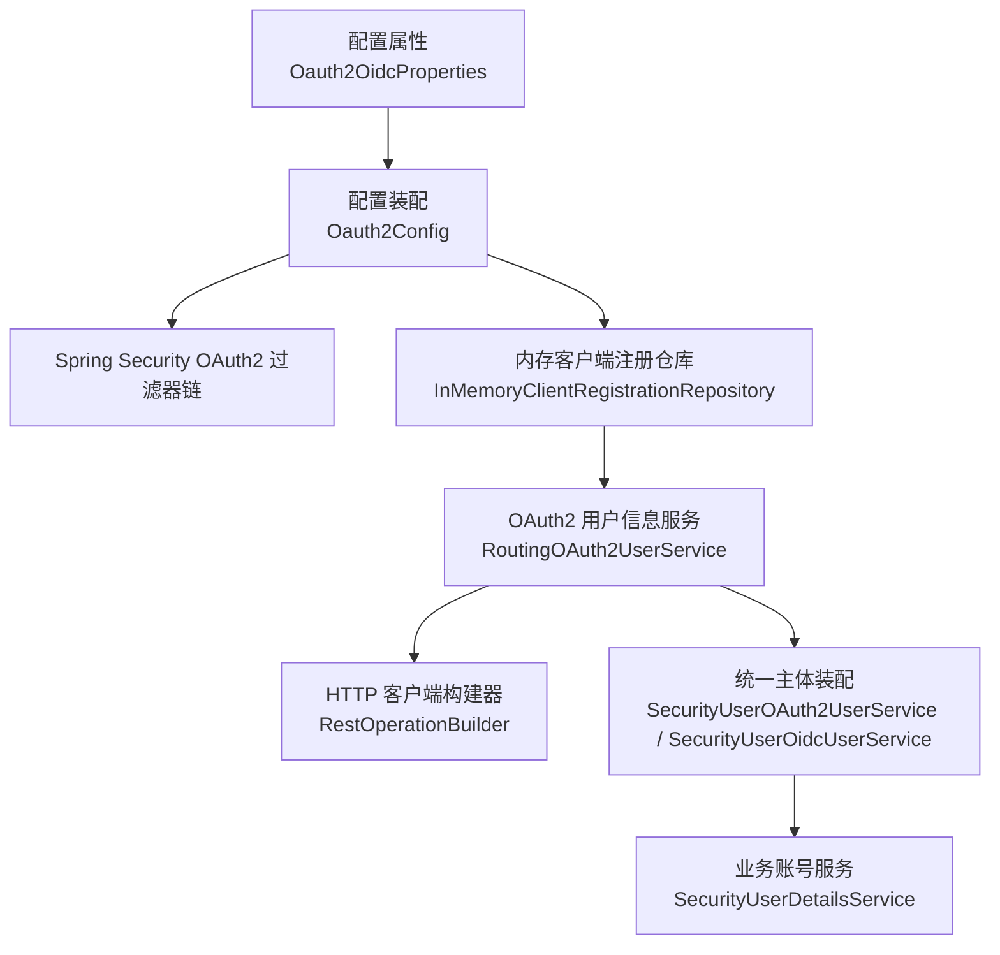
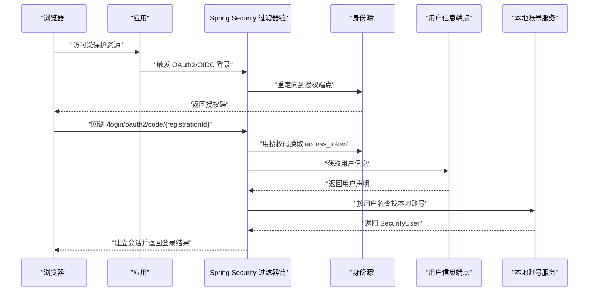
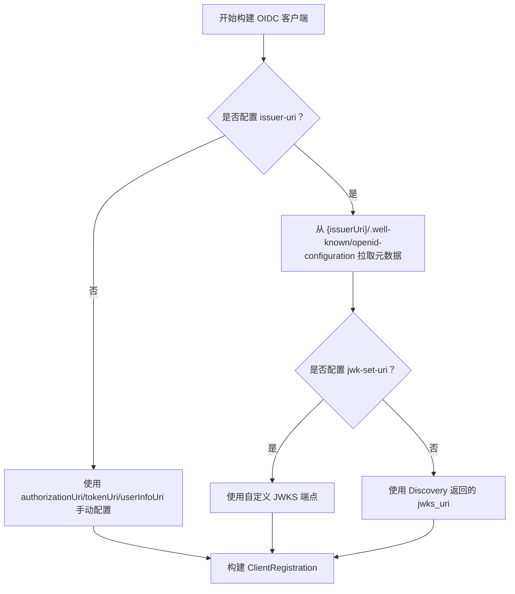
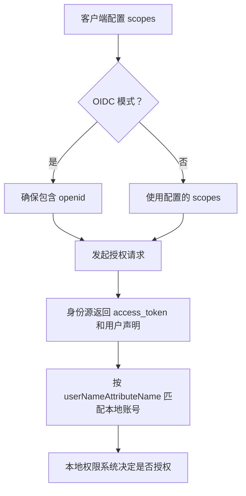
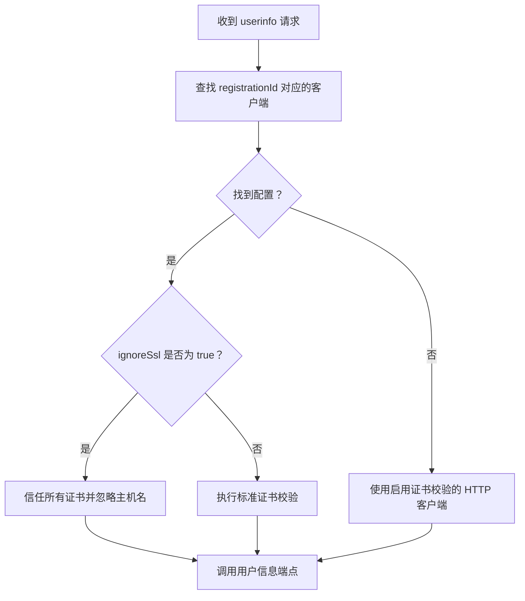
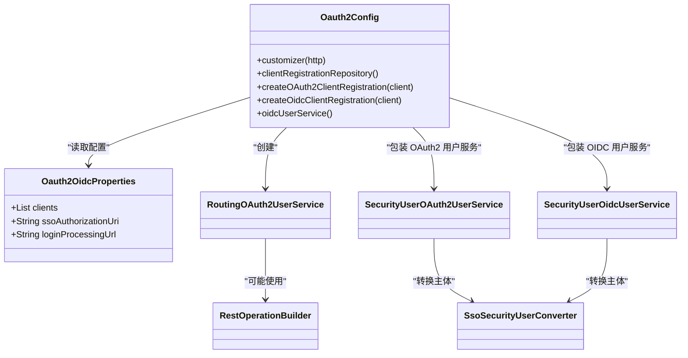

# OAuth2/OIDC 安全配置

<cite>
**本文引用的文件**   
- [Oauth2OidcProperties.java](file://login-spring-boot-starter/src/main/java/com/cu/framework/authentication/oauth2/Oauth2OidcProperties.java)
- [Oauth2Config.java](file://login-spring-boot-starter/src/main/java/com/cu/framework/authentication/oauth2/Oauth2Config.java)
- [RestOperationBuilder.java](file://login-spring-boot-starter/src/main/java/com/cu/framework/authentication/oauth2/RestOperationBuilder.java)
- [RoutingOAuth2UserService.java](file://login-spring-boot-starter/src/main/java/com/cu/framework/authentication/oauth2/RoutingOAuth2UserService.java)
- [SecurityUserOAuth2UserService.java](file://login-spring-boot-starter/src/main/java/com/cu/framework/authentication/oauth2/SecurityUserOAuth2UserService.java)
- [SecurityUserOidcUserService.java](file://login-spring-boot-starter/src/main/java/com/cu/framework/authentication/oauth2/SecurityUserOidcUserService.java)
- [SsoSecurityUserConverter.java](file://login-spring-boot-starter/src/main/java/com/cu/framework/authentication/oauth2/SsoSecurityUserConverter.java)
- [application.yml](file://sample/login-boot-sample/src/main/resources/application.yml)
- [oidc接入踩坑记录.md](file://docs/说明文档/oidc接入踩坑记录.md)
- [oauth2-login/spec.md](file://openspec/specs/identity/oauth2-login/spec.md)
- [OidcClientRegistrationTest.java](file://login-spring-boot-starter/src/test/java/com/cu/framework/authentication/oauth2/OidcClientRegistrationTest.java)
</cite>

## 目录
1. [引言](#引言)
2. [项目结构](#项目结构)
3. [核心组件](#核心组件)
4. [架构总览](#架构总览)
5. [详细组件分析](#详细组件分析)
6. [依赖关系分析](#依赖关系分析)
7. [性能与可用性考虑](#性能与可用性考虑)
8. [故障排查指南](#故障排查指南)
9. [结论](#结论)

## 引言
本指南面向需要在本框架中集成 OAuth2/OIDC 身份源的开发者，聚焦“安全配置”这一主题。仓库中的 `login-spring-boot-starter` 模块基于 Spring Security 的 `oauth2Login()` 能力，提供统一的多身份源登录装配，支持：
- OAuth2 授权码模式；
- OIDC 自动发现（从 `{issuerUri}/.well-known/openid-configuration` 拉取端点、JWKS 等元数据）；
- 用户信息端点的 TLS 证书校验开关；
- 将协议主体转换为框架统一的 `SecurityUser`。

本文围绕以下安全目标展开：访问令牌与刷新令牌的配置边界、OIDC 连接发现与 JWKS 签名验证、PKCE 流程现状、Scope 权限控制、重定向 URI 白名单要求，以及常见 OIDC 集成问题的定位方法。

## 项目结构
与 OAuth2/OIDC 安全配置直接相关的代码集中在 `login-spring-boot-starter` 模块：
- 配置属性类定义所有客户端参数；
- 配置装配类负责把属性转为 Spring Security 的 `ClientRegistrationRepository` 和过滤器链；
- REST 构建器为 userinfo 请求提供可切换 SSL 行为的 HTTP 客户端；
- 用户信息服务负责按注册 ID 路由到不同身份源并转换为本系统主体；
- 示例应用 `sample/login-boot-sample` 提供完整 YAML 配置样例。

**图表来源**
- [Oauth2OidcProperties.java:1-239](file://login-spring-boot-starter/src/main/java/com/cu/framework/authentication/oauth2/Oauth2OidcProperties.java#L1-L239)
- [Oauth2Config.java:1-271](file://login-spring-boot-starter/src/main/java/com/cu/framework/authentication/oauth2/Oauth2Config.java#L1-L271)
- [RestOperationBuilder.java:1-107](file://login-spring-boot-starter/src/main/java/com/cu/framework/authentication/oauth2/RestOperationBuilder.java#L1-L107)

**章节来源**
- [Oauth2OidcProperties.java:1-239](file://login-spring-boot-starter/src/main/java/com/cu/framework/authentication/oauth2/Oauth2OidcProperties.java#L1-L239)
- [Oauth2Config.java:1-271](file://login-spring-boot-starter/src/main/java/com/cu/framework/authentication/oauth2/Oauth2Config.java#L1-L271)
- [application.yml:1-207](file://sample/login-boot-sample/src/main/resources/application.yml#L1-L207)

## 核心组件
| 组件 | 职责 | 与安全配置相关的关键点 |
|---|---|---|
| `Oauth2OidcProperties` | 定义 `cu.security.login.oauth2` 下的全局配置与多客户端配置 | 支持手动端点和 OIDC 自动发现；包含 scope、redirectUriTemplate、issuerUri、jwkSetUri、ignoreSsl、userNameAttributeName 等字段 |
| `Oauth2Config` | 实现 `HttpSecurityCustomizer`，装配 OAuth2/OIDC 登录链路 | 创建 `ClientRegistrationRepository`；区分 OAuth2 手动模式和 OIDC 自动发现；注入成功/失败处理器；创建 OIDC UserService |
| `RestOperationBuilder` | 构建带可选 SSL 豁免的 `RestOperations` | 默认启用证书校验；`enableSsl(false)` 时信任所有证书并忽略主机名校验，仅用于开发调试 |
| `RoutingOAuth2UserService` | 根据 registrationId 选择对应身份源的用户信息服务 | 按客户端 `ignoreSsl` 决定 userinfo 是否跳过证书校验 |
| `SecurityUserOAuth2UserService` / `SecurityUserOidcUserService` | 在协议主体基础上装配框架统一的 `SecurityUser` | 通过 `SsoSecurityUserConverter` 调用业务 `SecurityUserDetailsService` 完成本地账号映射 |
| 示例配置 `application.yml` | 演示 OAuth2 手动端点和 OIDC 自动发现两种客户端 | 展示 scopes、issuer-uri、user-name-attribute-name 等字段的实际用法 |

**章节来源**
- [Oauth2OidcProperties.java:1-239](file://login-spring-boot-starter/src/main/java/com/cu/framework/authentication/oauth2/Oauth2OidcProperties.java#L1-L239)
- [Oauth2Config.java:1-271](file://login-spring-boot-starter/src/main/java/com/cu/framework/authentication/oauth2/Oauth2Config.java#L1-L271)
- [RestOperationBuilder.java:1-107](file://login-spring-boot-starter/src/main/java/com/cu/framework/authentication/oauth2/RestOperationBuilder.java#L1-L107)
- [application.yml:1-207](file://sample/login-boot-sample/src/main/resources/application.yml#L1-L207)

## 架构总览
下图展示一次 OIDC 登录的核心交互，包括认证请求、回调、令牌交换、用户信息获取和本地账号装配：

**图表来源**
- [Oauth2Config.java:1-271](file://login-spring-boot-starter/src/main/java/com/cu/framework/authentication/oauth2/Oauth2Config.java#L1-L271)
- [OidcClientRegistrationTest.java:1-95](file://login-spring-boot-starter/src/test/java/com/cu/framework/authentication/oauth2/OidcClientRegistrationTest.java#L1-L95)

## 详细组件分析

### 访问令牌与刷新令牌的配置管理
当前实现以 Spring Security 的授权码流程为核心：
- 授权类型固定为 `authorization_code`；
- 令牌交换由默认的 `DefaultAuthorizationCodeTokenResponseClient` 处理；
- 用户信息通过 `userInfoEndpoint` 拉取；
- 配置属性中虽然存在 `authorizationGrantType` 字段，但注释明确说明当前不会改变授权类型；
- 配置属性中没有显式的“访问令牌有效期”“刷新令牌有效期”“自动刷新机制”“令牌存储策略”等字段。

这意味着：
- **令牌有效期**：由身份源决定，本框架未提供覆盖或缩短令牌的配置项；
- **刷新令牌**：如果身份源返回 refresh_token，则由底层 OAuth2 客户端管理，但框架未暴露刷新策略配置；
- **自动刷新**：框架没有内置刷新令牌自动续期逻辑；
- **令牌存储策略**：框架不直接持久化 access_token/refresh_token；示例应用使用 `spring-session-jdbc`，会话表中会序列化保存原始声明和 ID Token，因此敏感令牌不应被导出或进入日志。

建议的安全实践：
- 在身份源侧设置合理的 token 过期时间；
- 如果需要长期访问，优先让身份源支持 refresh_token，并在应用层自行实现刷新逻辑；
- 不要把会话表或日志作为令牌存储方案；生产环境应限制数据库访问权限和备份范围；
- 如需自定义令牌交换行为，应扩展 `OAuth2AccessTokenResponseClient`，而不是修改示例应用的配置文件。

**章节来源**
- [Oauth2Config.java:100-160](file://login-spring-boot-starter/src/main/java/com/cu/framework/authentication/oauth2/Oauth2Config.java#L100-L160)
- [Oauth2OidcProperties.java:1-239](file://login-spring-boot-starter/src/main/java/com/cu/framework/authentication/oauth2/Oauth2OidcProperties.java#L1-L239)
- [application.yml:1-207](file://sample/login-boot-sample/src/main/resources/application.yml#L1-L207)

### OIDC 连接发现与 JWKS 密钥获取
#### 连接发现
当客户端配置 `protocol-type: oidc` 且提供 `issuer-uri` 时，框架通过 Spring Security 的 `ClientRegistrations.fromIssuerLocation(issuerUri)` 自动发现：
- 授权端点；
- 令牌端点；
- 用户信息端点；
- JWKS 端点；
- 支持的响应类型、主体类型、签名算法等元数据。

注意事项：
- `issuer-uri` 应为身份源基础地址，例如 `http://localhost:9010`，而不是完整 `.well-known/openid-configuration` URL；
- 若配置错误导致 Discovery 返回 HTML 而非 JSON，会抛出解析异常；
- 启动阶段若 IDP 不可用，OIDC 客户端注册可能失败，影响应用启动。

#### JWKS 与签名算法
- 默认情况下，ID Token 签名验证使用 Discovery 返回的 `jwks_uri`；
- 某些非标准 IDP 的 JWKS 端点需要携带 `client_id` 参数才能返回正确公钥集合；
- 框架允许在客户端配置中显式覆盖 `jwk-set-uri`，从而绕过自动发现值；
- `createOidcClientRegistration` 会把配置的 `jwkSetUri` 传入 `ClientRegistration.Builder`；
- 签名算法通常由 IDP 在 Discovery 文档中声明，框架本身不提供“禁用某算法”的配置项，应通过调整身份源配置或使用正确的 JWKS 端点解决。

**图表来源**
- [Oauth2Config.java:200-271](file://login-spring-boot-starter/src/main/java/com/cu/framework/authentication/oauth2/Oauth2Config.java#L200-L271)
- [oidc接入踩坑记录.md:1-456](file://docs/说明文档/oidc接入踩坑记录.md#L1-L456)

**章节来源**
- [Oauth2Config.java:200-271](file://login-spring-boot-starter/src/main/java/com/cu/framework/authentication/oauth2/Oauth2Config.java#L200-L271)
- [oidc接入踩坑记录.md:1-456](file://docs/说明文档/oidc接入踩坑记录.md#L1-L456)
- [OidcClientRegistrationTest.java:1-95](file://login-spring-boot-starter/src/test/java/com/cu/framework/authentication/oauth2/OidcClientRegistrationTest.java#L1-L95)

### PKCE（Code Challenge and Code Verifier）流程
在当前仓库中，未发现以下关键实现：
- 显式生成 `code_challenge` 和 `code_verifier` 的代码；
- 选择 challenge 方法（如 `S256`）的配置或逻辑；
- 对回调中 `code_verifier` 的校验逻辑；
- 专门针对 PKCE 的 CSRF 防护说明。

现有实现更偏向于标准授权码流程：
- 使用 `HttpSessionOAuth2AuthorizationRequestRepository` 保存授权请求；
- 通过 `state` 和 `nonce` 等参数由 Spring Security 内部处理；
- 配置注释强调回调时的关联校验，但未体现 PKCE 特有流程。

因此，不能断言该仓库已完整实现 PKCE。若业务要求强制 PKCE，应在身份源侧开启 PKCE 校验，并评估是否需要扩展授权请求构建逻辑来生成 `code_challenge` 和 `code_verifier`。

**章节来源**
- [Oauth2Config.java:1-271](file://login-spring-boot-starter/src/main/java/com/cu/framework/authentication/oauth2/Oauth2Config.java#L1-L271)
- [Oauth2OidcProperties.java:1-239](file://login-spring-boot-starter/src/main/java/com/cu/framework/authentication/oauth2/Oauth2OidcProperties.java#L1-L239)

### Scope 权限控制配置
#### 作用域定义
- OAuth2 场景中，`scopes` 表示向身份源申请的权限范围，例如 `read`、`profile`、`email`；
- OIDC 场景中，必须包含 `openid`；若未配置或为空，框架会自动添加 `openid`；
- 示例应用中同时展示了 `openid`、`profile`、`email` 的组合。

#### 权限映射与最小权限原则
- 本框架的权限判定来自本地 `SecurityUserDetailsService`，而不是身份源返回的 scope；
- 身份源只负责证明“这个人是谁”，登录后由 `userNameAttributeName` 指定的字段匹配本地账号；
- 因此，即使身份源返回额外权限声明，也不应将其视为最终授权依据；
- 安全最佳实践：
  - 只申请业务所需的最小 scope；
  - 在本地 RBAC 或数据范围控制中做二次校验；
  - 不要假设 `sub` 就是本地用户名，除非确认身份源与该字段一致。

**图表来源**
- [Oauth2Config.java:200-271](file://login-spring-boot-starter/src/main/java/com/cu/framework/authentication/oauth2/Oauth2Config.java#L200-L271)
- [application.yml:1-207](file://sample/login-boot-sample/src/main/resources/application.yml#L1-L207)

**章节来源**
- [Oauth2Config.java:200-271](file://login-spring-boot-starter/src/main/java/com/cu/framework/authentication/oauth2/Oauth2Config.java#L200-L271)
- [application.yml:1-207](file://sample/login-boot-sample/src/main/resources/application.yml#L1-L207)

### 重定向 URI 白名单配置
#### 当前实现
- 客户端配置中有 `redirectUriTemplate`，默认值为 `{baseUrl}/login/oauth2/code/{registrationId}`；
- 模板变量由 Spring Security 在处理授权请求时解析；
- 示例应用中，多个客户端共用同一模板，只是 `registrationId` 不同；
- 仓库中没有看到专门的“重定向 URI 白名单列表”“精确匹配规则”“通配符规则”“HTTPS 强制检查”等独立配置项。

#### 安全建议
- 在身份源后台登记准确的回调地址，避免过于宽泛的通配符；
- 生产环境应强制 HTTPS，并确保前端入口 `/oauth2/authorization/{registrationId}` 也走 HTTPS；
- 若需要更严格的白名单校验，应自定义 `AuthorizationRequestResolver`，在构造授权请求前校验最终 redirectUri；
- 不要把 `{baseUrl}` 设置为可被用户控制的值；应由应用服务器和反向代理统一输出。

**章节来源**
- [Oauth2OidcProperties.java:1-239](file://login-spring-boot-starter/src/main/java/com/cu/framework/authentication/oauth2/Oauth2OidcProperties.java#L1-L239)
- [application.yml:1-207](file://sample/login-boot-sample/src/main/resources/application.yml#L1-L207)

### TLS 证书校验与 userinfo 安全
仓库中对 userinfo 端点的传输层安全有明确约束：
- 默认必须校验服务端证书和主机名；
- `ignore-ssl: true` 仅影响 userinfo 端点，不影响 OIDC Discovery 和 JWK Set 拉取；
- 豁免行为按客户端粒度生效，一个客户端跳过校验不能影响其他客户端；
- 未匹配的 registrationId 应回落到启用证书校验的实例，不能因找不到配置就放宽安全策略；
- `RestOperationBuilder` 在 `enableSsl(false)` 时使用信任所有证书的策略和空主机名校验器，仅用于开发调试。

**图表来源**
- [RestOperationBuilder.java:1-107](file://login-spring-boot-starter/src/main/java/com/cu/framework/authentication/oauth2/RestOperationBuilder.java#L1-L107)
- [oauth2-login/spec.md:1-58](file://openspec/specs/identity/oauth2-login/spec.md#L1-L58)

**章节来源**
- [RestOperationBuilder.java:1-107](file://login-spring-boot-starter/src/main/java/com/cu/framework/authentication/oauth2/RestOperationBuilder.java#L1-L107)
- [oauth2-login/spec.md:1-58](file://openspec/specs/identity/oauth2-login/spec.md#L1-L58)

## 依赖关系分析
OAuth2/OIDC 配置装配的关键依赖如下：

**图表来源**
- [Oauth2OidcProperties.java:1-239](file://login-spring-boot-starter/src/main/java/com/cu/framework/authentication/oauth2/Oauth2OidcProperties.java#L1-L239)
- [Oauth2Config.java:1-271](file://login-spring-boot-starter/src/main/java/com/cu/framework/authentication/oauth2/Oauth2Config.java#L1-L271)
- [RestOperationBuilder.java:1-107](file://login-spring-boot-starter/src/main/java/com/cu/framework/authentication/oauth2/RestOperationBuilder.java#L1-L107)

**章节来源**
- [Oauth2OidcProperties.java:1-239](file://login-spring-boot-starter/src/main/java/com/cu/framework/authentication/oauth2/Oauth2OidcProperties.java#L1-L239)
- [Oauth2Config.java:1-271](file://login-spring-boot-starter/src/main/java/com/cu/framework/authentication/oauth2/Oauth2Config.java#L1-L271)

## 性能与可用性考虑
- **启动阶段网络依赖**：OIDC 模式下，应用启动时会访问 `{issuerUri}/.well-known/openid-configuration`。如果身份源不可用，可能导致启动失败；建议在生产环境使用健康检查或渐进式启动策略。
- **HTTP 客户端行为**：`RestOperationBuilder` 显式配置了消息转换器和重定向策略，并支持宽松的重定向行为；这有助于兼容部分非标准 IDP，但也应谨慎评估安全风险。
- **会话大小**：示例应用使用 JDBC Session，会话中会保存原始声明和 ID Token，应避免过大用户声明造成会话膨胀。
- **证书缓存**：JWKS 和 Discovery 的缓存行为由底层 Spring Security 和 Nimbus 实现决定；生产环境应保证网络稳定并监控证书过期。

[本节为通用指导，不直接分析具体代码文件]

## 故障排查指南

### 问题一：Discovery 返回 HTML 而非 JSON
**现象**：启动时报错，提示无法解析 Discovery 响应内容。  
**原因**：`issuer-uri` 配置成了完整 `.well-known/openid-configuration` URL，而 `fromIssuerLocation` 内部还会拼接该路径，导致重复路径。  
**解决**：
- 将 `issuer-uri` 改为身份源基础地址；
- 让框架自动拼接 `.well-known/openid-configuration`。

**章节来源**
- [oidc接入踩坑记录.md:1-456](file://docs/说明文档/oidc接入踩坑记录.md#L1-L456)

### 问题二：JWT 签名验证失败，提示找不到匹配密钥
**现象**：出现类似“期望算法不匹配或未找到匹配密钥”的错误。  
**原因**：非标准 IDP 的 JWKS 端点需要携带 `client_id` 参数；默认直接访问 `jwks_uri` 会返回空密钥集合。  
**解决**：
- 在客户端配置中显式设置 `jwk-set-uri`，带上身份源要求的参数；
- 不要为了适配某个 IDP 而关闭全局证书校验。

**章节来源**
- [oidc接入踩坑记录.md:1-456](file://docs/说明文档/oidc接入踩坑记录.md#L1-L456)
- [Oauth2Config.java:200-271](file://login-spring-boot-starter/src/main/java/com/cu/framework/authentication/oauth2/Oauth2Config.java#L200-L271)

### 问题三：userinfo 证书校验失败
**现象**：访问用户信息端点时发生 SSL 或主机名校验失败。  
**排查步骤**：
1. 检查身份源证书链是否可信；
2. 检查反向代理是否正确终止 TLS；
3. 仅在测试环境临时设置 `ignore-ssl: true`；
4. 确认该豁免只对 userinfo 有效，不会影响 Discovery 和 JWK 拉取；
5. 如果多个客户端共存，确认只有目标客户端启用了豁免。

**章节来源**
- [RestOperationBuilder.java:1-107](file://login-spring-boot-starter/src/main/java/com/cu/framework/authentication/oauth2/RestOperationBuilder.java#L1-L107)
- [oauth2-login/spec.md:1-58](file://openspec/specs/identity/oauth2-login/spec.md#L1-L58)

### 问题四：用户名对不上本地账号
**现象**：认证成功后登录失败，错误码指向本地用户不存在。  
**原因**：`userNameAttributeName` 指定的字段值与本地系统用户名不一致；OIDC 默认主体标识 `sub` 通常是身份源内部数字 ID。  
**解决**：
- 将 `user-name-attribute-name` 配置为身份源中与本地用户名一致的字段，例如 `preferred_username`；
- 如需按邮箱或其他字段匹配，应在业务实现的 `SecurityUserDetailsService` 中处理，而不是改 `userNameAttributeName`。

**章节来源**
- [Oauth2OidcProperties.java:190-239](file://login-spring-boot-starter/src/main/java/com/cu/framework/authentication/oauth2/Oauth2OidcProperties.java#L190-L239)
- [OidcClientRegistrationTest.java:1-95](file://login-spring-boot-starter/src/test/java/com/cu/framework/authentication/oauth2/OidcClientRegistrationTest.java#L1-L95)

### 问题五：时间同步与证书过期
虽然仓库中没有直接的时间同步配置项，但 OIDC 和 JWT 验证高度依赖系统时间：
- 如果服务器时间与身份源差异较大，可能出现 token 未生效或已过期；
- 证书过期会导致 Discovery、JWKS、userinfo 请求失败；
- 建议：
  - 使用 NTP 保持系统时钟同步；
  - 监控身份源证书有效期；
  - 在网络不稳定环境中增加超时和重试配置，并注意不要因此降低 TLS 校验强度。

[本节为通用指导，不直接分析具体代码文件]

## 结论
本仓库的 OAuth2/OIDC 安全配置以 Spring Security 为基础，重点提供了：
- 多身份源客户端配置；
- OIDC 连接发现和 JWKS 支持；
- userinfo 端点的 TLS 证书校验开关；
- 将协议主体转换为统一 `SecurityUser` 的能力。

但它不是完整的“令牌生命周期管理器”：
- 不直接管理 access_token 或 refresh_token 的有效期、自动刷新和存储策略；
- 没有显式的 PKCE 实现；
- 没有独立的重定向 URI 白名单配置。

因此，生产集成时应遵循：
- 在身份源侧控制令牌策略和重定向 URI 白名单；
- 在本系统本地 RBAC 和数据范围控制中实现最小权限原则；
- 严格启用 TLS 证书校验，仅将 `ignore-ssl` 用于测试；
- 通过 `jwk-set-uri` 适配非标准 JWKS 端点；
- 使用 `userNameAttributeName` 确保身份源能正确映射到本地账号。